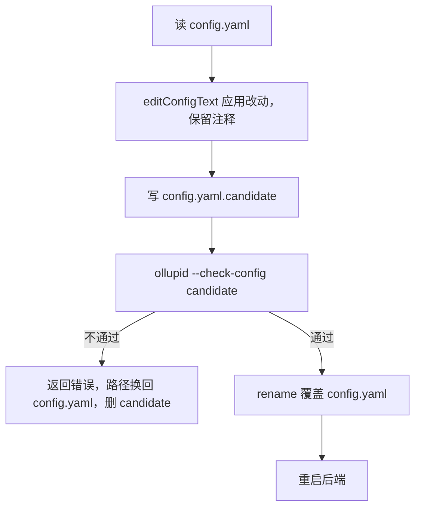

# 配置

桌面端的配置和数据都在 `~/.ollupi`，配置文件是 `config.yaml`。引擎只在启动时读配置，所以任何改动都要重启后端才生效。界面改配置时走一个固定流程：先让后端自己校验，通过后才写入并重启，这样后端不接受的改动到不了文件。

这个目录由环境变量 `OLLUPI_HOME` 覆盖，主进程和 sidecar 都认。

## 目录结构

```
~/.ollupi/
├── config.yaml        配置，权限 0600
├── data/
│   ├── ollupi.sqlite  引擎的数据库，旁边有 -shm 和 -wal
│   └── feishu.json    飞书话题和会话的对应
├── attachments/       随消息发送的图片和文件的副本
├── skills/            技能文件夹，skills_dir 指向这里
└── scratch/           不属于工作区的会话的命令在这里执行
```

沙箱对这个目录有专门的规则：`config.yaml` 和 `data/` 不可读，命令读不到 API 密钥和数据库；技能文件夹只读。

应用自己的数据在 macOS 的标准位置，不在这个目录：

| 位置 | 内容 |
|---|---|
| `~/Library/Logs/Ollupi/backend.log` | 后端日志，上一份是 `backend.log.old` |
| `~/Library/Application Support/Ollupi/bookmarks.json` | 浏览器收藏 |
| `~/Library/Application Support/Ollupi/history.json` | 浏览器历史 |
| `~/Library/Application Support/Ollupi/Partitions/browser` | 内置浏览器的 Cookie 和登录状态 |
| `~/Library/Application Support/Ollupi/update` | 下载的更新，启动时清空 |
| `<系统临时目录>/Ollupi/attachments` | 待发送的粘贴文件，启动时清空 |

配色、语言、通知开关和面板宽度在渲染进程的 `localStorage` 里，见 [渲染进程](/desktop/renderer)。

## 首次启动

`config.yaml` 不存在时，sidecar 先写入自带技能，再写入模板。模板是可运行的最小配置，带注释说明。

```yaml
name: ollupi
prompt: ""

models:
  - provider: openai
    type: openai
    base_url: https://api.openai.com/v1
    api_key: ""
    names:
      - name: gpt-5.2
        images: true
        limits: { context: 400000, output: 128000 }

permissions:
  approval: on-request # untrusted | on-request | never
  allow: []
  ask: []
  deny: []

workspace:
  enabled: true
  sandbox_mode: workspace-write # read-only | workspace-write | full-access
  command_timeout_sec: 60
  network: false

skills_dir: skills

memory:
  use: true
  generate: false
```

## 字段

表中"默认值"是不写这个字段时的行为，"模板"是首次生成的文件里的值。

### 顶层

| 字段 | 类型 | 默认值 | 模板 | 含义 |
|---|---|---|---|---|
| `name` | string | 必填 | `ollupi` | 代理的名字 |
| `prompt` | string | 空，用引擎默认的系统提示词 | `""` | 自定义提示词 |
| `models` | list | 必填，至少一个模型 | 见下 | 提供方和模型 |
| `tools` | string list | 不写时不限制 | 不写 | 引擎的工具白名单 |
| `permissions` | object | `approval` 必填 | 见下 | 代理默认的权限层 |
| `slots` | int | `0`，取引擎默认的 32 | 注释掉 | 同时运行的轮次数，不能为负 |
| `workspace` | object | `enabled` 为假 | 见下 | 命令和文件工具 |
| `mcp` | list | 空 | 注释掉 | MCP 服务器 |
| `memory` | object | 全部关闭 | 见下 | 记忆 |
| `skills_dir` | string | 空，关闭技能 | `skills` | 技能文件夹，相对路径基于 home |
| `feishu` | object | 不启用 | 注释掉 | 飞书机器人 |

未知字段一律报错，比如写错的键，或旧版本的 `settings`。

### models

每项是一个提供方，也就是一个 API。

| 字段 | 类型 | 默认值 | 含义 |
|---|---|---|---|
| `provider` | string | 必填 | 提供方名称，不能含 `/`，不能重复 |
| `type` | string | 必填 | `openai`（任何 OpenAI 兼容 API）、`anthropic`、`gemini` |
| `base_url` | string | 该 API 的默认地址 | `openai` 要包含版本，如 `…/v1` |
| `api_key` | string | 空 | 写在文件里；API 不需要密钥时留空 |
| `names` | list | 必填，至少一个 | 模型 |

`names` 的每项：

| 字段 | 类型 | 默认值 | 含义 |
|---|---|---|---|
| `name` | string | 必填 | API 识别的名称，同一提供方内不重复 |
| `calls` | int | `0`，取引擎默认的 4 | 对这个模型的最大并发请求数，不能为负 |
| `thinking` | bool | 不写时不发送，用 API 默认 | 思考开关 |
| `images` | bool | `false` | 模型接受图片。引擎拒绝给没有这个标记的模型发图片 |
| `limits.context` | int | 必填 | 上下文窗口，token |
| `limits.output` | int | 必填 | 一次回答的上限，token |
| `limits.input` | int | 不写时按窗口算 | 模型的输入比窗口剩余的小时填写 |

模型以 `provider/name` 选择，这也是引擎的连接 ID。两个提供方可以有同名模型。顺序有意义：第一个提供方的第一个模型是默认模型。

### permissions

代理默认的权限层，工作区和会话在上面叠加。详见 [权限](/engine/permissions)。

| 字段 | 类型 | 默认值 | 含义 |
|---|---|---|---|
| `approval` | string | 必填 | `untrusted`（严格）、`on-request`（适中）、`never`（宽松） |
| `allow` | string list | 空 | 不问直接做，如 `run_command(git:*)` |
| `ask` | string list | 空 | 总是先问 |
| `deny` | string list | 空 | 永远不做 |

`approval` 没有默认值。不写时 `Validate` 能过，引擎启动时报 `approval policy "" must be one of ...`。

### workspace

`enabled` 打开 `run_command`、`edit_file`、`write_file`，其余字段是引擎 `workspace.Config` 的 json 标签，直接平铺在这一层。沙箱行为见 [沙箱](/engine/sandbox)。

| 字段 | 类型 | 默认值 | 模板 | 含义 |
|---|---|---|---|---|
| `enabled` | bool | `false` | `true` | 开关 |
| `workspace_dirs` | string list | 空，用 `<home>/scratch` | 不写 | 命令目录，相对路径基于 home |
| `command_timeout_sec` | int | 30 | 60 | 命令默认超时，秒 |
| `max_command_timeout_sec` | int | `max(600, command_timeout_sec)` | 不写 | 单次命令超时上限，不能小于默认超时 |
| `command_blacklist` | string list | 空 | 不写 | 匹配到时拒绝执行 |
| `sandbox_mode` | string | `workspace-write` | `workspace-write` | `read-only`、`workspace-write`、`full-access` |
| `network` | bool | `false` | `false` | 沙箱内是否可联网 |
| `allowed_domains` | string list | 空 | 不写 | 网络走代理，只放行这些域名 |
| `denied_domains` | string list | 空 | 不写 | 必须和 `allowed_domains` 一起用 |
| `deny_read` | string list | 空 | 不写 | 额外的不可读路径 |
| `read_only` | string list | 空 | 不写 | 额外的只读路径 |
| `extra_writable` | string list | 空 | 不写 | 额外的可写路径 |
| `unix_sockets` | string list | 空 | 不写 | 允许访问的 Unix 套接字 |
| `env_passthrough` | string list | 空 | 不写 | 透传给命令的环境变量名 |
| `max_output_bytes` | int | 1 MiB | 不写 | 命令输出上限，不能为负 |

### mcp

每项是一个服务器：命令走 stdio，或 URL 走 Streamable HTTP。

| 字段 | 类型 | 含义 |
|---|---|---|
| `name` | string | 工具以 `<name>__<tool>` 提供。不能是 `browser`，这个名字归内置浏览器 |
| `command` | string | stdio 服务器的命令 |
| `args` | string list | 参数 |
| `env` | map | 环境变量，命令还会继承后端的环境 |
| `url` | string | HTTP 服务器的地址 |
| `headers` | map | 随每个请求发送 |

`env` 和 `headers` 的值里可以写 `${NAME}` 引用环境变量，密钥就不用写在文件里。引用的变量没设置时整份配置被拒绝。

连不上的服务器被跳过，不影响启动，原因显示在能力页。

界面里的校验比这张表更严：名称要匹配 `^[A-Za-z0-9][A-Za-z0-9_-]{0,31}$` 且不含 `__`。

### memory

| 字段 | 类型 | 默认值 | 模板 | 含义 |
|---|---|---|---|---|
| `use` | bool | `false` | `true` | 把记忆放进上下文 |
| `generate` | bool | `false` | `false` | 从结束的轮次提炼记忆 |
| `model` | string | 空 | 注释掉 | 提炼用的模型，`provider/name`。`generate` 为真时必填，它和这个模型共用 `calls` |

### feishu

存在这一节就启用机器人。行为见 [飞书机器人](/desktop/feishu-bot)，开放平台的步骤见 [飞书配置](/desktop/feishu)。

| 字段 | 类型 | 默认值 | 含义 |
|---|---|---|---|
| `app_id` | string | 必填 | 自建应用的 App ID |
| `app_secret` | string | 必填 | App Secret，写在文件里 |
| `domain` | string | `feishu` | `feishu`（open.feishu.cn）或 `lark`（open.larksuite.com） |
| `users` | string list | 空 | 机器人为谁操作，`open_id` 名单 |
| `workspace` | string | 空 | 飞书开始的会话所在工作区的文件夹 |

## 校验分三层

| 层 | 在哪 | 查什么 |
|---|---|---|
| 解析 | `config.Parse` | YAML 语法，未知字段，类型 |
| 文件形状 | `Config.Validate` | `name` 必填；提供方和模型名的规则；`calls`、`slots` 不为负；`limits` 不全为零；`memory.model` 指向存在的模型；`generate` 开启时有 `model`；MCP 不叫 `browser`；飞书的 ID、密钥和 `domain` |
| 能否启动 | `host.Check` | 引擎校验审批策略、权限规则、`limits` 的值、模型的上下文预算，以及 MCP 工具相关的规则 |

前两层只看文件，第三层真的装配一遍后端，用临时目录当数据库。全过才算通过。

## 界面怎么改配置

`config.yaml` 由主进程拥有。渲染进程只读取并提出改动，不碰文件。

改动是按键路径的操作：

```ts
export type ConfigChange =
  | { kind: 'set'; path: (string | number)[]; value: unknown }
  | { kind: 'delete'; path: (string | number)[] }
  | { kind: 'move'; path: (string | number)[]; to: number }
```

`BackendConfig.apply` 的流程：



候选文件放在真文件旁边，`rename` 才是原子的。校验用 30 秒超时和后端相同的环境变量，MCP 的 `${NAME}` 才解析得到。

**保留注释。** 用 `yaml` 库的 `Document` 编辑，不重新序列化成纯数据。这个库把顶层键上方的注释块存成上一节的结尾注释，写回时会缩进到上一节里。`attachSectionComments` 把最后一个空行之后的部分还给下一个键。

**重启前确认。** 有会话在运行时，渲染进程先问，因为重启会停止正在执行的命令。

**联动。** 改名提供方或模型时，`memory.model` 跟着改。删除被 `memory.model` 引用的模型时：学习关着就一起删除引用，学习开着就要求先换模型。不能删除最后一个模型。

**设默认模型** 是 `move` 操作，把模型和它的提供方移到各自列表的第一位。

**秘密值。** `--check-config` 的输出清空了 MCP 里写死的 `env` 和 `headers` 值。界面把它们当作"保持不变"，编辑时只写改过的键，不会把文件里的值改成空。

技能文件夹用同样的思路：改动先放到 `.staging-` 开头的临时文件夹，`--check-skills` 用代理的目录逻辑检查，通过后改名进去，再重启后端。代理跳过以点开头的文件夹，所以临时文件夹不会被加载。

## config:generate

渲染进程需要知道 `--check-config` 输出的类型，而这份类型由 Go 定义。`pnpm config:generate` 让 TypeScript 类型从 Go 生成，不手写第二份。

| 目标文件 | 类型名 | 来自 | 描述 |
|---|---|---|---|
| `src/shared/generated/backend-config.ts` | `ConfigCheck` | `ollupid --config-schema` | `--check-config` 的输出 |
| `src/shared/generated/backend-skills.ts` | `SkillsCheck` | `ollupid --skills-schema` | `--list-skills` 和 `--check-skills` 的输出 |

过程：

1. `apps/desktop/scripts/generate-config.mjs` 在 `sidecar/` 里执行 `go run ./cmd/ollupid <flag>`。
2. sidecar 用 `jsonschema.For[T]` 从 Go 类型得到 JSON Schema，字段名来自 json 标签。
3. `json-schema-to-typescript` 编译成 TypeScript，写上 `DO NOT EDIT` 的头。

`pnpm config:check` 比较现有文件和生成结果，过期时失败。

`src/shared/ipc.ts` 从这份类型派生出 `BackendConfig`、`ConfigModel`、`Skill`，界面都用这些名字。给 `Config` 加字段后，重新生成，界面就能在类型里看到它。

## 不一致检测

用户可以手改 `config.yaml`，或直接改技能文件夹，这时文件和正在运行的后端不一样。界面在四处比较，发现不一致时显示警告和"重启后端"按钮。

| 位置 | 比较 | 说明 |
|---|---|---|
| 设置 → 模型 | `model/list` 的连接 ID 和文件里的模型 ID | 顺序也比较，第一个是默认模型 |
| 能力 → MCP | `mcpServer/list` 的名称和文件里的名称 | |
| 能力 → 技能 | 代理加载的技能和文件夹里的技能 | 排序后比较 |
| 记忆设置 | `memory/status` 的两个开关和文件里的 `use`、`generate` | |

只有连接着后端时才比较。

## 代码位置

| 位置 | 职责 |
|---|---|
| ollupi-desktop `sidecar/internal/config/config.go` | 类型、解析、`Validate`、首次写入 |
| ollupi-desktop `sidecar/internal/config/template.go` | 模板 |
| ollupi-desktop `sidecar/cmd/ollupid/main.go` | `--check-config`、`--config-schema` 等模式 |
| ollupi-desktop `sidecar/internal/host/host.go` | `Check` |
| ollupi-desktop `apps/desktop/src/main/backend/config.ts` | `BackendConfig`、`editConfigText` |
| ollupi-desktop `apps/desktop/src/main/backend/skills.ts` | 技能文件夹的暂存和校验 |
| ollupi-desktop `apps/desktop/scripts/generate-config.mjs` | 类型生成 |
| ollupi-desktop `apps/desktop/src/shared/generated/` | 生成的类型 |
| ollupi-desktop `apps/desktop/src/renderer/src/domains/backendConfig.ts` | 渲染进程的应用和确认 |
| ollupi-desktop `apps/desktop/src/renderer/src/domains/modelConfig.ts` | 模型改动的规则 |
| ollupi-desktop `apps/desktop/src/renderer/src/domains/mcpConfig.ts` | MCP 改动的规则 |
| ollupi `tools/workspace/config.go` | 工作区字段和默认值 |
