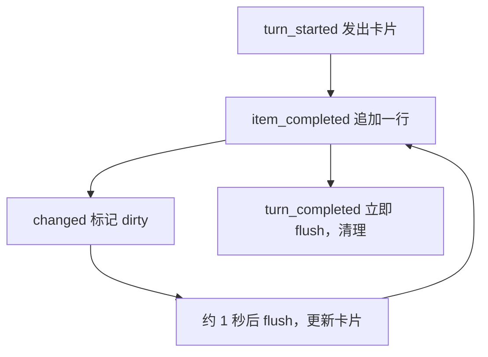

# 飞书机器人

飞书机器人让用户离开电脑时也能操作会话：在手机上发消息、看进度、处理审批和提问。它跑在 sidecar 里，是网关之外引擎的另一个客户端：直接调用引擎，收到网关收到的每个事件。

这页讲实现。开放平台的配置步骤见 [飞书配置](/desktop/feishu)。

## 长连接

机器人用飞书 SDK 的长连接主动连到飞书，接收消息和卡片回调，所以 Mac 不需要公网地址，但要开着、不能睡眠。

`Bridge.Run` 启动 `larkws` 客户端，注册两个处理函数：

| 事件 | 处理 |
|---|---|
| `im.message.receive_v1` | `incomingOf` 取出字段，发送者类型不是 `user` 时丢弃，推进队列 |
| `card.action.trigger` | 在飞书的 goroutine 上调用 `press`，返回一个 toast |

`domain` 决定连 `open.feishu.cn` 还是 `open.larksuite.com`。SDK 的日志转进后端日志。

连不上时记一条错误，后端继续运行，只是没有机器人。配置在启动时读取，改配置要重启后端。

## 并发模型

`Deliver` 不能阻塞：引擎在自己的循环里发事件，而机器人调用引擎时要等这个循环，阻塞就会死锁。所以事件和消息都推进一个无界队列，由 `Run` 的一个 goroutine 串行处理。

```go
func (b *Bridge) Deliver(e agent.Event) {
	b.queue.push(func() { b.event(e) })
}
```

`turns`、`requests`、`ours`、`seen` 这些字段只由这个 goroutine 读写，不需要锁。

这也解决了一个顺序问题。`send` 调 `StartTurn` 之后才把轮次 ID 记进 `ours`，而这一轮的 `turn_started` 事件排在队列里，一定在 `send` 返回之后处理，所以卡片能知道这一轮来自飞书。

## 名单校验

`users` 是 `open_id` 的集合。消息和卡片按钮都校验。

| 情况 | 动作 |
|---|---|
| 同一条消息第二次到达 | 忽略。飞书在没及时确认时会重发，`seen` 记最近 512 条消息 ID |
| 不是单聊（`chat_type` 不是 `p2p`） | 忽略 |
| 发送者不在名单，名单为空 | 回复对方的 `open_id` 和下一步。这是设置的最后一步 |
| 发送者不在名单，名单非空 | 回复对方的 `open_id`，说明要请设置者添加 |
| 按钮的操作者不在名单 | toast `你还不能用这个机器人`，不做任何事 |

## 消息

| 消息 | 动作 |
|---|---|
| 不在话题里 | 开始新会话 |
| 在话题里 | 作为这个会话的下一轮 |
| 话题里发 `/stop` | `InterruptTurn`，`expectedTurnID` 为空，即当前轮 |
| 话题不对应任何会话 | 回复说明，请直接发新消息 |
| 既不是文字也不是富文本，或没有文字 | 回复 `目前只能发文字。` |

文字取自 `text` 消息，或 `post` 消息里 `text`、`a`、`code_block` 这几种片段，标题放在第一行。图片和文件不处理。

下一轮用 `StartTurn` 发送。这一轮排队时回复 `已排队，当前这轮结束后开始。`。

## 话题和会话的映射

话题是飞书里挂在一条消息下的回复串，用根消息的 ID 标识。每个会话对应一个话题，存在 `<home>/data/feishu.json`：

```json
{
  "topics": {
    "<会话 ID>": "<话题根消息 ID>"
  }
}
```

文件和数据库放在一起，重启后保留。每次改动整个重写，先写 `.tmp` 再改名，崩溃后要么是旧文件要么是新文件。权限 `0600`。

内存里有两个方向的索引，`byThread` 和 `byRoot`。会话被删除时（`EventThreadDeleted`）映射一起删掉。

**从飞书开始的会话**：`startSession` 先建会话，标题用第一条消息的开头（规则和桌面端的 `titleFromMessage` 相同，最多 60 字符），再把这条消息记成话题根，最后发第一轮。先记映射，这一轮的事件才找得到话题。

新会话的工作区由 `feishu.workspace` 决定：按 `RootPath` 精确匹配未归档的工作区。配了但找不到时回复错误，不开始会话。不配时不属于任何工作区。

**从别处开始的会话**：桌面端或定时任务开始的会话，有内容要显示时才开话题。`shows` 决定什么算内容：

| 事件 | 根会话 | 子代理会话 |
|---|---|---|
| 审批、提问 | 是 | 是 |
| 一轮开始、错误 | 是 | 否 |
| 其他 | 否 | 否 |

`openTopic` 给名单里第一个人发一条消息，内容是 `工作区 · 标题`，没有标题时写 `新会话`，这条消息就是话题根。名单为空时不开话题。

子代理不单独开话题。`rootOf` 沿 `ParentThreadID` 找到根会话，审批和提问发到根会话的话题里。

## 每轮一张卡片

一轮对应一张卡片，由 `turn` 结构描述。



卡片是飞书卡片 JSON 2.0，设置 `update_multi` 以便发出后更新。

**内容**：

- 开头一行灰字标来源。定时任务写 `定时任务发来：`，桌面端写 `桌面端发来：`，飞书发的不写。输入截到 200 字符。
- 然后按顺序是代理的消息和工具调用。工具调用结束后才加一行：工具名加摘要，失败时加 `（失败）`，被拒绝时加 `（被拒绝）`。错误条目写成 `**出错了**`。
- 还没有内容时写 `思考中…`。
- 运行中有红色的"停止"按钮。

摘要优先用冻结的命令或文件列表，否则按顺序取参数里的 `description`、`command`、`path`、`pattern`、`url`、`query`、`name`，最长 120 字符。

卡片只显示已完成的条目，不显示流式文字。

**标题和颜色**：

| 状态 | 标签 | 颜色 |
|---|---|---|
| 运行中，包括排队和等待 | 进行中 | 蓝 |
| 完成 | 完成 | 绿 |
| 已中断 | 已停止 | 灰 |
| 失败 | 失败 | 红，正文加错误 |

**节流**：`flushEvery` 是 1 秒，飞书允许一条消息每秒更新几次，手机上不需要那么频繁。`changed` 只开一个计时器，期间的改动合并。结束时不等计时器，直接更新。

**长度**：飞书每张卡片上限 30 KB。`bodyLimit` 是 20 KiB，留出其余部分的空间。超过时 `tail` 保留末尾，前面加 `…前面的内容在桌面端查看`，并按 UTF-8 字符边界切。手机上最新的内容最重要。

**子代理**的轮次不出卡片，只有它的审批和提问会发到话题。

## 审批和提问卡片

`ask` 发送单独的卡片，每个条目只发一次，`requests` 记着已发的。引擎恢复请求时会再报一次。

**审批卡片**标题 `需要审批`，橙色，内容是 `callDetails`：

- 工具名，MCP 工具写成 `服务器__工具`。
- 冻结的内容：命令（最长 2000 字符）和工作目录，或文件列表和增删行数，否则是原始参数。
- 在沙箱外运行时加粗说明，带上代理给的理由。
- 工具的审批内容和原因。

按钮来自 `AvailableDecisions`，去掉"总是允许"，因为它要写规则，这件事留在桌面端选。

**提问卡片**标题 `需要回答`，用一个表单放所有问题。每个问题一个下拉框（有选项时）和一个输入框，一次提交。输入框的内容优先于下拉框。有问题没回答时 toast `还有问题没回答`，不提交。

**按钮不依赖内存。** 每个按钮的 value 带着需要的全部信息：动作、会话 ID、审批或条目 ID。后端重启后旧卡片仍然能用。

```go
button(label, kind, map[string]any{
	"action": actionApprove, "thread": threadID,
	"approval": it.Approval.ID, "decision": string(d),
})
```

`press` 调用引擎后只返回 toast，卡片的变化等引擎报告结果。

## 与桌面端同步

机器人和网关调用同一个引擎，都以 `repo.DefaultUser` 运行，所以桌面端和飞书操作的是同一批会话，不需要额外的同步。一边发的消息是另一边的一轮，引擎的事件同时到两边。

**处理结果互通。** 审批或提问在任一端处理后，条目发生变化，`settle` 把飞书卡片改成结果：

| 情况 | 卡片标题 | 颜色 |
|---|---|---|
| 审批已决定 | 决定的文字，如 `允许一次` | 绿，拒绝时灰 |
| 审批未决定就结束了 | `审批已取消` | 灰 |
| 提问已回答 | `已回答` | 绿 |
| 提问没回答就结束了 | `提问已取消` | 灰 |

审批卡片用标签标出处理的地方：`在飞书` 或 `在桌面`。依据是 `DecidedBy`，飞书做的决定记成常量 `Decider`，值是 `feishu`。

桌面端的审批卡片在 `item/completed` 时移除。

**错误文案。** `errorText` 把常见错误译成中文：`ErrNoActiveTurn` 是 `现在没有在跑的一轮`，`ErrThreadArchived` 是 `会话已归档，先在桌面端恢复`。

## 隐私

代码和对话内容会经过飞书的服务器。这和直接在桌面端用不同，选用前要知道。

## 代码位置

| 位置 | 职责 |
|---|---|
| ollupi-desktop `sidecar/internal/feishu/feishu.go` | 桥：消息、事件、话题、队列 |
| ollupi-desktop `sidecar/internal/feishu/cards.go` | 卡片内容 |
| ollupi-desktop `sidecar/internal/feishu/lark.go` | 长连接和开放接口 |
| ollupi-desktop `sidecar/internal/feishu/store.go` | 话题映射文件 |
| ollupi-desktop `sidecar/internal/config/config.go` | `Feishu` 配置和校验 |
| ollupi-desktop `apps/desktop/src/renderer/src/views/settings/FeishuSection.tsx` | 设置界面 |
| ollupi-desktop `apps/desktop/src/renderer/src/domains/feishuConfig.ts` | 把表单写成配置改动 |
