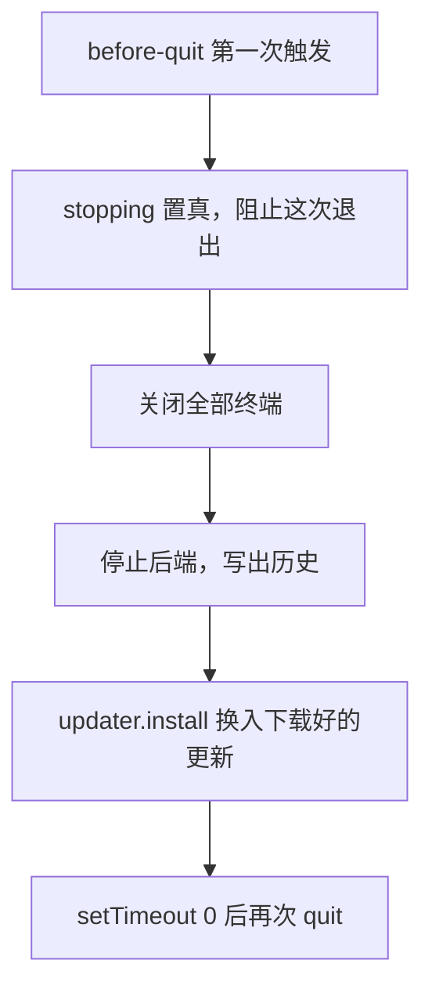
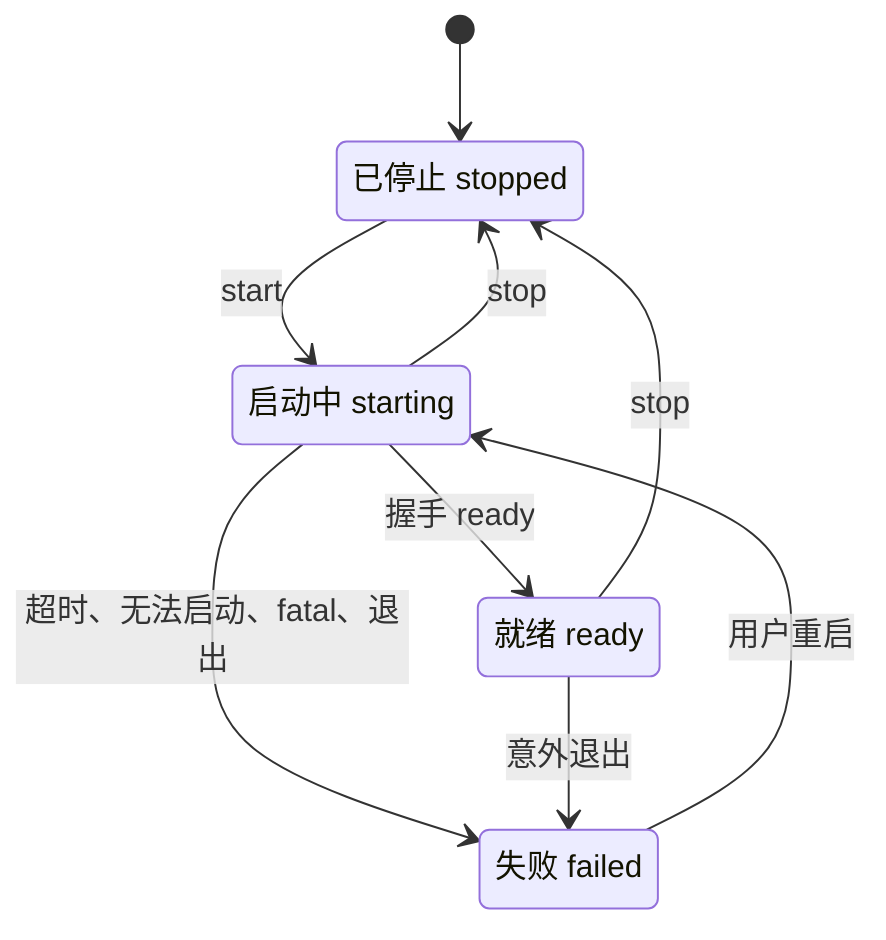

# 主进程

Electron 主进程管三件事：后端进程、窗口，以及渲染进程在沙箱里做不了的原生操作。入口 `src/main/index.ts` 只管应用生命周期，把各模块接在一起，每个关注点在自己的模块里。渲染进程拿不到通用的 shell，只能调用 `DesktopApi` 列出的方法。

## 生命周期

启动时按这个顺序走：

1. 注册 `app` 协议（必须在 ready 之前），申请单实例锁。拿不到锁就退出，第二个实例的启动转成 `showMainWindow`。
2. 创建浏览器、书签、历史、终端、临时附件、后端监督器、配置、技能、更新器。
3. `app.whenReady` 之后：提供渲染页，清理上次遗留的临时附件，注册 IPC，创建窗口，启动更新器。
4. 浏览器端点监听成功后才启动后端，这样后端的浏览器工具从一开始就能连上。

退出时：



菜单、⌘Q，以及 Electron 转成退出的 SIGINT 和 SIGTERM 都走这条路。第二次 `quit` 放在新任务里，注释写明了原因：在这次退出还在展开时从微任务里再退一次，有 `window-all-closed` 监听器时 Electron 会卡住。

## 后端托管

`BackendSupervisor` 拥有 `ollupid` 进程：用新令牌启动它，读握手行，把输出写进日志文件，留一段尾部给诊断，上报每次状态变化。

它从不自动重启。崩溃变成看得见的 `failed` 状态，由用户决定重试。

### 状态



`BackendState` 由主进程推给渲染进程：

```ts
export type BackendState =
  | { status: 'starting' }
  | { status: 'ready'; url: string; token: string; version: string }
  | { status: 'failed'; failure: BackendFailure; configPath: string | undefined; log: string }
  | { status: 'stopped' }
```

### 启动

| 步骤 | 细节 |
|---|---|
| 去重 | `start()` 共用一个进行中的 Promise。读环境变量时还没有子进程，第二次调用如果也启动，会多出一个没人管的后端 |
| 令牌 | `randomBytes(32).toString('hex')`，放进环境变量 `OLLUPI_GATEWAY_TOKEN` |
| 参数 | `--home <home> --watch-stdin`，有允许的源时加 `--allow-origin ollupi` |
| 环境 | 登录 shell 的环境合并进当前环境，见下节 |
| 握手 | 30 秒内没有握手行，报 `timeout` 并发 SIGKILL |
| 握手之后 | stdout 上的其他行当作日志 |

### 环境变量

从 Finder 或 Dock 启动的应用只拿到 launchd 的最小环境，所以 `backendEnv` 用 `$SHELL -ilc 'env -0'` 读一次登录 shell 的环境，再合并：

```ts
const shell = await loginShellEnv()
return { ...shell, ...process.env, PATH: shell.PATH ?? process.env.PATH }
```

启动终端里的变量优先于 shell 配置，`PATH` 用 shell 的。每次启动和每次校验都重新读，所以应用运行期间新 export 的变量也能被 MCP 的 `${NAME}` 用上。

读取用独立会话（`detached`），否则交互式 shell 会抢走启动终端的前台进程组，让 Ctrl-C 到不了应用。5 秒超时后杀掉，失败时返回空。

### 停止和重启

`stop()` 先把状态设为 `stopped`，发 SIGTERM 让后端写完，6 秒没退出就 SIGKILL。`restart()` 是 `stop` 加 `start`。

因为 `stop` 先清掉 `this.child`，随后的 `exit` 事件不会被当成意外退出。

### 失败种类

| `kind` | 什么时候 | 界面文案（中文） |
|---|---|---|
| `timeout` | 30 秒内没握手 | 后端在 30 秒内没有报告就绪 |
| `spawn` | 启动进程失败 | 无法启动 `<路径>`：`<错误>` |
| `exited` | 启动中或就绪后进程退出 | 后端意外退出（`<信号或退出码>`） |
| `reported` | 握手是 `fatal` | ollupi 自己的消息，原样显示 |

只有 `reported` 的消息来自后端。其余都由渲染进程按界面语言组织文字。

### 错误呈现

`failed` 状态下，`App` 用 `BackendScreen` 占满窗口，即使之前已同步过。页面显示原因、配置文件路径（有 `configPath` 时）、"重启后端"和"打开配置"按钮，以及可展开的后端日志。

日志来自监督器在内存里留的最后 200 行（`LOG_LINES`）。每次启动清空。

### 日志轮转

后端日志写到 `~/Library/Logs/Ollupi/backend.log`，stdout 和 stderr 都进去。轮转只在启动时发生：文件超过 10 MB（`10 << 20`）时改名为 `backend.log.old`，覆盖之前的那份。运行期间不轮转。打不开日志文件时后端照常运行，只是没有文件日志。

引擎只记 ID 和数字，不记消息、参数和输出。

## 窗口和 Dock

| 项 | 值 |
|---|---|
| 默认大小 | 1280 × 840 |
| 最小大小 | 860 × 560 |
| 标题栏 | `hiddenInset`，红绿灯位置 `{ x: 16, y: 13 }`，居中在 40px 的标题行上 |
| 背景色 | 深色 `#1b191a`，浅色 `#f7f5f4`，即默认配色的 `--ol-ground`，渲染前显示 |
| `webPreferences` | `contextIsolation`、`sandbox` 开，`nodeIntegration` 关，`plugins` 开（文件面板的 PDF 阅读器要用） |

**关窗不退出。** macOS 上 `close` 被拦下，窗口只是隐藏。隐藏的窗口保留渲染进程、它的网关连接、通知和角标，也保留每个会话的浏览器标签页。全屏窗口要先退出全屏再隐藏，否则会留下一个空的 Space。只有 `stopping` 为真时才真正关闭。

**回到窗口。** 点 Dock 图标触发 `activate`，`showMainWindow` 恢复并聚焦窗口；窗口已不存在时新建一个。

**导航。** 窗口本身不离开应用。`setWindowOpenHandler` 和 `will-navigate` 都把目标交给 `shell.openExternal`，只放行 http 和 https。

**页面来源。** 开发时加载 `ELECTRON_RENDERER_URL`，打包后加载 `app://ollupi/index.html`。`protocol.ts` 只服务渲染目录内的文件，并给每个响应加 CSP：

```
default-src 'self'; script-src 'self'; style-src 'self' 'unsafe-inline';
img-src 'self' data: https:; font-src 'self' data:;
frame-src blob:; connect-src ws://127.0.0.1:*
```

这份 CSP 禁止 eval 和 WebAssembly，所以工具校验器要提前编译成普通 JS，Shiki 要用 JavaScript 正则引擎。

## IPC 面

`ipc.ts` 的处理函数校验全部输入：工作区根目录必须是绝对路径，终端尺寸是 1 到 1000 的整数，配置改动只接受键路径和纯 JSON。

| 组 | 方法 | 做什么 |
|---|---|---|
| 应用 | `info` | 版本、平台、home、配置路径、日志路径 |
| 后端 | `backend.state`、`restart`、`onState` | 状态和重启 |
| 配置 | `config.read`、`apply` | 读取和改写 `config.yaml`，见 [配置](/desktop/config) |
| 技能 | `skills.list`、`read`、`create`、`save`、`import`、`remove`、`defaultFolder` | 管理技能文件夹 |
| 附件 | `attachments.pathOf`、`writeTemp`、`removeTemp` | 没有路径的文件先写成临时文件 |
| 文件 | `files.list`、`read`、`kind` | 只读工作区文件，见 [侧边面板](/desktop/side-panels) |
| 改动 | `changes.list`、`diff`、`stage`、`unstage`、`discard`、`commit` | 工作区的 git 操作 |
| 终端 | `terminal.open`、`write`、`resize`、`close`、`onData`、`onExit` | 用户自己的 shell |
| 浏览器 | `browser.*` | 标签页、收藏、历史、补全，见 [内置浏览器](/desktop/browser) |
| 模型 | `listModels`、`balance` | 问提供方的 API |
| 更新 | `update.state`、`check`、`download`、`restart`、`onState` | 见 [发布](/desktop/release) |
| 通知 | `notify`、`onNoticeClicked`、`setBadge` | 系统通知和 Dock 角标 |
| 系统 | `pickDirectory`、`saveFile`、`openPath`、`setColorScheme` | 选文件夹、保存、打开、明暗 |

`preload/index.ts` 把这些方法通过 `contextBridge` 暴露成 `window.desktop`，Node 和 Electron 的其他东西都不过桥。沙箱内的 preload 必须是 CommonJS，构建配置把它输出成 `.cjs`。

## 通知和角标

分工是：渲染进程决定什么值得说，主进程决定现在要不要说。

`showNotice` 在有窗口处于焦点，或系统不支持通知时直接返回。点击通知时把窗口带回前台，再向渲染进程发 `NoticeClicked`，渲染进程打开对应会话。

`Notification` 对象放进一个 `Set`，直到点击或关闭才移除。被垃圾回收的通知不再上报点击。

Dock 角标显示等你处理的会话数，`setBadge(0)` 清空。

渲染进程一侧：

| 事件 | 通知种类 | 说明 |
|---|---|---|
| 收到审批请求 | `approval` | 重连后网关会重发，`told` 集合去重 |
| 收到提问 | `question` | 正文是第一个问题 |
| 一轮完成 | `completed` | 子代理的轮次不通知，等父会话 |
| 一轮失败 | `failed` | 正文带错误 |

四种都可以在设置里分别开关，存在 `localStorage` 的 `ollupi.notifications`，默认全开。

## 模型列表

添加提供方时要问 API 有哪些模型。请求放在主进程，因为 API 不会回应渲染进程的源。`fetch` 用 Electron 的 `net.fetch`，走系统代理。超时 15 秒。

| API 类型 | 请求 | 请求头 | 解析 |
|---|---|---|---|
| `openai` | `GET {base}/models` | `Authorization: Bearer` | `data[].id`，上限读模型上或 `model_info` 里的 `context_window`、`max_input_tokens`、`max_output_tokens` |
| `anthropic` | `GET {base}/v1/models?limit=1000` | `anthropic-version: 2023-06-01`，`x-api-key` | `data[].id`，`max_input_tokens` 当上下文，`max_tokens` 当输出 |
| `gemini` | `GET {base}/v1beta/models?pageSize=1000` | `x-goog-api-key` | 只留支持 `generateContent` 的模型，`inputTokenLimit`、`outputTokenLimit` |

Base URL 为空时用各 API 的默认地址，与后端客户端一致：`https://api.openai.com/v1`、`https://api.anthropic.com`、`https://generativelanguage.googleapis.com`。

百炼是特例。Base URL 的主机以 `.aliyuncs.com` 结尾、路径是 `/compatible-mode/v1` 时，先分页问它自己的 `/api/v1/models`（每页 100），只留 `response_modality` 含 `Text` 的模型。问不到时退回兼容列表。

结果按名称排序去重。没有名称的项丢弃，上限只保留正整数。

## 余额查询

`balance.ts` 按 Base URL 的主机识别提供方，用已填的密钥查询。其他提供方、没有密钥或请求失败都返回 `undefined`，界面不显示，也不算错误。超时 10 秒。

| 主机 | 请求 | 读取 | 币种 |
|---|---|---|---|
| `api.deepseek.com` | `/user/balance` | `balance_infos[].total_balance` | 响应里的 `currency` |
| `api.moonshot.ai`、`api.moonshot.cn` | `/v1/users/me/balance` | `data.available_balance` | `.cn` 是 CNY，否则 USD |
| `api.siliconflow.cn`、`api.siliconflow.com` | `/v1/user/info` | `data.totalBalance` | `.cn` 是 CNY，否则 USD |
| `openrouter.ai` | `/api/v1/credits` | `data.total_credits - data.total_usage` | USD |

OpenRouter 只接受管理密钥，普通密钥通常查不到。

渲染进程的 `useBalance` 按 Base URL 加密钥缓存答案 5 分钟（`FRESH_MS`），打开设置时问一次，手动刷新时强制再问。

## 临时附件

粘贴的截图和从网页拖来的图片只在内存里，而引擎按路径收附件。`TempAttachments` 把它们写到 `<系统临时目录>/Ollupi/attachments/<uuid>/<文件名>`，权限 `0600`，目录 `0700`。发送返回后渲染进程删除，这时引擎已经复制完或已拒绝。`remove` 只接受这个目录下一层的路径。应用启动时清空整个目录，处理上次崩溃的遗留。

## 更新

`AppUpdater` 从 GitHub Releases 检查和下载更新，退出时换入。流程和状态见 [发布](/desktop/release)。

## 代码位置

| 位置 | 职责 |
|---|---|
| ollupi-desktop `apps/desktop/src/main/index.ts` | 应用生命周期 |
| ollupi-desktop `apps/desktop/src/main/backend/supervisor.ts` | 后端进程、握手、日志 |
| ollupi-desktop `apps/desktop/src/main/backend/environment.ts` | 后端路径和登录 shell 环境 |
| ollupi-desktop `apps/desktop/src/main/backend/config.ts` | `config.yaml` 的读写 |
| ollupi-desktop `apps/desktop/src/main/backend/skills.ts` | 技能文件夹的读写 |
| ollupi-desktop `apps/desktop/src/main/window.ts` | 主窗口 |
| ollupi-desktop `apps/desktop/src/main/ipc.ts` | IPC 处理和输入校验 |
| ollupi-desktop `apps/desktop/src/main/protocol.ts` | `app://` 协议和 CSP |
| ollupi-desktop `apps/desktop/src/main/notices.ts` | 系统通知和角标 |
| ollupi-desktop `apps/desktop/src/main/models.ts` | 模型列表 |
| ollupi-desktop `apps/desktop/src/main/balance.ts` | 余额查询 |
| ollupi-desktop `apps/desktop/src/main/attachments.ts` | 临时附件 |
| ollupi-desktop `apps/desktop/src/main/update.ts` | 自动更新 |
| ollupi-desktop `apps/desktop/src/preload/index.ts` | `window.desktop` |
| ollupi-desktop `apps/desktop/src/renderer/src/views/backend/BackendScreen.tsx` | 启动中和失败页面 |
| ollupi-desktop `apps/desktop/src/renderer/src/domains/notifications.ts` | 决定通知什么 |
