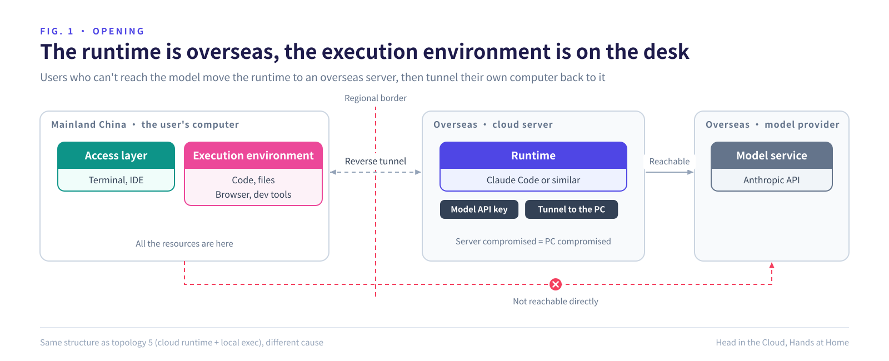
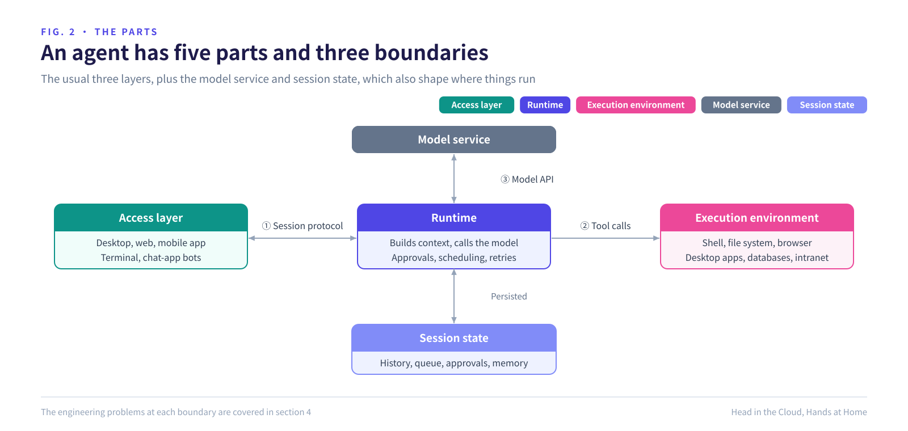
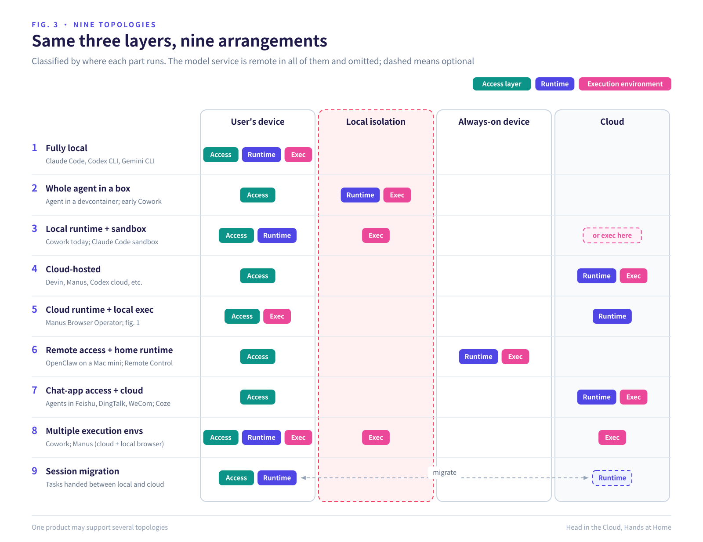
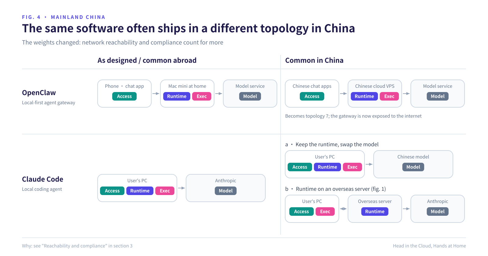
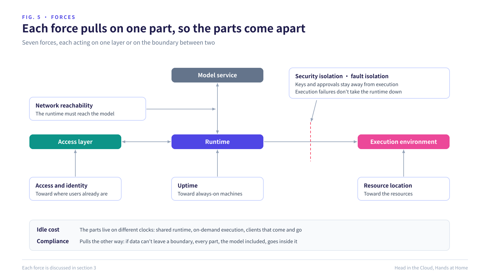
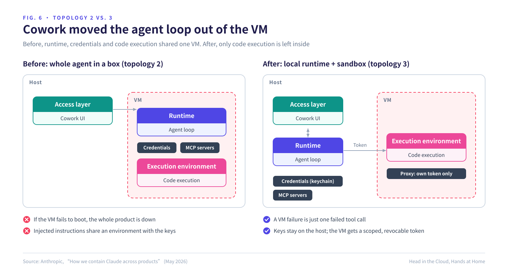
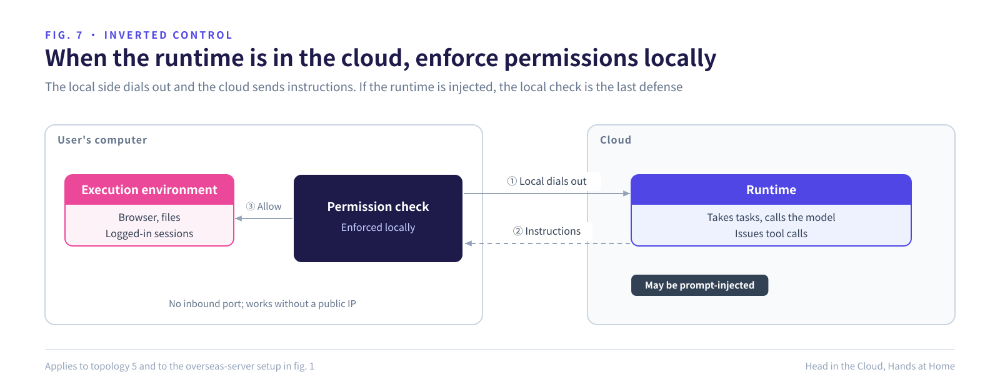
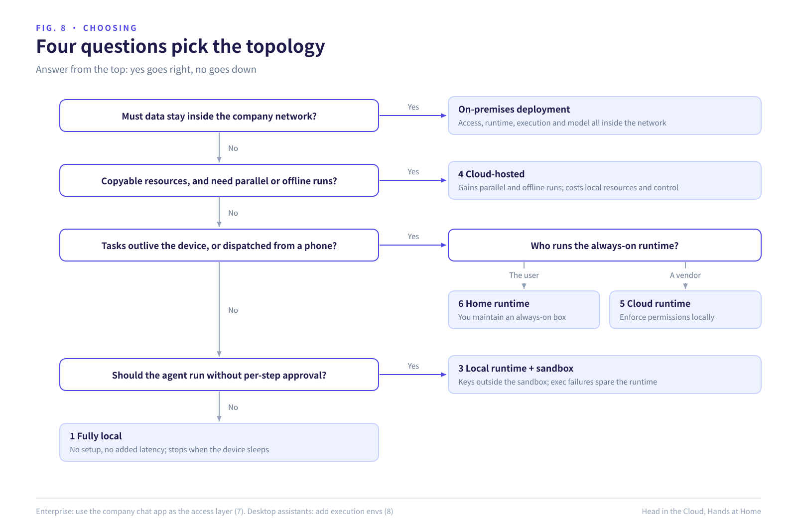

# Head in the Cloud, Hands at Home

*Where AI agents actually run, and why the parts end up in different places*

November 8, 2026 · [中文版](/zh/articles/head-in-the-cloud)

## Opening

Anthropic does not offer Claude in mainland China. Since September 2025 it has also barred companies controlled from China, wherever they are registered.

So some developers there rent a server abroad, run Claude Code on it, and tunnel their own computer back to it. The agent's runtime ends up across an ocean; its execution environment stays on the developer's desk.

A Tang dynasty poem has the line "clouds in the blue sky, water in the vase": everything in its place. This agent is the opposite.

It isn't a one-off hack. Manus lets its cloud agent drive the user's own browser, which is the same structure. Anthropic moved Cowork's agent loop out of its VM. The parts of an agent want to run in different places, so split placement is the norm.

## 1. The parts of an agent

The usual three layers:

**Access layer**: where the user talks to the agent. Desktop app, web, phone, terminal, chat-app bot.

**Runtime**: the agent loop. It builds context, calls the model, runs tool calls, asks for approval, schedules and retries.

**Execution environment**: where tools actually run. The user's computer, a local container or VM, or a cloud sandbox.

Two more parts shape deployment. The **model service** is almost always remote, so no agent is fully local: "local execution" only means the raw resources stay home, while whatever is read into the context still leaves. **Session state** decides who can resume after a disconnect or a crash. Claude Code's Remote Control runs everything on your computer, but syncs the transcript to Anthropic's servers, and that copy is what your phone works from.

## 2. Nine topologies

**Topologies 2 and 3 differ in what they isolate.** Topology 2 boxes the runtime together with execution, so keys and approval logic share an environment with model-written code, and one prompt injection can reach the keys. Topology 3 boxes only execution; the runtime stays outside and holds the credentials and the approval decision (figure 6). It is only as safe as that decision. Anthropic admits that in Claude Code a persuasive injected prompt or a tired approval click can get a command run outside the sandbox.

**Topology 5 exists because some resources can't move to the cloud.** A repo can be cloned; a logged-in session, a two-factor device, a local IP or an intranet cannot. Manus uses its cloud browser by default and switches to the user's own browser, through its Browser Operator extension, when a task needs the user's logins.

**Topology 6 is a home node the user runs.** OpenClaw connects twenty-plus chat channels to an agent on the user's own machine, ideally an always-on Mac mini or VPS: the runtime must stay online, and execution must reach the user's files and accounts. Remote Control has the same shape. The computer only makes outbound requests; the phone is just a client.

**Topologies 8 and 9 show that placement isn't fixed.** One agent can use files on the host, a shell in a VM, the user's browser and a cloud sandbox at once. Claude Code can pull a cloud session into the local terminal with `claude --teleport`.

### In mainland China

China hasn't invented new topologies, but the same software often lands in a different one than it was designed for (figure 4). The reason is that network reachability and compliance weigh far more there; see section 3.

**Runtime abroad, execution at home.** Topology 5 in shape, different in cause: the runtime goes abroad to reach the model, and execution stays home because the resources are there. Users split the two layers themselves, with no vendor support, which shows the boundary is real. The costs: the overseas server holds both the model credentials and a tunnel into a personal computer, so compromising one compromises both; every tool call crosses a border; and it breaks the provider's terms, so accounts get banned. The Financial Times reported in July 2026 that some Chinese companies reached Claude through overseas entities and resold cloud APIs, and that Anthropic responds by checking signals such as the computer's time zone and by targeting relay services.

**The chat app is the identity system.** Feishu, DingTalk and WeCom expose identity, department and document permissions through official APIs, so the agent needs no identity system of its own. Personal WeChat used to require protocol emulation and risked bans; in March 2026 Tencent began rolling out a WeChat ClawBot plugin, making WeChat an official access layer for a self-hosted agent. The runtime stays on the user's machine.

**Local-first software, moved to the cloud.** OpenClaw is meant for the user's own always-on machine. After it took off in China, Alibaba Cloud, Tencent Cloud and Huawei Cloud shipped one-click images wired to Feishu, DingTalk, WeCom or QQ, which in practice is topology 7. Guides pick the server region by what it must reach: reachability choosing where the runtime lives. Some setups also open the SSH and gateway ports to the internet, so a gateway built for a home network now faces the public.

**Keep the runtime, swap the model.** GLM, Kimi, DeepSeek, MiniMax and Qwen offer Anthropic-compatible endpoints; change a URL and a key and Claude Code runs on a Chinese model. The runtime is becoming a general client for any model. Third-party API relays show the flip side: the relay sees the full context, so who operates the model service is part of the security boundary.

**On-premises.** Data-security rules, cross-border data rules and the push for domestic technology (Xinchuang) lead many companies to put access, runtime, execution and an open-weight Chinese model all inside their network. Compliance outweighs everything else. It runs against the global trend but follows the same logic.

## 3. Seven forces

Each force acts on one part or one boundary, which is why the parts come apart.

**Resource location: execution goes to the resources.** Copyable resources, like repos and public data, can move to the cloud, which is why coding agents went cloud-hosted first. Resources that can't be copied, like logins, intranet access, local software and private files, keep execution at home.

**Uptime: the runtime goes where the power stays on.** Tasks run for hours and pause for approval; laptops close. Once a task outlives the device, the runtime moves to a vendor's cloud or the user's own always-on machine.

**Security isolation: keys and approvals stay away from execution.** In Claude Code on the web, git credentials never enter the sandbox. The sandbox holds only a scoped credential for a proxy, which checks the branch and repository before doing the real push. Cowork keeps credentials in the host keychain and gives the VM a per-session token that can be revoked on its own.

**Fault isolation: when execution fails, the runtime keeps going.** Cowork first ran the whole agent in a VM, and if the VM failed to boot, the product was down. With the loop moved to the host, a VM failure is one failed tool call, and the agent can still answer and help debug. Local MCP servers moved out too: they were hard to audit and needed local processes. Code still runs in the VM, so security barely changed.

**Idle cost: agents mostly wait.** For the model, for tools, mostly for the user. An always-on container per session pays for waiting. So in the cloud each part gets its own lifecycle: a stateless, shared runtime; execution created on demand and suspended; clients that come and go.

**Access and identity: the access layer goes where users already are.** The phone is used most and suits execution least. Chat apps are installed, push notifications work, and company chat apps carry identity and the org chart. Once access splits off, approval becomes an asynchronous message instead of a dialog.

**Reachability and compliance: the runtime must reach the model.** If a model is only reachable from one network or region, the runtime runs there, wherever the user is. That is how the overseas server in the opening came about. Compliance pulls the other way: if data can't leave a boundary, every part, the model included, goes inside it.

Business matters too. A cloud runtime gives the vendor metering, data and model routing, so vendors lean cloud and open-source projects lean local.

## 4. Engineering problems at each boundary

Once the parts separate, function calls become calls across processes, machines and sometimes trust domains.

**Access to runtime: the session protocol.** Clients drop at any time, so the protocol needs resume and multi-device sync, with state persisted by the runtime. Approvals must be durable, asynchronous objects, because the approver may show up hours later on another device.

**Runtime to execution: remote-call semantics.** After a timeout, the runtime can't tell whether the call ran. For `ls` that's fine; for a payment or a `git push` it isn't, so "not run" and "may have run" must be different states. File sync is the hardest part: mount, sync or copy, and which copy is authoritative. Cowork mounts the chosen folder and must resolve symlinks before validating paths, or a symlink can point outside. A sandbox's cold start, seconds long, lands in the user's wait.

**Cloud runtime, local execution: inverted control.** Here the cloud sends instructions to the user's computer. The local side dials out, so no inbound port is needed, but that solves connectivity, not trust.

If permissions are checked only in the cloud, an injected cloud runtime leaves the local machine wide open. Mindgard found that the Manus browser extension can read and write cookies, and that the user's consent lasts the whole conversation. When runtime and execution sit in different trust domains, the final check belongs on the execution side. The home-made tunnel from the opening is the same case, with higher stakes.

**Credentials: on the side that doesn't run untrusted code.** Execution gets scoped, revocable tokens, and a proxy on the boundary does the real work. Cowork adds a proxy inside the VM that passes only API requests carrying its own session token. It stops a malicious file from smuggling in an attacker's API key and shipping data out through the Anthropic API address that is already allowlisted.

**Observability: isolation also blinds your own tools.** The VM that contains Claude also keeps out the company's endpoint detection and response (EDR) software, which sees Cowork as one opaque process. The stronger the isolation, the more the agent has to report on itself.

## 5. Which topology for which job

Pick a topology with figure 8, then check the trade-offs below.

| Job | Topology | You get | You pay |
|---|---|---|---|
| Working on a local repo at your own machine | 1 Fully local | No setup, no added latency | Stops when the device does; safety relies on per-step approval |
| Letting the agent run without per-step approval | 3 Local runtime + sandbox | Autonomy; keys stay outside the box | A boundary and a file mount to maintain |
| A one-off experiment with no credentials around | 2 Whole agent in a box | Simplest, disposable | Any credential inside can leak |
| Clonable repo, long tasks in parallel, output is a PR | 4 Cloud-hosted | Parallelism; keeps going with the laptop shut | No local resources; the vendor holds the data |
| Work that needs the user's logins | 5 Cloud runtime + local exec | Resources that can't be copied | Device must be online; enforce permissions locally |
| A personal assistant you message from a chat app | 6 Remote access + home runtime | Always on, local resources | A machine to maintain |
| An assistant for employees | 7 Company chat app + cloud | Identity and permissions ready-made | Limited by the chat platform's APIs |
| Finance, government, healthcare | On-premises | Compliance | Weaker models, higher ops cost |
| A desktop assistant for non-developers | 3 + 8 | Safety plus local resources | The most complex system |
| The model you want isn't reachable | Keep the runtime, swap the model (not the overseas-server setup) | Compliant and stable | A different model's capabilities |

## 6. Conclusion

Three rules: **resources decide where execution runs, uptime decides where the runtime runs, and trust boundaries decide where permissions are enforced.**

Topologies won't converge, but the interfaces between the parts will. Runtime-to-model is nearly standard already. Runtime-to-execution is being filled in by MCP and sandbox APIs. Access-to-runtime, a session protocol with resume, multi-device sync and asynchronous approval, is the least settled. Runtimes will stop caring where they run, and execution environments will become resources you attach and swap.

## References

- Li Ao, "Presented to the Monk Weiyan of Mount Yao" (Tang dynasty): "云在青天水在瓶", clouds in the blue sky, water in the vase.
- Anthropic, [How we contain Claude across products](https://www.anthropic.com/engineering/how-we-contain-claude) (May 2026)
- Anthropic, [Making Claude Code more secure and autonomous with sandboxing](https://www.anthropic.com/engineering/claude-code-sandboxing)
- The Decoder, [Anthropic bans companies majority-controlled by China, Russia, Iran, and North Korea from Claude](https://the-decoder.com/anthropic-bans-companies-majority-controlled-by-china-russia-iran-and-north-korea-from-claude/) (September 2025)
- Investing.com, [Anthropic targets loopholes used by Chinese firms to access Claude, FT reports](https://www.investing.com/news/stock-market-news/anthropic-targets-loopholes-used-by-chinese-firms-to-access-claude-ft-reports-4774998) (July 2026)
- [OpenClaw documentation](https://docs.openclaw.ai/)
- Manus, [Introducing Manus Browser Operator](https://manus.im/blog/manus-browser-operator) (November 2025)
- Mindgard, [Manus Rubra: the browser extension with its hand in everything](https://mindgard.ai/blog/manus-rubra-full-browser-remote-control)
- Help Net Security, [Anthropic's Remote Control feature brings Claude Code to mobile devices](https://www.helpnetsecurity.com/2026/02/25/anthropic-remote-control-claude-code-feature/) (February 2026)
- HackerNoon, [Claude Code launches Teleport workflow](https://hackernoon.com/claude-code-launches-teleport-workflow-start-anywhere-continue-everywhere)
- Tencent Cloud, [OpenClaw cloud deployment](https://cloud.tencent.com/act/pro/openclaw); Alibaba Cloud Developer Community, [one-click OpenClaw deployment](https://developer.aliyun.com/article/1720712)
- Tencent Cloud Developer Community, [official WeChat plugin for OpenClaw](https://cloud.tencent.com/developer/article/2648517)
