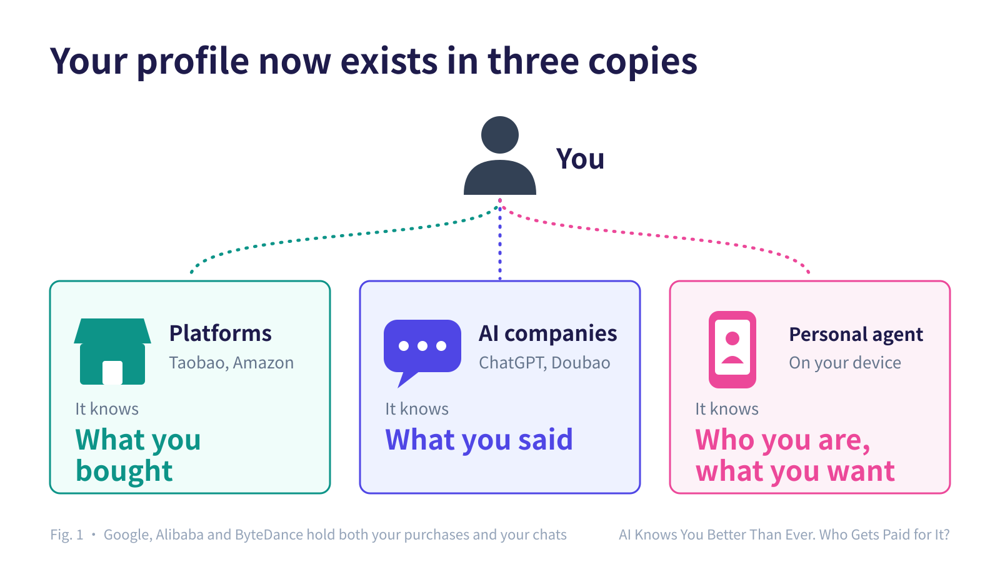
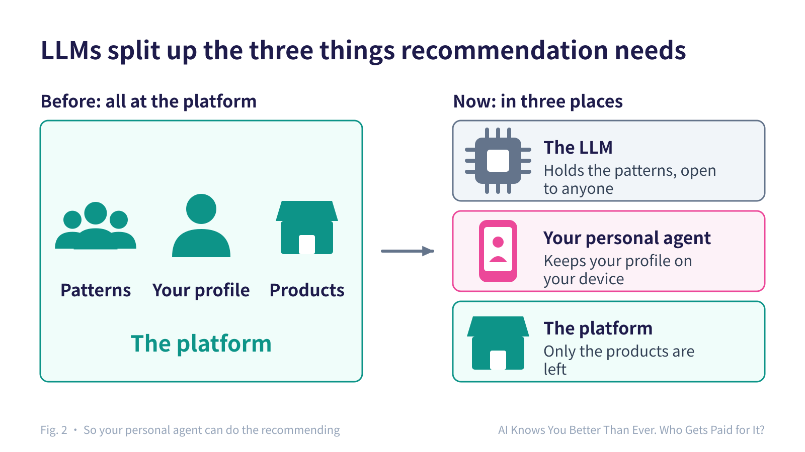
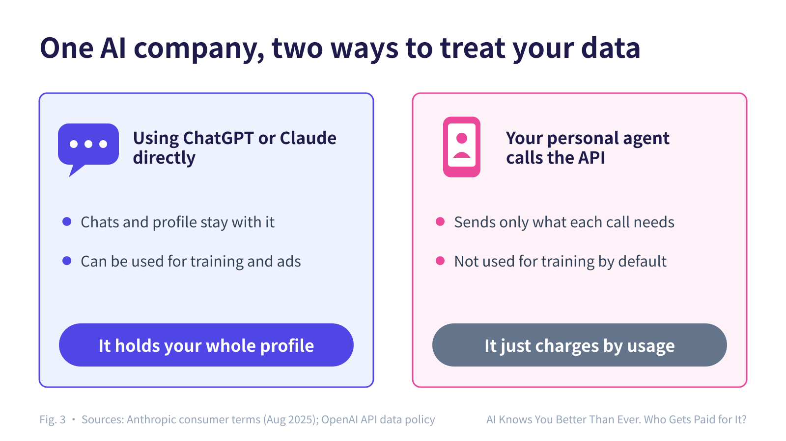
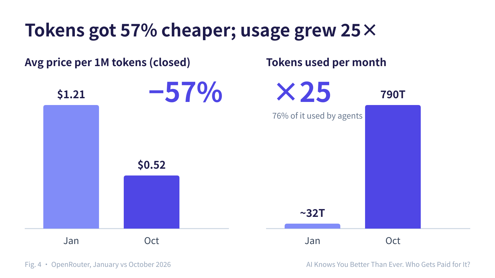
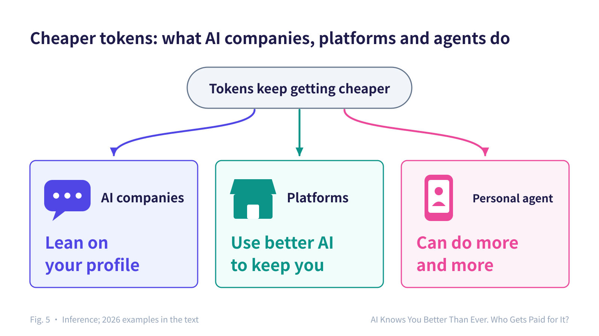
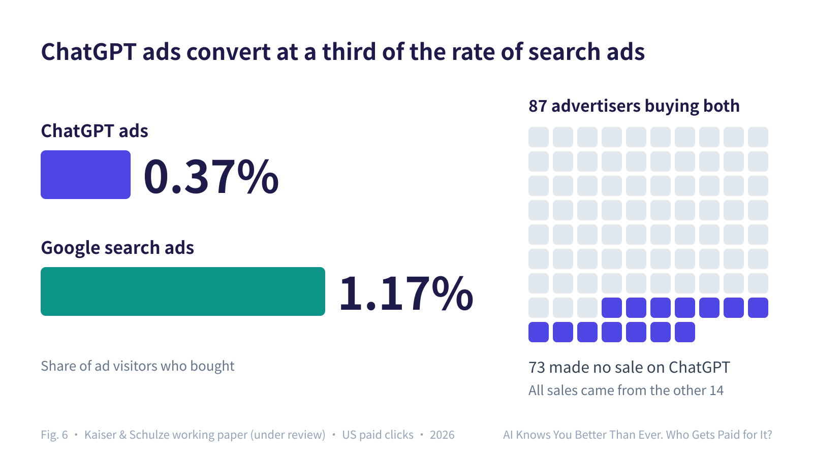
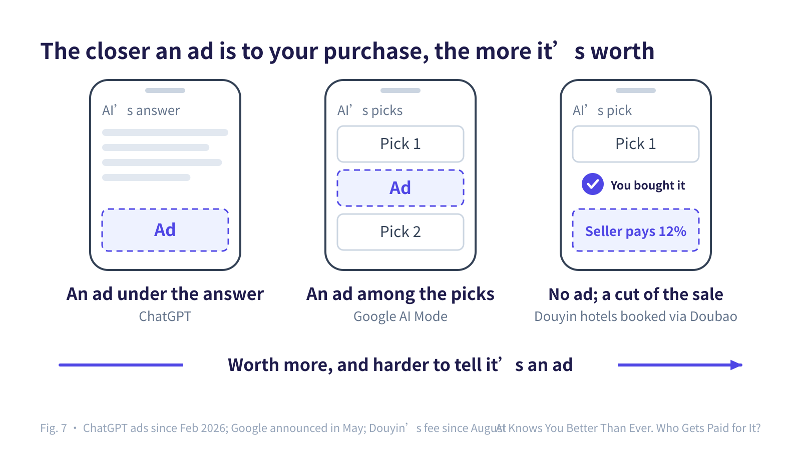
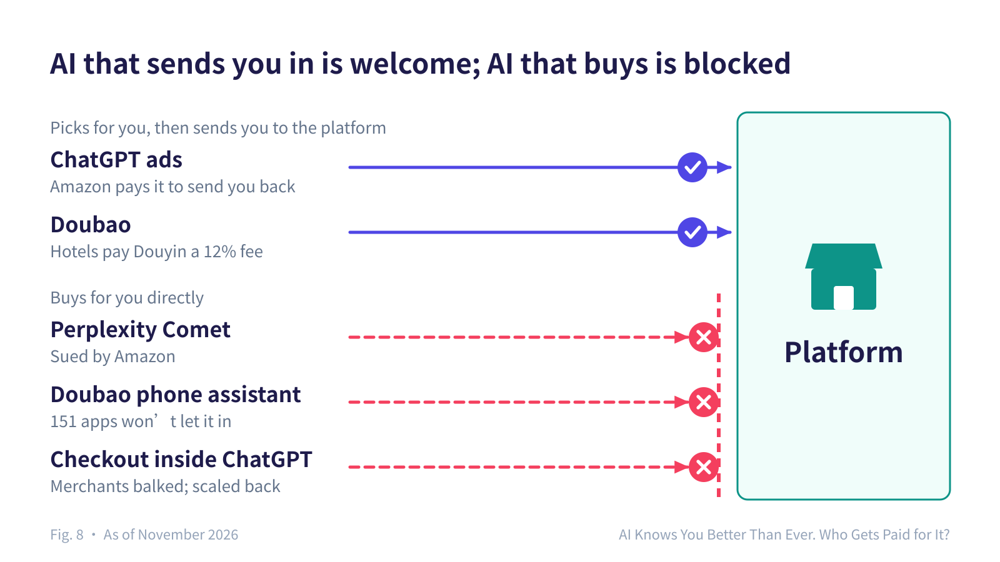
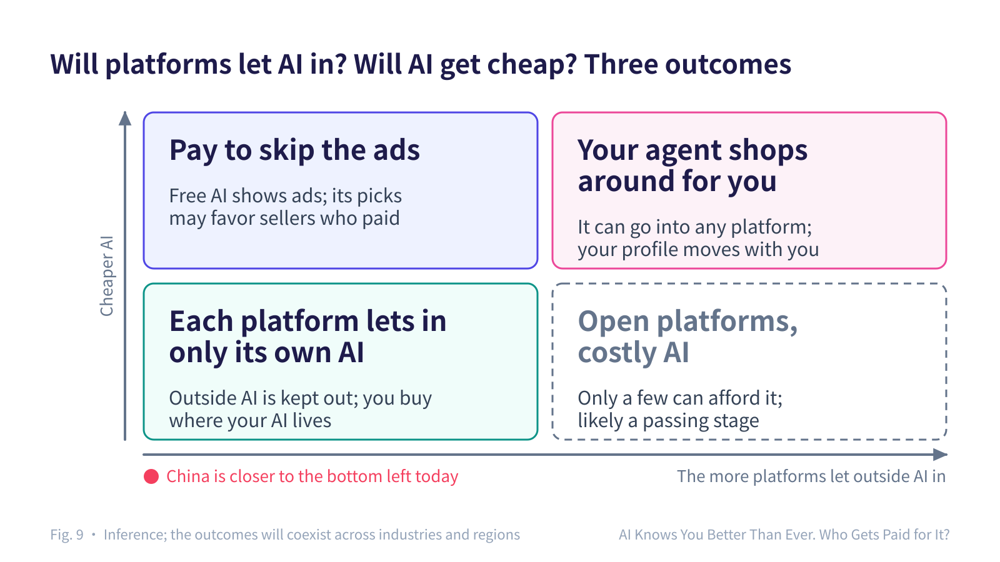
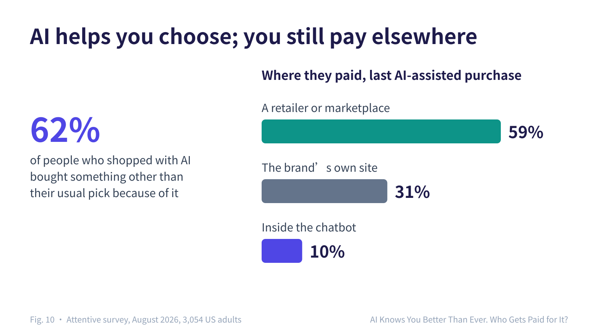

# AI Knows You Better Than Ever. Who Gets Paid for It?

November 11, 2026 · [中文版](/zh/articles/user-profile)

## Introduction

For twenty years, your user profile has been the most valuable thing the big internet companies own. Every search, click and purchase on Taobao, Douyin or Google teaches the platform a little more about you. The platform uses that to recommend things, then sells the recommendation slots to advertisers. All of that value has gone to the platform.

AI changes this. The short version:

- **The platforms used to take all of it. Now AI companies want a share, and for the first time you have a chance to keep some for yourself.** That depends on platforms letting outside AI in, and on AI getting cheap enough.
- **Your profile now exists in three copies.** Platforms know what you bought. AI companies know what you said. Your own personal agent knows who you are and what you want.
- **How AI companies make money: by putting ads inside AI recommendations.** Ads shown under an AI's answer rarely sell anything. The closer an ad sits to the moment you buy, the more it is worth.
- **How platforms make money: their own AI keeps you, and outside AI pays them.** AI that sends you to the platform to buy is welcome. AI that tries to buy for you is blocked.
- **The cheaper tokens get, the harder everyone fights.** AI companies lean harder on your profile, platforms build better AI to keep you, and your personal agent can do more for you.

The words I use:

- **Platforms**: internet platforms such as Taobao (China's largest shopping site, run by Alibaba), JD.com, Douyin (TikTok's Chinese counterpart), Amazon and Google.
- **AI companies**: companies that build large language models and the chat apps on top of them: OpenAI, Anthropic, plus ByteDance (maker of the Doubao chatbot) and Alibaba (maker of the Qwen app). ByteDance and Alibaba are both platforms and AI companies.
- **Personal agent**: an AI that runs on your phone or computer, remembers your preferences, and does things for you. The AI a platform builds for itself I call "the platform's own AI".

Where I describe what has already happened, I give a source. Where I say what will happen, that is my read, and I say so.

## 1. Before AI, only platforms had your profile

A recommendation needs three things (left side of figure 2):

- **Patterns**: what many people tend to do, such as "people who buy a tent often buy a sleeping pad too".
- **Your profile**: who you are, what you like, your budget, what you are shopping for right now.
- **Products**: the things that can be recommended, goods but also content such as web pages, with their prices, stock and reviews.

Only platforms had all three. So recommendations belonged to platforms, and the only place to buy ads was from a platform.

In 2006, Doc Searls imagined the reverse: customers say what they want, and sellers come to them with offers. He called it the "intention economy", and it never took off. My read: ordinary people had their own data, but no way to make use of it.

## 2. LLMs split recommendation apart

Now the three things live in three places (right side of figure 2):

- **The patterns are inside the model.** A large language model learned from huge amounts of text which products suit which people, and anyone can call it. This is Benedict Evans's point. Ask ChatGPT what to pack for camping and it will remind you about a sleeping pad without ever seeing your purchase history. The exception is live market data: what is selling this week, who just cut prices. Only the platform knows that.
- **Your profile can live on your own device.** Ant Group's Lingguang 2.0 (Ant runs Alipay), Alibaba's Qwen Go!, Apple's new Siri and many open-source projects can read the email, calendar and files you allow, and keep notes about your preferences on your device. Those notes are your own copy of your profile. Claude can even import these notes from another AI, so a profile can move.
- **Platforms are left with only the products.**

So your personal agent can make recommendations itself: take your profile to every store, and pick by your standards. It is already happening:

- In an October test by Huxiu, a Chinese tech site, Lingguang 2.0 recommended a cheaper product on JD.com when comparing prices; Alibaba's Qwen app only searched Taobao.
- Perplexity's Comet browser and ByteDance's Doubao phone assistant can operate other companies' websites and apps for you.
- In an August survey by Attentive, 62% of people who used AI to help them shop said AI led them to buy something other than their usual pick.

Platforms' recommendation slots are being bypassed. The next fight is over whether platforms give outside AI access, so your personal agent can go in and buy for you.

## 3. AI companies hold a copy too

Every time your personal agent uses a model, it sends the part of your profile it needs to the AI company, unless the model runs on your own device.

The same AI company handles your data in two different ways (figure 3):

- **When you use the ChatGPT or Claude app directly**: your chats and what it has noted about you stay with the company, and can be used for training and for choosing ads. Since August 2025, Anthropic trains on these chats by default and keeps them for up to five years.
- **When your personal agent calls the company's API**: by default, nothing is used for training. OpenAI keeps API logs for at most 30 days, and Anthropic's training terms do not apply to its API.

Sometimes the AI company cannot fully control its copy either. In The New York Times's lawsuit against OpenAI, a court ordered OpenAI to keep ChatGPT chats that users had deleted, and later to hand over 20 million chat logs with identifying details removed.

Add the purchase history that platforms hold, and your profile now exists in at least three copies (figure 1). Each has a weakness:

- A platform cannot see what you want outside it.
- An AI company has no products of its own to sell.
- Your personal agent has no one else's data, and cannot get into platforms that keep it out.

Google, Alibaba and ByteDance hold both your purchase history and your chats with AI. These companies have the easiest path to making money.

Someone wants to make money from each of these copies. Next: how platforms and AI companies make money, and how much you can keep.

## 4. How platforms and AI companies make money, and how much you can keep

AI companies, platforms and your personal agent are all competing for the same moment: you ask an AI "which one should I buy?", and it recommends something. One shared factor shapes where each of them goes: the price of tokens.

### Tokens keep getting cheaper

- For the same capability, prices fall between 9× and 900× a year (Epoch AI).
- Models are converging: the best American model is only 2.7% ahead of the best Chinese one, and the best closed model is only 3.3% ahead of the best open one (Stanford's 2026 AI Index).
- China's price war is fiercer: DeepSeek permanently cut V4-Pro to a quarter of its original price, and Xiaomi cut its API prices by up to 99%.

Doing the same task with AI keeps getting cheaper. But usage grows even faster (figure 4): on OpenRouter, the average price of closed models more than halved from January to October 2026, while monthly token use grew 25×.

Usage is growing because people are asking AI to do more. An agent completing one coding task uses about 1,000 times as many tokens as answering one coding question (Stanford Digital Economy Lab); three quarters of OpenRouter's tokens are used by agents. So as tokens get cheaper, the first to benefit are people who let AI do things for them.

China is the exception: compute is short, and prices have actually gone up. By Morgan Stanley's count, the average API price in China in Q2 2026 was well above Q1 2025: about 48% higher for input, about 80% higher for output. The rest of this piece assumes prices keep falling over the long run; in China it will take longer.

As tokens get cheaper, AI companies, platforms and personal agents each make a different move (figure 5).

### How AI companies make money: ads inside AI recommendations

My read: models keep getting cheaper and more alike, users lose almost nothing by switching, and AI companies will struggle to make more money from the models themselves. With ordinary users, the most valuable thing they hold, and the one no one else can take, is the profile you leave in their apps.

What is already happening:

- ChatGPT picks ads using what it has noted about you and what you chat about. Ads launched in February; by August they were bringing in $1 billion a year at the current rate, and by October they ran in 89 countries.
- Since December 2025, Meta uses your chats with Meta AI to choose ads.

But ads under an AI's answer are not selling much (figure 6):

- Of people who clicked a ChatGPT ad, 0.37% bought something; for Google search ads it was 1.17%.
- Of 87 advertisers on both, 73 did not make a single sale through ChatGPT.

These numbers come from a paper by Kaiser and Schulze that is still under review. On the other hand, people who click straight through from an AI's answer buy 60% more often than visitors from other sources (Adobe). In other words: people buy what AI recommends, and ignore the ads beside it.

My explanation: on a search results page, you have not decided yet, and an ad is one of ten results. When an AI answers, it has already picked for you. An ad placed after that is arguing with the AI's own pick.

So ads are moving into the recommendations (figure 7):

- Google has announced ads placed directly in the recommendation lists of AI Mode.
- Amazon's sponsored products appear inside Alexa+ shopping chats.
- Douyin does not sell a slot at all: when you book a hotel on Douyin through Doubao, Douyin charges the hotel a fee.

The closer an ad sits to your purchase, the more it is worth, and the harder it is to tell it is an ad. In a Harris Poll survey, 75% of people said they would trust an AI's recommendations less if brands had paid to influence them.

AI companies also use pricing to keep you in their own apps. Anthropic, for example, lets monthly subscriptions be used only in its own apps; using one in someone else's tool costs extra, by usage. My read: that keeps you in its app, where it knows you best.

### How platforms make money: their own AI keeps you, and outside AI pays them

As tokens get cheaper, giving every user a good AI costs a platform less and less. Platforms already have the products and the transactions, so they are best placed to build AI that knows their business:

- Alibaba connected its Qwen app to Taobao, Alipay, Fliggy (travel) and Amap (maps). Over Chinese New Year 2026, users placed nearly 200 million orders with a single sentence.
- JD.com has "Dongdong", Amazon folded Rufus into Alexa+, and Spotify launched an AI you can talk to.

Toward outside AI, a platform's attitude depends on what the AI is there to do (figure 8):

- **AI that sends you to the platform to buy is welcome, and platforms will even pay for it.** Amazon pays for ads in ChatGPT that send you back to amazon.com. When you book a Douyin hotel through Doubao, the hotel pays a fee of about 12%, higher than the roughly 8% it pays when selling on Douyin directly.
- **AI that tries to buy for you is blocked.** Amazon sued Perplexity over its Comet browser buying for users; an appeals court lifted the injunction, and the case goes on. 151 Chinese apps, including WeChat, Taobao and Alipay, refused to let Doubao's phone assistant operate them for users. Merchants would not sign up for checkout inside ChatGPT, and OpenAI scaled it back in March.

Merchants would not sell inside ChatGPT because they would never meet the customer or be able to give loyalty points. In the end, nobody wants to hand over the moment of purchase.

My read: while tokens are expensive, only platforms that make money from shopping or ads can afford free AI, especially in China. Once tokens are cheap, platforms' AI will keep getting better and keep you at home.

### How much you can keep: it depends on your personal agent

Whether some of your profile's value stays with you depends on your personal agent, and cheap tokens help it most. Open models are only a few percentage points behind the best closed model; work that needs the cloud today may run on your phone or laptop soon. Running on your device means no per-token bill, and your profile never leaves. Apple's new Siri reportedly already splits the work this way: simple requests on the phone, harder ones on Apple's own servers.

For the work that still needs the cloud, you pay. Tmall, Alibaba's online mall, started selling tokens in September, like prepaid phone credit. Few people are buying yet: by Yicai's count, the store of the model maker Zhipu had sold only about 300 units.

When you pay, the AI really works for you. "We don't make money from your data" has become a selling point: Anthropic ran Super Bowl ads saying ads are coming to AI, but not to Claude, and Perplexity stopped taking new advertisers, partly to avoid losing users' trust.

My read: the intention economy Searls imagined is possible for the first time. Your personal agent can send what you want to many sellers ("Chengdu next week, two nights, near the metro, under ¥600, about $85, a night"), let them make offers, and pick for you. That depends on sellers letting it in.

Interestingly, Penn and Chaudhary at Cambridge use the same term, "intention economy", for the opposite: AI companies collect what you want and sell it to whoever wants to influence you. Searls's version runs on the profile you hold; theirs runs on the AI company's copy. We will see both.

### The outcome turns on two questions: will platforms let outside AI in, and how cheap will AI get?

You may be using several AIs at once: an AI company's free app, a platform's own AI, and your personal agent. Whichever one makes the call for you, the money flows to it.

My read: the outcome turns on two questions.

1. **Will platforms let outside AI in?** Can your personal agent search other platforms, buy for you, and take your profile with it? Watch:
   - how Amazon's case against Perplexity ends;
   - whether the EU's requirement holds that, by July 2027, Google give other companies' AI the same access on Android as its own Gemini;
   - whether the list of Chinese apps that refuse Doubao's phone assistant grows or shrinks;
   - whether tools to import and export your profile spread. The EU already requires large platforms to offer a recommendation option that does not use your profile.
2. **How cheap will AI get?** How cheap tokens become, and how much can run on your phone. While AI is expensive, only companies with another business to pay for it can offer free AI. Once AI is cheap and runs on your device, everyone can afford a personal agent.

## 5. Three outcomes, and the signals to watch for each

This section is my read. The two questions above give three outcomes (figure 9), each with signals you can see coming:

| Outcome | What you will see | Signals to watch |
|---|---|---|
| **Each platform lets in only its own AI** | Outside AI is kept out. You can only buy where your AI lives, and the platform still decides what gets recommended | The list of apps refusing Doubao's phone assistant grows; API prices in China keep rising |
| **Pay to skip the ads** | Free AI shows ads, and its picks may lean toward sellers who paid. To get rid of both, you pay for a subscription | Ads move from under the answer into the recommendations; more subscription plans promise "no ads" |
| **Your agent shops around for you** | Your personal agent can go into any platform, your profile moves with you, and sellers compete to make it offers and win its recommendation | A final ruling in Amazon v. Perplexity; the EU's Android rules take effect; profiles can be exported and imported freely; models on phones keep improving |

The bottom-right corner of the figure is one more case, open platforms but costly AI: platforms let outside AI in, but AI is too expensive for most people. That is probably a passing stage.

The three outcomes will coexist across industries and regions. With compute short and every big platform running its own AI, China is most likely to reach the first one first: each platform lets in only its own AI.

## 6. What you pay

When someone else makes money from your profile, you bear the cost.

**You see ads, and you can't be sure the recommendation wasn't bought.** Free AI makes money from ads. The closer an ad sits to your purchase, the harder it is to tell which is the ad and which is what the AI actually recommends (see section 4).

**You are seen through, and may be charged more.** In the Harris Poll survey, 73% of people were uneasy about AI using their shopping data. In an experiment by Consumer Reports and others on Instacart, different shoppers saw prices from $3.99 to $4.79 for the same dozen eggs at the same store. My read: an AI knows how urgently you need something and what you can spend; if that reaches the seller, you may pay more.

**The better AI knows you, the more it tells you what you want to hear.** A CHI 2026 paper found that giving a model a summary of the user's profile made Gemini 2.5 Pro, Claude Sonnet 4 and GPT-4.1 mini agree with the user more: by 45%, 33% and 16%.

**AI knows you, not necessarily the product.** The Paper, a Chinese news outlet, tested several platforms' AI shoppers. Prices were mostly real, but one "cheap AirPods" pick was a grey-market unit, and one "authorized" store also sold non-Apple models. Your profile cannot tell you whether a product is genuine.

**Most people never manage their profile, so the defaults decide.** Anthropic, for example, trains on your chats by default, and you have to turn that off yourself. My read: where your profile ends up depends mostly on default settings, so defaults will become something companies fight over.

**People are wary too: they let AI help choose, but pay elsewhere.** Of people who used AI to help them shop, 62% bought something other than their usual pick because of it, yet only 10% paid inside the chatbot on their most recent AI-assisted purchase (figure 10). In a survey by the Shanghai Consumer Council, 84.56% had tried AI shopping help, but only 16.06% said it found what they actually wanted.

## 7. Who else can make money: new opportunities

Beyond platforms and AI companies, there is new business to be done. This section is my read. On the user's side:

- **Tools that keep and move your profile**: your profile stays with you, is shared only when you allow it, and comes with you when you switch AI.

On the seller's and AI's side:

- **Interfaces that let AI understand products**: help sellers give their products, stock and member prices to every kind of AI, while keeping the checkout for themselves.
- **Matching AI recommendations to sales**: nobody can yet say how much business AI recommendations bring in. Whoever can measure it can put a price on it.
- **Services that verify products for AI**: when an AI recommends a fake, the AI gets the blame, so it will pay to avoid that.
- **Charging per sale, with records anyone can check**: ads mixed into recommendations are hard to audit; a fee per sale shows up plainly on the seller's statement.

## 8. Conclusion: who gets paid for knowing you?

The short answer: for now, mostly platforms and AI companies. How much you keep later depends on your personal agent.

Your profile used to live only with platforms, and recommendations and ads were their business. Now there are three copies: platforms have your purchase history, AI companies have your chats, and your personal agent knows who you are and what you want.

Platforms keep you with their own AI and charge the outside AI that brings them customers. AI companies put ads inside AI recommendations. Whether you keep any of the value depends on whether platforms let outside AI in and how cheap AI gets, and those will be settled by lawsuits, regulators and default settings, not by technology.

It comes down to one sentence:

**Whoever pays for the AI is who the AI works for.**

## What others have written

Several good pieces each cover one part of this:

- [Ben Thompson](https://stratechery.com/2026/ads-in-chatgpt-why-openai-needs-ads-the-long-road-to-instagram/) on why OpenAI needs ads to pay for its free users.
- [Benedict Evans](https://ben-evans.com/benedictevans/2025/11/23/ai-networks-and-mechanical-turks) on how LLMs let recommendation systems skip collecting data from a billion users first.
- [Penn and Chaudhary](https://www.sciencealert.com/covert-ai-could-lead-to-a-new-intention-economy-experts-warn) warning that conversational AI will turn what users want into something to be bought and sold.
- [Stanford HAI](https://hai.stanford.edu/policy/designing-loyalty-ai-agents-and-conflicts-of-interest) and [a commentary in Fortune](https://fortune.com/2026/11/03/ai-agents-agentic-commerce-value-capture-shoppers-workers-voters/) arguing that AI acting for users should be loyal to them and not secretly work for anyone else.
- Chinese media [testing AI shopping assistants](https://www.thepaper.cn/newsDetail_forward_34422613) during Singles' Day, China's biggest shopping festival, to see whether they recommend the wrong products.

Most of these look at how the platform's or the AI company's copy of your profile gets used. This piece argues that there is more than one copy now, and the money goes to whichever copy is used when the AI makes the call for you.

## References

Your profile now has three copies:

- Doc Searls, The Intention Economy (2012, Wikipedia entry): <https://en.wikipedia.org/wiki/The_Intention_Economy>
- Benedict Evans, AI, networks and Mechanical Turks (2025-11-23): <https://ben-evans.com/benedictevans/2025/11/23/ai-networks-and-mechanical-turks>
- Sina Finance, Ant Group launches Lingguang 2.0 (2026-10, Chinese): <https://cj.sina.com.cn/articles/view/1750070171/684ff39b01901idnk>
- Sina Finance via Jiemian, the AI fight over the Singles' Day shopping cart (including Qwen Go!, 2026-10-24, Chinese): <https://finance.sina.com.cn/jjxw/2026-10-24/doc-iniwhxpu1418577.shtml>
- The Next Web, Apple unveils the new Siri at WWDC 2026 (2026-06): <https://thenextweb.com/news/apple-wwdc-2026-siri-ai-gemini-ios-27>
- MacRumors, Claude opens memory to free users and adds an import tool (2026-03): <https://macrumors.com/2026/03/02/anthropic-memory-import-tool/>
- Huxiu, hands-on test of Lingguang 2.0 (2026-10, Chinese): <https://www.huxiu.com/article/4901936.html>
- Agile Brand Guide, republishing Attentive's survey (2026-08): <https://agilebrandguide.com/ai-is-influencing-what-shoppers-buy-but-brands-still-shape-their-customer-journey-new-attentive-research-finds/>

The AI company's copy:

- 9to5Mac, Meta will use AI chats to personalize ads (2025-10): <https://9to5mac.com/2025/10/01/meta-will-use-your-chats-with-ai-to-sell-hyper-targeted-ads/>
- Anthropic, Updates to our consumer terms (2025-08): <https://www.anthropic.com/news/updates-to-our-consumer-terms>
- OpenAI, Your data (API data policy): <https://developers.openai.com/api/docs/guides/your-data>
- OpenAI, Ads in ChatGPT (help article): <https://help.openai.com/articles/20001047-ads-in-chatgpt>
- Engadget, OpenAI no longer has to preserve all ChatGPT data (2025-10): <https://engadget.com/ai/openai-no-longer-has-to-preserve-all-of-its-chatgpt-data-with-some-exceptions-192422093.html>

How platforms respond:

- Jones Day, Ninth Circuit vacates the injunction against Comet (2026-09): <https://www.jonesday.com/en/insights/2026/09/ninth-circuit-vacates-cfaa-injunction-against-perplexitys-comet-ai-agent>
- Yicai, apps refusing Doubao's phone assistant (2026-10, Chinese): <https://www.yicai.com/news/103393570.html>
- Search Engine Land, Cloudflare blocks AI crawlers by default and adds pay per crawl (2025-07): <https://searchengineland.com/cloudflare-to-block-ai-crawlers-by-default-with-new-pay-per-crawl-initiative-457708>
- Forrester, OpenAI scales back Instant Checkout (2026-03): <https://www.forrester.com/blogs/what-it-means-that-the-leader-in-agentic-commerce-just-pulled-back>
- QbitAI, Qwen orders over Chinese New Year (2026-02, Chinese): <https://www.qbitai.com/2026/02/381758.html>
- The Next Web, Spotify launches a conversational AI beta (2026-07-15): <https://thenextweb.com/news/spotify-talk-conversational-ai-managed-accounts-kids>
- Digiday, Alexa+ agentic ads: <https://digiday.com/marketing/amazons-latest-ad-format-offers-a-glimpse-of-advertisings-agentic-future/>
- National Business Daily, Douyin's fee on hotel orders via Doubao (2026-08-11, Chinese): <https://www.nbd.com.cn/articles/2026-08-11/4539006.html>
- Modern Retail, Amazon buys Prime Day ads in ChatGPT (2026-06): <https://www.modernretail.co/technology/amazon-buys-ads-in-chatgpt-to-promote-prime-day/>
- Amazon Ads, ChatGPT ads through Amazon DSP: <https://advertising.amazon.com/library/news/amazon-ads-chat-gpt-advertising-integration>

Token prices:

- Stanford HAI, 2026 AI Index Report: Technical Performance (2026-04): <https://hai.stanford.edu/ai-index/2026-ai-index-report/technical-performance>
- ifanr, Xiaomi permanently cuts MiMo-V2.5 API prices (2026-05-27, Chinese): <https://www.ifanr.com/1666975>
- Epoch AI, LLM inference prices have fallen rapidly but unequally across tasks: <https://epoch.ai/data-insights/ai-inference-price-trends>
- OpenRouter, October 2026 data recap (2026-11): <https://openrouter.ai/data/october-2026>
- Bai et al., How Do AI Agents Spend Your Money? (Stanford Digital Economy Lab working paper, 2026-04): <https://digitaleconomy.stanford.edu/publication/how-do-ai-agents-spend-your-money>
- 21st Century Business Herald, rising API prices in China and DeepSeek's peak pricing (2026-08-20, Chinese): <https://www.sfccn.com/2026/8-20/3NMDE0MDdfMjIxNDg3Nw.html>
- GIGAZINE, Anthropic bans third-party tools from using subscriptions (2026-02): <https://gigazine.net/gsc_news/en/20260220-anthropic-third-party-block>
- Hongkiat, third-party tools billed by usage from April (2026-04): <https://www.hongkiat.com/blog/anthropic-closed-openclaw-loophole/>

Ads:

- CNBC, ChatGPT ads expand to 89 countries (2026-10-21): <https://www.cnbc.com/2026/10/21/openai-chatgpt-ads-26-countries.html>
- PPC Land, on Kaiser and Schulze's working paper Can Advertising Fund Free AI? (2026-11): <https://ppc.land/chatgpt-ad-visits-earn-shops-0-89-against-2-45-for-google-search-ads/>
- Adobe, AI Traffic Trends Report (August 2026): <https://business.adobe.com/assets/pdfs/resources/sdk/ai-traffic-trends-report-august-2026/ai-traffic-trends-report-2026-08-19.pdf>
- Adobe, AI traffic surges while retail sites aren't machine-readable: <https://business.adobe.com/blog/ai-traffic-surge-retail-sites-not-machine-readable>
- PPC Land, Google AI Mode ads blend into answers (2026-05): <https://ppc.land/google-ai-mode-ads-blend-into-answers-and-a-billion-users-are-watching/>
- Homepage News, the Quad and Harris Poll survey (2026-02): <https://www.homepagenews.com/retail-articles/survey-foretells-future-of-brands-marketing-to-ai-agents-shoppers-are-starting-to-trust/>
- Adweek, Anthropic's Super Bowl ads and OpenAI's response (2026-02): <https://www.adweek.com/brand-marketing/ai-rivalry-heats-up-ahead-of-super-bowl-as-openai-slams-anthropics-deceptive-ad/>
- Campaign Asia, Perplexity pulls back on ads over trust: <https://www.campaignasia.com/article/perplexity-pulls-the-plug-on-ads-citing-trust-concerns-for-ai/44kz4ahvfxx8q7nwkejtgjdgcr>

Rules:

- The Next Web, EU orders Google to open Android to rival AI (2026-07): <https://thenextweb.com/news/eu-google-android-ai-search-data-digital-markets-act>
- Digital Services Act, Article 38: <https://www.springlex.eu/en/packages/dsa/dsa-regulation/article-38/>
- EDRi's complaint against YouTube (2026-03): <https://edri.org/wp-content/uploads/2026/03/EDRi-DSA-complaint-Youtube.pdf>

Users:

- Sina Finance via TMTPost, AI's Singles' Day puzzle (citing the Shanghai Consumer Council survey, 2026-10-26, Chinese): <https://finance.sina.com.cn/roll/2026-10-26/doc-iniwprzt9210259.shtml>
- The Paper, a hands-on test of AI shopping on Singles' Day (2026-11-08, Chinese): <https://www.thepaper.cn/newsDetail_forward_34422613>
- Jain et al., Interaction Context Often Increases Sycophancy in LLMs (CHI 2026): <https://arxiv.org/abs/2509.12517>

Commentary mentioned in the text:

- Ben Thompson, Ads in ChatGPT, Why OpenAI Needs Ads, The Long Road to Instagram (2026-01-20): <https://stratechery.com/2026/ads-in-chatgpt-why-openai-needs-ads-the-long-road-to-instagram/>
- Fortune, Candelon et al., AI agents are deciding who captures the value (2026-11-03): <https://fortune.com/2026/11/03/ai-agents-agentic-commerce-value-capture-shoppers-workers-voters/>
- Stanford HAI, Designing Loyalty: AI Agents and Conflicts of Interest (2026-08): <https://hai.stanford.edu/policy/designing-loyalty-ai-agents-and-conflicts-of-interest>
- ScienceAlert on Penn and Chaudhary's "intention economy" paper (2024-12): <https://www.sciencealert.com/covert-ai-could-lead-to-a-new-intention-economy-experts-warn>
