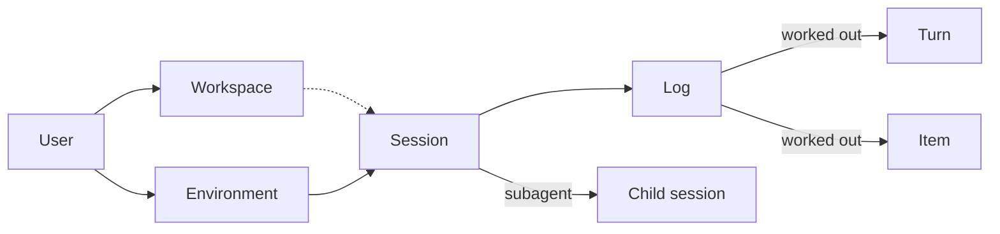

# Core concepts

Ollupi's data has four levels: a user owns workspaces, a workspace holds sessions, a session is a series of turns, and each turn produces a series of items. A session's turns and items are not stored on their own: each session is an append-only log, and its turns and items are worked out from the log.

## Workspace

A project folder in the user's sandbox: a local folder on the desktop app, a path on the user's own sandbox machine in the cloud. Tools read and write files and run commands here, and permission rules can be set per workspace. A session may belong to a workspace or to none (general). A workspace can be archived but not deleted; once archived, no new session starts in it and its sessions take no new messages.

## Environment

Where a session's commands and file tools run. Every user has this machine as one environment, and can add cloud sandboxes of their own. A session chooses its environment when it starts and keeps it, and its subagents follow it; a session that chooses none runs on this machine. Which machine an environment stands for is the host's to decide. See the [gateway protocol](/zh/integrate/protocol/workspaces#执行环境的方法) (in Chinese).

## Session (thread)

One continuous conversation. Subagents and scheduled tasks use ordinary sessions too; the engine has no special way of running them.

| State | Meaning |
|---|---|
| Idle | No turn that has not ended |
| Active | A turn has not ended and is not waiting on the user |
| Waiting on approval | The current turn has a call waiting for the user to approve it |
| Waiting on an answer | The current turn has a question waiting for the user's answer |

When a subagent waits for the user's approval or answer, its parent session shows as waiting too, approval first when there are both, so the session list shows every place that waits on the user.

## Log

Each session is an append-only log. The user sending a message, the model answering, a tool call being proposed, approved, started and given its result: each is a new entry in the log, never changed once written. What state a turn is in, what it waits on and what comes next are all worked out from the log; no scheduling state lives in memory.

The log brings three rules:

- **Write, then act.** Every step is appended to the log before it is carried out. If the process is killed at any moment, reading the log on restart shows how far each session got, and the same logic carries on from there.
- **Check before writing.** Every entry is checked before it is written: whether it can follow the log as it stands. An ended turn takes nothing more, only a call waiting for approval can be approved, and so on. An entry that cannot follow refuses the whole write.
- **Tell after writing.** Only once a write commits do its changes go out to clients, the scheduler and memory extraction; the changes of one commit share one number, by which a client drops notifications that are out of date. The writer tells no one directly.

## Turn

One thing handed to the agent is one turn. It comes from one of three places: the user sending a message, a scheduled task falling due, or a parent session launching a subagent. A turn may call the model and tools many times.

A session runs one turn at a time. While it is busy, each new message becomes a turn of its own queued behind, up to 20; to say something to the turn that is running, the user steers, and the message joins the current turn, where the agent reads it at its next step.

| State | Meaning | Holds a slot |
|---|---|---|
| Queued | Behind a turn of the same session that has not ended | No |
| In progress | The session's current turn | Only while it actually runs; given up while waiting on an approval, an answer or subagents |
| Completed / failed / interrupted | Ended | No |

What an in-progress turn is doing is read from its items: a call waiting for approval or an answer means it waits on the user; an answer given while subagents it launched have not all reported means it waits on subagents; otherwise it can run and waits for a free slot. A turn whose run fails or passes its time limit (four hours by default) ends as failed.

How turns move between states, and what moves them, is in the [execution model](/engine/execution).

## Item

Each step in a turn is an item; the interface's timeline is the list of items. An item is worked out from one or several log entries: a tool call, for instance, is several entries in the log, from being proposed through waiting for approval and starting to its result, and one item in the timeline.

| Type | Content |
|---|---|
| User message | The message that opened a turn, a steer, or the task handed to a subagent |
| Answer | The model's reply to the user |
| Reasoning | The model's reasoning |
| Tool call | One tool call, with its arguments, approval, question and result in this one item |
| Subagent report | A subagent's report, handed back to the turn that launched it |
| Context compaction | The summary a compaction leaves |
| Memory | The memories loaded for this turn |
| Notice | Something the runtime tells the model, such as why tool use stopped |
| Error | A failed model call |

Items have their own states: pending, in progress, completed, failed, declined. The difference between pending and in progress decides what a restart does to a tool: a call not yet started runs as usual; a call started without a result may already have taken effect, so after a restart it is marked as cut off and the agent is told to check before deciding whether to retry. It is never run twice on its own.

## Slot

The unit of concurrency in the execution pool. To run its current turn, a session first takes a slot; there are 32 in all by default, and the host can cap how many one user holds at once. Waiting turns give up their slots, so the slot count limits turns running at once, not the number of sessions. When slots run short, users' own sessions go before subagents, and sessions of the same kind go in the order they became able to run.

Model calls have a second limit, per model connection: 4 per connection by default. Tool execution does not count against it.

## Shard

One database is one shard. A shard holds many users, who share its tables with their data isolated by user. Only one process holds a shard's lease at a time, and a standby takes over when that process dies. The number of shards sets the capacity. The desktop app has one shard and one default user. See [shards and users](/engine/sharding).

## Approvals and questions

A tool call may need the user's approval, and the agent can ask the user structured questions. In both cases the turn gives up its slot and can run again once the user approves, declines or answers. A question can be skipped, and the agent goes on without the answer. See [permissions and approvals](/engine/permissions).

## Subagents

A subtask launched by a tool call in the parent session, of one of two kinds: general or browser. A subagent is an ordinary session whose turns queue with all the others, at a lower priority than users' own sessions; it takes no messages from the user directly and cannot launch subagents of its own.

The launch returns at once and the subagent runs beside its parent. When it ends, its report is written as an item into the turn that launched it; once the parent turn has answered, it waits for every subagent it launched to report before answering again. While it waits it holds no slot; if the user steers meanwhile, it replies first and then goes back to waiting.

## Memory and skills

Memory is long-term information distilled in the background from finished turns, in four kinds: preferences, decisions, procedures and facts. Each user has two switches: with memory off, sessions neither load nor search memories; with learning off, the memories kept are used as before, but nothing new is learned from turns. See [memory](/engine/memory).

A skill is a folder containing a `SKILL.md`, installed for each kind of agent separately and activated by the agent when needed. See [skills and MCP](/engine/skills-mcp).

## See also

More terms are in the [glossary](/reference/glossary).
