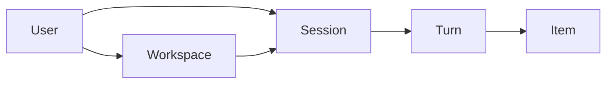

# Core concepts

Ollupi's data has four levels: a user owns workspaces, a workspace holds sessions, a session is a series of turns, and each turn produces a series of items.

## Workspace

A project folder in the user's sandbox (`Box`): a local folder on the desktop app, a path on the user's own sandbox machine in the cloud. Tools read and write files and run commands here, and permission rules can be set per workspace. A session may belong to a workspace or to none (general).

## Session (thread)

One continuous conversation. Subagents and scheduled tasks use ordinary sessions too; the engine has no special way of running them.

| State | Meaning |
|---|---|
| `idle` | No turn in progress |
| `active` | A turn is running |
| `waitingOnApproval` | Waiting for the user to approve |
| `waitingOnUserInput` | Waiting for the user to answer a question |

## Turn

From the user sending a message to the agent's result is one turn. A turn may call the model and tools many times. A session runs one turn at a time; the rest queue.

| State | Meaning | Holds a slot |
|---|---|---|
| `queued` | Behind the previous turn of the same session | No |
| `ready` | Can run, waiting for a free slot | No |
| `inProgress` | Running | Yes |
| `waitingOnApproval` | Waiting for an approval | No |
| `waitingOnUserInput` | Waiting for an answer | No |
| `waitingOnAgent` | Waiting for subagents | No |
| `completed` / `interrupted` / `failed` | Finished | No |

How turns move between states is in the [execution model](/engine/execution).

## Item

Everything that happens in a turn is an item; the interface's timeline is the list of items.

| Type | Content |
|---|---|
| `userMessage` | A message from the user |
| `agentMessage` | The model's reply to the user |
| `reasoning` | The model's reasoning |
| `toolCall` | One tool call |
| `contextCompaction` | A context compaction |
| `memoryContext` | Memory loaded into the session |
| `error` | An error |

Items have their own states: `pending`, `inProgress`, `completed`, `failed`, `declined`. The difference between `pending` and `inProgress` decides what happens to a tool after a restart: a `pending` call has not run and runs as usual; an `inProgress` call may already have taken effect and is not run again.

## Slot

The unit of concurrency in the execution pool. Only turns holding a slot are running; there are 32 by default. Waiting turns give up their slots, so the slot count limits turns running at once, not the number of sessions.

Model calls have a second limit, per model connection: 4 per connection by default. Tool execution does not count against it.

## Shard

One database is one shard. A shard holds many users, who share its tables with their data isolated by user. Only one process holds a shard's lease at a time. The number of shards sets the capacity. The desktop app has one shard and one default user. See [shards and users](/engine/sharding).

## Approvals and questions

A tool call may need the user's approval, and the agent can ask the user structured questions with `request_user_input`. In both cases the turn gives up its slot and returns to the queue once the user responds. See [permissions and approvals](/engine/permissions).

## Subagents

Subtasks started by the `Agent` tool. A subagent is an ordinary session whose turns queue with all the others, at a lower priority than top-level sessions. While the parent turn waits it is `waitingOnAgent` and holds no slot; the subagent's result comes back as the tool call's result.

## Memory and skills

Memory is long-term information distilled in the background from finished turns, in four kinds: preferences, decisions, procedures and facts. See [memory](/engine/memory).

A skill is a folder containing a `SKILL.md`, which the agent activates when needed. See [skills and MCP](/engine/skills-mcp).

## See also

More terms are in the [glossary](/reference/glossary).
