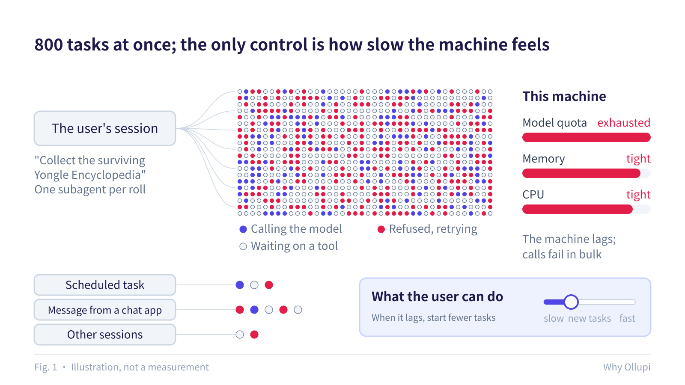
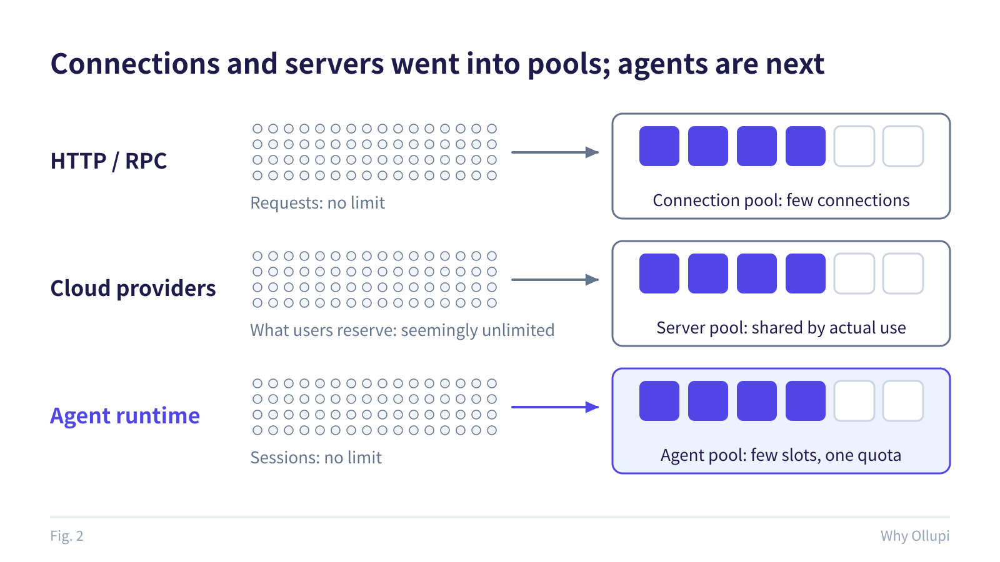
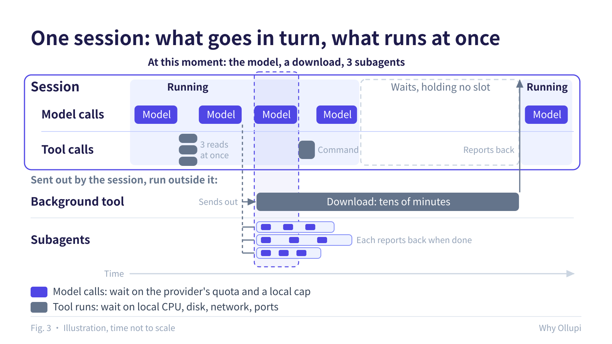
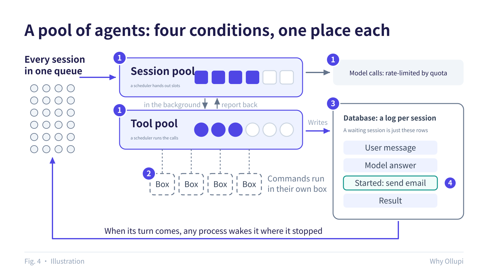
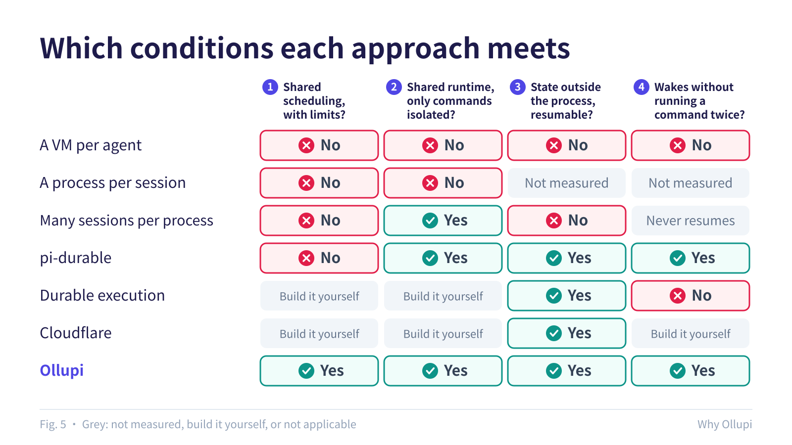
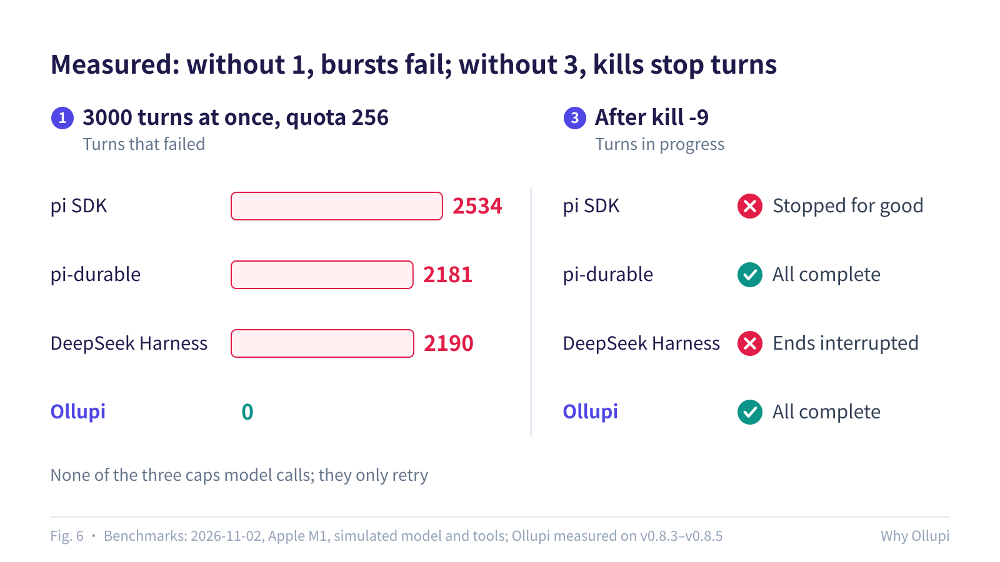
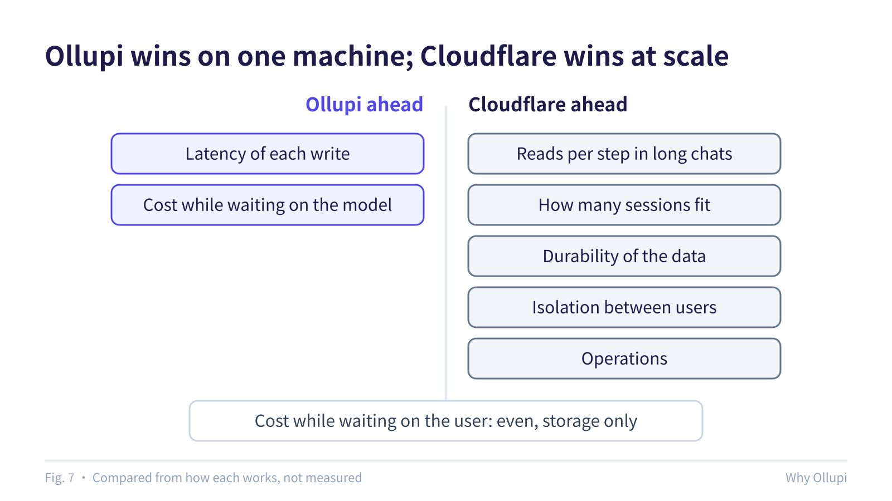

# Why Ollupi

Agents will run by the hundreds and thousands at once, on personal computers and on cloud platforms alike. Machines and model quotas are limited; people's ideas and needs are not. Which agents should run at a given moment is something the user cannot decide one by one, and the main agent cannot judge accurately either. Network connections and servers met the same problem, and both were solved with pools. Agents need pooling too, but a session is more complex than a connection: pooling has to meet four conditions, and every existing approach misses at least one. Ollupi is a runtime designed for exactly these four conditions.

## The problem: more agents than a person can schedule

Suppose you give an agent a task: collect the surviving parts of the Yongle Encyclopedia. The more than 800 surviving volumes are scattered across more than 30 institutions in eight countries. The agent launches one subagent per volume to find, download, recognize and proofread the scans: more than 800 sessions (threads) in all. On the same computer there are also scheduled tasks, messages from chat apps and other sessions.

These sessions start at the same time and compete for the same model quota, memory and CPU: model requests are refused in bulk and retried again and again, and the machine gets slower and slower. Who decides which sessions run at a given moment?

- **The user decides.** The user cannot see how much quota and memory is left, and can only slow down starting new tasks by hand according to how sluggish the machine feels. This is imprecise, and it adds to the user's load.
- **The main agent decides.** It cannot see the remaining quota and memory, or the state of the other sessions, so it can only estimate; and each estimate costs an extra model call.

## The answer: pooling

The software industry has solved a similar problem twice. HTTP and RPC frameworks use connection pools: the number of connections is capped, requests queue, and a connection goes back when it is done. Cloud providers pool physical machines: users request what they need and the available resources seem unlimited, but the platform hands out only what is actually used, and idle CPU and memory go to other users. AWS Lambda oversubscribes CPU and memory up to 10 times in production, and idle EC2 capacity is sold cheaply as Spot Instances. What the two have in common: total resources are capped, they are handed out by actual use, and what is idle is given back. The caller only submits requests; it does not allocate resources.

Agents are the third time. With a pool, the user only sets the limits and then hands over every task: even if 800 subagents are launched, no more than the limit run at once, and the rest queue. One running place in the pool is called a slot.

But a session is not a connection. A connection is borrowed for a few milliseconds and returned, and it is used the same way every time; a session can last from minutes to days, calling the model, running commands and launching subagents along the way. Before sessions can be pooled, their life cycle has to be clear.

## The life cycle of a session

The runtime's own computation is small: each turn needs only a few to a few dozen milliseconds of CPU. The rest of the time is spent waiting, and what is waited on decides what can run at once:

- **Model calls** take the longest, from a few seconds to a minute each. A session's model calls run one after another, since each step depends on the result of the last. The bottleneck is outside: the model provider's quota, and the local limit on concurrent requests.
- **Tool calls** happen several times a turn and vary widely in length. Read-only calls (such as reading a file) can run at once and finish in milliseconds; commands run one at a time. Long calls (such as downloading a file) can move to the background while the session goes on calling the model. The bottleneck is the local CPU, disk and network, and some tools also hold ports. Commands change files and send requests, and some of these actions cannot be undone.
- **Subagents** are separate sessions. Several can be launched at once, and each goes through a full life cycle of its own.
- **While waiting for a report, an approval or the user's reply**, the session does no work at all, and the wait can last days.

So at one moment, a single session may have a model call, a download and several subagents running at the same time, each limited by a different resource.

## Four conditions

Pooling requires a session to give back its slot while it is idle and to resume when its turn comes. The life cycle above has four features, each of which leads to one condition:

1. **Different bottlenecks → schedule them separately, each with its own limit.** Sessions are let through by slots; model calls are rate-limited by the provider's quota and the local concurrency limit; the model can move long tool calls to the background, where they run in a separate tool pool and, when done, report back the way a subagent does. If the three shared one queue they would block each other: if tool runs took up model-call places, a few long-running tools would use them all up and leave every session unable to call the model. The limits must also be shared by all sessions: if each session calls, gets refused and retries on its own, it only makes congestion worse.
2. **Commands must run → separate the runtime from the sandbox.** The agent loop uses almost no computation; what needs isolating is the commands it runs. The loop runs in a shared runtime, and commands run in their own sandboxes. Otherwise every session would carry a whole set of processes or a whole machine, and the pool's capacity would drop sharply.
3. **Waits last days → no session state in the runtime.** While a session waits, processes restart and are upgraded, and machines fail. So every step is written to durable storage: a waiting session is only a log in the database, holding no slot and no memory, and any process can wake it and continue from where it stopped.
4. **Commands have side effects → do not blindly redo on waking.** An email that has been sent cannot be taken back. A record is written before a tool runs; if the process exits partway, the call is marked "may have taken effect" and left for the model and the user to check, never redone automatically.

Without any one of these, pooling does not work. Any mechanism beyond these four should say which of them would break without it; otherwise it is surplus.

## Existing approaches: what each solves, and what it lacks

The first four approaches build on one another: each solves the previous one's problem and leaves a new gap. Cloudflare takes a different route.

1. **One virtual machine per agent.** The agent and the commands it runs go into the same machine, fully isolated. The gap is that nothing is shared: each agent has a machine to itself and does not release it when idle; each calls the model on its own with no common limit; suspending relies on memory snapshots, and resuming returns to the moment of the snapshot, so commands run after it may run again.
2. **One process per session**, such as Claude Code and its SDK. There is no longer a machine for every agent, and one machine can host many sessions. The gap is that only the commands need isolating, yet every session gets a complete runtime environment: running Ollupi and DeepSeek Harness with one process per session takes 17.7–129 MB per process. Model calls are still made separately, with no common limit.
3. **One process hosting many sessions**, such as pi's SDK and DeepSeek Harness. Sessions share one process, which saves the surplus runtime environments. There are two gaps: no common limit, so they fail in bulk under bursts; and state lives only in memory, so when the process is killed turns are cut off, and waiting sessions still hold memory. pi's experimental version, pi-durable, stores state in SQLite and can continue from where it stopped after being killed, but still lacks a common limit.
4. **Durable execution frameworks**, such as Temporal, Restate and DBOS. State is durable, and after a restart the process can resume from where it stopped. The gap is that they do not understand an agent's steps and can only treat the code as a black box: on recovery they replay the code, and a failed step is retried, so every step must be safe to repeat, which commands the model decides on the spot cannot be. Scheduling limits and sandboxes also have to be built by hand.
5. **Cloudflare's Durable Objects and Workflows**, the other route to pooling: pooling done at the platform layer. Each session is a separate object with its own storage, and while waiting it is only storage; scaling, replication and isolation are the platform's job. What it offers is lower-level building blocks: the agent loop, limits on model calls and the record of side effects still have to be built on top by the developer.

## Ollupi: only these four conditions

Ollupi does pooling at the runtime layer. All four conditions require the runtime to know which step the loop is on: which step is a model call, which is running a command, and what each step's result is. A general framework cannot understand an agent's steps, and an in-process harness cannot see other sessions. So Ollupi implements the agent loop itself, with one mechanism for each condition:

| Condition | How Ollupi meets it |
|---|---|
| Schedule separately, each with its own limit | Three limits, one for each bottleneck. Session pool: a fixed number of slots, with the total and the per-user limit configurable; subagents and scheduled tasks are ordinary sessions in the pool. Model calls: rate-limited by the provider's quota; tool runs do not take model-call places. Tool pool: tool calls moved to the background queue here, with the total and the per-user limit configurable; the model is told "started" and goes on with other work |
| Separate the runtime from the sandbox | Commands and file operations all go through the same sandbox interface; locally the macOS system sandbox is used, and a cloud sandbox can be plugged in |
| No session state in the runtime | Each session is an append-only log, and its state is computed from the log; process memory records only which slots are held; when a process exits a standby takes over, and capacity grows by adding shards |
| Do not blindly redo on waking | Before a tool runs, the log first records "started"; a call cut off partway is marked "may have taken effect" |

What is given up is customization: a host can replace the model, the tools, the sandbox and the authentication, but not the loop itself. Teams that need to design their own loop are better served by a durable execution framework.

## Costs and limits

Ollupi and Cloudflare are the two routes to pooling: Cloudflare at the platform layer, Ollupi at the runtime layer. The trade-off between them:

Ollupi keeps sessions in one process and one database, and its advantage is efficiency on one machine: each step is written to local SQLite, and waiting on the model takes only one slot. The cost is that scaling, replication and isolation are left to whoever deploys it: a shard is one file on one machine, more capacity means more shards, backups have to be done by the deployer, and users on the same shard affect each other. So it can run directly on a personal computer, and a provider can also embed it in its own service and deploy it on its own cloud; the more users and the higher the concurrency, the more pooled scheduling pays off.

One thing not yet solved: the limits cap concurrent sessions, model requests and background tool calls, but not the memory and CPU the commands themselves use. This item is on the [roadmap](/roadmap).

## Evidence

| Claim | Data |
|---|---|
| The agent loop uses almost no CPU | 512 sessions running at once, with turns of about 17 seconds, take 0.64 of a core for the whole process |
| Waiting sessions take almost no memory | 50,000 waiting sessions take 34 MB of resident memory in all; in the side-by-side comparison, a waiting session takes 14 KB on Ollupi and 64–147 KB on the other three harnesses |
| A shared runtime uses less memory than one process per session | About 112 KB per active session; with one process per session, 17.7 MB for Ollupi and 129 MB for DeepSeek Harness |
| With shared limits, bursts do not cause failures | 3000 turns submitted at once with a quota of 256: all complete on Ollupi, with no 429s; the other three complete 483–1764 |
| After the process is killed, it continues from where it stopped without redoing | 30 kills while 500 sessions run: all 600 turns completed, and of 110 calls cut off, 0 redone |
| Latency at full load | At 1536 sessions at once, a turn is about 5% slower than alone (17 s); at 4096, its median is 48.2 s, nearly all of the extra time spent waiting for the one SQLite connection |
| Resources held by an agent suspended in a virtual machine | To be added |
| How long a standby takes to take over | 1.3 s at the median with a 1.5 s lease; across 8 kills, all 480 turns complete |
| How a heavy user affects others on the same shard | With one user filling every slot, the others wait 206 s; with a per-user limit of 64 slots, they wait 8 ms and their turns take 17.1 s, as alone |
| Fairness between users | To be added |
| Whether adding shards scales linearly | On one machine, 4096 sessions over 1, 2 and 4 shards run 84.9, 116.3 and 144.4 turns a second, and at 4 shards the machine runs out first; with a machine for each shard, to be added |

The data so far comes from [benchmarks](/benchmarks/) and the [comparison with other harnesses](/benchmarks/#comparison): a simulated model and simulated tools, on one Apple M1 with 8 GB of memory; Ollupi was measured on v0.18.0 (2026-11-19), one run each. What is still blank is in [what to measure next](/benchmarks/plan).

## Two projects

- **[ollupi](https://github.com/0xfakeSpike/ollupi)**, the engine: a Go library for hosts that serve many users. Start with [embed the engine](/integrate/embed).
- **[ollupi-desktop](https://github.com/0xfakeSpike/ollupi-desktop)**, a macOS app built on the engine. It is the engine's simplest real deployment, one user with many sessions, and the author uses it every day. Start with the [desktop quickstart](/app/install).

What comes next is on the [roadmap](/roadmap).

## References

- AWS Lambda's oversubscription (soft allocation, up to 10 times in production): [Firecracker: Lightweight Virtualization for Serverless Applications](https://www.usenix.org/conference/nsdi20/presentation/agache)
- Spot Instances use idle EC2 capacity: [Spot Instances](https://docs.aws.amazon.com/AWSEC2/latest/UserGuide/using-spot-instances.html)
- The Claude Agent SDK runs one subprocess per session: [Hosting the Agent SDK](https://code.claude.com/docs/en/agent-sdk/hosting)
- Temporal retries steps by default and requires them to be safe to repeat: [What is idempotency? And why it matters for durable systems](https://temporal.io/blog/idempotency-and-durable-execution)
- SQLite in Durable Objects and write confirmation: [Zero-latency SQLite storage in every Durable Object](https://blog.cloudflare.com/sqlite-in-durable-objects)
- Durable Objects pricing: [Durable Objects pricing](https://developers.cloudflare.com/durable-objects/platform/pricing)
