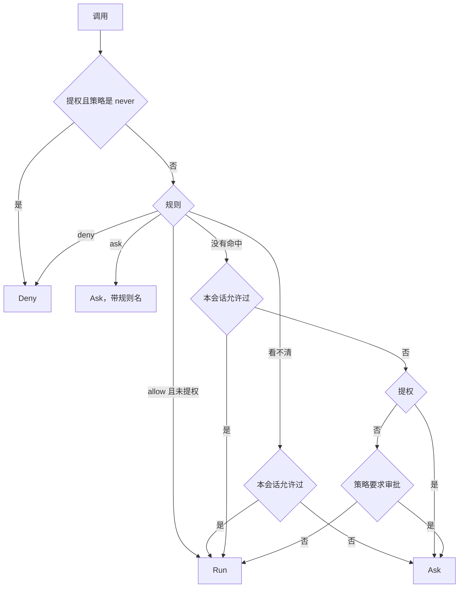

# 审批与权限

代理调用工具之前，`agent/permission` 决定这次调用是直接运行、问用户，还是拒绝。决定基于三样东西：审批策略、规则、这次调用的内容。审批（approval）是这个决定为"问用户"时的等待流程。等待期间这一轮让出槽位，只留在数据库里。

## 判定顺序

`Checker.decide` 按固定顺序走，先到先得：



提权的调用即使命中 allow 规则也不直接运行，继续走后面的判断。拒绝时错误交给模型，告诉它不要重试。

## 审批策略

策略只有三档，取 `untrusted`、`on-request`、`never`。它只在规则没有给出结论时起作用。

```go
func (p Policy) requiresApproval(a tools.Annotations, prepared *tools.Prepared) bool
```

| 调用 | `never` | `on-request` | `untrusted` |
| --- | --- | --- | --- |
| 只读且封闭：`read_file`、`glob`、`grep`、`update_plan` | 运行 | 运行 | 运行 |
| 只读但 `OpenWorldHint` 未关：MCP 服务器标了只读的工具 | 运行 | 运行 | 问 |
| 在沙箱内执行：`run_command`、`edit_file`、`write_file`（沙箱生效时） | 运行 | 运行 | 问 |
| 其他非只读：`web_fetch`、定时任务的增删、未标只读的 MCP 工具、沙箱关闭时的命令 | 运行 | 问 | 问 |
| 提权的命令 | 拒绝 | 问 | 问 |

`on-request` 的依据是 `Prepared.Sandboxed`：沙箱已经限制了命令能做什么，所以不用问。`never` 下没有人能批准，所以提权一律拒绝，错误告诉模型在沙箱内完成或告知用户。

## 规则语法

规则分 `allow`、`ask`、`deny` 三组，每条是 `工具` 或 `工具(说明符)`。

| 写法 | 匹配 |
| --- | --- |
| `edit_file` | 这个工具的所有调用 |
| `edit_file(*)` | 同上 |
| `run_command(git status)` | 内容完全等于 `git status` |
| `run_command(git:*)` | `git`，或 `git` 后接空格和任意内容 |
| `run_command(git *)` | 同上 |
| `read_file(src/*)` | `src/` 开头，`*` 跨目录 |
| `web_fetch(example.com)` | 主机名 |

- `*` 编译成 `.*`，可以跨 `/` 和换行。结尾的 `:*` 或空格加 `*` 表示后面的部分可有可无。
- 说明符的第一个词转小写，匹配的内容里程序名也是小写，其余大小写敏感。路径和主机名的内容整体小写。
- 空说明符、缺右括号、工具名含空格都报错。
- 没有 `PermissionContent` 的工具不能写说明符（"takes no specifier"），MCP 工具都属于这一类。
- 工具名必须在注册表里，否则报错。服务器暂时连不上时，已保存的规则保留，但不能新增。

一条不带说明符的 `deny` 把工具从发给模型的列表里去掉。带说明符的 `deny` 只拒绝匹配的调用。

### 匹配过程

`ruleSet.decide` 的输入是 `Content`：`Match` 加上 `Parts`（拆开的子命令）。

1. 依次试 `deny`、`ask`。`Match` 或任一 `Parts` 命中即生效。
2. 内容看不清（`Opaque`），且这个工具有带说明符的 `deny` 或 `ask` 规则：无法证明它们不适用，结果是"看不清"，转为问用户。
3. 有不带说明符的 `allow`：通过。
4. 内容看不清或没有内容：没有结论。
5. 每个 `Parts` 都必须被某条 `allow` 匹配，缺一个就没有结论。

第 5 步是 `allow` 比 `deny` 严的地方：`deny` 命中一部分就够，`allow` 要覆盖全部。`git status && rm -rf x` 不会因为允许了 `git:*` 而放行。

## 三层叠加

设置存在三个地方，格式相同：

```go
type PermissionSettings struct {
	ApprovalPolicy string          `json:"approvalPolicy,omitempty"`
	Rules          PermissionRules `json:"permissions"`
}
```

| 层 | 来源 |
| --- | --- |
| 代理默认 | `Config.Settings` |
| 工作区 | `workspaces.settings` |
| 会话 | `threads.settings` |

`permission.Resolve` 按顺序合并：策略取最后一个非空的，三组规则取并集去重。因为 `deny` 永远先判定，下层可以加规则，去不掉上层的 `deny`。默认层必须给出有效策略，否则构建 `Checker` 时报错。

子代理不用自己的会话设置。它的层是：代理默认、工作区、父会话的设置，再加一层 `Deny: ["Agent"]`，所以子代理不能再派生。

`Checker` 在一轮开始时构建，每次模型回答后 `Reload` 重建，会话设置的修改在下一次回答后生效。读不到权限设置时这一轮失败，不会退回默认值。

修改走 `thread/updatePermissions` 和 `workspace/updatePermissions`，由 `ValidateLayer` 校验：单层规则合法，合并后也合法。

## 命令解析

`run_command` 的 `PermissionContent` 不是简单拼字符串。模型常把命令包在 `sh -c` 或 `env` 里，所以规则要看到真正运行的程序。

`Match` 是 `程序名 参数...`，程序名取路径的最后一段并转小写。`expand` 递归拆开包装，最多 4 层，结果放进 `Parts`。

| 形式 | 处理 |
| --- | --- |
| `sh -c "a && b"`（`sh`、`bash`、`zsh`、`dash`、`ash`、`ksh`、`fish`、`csh`、`tcsh`） | 解析脚本，按 `;`、`&`、`\|`、换行拆成子命令，每个再展开 |
| `sh script.sh` | 不拆，按普通命令 |
| `env`、`nohup`、`nice`、`caffeinate`、`time` 接命令 | 去掉包装 |
| `timeout 5 cmd` | 去掉 `timeout` 和时长 |
| 上面这些包装带选项，或 `env A=B cmd` | 看不清 |
| `xargs`、`sudo`、`doas` | 看不清，不拆 |
| 路径不在系统目录下的程序，比如 `./sh` | 看不清 |
| 超过 4 层 | 看不清 |

系统目录是 `/bin`、`/sbin`、`/usr/bin`、`/usr/sbin`、`/usr/local/bin`、`/opt/homebrew/bin`、`/opt/homebrew/sbin`。名字不含 `/` 的程序算可信。路径检查的意义在于仓库里一个叫 `sh` 的脚本不是 shell。

### 看不清的命令

脚本解析器 `splitScript` 只认它确定能理解的语法，其余一律标看不清：

- `$`、反引号、`(`、`)`、`{`、`}`、`#`、`!`、`~`，在单引号之外出现（双引号内只看 `$` 和反引号）
- 引号外的非 ASCII 字符
- `<(`、`>(` 进程替换
- 未闭合的引号、结尾的反斜杠、行继续
- 程序位置是赋值（`A=1 cmd`）、含通配符，或是保留字
- 保留字：`if`、`for`、`while`、`case`、`eval`、`source`、`.`、`exec`、`command`、`builtin`、`alias`、`trap`、`export` 等

重定向被跳过，目标不算词。`2>&1` 的 `2` 也被去掉。带 `env` 参数的调用也标看不清，审批时环境变量排在命令前显示。

看不清的效果：带说明符的 `allow` 不生效，不提供"总是允许"；工具上有带说明符的 `deny` 或 `ask` 时转为问用户。工具上没有这类规则时，结论落到审批策略，`on-request` 下沙箱内的命令仍然直接运行，沙箱是这时的限制。

### 命令黑名单

`command_blacklist` 是 `workspace` 配置项，和规则分开。`Prepare` 阶段检查，比对 `Match` 和全部 `Parts` 的连续词序列，命中直接拒绝，策略和审批都改变不了。

## 审批流程


`Approval` 是条目上的一个 JSON 字段：

| 字段 | 含义 |
| --- | --- |
| `id`、`requestedAt` | 请求 ID 和时间 |
| `reason` | 说明为什么要问 |
| `rule` | 触发询问的规则 |
| `content` | `Content.Text`，批准的具体内容 |
| `suggestedRules` | "总是允许"会写入的规则 |
| `decision`、`decidedBy`、`decidedAt` | 决定 |

条目的 `Approval` 非空且 `Decision` 为空时，这一轮状态是 `waitingOnApproval`。一批调用里遇到第一个要问的就停，后面的调用留在 `pending`，所以审批一个接一个出现。请求发送时带 `preparedExecution`，界面显示冻结的命令和 diff。

可选决定由 `AvailableDecisions` 算：

| 情况 | 可选 |
| --- | --- |
| 由规则触发 | `accept`、`decline` |
| 没有建议规则（看不清、提权、含 `*`） | `accept`、`acceptForSession`、`decline` |
| 其他 | `accept`、`acceptForSession`、`acceptAlways`、`decline` |

规则触发时不给"总是允许"：`ask` 规则的意思就是每次都问，加 `allow` 也改变不了。

| 决定 | 效果 |
| --- | --- |
| `accept` | 只放行这一次 |
| `acceptForSession` | 本会话内完全相同的调用不再问：工具相同，`Prepared` 深度相等，`Content.Text` 相等 |
| `acceptAlways` | 写入规则，然后放行 |
| `decline` | 条目 `declined`，这一轮停止用工具，由模型写最终回答 |

`acceptForSession` 不存额外状态，判定时直接扫描会话历史里的条目。`Prepared` 里有设置摘要，沙箱配置变了之后旧批准自然失效。

决定只在这一轮不占槽位时接受，占着槽位或请求不存在时返回 `ErrNoSuchRequest`。

## "总是允许"的写入

`suggest` 为每个 `Part` 生成一条规则：

| 内容 | 建议 |
| --- | --- |
| 工具没有 `PermissionContent` | 工具名本身 |
| `git status --short` | `run_command(git status:*)`，第二个词像子命令时 |
| `rm -rf build` | `run_command(rm -rf build)`，第二个词不像子命令时用原文 |
| 多个子命令 | 每个一条，去重 |
| 含 `*`、看不清、提权 | 不建议 |

建议的规则会被再解析一次，确认它确实匹配这次调用才给出。子命令的判断标准是 `^[a-z][a-z0-9_-]*$`。

`allowAlways` 决定写到哪里：

| 会话 | 写入 |
| --- | --- |
| 在工作区里 | 工作区设置 |
| 不在工作区（general） | 会话设置 |
| 子代理 | 先换成父会话，再按上面两条 |

写入走 `UpdateWorkspaceSettings` 或 `UpdateThreadSettings`，和界面修改同一条路径，校验相同，界面随即收到变化通知。写入失败时决定也不生效。

## 结构化提问

`request_user_input` 让模型向用户提问，而不是把问题写在回答里。它和审批共用等待机制，但这是一次工具调用：`Invoke` 校验后返回 `Await{By: user}`，条目保持 `inProgress`，这一轮状态是 `waitingOnUserInput`。

| 项 | 约束 |
| --- | --- |
| 问题数 | 1 到 4 |
| `id` | `^[a-z][a-z0-9_]{0,63}$`，不重复 |
| `header` | 1 到 12 字符 |
| `question` | 1 到 600 字符 |
| `options` | 至多 4 个，可省略 |
| `options[].label` | 1 到 60 字符 |
| `options[].description` | 至多 200 字符 |

工具描述要求这是回答里唯一的调用，同一回答里的其他调用会在用户回答之前运行。

界面收到 `item/tool/requestUserInput`，回 `{answers: {问题 ID: {answers: [...]}}}`。`Request.Check` 校验：每题都有回答，回答不为空，没有多出的题，总长不超过 4000 字符。校验失败返回 `ErrInvalidAnswer`，请求仍在等待。通过后回答成为工具结果，条目 `completed`。

待处理请求按时间排序。`PendingRequests` 列出一个会话及其子代理的请求，`AllPendingRequests` 列出用户全部等待中的会话的请求，连接恢复后界面能重新拿到它们。

## 代码位置

| 位置 | 职责 |
| --- | --- |
| ollupi `agent/permission/permission.go` | 层合并、`Checker`、判定顺序、会话内允许 |
| ollupi `agent/permission/policy.go` | 三档策略 |
| ollupi `agent/permission/rules.go` | 规则解析、匹配、建议规则 |
| ollupi `tools/workspace/command.go` | 命令结构化解析、黑名单 |
| ollupi `tools/userinput/userinput.go` | 结构化提问 |
| ollupi `agent/runtime/calls.go` | 调用判定、批准后重新校验 |
| ollupi `agent/turns.go` | 决定和回答的处理、`allowAlways` |
| ollupi `agent/scope.go` | 组装各层 |
| ollupi `agent/requests.go` | 列出待处理请求 |
| ollupi `repo/items.go` | `Approval`、`AvailableDecisions` |
| ollupi `repo/permissions.go` | 设置的存储形状 |
| ollupi `gateway/server.go`、`gateway/protocol.go` | 请求的发送和回应 |
