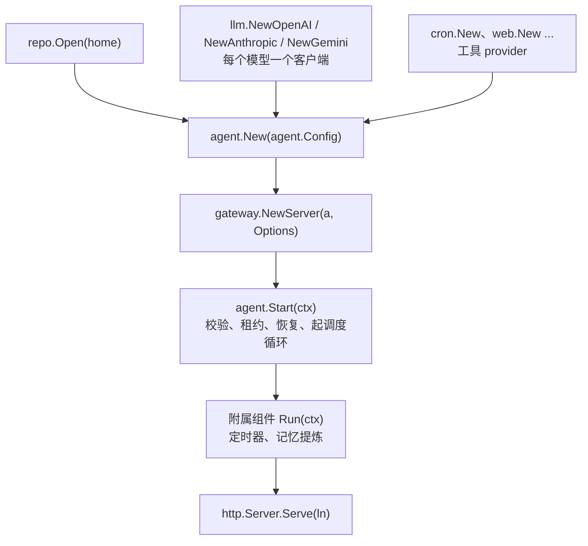

# 把引擎嵌进服务

Ollupi 引擎是一个 Go 库，模块路径 `github.com/0xfakeSpike/ollupi`。它没有 `main`：打开数据库、建模型客户端和工具、构造 `agent.Agent` 与 `gateway.Server`、决定进程何时退出，都是宿主（host）的事。桌面端的 `sidecar/internal/host/host.go` 是一个宿主，`bench/main.go` 是另一个。

本页给要把引擎嵌进自己服务的后端工程师：一个能跑起来的最小宿主，和上线前必须处理的几件事。分层、一轮（turn）的生命周期、槽位（slot）调度见[引擎架构](/engine/architecture)与[执行模型](/engine/execution)。

## 宿主负责什么

引擎提供调度、持久化、工具、权限、协议，但不提供进程。宿主的装配顺序如下。



| 步骤 | 调用 | 前置条件 |
|---|---|---|
| 打开库 | `repo.Open(home)` | 目录可写；二进制带 `-tags sqlite_fts5` 构建 |
| 模型客户端 | `llm.NewOpenAI`、`llm.NewAnthropic`、`llm.NewGemini` | 每个模型一条连接，连接 ID 不重复，`limits` 里写明这个模型 |
| 工具 provider | `cron.New`、`web.New`、`workspace.New` 等 | 需要库的 provider（`cron`）用同一个 `*repo.DB` |
| 构造 agent | `agent.New(agent.Config{...})` | `DB` 非 nil、`Name` 非空；`New` 只填默认值，不启动任何东西 |
| 构造网关 | `gateway.NewServer(a, gateway.Options{...})` | `Options.DB` 非 nil；`Token` 与 `Authenticate` 至少一个 |
| 启动 | `a.Start(ctx)` | 上面全部就绪；配了 `Config.Lease` 时这里会阻塞到拿到租约 |
| 对外服务 | `srv.Serve(ctx, ln)`，或装进自己的 `http.Server` | 必须已 `Start`，否则没有调度循环消费 turn |
| 关闭 | 见下文「关闭、备份与升级」 | 网关先停，库最后关 |

`agent.Config` 里宿主必须填的只有 `Name`、`Models`、`Connections`、`DB`，其余都有默认值或可省略。

| 字段 | 填什么 | 不填时 |
|---|---|---|
| `Name` | 实例名，出现在日志和部分错误里 | 启动失败 |
| `Prompt` | 系统提示词正文 | 空提示词 |
| `Models` | `[]llm.Model`，第一项是默认模型 | 启动失败 |
| `Connections` | 连接 ID 到 `llm.Client` 的映射 | 启动失败 |
| `Settings`、`Tools` | 默认权限层、工具白名单 | 空层；`nil` 表示全部工具可见 |
| `Slots`、`UserSlots`、`RunLimit` | 容量参数 | 32、等于 `Slots`、4 小时 |
| `Providers` | 工具 provider 列表 | 只有引擎内置的 `plan`、`subagent`、`userinput` 等 |
| `DB` | `repo.DB` | 启动失败 |
| `OnEvent` | 把事件交给网关和别的客户端 | 事件只进日志 |
| `Lease` | 分片租约时长 | 不启用租约，进程假定自己是唯一的 |
| `OnLeaseLost` | 失去租约时的回调 | 只写日志 |
| `AttachmentsDir`、`SkillsDir`、`Memory` | 附件目录、技能目录、记忆管理器 | 附件不接收，技能与记忆关闭 |

宿主不自己建 `tools.Registry`：`buildTools` 把 `Providers` 加内置 provider 建成共用注册表，每个用户再有自己的一份（`ToolsFor`）。加工具时实现 `tools.Provider` 的三个方法（`Name`、`ToolList`、`Invoke`）放进 `Providers`。

## 最小宿主程序

下面是 `run()` 的全部内容，`main` 只负责调用它并处理返回的错误。这段代码对着本地引擎模块编译通过；模型名和 limits 取自[桌面端配置](/desktop/config) 里在用的组合，真实部署时把 `home`、监听地址、令牌换成配置项。

```go
func run() error {
	home := "/srv/ollupi"

	db, err := repo.Open(home) // <home>/data/ollupi.sqlite
	if err != nil {
		return err
	}
	defer db.Close()

	models := []llm.Model{{Name: "gpt-5.2", Connection: "openai"}}
	connections := map[string]llm.Client{
		"openai": llm.NewOpenAI("", os.Getenv("OPENAI_API_KEY"), 4, map[string]llm.Limits{
			"gpt-5.2": {Context: 400_000, Output: 128_000},
		}),
	}

	jobs := cron.New(db, time.Local, func(id, threadID string) {})

	var srv *gateway.Server
	a := agent.New(agent.Config{
		Name:        "support",
		Prompt:      "用中文回答工单。",
		Models:      models,
		Connections: connections,
		Settings:    permission.Settings{ApprovalPolicy: string(permission.Never)},
		Providers:   []tools.Provider{jobs, web.New(web.Options{})},
		Slots:       32,
		UserSlots:   4,
		RunLimit:    30 * time.Minute,
		Lease:       15 * time.Second,
		DB:          db,
		OnEvent: func(e agent.Event) {
			srv.Deliver(e) // 事件只在 Start 之后产生，此时 srv 已就位
		},
	})

	srv, err = gateway.NewServer(a, gateway.Options{
		DB:             db,
		Token:          os.Getenv("OLLUPI_GATEWAY_TOKEN"),
		AllowedHosts:   []string{"agent.example.com"},
		AllowedOrigins: []string{"app://support"},
		Jobs:           jobs,
	})
	if err != nil {
		return err
	}

	ctx, stop := signal.NotifyContext(context.Background(), os.Interrupt, syscall.SIGTERM)
	defer stop()
	if err := a.Start(ctx); err != nil {
		return err
	}

	var siblings sync.WaitGroup
	siblings.Go(func() { jobs.Run(ctx, a.StartScheduledTurn) })

	ln, err := net.Listen("tcp", "127.0.0.1:8787")
	if err != nil {
		return err
	}
	server := &http.Server{Handler: srv}
	go func() { _ = server.Serve(ln) }()

	<-ctx.Done() // SIGINT / SIGTERM
	shutdown, cancel := context.WithTimeout(context.Background(), 10*time.Second)
	defer cancel()
	_ = server.Shutdown(shutdown) // 1. 先停网关
	stop()                        // 2. 再停 agent 和附属组件
	siblings.Wait()
	a.Wait()
	return nil
}
```

几个必须注意的点：

- `repo.Open` 的参数是目录，不是文件：库固定为 `<home>/data/ollupi.sqlite`，打开时执行 migration 并保证 `default` 用户存在。DSN 固定 `_busy_timeout=5000`、`_journal_mode=WAL`、`_foreign_keys=on`，连接池只有一条连接。
- `gateway.Server` 实现 `http.Handler`，只挂 `GET /`。自己配 `http.Server` 时要确认 `Handler` 就是它，不要加前缀路径。
- 网关默认只接受 `Host` 为 `localhost`、`127.0.0.1`、`::1` 的请求，`AllowedHosts` 要写上对外域名，否则经反向代理进来一律 403 `host not allowed`；`Origin` 同理，`AllowedOrigins` 填前端来源。
- `Token` 是单用户网关的令牌，归 `default` 用户；多用户换成 `Authenticate`，见[分片与多用户](/engine/sharding)。
- `llm.NewGemini` 返回 `(*Gemini, error)`，`NewOpenAI` 和 `NewAnthropic` 不返回错误，装配时别抄错签名。

## 多用户与分片

一个进程打开一个 SQLite 文件，这个文件就是一个分片。要让同一时刻只有一个进程运行它，靠库里 `shard_lease` 的一行租约保证。

`Config.Lease` 是一个时长，设了才启用租约。`Agent.Start` 在恢复之前调用 `claimShard`：没拿到就每 L/3 重试一次，一直阻塞到拿到或 ctx 结束；拿到后每 L/3 续约。失去租约时调用 `OnLeaseLost`，取消 agent 的 ctx。配了租约时 `Start` 可能长时间不返回。

多进程部署由三层组成：

| 角色 | 起几个 | 说明 |
|---|---|---|
| 分片进程 | 每个分片一个，另加备用 | 备用进程用同样的 `Lease` 等待接管 |
| 路由器 | 任意个，无状态 | `gateway.NewRouter(authenticate, directory)`，`repo.Catalog` 实现 `Directory` |
| 目录库 | 一个 | `repo.OpenCatalog(path)`，参数是文件路径；保存 `shards` 和 `placements` 两张表 |

`repo.Catalog` 负责用户放置：`ShardOf(user)` 把新用户放进 `accepting` 且用户最少的分片，`Place(user, shard)` 由运维在用户有数据之前指定。`Publish(shard, address, accepting)` 由拿到租约的进程在 `Start` 返回后调用。租约的时间参数、围栏、`OnShard` 校验、令牌读法都在[分片与多用户](/engine/sharding)。

## 容量与限流

槽位和模型并发是两个独立的上限，另外两个是单用户限额与时长：

| 参数 | 控制什么 | 默认 |
|---|---|---|
| `Config.Slots` | 这个进程同时运行的 turn 数 | 32 |
| `Config.UserSlots` | 一个用户最多占几个槽位 | 等于 `Slots` |
| `llm` 客户端的 `calls` | 一条连接同时在途的模型请求数 | 4 |
| `Config.RunLimit` | 一次占用槽位的最长时间 | 4 小时 |

工具执行不占模型名额，名额满时调用在通道上排队，这一轮仍占着槽位。所以把 `Slots` 调到远大于 `calls` 不会提高吞吐，只会让更多 turn 一边排队一边占着槽位。`RunLimit` 超时后这一轮以 `agent: the turn reached its time limit of ...` 失败，它按每次进槽位计时，细节见[执行模型](/engine/execution)。

`checkModels` 拒绝两条模型共用同一个 `Connection`。同一模型要更多并发，就新建一条连接（如 `openai-2`）给它单独配额。

## 关闭、备份与升级

关闭顺序：先停网关，再停附属组件，最后关库。

| 顺序 | 动作 | 原因 |
|---|---|---|
| 1 | `http.Server.Shutdown`，或让 `gateway.Server.Serve` 的 ctx 结束 | 关掉入口，不再有新的 `turn/start` 写库；`Serve` 最多等 5 秒 |
| 2 | 取消 agent 和附属组件的 ctx，等它们返回 | 定时器不再发 turn，记忆提炼收尾 |
| 3 | `a.Wait()` | 等槽位里的 goroutine 退出，并释放分片租约 |
| 4 | `db.Close()` | 租约释放、所有写入结束之后才关库 |

顺序错了后果很具体：先关库会让槽位里的写入失败，turn 停在中间状态；租约没释放就关库，备用进程要等租约过期才接管。

备份：库是单个文件 `<home>/data/ollupi.sqlite`，WAL 模式下还有同目录的 `-wal` 和 `-shm`，要三个一起拷或先停进程；分片目录库是另一个文件，一起备份。不要用 `VACUUM` 做快照：`items` 没有 INTEGER PRIMARY KEY，`VACUUM` 会重编号 rowid，而 `items_search` 靠 rowid 回读，之后必须重建索引，见[持久化](/engine/persistence)。

升级：`repo.Open` 会读 `PRAGMA user_version` 并按 `repo/migrations` 逐级升级，步骤只往前走，没有回滚。库版本高于程序知道的步数时 `Open` 直接失败：

```
the database is at schema version 3, from a newer ollupi; this one knows up to 2
```

所以升级前先备份库，也别指望换回旧二进制能打开新库。二进制必须带 `-tags sqlite_fts5` 构建，否则 `repo/fts5.go` 让编译直接失败。

## 启动校验与常见错误

引擎没有命令行入口，也没有 `--check-config` 这类开关：校验都在 `agent.Start` 和 `gateway.NewServer` 里发生，失败就返回错误，什么也没启动。宿主要在发版前验一遍，可以拿临时目录跑同样的装配，不碰生产库：
```go
db, err := repo.Open(dir) // dir 由 os.MkdirTemp 给出，空库，migration 照跑
if err != nil {
	return err
}
defer db.Close()

cfg.DB = db // cfg 是生产配置的副本
a := agent.New(cfg)
ctx, cancel := context.WithCancel(context.Background())
if err := a.Start(ctx); err != nil {
	return err
}
_, err = a.StartThread(repo.DefaultUser, "", "", permission.Settings{})
cancel()
a.Wait()
return err
```

`StartThread` 不是多余的：`Start` 只拿共用工具（`Providers`）核对权限规则，用户自己的工具（`ToolsFor`，比如 MCP 服务器）要到开一个会话才建注册表。

`checkModels` 的失败条件：没有模型；某个模型缺 `Connection` 或 `Name`；两条模型用同一个 `Connection`；`Connections` 里找不到某个 `Connection` 的客户端。

`checkPromptFits` 对每个模型算一遍：系统提示词加要发出的工具定义估算出的 token 数，超过这个模型输入预算的一半就失败。输入预算由 `llm.Limits` 决定，`Context` 减去回答预留（`Output` 与 `Context/4` 取小）再受 `MaxInput` 限制。失败通常是工具太多、limits 报小了，或客户端没声明这个模型的 limits。

| 报错开头 | 什么时候出现 |
|---|---|
| `agent <名字>: at least one model is required` | `Models` 为空 |
| `agent: every model needs a connection and a name` | 某个模型缺字段 |
| `agent: connection %q is listed twice` | 两条模型共用连接 |
| `agent: connection %q has no client` | `Connections` 缺项 |
| `llm: the context limits of model %q are not declared` | 客户端构造时 `limits` 里没有这个模型 |
| `agent <名字>: context: the system prompt and tool definitions take N tokens, over half of the M input tokens model X allows` | 提示词加工具定义超过输入预算一半 |
| `the tools allowlist: ...` | `Config.Tools` 里的名字不是任何 provider 的工具 |
| `gateway: ...` | `Options.DB` 是 nil，或 `Token` 为空且没有 `Authenticate` |

权限层里 `approvalPolicy` 的值非法（只有 `untrusted`、`on-request`、`never`）也会让启动失败，错误前缀写明是哪一层：`Config.Settings` 是 `the default permission settings:`，会话那一层是 `this conversation's permission settings:`。

## 代码位置

| 仓库 | 路径 | 职责 |
|---|---|---|
| ollupi | `agent/agent.go` | `Config`、`New`、`Start`、`buildTools`、默认值 |
| ollupi | `agent/models.go` | `checkModels`、`checkPromptFits`、`ClientFor` |
| ollupi | `agent/lease.go` | `claimShard`、续约、失去租约 |
| ollupi | `repo/db.go` | `Open`、DSN、连接池、`Close` |
| ollupi | `repo/catalog.go` | `OpenCatalog`、`Publish`、`Place`、`ShardOf` |
| ollupi | `repo/migrate.go` | `user_version` 与版本检查 |
| ollupi | `pkg/llm/openai.go`、`anthropic.go`、`gemini.go` | 三个模型客户端构造 |
| ollupi | `pkg/llm/connection.go` | `Limits`、`DefaultCalls`、并发名额、默认超时 |
| ollupi | `tools/provider.go`、`tools/registry.go` | `Provider` 接口、注册表 |
| ollupi | `gateway/serve.go`、`server.go` | `Options`、`NewServer`、`Serve`、`ServeHTTP`、Host 与 Origin 校验 |
| ollupi | `bench/main.go` | 只用引擎、不带桌面端代码的宿主 |
| ollupi-desktop | `sidecar/internal/host/host.go` | 生产级宿主：装配、启动、关闭顺序 |
