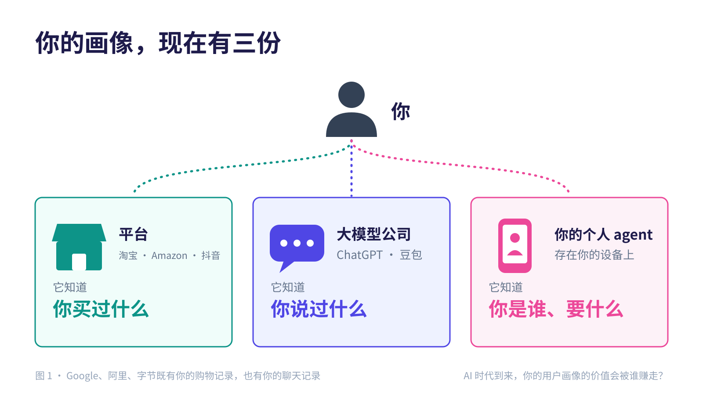
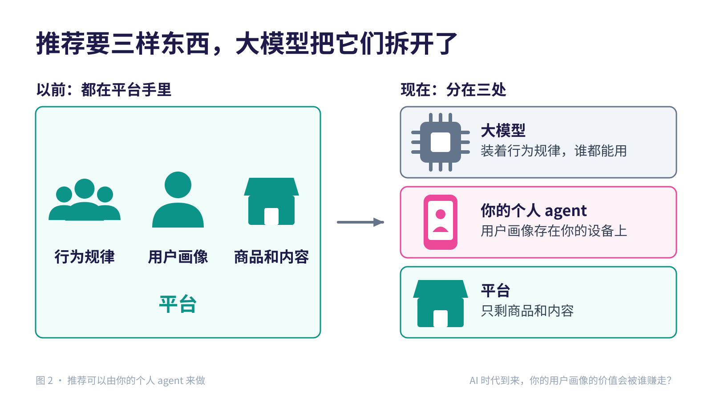
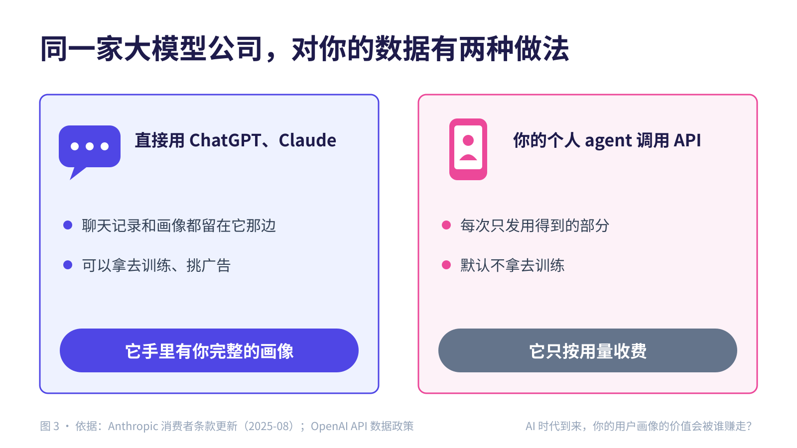
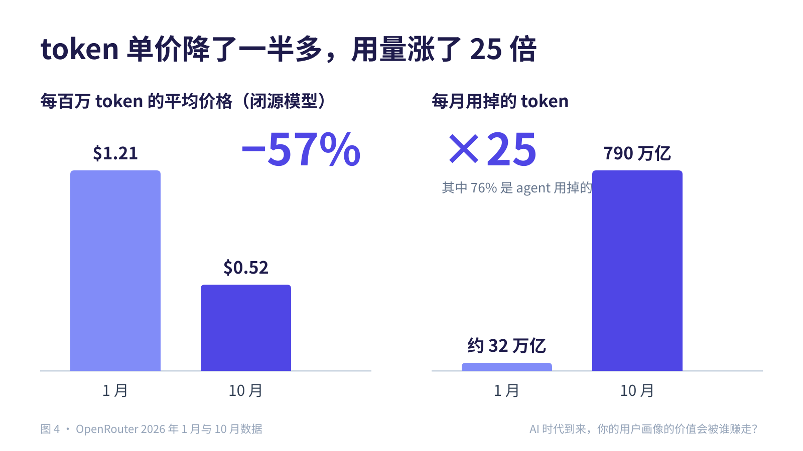
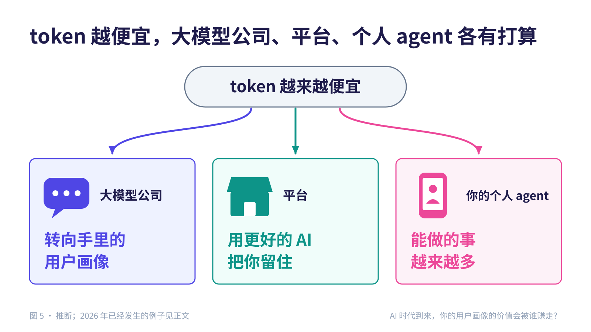
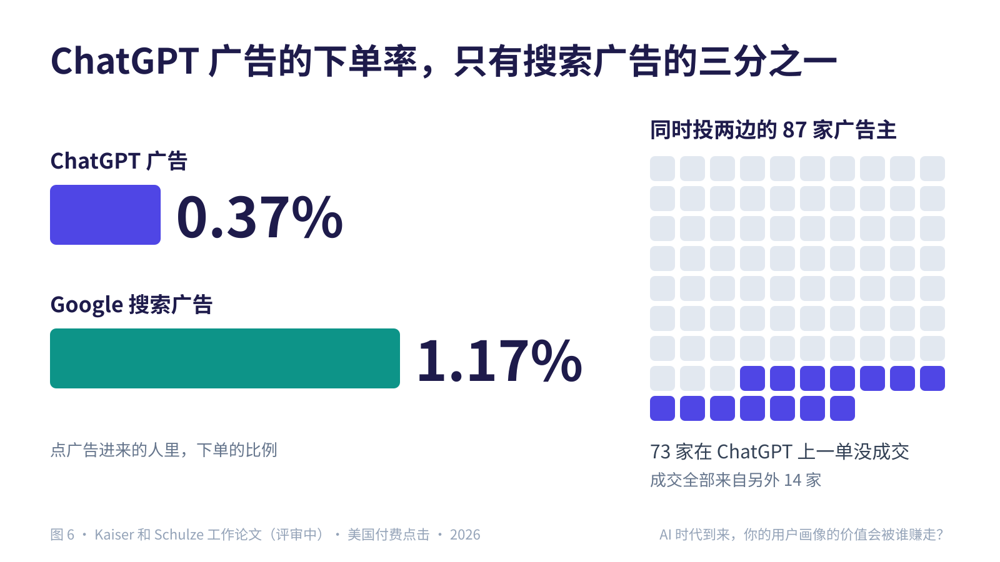
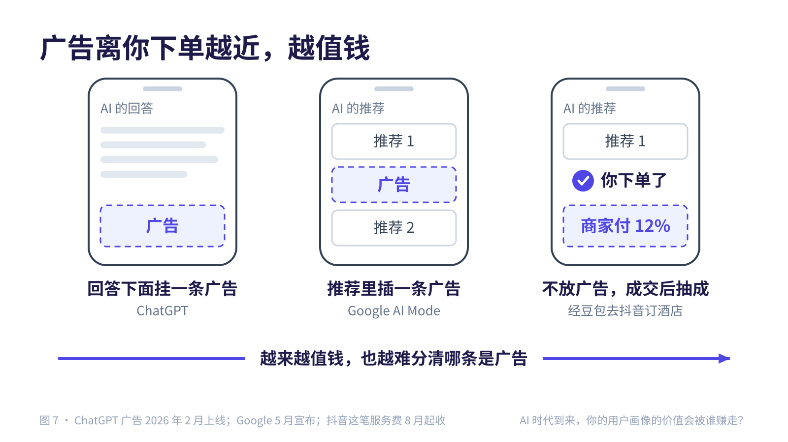
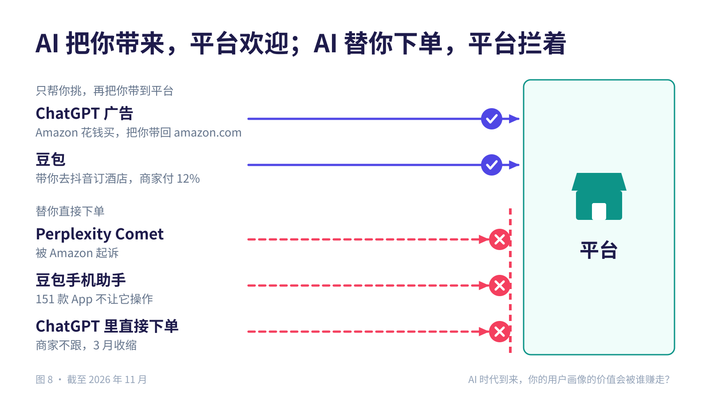
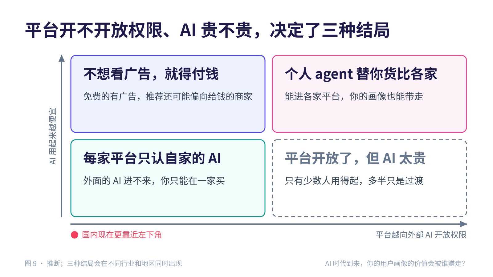
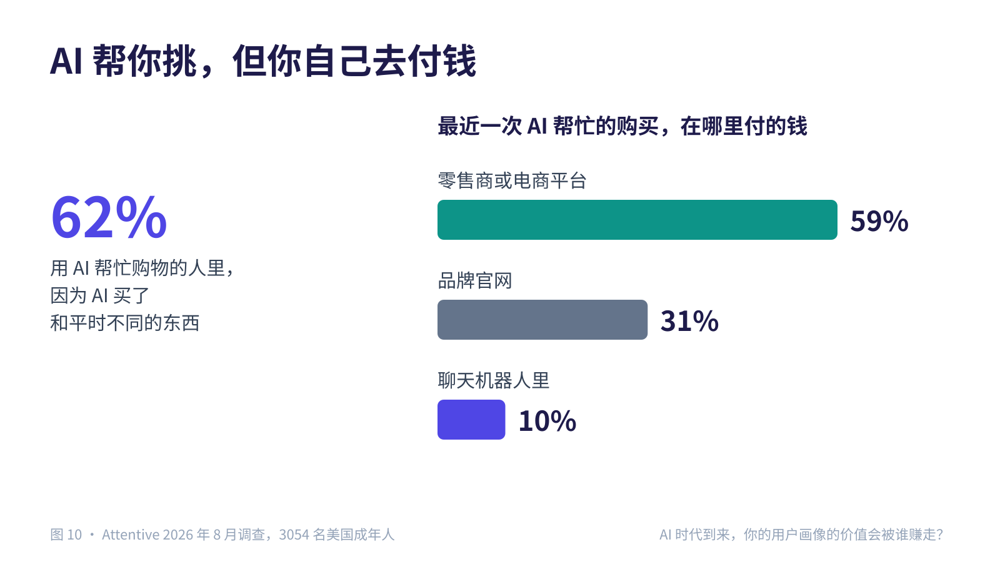

# AI 时代到来，你的用户画像的价值会被谁赚走？

2026 年 11 月 11 日 · [English](/articles/user-profile)

## 引子

过去二十年，用户画像是互联网巨头最值钱的东西。你在淘宝、抖音、Google 上的每次搜索、点击、购买，都让平台更了解你。平台拿这份了解给你推荐东西，再把推荐位卖给广告主。这份价值，一直被平台赚走。

AI 来了，情况变了。先说结论：

- **以前这份价值全被平台赚走；现在大模型公司也来分，而你第一次有机会留一部分给自己。** 前提是平台向外部 AI 开放权限，AI 用起来也足够便宜。
- **你的画像现在有三份。** 平台知道你买过什么，大模型公司知道你说过什么，你自己的个人 agent 记着你是谁、要什么。
- **大模型公司怎么赚：把广告挤进 AI 的推荐。** 放在 AI 回答下面的广告很少有人买，离你下单越近的位置越值钱。
- **平台怎么赚：用自家的 AI 留住你，向外部的 AI 收费。** 把你带到平台下单的 AI，平台欢迎；想替你直接下单的 AI，平台拦着。
- **token 越便宜，争得越凶。** 大模型公司更想靠你的画像赚钱，平台用更好的 AI 留住你，你的个人 agent 能替你做的事也越来越多。

本文用词：

- **平台**：淘宝、京东、抖音、Amazon、Google 这类互联网平台。
- **大模型公司**：OpenAI、Anthropic，以及做豆包的字节、做千问的阿里。字节和阿里两边都算。
- **个人 agent**：装在你手机或电脑上、记着你的偏好、替你办事的 AI。平台自己做的 AI，本文叫"平台自家的 AI"。

讲已经发生的事都有出处；讲以后会怎样的地方是我的判断，会写明。

## 一、过去：用户画像只在平台手里

推荐要三样东西（图 2 左）：

- **行为规律**：从很多人的行为里总结出来的规律，比如买帐篷的人常常也买防潮垫。
- **用户画像**：你是谁、喜欢什么、预算多少、最近在找什么。
- **商品和内容**：能推荐给你的东西，包括价格、库存、评价。

过去只有平台三样都有，所以推荐是平台的专利，广告也只能找平台买。

2006 年，Doc Searls 设想过反过来：顾客自己说要什么，商家来报价。他管这叫"意图经济"，但一直没做成。我的判断是：普通人有自己的数据，却没有能力处理它。

## 二、大模型把推荐拆开了

现在三样东西分到了三处（图 2 右）：

- **行为规律装进了大模型。** 大模型从海量文本里学到了什么商品适合什么人，谁都能调用，这是 Benedict Evans 的观点。比如你问 ChatGPT 露营要带什么，它没看过你的购物记录，也会提醒你带防潮垫。实时行情除外：这周什么好卖、哪家在降价，还是只有平台知道。
- **用户画像可以存在你的设备上。** 蚂蚁的灵光 2.0、阿里的千问Go!、Apple 的新 Siri 和很多开源项目，都能读你授权的邮件、日历和文件，把你的偏好记下来存在你的设备上。这些记下来的东西，就是你自己的那份画像。Claude 还能从别家 AI 导入这些记录，画像可以搬家。
- **平台手里只剩商品和内容。**

这样，你的个人 agent 就能自己做推荐：带着你的画像去各家查，按你的标准挑。已经有这样的例子：

- 虎嗅 10 月实测：灵光 2.0 比价时会推荐更便宜的京东商品；千问只查淘宝。
- Perplexity 的 Comet 浏览器、豆包手机助手，能替你去别家网站和 App 里操作。
- Attentive 8 月调查：用 AI 帮忙购物的人里，62% 因为 AI 买了和平时不同的东西。

平台的推荐位被绕开了。接下来的争夺点是：平台开不开放权限，让你的个人 agent 进去替你下单。

## 三、大模型公司手里也有一份

你的个人 agent 每次用大模型，都要把用得到的那部分画像发给大模型公司，除非模型直接在你的设备上运行。

同一家大模型公司，对你的数据有两种做法（图 3）：

- **你直接用 ChatGPT、Claude 的应用**：聊天记录和它记下的你的画像，都留在它那边，可以拿去训练、挑广告。Anthropic 2025 年 8 月起默认用这些对话训练，最长保留 5 年。
- **你的个人 agent 通过 API 调用它**：默认不拿去训练。OpenAI 的 API 日志最多留 30 天；Anthropic 的训练条款也不适用于 API。

大模型公司手里那份，有时连它自己都做不了主。《纽约时报》起诉 OpenAI 的案子里，法院曾要求它保存用户删掉的 ChatGPT 对话，后来又要求它交出 2000 万条去掉身份信息的对话记录。

加上平台手里的购物记录，你的画像现在至少有三份（图 1）。三份各有短处：

- 平台看不到你在它之外想要什么。
- 大模型公司自己没有商品可卖。
- 你的个人 agent 没有别人的数据，也进不了不让它进的平台。

Google、阿里、字节手里既有你的购物记录，也有你和 AI 的聊天记录，这几家赚钱最顺。

三份画像，都有人想拿它赚钱。下面看平台和大模型公司各自怎么赚，你又能留下多少。

## 四、平台和大模型公司怎么赚，你能留下多少

大模型公司、平台和你的个人 agent，争的是同一个时刻：你问 AI"买哪个"，它推荐谁。影响它们怎么走的，还有一个共同的因素：token 的价格。

### token 越来越便宜

- 同样的能力，价格每年降 9 到 900 倍（Epoch AI）。
- 各家模型越来越接近：美国最好的模型只比中国最好的强 2.7%，最好的闭源模型只比最好的开源模型强 3.3%（斯坦福 2026 年 AI 指数报告）。
- 国内价格战更凶：DeepSeek 把 V4-Pro 永久降到原价的四分之一，小米的 API 价格最多降了 99%。

同一件事，用 AI 来做越来越便宜。但用量涨得更快（图 4）：OpenRouter 上，闭源模型的平均价格从 1 月到 10 月降了一半多，每月用掉的 token 却涨了 25 倍。

用量涨得这么快，是因为大家让 AI 做的事越来越多。agent 完成一个编程任务用的 token，是回答一个代码问题的约 1000 倍（斯坦福数字经济实验室）；OpenRouter 上四分之三的 token 是 agent 用掉的。所以 token 便宜下来，最先受益的是让 AI 替自己办事的人。

国内是例外：算力不够，价格这两年反而涨了。据摩根士丹利统计，2026 年二季度国内 API 的均价比 2025 年一季度贵了不少，输入涨了约 48%，输出涨了约 80%。下面按长期降价来讨论，国内会慢一些。

token 便宜了，大模型公司、平台和个人 agent 的打算各不相同（图 5）。

### 大模型公司怎么赚：把广告挤进 AI 的推荐

我的判断是：模型越来越便宜、越来越像，用户换一家几乎没损失，大模型公司很难靠卖模型多赚钱。在普通用户这边，它们手里最值钱、别人拿不走的，就是你在它们应用里留下的画像。

已经在发生的：

- ChatGPT 的广告会参考它记下的你的画像和聊天内容来挑选。2 月上线，8 月按年算的广告收入达到 10 亿美元，10 月已覆盖 89 个国家。
- Meta 从 2025 年 12 月起，用你和 Meta AI 的聊天来挑广告。

但放在 AI 回答下面的广告，没多少人买（图 6）：

- 点 ChatGPT 广告进来的人，下单的只有 0.37%；点 Google 搜索广告进来的是 1.17%。
- 同时在两边投广告的 87 家商家里，73 家在 ChatGPT 上一单都没卖出去。

这些数字来自 Kaiser 和 Schulze 的论文，还在评审中。反过来，从 AI 回答里直接点进去的人，下单率比其他来源高 60%（Adobe）。也就是说，AI 推荐的东西很多人买，旁边的广告却没人理。

我的解释是：在搜索结果页上，你还没拿主意，广告是十条结果之一；AI 回答时已经替你挑好了，广告放在后面，等于在跟 AI 的推荐唱反调。

所以广告会往推荐里钻（图 7）：

- Google 宣布在 AI Mode 的推荐列表里直接插广告。
- Amazon 的赞助商品会出现在 Alexa+ 的购物对话里。
- 抖音干脆不卖位置：你通过豆包订了抖音上的酒店，它再向商家收服务费。

广告离你下单越近越值钱，你也越难分清哪条是广告。Harris Poll 的调查里，75% 的人说，如果 AI 的推荐收了品牌的钱，他们会更不信任它。

大模型公司还用价格把你留在它自己的应用里。比如 Anthropic 规定，包月账号只能在自家应用里用，拿到别人的工具里要另外按量付费。我的判断是：这样你会留在它的应用里，那里它对你了解得最全。

### 平台怎么赚：用自家的 AI 留住你，向外部的 AI 收费

token 便宜了，平台给每个用户配一个好用的 AI，成本也越来越低。平台本来就有商品和交易，最适合做懂自家生意的 AI：

- 千问接入淘宝、支付宝、飞猪和高德，2026 年春节期间用户"一句话下单"近 2 亿次。
- 京东有"东东"，Amazon 把 Rufus 并进了 Alexa+，Spotify 也推出了能对话的 AI。

对外面的 AI，平台的态度看它来干什么（图 8）：

- **把你带到平台下单的 AI，平台欢迎，还愿意花钱。** Amazon 花钱在 ChatGPT 投广告，把你带回 amazon.com。你通过豆包去抖音订酒店，商家付约 12% 的服务费，比直接在抖音卖（约 8%）还高。
- **想替你直接下单的 AI，平台拦着。** Amazon 起诉了替用户下单的 Comet 浏览器，上诉法院撤销了禁令，官司还在打。151 款 App 拒绝豆包手机助手替用户操作，包括微信、淘宝、支付宝。ChatGPT 里直接下单的功能，商家不愿跟，OpenAI 3 月收缩了。

商家不愿在 ChatGPT 里卖东西，是因为那样见不到客户、给不了会员积分。说到底，谁都不想把下单这一步交出去。

我的判断是：token 贵的时候，只有靠电商或广告赚钱的平台养得起免费 AI，国内尤其如此；token 便宜以后，平台的 AI 会越来越好，把你留在自家。

### 你能留住多少：靠你的个人 agent

画像的价值能不能有一部分留给你，要看你的个人 agent。token 便宜，对它最有利。开源模型只比最好的闭源模型差几个百分点，今天要上云的事，以后可能在手机和电脑上就能做。在你的设备上运行，就不用按 token 付钱，画像也不用发出去。据报道，Apple 的新 Siri 已经这样分工：简单的在手机上做，复杂的才送到 Apple 自己的服务器。

要上云的部分，钱由你自己付。天猫 9 月开始卖 token，像卖话费一样，不过买的人还不多：据第一财经观察，智谱的店累计只卖出约 300 件。

你自己付钱，AI 才真正替你办事。"不拿你的数据赚别的钱"已经成了卖点：Anthropic 在超级碗打广告，说 AI 要有广告了，但 Claude 不会有；Perplexity 停止接新的广告主，原因之一是怕失去用户的信任。

我的判断是：Searls 当年设想的意图经济，第一次有了条件。你的个人 agent 可以把需求发给多家商家，比如"下周去成都，两晚，靠近地铁，每晚 600 元以内"，让商家来报价，它替你挑。前提是商家愿意让它进来。

有意思的是，剑桥的 Penn 和 Chaudhary 也用"意图经济"这个词，说的却是反过来的事：你的需求被大模型公司收集起来，卖给想影响你的人。前一种靠你手里的画像，后一种靠大模型公司手里的画像，两种都会出现。

### 结局取决于两件事：平台开不开放权限，AI 贵不贵

你可能同时在用好几个 AI：大模型公司的免费应用、平台自家的 AI、你的个人 agent。最后谁替你拿主意，钱就流向谁。

我的判断是，最后怎么走看两件事：

1. **平台开不开放权限。** 你的个人 agent 能不能进别家平台查商品、替你下单，能不能把你的画像带走。要看：
   - Amazon 和 Perplexity 官司的结果；
   - 欧盟要求 Google 在 2027 年 7 月前，让其他公司的 AI 在 Android 上享受和 Gemini 一样的待遇，能不能落实；
   - 国内拒绝豆包手机助手的 App 名单是变长还是变短；
   - 导入导出画像的工具能不能普及。欧盟已经要求大平台提供一种不看用户画像的推荐方式。
2. **AI 用起来贵不贵。** token 能便宜到什么程度，多少事能在手机上做。AI 贵，只有靠别的生意贴钱的公司养得起免费的 AI；AI 便宜、能在设备上运行，个人 agent 才人人用得起。

## 五、三种结局，和每种要盯的信号

这一节是我的判断。按上面两件事，可以分出三种结局（图 9）。每种结局都有提前能看到的信号：

| 结局 | 你会遇到什么 | 要盯的信号 |
|---|---|---|
| **每家平台只认自家的 AI** | 外面的 AI 进不来。你用哪家平台的 AI，就只能在哪家买，推荐还是平台说了算 | 拒绝豆包手机助手的 App 名单变长；国内 API 继续涨价 |
| **不想看广告，就得付钱** | 免费的 AI 有广告，推荐还可能偏向给了钱的商家；想去掉这些，就付钱订阅 | 广告从回答下面挪进推荐里；更多订阅方案写明"无广告" |
| **个人 agent 替你货比各家** | 你的个人 agent 能进各家平台，画像能带走，商家要向它报价、争取它推荐自己 | Amazon 诉 Perplexity 的终审；欧盟对 Android 的要求落地；画像能自由导出导入；手机上的模型越来越强 |

图里右下角还有一种情况：平台开放了，但 AI 太贵，只有少数人用得起。这多半只是过渡。

三种结局会在不同的行业和地区同时出现。国内算力紧、大平台都有自己的 AI，最可能先走到第一种：每家平台只认自家的 AI。

## 六、你付出了什么

画像的价值被别人赚走，代价落在你身上。

**看广告，还要担心推荐被收买。** 免费的 AI 靠广告赚钱，广告离你下单越近，你越难分清哪条是广告，哪条是 AI 真心推荐的（见第四节）。

**被看穿，还可能被多收钱。** Harris Poll 的调查里，73% 的人对 AI 用自己的购物数据感到不安。Consumer Reports 等机构做过实验：在 Instacart 上，同一家超市的一打鸡蛋，不同的人看到 3.99 到 4.79 美元不等的价格。我的判断是：AI 知道你有多急、预算多少，这些要是流到卖家手里，你可能会多花钱。

**AI 越懂你，越爱顺着你说。** CHI 2026 的一篇论文发现，把用户画像交给大模型后，Gemini 2.5 Pro、Claude Sonnet 4、GPT-4.1 mini 顺着用户说话的倾向分别上升了 45%、33%、16%。

**AI 懂你，不一定懂货。** 澎湃新闻实测了几家平台的 AI：价格大多是真的，但有的推荐的"便宜 AirPods"其实是资源机，有的"官方授权"店里卖着非官方的型号。商品是真是假，你的画像帮不上忙。

**大多数人不会管自己的画像，默认设置说了算。** 比如 Anthropic 默认用对话训练模型，要你自己去关。我的判断是：画像留在哪里，主要看默认设置，所以默认设置会成为各家争夺的地方。

**大家也在提防：让 AI 帮着挑，但自己去付钱。** 用 AI 帮忙购物的人里，62% 因为 AI 换了要买的东西，但最近一次购买，只有 10% 是在聊天机器人里付的钱（图 10）。上海市消保委的调查里，84.56% 的人试过让 AI 帮忙选购，只有 16.06% 觉得它找得准。

## 七、还有谁能赚到：新机会

平台和大模型公司之外，也有新的生意可做。这一节是我的判断。替用户这一头：

- **帮你保管、搬运画像的工具**：画像存在你自己手里，用的时候由你授权，换 AI 时能带走。

替商家和 AI 这一头：

- **让 AI 读懂商品的接口**：帮商家把商品、库存、会员价交给各种 AI，同时把下单留在自己手里。
- **把 AI 推荐和成交对上账**：现在没人说得清 AI 推荐带来了多少生意，谁能算清，谁就能给它定价。
- **帮 AI 核实商品真假的服务**：推错了货，挨骂的是 AI，它会愿意为此付钱。
- **按成交收费，账目可查**：广告混进推荐里很难查；按成交收费，商家的账单上写得清清楚楚。

## 八、结论：你的用户画像的价值会被谁赚走？

短答案：现在主要被平台和大模型公司赚走；以后你能留下多少，要看你的个人 agent。

过去，用户画像只在平台手里，推荐和广告都是平台的生意。现在你的画像有了三份：平台有你的购物记录，大模型公司有你的聊天记录，你的个人 agent 记着你是谁、要什么。

平台靠自家的 AI 留住你，向把客人带来的外部 AI 收费；大模型公司靠把广告挤进 AI 的推荐。你能不能留下一部分，取决于平台开不开放权限、AI 贵不贵，而这两件事要由官司、监管和默认设置来决定，不是由技术决定。

说到底，只有一句话：

**谁付 AI 的钱，AI 就替谁办事。**

## 和已有讨论的关系

这个话题已经有不少好文章，各自讲了一个方面：

- [Ben Thompson](https://stratechery.com/2026/ads-in-chatgpt-why-openai-needs-ads-the-long-road-to-instagram/) 讲 OpenAI 为什么必须靠广告养活免费用户。
- [Benedict Evans](https://ben-evans.com/benedictevans/2025/11/23/ai-networks-and-mechanical-turks) 讲大模型让推荐系统不用再先攒几亿用户的数据。
- [Penn 和 Chaudhary](https://www.sciencealert.com/covert-ai-could-lead-to-a-new-intention-economy-experts-warn) 警告对话式 AI 会把用户的需求变成可以买卖的东西。
- [Stanford HAI](https://hai.stanford.edu/policy/designing-loyalty-ai-agents-and-conflicts-of-interest) 和 [Fortune 上的一篇评论](https://fortune.com/2026/11/03/ai-agents-agentic-commerce-value-capture-shoppers-workers-voters/) 主张，替用户办事的 AI 应当忠于用户，不能暗中替别人办事。
- 国内媒体在双 11 [实测各家 AI 导购](https://www.thepaper.cn/newsDetail_forward_34422613)，看它们会不会推错货。

这些文章讲的，大多是平台或大模型公司手里那份画像怎么用。本文想说的是：画像已经不止一份，钱往哪里流，要看替你拿主意时用的是哪一份。

## 参考

用户画像有了三份：

- Doc Searls，The Intention Economy（2012，维基百科条目）：<https://en.wikipedia.org/wiki/The_Intention_Economy>
- Benedict Evans，AI, networks and Mechanical Turks（2025-11-23）：<https://ben-evans.com/benedictevans/2025/11/23/ai-networks-and-mechanical-turks>
- 新浪财经，蚂蚁灵光 2.0 发布（2026-10）：<https://cj.sina.com.cn/articles/view/1750070171/684ff39b01901idnk>
- 新浪财经转界面新闻，双 11 购物车里的 AI 暗战（含千问Go!，2026-10-24）：<https://finance.sina.com.cn/jjxw/2026-10-24/doc-iniwhxpu1418577.shtml>
- The Next Web，Apple WWDC 2026 发布新 Siri（2026-06）：<https://thenextweb.com/news/apple-wwdc-2026-siri-ai-gemini-ios-27>
- MacRumors，Claude 向免费用户开放记忆并推出导入工具（2026-03）：<https://macrumors.com/2026/03/02/anthropic-memory-import-tool/>
- 虎嗅，灵光 2.0 实测（2026-10）：<https://www.huxiu.com/article/4901936.html>
- Agile Brand Guide 转载 Attentive 调查（2026-08）：<https://agilebrandguide.com/ai-is-influencing-what-shoppers-buy-but-brands-still-shape-their-customer-journey-new-attentive-research-finds/>

大模型公司手里的那一份：

- 9to5Mac，Meta 用 AI 对话个性化广告（2025-10）：<https://9to5mac.com/2025/10/01/meta-will-use-your-chats-with-ai-to-sell-hyper-targeted-ads/>
- Anthropic，Updates to our consumer terms（2025-08）：<https://www.anthropic.com/news/updates-to-our-consumer-terms>
- OpenAI，Your data（API 数据政策）：<https://developers.openai.com/api/docs/guides/your-data>
- OpenAI，Ads in ChatGPT（帮助文档）：<https://help.openai.com/articles/20001047-ads-in-chatgpt>
- Engadget，OpenAI 不再需要保存全部 ChatGPT 对话（2025-10）：<https://engadget.com/ai/openai-no-longer-has-to-preserve-all-of-its-chatgpt-data-with-some-exceptions-192422093.html>

平台怎么应对：

- Jones Day，第九巡回法院撤销对 Comet 的禁令（2026-09）：<https://www.jonesday.com/en/insights/2026/09/ninth-circuit-vacates-cfaa-injunction-against-perplexitys-comet-ai-agent>
- 第一财经，豆包 SAEP 拒绝名单（2026-10）：<https://www.yicai.com/news/103393570.html>
- Search Engine Land，Cloudflare 默认拦截 AI 爬虫并推出按次收费（2025-07）：<https://searchengineland.com/cloudflare-to-block-ai-crawlers-by-default-with-new-pay-per-crawl-initiative-457708>
- Forrester，OpenAI 收缩 Instant Checkout（2026-03）：<https://www.forrester.com/blogs/what-it-means-that-the-leader-in-agentic-commerce-just-pulled-back>
- 量子位，千问春节 AI 下单（2026-02）：<https://www.qbitai.com/2026/02/381758.html>
- The Next Web，Spotify 推出对话式 AI 测试版（2026-07-15）：<https://thenextweb.com/news/spotify-talk-conversational-ai-managed-accounts-kids>
- Digiday，Alexa+ 智能体广告：<https://digiday.com/marketing/amazons-latest-ad-format-offers-a-glimpse-of-advertisings-agentic-future/>
- 每日经济新闻，抖音生活服务对豆包渠道酒店订单收费（2026-08-11）：<https://www.nbd.com.cn/articles/2026-08-11/4539006.html>
- Modern Retail，Amazon 在 ChatGPT 投 Prime Day 广告（2026-06）：<https://www.modernretail.co/technology/amazon-buys-ads-in-chatgpt-to-promote-prime-day/>
- Amazon Ads，Amazon DSP 接入 ChatGPT 广告：<https://advertising.amazon.com/library/news/amazon-ads-chat-gpt-advertising-integration>

token 价格：

- 斯坦福 HAI，2026 AI Index Report：Technical Performance（2026-04）：<https://hai.stanford.edu/ai-index/2026-ai-index-report/technical-performance>
- 爱范儿，小米 MiMo-V2.5 API 永久降价（2026-05-27）：<https://www.ifanr.com/1666975>
- Epoch AI，LLM inference prices have fallen rapidly but unequally across tasks：<https://epoch.ai/data-insights/ai-inference-price-trends>
- OpenRouter，October 2026 data recap（2026-11）：<https://openrouter.ai/data/october-2026>
- Bai 等，How Do AI Agents Spend Your Money?（斯坦福数字经济实验室工作论文，2026-04）：<https://digitaleconomy.stanford.edu/publication/how-do-ai-agents-spend-your-money>
- 21 世纪经济报道，国内大模型 API 涨价与 DeepSeek 分时定价（2026-08-20）：<https://www.sfccn.com/2026/8-20/3NMDE0MDdfMjIxNDg3Nw.html>
- GIGAZINE，Anthropic 禁止第三方工具使用订阅账号（2026-02）：<https://gigazine.net/gsc_news/en/20260220-anthropic-third-party-block>
- Hongkiat，Anthropic 4 月起第三方工具改为按量计费（2026-04）：<https://www.hongkiat.com/blog/anthropic-closed-openclaw-loophole/>

广告：

- CNBC，ChatGPT 广告扩展到 89 个国家（2026-10-21）：<https://www.cnbc.com/2026/10/21/openai-chatgpt-ads-26-countries.html>
- PPC Land，Kaiser 和 Schulze 的工作论文 Can Advertising Fund Free AI?（2026-11）：<https://ppc.land/chatgpt-ad-visits-earn-shops-0-89-against-2-45-for-google-search-ads/>
- Adobe，AI Traffic Trends Report（2026 年 8 月）：<https://business.adobe.com/assets/pdfs/resources/sdk/ai-traffic-trends-report-august-2026/ai-traffic-trends-report-2026-08-19.pdf>
- Adobe，AI 流量增长而零售网站难以被机器读懂：<https://business.adobe.com/blog/ai-traffic-surge-retail-sites-not-machine-readable>
- PPC Land，Google AI Mode 的广告混进答案（2026-05）：<https://ppc.land/google-ai-mode-ads-blend-into-answers-and-a-billion-users-are-watching/>
- Homepage News，Quad 与 Harris Poll 的调查（2026-02）：<https://www.homepagenews.com/retail-articles/survey-foretells-future-of-brands-marketing-to-ai-agents-shoppers-are-starting-to-trust/>
- Adweek，Anthropic 的超级碗广告与 OpenAI 的回应（2026-02）：<https://www.adweek.com/brand-marketing/ai-rivalry-heats-up-ahead-of-super-bowl-as-openai-slams-anthropics-deceptive-ad/>
- Campaign Asia，Perplexity 因信任问题收缩广告：<https://www.campaignasia.com/article/perplexity-pulls-the-plug-on-ads-citing-trust-concerns-for-ai/44kz4ahvfxx8q7nwkejtgjdgcr>

规则：

- The Next Web，欧盟要求 Google 向竞争对手开放 Android（2026-07）：<https://thenextweb.com/news/eu-google-android-ai-search-data-digital-markets-act>
- 《数字服务法》第 38 条：<https://www.springlex.eu/en/packages/dsa/dsa-regulation/article-38/>
- EDRi 对 YouTube 的投诉（2026-03）：<https://edri.org/wp-content/uploads/2026/03/EDRi-DSA-complaint-Youtube.pdf>

用户：

- 新浪财经转钛媒体，AI 的双 11 迷局（引用上海市消保委调查，2026-10-26）：<https://finance.sina.com.cn/roll/2026-10-26/doc-iniwprzt9210259.shtml>
- 澎湃新闻，双十一把购物交给 AI 的实测（2026-11-08）：<https://www.thepaper.cn/newsDetail_forward_34422613>
- Jain 等，Interaction Context Often Increases Sycophancy in LLMs（CHI 2026）：<https://arxiv.org/abs/2509.12517>

文中提到的观点文章：

- Ben Thompson，Ads in ChatGPT, Why OpenAI Needs Ads, The Long Road to Instagram（2026-01-20）：<https://stratechery.com/2026/ads-in-chatgpt-why-openai-needs-ads-the-long-road-to-instagram/>
- Fortune，Candelon 等，AI agents are deciding who captures the value（2026-11-03）：<https://fortune.com/2026/11/03/ai-agents-agentic-commerce-value-capture-shoppers-workers-voters/>
- Stanford HAI，Designing Loyalty: AI Agents and Conflicts of Interest（2026-08）：<https://hai.stanford.edu/policy/designing-loyalty-ai-agents-and-conflicts-of-interest>
- ScienceAlert 关于 Penn 和 Chaudhary"意图经济"论文的报道（2024-12）：<https://www.sciencealert.com/covert-ai-could-lead-to-a-new-intention-economy-experts-warn>
