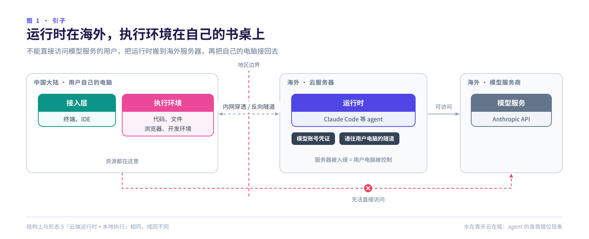
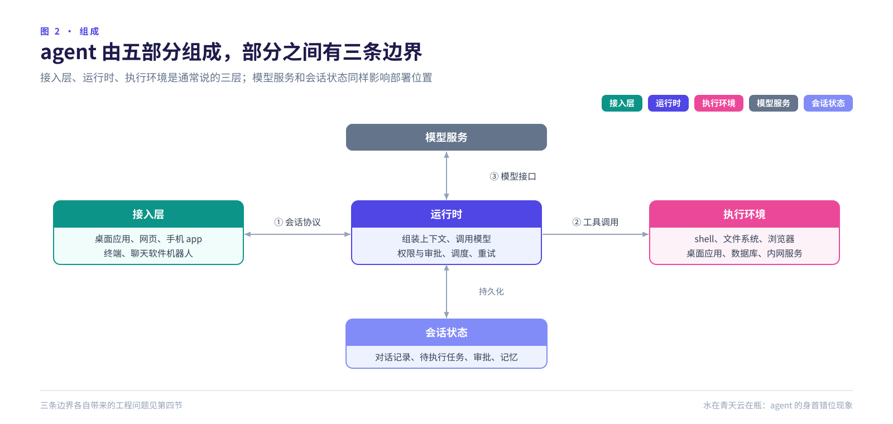
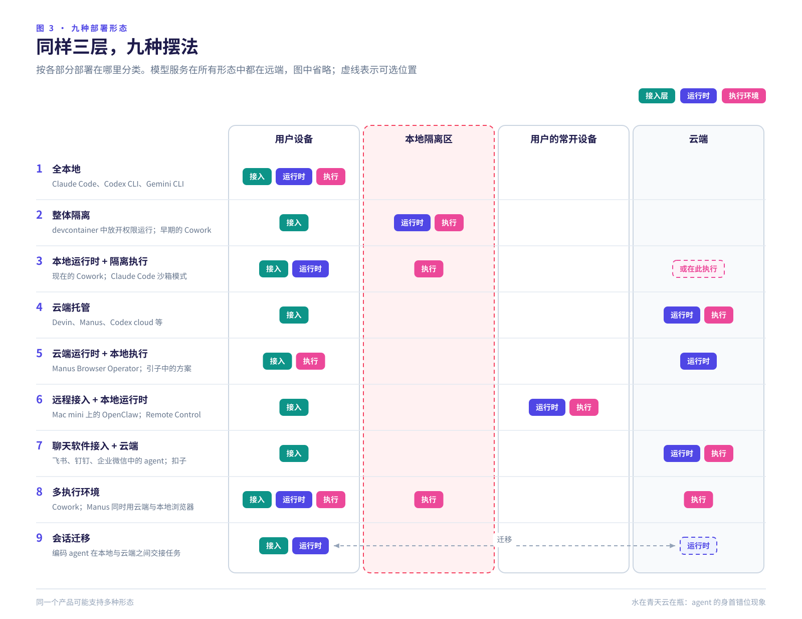
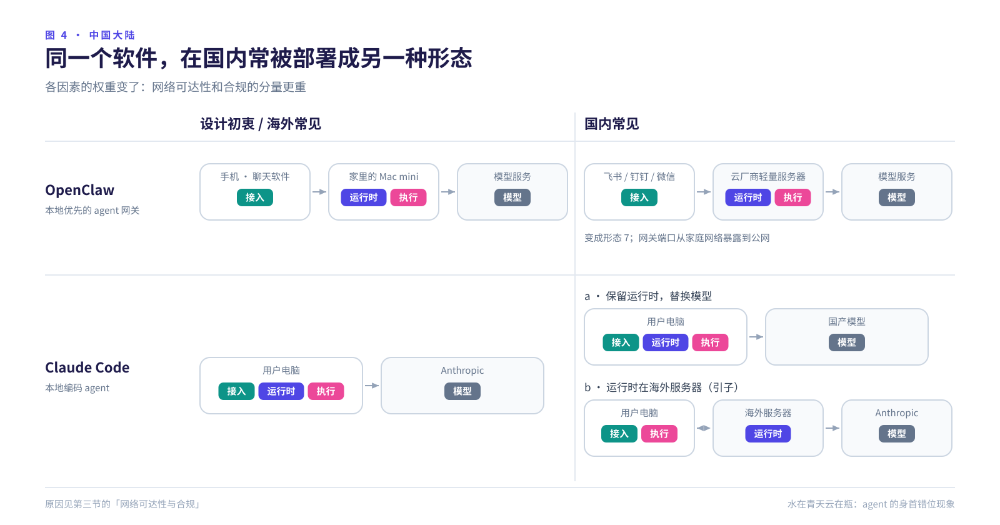
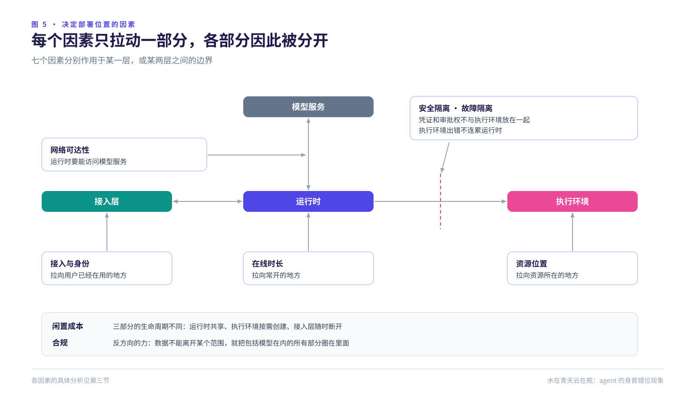
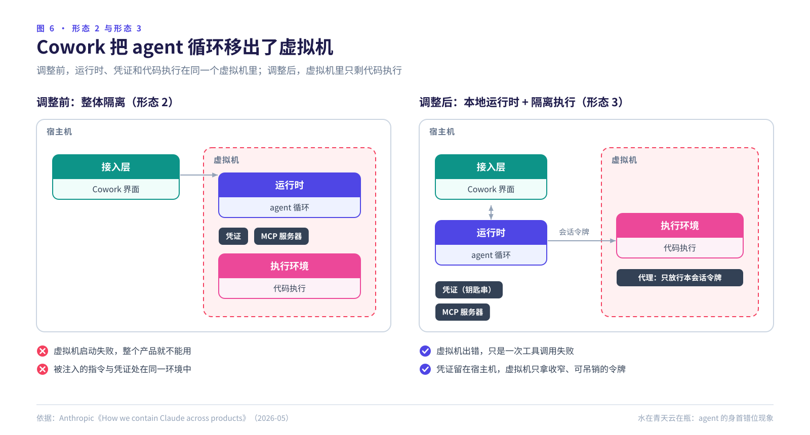
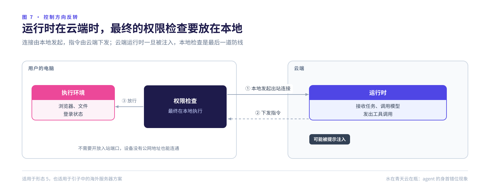
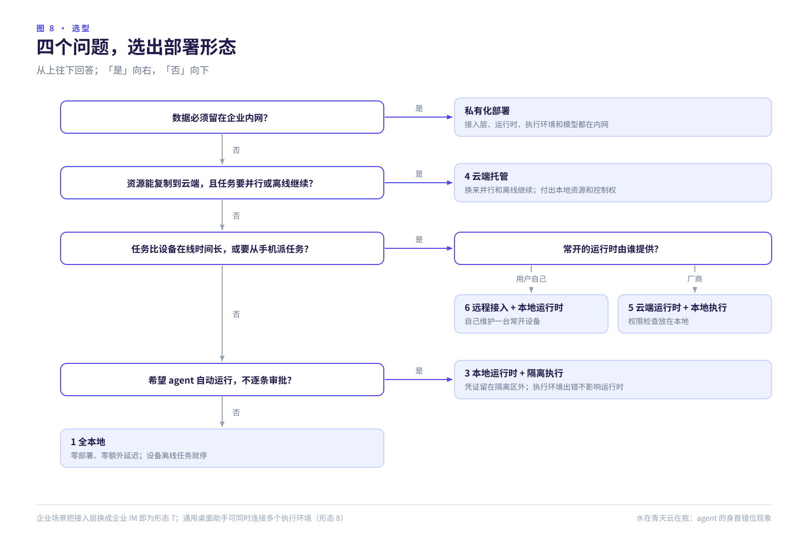

# 水在青天云在瓶：agent 的身首错位现象

2026 年 11 月 8 日 · [English](/articles/head-in-the-cloud)

## 引子

Anthropic 不向中国大陆提供服务。2025 年 9 月起，它还禁止由中国实体控制的公司使用 Claude，不论公司注册在哪里。

于是有开发者在海外租一台服务器运行 Claude Code，再用内网穿透把自己的电脑接回去。结果是：agent 的运行时在大洋彼岸，执行环境在自己的书桌上。

唐代李翱有诗："云在青天水在瓶。"万物各在其位。这里的 agent 正好反过来。

这并不是特例。Manus 让云端的 agent 操作用户自己的浏览器，结构完全相同；Anthropic 的 Cowork 也把 agent 循环从虚拟机里移了出来。agent 的各部分对运行位置的要求本来就不同，"身首错位"是常态。

## 一、agent 的组成

通常说的三层是：

**接入层**：用户与 agent 交互的地方，包括桌面应用、网页、手机、终端和聊天软件机器人。

**运行时（runtime）**：agent 循环本身，负责组装上下文、调用模型、执行工具调用、审批、调度和重试。

**执行环境**：工具实际运行的地方，可以是用户的电脑、本地容器或虚拟机，也可以是云端沙箱。

另外两部分也影响部署。**模型服务**几乎总在远端，所以不存在完全本地的 agent；"本地执行"只意味着原始资源留在本机，读进上下文的内容照样会发出去。**会话状态**放在哪里，决定了断线或崩溃后谁能接着运行。比如 Claude Code 的 Remote Control，执行一直在本机，但对话记录会同步到 Anthropic 的服务器，手机端依靠的就是这份记录。

## 二、九种部署形态

**形态 2 和形态 3 的区别在于隔离什么。** 形态 2 把运行时和执行环境一起隔离，密钥、审批逻辑与模型生成的代码处在同一环境，一次提示注入就可能拿到密钥。形态 3 只隔离执行环境，运行时在隔离区外，持有凭证和审批权（见图 6）。它的前提是"是否放行"的判断不受不可信输入影响。Anthropic 也承认，在 Claude Code 中，一段有说服力的注入内容或一次疲劳时的误点，都可能让命令绕过沙箱。

**形态 5 的出现，是因为有些资源无法搬上云。** 代码仓库可以克隆，登录状态、两步验证、本机 IP 和内网却复制不了。Manus 平时使用云端浏览器，需要用户登录状态时，才通过 Browser Operator 扩展操作用户自己的浏览器。

**形态 6 是用户自建的常开节点。** OpenClaw 把二十多个聊天渠道接到用户自己设备上的 agent，官方推荐部署在 Mac mini 或 VPS 上：运行时需要一直在线，执行环境需要访问用户自己的文件和账号。Remote Control 的结构相同：本机只发起出站请求，手机只是客户端。

**形态 8 和形态 9 说明，位置并不固定。** 同一个 agent 可以同时使用宿主机上的文件、虚拟机里的 shell、用户的浏览器和云端沙箱。Claude Code 还能用 `claude --teleport` 把云端会话拉回本地终端继续。

### 在中国大陆

国内没有出现新的形态，但同一个软件常被部署成与设计初衷不同的形态（图 4）。原因是网络可达性和合规这两个因素在国内分量重得多，见第三节。

**运行时在海外，执行在本机。** 结构与形态 5 相同，成因不同：运行时去海外是为了访问模型，执行留在本地是因为资源在本地。用户在没有任何厂商支持的情况下，自己把这两层拆开了，说明这条边界真实存在。代价有三点：海外服务器同时持有模型凭证和通往个人电脑的隧道，一旦被入侵，个人电脑也随之失守；每次工具调用都要跨境往返；违反服务条款，账号随时可能被封。据《金融时报》2026 年 7 月报道，一些中国企业也通过海外实体和云服务商转售的接口使用 Claude，Anthropic 则通过检测电脑时区、打击"中转站"来封堵。

**聊天软件即身份系统。** 飞书、钉钉、企业微信的官方接口直接提供用户身份、部门和文档权限，agent 不必另建身份系统。个人微信过去只能依赖模拟协议，有封号风险；2026 年 3 月，腾讯开始灰度推出微信 ClawBot 插件，微信成了自托管 agent 的官方接入层，运行时仍在用户自己的设备上。

**本地优先的软件被搬上云。** OpenClaw 原本推荐部署在用户自己的常开设备上。在国内流行后，阿里云、腾讯云、华为云都推出了一键部署镜像，接入飞书、钉钉、企业微信或 QQ，实际变成了形态 7。部署教程会按要连接的服务选择地域，这是可达性在决定运行时的位置；部分流程还会直接向公网开放 SSH 和网关端口，原本在家庭网络里的网关就此暴露在公网上。

**保留运行时，替换模型。** GLM、Kimi、DeepSeek、MiniMax、通义千问都提供兼容 Anthropic 接口的服务，改一下地址和密钥，Claude Code 就能使用国产模型。运行时正在成为能连接任何模型的通用客户端。第三方"API 中转"则说明另一面：中转方能看到完整的上下文，模型服务由谁运营，本身就是安全边界的一部分。

**私有化部署。** 出于数据安全、数据出境监管和信创要求，很多企业把接入层、运行时、执行环境和国产开源模型全部放进内网。这是合规压过其他所有因素的结果，方向与全球趋势相反，逻辑却相同。

## 三、决定部署位置的七个因素

每个因素只作用于某一部分或某一条边界，各部分因此被分开。

**资源位置：执行环境要靠近资源。** 能复制的资源，如代码仓库和公开数据，可以搬到云端，所以编码 agent 最先实现了云端托管。复制不了的资源，如登录状态、内网权限、本地软件和私人文件，会把执行环境留在本地。

**在线时长：运行时要部署在常开的地方。** 任务可能持续数小时，中途还要等审批，笔记本却会合盖。只要任务比设备在线得久，运行时就要放到厂商的云上，或用户自己的常开设备上。

**安全隔离：凭证和审批权不与执行环境放在一起。** Claude Code 网页版的 git 凭证从不进入沙箱。沙箱里只有一个访问代理的受限凭证，代理检查分支和目标仓库后，再代为执行操作。Cowork 的凭证留在宿主机钥匙串里，虚拟机只拿到按会话签发、可单独吊销的令牌。

**故障隔离：执行环境出错，运行时要能继续工作。** Cowork 最初把整个 agent 放在虚拟机里，虚拟机一旦启动失败，整个产品就不可用。把循环移到宿主机后，虚拟机出错只是一次失败的工具调用，agent 仍能回复用户、协助排查。本地 MCP 服务器也因为难以审计、需要访问本机进程而移了出来。代码仍在虚拟机里执行，安全性基本没变。

**闲置成本：agent 大部分时间在等待。** 等模型、等工具，更多时候是等用户。给每个会话配一个常驻容器，算力大多花在等待上。所以在云端，三部分各有各的生命周期：运行时无状态、多租户共享；执行环境按需创建、可以休眠；接入层随时断开重连。

**接入与身份：接入层在用户已经在的地方。** 手机最常用，却最不适合做执行环境；聊天软件已经装好、能推送，企业 IM 还自带身份和组织架构。接入层分离之后，审批也从同步弹窗变成了异步消息。

**网络可达性与合规：运行时必须能访问模型。** 模型只能在某个网络或地区访问，运行时就只能部署在那里，引子中的海外服务器就是这样来的。合规的方向相反：数据不能出某个范围，就把包括模型在内的所有部分都放进这个范围。

此外还有商业因素：运行时在云端，计费、数据和模型路由都由厂商掌握，所以厂商倾向云端，开源项目倾向本地。

## 四、拆开之后的工程问题

各部分分开后，函数调用变成了跨进程、跨机器，甚至跨信任域的通信。

**接入层与运行时之间：会话协议。** 客户端随时会断开，协议要支持断线续传和多端同步，状态由运行时持久化。审批要做成可持久化、可异步处理的对象，因为审批的人可能几小时后才在另一台设备上出现。

**运行时与执行环境之间：远程调用的语义。** 远程调用超时后，运行时无法确定对方是否已经执行。`ls` 无所谓，付款或 `git push` 就后果严重，所以要区分"未执行"和"可能已执行"。文件同步最难：挂载、同步还是复制，哪一份是权威副本。Cowork 挂载用户选定的文件夹，并且必须先解析符号链接再校验路径，否则一个符号链接就能指向文件夹外面。沙箱冷启动的几秒，也会计入用户的等待时间。

**运行时在云端、执行在本地：控制方向反转。** 这时是云端向用户的电脑发指令。连接由本地发起，不需要开放入站端口，但这只解决了连通，没有解决信任。

如果权限检查只在云端进行，云端一旦被注入，本地就完全暴露。Mindgard 分析 Manus 的浏览器扩展时发现，它可以读写 cookie，而用户的授权在整个对话期间都有效。所以，运行时和执行环境分属不同信任域时，最终的权限检查必须在执行环境一侧完成。引子中那条自建隧道同样如此，而且风险更高。

**凭证：放在不执行不可信代码的一侧。** 执行环境只拿受限、可吊销的令牌，真实操作由边界上的代理完成。Cowork 还在虚拟机里加了一层代理，只放行携带本会话令牌的 API 请求。它防的是：恶意文件夹带攻击者的 API 密钥，借出站白名单里的 Anthropic API 地址把数据送出去。

**可观测性：隔离也挡住了安全软件。** 隔离 Claude 的虚拟机，同样挡住了企业的终端安全软件（EDR）；在 EDR 看来，Cowork 只是一个看不到内部的进程。隔离越彻底，agent 越需要主动报告自己的行为。

## 五、什么场景用什么形态

先用图 8 选出形态，再看下表中的收益和代价。

| 场景 | 形态 | 换来的 | 付出的 |
|---|---|---|---|
| 在自己电脑上处理本地仓库 | 1 全本地 | 零部署、零额外延迟 | 设备一关任务就停；安全靠逐条审批 |
| 让 agent 自动运行，不逐条审批 | 3 本地运行时 + 隔离执行 | 自动化程度高，凭证不进隔离区 | 要维护隔离边界和文件挂载 |
| 一次性实验，环境里没有凭证 | 2 整体隔离 | 最简单，用完即弃 | 环境里一旦有凭证就可能泄露 |
| 仓库可克隆，并行运行长任务，产出 PR | 4 云端托管 | 可并行，关掉电脑也继续 | 访问不到本地资源；数据归厂商 |
| 需要使用用户的登录状态 | 5 云端运行时 + 本地执行 | 能使用无法复制的资源 | 本地设备须在线；权限须在本地检查 |
| 通过聊天软件随时派活的个人助理 | 6 远程接入 + 本地运行时 | 常开，能访问本地资源 | 要自己维护一台设备 |
| 企业员工助手 | 7 企业 IM + 云端 | 身份和权限现成可用 | 受 IM 平台接口限制 |
| 金融、政务、医疗等强监管行业 | 私有化部署 | 满足合规 | 模型能力受限，运维成本高 |
| 面向普通用户的桌面助手 | 3 + 8 | 兼顾安全与本地资源 | 系统最复杂 |
| 所需模型在当地无法访问 | 保留运行时、替换模型（不建议用海外服务器方案） | 合规、稳定 | 要接受模型能力的差异 |

## 六、结论

三条规律：**资源决定执行环境的位置，在线时长决定运行时的位置，信任边界决定权限检查的位置。**

形态不会统一，但各部分之间的接口会逐步标准化。运行时与模型之间已经基本统一；运行时与执行环境之间，正由 MCP 和各家沙箱 API 填补；接入层与运行时之间的会话协议，目前最缺标准。运行时会变得与部署位置无关，执行环境会变成可以随时接入、随时更换的资源。

## 参考

- 李翱《赠药山高僧惟俨》："练得身形似鹤形，千株松下两函经。我来问道无余说，云在青天水在瓶。"
- Anthropic，How we contain Claude across products（2026-05）：<https://www.anthropic.com/engineering/how-we-contain-claude>
- Anthropic，Making Claude Code more secure and autonomous with sandboxing：<https://www.anthropic.com/engineering/claude-code-sandboxing>
- The Decoder，Anthropic 禁止中国等地区控股的公司使用 Claude（2025-09）：<https://the-decoder.com/anthropic-bans-companies-majority-controlled-by-china-russia-iran-and-north-korea-from-claude/>
- Investing.com，转述《金融时报》关于中国企业绕道使用 Claude 的报道（2026-07）：<https://www.investing.com/news/stock-market-news/anthropic-targets-loopholes-used-by-chinese-firms-to-access-claude-ft-reports-4774998>
- OpenClaw 文档：<https://docs.openclaw.ai/>
- Manus，Introducing Manus Browser Operator（2025-11）：<https://manus.im/blog/manus-browser-operator>
- Mindgard 对 Manus 浏览器扩展的安全分析：<https://mindgard.ai/blog/manus-rubra-full-browser-remote-control>
- Help Net Security，Anthropic 推出 Remote Control（2026-02）：<https://www.helpnetsecurity.com/2026/02/25/anthropic-remote-control-claude-code-feature/>
- HackerNoon，Claude Code 的 Teleport 工作流：<https://hackernoon.com/claude-code-launches-teleport-workflow-start-anywhere-continue-everywhere>
- 腾讯云，OpenClaw 云端部署：<https://cloud.tencent.com/act/pro/openclaw>
- 阿里云开发者社区，OpenClaw 一键部署：<https://developer.aliyun.com/article/1720712>
- 腾讯云开发者社区，微信官方插件接入 OpenClaw：<https://cloud.tencent.com/developer/article/2648517>
- Claude Code 接入国产模型的社区教程（示例）：<https://blog.csdn.net/m0_74837192/article/details/154499032>
