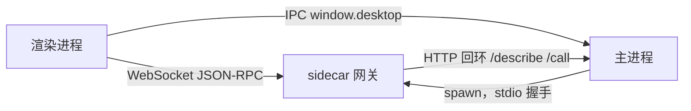
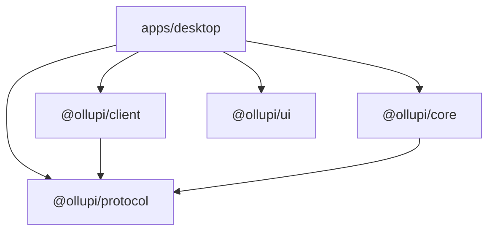
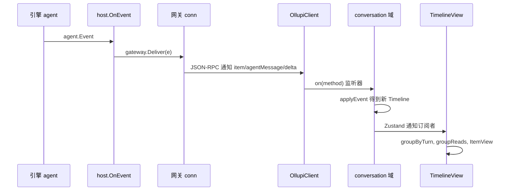

# 桌面端架构

Ollupi 桌面端把 ollupi 引擎包成一个 macOS 应用。引擎是 Go 库，桌面端要给它一个进程、一个界面和一些只有本机才有的能力（内置浏览器、终端、Finder、系统通知）。它由三个进程和四个前端 package 组成：Go sidecar 跑引擎，Electron 主进程托管 sidecar 并提供原生能力，渲染进程直接连 sidecar 的网关画界面。

## 三个进程

| 进程 | 代码 | 做什么 | 生命周期 |
|---|---|---|---|
| Go sidecar（`ollupid`） | `sidecar/` | 嵌入引擎，装配模型、工具、MCP、记忆、定时任务、飞书机器人，在回环端口上提供网关 | 主进程启动它；SIGTERM 或 stdin 关闭时退出 |
| Electron 主进程 | `apps/desktop/src/main` | 托管 sidecar，拥有 `config.yaml` 和技能文件夹的写入、窗口、内置浏览器、终端、git 操作、更新、通知 | 应用的生命周期，窗口关闭后仍在 |
| 渲染进程 | `apps/desktop/src/renderer` | 界面。沙箱内运行，只能通过 `window.desktop` 和网关 WebSocket 与外界说话 | 窗口的生命周期；隐藏窗口不销毁它 |

主进程不转发网关流量。sidecar 就绪后，主进程把地址和令牌放进 `BackendState` 交给渲染进程，渲染进程自己连。所以一条消息从引擎到界面不经过主进程。

## 四条通道

| 通道 | 两端 | 传输 | 认证 | 传什么 |
|---|---|---|---|---|
| 网关 | 渲染进程和 sidecar | `ws://127.0.0.1:<随机端口>/`，JSON-RPC 2.0 | 每次启动新生成的 32 字节令牌，随 `ollupi.token` 子协议发送 | 会话、一轮、条目、审批、设置，全部引擎数据 |
| IPC | 渲染进程和主进程 | `ipcRenderer.invoke` 和 `webContents.send` | 只暴露 `DesktopApi` 列出的方法 | 文件、git、终端、浏览器标签、配置、更新 |
| 握手 | sidecar 和主进程 | stdout 一行 JSON，stderr 进日志 | 令牌走环境变量 `OLLUPI_GATEWAY_TOKEN` | `ready` 或 `fatal`，见 [sidecar](/zh/desktop/sidecar) |
| 浏览器端点 | sidecar 和主进程 | `http://127.0.0.1:<随机端口>`，POST JSON | 令牌走环境变量 `OLLUPI_BROWSER_TOKEN`，请求带 `Authorization: Bearer` | agent 对标签页的操作，见 [内置浏览器](/zh/desktop/browser) |

令牌放环境变量而不放参数，原因写在 `supervisor.ts`：argv 其他用户能读到。

打包后的页面从 `app://ollupi` 加载，而不是 `file://`，这样页面有真实的源，网关能用 `--allow-origin ollupi` 放行，也能给它严格的 CSP。

## 四个 package

依赖只有一个方向，`protocol` 在最底层，`ui` 不知道协议。

| package | 职责 | 约束 |
|---|---|---|
| `@ollupi/protocol` | 网关契约的 TypeScript 形式：类型、方法表、错误码、内置工具校验器 | `src/generated/` 全部由 `gateway/protocol.schema.json` 生成，不手写 |
| `@ollupi/client` | JSON-RPC 对等端和类型化的 `OllupiClient` | 不依赖框架，能跑 WebSocket 的地方都能用；自己不重连 |
| `@ollupi/core` | 客户端领域逻辑：时间线归并、会话排序、工具调用分类、上下文用量、cron 表达式 | 只有纯函数，没有 I/O、框架和状态容器 |
| `@ollupi/ui` | 基于 `theme.css` token 的展示组件 | 没有应用状态，没有协议知识，一切靠 props |

主进程和渲染进程之间的契约是 `apps/desktop/src/shared/ipc.ts`：通道名和 `DesktopApi` 接口，两边都 import，改动在两端都过类型检查。

`src/shared/generated/` 里的 `ConfigCheck` 和 `SkillsCheck` 是另一份生成的类型，来源是 sidecar 打印的 JSON Schema，见 [配置](/zh/app/config)。

## 数据从引擎事件到界面

下面是 agent 写出一段文字时的路径。一轮（turn）是用户发一条消息后 agent 的一次完整运行，条目（item）是一轮里的一条记录：一段回复、一次工具调用、一段思考。

1. 引擎从自己的循环里发出 `agent.Event`。`host.New` 给的 `OnEvent` 把它同时交给网关和每个 `Client`（目前只有飞书机器人）。`Deliver` 不许阻塞，因为引擎在自己的循环里发事件。
2. 网关按事件所属用户找到连接，转成 JSON-RPC 通知。
3. `RpcPeer` 解析消息。带 `method` 无 `id` 的是通知，带 `method` 和 `id` 的是网关发来的请求（审批和提问），只带 `id` 的是调用的回应。
4. `OllupiClient.on` 把通知派发给监听器。渲染进程的每个域（domain）在 `bind` 里订阅自己关心的通知。
5. `conversation` 域调用 `@ollupi/core` 的 `applyEvent`，得到一个新的 `Timeline` 放进 Zustand。没打开的会话的通知直接丢弃，打开时再读当前状态。
6. React 组件重新渲染。细节见 [渲染进程](/zh/desktop/renderer)。

审批走的是反方向的请求：网关发 `item/toolCall/requestApproval`，渲染进程把 JSON-RPC 的 resolve 存进 `requests` 域，用户点按钮时调用它，回应就发回去了。

## 逻辑放在哪一层

原则写在 `docs/roadmap.md`：逻辑放在拥有它的那一层，桌面端只做展示和装配。判断一个规则该不该写进桌面端，看它是不是引擎也要遵守的事实。下面是代码里的几个实例。

| 问题 | 放在哪 | 为什么 |
|---|---|---|
| 这份 `config.yaml` 能不能启动 | sidecar 的 `--check-config`，它真的装配一遍后端并启动 agent | 引擎才知道权限规则和模型预算是否合法，桌面端不重写校验 |
| 这个文件夹里的技能能不能加载 | sidecar 的 `--check-skills`，用 agent 启动时同一份目录逻辑 | 同上 |
| 一个工具调用现在在等什么 | 引擎的 `ItemRow`，`@ollupi/core` 的 `waitsForApproval` 等函数照抄它的定义 | 界面只读状态，注释里写明对应的 `repo.*` 方法 |
| 哪些事件值得通知 | 渲染进程的 `notifications` 域 | 它跟着网关，有用户的通知偏好 |
| 现在要不要弹系统通知 | 主进程的 `showNotice` | 它才知道窗口是否在前台 |
| 后端失败的文案 | 渲染进程按 `BackendFailure` 的 `kind` 用界面语言写 | 主进程只报种类；只有 ollupi 自己报的 `reported.message` 原样显示 |
| 浏览器工具的名称和注解 | sidecar 的 `internal/browser` | 工具是引擎概念 |
| 标签页和页面操作 | 主进程 | 只有它能碰 `WebContents` |

桌面端自己定义的只有引擎没有的东西：窗口、面板宽度、配色、通知开关、内置浏览器的标签页和历史。这些存在渲染进程的 `localStorage` 或主进程的数据文件夹里，不进引擎的库。

## 单用户

引擎是多用户的，桌面端只有一个用户 `repo.DefaultUser`，值是 `default`。网关的令牌就是这个用户，飞书机器人也以它的身份调用引擎，所以桌面和飞书看到的是同一批会话。网关给每个用户保留一条连接，新连接会顶掉旧的，这也是渲染进程在同步完成之前不开第二条重连循环的原因。引擎的多用户和分片见 [分片](/zh/engine/sharding)。

## 代码位置

| 位置 | 职责 |
|---|---|
| ollupi-desktop `apps/desktop/src/main/index.ts` | 主进程入口，把各模块接在一起 |
| ollupi-desktop `apps/desktop/src/shared/ipc.ts` | 主进程和渲染进程的契约 |
| ollupi-desktop `apps/desktop/src/preload/index.ts` | 把 `DesktopApi` 暴露给沙箱内的渲染进程 |
| ollupi-desktop `apps/desktop/src/main/protocol.ts` | `app://ollupi` 协议和 CSP |
| ollupi-desktop `apps/desktop/src/renderer/src/gateway/` | 渲染进程的网关连接和域的运行 |
| ollupi-desktop `packages/protocol/` | 生成的契约类型 |
| ollupi-desktop `packages/client/` | JSON-RPC 客户端 |
| ollupi-desktop `packages/core/` | 客户端纯函数 |
| ollupi-desktop `packages/ui/` | 组件和设计 token |
| ollupi-desktop `sidecar/internal/host/host.go` | 装配引擎，事件分发 |
| ollupi `gateway/server.go` | 网关连接和事件投递 |
