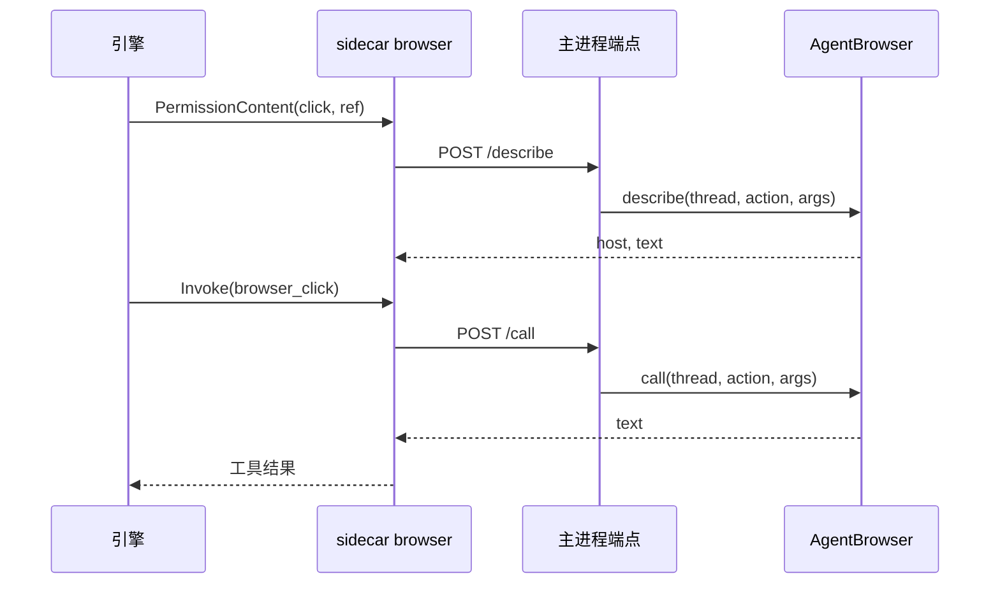

# 内置浏览器

内置浏览器是应用自带的 Chromium 标签页，放在会话右侧，agent 和用户共用：agent 能打开网页、读内容、点击、粘贴、上传文件，用户看得到它在做什么，也能随时接手，比如登录一个 agent 进不去的站点。

浏览器属于桌面端，不属于引擎。sidecar 只给出工具的名字和描述，把调用转发给主进程；主进程拥有全部 `WebContentsView`，agent 的动作由主进程里的 Playwright 读页面、执行，经进程内的 CDP 代理连到标签页，不开调试端口。agent 看的就是用户看的同一个页面，引擎不接触窗口。

## 标签页归属

每个会话有一组标签页，由主进程的 `AgentBrowser` 按会话 ID 保管；`Strip` 记着会话、标签页数组和当前活动的那一个。

```ts
interface Strip {
  thread: string
  tabs: WebContentsView[]
  active: WebContentsView | undefined
}
```

所有动作都作用于 `strip.active`，换标签页改的就是它；页面要 `window.open` 时拒绝新窗口，在同一会话里 `newTab`，只开 http 和 https，并把新标签设为 `active`；关闭当前标签页时下一个顶上，没有下一个就取最后一个。子 agent 的工具调用带它自己的会话 ID，所以它有自己的标签页。

**草稿的标签页。** 草稿页的会话还不存在，标签页挂在固定 ID `draft` 下；发出第一条消息时 `startThread` 在第一轮开始前调用 `handOver('draft', threadId)`，标签页移到这个会话。

**显示。** 同一时间最多一个标签页可见。`shown` 记录当前显示哪个会话、在哪块区域；`layAll` 把这个会话的 `active` 设为可见并放到指定位置，其余隐藏并给 0×0 的边界——只隐藏而不改尺寸的视图会继续在旧位置画。隐藏的标签页继续运行；面板跟着各自的会话切换，见[侧边面板](/zh/desktop/side-panels)。

标签页只活在内存里，随窗口存在，不跨应用重启；后端重启不影响它们。

## 视图的放置

网页不是 DOM 的一部分，是主进程盖在窗口上的原生视图。`BrowserPanel` 把内容区的矩形上报给主进程：

```ts
void desktop.browser.place(thread, { x: r.left, y: r.top, width: r.width, height: r.height })
```

矩形每帧读一次，变了才重新上报：窗口变窄、旁边的列换了份额时区域会移动，而移动不触发 `ResizeObserver`，留在原处的页面会画到面板外面。区域没有面积时上报 `undefined`，页面不显示。还没打开页面、拖动面板边缘、收藏/历史/地址补全列表打开、有对话框压在窗口上（`useDialogOpen`）时也不上报，页面随之隐藏。

## 工具调用的路径



端点是主进程在回环地址的随机端口上开的 HTTP 服务，后端启动之前就开好；地址和令牌经 `OLLUPI_BROWSER_URL`、`OLLUPI_BROWSER_TOKEN` 给 sidecar，令牌用 `timingSafeEqual` 比较。`/call` 回 `{text}`，`/describe` 回 `{host, text}`；400、401、404、405、500 都是工具错误；422 是 `Refusal`，`{error}` 是给 agent 看的文字，比如 ref 过期、没有打开的页面，它读到就能调整。sidecar 的 HTTP 超时 90 秒，够页面在动作之后加载完；主进程不回应时报 `the app does not answer`。

## 工具

工具名是 `browser_<action>`，提供方 `browser`，所以 MCP 服务器不能用这个名字。所有工具都标 `Serial: true`：同一会话的调用共用一个活动标签页，不能并行。

| 工具 | 参数 | 只读 | 开放世界 | 描述 host |
|---|---|---|---|---|
| `browser_navigate` | `url` | 是 | 是 | 是 |
| `browser_open` | `url` | 是 | 是 | 是 |
| `browser_tabs` | `select` | 是 | 否 | 否 |
| `browser_screenshot` | `full` | 是 | 否 | 否 |
| `browser_snapshot` | `page` | 是 | 否 | 否 |
| `browser_click` | `ref`、`snapshot` | 否 | 是 | 是 |
| `browser_type` | `ref`、`text`、`submit`、`snapshot` | 否 | 是 | 是 |
| `browser_paste` | `text`、`html`、`ref`、`snapshot` | 否 | 是 | 是 |
| `browser_press_key` | `key`、`snapshot` | 否 | 是 | 是 |
| `browser_scroll` | `direction`、`snapshot` | 是 | 否 | 否 |
| `browser_upload` | `files`、`ref`、`snapshot` | 否 | 是 | 是 |
| `browser_back` | `snapshot` | 是 | 是 | 是 |

`snapshot` 是共享参数：动作之后默认把页面读回来，`snapshot: false` 就不要，连续几次编辑只在最后读一次；粘贴默认不读回。`navigate` 在活动标签页打开，`open` 另开一个并留在新页，`tabs` 列出标签页并指定以后在哪一个里操作；`screenshot` 把页面截成 PNG 存到临时目录，回答路径和尺寸；`upload` 按路径把本机文件放进 file input。

### 粘贴

`browser_paste` 让 agent 往富文本编辑器里放东西：帖子框、评论框这样的编辑器不收逐字输入，只认粘贴事件。`text` 原样放进光标处，`html` 把同一段文字作为标记一起带上，编辑器会保留标题、粗体、列表和链接；`ref` 指定字段，不写就是当前聚焦的字段。它不提交任何东西。

实现是先在该元素上派发带 `text/plain`（和 `text/html`）的 `ClipboardEvent('paste')`，让页面自己的粘贴处理拿走它；2 秒内字段没变化，就把光标放到末尾用 `keyboard.insertText` 插入，这只适用于不处理粘贴事件的输入框；仍没变化就返回 `Refusal`（`the field did not take the text; click it first, or name its ref in the snapshot`）。默认不读回，回答是 `Pasted N characters in M block(s) into … The page was not read back; browser_snapshot reads it.`，节数按非空行算。browser 子 agent 因此能读工作区里的文件、直接把内容粘进页面（`desktop@532d208`）；它不能驱动 Mac 的剪贴板——`paste` 只在页面里造一个粘贴事件。

### 按网站审批

带「描述 host」的工具在执行前或审批前调用 `/describe`，得到动作的文字描述和标签页的 host。host 是权限内容的匹配值，规则和审批都按网站走；引擎在已批准的调用执行前再算一遍，标签页换了站点就重新询问。`navigate`、`open` 的 host 取目标地址，其余取当前页面，描述如 `Click button "Sign in" on example.com`。

`click`、`type`、`paste` 的元素名取自这个标签页最新的那份快照，不临时重拍，因为拍一次会给整帧重编 ref，审批完 agent 手里的 ref 就失效了。ref 不在最新快照里，或 `back` 没有更早的页面，直接拒绝。

审批策略由工具注解决定（[权限](/zh/engine/permissions)）：

| 策略 | 需要审批的工具 |
|---|---|
| 严格（`untrusted`） | 非只读或开放世界：`navigate`、`open`、`click`、`type`、`paste`、`press_key`、`upload`、`back` |
| 适中（`on-request`） | 非只读：`click`、`type`、`paste`、`press_key`、`upload` |
| 宽松（`never`） | 无 |

这张表是没有规则时的结果，allow、ask、deny 规则可以改变它。

### 动作的实现

- `navigate`：`normalize` 后 `loadURL`，没有标签页时新建；加载失败不算错，页面显示错误页。
- `click`：`page.getByRef(ref).click()`，先滚进视野，等它可见、可用、位置稳定、没被挡住，再发 CDP 鼠标事件。
- `type`：输入框用 `fill`；contenteditable 不能 `fill`（会折掉换行、也清不空），先 `ControlOrMeta+A` 再 `Delete`，最后 `insertText`。`submit` 时补一个 `Enter`。
- `press_key`：`page.keyboard.press`，键名按 Playwright（`Enter`、`PageDown`），可组合（`Control+A`）。
- `scroll`：鼠标移到页面中央，滚轮滚一屏的 80%；页面里自己滚的列表也会滚。
- `back`：`page.goBack`，只等到提交，加载交给之后的读取。

`click`、`type`、`paste`、`upload` 先用 `count()` 确认 ref 还指向页面上的元素，不在就立即拒绝（`no element eN on the page now; take a new snapshot`），不先查会等满 Playwright 的 10 秒超时。动作出错时，Playwright 的错误信息加调用日志的前 12 行作为 `Refusal` 返回。

**不在屏幕上的标签页。** 会话不在屏幕上时标签页尺寸是 0、不跑动画帧，Playwright 判断元素是否稳定要等动画帧，于是一直等下去。每个动作期间 `Pages.act` 用 CDP 打开焦点模拟（`Emulation.setFocusEmulationEnabled`），并按面板上次显示的尺寸设置 `Emulation.setDeviceMetricsOverride`（没显示过用 1280×800），动作结束后两者都清掉。

`call` 开始时发 `used` 事件，渲染进程收到后打开这个会话的浏览器面板（`showBrowser`），让用户看到 agent 在做什么。

::: info 演进
以前的动作是自己写的页面脚本，跑在 1001 号隔离世界里：点击用 `sendInputEvent`，标签页不在屏幕上时退回 DOM 的 `el.click()`，只响应 `pointerdown` 的控件点不动；快照跳过 iframe；滚动只滚整个窗口。`desktop@4f4ebe6` 换成 Playwright，`desktop@6a43a81` 加上粘贴。
:::

## Snapshot 格式

每个动作都以页面文本作答，`snapshot` 不做动作直接读。读之前先等页面的 `load`，最多 15 秒（`LOAD_TIMEOUT`），超时按已经加载出来的内容读；刚被链接打开、还没有地址的新标签页，先等它停止加载。

快照是 Playwright 的 `page.ariaSnapshot({ mode: 'ai' })`：按无障碍树写成 YAML，能操作的元素带 `[ref=eN]`，iframe 展开在 `iframe` 节点下，里面的 ref 带帧前缀（`f1e2`），跨站的 iframe 和 Shadow DOM 里的元素都在内。返回的文本是标题、地址和快照：

```
E2E
http://example.com:8765/

- generic [active] [ref=e1]:
  - heading "Hello" [level=1] [ref=e2]
  - iframe [ref=e9]:
    - button "frame button" [ref=f1e2]
```

页面为空时写 `(the page shows nothing)`。超过 40000 字符（`SNAPSHOT_PAGE`，约 1 万 token）时按行切成几页，结尾写 `[page 1 of 6 of this snapshot; snapshot with page 2 reads on]`；`browser_snapshot` 带 `page` 时从最新的那份快照里取那一页，ref 到下一次拍快照前都有效。已经在 DOM 里的内容都在各页里，`scroll` 用于滚到才加载的内容。

## Playwright 怎么连到标签页

Electron 给每个页面一个 CDP 通道（`webContents.debugger`），Playwright 连的却是整个浏览器，`TabsOverCDP` 在两者之间：连接时的四个浏览器级命令直接作答（`Browser.getVersion`、`Target.setAutoAttach` 随即把已有标签页报成 `Target.attachedToTarget`、`Target.getTargetInfo`、`Browser.setDownloadBehavior`），其余拒绝；标签页会话的命令转给那个标签页的 debugger，跨站 iframe 是 Chromium 另开的子会话，按 `attachedToTarget` 记下归属；debugger 断开时向 Playwright 报 `Target.detachedFromTarget`。`chromium.connectOverCDP(transport)` 不走 socket，连接带 `noDefaults`。

不开 `--remote-debugging-port`：调试端口没有认证，本机任何程序都能接管所有标签页和登录状态。Playwright 在第一次动作时才加载，标签页也在那时接入，一次一个，用户没在用的页面从不被自动化。子会话的 `Target.setAutoAttach` 用 `waitForDebuggerOnStart: false`：接入之后才出现的跨站 iframe 若暂停等调试器，恢复命令经 Electron 的 debugger 发不过去，整个页面停在加载中。

## 地址栏

新标签页、以及没有标签页时打开的浏览器，都从 `START_PAGE`（`https://www.google.com/`）开始。地址栏输入交给主进程的 `typedPage`：像地址就当地址开（有协议，或没有空格且 host 是 localhost、IP、带端口、带字母顶级域的名字），否则拼成 `https://www.google.com/search?q=…`；`normalize` 为 `localhost`、IP、`[::1]` 补 `http://`，其余补 `https://`，只开 http 和 https——主进程能加载页面自己不能加载的东西（如 `file:`），所以不管谁发起都不放行。

地址栏右侧依次是回退、前进、刷新、收藏星标，以及收藏和历史两个列表（`listing`）。历史按最近访问列出，可筛选，能删单条（`removeVisit`）或清空（`clearHistory`）；收藏先列用户自己的，再按 Chrome 个人资料分组。输入时最多补 8 条（`LIMIT`），来源是历史和收藏：地址或标题要包含输入的每个词，地址以输入开头的排最前，其次每个词都是某个词的开头；同层按 `visits × 时效系数 + (已收藏 ? 1 : 0)` 排，再按最近访问（4 天内 1，14 天内 0.7，31 天内 0.5，90 天内 0.3，更久 0.1）。第一条在最前层时补进输入框、补上的部分选中，下一次按键替换它；删除字符时不补。方向键选择，回车打开，Esc 先收列表再放弃输入。

## 设备权限

页面要用的东西分三类（`asking()`）：每站点问一次并记住的，是 `clipboard-read`、`clipboard-sanitized-write`、`notifications`、`fullscreen`、`pointerLock`、`mediaKeySystem`；每次都问、会碰到 Mac 自己东西的，是 `geolocation`、`media`、`display-capture`、`midi`、`midiSysex`、`hid`、`serial`、`usb`、`idle-detection`、`openExternal`、`speaker-selection`；其余不问，直接拒绝。答案存在 `browser-permissions.json`，形如 `{ "example.com": { "notifications": true } }`，按站点分、串行写入。

问题画在面板顶部一条 `PermissionNotice`（`role="alertdialog"`）：「`example.com` 想使用通知。」第二行说明这次是否记住，按钮是「拒绝」和「允许」，页面等着答案。60 秒（`ASK_TIMEOUT`）没人回答就算拒绝，问题撤掉（`permissionClosed`）。只有面板正在显示的标签页能问，因为问题只能画在一处；记住的答案在别处也生效。

## 登录分区

所有标签页共用一个分区 `persist:browser`，和应用自身的 session 分开并持久化，登录状态在 `~/Library/Application Support/Ollupi/Partitions/browser`，不和 Chrome 共用。配置在第一次创建标签页时做一次：

| 配置 | 值 | 原因 |
|---|---|---|
| User-Agent | Chromium 默认值去掉 `Electron/...` 和应用名 | Google 登录这类站点拒绝标着嵌入式浏览器的 UA |
| 下载 | 问存到哪里 | `will-download` 弹保存对话框，默认在「下载」；结束后面板顶部一条 `DownloadNotice` 报路径，可在 Finder 里显示 |
| `webPreferences` | `sandbox`、`contextIsolation` 开，`nodeIntegration` 关 | |

## 历史与收藏

`History` 记下每个标签页打开过的网页，用户和 agent 打开的都算，文件是 `~/Library/Application Support/Ollupi/history.json`。一次访问是标签页到达另一个地址（`did-navigate` 和主框架的 `did-navigate-in-page`），刷新不算；每个网页一条 `url`、`title`、`visits`、`last`，最多 5000 条（`LIMIT`），超过时删掉最久没访问的。改动 1 秒后批量写入（`SAVE_DELAY`），退出时 `flush`；写文件经 `.tmp` 再改名，读不了时抛错而不是当成空，否则下一次保存会覆盖原内容（`readKept`）。设置 → 通用能看到网页数并清除。

`bookmarks.json` 存用户自己的收藏，加入时放到最前，已存在的移到最前并更新标题。Chrome 的收藏只读：从 `Local State` 的 `profile.info_cache` 得到个人资料和显示名，再读每个资料的 `Bookmarks`，只留 http 和 https 并记下文件夹路径；读不到就返回空。

## 边界与已知问题

- 标签页不跨应用重启，窗口关掉就没了；草稿的标签页在会话建好后移交。
- 同一时间只有一个会话的浏览器可见，其他会话的标签页还在跑，但尺寸是 0，动作要靠焦点模拟和尺寸覆盖才动得起来。
- 只有当前显示的标签页能弹权限问题，后台标签页的请求直接被拒；`screenshot` 存在临时目录里的 PNG 不清理。
- 调试端口全程不开，标签页只经进程内的 CDP 代理被 Playwright 操作。

## 代码位置

| 位置 | 职责 |
|---|---|
| ollupi-desktop `sidecar/internal/browser/browser.go` | 工具定义和转发 |
| ollupi-desktop `apps/desktop/src/main/browser/browser.ts` | `AgentBrowser`：标签页、动作、粘贴、快照、权限、分区 |
| ollupi-desktop `apps/desktop/src/main/browser/playwright.ts`、`cdp.ts` | `Pages` 加载连接 Playwright、动作期间唤醒；`TabsOverCDP` 把标签页拼成 CDP 浏览器 |
| ollupi-desktop `apps/desktop/src/main/browser/endpoint.ts` | 回环 HTTP 端点与令牌 |
| ollupi-desktop `apps/desktop/src/main/browser/address.ts` | `START_PAGE`、`normalize`、`typedPage` |
| ollupi-desktop `apps/desktop/src/main/browser/permissions.ts` | 三类问法与记住的答案 |
| ollupi-desktop `apps/desktop/src/main/browser/history.ts`、`bookmarks.ts`、`suggest.ts`、`file.ts` | 历史、收藏、地址栏补全、JSON 文件的安全读写 |
| ollupi-desktop `apps/desktop/src/renderer/src/views/conversation/BrowserPanel.tsx` | 面板、标签栏、地址栏、权限与下载提示 |
