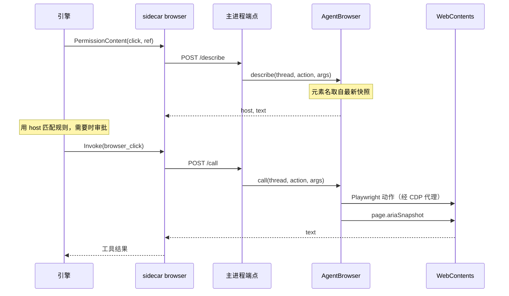

# 内置浏览器

内置浏览器是应用自带的 Chromium 标签页，放在会话右侧，agent 和用户共用。agent 能打开网页、读内容、点击、输入；用户看得到它在做什么，也能随时接手，比如登录一个 agent 进不去的站点。

浏览器属于桌面端，不属于引擎。sidecar 只提供工具的名称和描述，把调用转发给主进程。主进程拥有全部 `WebContentsView`，agent 的动作由主进程里的 Playwright 读页面、执行，它经一个进程内的 CDP 代理连到标签页，不开调试端口。

## 标签页归属

每个会话有一组标签页，由主进程的 `AgentBrowser` 按会话 ID 保管。

```ts
interface Strip {
  thread: string
  tabs: WebContentsView[]
  active: WebContentsView | undefined
}
```

| 规则 | 实现 |
|---|---|
| agent 在当前显示的标签页里操作 | 所有动作都作用于 `strip.active` |
| 用户切换标签页，agent 跟着换 | `select` 改的就是 `active` |
| 页面打开新窗口时开成新标签页 | `setWindowOpenHandler` 拒绝窗口，在同一个会话里 `newTab`，只开 http 和 https |
| 点击打开新标签页后 agent 留在新页 | `newTab` 把新标签设为 `active`，`call` 最后读的是 `active` |
| 关闭当前标签页 | 下一个标签顶上，没有下一个时取最后一个 |
| 子 agent | 工具调用带的是子 agent 自己的会话 ID，所以它有自己的标签页 |

**草稿的标签页。** 草稿页的会话还不存在，标签页挂在固定的 ID `draft` 下。发出第一条消息时，`startThread` 在第一轮开始之前调用 `handOver('draft', threadId)`，标签页移到这个会话。

**显示。** 同一时间最多一个标签页可见。`shown` 记录当前显示哪个会话和在哪块区域。`layAll` 遍历所有标签，只把那个会话的 `active` 设为可见并放到指定位置，其余全部隐藏。隐藏的标签页继续运行。

**标签页的生命周期。** 它们只活在内存里，随窗口存在，不跨应用重启。后端重启不影响标签页。窗口隐藏时标签页还在。窗口已不存在时打开标签页会被拒绝。

## 视图的放置

网页不是 DOM 的一部分，是主进程盖在窗口上的原生视图。`BrowserPanel` 量出自己的区域，告诉主进程放在哪里：

```ts
const r = el.getBoundingClientRect()
void desktop.browser.place(thread, { x: r.left, y: r.top, width: r.width, height: r.height })
```

`ResizeObserver` 和窗口 `resize` 时重新上报。这几种情况隐藏视图，否则它会盖住或抢走指针：

- 页面还没打开，这时面板显示说明文字。
- 拖动面板边缘。
- 收藏列表或地址补全列表打开，这两个是 DOM 浮层，画在视图下面。
- 面板关闭或切换到别的会话。

## 工具调用的路径



端点是主进程在 `127.0.0.1` 随机端口上开的 HTTP 服务，后端启动之前就开好。地址和令牌通过 `OLLUPI_BROWSER_URL`、`OLLUPI_BROWSER_TOKEN` 给 sidecar，每次启动和每次配置校验都带上。令牌用 `timingSafeEqual` 比较。

请求体：

```json
{"thread": "<会话 ID>", "action": "click", "arguments": {"ref": "e12"}}
```

| 状态码 | 含义 | sidecar 怎么处理 |
|---|---|---|
| 200 | `/call` 回 `{text}`，`/describe` 回 `{host, text}` | 正常 |
| 400 | 请求体不对 | 工具错误 |
| 401 | 令牌不对 | 工具错误 |
| 404 / 405 | 路径或方法不对 | 工具错误 |
| 422 | `Refusal`，比如 ref 过期、没有打开的页面，`{error}` 是给 agent 看的文字 | 作为工具输出返回，agent 能读到并调整 |
| 500 | 其他异常 | 工具错误 |

sidecar 的 HTTP 超时是 90 秒，够页面在动作之后加载完。主进程不回应时报 `the app does not answer`。

## 工具

工具名是 `browser_<action>`，提供方名 `browser`，所以 MCP 服务器不能用这个名字（配置校验会拒绝）。所有工具都标了 `Serial: true`：同一会话的调用共用一个活动标签页，不能并行。

| 工具 | 参数 | 只读 | 开放世界 | 有权限内容 |
|---|---|---|---|---|
| `browser_navigate` | `url` | 是 | 是 | 是 |
| `browser_snapshot` | `page` | 是 | 否 | 否 |
| `browser_click` | `ref` | 否 | 是 | 是 |
| `browser_type` | `ref`、`text`、`submit` | 否 | 是 | 是 |
| `browser_press_key` | `key` | 否 | 是 | 是 |
| `browser_scroll` | `direction`（`down`、`up`） | 是 | 否 | 否 |
| `browser_back` | | 是 | 是 | 是 |

### 按网站审批

有权限内容的工具在审批前调用 `/describe`，得到操作的文字描述和标签页的 host。host 是权限内容的匹配值，所以规则和审批都按网站走。引擎在已批准的调用执行前再算一遍，标签页换了站点就重新询问。

`navigate` 的 host 取目标地址，其余取当前页面。描述文字举例：

| 动作 | 描述 |
|---|---|
| `navigate` | `Open https://example.com/` |
| `click` | `Click button "Sign in" on example.com` |
| `type` | `Type "hello" into textbox "Search" and press Enter on example.com` |
| `press_key` | `Press Enter on example.com` |
| `back` | `Go back from example.com` |

`click` 和 `type` 的元素名取自这个标签页最新的那份快照，也就是 agent 看到的样子。不去页面上查，是因为 Playwright 给元素拍一次快照就会给整帧重新编 ref，审批完 agent 手里的 ref 就失效了。ref 不在最新快照里，或 `back` 没有更早的页面，直接拒绝。

审批策略由工具注解决定（[权限](/zh/engine/permissions)）：

| 策略 | 需要审批的工具 |
|---|---|
| 严格（`untrusted`） | 非只读或开放世界：`navigate`、`click`、`type`、`press_key`、`back` |
| 适中（`on-request`） | 非只读：`click`、`type`、`press_key` |
| 宽松（`never`） | 无 |

这张表是没有规则时的结果。allow、ask、deny 规则可以改变它。

### 动作的实现

| 动作 | 怎么做 |
|---|---|
| `navigate` | `normalize` 地址后 `loadURL`，没有标签页时新建。加载失败不算错，页面显示错误页 |
| `click` | `page.getByRef(ref).click()`。Playwright 先把元素滚进视野，等它可见、可用、位置稳定、没被别的元素挡住，再发 CDP 的鼠标事件 |
| `type` | `fill` 替换内容，`submit` 时再 `press('Enter')` |
| `press_key` | `page.keyboard.press`，键名按 Playwright：`Enter`、`ArrowUp`、`PageDown`，也能组合，如 `Control+A` |
| `scroll` | 鼠标移到页面中央，滚轮滚一屏的 80%。滚动的是中央那块区域，页面里自己滚动的列表也会滚 |
| `back` | `page.goBack`，只等到提交，加载交给之后的读取 |

`click` 和 `type` 先用 `count()` 确认 ref 还指向页面上的元素，不在就立即拒绝：`no element eN on the page now; take a new snapshot`。不先查的话，Playwright 会等满整个超时（10 秒）。

动作出错时（元素一直不可点、键名不认识），Playwright 的错误信息和调用日志的前 12 行作为 `Refusal` 返回给 agent，调用日志说明它在等什么。

**不在屏幕上的标签页。** 会话不在屏幕上时，它的标签页尺寸是 0，页面不跑动画帧，Playwright 判断元素是否稳定要等动画帧，于是一直等下去。每个动作期间 `Pages.act` 用 CDP 打开焦点模拟（`Emulation.setFocusEmulationEnabled`），让页面照常运行；标签页不在屏幕上时，再按浏览器面板上次显示的尺寸设置 `Emulation.setDeviceMetricsOverride`，没显示过面板时用 1280×800。动作结束后两者都清掉。焦点模拟在屏幕上的标签页也开，因为窗口被遮住时页面同样可能停跑动画帧（这一点是推断，没有单独测过）。

`call` 开始时发 `used` 事件。渲染进程收到后，如果这个会话正在屏幕上，打开浏览器面板，让用户看到 agent 在做什么。

::: info 演进
以前的动作是自己写的页面脚本，跑在 1001 号隔离世界里：点击用 `sendInputEvent`，标签页不在屏幕上时退回 DOM 的 `el.click()`，只响应 `pointerdown` 的控件点不动；快照跳过 iframe；滚动只滚整个窗口。`desktop@c0295de` 换成 Playwright。
:::

## Snapshot 格式

每个动作都以页面文本作答，`snapshot` 不做动作直接读。读之前，如果当前标签页是刚被链接打开、还没有地址的新标签页，先等它停止加载；再等页面的 `load`，最多 15 秒，超时就按已经加载出来的内容读。

快照是 Playwright 的 `page.ariaSnapshot({ mode: 'ai' })`：按无障碍树写成 YAML，能操作的元素带 `[ref=eN]`，iframe 展开在 `iframe` 节点下，里面的 ref 带帧前缀，如 `f1e2`；跨站的 iframe 也在内。Shadow DOM 里的元素照常列出。返回的文本是标题、地址和快照，例如测试页的开头：

```
E2E
http://127.0.0.1:8765/

- generic [active] [ref=e1]:
  - heading "Hello" [level=1] [ref=e2]
  - button "pointer only" [ref=e3]
  - textbox "Name" [ref=e4]
  - link "get file" [ref=e5] [cursor=pointer]:
    - /url: /file.txt
  - button "shadow button" [ref=e8]
  - iframe [ref=e9]:
    - button "frame button" [ref=f1e2]
```

页面为空时写 `(the page shows nothing)`。

### 分页

快照不截断。超过 40000 字符（`SNAPSHOT_PAGE`，约 1 万 token）时，`paged` 按行切成几页，每页不超过这个长度，单独一行超长时再切开。返回第 1 页，结尾写：

```
[page 1 of 6 of this snapshot; snapshot with page 2 reads on]
```

`browser_snapshot` 带 `page` 时不重新拍，从这个标签页最新的那份快照里取那一页。Playwright 的 ref 绑定在最近一次快照上，所以同一份快照每一页的 ref 都有效，直到下一次拍快照。不带 `page` 就重新拍，从第 1 页开始。页数超出范围、或还没有快照时拒绝。

分页和滚动是两回事：已经在 DOM 里的内容都在快照的各页里；`scroll` 用于页面滚到才加载的内容。

## Playwright 怎么连到标签页

Electron 给每个页面一个 CDP 通道（`webContents.debugger`），Playwright 连的却是整个浏览器。`TabsOverCDP` 在两者之间：

- 对 Playwright 连接时发的四个浏览器级命令直接作答：`Browser.getVersion`、`Target.setAutoAttach`（随即把已有的标签页报成 `Target.attachedToTarget`）、`Target.getTargetInfo`、`Browser.setDownloadBehavior`（空答，下载仍由应用处理）。其余浏览器级命令拒绝。
- 标签页会话上的命令转给那个标签页的 debugger。标签页里跨站的 iframe 是 Chromium 另开的子会话，按 `attachedToTarget` 事件记下它属于哪个标签页，命令带着子会话 ID 转过去。
- 标签页的 debugger 断开（关闭、崩溃）时，向 Playwright 报 `Target.detachedFromTarget`。

Playwright 用 `chromium.connectOverCDP(transport)` 在进程内连上它，`transport` 是一个对象，不经过 socket。连接带 `noDefaults`，Playwright 不改页面的模拟、焦点和下载行为。

| 规则 | 原因 |
|---|---|
| 不开 `--remote-debugging-port` | 调试端口没有认证，本机任何程序都能接管所有标签页和登录状态，连应用自己的界面也在目标列表里 |
| Playwright 在 agent 第一次动作时才加载、连接 | 加载它要约 200 毫秒，不让应用启动付这笔 |
| 标签页在 agent 第一次在里面动作时才接入 | 只有用户在用的标签页从不被自动化 |
| 一次只接入一个标签页 | 接入时 Playwright 收到的下一个页面就是它 |
| 子会话的 `Target.setAutoAttach` 改成 `waitForDebuggerOnStart: false` | 接入之后才出现的跨站 iframe 如果暂停等调试器，经 Electron 的 debugger 发去的恢复命令不会得到回应，整个页面停在加载中 |

VS Code 的内置浏览器用的是同一种结构：主进程里的 `WebContentsView`、协议感知的 CDP 代理、`connectOverCDP(transport)`，也把子目标设为不等调试器。

## 地址

`normalize` 处理用户和 agent 输入的地址：

- 没有协议时，`localhost`、`127.0.0.1`、`[::1]` 补 `http://`，其余补 `https://`。
- 只开 http 和 https，别的协议拒绝。主进程能加载页面自己不能加载的东西（比如 `file:`），所以无论谁发起都不放行。

## 登录分区

所有标签页共用一个分区 `persist:browser`，和应用自身的 session 分开，并持久化。登录状态存在 `~/Library/Application Support/Ollupi/Partitions/browser`，不和 Chrome 共用。

| 配置 | 值 | 原因 |
|---|---|---|
| User-Agent | Chromium 的默认值去掉 `Electron/...` 和应用名 | Google 登录这类站点会拒绝标着嵌入式浏览器的 UA |
| 设备权限 | 一律拒绝 | `setPermissionRequestHandler` 回 `false` |
| 下载 | 问存到哪里 | `will-download` 里弹出保存对话框，默认在「下载」；Playwright 连接带 `noDefaults`，不接管下载 |
| `webPreferences` | `sandbox`、`contextIsolation` 开，`nodeIntegration` 关 | |

这些在第一次创建标签页时配置一次。

## 历史

`History` 记下每个标签页打开过的网页，用户和 agent 打开的都算。文件是 `~/Library/Application Support/Ollupi/history.json`。

- 一次访问是标签页到达另一个地址：`did-navigate` 和主框架的 `did-navigate-in-page`。刷新或页面把地址改成原样不算。
- 每个网页一条：`url`、`title`、`visits`、`last`。
- 最多 5000 条（`LIMIT`），超过时删掉最久没访问的。
- 改动 1 秒后批量写入（`SAVE_DELAY`），退出时 `flush`。
- 标题后到时用 `titled` 事件补上。只有页面显式设置的标题才算。

文件写入经过 `.tmp` 再改名，崩溃不会留下半个文件。文件读不了时抛错，不当成空，否则下一次保存会覆盖原内容。这条规则在 `readKept` 里，收藏也用它。

在 **设置 → 通用** 能看到网页数并清除。

## 收藏

`bookmarks.json` 存用户自己的收藏。加入时放到最前，已存在的移到最前并更新标题。

Chrome 的收藏只读，列出时现读：

1. 读 `~/Library/Application Support/Google/Chrome/Local State` 的 `profile.info_cache` 得到全部个人资料和显示名。
2. 读每个个人资料的 `Bookmarks` 文件，它是纯 JSON，Chrome 一直在写，所以只读不改。
3. 只留 http 和 https，记下所在的文件夹路径。

读不到时返回空，Chrome 不是必须的。

## 地址栏补全

`suggest` 对输入返回最多 8 条（`LIMIT`），来源是历史和收藏（含 Chrome 的）。

**匹配**：地址或标题要包含输入的每个词。比较时地址用 `bare` 去掉协议、`www.` 和单独的结尾斜杠。

**排序**：

| 层 | 条件 |
|---|---|
| 2 | 地址以输入开头 |
| 1 | 每个词都是地址或标题里某个词的开头 |
| 0 | 其余 |

同层内按分数排：`visits × 时效系数 + (已收藏 ? 1 : 0)`，再按最近访问。

| 距上次访问 | 系数 |
|---|---|
| 4 天内 | 1 |
| 14 天内 | 0.7 |
| 31 天内 | 0.5 |
| 90 天内 | 0.3 |
| 更久 | 0.1 |

**就地补全**：第一条在第 2 层时补进输入框，补上的部分处于选中状态，下一次按键替换它。还在输入站点名时只补到站点，回车打开站点首页。删除字符时不补全。

**键盘**：方向键选择，回车打开，Esc 先收起列表，再按一次放弃输入。

输入过程中只有最新的一次询问生效（`asked` 计数），避免旧结果盖掉新结果。

## 代码位置

| 位置 | 职责 |
|---|---|
| ollupi-desktop `sidecar/internal/browser/browser.go` | 工具定义和转发 |
| ollupi-desktop `apps/desktop/src/main/browser/browser.ts` | `AgentBrowser`：标签页、动作、快照分页、分区配置 |
| ollupi-desktop `apps/desktop/src/main/browser/playwright.ts` | `Pages`：加载和连接 Playwright、接入标签页、动作期间唤醒 |
| ollupi-desktop `apps/desktop/src/main/browser/cdp.ts` | `TabsOverCDP`：把标签页拼成一个 CDP 浏览器给 Playwright |
| ollupi-desktop `apps/desktop/src/main/browser/endpoint.ts` | 回环 HTTP 端点 |
| ollupi-desktop `apps/desktop/src/main/browser/address.ts` | 地址规范化 |
| ollupi-desktop `apps/desktop/src/main/browser/history.ts` | 历史记录 |
| ollupi-desktop `apps/desktop/src/main/browser/bookmarks.ts` | 收藏和 Chrome 收藏 |
| ollupi-desktop `apps/desktop/src/main/browser/suggest.ts` | 地址栏补全 |
| ollupi-desktop `apps/desktop/src/main/browser/file.ts` | JSON 文件的安全读写 |
| ollupi-desktop `apps/desktop/src/renderer/src/views/conversation/BrowserPanel.tsx` | 面板、标签栏、地址栏 |
