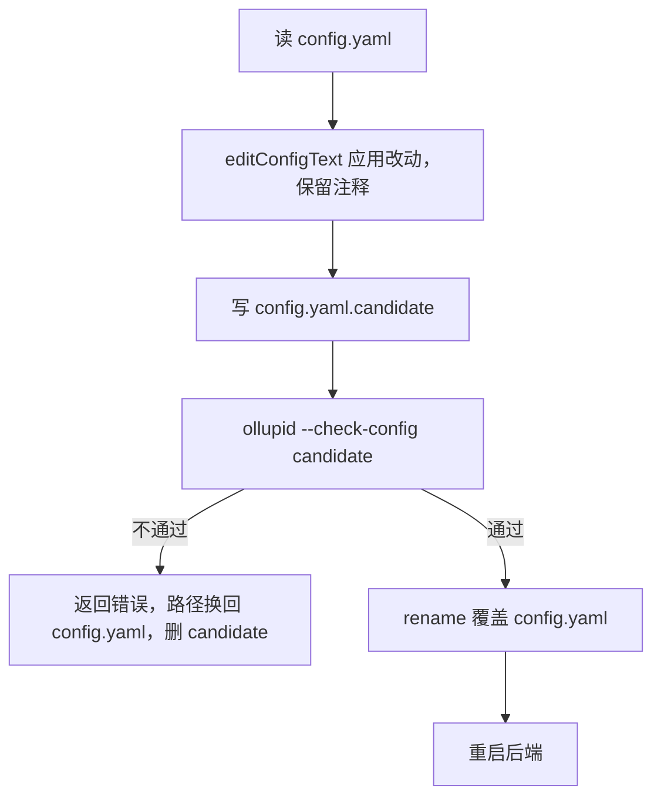

# 配置的实现

桌面端的配置文件是 `~/.ollupi/config.yaml`，字段说明见[配置与数据](/zh/app/config)。引擎只在启动时读配置，所以任何改动都要重启后端才生效。界面改配置时走一个固定流程：先让后端自己校验，通过后才写入并重启，这样后端不接受的改动到不了文件。

## 校验分三层

| 层 | 在哪 | 查什么 |
|---|---|---|
| 解析 | `config.Parse` | YAML 语法，未知字段，类型 |
| 文件形状 | `Config.Validate` | `name` 必填；提供方和模型名的规则；`calls`、`slots` 不为负；`limits` 不全为零；`memory.model` 指向存在的模型；`generate` 开启时有 `model`；MCP 不叫 `browser`；飞书的 ID、密钥和 `domain` |
| 能否启动 | `host.Check` | 引擎校验审批策略、权限规则、`limits` 的值、模型的上下文预算，以及 MCP 工具相关的规则 |

前两层只看文件，第三层真的装配一遍后端，用临时目录当数据库。全过才算通过。

## 界面怎么改配置

`config.yaml` 由主进程拥有。渲染进程只读取并提出改动，不碰文件。

改动是按键路径的操作：

```ts
export type ConfigChange =
  | { kind: 'set'; path: (string | number)[]; value: unknown }
  | { kind: 'delete'; path: (string | number)[] }
  | { kind: 'move'; path: (string | number)[]; to: number }
```

`BackendConfig.apply` 的流程：



候选文件放在真文件旁边，`rename` 才是原子的。校验用 30 秒超时和后端相同的环境变量，MCP 的 `${NAME}` 才解析得到。

**保留注释。** 用 `yaml` 库的 `Document` 编辑，不重新序列化成纯数据。这个库把顶层键上方的注释块存成上一节的结尾注释，写回时会缩进到上一节里。`attachSectionComments` 把最后一个空行之后的部分还给下一个键。

**重启前确认。** 有会话在运行时，渲染进程先问，因为重启会停止正在执行的命令。

**联动。** 改名提供方或模型时，`memory.model` 跟着改。删除被 `memory.model` 引用的模型时：学习关着就一起删除引用，学习开着就要求先换模型。不能删除最后一个模型。

**设默认模型** 是 `move` 操作，把模型和它的提供方移到各自列表的第一位。

**秘密值。** `--check-config` 的输出清空了 MCP 里写死的 `env` 和 `headers` 值。界面把它们当作"保持不变"，编辑时只写改过的键，不会把文件里的值改成空。

技能文件夹用同样的思路：改动先放到 `.staging-` 开头的临时文件夹，`--check-skills` 用 agent 的目录逻辑检查，通过后改名进去，再重启后端。agent 跳过以点开头的文件夹，所以临时文件夹不会被加载。

## config:generate

渲染进程需要知道 `--check-config` 输出的类型，而这份类型由 Go 定义。`pnpm config:generate` 让 TypeScript 类型从 Go 生成，不手写第二份。

| 目标文件 | 类型名 | 来自 | 描述 |
|---|---|---|---|
| `src/shared/generated/backend-config.ts` | `ConfigCheck` | `ollupid --config-schema` | `--check-config` 的输出 |
| `src/shared/generated/backend-skills.ts` | `SkillsCheck` | `ollupid --skills-schema` | `--list-skills` 和 `--check-skills` 的输出 |

过程：

1. `apps/desktop/scripts/generate-config.mjs` 在 `sidecar/` 里执行 `go run ./cmd/ollupid <flag>`。
2. sidecar 用 `jsonschema.For[T]` 从 Go 类型得到 JSON Schema，字段名来自 json 标签。
3. `json-schema-to-typescript` 编译成 TypeScript，写上 `DO NOT EDIT` 的头。

`pnpm config:check` 比较现有文件和生成结果，过期时失败。

`src/shared/ipc.ts` 从这份类型派生出 `BackendConfig`、`ConfigModel`、`Skill`，界面都用这些名字。给 `Config` 加字段后，重新生成，界面就能在类型里看到它。

## 不一致检测

用户可以手改 `config.yaml`，或直接改技能文件夹，这时文件和正在运行的后端不一样。界面在四处比较，发现不一致时显示警告和"重启后端"按钮。

| 位置 | 比较 | 说明 |
|---|---|---|
| 设置 → 模型 | `model/list` 的连接 ID 和文件里的模型 ID | 顺序也比较，第一个是默认模型 |
| 能力 → MCP | `mcpServer/list` 的名称和文件里的名称 | |
| 能力 → 技能 | agent 加载的技能和文件夹里的技能 | 排序后比较 |
| 记忆设置 | `memory/status` 的两个开关和文件里的 `use`、`generate` | |

只有连接着后端时才比较。

## 代码位置

| 位置 | 职责 |
|---|---|
| ollupi-desktop `sidecar/internal/config/config.go` | 类型、解析、`Validate`、首次写入 |
| ollupi-desktop `sidecar/internal/config/template.go` | 模板 |
| ollupi-desktop `sidecar/cmd/ollupid/main.go` | `--check-config`、`--config-schema` 等模式 |
| ollupi-desktop `sidecar/internal/host/host.go` | `Check` |
| ollupi-desktop `apps/desktop/src/main/backend/config.ts` | `BackendConfig`、`editConfigText` |
| ollupi-desktop `apps/desktop/src/main/backend/skills.ts` | 技能文件夹的暂存和校验 |
| ollupi-desktop `apps/desktop/scripts/generate-config.mjs` | 类型生成 |
| ollupi-desktop `apps/desktop/src/shared/generated/` | 生成的类型 |
| ollupi-desktop `apps/desktop/src/renderer/src/domains/backendConfig.ts` | 渲染进程的应用和确认 |
| ollupi-desktop `apps/desktop/src/renderer/src/domains/modelConfig.ts` | 模型改动的规则 |
| ollupi-desktop `apps/desktop/src/renderer/src/domains/mcpConfig.ts` | MCP 改动的规则 |
| ollupi `tools/workspace/config.go` | 工作区字段和默认值 |
