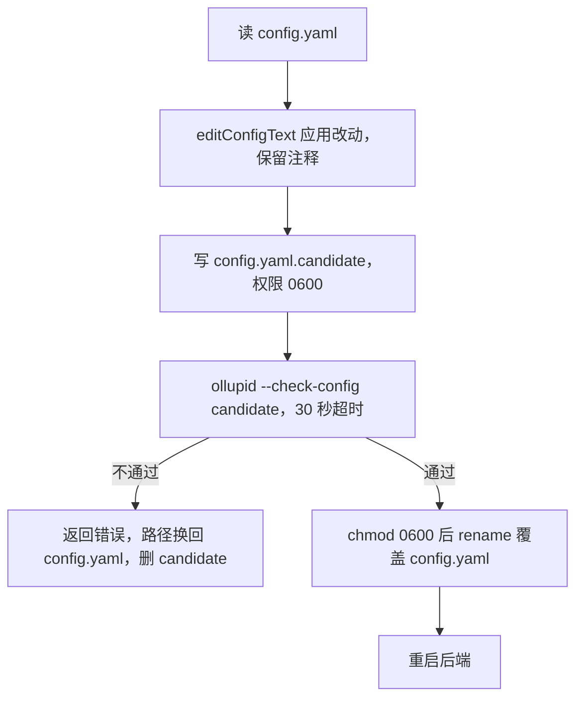

# 配置的实现

桌面端的配置文件是 `~/.ollupi/config.yaml`，字段说明见[配置与数据](/zh/app/config)。这个文件只放"启动时取一次"的部署参数：模型和提供它们的 API、工作区工具、记忆用什么模型学、槽位。用户运行中会改的东西——权限、MCP 服务器、记忆开不开——存在引擎的 store 里，通过网关改，不经过这个文件。

引擎只在启动时读配置，所以文件的改动都要重启后端才生效。界面改配置时走一个固定流程：先让后端自己校验，通过后才写入并重启，这样后端不接受的改动到不了文件。

## 为什么这样设计

文件可以手改，编辑器、`cp`、git 都行；如果界面自己实现一套校验，两边就会漂移，用户手改出来的文件界面认不出，界面写出来的文件后端又启动不了。让 `ollupid --check-config` 当唯一的裁判，界面只负责给出改动和显示错误。

运行中可改的项（权限、MCP 服务器、记忆开关）放在 store 里，是因为它们不需要重启就能生效，放进需要重启的文件会白白打断正在跑的命令。这条分界线在 `internal/config` 的包注释里：这个包"只描述，`host` 把它变成运行中的组件"。

## 文件里有什么

| 键 | 含义 | 默认或要求 |
|---|---|---|
| `name` | 部署的名字，引擎用它在 MCP 握手和日志里标识自己 | 必填，不能为空白 |
| `prompt` | 系统提示 | 省略时用引擎的默认系统提示 |
| `models[]` | 按提供它们的 API 分组。顺序有意义：第一个提供方的第一个模型是默认模型 | 至少一个模型 |
| `models[].provider` | 提供方名字。模型按 `provider/name` 选择，所以名字要唯一，且不能带 `/` | 必填 |
| `models[].type` | 提供方说的 API：`openai`（任何 OpenAI 兼容接口）、`anthropic`、`gemini` | 必填，三种之一 |
| `models[].base_url` | API 地址 | 省略时用客户的默认地址 |
| `models[].api_key` | API 密钥，明文写在文件里，像 `base_url` 一样 | 不需要密钥的接口可省 |
| `models[].names[].name` | 模型名，同一提供方内唯一 | 必填 |
| `models[].names[].calls` | 这个模型同时最多几个请求。每个模型是独立的引擎连接和客户端，所以这个上限只限它自己 | 省略用 4 |
| `models[].names[].thinking` | 是否请求模型的思考。OpenAI 兼容接口据此发 `enable_thinking` | `anthropic`、`gemini` 省略为开；`openai` 省略时不发 `enable_thinking`，由 API 自己决定；设 `false` 关闭 |
| `models[].names[].images` | 模型接受图片。为假时引擎拒绝把图片发给它 | 省略为假 |
| `models[].names[].limits` | `context` 上下文窗口、`output` 一次回答最多占多少、`input` 可选的输入上限 | 必填，不能是零值；`context`、`output` 必须为正 |
| `tools` | 工具白名单 | 省略即全部放开 |
| `slots` | 同时跑多少轮 | 省略用引擎默认的 32 |
| `workspace.enabled` | 打开 `run_command`、`edit_file`、`write_file` | 省略为假 |
| `workspace.sandbox_mode` | `read-only`、`workspace-write`、`full-access` | 省略为 `workspace-write` |
| `workspace.command_timeout_sec` | 单条命令的默认超时（秒） | 省略或不为正时用 30 |
| `workspace.max_command_timeout_sec` | 工具调用能给命令指定的最大超时 | 省略时用 `max(600, command_timeout_sec)`；不能小于 `command_timeout_sec` |
| `workspace.network` | 沙箱里是否允许联网 | 省略为假 |
| `workspace.workspace_dirs` | 命令的工作目录 | 省略时用 `<home>/scratch`，引擎自己创建 |
| `workspace.allowed_domains` / `denied_domains` | 联网时的域名规则 | |
| `workspace.deny_read` / `read_only` | 禁止读、只读的路径 | |
| `workspace.extra_writable` | 工作目录之外额外可写的路径 | |
| `workspace.unix_sockets` / `env_passthrough` | 允许访问的 unix socket、透传的环境变量 | |
| `workspace.max_output_bytes` | 单次命令输出的上限 | 省略用 1 MiB |
| `workspace.command_blacklist` | 禁止执行的命令名 | |
| `memory.model` | 从结束的轮次里学记忆的模型，写 `provider/name`。和那个模型共用客户端与 `calls` | 省略则不学 |

`config.yaml` 里没有 MCP 字段、技能，也没有记忆的开关：MCP 服务器和技能在引擎的 store 里（`mcpServer/list`、`skill/list`），记忆的 `use`、`generate` 在设置里（`settings/read`）。

桌面端还会在引擎之外往工作区沙箱上加两条：`deny_read` 里有 `config.yaml`，命令读不到里面的 API 密钥；环境变量标记是 `OLLUPI_SANDBOX`。引擎自己再补两条：`<home>/data` 禁止读，`AGENTS.md`、`CLAUDE.md`、`.mcp.json` 这类文件名受保护。

::: info 演进
0.7.53 之前，默认权限、MCP 服务器和记忆的两个开关都写在 `config.yaml` 里，改它们也要重启后端。0.7.53 跟进引擎 v0.17.1，引擎按用户把它们存进 store，桌面端改在应用里设置，第一次启动时把文件里的旧键搬进引擎（`desktop@795ac1d`）。
:::

## 校验分三层

| 层 | 在哪 | 查什么 |
|---|---|---|
| 解析 | `config.Parse` | YAML 语法；转成 JSON 后用 `DisallowUnknownFields` 解码，拼错的键报错而不是被忽略；类型 |
| 文件形状 | `Config.Validate` | `name` 必填；提供方名字唯一且不带 `/`；`type` 在三种之内；每个提供方至少一个模型、模型名不重复；`calls`、`slots` 不为负；`limits` 不能是零值；`memory.model` 指向列出的模型 |
| 能否启动 | `host.Check` | 完整装配一遍后端：模型客户端的 `limits` 取值、工作区沙箱、记忆模型 |

前两层只看文件，第三层真的装配。`host.Check` 建一个临时数据目录（前缀 `ollupid-check-`），用和真实启动同一个 `New` 装配，然后关掉、删掉目录；它不走 `Serve`，所以不启动引擎、不开会话、不连 MCP 服务器。

## 界面怎么改配置

`config.yaml` 由主进程拥有。渲染进程只读取并提出改动，不碰文件。

改动是按键路径的操作：

```ts
export type ConfigChange =
  | { kind: 'set'; path: (string | number)[]; value: unknown }
  | { kind: 'delete'; path: (string | number)[] }
  | { kind: 'move'; path: (string | number)[]; to: number }
```

`BackendConfig.apply` 的流程：



候选文件放在真文件旁边，`rename` 才是原子的。校验用和后端相同的环境变量（主进程的 `env()`，含浏览器端点的两个变量），端口、令牌都不另配一份。

**保留注释。** 用 `yaml` 库的 `Document` 编辑，不重新序列化成纯数据。这个库把顶层键上方的注释块存成上一节的结尾注释，写回时会缩进到上一节里。`attachSectionComments` 把最后一个空行之后的部分还给下一个键。`move` 搬的是节点本身，节点上的注释跟着走。

**重启前确认。** 有轮次在跑时，渲染进程先问，因为重启会把正在执行的命令标成中断。确认逻辑在 `domains/backendConfig.ts` 的 `confirmRestart`。

**联动。** 改名提供方或模型时，`memory.model` 跟着改。被 `memory.model` 引用的模型不能删除，含有它的提供方也不能删：`cannotRemove`、`cannotRemoveProvider` 返回 `memoryModel`（`memoryModels`），界面提示先在记忆页换一个模型，不看学习开没开。不能删除最后一个模型。

**设默认模型** 是 `move` 操作，把模型和它的提供方移到各自列表的第一位。

## 技能

技能不在 `config.yaml` 里，也不在哪个文件夹里：每个身份的技能存在引擎的 store 里，渲染进程经网关读写（`skill/list`、`skill/read`、`skill/set`、`skill/delete`），`skill/changed` 把改动推给每个窗口。引擎在 `skill/set` 时检查技能，不通过就回 `invalidParams`，界面把原因显示在对话框里；agent 每一步开始时重读技能，所以改完不用重启。

主进程只做一件事：导入时让用户选一个文件夹，交给 `ollupid --read-skill` 读成字段，原样还给渲染进程（`BackendSkills.read`）。读 `SKILL.md` 的是 sidecar，和随应用发布的技能同一个读法，见 [sidecar 的技能](/zh/desktop/sidecar#技能)。

::: info 演进
引擎 v0.31.0 之前，技能是 `config.yaml` 的 `skills_dir` 指向的文件夹，按角色分目录，所有身份共用。主进程在文件夹里暂存改动，用 `ollupid --check-skills` 检查后 `rename` 进去，删除走回收站，复制给另一个 agent 是复制一份文件夹。v0.31.0 把技能搬进 store、改成每个用户自己的，桌面端跟着去掉了文件夹和这套暂存流程（`desktop@41ea52e`），旧文件夹里的技能由 `--import-config` 一次性搬进去。
:::

## config:generate

渲染进程需要知道 `--check-config` 和 `--read-skill` 输出的类型，而这份类型由 Go 定义。`pnpm config:generate` 让 TypeScript 类型从 Go 生成，不手写第二份。

| 目标文件 | 类型名 | 来自 | 描述 |
|---|---|---|---|
| `src/shared/generated/backend-config.ts` | `ConfigCheck` | `ollupid --config-schema` | `--check-config` 的输出 |
| `src/shared/generated/backend-skills.ts` | `SkillFolder` | `ollupid --skill-schema` | `--read-skill` 的输出 |

过程：

1. `apps/desktop/scripts/generate-config.mjs` 在 `sidecar/` 里执行 `go run -tags sqlite_fts5 ./cmd/ollupid <flag>`。
2. sidecar 用 `jsonschema.For[T]` 从 Go 类型得到 JSON Schema，字段名来自 json 标签。
3. `json-schema-to-typescript` 编译成 TypeScript，写上 `DO NOT EDIT` 的头。

`pnpm config:check` 比较现有文件和生成结果，过期时失败。

`src/shared/ipc.ts` 从这些类型派生出 `BackendConfig`、`ConfigModel`，并导出 `SkillFolder`，界面都用这些名字。给 `Config` 加字段后，重新生成，界面就能在类型里看到它。

## 不一致检测

用户可以手改 `config.yaml`，这时文件和正在运行的后端不一样。设置 → 模型会检查：`connected` 之后比较 `model/list` 的连接 ID 顺序和文件里的模型 ID 顺序，顺序也算，因为第一个是默认模型；不一致时显示警告和"重启后端"按钮。

这是唯一还能对不上的地方。MCP 服务器、技能和记忆开关都在引擎的 store 里，界面通过 `mcpServer/*`、`skill/*` 和 `settings/*` 读写，改完即时生效，没有"文件和运行中的后端不一致"这回事。

## 代码位置

| 仓库 | 路径 | 职责 |
|---|---|---|
| ollupi-desktop | `sidecar/internal/config/config.go` | 类型、`Parse`、`Validate`、`Load`/`LoadFile`、首次写入 |
| ollupi-desktop | `sidecar/internal/config/template.go` | 首次启动写入的模板 |
| ollupi-desktop | `sidecar/cmd/ollupid/main.go` | `--check-config`、`--config-schema` |
| ollupi-desktop | `sidecar/cmd/ollupid/skills.go` | `--read-skill`、`--skill-schema` 的输出类型 |
| ollupi-desktop | `sidecar/internal/host/host.go` | `Check`、`New` 里的装配 |
| ollupi-desktop | `apps/desktop/src/main/backend/config.ts` | `BackendConfig`、`editConfigText`、`apply` |
| ollupi-desktop | `apps/desktop/src/main/backend/skills.ts` | 导入时用 `--read-skill` 读一个技能文件夹 |
| ollupi-desktop | `apps/desktop/src/renderer/src/domains/skills.ts` | 技能列表跟着 `skill/changed`，`skill/read`、`skill/set`、`skill/delete` |
| ollupi-desktop | `apps/desktop/scripts/generate-config.mjs` | 类型生成 |
| ollupi-desktop | `apps/desktop/src/shared/generated/` | 生成的类型 |
| ollupi-desktop | `apps/desktop/src/renderer/src/domains/backendConfig.ts` | 渲染进程的应用与重启前确认 |
| ollupi-desktop | `apps/desktop/src/renderer/src/views/settings/ModelsSection.tsx` | 模型编辑与不一致警告 |
| ollupi-desktop | `apps/desktop/src/renderer/src/domains/modelConfig.ts` | 模型改动的规则 |
| ollupi-desktop | `apps/desktop/src/renderer/src/domains/mcp.ts` | MCP 服务器，走网关而不是文件 |
| ollupi | `tool/builtin/workspace/config.go` | 工作区字段、默认值和沙箱配置 |
| ollupi | `pkg/llm/limits.go` | `limits` 的含义与取值检查 |
