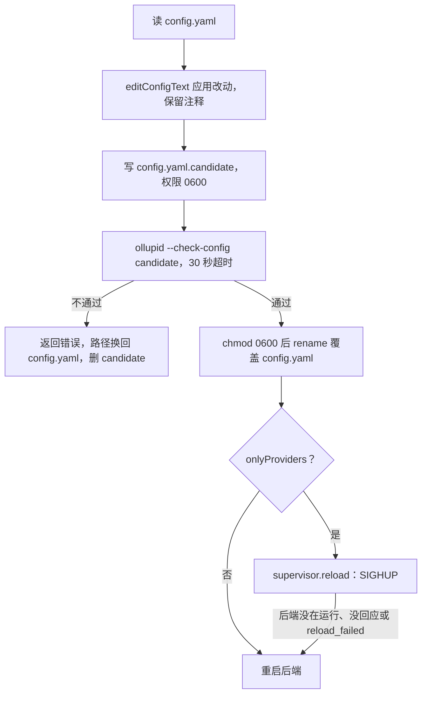

# 配置的实现

桌面端的配置文件是 `~/.ollupi/config.yaml`，字段说明见[配置与数据](/zh/app/config)。它描述的是这个部署，所有身份共用：名字、提示词、模型目录（`providers`，含 API 密钥）、工具白名单、槽位。每个身份自己的东西——新会话默认的模型、学记忆的模型、权限、MCP 服务器、技能、记忆开关——存在引擎的 store 里，经网关读写，不经过这个文件。

界面改配置时走一个固定流程：先让后端自己校验，通过后才写入。只改模型目录时，改动直接重载进正在运行的后端；改别的就重启后端。

## 为什么这样设计

文件可以手改，编辑器、`cp`、git 都行；如果界面自己实现一套校验，两边就会漂移，用户手改出来的文件界面认不出，界面写出来的文件后端又启动不了。让 `ollupid --check-config` 当唯一的裁判，界面只负责给出改动和显示错误。

文件里只放部署的东西，是因为引擎是多租户的：模型目录和密钥归运营者，所有用户共用；用户只在目录里选。放到服务器上时，同一份 `config.yaml` 原样可用，身份来自外部的身份系统。身份列表（`profiles.json`）因此不进这个文件：本机部署里应用是身份提供方，列表是它的，后端不读。

运行中会改的项放在 store 里，是因为它们不需要重启就能生效，放进需要重启的文件会白白打断正在跑的命令。这条分界线写在 `internal/config` 的包注释里：这个包"只描述，`host` 把它变成运行中的组件"。

## 文件里有什么

| 键 | 含义 | 默认或要求 |
|---|---|---|
| `name` | 部署的名字，引擎用它在 MCP 握手和日志里标识自己 | 必填，不能为空白 |
| `prompt` | 系统提示 | 省略时用引擎的默认系统提示 |
| `providers[]` | 模型目录，每项是一个 API 账号。顺序有意义：没选过模型的身份用第一个提供方的第一个模型 | 可以为空，但没有模型时开不了会话 |
| `providers[].id` | 提供方名字。模型按 `id/name` 选择，这也是引擎的连接 ID | 必填，1 到 64 个字符，前后无空格，不带 `/`，不重复 |
| `providers[].type` | 提供方说的 API：`openai`（任何 OpenAI 兼容接口）、`anthropic`、`gemini` | 必填，三种之一 |
| `providers[].base_url` | API 地址 | 省略时用客户端的默认地址 |
| `providers[].api_key` | API 密钥，明文写在文件里，像 `base_url` 一样 | 不需要密钥的接口可省；`gemini` 必填 |
| `providers[].models[].name` | 模型名，同一提供方内唯一 | 必填 |
| `providers[].models[].calls` | 这个模型同时最多几个请求。每个模型是独立的引擎连接和客户端，所有用户共用这个上限 | 省略用 4，不能为负 |
| `providers[].models[].thinking` | 是否请求模型的思考。OpenAI 兼容接口据此发 `enable_thinking` | `anthropic`、`gemini` 省略为开；`openai` 省略时不发，由 API 自己决定；设 `false` 关闭 |
| `providers[].models[].images` | 模型接受图片。为假时引擎不把图片发给它 | 省略为假 |
| `providers[].models[].limits` | `context` 上下文窗口、`output` 一次回答最多占多少、`input` 可选的输入上限 | `context`、`output` 必须为正，`input` 不能为负 |
| `tools` | 工具白名单 | 省略即全部放开 |
| `slots` | 同时跑多少会话 | 省略用引擎默认的 32，不能为负 |

`config.yaml` 里没有身份、MCP、技能、记忆开关，也没有工作区工具的设置：

- 命令和文件工具（`run_command`、`edit_file`、`write_file`）总是打开，沙箱用引擎 `workspace.Config` 的默认值：工作区可写、不联网、命令默认 30 秒超时（单次最多 600 秒），工作目录是 `<home>/scratch`。桌面端在此之外加两条：`config.yaml` 和 `<home>/data` 禁止读，命令读不到 API 密钥和数据库；环境变量标记是 `OLLUPI_SANDBOX`。引擎自己再让 `AGENTS.md`、`CLAUDE.md`、`.mcp.json` 这类文件名受保护。
- 每个身份的模型选择在 `settings/read` 的 `model`、`learnModel` 里，经 `settings/update` 改，只能选目录里有的。
- MCP 服务器和技能在 `mcpServer/list`、`skill/list`，记忆的开关在设置里。

::: info 演进
0.7.53 之前，默认权限、MCP 服务器和记忆的两个开关都写在 `config.yaml` 里，改它们也要重启后端；0.7.53 跟进引擎 v0.17.1 把它们搬进 store（`desktop@795ac1d`）。0.8.17-beta.5 跟进引擎的单一模型目录，`models`、`profiles`、`credentials` 这些按身份写模型的键换成 `providers`（`desktop@1c7ccf0`）。引擎 v0.31.0 让技能进 store，`skills_dir` 去掉（`desktop@41ea52e`）。之后 `workspace` 块也去掉了，命令和文件工具总是打开（`desktop@274e778`）。旧文件里的这些键都由 `--import-config` 在启动时拆掉，见[旧文件的导入](#旧文件的导入)。
:::

## 校验分三层

| 层 | 在哪 | 查什么 |
|---|---|---|
| 解析 | `config.Parse` | YAML 语法；转成 JSON 后用 `DisallowUnknownFields` 解码，拼错的键报错而不是被忽略；类型 |
| 文件形状 | `Config.Validate` | `name` 必填；`slots` 不为负；`providers` 交给引擎的 `account.CheckCatalog`：每个提供方的名字、`type`、`gemini` 的密钥、至少一个模型、模型名不重复、`calls` 不为负、`limits` 取值，以及提供方名字不重复 |
| 能否启动 | `host.Check` | 完整装配一遍后端：模型客户端、工作区沙箱、浏览器端点 |

`LoadFile` 在解析之前还会先看文件里有没有旧版本的键（按身份写的模型、`skills_dir`、`workspace`），有就直接拒绝，错误里写明运行 `ollupid --import-config`，而不是报一个让人看不懂的"未知字段"。

前两层只看文件，第三层真的装配。`host.Check` 建一个临时数据目录（前缀 `ollupid-check-`），用和真实启动同一个 `New` 装配，然后关掉、删掉目录；它不走 `Serve`，所以不启动引擎、不开会话、不连 MCP 服务器。

## 界面怎么改配置

`config.yaml` 由主进程拥有。渲染进程只读取并提出改动，不碰文件。

改动是按键路径的操作：

```ts
export type ConfigChange =
  | { kind: 'set'; path: (string | number)[]; value: unknown }
  | { kind: 'delete'; path: (string | number)[] }
```

`BackendConfig.apply` 的流程：



候选文件放在真文件旁边，`rename` 才是原子的。校验用和后端相同的环境变量（主进程的 `env()`，含浏览器端点的两个变量），端口、令牌都不另配一份。

**重载。** `onlyProviders` 在每个改动的路径都以 `providers` 开头时为真。后端收到 SIGHUP 后重读文件、调用 `host.Reload`，也就是引擎的 `SetModels`：每个模型换上新的客户端，正在调用模型的轮次用旧客户端跑完，然后在 stdout 上回 `reloaded` 或 `reload_failed`。主进程等这一行，超时、失败或后端本来没在运行时退回重启，重启会读整个文件。

**重启前确认。** 要重启的改动，有轮次在跑时渲染进程先问，因为重启会把正在执行的命令标成中断。确认逻辑在 `domains/backendConfig.ts` 的 `confirmRestart`；`applyProviders` 走重载，不问。重载完成后渲染进程重新读 `model/list`。

**保留注释。** 用 `yaml` 库的 `Document` 编辑，不重新序列化成纯数据。这个库把顶层键上方的注释块存成上一节的结尾注释，写回时会缩进到上一节里。`attachSectionComments` 把最后一个空行之后的部分还给下一个键。

**模型编辑的规则** 在 `domains/providers.ts`：提供方带着它的模型一起加；删掉一个提供方的最后一个模型就删掉这个提供方；不能删目录里的最后一个模型（`cannotRemove`、`cannotRemoveProvider` 返回 `lastModel`）。改提供方的名字会改掉它所有模型的连接 ID，选过这些模型的身份、跑过它们的会话都要重新选，删除和改名前的确认里会说。设为默认（星标）不改文件，是本身份的 `settings/update` 的 `model`。

## 旧文件的导入

应用每次启动时，在读配置、选身份之前运行一次 `ollupid --import-config`（`BackendConfig.importOlder`，同一次启动里只跑一次）。每一步都能重复运行，导入中途断了，下次启动接着做完。三步依次是：

| 步骤 | 处理什么 | 做法 |
|---|---|---|
| `dropWorkspace` | `workspace` 块 | 从文件里去掉，不保留任何值 |
| `runImport` | 按身份写模型的旧键（`config.Legacy`） | 所有身份用过的模型合并进 `providers`；每个身份变成 store 里的用户，`settings` 里记下原来的模型和学习模型；身份写进 `profiles.json`，名字和颜色取自文件或 `--names` 给的应用旧 `profiles.json`；原文件存为 `config.yaml.pre-import` |
| `importSkills` | `skills_dir` | 读文件夹里各角色的技能，同名的合成一个、给所有有它的角色，内容不同时以主 agent 那份为准，写给 store 里的每个用户；去掉这一行，文件夹留着 |

输出是一行 JSON：`{"ok":true,"workspace":true,"imported":[…],"skills":{…}}`，没做的步骤不出现。

去掉一个键用的是 `config/older.go` 的 `takeKey`：在 `yaml.Node` 树上删掉这个键和它的值，其余节点和注释原样写回。`yaml.v3` 把一个键上方的所有注释段落都算作这个键的 `HeadComment`，段落之间隔着空行，所以只有最后一段是在说这个键的。`takeKey` 删键时只带走最后一段，前面的段落挪到下一个键上方，没有下一个键时挪到文件末尾。比如模板里 `# slots: 32` 这行注释，不会因为下面跟着的 `workspace` 被删而一起消失。

## 技能

技能不在 `config.yaml` 里，也不在哪个文件夹里：每个身份的技能存在引擎的 store 里，渲染进程经网关读写（`skill/list`、`skill/read`、`skill/set`、`skill/delete`），`skill/changed` 把改动推给每个窗口。引擎在 `skill/set` 时检查技能，不通过就回 `invalidParams`，界面把原因显示在对话框里；agent 每一步开始时重读技能，所以改完不用重启。

主进程只做一件事：导入时让用户选一个文件夹，交给 `ollupid --read-skill` 读成字段，原样还给渲染进程（`BackendSkills.read`）。读 `SKILL.md` 的是 sidecar，和随应用发布的技能同一个读法，见 [sidecar 的技能](/zh/desktop/sidecar#技能)。

::: info 演进
引擎 v0.31.0 之前，技能是 `config.yaml` 的 `skills_dir` 指向的文件夹，按角色分目录，所有身份共用。主进程在文件夹里暂存改动，用 `ollupid --check-skills` 检查后 `rename` 进去，删除走回收站，复制给另一个 agent 是复制一份文件夹。v0.31.0 把技能搬进 store、改成每个用户自己的，桌面端跟着去掉了文件夹和这套暂存流程（`desktop@41ea52e`），旧文件夹里的技能由 `--import-config` 一次性搬进去。
:::

## config:generate

渲染进程需要知道 `--check-config` 和 `--read-skill` 输出的类型，而这份类型由 Go 定义。`pnpm config:generate` 让 TypeScript 类型从 Go 生成，不手写第二份。

| 目标文件 | 类型名 | 来自 | 描述 |
|---|---|---|---|
| `src/shared/generated/backend-config.ts` | `ConfigCheck` | `ollupid --config-schema` | `--check-config` 的输出 |
| `src/shared/generated/backend-skills.ts` | `SkillFolder` | `ollupid --skill-schema` | `--read-skill` 的输出 |

过程：

1. `apps/desktop/scripts/generate-config.mjs` 在 `sidecar/` 里执行 `go run -tags sqlite_fts5 ./cmd/ollupid <flag>`。
2. sidecar 用 `jsonschema.For[T]` 从 Go 类型得到 JSON Schema，字段名来自 json 标签。
3. `json-schema-to-typescript` 编译成 TypeScript，写上 `DO NOT EDIT` 的头。

`pnpm config:check` 比较现有文件和生成结果，过期时失败。

`src/shared/ipc.ts` 从这些类型派生出 `BackendConfig` 等名字，并导出 `SkillFolder`，界面都用这些名字。给 `Config` 加字段后，重新生成，界面就能在类型里看到它。

## 不一致检测

用户可以手改 `config.yaml`，这时文件和正在运行的后端不一样。设置 → 模型会检查：连上网关之后，比较 `model/list` 给的连接 ID 和文件里 `providers` 展开的 `id/name`，顺序也算，因为第一个是没选过模型的身份的默认；不一致时显示警告和"重启后端"按钮。

这是唯一还能对不上的地方。身份的选择、MCP 服务器、技能和记忆开关都在引擎的 store 里，界面通过 `settings/*`、`mcpServer/*`、`skill/*` 读写，改完即时生效，没有"文件和运行中的后端不一致"这回事。手改了 `name`、`prompt`、`tools`、`slots`，界面看不出来，要自己重启后端。

## 边界与已知问题

- API 密钥明文写在 `config.yaml` 里，靠文件权限 0600 和沙箱禁读保护，没有进 Keychain。
- 连接另一台机器上的后端时，设置 → 模型读写的仍是本机的 `config.yaml`，改动到不了远端。
- `--import-config` 只认得上面三类旧键。0.7.53 之前的 `permissions`、`mcp`、`memory.use`、`memory.generate` 已不在导入之列，文件里还有它们时后端以未知字段拒绝启动，要手动删掉。

## 代码位置

| 仓库 | 路径 | 职责 |
|---|---|---|
| ollupi-desktop | `sidecar/internal/config/config.go` | 类型、`Parse`、`Validate`、`Load`/`LoadFile`、首次写入 |
| ollupi-desktop | `sidecar/internal/config/template.go` | 首次启动写入的模板 |
| ollupi-desktop | `sidecar/internal/config/legacy.go` | 按身份写模型的旧文件（`Legacy`） |
| ollupi-desktop | `sidecar/internal/config/older.go` | `SkillsDir`、`Workspace` 和它们共用的 `takeKey` |
| ollupi-desktop | `sidecar/cmd/ollupid/main.go` | `--check-config`、`--config-schema`、SIGHUP 重载 |
| ollupi-desktop | `sidecar/cmd/ollupid/import.go` | `--import-config`：`dropWorkspace`、`runImport`、写 `profiles.json` |
| ollupi-desktop | `sidecar/cmd/ollupid/skills.go` | `importSkills`，`--read-skill`、`--skill-schema` 的输出类型 |
| ollupi-desktop | `sidecar/internal/host/host.go` | `Check`、`Reload`、`New` 里的装配和工作区沙箱 |
| ollupi-desktop | `apps/desktop/src/main/backend/config.ts` | `BackendConfig`、`editConfigText`、`onlyProviders`、`apply`、`importOlder` |
| ollupi-desktop | `apps/desktop/src/main/backend/supervisor.ts` | `reload`：SIGHUP 和退回重启 |
| ollupi-desktop | `apps/desktop/src/main/backend/skills.ts` | 导入时用 `--read-skill` 读一个技能文件夹 |
| ollupi-desktop | `apps/desktop/src/main/profile.ts` | `profiles.json` 和这台 Mac 的选择 |
| ollupi-desktop | `apps/desktop/scripts/generate-config.mjs` | 类型生成 |
| ollupi-desktop | `apps/desktop/src/shared/generated/` | 生成的类型 |
| ollupi-desktop | `apps/desktop/src/renderer/src/domains/backendConfig.ts` | 渲染进程的应用、重载与重启前确认 |
| ollupi-desktop | `apps/desktop/src/renderer/src/domains/providers.ts` | 模型目录改动的规则 |
| ollupi-desktop | `apps/desktop/src/renderer/src/views/settings/ModelsSection.tsx` | 模型编辑与不一致警告 |
| ollupi-desktop | `apps/desktop/src/renderer/src/domains/skills.ts` | 技能列表跟着 `skill/changed`，`skill/read`、`skill/set`、`skill/delete` |
| ollupi | `account/models.go` | `ProviderModel`、`CheckCatalog` |
| ollupi | `pkg/llm/limits.go` | `limits` 的含义与取值检查 |
| ollupi | `tool/builtin/workspace/config.go` | 工作区工具的默认值和沙箱配置 |
