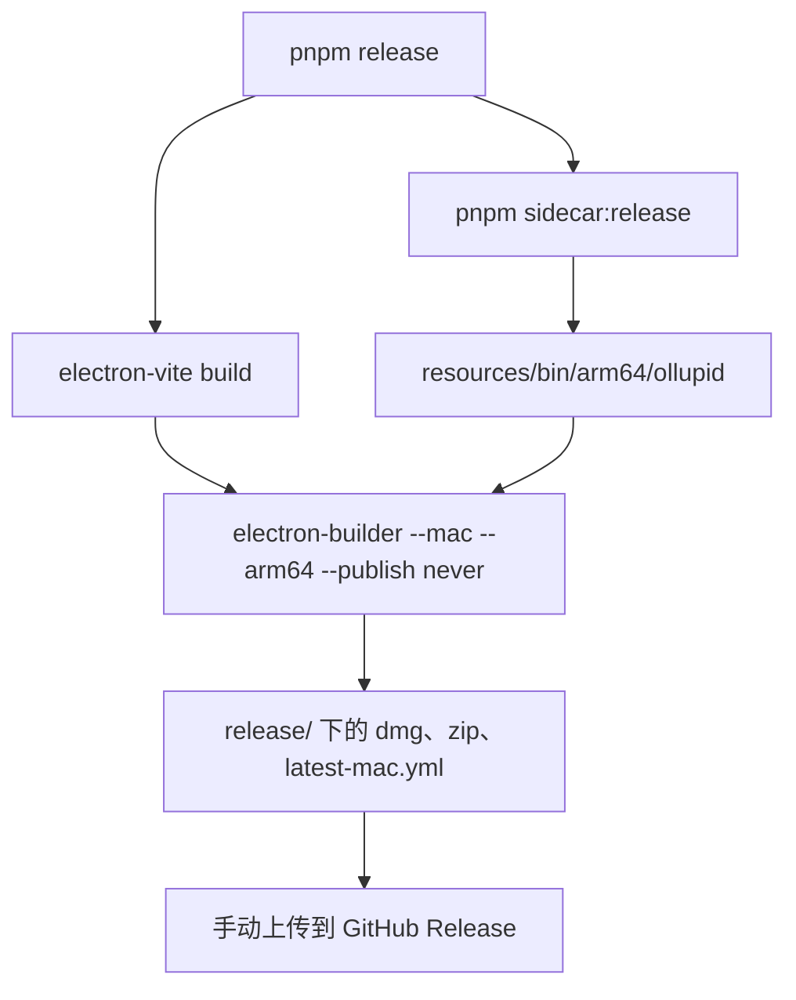
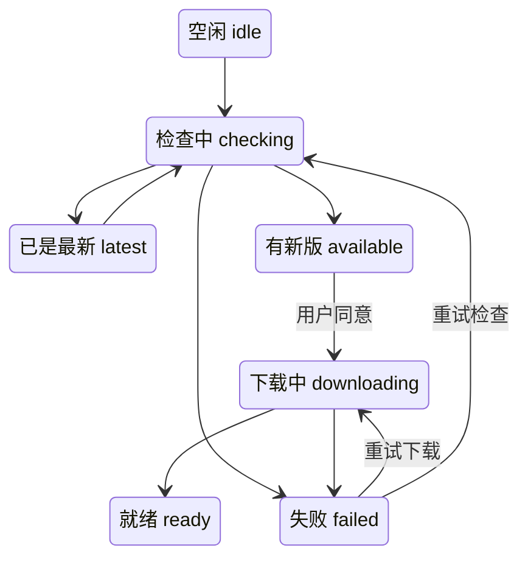

# 发布

桌面端发布到 GitHub Releases，只提供 Apple 芯片版本，每个版本包含一个 dmg、一个 zip 和 `latest-mac.yml`。dmg 给首次安装，zip 给应用自动更新。应用是 ad hoc 签名，没有经过 Apple 公证，所以更新器是自己写的，不用 Squirrel.Mac。

## 构建流程



| 命令 | 做什么 |
|---|---|
| `pnpm dev` | 构建 sidecar 到 `resources/bin/ollupid`，启动 electron-vite |
| `pnpm sidecar:build` | 开发用的 sidecar，会用本地的 `go.work` |
| `pnpm sidecar:release` | 发布用的 sidecar |
| `pnpm package` | 打包成 `.app` 目录，不出安装包（`--dir`） |
| `pnpm release` | 完整发布构建 |

### sidecar:release

```bash
cd sidecar && GOWORK=off CGO_ENABLED=1 MACOSX_DEPLOYMENT_TARGET=12.0 GOARCH=arm64 \
  CC='clang -arch arm64' go build -trimpath -ldflags=-s \
  -o ../apps/desktop/resources/bin/arm64/ollupid ./cmd/ollupid
```

`GOWORK=off` 有来历。`sidecar` 旁边的 `go.work`（不进仓库）指向本地的 ollupi 检出，发布构建曾经用了它，0.7.8 因此带上了一个未发布的 ollupi，协议和界面生成时用的不一致。之后发布构建忽略 `go.work`，只按 `go.mod` 钉住的版本。

### electron-builder

`apps/desktop/electron-builder.yml` 的要点：

| 配置 | 值 | 说明 |
|---|---|---|
| `appId` | `dev.ollupi.desktop` | |
| `mac.target` | `[dmg, zip]` | |
| `mac.minimumSystemVersion` | `12.0` | |
| `mac.artifactName` | `${productName}-${version}-${arch}.${ext}` | 如 `Ollupi-0.7.17-arm64.dmg` |
| `mac.identity` | `'-'` | ad hoc 签名 |
| `mac.hardenedRuntime` | `false` | 强化运行时需要真实身份 |
| `extraResources` | `resources/bin/${arch}` 到 `bin` | 把对应架构的 sidecar 放进应用 |
| `asarUnpack` | `node_modules/node-pty/**` | 终端的原生模块和 `spawn-helper` 要从磁盘加载 |
| `npmRebuild` | `false` | `node-pty` 的预构建二进制用 Node-API，Electron 直接能加载 |
| `publish` | `provider: github` | 让构建生成 `latest-mac.yml`；上传是手动的 |

打包后主进程从 `process.resourcesPath/bin/ollupid` 找 sidecar，开发时从 `resources/bin/ollupid`。

`node-pty` 1.1.0 发布的 `spawn-helper` 没有执行权限，每个终端都会报 `posix_spawnp failed`。`postinstall` 跑 `scripts/node-pty-helper.mjs` 把权限补上。

## 只有 arm64

0.7.14 是最后一个带 Intel 构建的版本。提交 `0cd622f`（Ship releases for Apple silicon only）之后，`pnpm release` 只构建 arm64，仍然是 dmg 加 zip，因为更新器从 zip 安装。

更新器按 `process.arch` 在 `latest-mac.yml` 里找 `-<arch>.zip`。Intel 机器上的 0.7.14 找不到 x64 的 zip，检查更新会失败。发布说明让 Intel 用户继续用 0.7.14。

## 发布产物

| 文件 | 给谁 |
|---|---|
| `Ollupi-<版本>-arm64.dmg` | 手动下载、首次安装 |
| `Ollupi-<版本>-arm64.zip` | 更新器 |
| `latest-mac.yml` | 更新器，列出 zip 的版本、大小和 sha512 |

三个都要上传。发布说明写明基于哪个 ollupi 版本，并列出 dmg 和 zip 的 SHA-256。

## 自动更新

为什么不用 Squirrel.Mac：应用是 ad hoc 签名，两个版本之间没有相同的 designated requirement，Squirrel 会拒绝每一次更新。

`AppUpdater` 自己做这件事：



不在安装好的 `.app` 里运行时（开发环境）状态是 `unsupported`，什么都不做。

**检查。** 启动时清掉暂存目录后检查一次，之后每 6 小时一次。也可以在设置里手动触发。请求 `releases/latest/download/latest-mac.yml`，超时 15 秒。正在检查、下载或已就绪时跳过。

```yaml
version: 0.7.17
files:
  - url: Ollupi-0.7.17-arm64.zip
    sha512: <base64>
    size: <字节数>
```

`releaseFile` 取版本和这个架构的 zip。`newer` 只比较 `x.y.z` 形式的版本，预发布版本永远不算更新。

**下载。** 只有用户同意才开始。步骤：

1. 确认 `.app` 所在文件夹可写。挂载的 dmg 或被 App Translocation 的位置不可写，报 `location` 错误，提示用户移到"应用程序"。
2. 下载到 `<userData>/update/<版本>/update.zip`，地址是 `releases/download/v<版本>/<文件名>`。60 秒收不到数据就放弃。进度按整数百分比上报。
3. 校验字节数和 sha512。
4. 用 `/usr/bin/ditto -x -k` 解压，删除 zip。
5. 确认解压出恰好一个 `.app`，用 `plutil` 读 `CFBundleIdentifier` 和 `CFBundleShortVersionString`，必须是这个应用的这个版本。

**安装。** 主进程退出时调用 `updater.install`，这时后端已经停止。`swapIn` 启动一个脱离应用的 shell 脚本：

```sh
while kill -0 "$1" 2>/dev/null; do sleep 0.2; done
[ -d "$2/Contents" ] || exit 1
old="$(dirname "$3")/.$(basename "$3").old-$$"
if mv "$3" "$old"; then
  if mv "$2" "$3"; then rm -rf "$old"; else rm -rf "$3"; mv "$old" "$3"; fi
fi
[ "$4" = 1 ] && open "$3"
```

它等应用进程退出，把旧的 `.app` 改名挪开，把新的放进去。放不进去时恢复旧的。用户点"立即重启"时第 4 个参数是 `1`，脚本再打开应用；否则等用户下次自己打开。

**界面。** 侧边栏底部的卡片询问是否下载，选"稍后"后这个版本在这个窗口里不再提示，设置页仍然显示。设置 → 通用的版本一行显示同样的状态。

## 版本号

规则：默认升 patch。只有发布必须清除数据库迁移搬不走的数据时才升 minor。版本号在 `apps/desktop/package.json`，发布提交的标题是 `Release Ollupi <版本>`。

Git 和发布记录能确认的是这样：

| 版本 | 日期 | ollupi | 记录 |
|---|---|---|---|
| 0.1.0 | 2026-10-28 | v0.1.0 | 第一个版本 |
| 0.2.0 | 2026-10-29 | v0.3.0 | |
| 0.3.0 | 2026-10-30 | v0.5.0 | 从这版起有应用内更新。会话数据不迁移，说明建议删掉 `~/.ollupi/data` |
| 0.4.0 到 0.6.0 | 2026-10-31 到 11-01 | v0.7.0 | 升级不用改数据 |
| 0.7.0 | 2026-11-01 | v0.8.0 | 升级不用改数据 |
| 0.7.1 到 0.7.17 | 2026-11-01 到 11-07 | v0.8.0 到 v0.10.4 | 全部是 patch |

0.7.0 之前每次发布都升 minor，这几次的说明都不要求清数据（0.3.0 除外），也就是说这条规则是从 0.7.x 开始执行的。0.7.3 的说明写明后端数据库改为按版本号逐步升级，表结构变化时带着数据走，不再需要清空。0.7.12 的数据库升级之后不能再用旧版本打开，版本号仍然是 patch。

`v0.7.10` 有发布提交，没有 tag 和 GitHub Release，0.7.11 的说明写的是从 0.7.9 升级。

## 签名和公证

| 项 | 现状 |
|---|---|
| 代码签名 | ad hoc（`identity: '-'`），没有 Developer ID |
| 强化运行时 | 关闭 |
| 公证 | 没有 |

后果：

- 用户第一次打开会被 Gatekeeper 拦下，要到"隐私与安全性"里放行，或执行 `xattr -dr com.apple.quarantine /Applications/Ollupi.app`。步骤见 [快速开始](/zh/app/install)。
- 不能用 Squirrel.Mac。
- 用 `pnpm package` 打包出的产物同样是 ad hoc 签名。

Apple 公证在待办里，优先级 P3，见 [路线图](/zh/roadmap)。

## 代码位置

| 位置 | 职责 |
|---|---|
| ollupi-desktop `package.json` | `sidecar:release`、`release` 等脚本 |
| ollupi-desktop `apps/desktop/package.json` | 应用版本号和打包脚本 |
| ollupi-desktop `apps/desktop/electron-builder.yml` | 打包配置 |
| ollupi-desktop `apps/desktop/scripts/node-pty-helper.mjs` | 修 `spawn-helper` 的权限 |
| ollupi-desktop `apps/desktop/src/main/update.ts` | `AppUpdater`、`swapIn` |
| ollupi-desktop `apps/desktop/src/main/backend/environment.ts` | 找 sidecar 可执行文件 |
| ollupi-desktop `apps/desktop/src/renderer/src/domains/update.ts` | 更新状态和"稍后" |
| ollupi-desktop `apps/desktop/src/renderer/src/views/common/Update.tsx` | 侧边栏卡片和设置行 |
