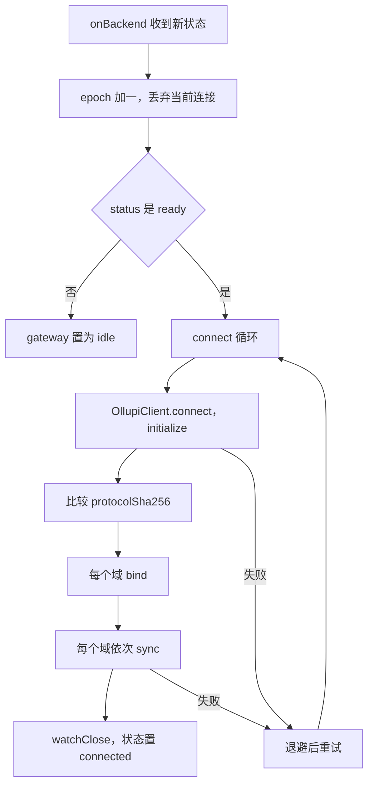
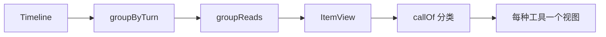

# 渲染进程

渲染进程是 React 19 写的界面，在沙箱里运行。它做两件事：把引擎的状态镜像到本地，再把镜像画出来。服务器状态都来自网关，按领域分成若干 Zustand store；纯逻辑放在 `@ollupi/core`，组件只读 store。

## 屏幕和路由

没有 URL 路由。当前屏幕是 `navigation` store 里的一个值，`App.tsx` 用 `switch` 选组件。

```ts
export type Screen =
  | { kind: 'draft'; workspaceId: string | undefined }
  | { kind: 'thread'; threadId: string }
  | { kind: 'search' }
  | { kind: 'memory'; found?: { id: string; scope: string } }
  | { kind: 'cron'; found?: string }
  | { kind: 'capabilities'; tab: CapabilityTab }
  | { kind: 'settings' }
```

| 屏幕 | 组件 | 内容 |
|---|---|---|
| `draft` | `DraftScreen` | 还没创建的会话：选工作区和模型，发第一条消息时才创建 |
| `thread` | `ConversationScreen` | 标题栏、时间线、输入框、侧边面板 |
| `search` | `SearchScreen` | 全局搜索，⌘K 从任何地方打开 |
| `memory` | `MemoryScreen` | 记忆浏览和设置 |
| `cron` | `CronScreen` | 定时任务 |
| `capabilities` | `CapabilitiesScreen` | 技能、MCP、内置工具 |
| `settings` | `SettingsScreen` | 所有设置在一页，左侧列表跳转 |

`found` 字段是搜索结果带来的定位目标，屏幕列表就绪后滚到那一条并闪一下（`.found` 动画）。

外层结构：

- 第一次同步完成之前，或后端处于 `failed` 时，显示 `BackendScreen`。
- 同步过一次之后，界面在重连和重启期间保持原样，连接状态只显示在侧边栏底部。
- 协议版本不一致时，窗口顶部加一条横幅。
- `Toasts` 始终在最上层，最多 3 条。info 4 秒消失，错误要手动关。

`navigation` store 还放这些只属于客户端的状态：`model`（输入框里选的模型，切换到别的会话时清空）、`panel`（侧边面板）、`focus`（要滚到的条目）、`file`（文件面板打开的文件）。

## 状态管理

每块服务器状态是一个域（domain）：拥有自己的 store，声明如何跟随连接。会话只运行这些钩子。

```ts
export interface Domain {
  /** 订阅网关事件。在 sync 之前运行，两者之间不漏事件。 */
  bind?(client: OllupiClient): () => void
  /** 在新连接上加载状态。 */
  sync?(client: OllupiClient): Promise<void>
  /** 丢弃只对刚结束的连接有效的状态。 */
  disconnect?(): void
}
```

| 域 | 镜像什么 | 同步方式 |
|---|---|---|
| `workspaces` | 工作区列表 | `workspace/list`，之后 `workspace/changed` |
| `threads` | 侧边栏会话列表和状态 | 每个工作区一次 `thread/list`，每页 50 |
| `conversation` | 打开过的会话的时间线 | 重读当前会话，丢弃其他 |
| `requests` | 等待用户的审批和提问 | 网关在初始化后重发 |
| `notices` | 网关报的错误 | 只收带 `itemId` 的 `error` 通知 |
| `notifications` | 系统通知 | 只订阅事件 |
| `models` | 可用模型和默认模型 | `model/list`，每条连接读一次 |
| `tools` | 工具列表 | `tool/list` |
| `cron` | 定时任务 | `cron/list`，之后 `cron/changed` |
| `settings` | 脱敏开关 | `settings/read`，之后 `settings/changed` |

同步按这个顺序串行执行。`workspaces` 必须在 `threads` 之前，因为会话按工作区列出。

工作区、定时任务和设置的写操作不直接改 store。它们的注释都写明：调用的结果不应用，等引擎发来的变更通知，所以别处发起的改动走同一条路径。

用户动作用 `run()` 包起来，失败变成一条 toast，文案说明是什么动作失败。

### 连接

`gateway/session.ts` 跟随主进程上报的后端状态：



- **退避**：`min(5000, 250 * 2^attempt)` 毫秒。
- **epoch**：后端每次状态变化加一，旧的循环看到 epoch 变了就退出。后端重启后地址和令牌都换了，旧循环不能继续。
- **`watchClose` 在同步之后才挂**：同步中途断开时由这个循环重试。如果此时再开一个循环，两条连接会在网关互相顶替，网关每个用户只留一条。

连接断开后 `requests` 清空，新连接初始化之后网关重发全部待处理请求。

## 协议类型

`packages/protocol/scripts/generate.mjs` 从 ollupi 的 `gateway/protocol.schema.json` 生成全部类型。这份契约来自网关分发用的同一张表，详见 [协议](/zh/integrate/protocol)。脚本用 `go list -m` 找到 sidecar 构建所用的 ollupi，只读这份 JSON，不读 Go 代码。

| 生成文件 | 内容 |
|---|---|
| `protocol.schema.json` | 契约原文 |
| `types.ts` | `$defs` 经 `json-schema-to-typescript` 生成的类型 |
| `messages.ts` | `PROTOCOL_SHA256`、`ClientMethods`、`ServerNotifications`、`ServerRequests`、`ErrorCode`、`BuiltinTools`、`Providers` |
| `tools.validate.js` | 内置工具参数和输出的 ajv 独立校验器 |
| `tools.ts` | 类型守卫 `isToolPart` |

校验器提前编译成普通 JS，因为渲染页的 CSP 禁止 eval。ajv 写出的 `require()` 在 ES 模块里不能用，生成脚本把它内联；碰到不认识的 `require` 直接中止生成。

`pnpm protocol:generate` 写入，`pnpm protocol:check` 在过期时失败。

类型和实际流量是否一致，有三道检查：

| 检查 | 什么时候 | 做什么 |
|---|---|---|
| `contract.test.ts` | 测试时 | 用录下的真实会话 `fixtures/session.json` 校验每条消息的两个方向 |
| `gateway/contract.ts` | 开发构建运行时 | 用 `Inspector` 校验所有收发的消息，不符时弹 toast。动态 import，生产包不带 |
| `initialize` 的 `protocolSha256` | 每次连接 | 和 `PROTOCOL_SHA256` 比较，不同时显示顶部横幅 |

工具的参数是模型自己写的 JSON 文本，不能只靠类型。`callOf` 用 `isToolPart` 校验通过后才按内置工具读，否则当作普通工具显示。

## 时间线

`Timeline` 是客户端手里的一份会话副本。每个函数返回新对象，未变的部分保持引用不变，所以任何状态容器都能放，React 的 `memo` 也能生效。

```ts
export interface Timeline {
  thread: ThreadRow
  turns: TurnRow[]
  items: ItemRow[]
  /** items[0] 之前还有更早的条目。 */
  hasMore: boolean
}
```

### 事件归并

`applyEvent` 是归并的唯一入口。通知带的是落库后的完整行，所以大多数情况是替换，不是打补丁。

| 通知 | 动作 |
|---|---|
| `turn/queued`、`turn/started`、`turn/completed` | `setThread` 加 `upsertTurn`，通知里带着存好的轮次和 thread |
| `item/started`、`item/updated`、`item/completed` | `upsertItem`，按 ID 替换，再按 `seq` 排序 |
| `item/agentMessage/delta`、`item/reasoning/textDelta` | `appendDelta`，把文字接到条目末尾 |

`item/updated` 用于尚未完成的条目发生变化，比如审批前冻结的执行内容。

流式增量不用保证完整：网关先发 `item/started`，`item/completed` 带全文。增量找不到对应条目时直接丢弃，最后的全文覆盖它。

`thread/changed` 单独处理：有行时 `setThread`，没有行表示会话已删除，从 store 移除。如果删除的是当前屏幕，回到草稿页。

### 分页

打开会话用 `thread/resume`，每页 100 条（`PAGE_SIZE`）。网关还会在约 4 MB 处截断页面并报 `hasMore`。这个调用同时让网关重发这个会话里还在等的请求。

| 情况 | 函数 |
|---|---|
| 首次打开 | `timelineFromPage` |
| 加载更早 | `thread/read` 带 `beforeSeq`，`prependPage` 合并，按 ID 去重 |
| 重连后 | `refreshFromPage`：用新页替换活动的尾部，保留比它更早的已加载条目，这些属于已结束的轮次，不再变化 |
| 定位到某条 | `openThreadAt` 循环读更早的页，直到 `seq` 进入已加载范围，再设置 `focus` |
| 导出 | `readWhole` 独立读完整个会话，不管界面加载了多少 |

重连时只重读当前打开的会话，其他会话的时间线全部丢弃，下次打开时重新读。

### 从时间线到屏幕



- `groupByTurn`：把已加载的条目挂到各自的轮次下。排队的轮次还没有条目，单独用 `queuedTurns` 取，它的输入在轮次行上，开始后才变成用户消息条目。
- `groupReads`：相邻的两个以上 `read_file`、`glob`、`grep` 合成一行。正在等审批的调用不合并，保证它的审批卡片显示出来。
- `ItemView`：按 `item.type` 分派，用 `memo` 包住。类型有 `userMessage`、`agentMessage`、`reasoning`、`toolCall`、`contextCompaction`、`memoryContext`、`error`。
- `callOf`：把工具调用分成 `command`、`file`、`read`、`glob`、`grep`、`plan`、`question`、`subagent`、`tool`。`views` 是按种类穷举的 Record，少一个视图编译不过。

`run_command` 和 `edit_file`、`write_file` 读的是 `preparedExecution`，也就是审批前冻结的内容，这才是实际执行的东西。

每轮的结果由 `TurnOutcome` 画：失败是红色提示，停止是一行灰字，完成时一行写模型、耗时和用量。

### 审批和提问

`requests` 域按条目 ID 存待处理请求，每项持有 JSON-RPC 请求的 resolve：

```ts
client.handle('item/toolCall/requestApproval', (params) =>
  new Promise((resolve) => add({
    kind: 'approval', params,
    respond: (decision) => { remove(params.itemId); resolve({ decision }) },
  })))
```

工具调用的行通过 `usePendingRequest(item.id)` 找到请求，卡片画在这一行下面。在别处解决的请求（飞书、这一轮结束）会让条目完成，`item/completed` 把它移除。

子 agent 的请求画在父会话的 `Agent` 调用下面，因为父会话把子 agent 的等待报告成自己的状态。子 agent 的会话只读。

审批卡片里，跑到沙箱外的调用是危险级别：不提供"在此会话中允许"，主按钮是"在沙箱外运行"。

### 发送消息

| 情况 | 动作 |
|---|---|
| 空闲时 Enter 或 ⌥Enter | `turn/start` |
| 运行中 Enter | `turn/steer`，插话 |
| 运行中 ⌥Enter | `turn/start`，排队 |
| 插话输给了轮次结束 | 收到 `noActiveTurn` 或 `turnMismatch` 时改发 `turn/start` |

输入法组合期间的 Enter 不发送，Shift+Enter 换行。

草稿页发第一条消息的顺序是：`thread/start`，把草稿的浏览器标签页交给这个会话，跳转，再发第一轮。这样 agent 开始动作时标签页已经归它。

`titleFromMessage` 取第一条非空行，空白折叠，最多 60 字符，没有文字时用第一个附件的文件名。

## 滚动

时间线没有虚拟化。已加载的条目全部渲染，靠 `ItemView` 的 `memo` 和分页控制数量。

`useStickToBottom` 负责贴底：

- 离底部 80 像素（`NEAR_PX`）以内算贴底。用户往上滚之后不再跟随，出现"回到最新"按钮。
- 用 `ResizeObserver` 和 `MutationObserver` 监听内容变化，不依赖具体事件，所以流式文字、展开的工具输出、异步加载的图都能跟上。
- `key` 变化（切换会话）时重新贴底。

滚动区用 `.scroll-centered`（`scrollbar-gutter: stable both-edges`），让列内容和滚动区外的输入框对齐。

## Markdown

agent 的回复由 `Streamdown` 解析。流式输出时它先把没闭合的代码块、表格、强调补全，避免闪出纯文本。每个元素都画成普通标签，样式只来自 `.markdown` 里基于 token 的规则。

| 内容 | 处理 |
|---|---|
| 代码块 | Shiki，`github-light` 和 `github-dark` 两套主题同时生成，`defaultColor: false`，跟随明暗。语言在第一次用到时加载，不认识的语言不高亮 |
| Shiki 引擎 | JavaScript 正则引擎，因为 CSP 不允许 WebAssembly |
| diff | 用 transformer 给 `+` 和 `-` 开头的行加 class，整行着色 |
| Mermaid | 见下 |
| 脚注 | 每条消息都从 1 编号，id 会重复，所以点击时在当前 `.markdown` 内滚动 |
| 行内代码和链接 | 如果指向工作区文件，变成可点击的文件链接 |

### Mermaid

| 类型 | 渲染器 |
|---|---|
| `flowchart`、`graph`、`stateDiagram`、`sequenceDiagram`、`classDiagram`、`erDiagram`、`xychart-beta` | `beautiful-mermaid`，同步绘制，颜色写成 CSS 变量，换配色不用重画 |
| 其他类型，以及上面失败的 | `mermaid`，第一次用到时动态加载，`securityLevel: 'strict'`，主题变量从 token 解析成不透明的 `#rrggbb`，换配色或明暗时重画 |

流式输出中（`useIsCodeFenceIncomplete`）显示源码。两个渲染器都解析不了时保留源码，下面写原因。

`balanceDecisions` 处理判断节点：它是按标签宽度定边长的正方形，一行写完的问句会撑得很大。作者没换行的标签按词均匀断行，中文用 `Intl.Segmenter` 分词。取接近最小正方形（1.2 倍以内）时行数最少的方案。

### 工作区文件链接

`workspacePath` 判断一段文字是不是工作区里的路径：相对路径或根目录下的绝对路径，去掉开头的 `./` 和结尾的 `:行号`。不含 `/` 也没有扩展名的词不算，那多半是代码。

是否真的存在由 `files.kind` 问主进程。找到的结果记住，找不到的下次再问，因为 agent 可能之后才写出来。

单击在文件面板打开，⌘+点击用默认应用打开。

## 语言

界面有 `en` 和 `zh-CN` 两份词表，放在 `i18n/messages/` 下，按区域分文件。中文词表类型是 `typeof en`，少一个键编译不过。

组件用 `useT()`，React 之外用 `t()`。`t()` 在需要时才读，所以切换语言立即生效。语言偏好跟随系统时，`zh` 开头的系统语言对应中文，其余对应英文。只有应用自己的文字会翻译，用户、agent 和后端写的内容原样显示。

## 本地存储

这些偏好只属于这台机器的这个应用，存在 `localStorage`，不进引擎的库。

| 键 | 内容 |
|---|---|
| `ollupi.palette` | 配色 |
| `ollupi.colorScheme` | 明暗 |
| `ollupi.language` | 语言 |
| `ollupi.notifications` | 四种通知的开关 |
| `ollupi.panelWidths` | 每个面板的宽度 |

## 代码位置

| 位置 | 职责 |
|---|---|
| ollupi-desktop `apps/desktop/src/renderer/src/views/App.tsx` | 顶层组合和屏幕切换 |
| ollupi-desktop `apps/desktop/src/renderer/src/gateway/session.ts` | 连接、重连、运行各域 |
| ollupi-desktop `apps/desktop/src/renderer/src/gateway/contract.ts` | 开发时的流量校验 |
| ollupi-desktop `apps/desktop/src/renderer/src/domains/` | 各域的 store 和动作 |
| ollupi-desktop `apps/desktop/src/renderer/src/domains/navigation.ts` | 屏幕和面板状态 |
| ollupi-desktop `apps/desktop/src/renderer/src/domains/conversation.ts` | 时间线和发送 |
| ollupi-desktop `apps/desktop/src/renderer/src/domains/requests.ts` | 审批和提问 |
| ollupi-desktop `apps/desktop/src/renderer/src/views/conversation/TimelineView.tsx` | 时间线视图 |
| ollupi-desktop `apps/desktop/src/renderer/src/views/conversation/tools/` | 每种工具调用的视图 |
| ollupi-desktop `apps/desktop/src/renderer/src/views/common/useStickToBottom.ts` | 贴底滚动 |
| ollupi-desktop `apps/desktop/src/renderer/src/views/common/Markdown.tsx` | Markdown 和代码高亮 |
| ollupi-desktop `apps/desktop/src/renderer/src/views/common/Mermaid.tsx` | 图 |
| ollupi-desktop `apps/desktop/src/renderer/src/i18n/` | 词表 |
| ollupi-desktop `packages/core/src/timeline.ts` | 时间线归并 |
| ollupi-desktop `packages/core/src/calls.ts` | 工具调用分类 |
| ollupi-desktop `packages/protocol/scripts/generate.mjs` | 协议类型生成 |
| ollupi-desktop `packages/client/src/client.ts` | 类型化客户端 |
