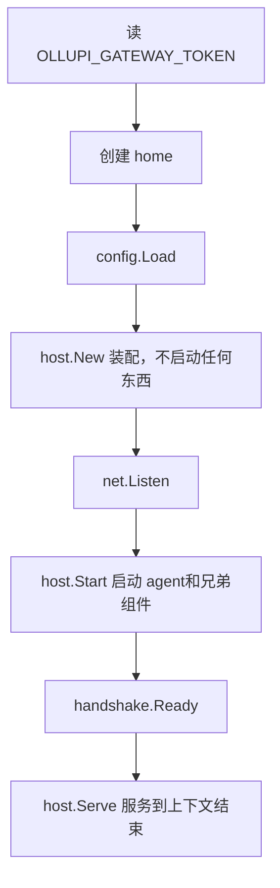

# Sidecar

`ollupid` 是桌面端的后端。它是一个 Go 可执行文件，把 ollupi 引擎装配起来，在回环端口上提供网关。引擎是库，不带入口，也不知道配置文件和飞书，这些由 sidecar 负责。Electron 主进程启动它，读一行握手，然后把地址交给界面。

除了常驻运行，`ollupid` 还有几个一次性模式，主进程用它们校验配置和技能，所以校验规则只有一份，就是后端自己的。

## 启动参数

| 参数 | 默认值 | 含义 |
|---|---|---|
| `--home` | `$OLLUPI_HOME`，否则 `~/.ollupi` | 配置和数据目录 |
| `--listen` | `127.0.0.1:0` | 网关监听地址，端口由系统分配 |
| `--allow-origin` | 空 | 逗号分隔的额外 WebSocket 源。打包后主进程传 `ollupi`，对应 `app://ollupi` |
| `--watch-stdin` | `false` | stdin 关闭时退出。主进程总是传，父进程死掉后 sidecar 跟着退 |
| `--check-config FILE` | | 检查这份配置能否启动，打印结果后退出 |
| `--config-schema` | | 打印 `--check-config` 输出的 JSON Schema 后退出 |
| `--list-skills` | | 列出 `config.yaml` 的 `skills_dir` 里的技能后退出 |
| `--check-skills DIR` | | 按 agent 加载的方式列出 DIR 里的技能后退出 |
| `--skills-schema` | | 打印技能模式输出的 JSON Schema 后退出 |

一次性模式都只打印一行 JSON（Schema 模式是缩进的 JSON），失败时退出码为 1。

| 环境变量 | 含义 |
|---|---|
| `OLLUPI_GATEWAY_TOKEN` | 网关令牌。常驻模式必需，为空时直接失败 |
| `OLLUPI_HOME` | 覆盖默认的 `--home` |
| `OLLUPI_BROWSER_URL` | 内置浏览器端点的地址。不设时不注册浏览器工具 |
| `OLLUPI_BROWSER_TOKEN` | 内置浏览器端点的令牌 |

主进程在每次启动和每次 `--check-config` 时都带上浏览器端点的两个变量，这样检查时注册的工具和真实启动一致。

## 握手

sidecar 和主进程之间的协议是 stdout 上的一行 JSON。日志全部走 stderr，stdout 保持机器可读。

```go
type Message struct {
	Type       string `json:"type"`
	URL        string `json:"url,omitempty"`
	Version    string `json:"version,omitempty"`
	Message    string `json:"message,omitempty"`
	ConfigPath string `json:"configPath,omitempty"`
}
```

```json
{"type":"ready","url":"ws://127.0.0.1:53421/","version":"dev"}
{"type":"fatal","message":"models: at least one model is required; the first is the default","configPath":"/Users/me/.ollupi/config.yaml"}
```

`ready` 只在 agent 启动成功之后发，所以启动失败一定报成 `fatal`，不会出现先 `ready` 后失败的情况。`fatal` 带上配置文件路径，界面据此显示"打开配置"按钮。

`host.New` 在 `ready` 之前就连接全部 MCP 服务器，所以它们的启动时间算在主进程 30 秒的握手时限内。

## 启动顺序



退出信号有三种：SIGINT、SIGTERM、stdin 关闭。它们取消同一个上下文。`Serve` 返回前等兄弟组件和 agent 结束，最后按相反顺序关闭组件，数据库最后释放。

## 装配引擎

`internal/host` 遵循 ollupi README 描述的装配方式。`New` 只构建，不启动。任何一步失败，已打开的组件按相反顺序关闭。

| 顺序 | 组件 | 说明 |
|---|---|---|
| 1 | 数据库 | `repo.Open(dataHome)`，文件在 `<home>/data/ollupi.sqlite` |
| 2 | 模型客户端 | 每个模型一条连接、一个客户端，连接 ID 是 `provider/name`，所以 `calls` 只限这一个模型。按文件顺序排，第一个是默认 |
| 3 | 定时任务 | `cron.New(db, time.Local, ...)`，既是工具提供方，也是到点发送的计时器 |
| 4 | 工作区工具 | `workspace.enabled` 为真时才有。`DenyRead` 加上 `config.yaml`，命令读不到里面的 API 密钥；`EnvMarker` 是 `OLLUPI_SANDBOX` |
| 5 | `web_fetch` | `web.New` |
| 6 | 浏览器工具 | 只有 `OLLUPI_BROWSER_URL` 存在时注册 |
| 7 | MCP | 展开 `${NAME}`，建运行环境，`connected.For(repo.DefaultUser)` 立刻连接。连不上的跳过，原因由 `mcpServer/list` 报告 |
| 8 | 记忆 | `memory.New`，提炼用 `memory.model` 指定的模型，和它共用客户端和 `calls` |
| 9 | agent | `agent.New`，附件目录是 `<home>/attachments` |
| 10 | 网关 | `gateway.NewServer`，带令牌和允许的源 |
| 11 | 客户端 | 配置了 `feishu` 时创建飞书机器人 |
| 12 | 接线 | 把网关的 `CronChanged` 接给定时任务，保证计时器不会向空的网关上报 |

事件分发写在 `agent.Config.OnEvent` 里：

```go
OnEvent: func(e agent.Event) {
	h.gateway.Deliver(e)
	for _, c := range h.clients {
		c.Deliver(e)
	}
},
```

`Client` 是网关之外的前端，比如聊天机器人。它收到网关收到的每个事件，`Deliver` 不能阻塞，`Run` 一直跑到后端停止。

```go
type Client interface {
	Deliver(agent.Event)
	Run(ctx context.Context)
}
```

`Start` 先启动 agent，再并行跑记忆提炼、定时任务计时器和各个 `Client`。到期的定时任务通过 `agent.StartScheduledTurn` 以会话所有者的身份发送。

### MCP 的运行环境

MCP 服务器是用户自己配置的命令，所以不进工作区的沙箱。`mcpBox` 建一个 `full-access` 模式的运行环境，根目录是 home，透传后端拿到的环境变量，但去掉两类：`OLLUPI_` 开头的变量（尤其是令牌），以及沙箱拒绝的名字，比如 shell 的 `BASH_FUNC_x%%`。

`env` 和 `headers` 里的 `${NAME}` 在这里展开。引用的变量没设置时拒绝整份配置，否则服务器会在缺密钥的状态下运行。

## 能否启动的检查

`--check-config` 调用 `host.Check`，流程是：

1. 建一个临时数据目录（`ollupid-check-`），真正的数据库不打开。
2. 像 `New` 一样完整装配，包括连接 MCP 服务器。
3. 启动 agent。引擎在这一步校验权限规则和每个模型的上下文预算。
4. 用默认用户开一个空会话。这一步会用 MCP 服务器的工具校验规则，否则这类错误要到某一轮失败时才暴露。
5. 停止，什么都不提供服务。

规则里写到一个没连上的服务器的工具时仍然有效，等它连上才匹配；写到已连上的服务器没有的工具时拒绝。

输出的类型是 `checkResult`：

```go
type checkResult struct {
	OK     bool              `json:"ok"`
	Config *config.Config    `json:"config,omitempty"`
	Models []config.ModelRef `json:"models,omitempty"`
	Error  string            `json:"error,omitempty"`
}
```

`Config` 是后端解码后的样子：默认值已应用，路径已解析。MCP 的 `env` 和 `headers` 里写死的值被清空，只留 `${NAME}` 形式的引用，因为写死的值可能是密钥。API 密钥保留，因为界面要像编辑 Base URL 一样编辑它。

## 配置加载和校验

`config.Load` 在 `config.yaml` 不存在时先写入自带技能，再写入模板（权限 `0600`）。技能先写，这样复制失败时下一次启动会重试。

解析分两步走：

1. `Parse` 把 YAML 转成 JSON 再解码，这样文件用的就是引擎在工作区类型上定义的 json 标签。未知字段报错，拼错的键不会被静默忽略。
2. `Validate` 只检查这份文件的形状能出的错：模型的名字和段落之间的引用。策略、规则和 `limits` 的取值留给引擎在启动时校验。

全部字段和校验规则见 [配置](/zh/app/config)。

## 宿主能力

`internal/host` 之外的包提供具体能力，`host` 把它们挂到引擎上。

| 包 | 能力 | 文档 |
|---|---|---|
| `internal/config` | `config.yaml` 的类型、模板、解析和校验 | [配置](/zh/app/config) |
| `internal/handshake` | stdout 握手行 | 本页 |
| `internal/browser` | 把内置浏览器作为工具提供方，请求转发到主进程 | [内置浏览器](/zh/desktop/browser) |
| `internal/feishu` | 飞书机器人，一个 `host.Client` | [飞书机器人](/zh/desktop/feishu-bot) |

## 内置技能

技能是一个带 `SKILL.md` 的文件夹，agent 按需加载。`sidecar/skills/` 用 `go:embed` 打进可执行文件，这个目录里每个子文件夹是一个随应用发布的技能，加一个文件夹就发布一个。目前只有 `zhou-shenghua-woodcut-style`，内含风格规则、Python 渲染库和生图提示词。

`writeStarterSkills` 把它们复制到 `<home>/skills`，规则是：

- 只在 `config.yaml` 还不存在时运行，也就是首次启动。之后这个文件夹归用户管理，升级不覆盖。
- 目标文件夹已存在时跳过。
- 复制到一半失败时删掉残留，下次重试不会把半个技能当成已存在。

模板里写的 `skills_dir: skills` 让技能默认开启。去掉这一行就关闭技能。技能机制本身见 [技能和 MCP](/zh/engine/skills-mcp)。

## 代码位置

| 位置 | 职责 |
|---|---|
| ollupi-desktop `sidecar/cmd/ollupid/main.go` | 命令行入口、一次性模式、启动顺序 |
| ollupi-desktop `sidecar/internal/handshake/handshake.go` | 握手行 |
| ollupi-desktop `sidecar/internal/host/host.go` | 装配、启动、停止、`Check` |
| ollupi-desktop `sidecar/internal/config/config.go` | 配置类型、解析、校验、首次写入 |
| ollupi-desktop `sidecar/internal/config/template.go` | 首次启动写入的模板 |
| ollupi-desktop `sidecar/skills/` | 随应用发布的技能 |
