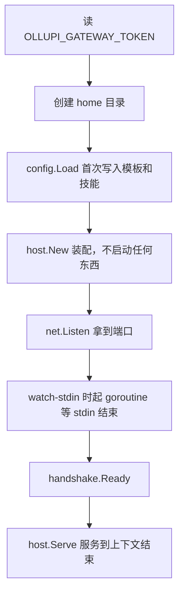

# Sidecar

`ollupid` 是桌面端的后端。它是一个 Go 可执行文件，把 ollupi 引擎装配起来，在回环端口上提供网关。引擎是库，没有入口，也不读配置文件和飞书，这些由 sidecar 负责。Electron 主进程启动它，读一行握手，然后把地址交给界面。sidecar 的 `go.mod` 钉住引擎版本，当前是 `v0.26.2`。

除了常驻运行，`ollupid` 还有几个一次性模式，主进程用它们校验配置和技能。校验规则只有一份，就是后端自己的，界面不重写一遍。

## 启动参数

| 参数 | 默认值 | 含义 |
|---|---|---|
| `--home` | `$OLLUPI_HOME`，否则 `~/.ollupi` | 配置和数据目录 |
| `--listen` | `127.0.0.1:0` | 网关监听地址，端口由系统分配 |
| `--allow-origin` | 空 | 逗号分隔的额外 WebSocket 源。打包后主进程传 `ollupi`，对应 `app://ollupi` |
| `--watch-stdin` | `false` | stdin 关闭时退出。主进程总是传，父进程死掉后 sidecar 跟着退 |
| `--check-config FILE` | | 检查这份配置能否启动，打印结果后退出 |
| `--config-schema` | | 打印 `--check-config` 输出的 JSON Schema 后退出 |
| `--list-skills` | | 列出 `config.yaml` 的 `skills_dir` 里每个角色的技能后退出 |
| `--check-skills DIR` | | 按 agent 加载的方式列出 DIR 里每个角色的技能后退出 |
| `--skills-schema` | | 打印技能模式输出的 JSON Schema 后退出 |

一次性模式都只打印一行 JSON（Schema 模式是缩进的 JSON），失败时退出码为 1。

| 环境变量 | 含义 |
|---|---|
| `OLLUPI_GATEWAY_TOKEN` | 网关令牌。常驻模式必需，为空时直接失败 |
| `OLLUPI_HOME` | 覆盖默认的 `--home` |
| `OLLUPI_BROWSER_URL` | 内置浏览器端点的地址。不设时不注册浏览器工具 |
| `OLLUPI_BROWSER_TOKEN` | 内置浏览器端点的令牌 |

浏览器端点的两个变量由主进程的 `browser/endpoint.ts` 的 `env()` 给出，每次启动和每次 `--check-config` 都带上，所以检查时注册的工具和真实启动一致。

## 握手

sidecar 和主进程之间的协议是 stdout 上的一行 JSON。日志全部走 stderr，stdout 保持机器可读。

```go
type Message struct {
	Type       string `json:"type"`
	URL        string `json:"url,omitempty"`
	Version    string `json:"version,omitempty"`
	Message    string `json:"message,omitempty"`
	ConfigPath string `json:"configPath,omitempty"`
}
```

```json
{"type":"ready","url":"ws://127.0.0.1:53421/","version":"dev"}
{"type":"fatal","message":"models: at least one model is required; the first is the default","configPath":"/Users/me/.ollupi/config.yaml"}
```

`ready` 只在后端装配完成、并且已经拿到监听地址之后才发，所以启动失败一定报成 `fatal`，不会出现先 `ready` 后失败的情况。`version` 取 `debug.ReadBuildInfo()` 的主模块版本，取不到时是 `"dev"`。`fatal` 带上配置文件路径，界面据此显示"打开配置"按钮。

## 启动顺序



退出信号有三种：SIGINT、SIGTERM、stdin 关闭。它们取消同一个上下文。`Serve` 里用 `errgroup` 并行跑引擎的常驻流程、网关和各个 `Client`，任何一个返回就取消其余；返回前按相反顺序关闭组件，数据库最后释放。

## 装配引擎

装配出来的组件大部分在引擎的 host 里。`ollupi.New` 一次建好 store、附件、内置工具、调度器、记忆提炼和用量记录，桌面端只补上引擎不知道的几样：模型客户端、这台机器的运行环境、工作区工具、内置浏览器、飞书。`host.New` 只构建，不启动，任何一步失败都会把已打开的组件按相反顺序关掉。

| 顺序 | 组件 | 说明 |
|---|---|---|
| 1 | 模型客户端 | `modelClients`：每个模型一条连接、一个客户端，连接 ID 是 `provider/name`，所以 `calls` 只限这一个模型。按文件顺序排，第一个是默认 |
| 2 | 记忆模型 | `memory.model` 指向的连接，找不到时为空，不报错 |
| 3 | 运行环境 | `userBox`：`sandbox.New` 的 `full access` 模式，根目录是 home |
| 4 | 工作区工具 | `workspace.enabled` 为真时才有。`DenyRead` 加上 `config.yaml`，命令读不到里面的 API 密钥；`EnvMarker` 是 `OLLUPI_SANDBOX` |
| 5 | 浏览器工具 | 只有 `OLLUPI_BROWSER_URL` 存在时注册 |
| 6 | 引擎 | `ollupi.New`，带模型、工具、技能目录、槽位和网关选项 |
| 7 | 飞书 | 配置了 `feishu` 时创建飞书机器人，会话和话题的对应关系存在 `<home>/data/feishu.json` |

`ollupi.New` 的两个参数是桌面端特有的：

- `Boxes` 把每个会话都指向同一个 `userBox`。命令在这台机器上跑，所以引擎里指向别的机器的会话会被拒绝，报"start the conversation in …"。
- `Hub: true`。应用的 Super Agent 就是引擎的中枢，用户的唯一中枢工作区把活分给项目工作区。中枢本身见 [中枢](/zh/engine/hub)。

::: info 演进
早期 store、定时任务、MCP 连接、记忆提炼和网关都由 `host.New` 自己逐个构造，事件还要靠 `agent.Config.OnEvent` 手动分发给网关和各个客户端。现在这些都是引擎 host 的一部分，分发改走 store 的事件流，sidecar 只剩上面七步。
:::

### 客户端

`Client` 是网关之外的前端，目前只有飞书机器人。它不再是事件的接收者，而是自己去订阅 store 的事件流：

```go
type Client interface {
	Run(ctx context.Context)
}
```

飞书机器人在 `Run` 里调 `store.Feed().Subscribe(owner, b.hear)`，只收会话所有者 `default` 的变更，收到后推进队列，由自己的工作循环去回消息。订阅回调在提交事务的 goroutine 里执行，所以 `hear` 不能阻塞。会话和话题的对应关系记在 `feishu.json`，重启后仍能对上。

### MCP 服务器

MCP 服务器由用户在界面里添加，存在引擎的 store 里，`config.yaml` 没有对应字段。它们的进程跑在 `userBox` 里：根目录是 home，能拿到后端的环境变量，但去掉两类：`OLLUPI_` 开头的变量（尤其是令牌），以及沙箱拒绝的名字，比如 shell 的 `BASH_FUNC_x%%`。

连接发生在 `Serve` 开头：`go h.ollupi.Users.Tools(ctx, gateway.DefaultUser)`，不在握手的 30 秒时限内。连不上的服务器跳过，原因由 `mcpServer/list` 报告，界面上能看到。

## 能否启动的检查

`--check-config` 先用 `config.LoadFile` 解析文件，再调 `host.Check`：

1. `os.MkdirTemp("", "ollupid-check-")` 建一个临时数据目录，真正的数据库不打开。
2. 用 `New` 完整装配，和真实启动同一个函数：模型客户端、技能目录、工作区沙箱、记忆模型都在这一步校验。
3. `h.close()` 关掉装配出来的东西，`RemoveAll` 删临时目录。

它不走 `Serve`，所以不启动引擎的常驻流程，不开会话，也不连 MCP 服务器。

输出的类型是 `checkResult`：

```go
type checkResult struct {
	OK     bool              `json:"ok"`
	Config *config.Config    `json:"config,omitempty"`
	Models []config.ModelRef `json:"models,omitempty"`
	Error  string            `json:"error,omitempty"`
}
```

`Config` 是后端解码后的样子：默认值已应用，`skills_dir` 这类相对路径已解析成绝对路径。API 密钥保留在输出里，界面要像编辑 Base URL 一样编辑它。

## 技能

技能是一个带 `SKILL.md` 的文件夹，agent 按需加载。`sidecar/skills/` 用 `go:embed` 打进可执行文件，这个目录里每个子文件夹是一个随应用发布的技能。目前只有 `zhou-shenghua-woodcut-style`，内含风格规则、Python 渲染库和生图提示词。

引擎按角色分目录加载技能，所以 `writeStarterSkills` 把内置技能复制到 `<home>/skills/<role>/<skill>`，角色是 `agent.FullMain` 和 `agent.CompactMain`：同一个主 agent 的两个角色都有，会话换到另一种大小的模型时技能还在。规则是：

- 只在 `config.yaml` 还不存在时运行，也就是首次启动。之后这个文件夹归用户管理，升级不覆盖。
- 目标文件夹已存在时跳过。
- 复制到一半失败时删掉残留，下次重试不会把半个技能当成已存在。

模板里写的 `skills_dir: skills` 让技能默认开启。去掉这一行就关闭技能。

两个技能模式输出 `skillsResult`：

```go
type skillsResult struct {
	OK    bool         `json:"ok"`
	Dir   string       `json:"dir"`
	Roles []roleSkills `json:"roles,omitempty"`
	Error string       `json:"error,omitempty"`
}
```

`Dir` 为空表示 `config.yaml` 没写 `skills_dir`，技能关闭。否则 `skillsIn` 先调 `skill.Check(dir, agent.Names)` 按 agent 启动时的规则检查整个目录，再对 `agent.Names` 里的每个角色调 `skill.Load`，用和一轮开始时相同的方式读出技能。角色是引擎的 11 个：`full-main-agent`、`compact-main-agent`、`general-sub-agent`、`browser-sub-agent`、`design-sub-agent`、`codebase-sub-agent`、`frontend-sub-agent`、`backend-sub-agent`、`writing-sub-agent`、`research-sub-agent`、`hub-main-agent`。没有目录的角色就是没有技能。

## 配置加载和校验

`config.Load` 在 `config.yaml` 不存在时先写入自带技能，再写入模板（权限 `0600`）。技能先写，这样复制失败时下一次启动会重试。

解析分两步走：

1. `Parse` 把 YAML 转成 JSON 再解码，这样文件用的就是引擎在工作区类型上定义的 json 标签。未知字段报错，拼错的键不会被静默忽略。
2. `Validate` 只检查这份文件的形状能出的错：`name` 必填，提供方名字唯一且不带 `/`，`type` 在 `openai`/`anthropic`/`gemini` 之内，模型名不重复，`calls` 和 `slots` 不为负，`limits` 不能是零值，`memory.model` 指向列出的模型，飞书的 ID、密钥和 `domain`。策略、规则和 `limits` 的取值留给引擎在启动时校验。

`config.yaml` 只放"启动时取一次"的部署参数：模型和提供它们的 API、工作区工具、记忆用什么模型学、槽位。用户运行中改的东西（权限、MCP 服务器、记忆开不开）存在引擎的 store 里，通过网关改，所以改这些不用重启。逐键说明见 [配置](/zh/app/config)。

## 宿主能力

`internal/host` 之外的包提供具体能力，`host` 把它们挂到引擎上。

| 包 | 能力 | 文档 |
|---|---|---|
| `internal/config` | `config.yaml` 的类型、模板、解析和校验 | [配置](/zh/app/config) |
| `internal/handshake` | stdout 握手行 | 本页 |
| `internal/browser` | 把内置浏览器作为工具提供方，请求转发到主进程 | [内置浏览器](/zh/desktop/browser) |
| `internal/feishu` | 飞书机器人，一个 `host.Client` | [飞书机器人](/zh/desktop/feishu-bot) |

## 代码位置

| 仓库 | 路径 | 职责 |
|---|---|---|
| ollupi-desktop | `sidecar/cmd/ollupid/main.go` | 命令行入口、一次性模式、启动顺序、`checkResult` 与 `skillsResult` |
| ollupi-desktop | `sidecar/internal/host/host.go` | 装配、`Serve`、`Check`、`userBox`、`modelClients` |
| ollupi-desktop | `sidecar/internal/handshake/handshake.go` | 握手行 |
| ollupi-desktop | `sidecar/internal/config/config.go` | 配置类型、解析、`Validate`、首次写入、内置技能复制 |
| ollupi-desktop | `sidecar/internal/config/template.go` | 首次启动写入的模板 |
| ollupi-desktop | `sidecar/internal/feishu/feishu.go` | 飞书机器人，订阅 store 的事件流 |
| ollupi-desktop | `sidecar/internal/browser/` | 把主进程的浏览器端点包成工具提供方 |
| ollupi-desktop | `sidecar/skills/` | 随应用发布的技能 |
| ollupi | `host/host.go` | `New` 装配、`Run` 跑常驻流程、`Close` |
| ollupi | `gateway/server.go` | 网关，`Subscribe` 事件流 |
