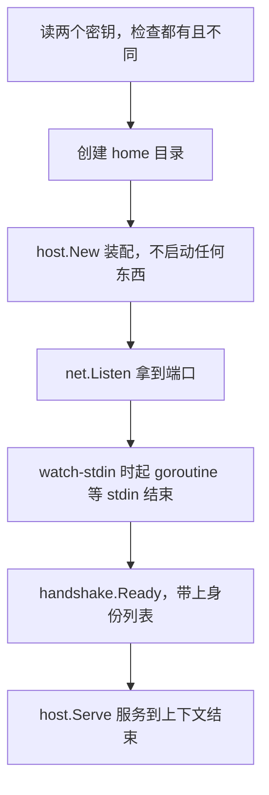

# Sidecar

`ollupid` 是桌面端的后端。它是一个 Go 可执行文件，把 ollupi 引擎装配起来，在回环端口上提供网关。引擎是库，没有入口；sidecar 也不读配置文件，模型目录、身份和每个身份的设置都在引擎的 store 里，经网关读写。Electron 主进程启动它，读一行握手，然后把地址交给界面。sidecar 的 `go.mod` 钉住引擎版本，当前是 `v0.33.1`。

除了常驻运行，`ollupid` 还有几个一次性模式，主进程用它们把旧数据目录搬到现在的样子、删除身份、导入时读技能文件夹。规则只有一份，就是后端自己的，界面不重写一遍。

## 启动参数

| 参数 | 默认值 | 含义 |
|---|---|---|
| `--home` | `$OLLUPI_HOME`，否则 `~/.ollupi` | 数据目录 |
| `--listen` | `127.0.0.1:0` | 网关监听地址，端口由系统分配 |
| `--allow-origin` | 空 | 逗号分隔的额外 WebSocket 源。打包后主进程传 `ollupi`，对应 `app://ollupi` |
| `--watch-stdin` | `false` | stdin 关闭时退出。主进程总是传，父进程死掉后 sidecar 跟着退 |
| `--import-config` | | 把旧版留下的 `config.yaml` 和 `profiles.json` 搬进 store，再删掉 `config.yaml`，然后退出，见[配置的实现](/zh/desktop/config#旧文件的导入) |
| `--names FILE` | 空 | 和 `--import-config` 一起用：应用旧版放在自己文件夹里的 `profiles.json`，取身份的名字 |
| `--delete-profile ID` | | 在后端停着时从 store 删掉一个身份的数据后退出。最后一个身份、或者它还有轮次在跑或排队时拒绝 |
| `--read-skill DIR` | | 把技能文件夹 DIR 读成 `skill/set` 要的字段，打印后退出。主进程导入文件夹时用 |
| `--skill-schema` | | 打印 `--read-skill` 输出的 JSON Schema 后退出 |

一次性模式都只打印一行 JSON（Schema 模式是缩进的 JSON），失败时退出码为 1。

| 环境变量 | 含义 |
|---|---|
| `OLLUPI_GATEWAY_TOKEN` | 网关密钥。常驻模式必需 |
| `OLLUPI_OPERATOR_TOKEN` | 运营者密钥。常驻模式必需，不能和网关密钥相同，否则每个用户都成了运营者 |
| `OLLUPI_HOME` | 覆盖默认的 `--home` |
| `OLLUPI_BROWSER_URL` | 内置浏览器端点的地址。不设时不注册浏览器工具 |
| `OLLUPI_BROWSER_TOKEN` | 内置浏览器端点的令牌 |

连接的 token 是 `<密钥>.<身份>`：拿网关密钥是这个身份，拿运营者密钥是这个身份、同时是运营者，能改模型目录、管理身份，见[配置的实现](/zh/desktop/config#运营者和身份)。

浏览器端点的两个变量由主进程的 `browser/endpoint.ts` 的 `env()` 给出，每次启动都带上。

## 握手

sidecar 和主进程之间的协议是 stdout 上的一行 JSON。日志全部走 stderr，stdout 保持机器可读。

```go
type Message struct {
	Type    string `json:"type"`
	URL     string `json:"url,omitempty"`
	Version string `json:"version,omitempty"`
	Message string `json:"message,omitempty"`
	// Profiles are the users of the store, for the app to act as one.
	Profiles []string `json:"profiles,omitempty"`
}
```

```json
{"type":"ready","url":"ws://127.0.0.1:53421/","version":"dev","profiles":["default","work"]}
{"type":"fatal","message":"OLLUPI_GATEWAY_TOKEN and OLLUPI_OPERATOR_TOKEN must both be set"}
```

`ready` 只在后端装配完成、并且已经拿到监听地址之后才发，所以启动失败一定报成 `fatal`，不会出现先 `ready` 后失败的情况。`version` 取 `debug.ReadBuildInfo()` 的主模块版本，取不到时是 `"dev"`。`profiles` 是 store 里所有身份的 id；主进程记着的身份不在里面时，退回第一个并记下。

## 启动顺序



退出信号有三种：SIGINT、SIGTERM、stdin 关闭。它们取消同一个上下文。`Serve` 里用 `errgroup` 并行跑引擎的常驻流程和网关，任何一个返回就取消另一个；返回前按相反顺序关闭组件，数据库最后释放。

## 装配引擎

装配出来的组件大部分在引擎的 host 里。`ollupi.New` 一次建好 store、按模型目录建的模型客户端、附件、内置工具、调度器、记忆提炼和用量记录，桌面端只补上引擎不知道的几样：每个身份的运行环境、工作区工具、内置浏览器、网关的认证。`host.New` 只构建，不启动，任何一步失败都会把已打开的组件按相反顺序关掉。

| 顺序 | 组件 | 说明 |
|---|---|---|
| 1 | 运行环境 | `newUserBoxes`：每个身份一个 `sandbox.New` 的 `full access` Box，根目录是 `<home>/users/<id>`，第一次用到时建 |
| 2 | 工作区工具 | 总是有。`DenyRead` 是 `<home>/data`，命令读不到 API 密钥和数据库；`EnvMarker` 是 `OLLUPI_SANDBOX`；`BoxIn` 拒绝在别的机器上开的会话 |
| 3 | 浏览器工具 | 只有 `OLLUPI_BROWSER_URL` 存在时注册 |
| 4 | 引擎 | `ollupi.New`：名字 `host.Name`（`ollupi`），引擎默认的系统提示和槽位，全部工具，`Boxes`、`Hub: true`，网关的 `Authenticate`、`Welcome` 和允许的源 |
| 5 | 第一个身份 | `firstProfile`：store 里一个用户都没有时建 `default`，给它随应用发布的技能 |

桌面端特有的几样：

- `Authenticate` 是 `profileOf`：认出 token 用的是哪个密钥，token 里的身份必须是 store 里已有的用户，否则回 `ErrUnknownToken`，不会当场建。
- `Welcome`：运营者用 `user/create` 建的身份，也拿到随应用发布的技能。
- `Boxes` 给每个身份自己的 Box。命令只在这台机器上跑，所以引擎里指向别的机器的会话会被工作区工具拒绝，报"start the conversation in …"。
- `Hub: true`。应用的 Super Agent 就是引擎的中枢，用户的唯一中枢工作区把活分给项目工作区。中枢本身见 [中枢](/zh/engine/hub)。

::: info 演进
早期 store、定时任务、MCP 连接、记忆提炼和网关都由 `host.New` 自己逐个构造，事件还要靠 `agent.Config.OnEvent` 手动分发给网关和各个客户端。后来这些都成了引擎 host 的一部分，分发改走 store 的事件流。模型客户端原来由 sidecar 按 `config.yaml` 里的模型逐个建（`modelClients`），引擎 v0.32.0 把模型目录搬进 store 后由引擎自己建（`desktop@8033b6d`）；名字、提示、工具白名单和槽位原来读自 `config.yaml`，现在是常量（`desktop@780d8cc`）。
:::

### MCP 服务器

MCP 服务器由用户在界面里添加，存在引擎的 store 里，每个身份自己的。它们的进程跑在这个身份的 Box 里：根目录是 `<home>/users/<id>`，能拿到后端的环境变量，但去掉两类：`OLLUPI_` 开头的变量（尤其是两个密钥），以及沙箱拒绝的名字，比如 shell 的 `BASH_FUNC_x%%`。

连接发生在 `Serve` 开头：对 store 里的每个身份各起一个 `h.ollupi.Users.Tools(ctx, user)`，不在握手的 30 秒时限内。连不上的服务器跳过，原因由 `mcpServer/list` 报告，界面上能看到。

## 技能

技能是每个用户自己的，存在引擎的 store 里，给一个或几个角色，经网关的 `skill/list`、`skill/read`、`skill/set`、`skill/delete` 读写，改动用 `skill/changed` 推给每个客户端。sidecar 不管技能的存放，只在三个地方把一个技能文件夹（`SKILL.md` 加旁边的文件）变成引擎要的 `skill.Package`，三处共用 `internal/skillmd` 的 `Read`：

- 文件夹名必须等于 frontmatter 里的 `name`；`metadata.version` 是版本。
- 以 `.` 开头的文件和文件夹跳过；链接、非 UTF-8 的文件、扩展名不在引擎收的文本类型里的文件不带上，记在 `skipped` 里。
- 结果不带角色，给哪些角色由调用的一方决定；名称、描述、大小这些规则留给引擎在 `SetSkill` 时检查。

### 随应用发布的技能

`sidecar/skills/` 用 `go:embed` 打进可执行文件，每个子文件夹是一个技能，目前只有 `zhou-shenghua-woodcut-style`，内含风格规则、Python 渲染库和生图提示词。`skills.Starter()` 把它们读成给 `full-main-agent` 和 `compact-main-agent` 的技能：同一个主 agent 的两个角色都有，会话换到另一种大小的模型时技能还在。

`giveStarterSkills` 在两处把这些技能给一个身份：后端启动时建第一个身份（`firstProfile`），以及运营者 `user/create` 建新身份（网关的 `Welcome`）。只在建用户的那一次给，所以用户删掉的技能不会再回来。

### 导入文件夹

`--read-skill DIR` 输出 `readResult`，字段和 `skill/set` 的参数一样，只少了角色：

```go
type readResult struct {
	OK      bool         `json:"ok"`
	Skill   *skillFields `json:"skill,omitempty"`
	Skipped []string     `json:"skipped,omitempty"`
	Error   string       `json:"error,omitempty"`
}
```

主进程把它交给界面，界面填进对话框，用户勾好给哪些 agent 后自己调 `skill/set`。

### 旧配置里的 `skills_dir`

`--import-config` 在搬完模型和身份之后，再看 `config.yaml` 有没有 `skills_dir`（`importSkills`）。有就按角色读 `<skills_dir>/<role>/<skill>`，主 agent 的两个角色先读：

- 同名的技能合成一个，带上所有有它的角色；内容不同时留先读到的那份，也就是主 agent 的，其余记进 `skipped`。
- 引擎会拒绝的技能（`Package.Check`）不搬，同样记进 `skipped`，不挡启动。
- store 里每个已有用户都得到全部技能，写完再从 `config.yaml` 去掉这一项（`config.SkillsDir` 用 YAML 节点删键，其余注释保留）。文件夹原样留在磁盘上。

每一步都能重跑：没删掉键之前中断，下次启动再写一遍同样的技能。之后 `removeConfig` 删掉整个 `config.yaml`，完整的五步见[配置的实现](/zh/desktop/config#旧文件的导入)。

## 宿主能力

`internal/host` 之外的包提供具体能力，`host` 把它们挂到引擎上。

| 包 | 能力 | 文档 |
|---|---|---|
| `internal/config` | 拆开旧版的 `config.yaml`（`Legacy`、`Providers`、`SkillsDir`），身份 id 的规则 `ProfileID` | [配置的实现](/zh/desktop/config#旧文件的导入) |
| `internal/handshake` | stdout 握手行 | 本页 |
| `internal/skillmd` | 把技能文件夹读成 `skill.Package` | 本页 |
| `internal/browser` | 把内置浏览器作为工具提供方，请求转发到主进程 | [内置浏览器](/zh/desktop/browser) |

## 代码位置

| 仓库 | 路径 | 职责 |
|---|---|---|
| ollupi-desktop | `sidecar/cmd/ollupid/main.go` | 命令行入口、两个密钥、一次性模式、启动顺序、`--delete-profile` |
| ollupi-desktop | `sidecar/cmd/ollupid/import.go` | `--import-config` |
| ollupi-desktop | `sidecar/cmd/ollupid/skills.go` | `--read-skill` 和它的 `readResult`，`importSkills` 搬旧的 `skills_dir` |
| ollupi-desktop | `sidecar/internal/host/host.go` | 装配、`Serve`、每个身份的 Box、`profileOf`、`firstProfile`、`giveStarterSkills` |
| ollupi-desktop | `sidecar/internal/handshake/handshake.go` | 握手行 |
| ollupi-desktop | `sidecar/internal/config/` | 拆开旧配置，`ProfileID` |
| ollupi-desktop | `sidecar/internal/skillmd/` | 把技能文件夹读成 `skill.Package` |
| ollupi-desktop | `sidecar/internal/browser/` | 把主进程的浏览器端点包成工具提供方 |
| ollupi-desktop | `sidecar/skills/` | 随应用发布的技能，`Starter()` |
| ollupi | `host/host.go` | `New` 装配、`Run` 跑常驻流程、`Close` |
| ollupi | `gateway/server.go` | 网关，`Subscribe` 事件流 |
