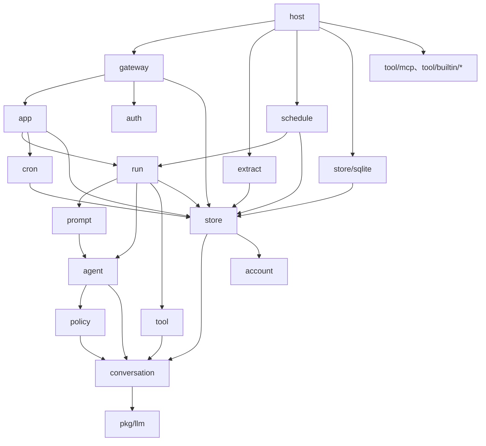
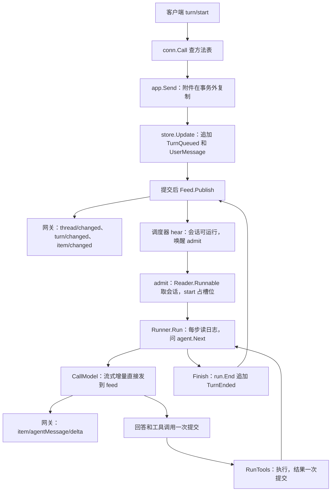

# 引擎架构

Ollupi 引擎是一个 Go 库，模块路径 `github.com/0xfakeSpike/ollupi`。一个进程运行一个分片上的所有会话（thread）：每个会话是 SQLite 里一份只追加的日志，轮次、条目和会话状态都从日志算出来，内存里只记哪些会话正占着槽位。这一页讲引擎分几层、依赖往哪个方向走、宿主怎样把各部分装起来，以及一条消息从客户端进来、到回答回到界面经过哪些代码。


## 为什么这样设计

- **引擎是库，宿主负责装配。** 引擎没有 `main`。`host.New` 按 `host.Config` 打开存储，装起 app、run、schedule、extract、cron 和网关；`Host.Run` 运行后台流程，`Gateway.Serve` 在宿主给的监听器上接客户端。桌面端的 sidecar、`bench/` 和 `eval/` 都这样嵌入引擎。分片租约也在引擎外面：`shard.Member.Run` 拿到租约后才调用宿主交给它的函数，引擎本身不知道分片的存在。
- **一条路写，一条路读，一条路通知。** 一切变化都是在 `store.Update` 的一个事务里向会话日志追加记录，每条记录先过 `conversation.Check`；会话现在的样子（`conversation.View`）由同一组纯函数从日志折叠出来；事务提交之后，改变的东西作为事件发到 store 的 feed 上，按提交编号。网关、调度器、记忆提取都只从 feed 得知变化，写的一方不通知任何人。所以不经网关、直接调用 `app` 的宿主拿到的是同一套规则，也不会漏掉调度。见[设计决策 19](/zh/reference/decisions#_19-逻辑放在拥有它的层)。
- **规则是纯函数，不碰存储。** `conversation`（记录能不能追加）、`agent`（下一步做什么）、`policy`（调用能不能执行）只读传进来的 `View`，都不导入 `store`。读写数据库、调模型、执行工具的是 `run`、`app` 这些流程包。规则因此可以只用内存里的日志测试，`agent` 的测试只导入 `conversation`。
- **内存里只有槽位表。** 排队靠的是 `threads` 表上记下的"会话变为可运行的时刻"，调度器内存里只有"哪个会话占着槽位"。进程重启后从库里重新取可运行的会话，没有内存状态要恢复。见[执行模型](/zh/engine/execution)和[设计决策 3](/zh/reference/decisions#_3-无内存调度状态)。
- **一个进程承载一个分片的全部会话。** 不按 agent 分进程或容器，等待中的会话只剩数据库记录。见[设计决策 1](/zh/reference/decisions#_1-池化-runtime)。

代价有三处。feed 的订阅回调在提交者的 goroutine 上同步执行，回调慢了，写的一方就跟着慢（见[边界](#边界与已知问题)）。数据库只有一条连接，所有读写串行，一个慢事务会拖住整个分片，所以附件复制、工具集构造、模型调用和工具执行都放在事务之外。run 每一步都把整个会话的投影重读一遍，历史越长，每一步读得越多。

::: info 演进
- 初版提交就把引擎定位成库：应用导入它，自带工具、技能和界面（`acfb8e4`）。
- v0.12.1 时宿主构造的是 `agent.Agent`：调度状态在一个事件循环里改，事件经 `Config.OnEvent` 回调往上走，网关自己读库补齐视图。`a9026ed` 先把事件改成每个连接订阅的总线，让网关不再碰存储。
- v0.16.0（`d263a2d`）把引擎重建为以会话日志为中心：`89cbf7c` 加入日志和折叠，`6a64e78` 加入 store 和 feed，`3c3ed62` 让调度器只从 feed 得知变化，`9b5b50b` 把网关建在 app 和 feed 上，`18d6757` 用 `host.Config` 取代 `service.Config`。旧的 `agent/*` 子包、`repo/`、`tools/*` 在 `13a3637` 删除。
- `b8c3665` 把令牌契约移进 `auth`，`router` 不再依赖网关和它背后的整个引擎。
:::

## 分层

| 层 | 包 | 负责什么 |
|---|---|---|
| 装配 | `host` | `host.Config`、`host.New`：把下面各层装进一个进程 |
| 网关 | `gateway`、`auth` | WebSocket 上的 JSON-RPC 2.0；认证（`auth.Authenticate`）；把 feed 上的事件翻译成通知；协议契约（`gateway/protocol.go`） |
| 流程 | `app` | 用户能做的每件事：先检查，再在一个事务里写下（发消息、插话、中断、审批、回答，工作区、环境、定时任务、记忆的增删改） |
| | `run` | 一轮的每一步：读日志，问 `agent.Next`，调模型或执行工具，把结果追加回日志；`run.End` 结束一轮 |
| | `schedule` | 槽位与排队：从 feed 得知可运行的会话，交给 `run` |
| | `extract` | 记忆提取：从 feed 得知结束的轮次，提炼成记忆 |
| | `cron` | 定时任务的日历；到点经 `app.Scheduled` 给会话排一轮 |
| 核心 | `conversation` | 日志记录（`Entry`）、`Check`、`View` 投影 |
| | `agent` | 四种角色（`Role`）和 `Next` 决策 |
| | `prompt` | 上下文窗口、系统提示、压缩、渲染 |
| | `policy` | 权限判定 |
| | `account` | 工作区、会话、执行环境、用户设置，权限分层 |
| | `memory`、`ask` | 记忆条目与召回；结构化提问 |
| 端口与适配器 | `store`、`store/sqlite` | `Store`、`Reader`、`Tx` 接口和 feed；SQLite 实现 |
| | `tool`、`tool/kit`、`tool/builtin/*`、`tool/mcp` | 工具端口；注册表；内置工具；MCP |
| | `blob`、`skill` | 附件存储；技能目录 |
| 分布式 | `shard`、`catalog`、`router`、`router/extproc` | 分片租约、目录、路由，见[分片与租约](/zh/engine/sharding) |
| 基础包 | `pkg/llm`、`pkg/sandbox`、`pkg/redact`、`pkg/jsonrpc`、`pkg/sqlitedb`、`pkg/wshub` | 模型客户端、沙箱、脱敏、JSON-RPC 连接、SQLite 的打开与迁移、WebSocket 连接管理 |

本页用到的术语：

- 会话（thread）：一段对话，`threads` 表的一行，加上它的日志。
- 记录（entry）：日志里的一条，`entries` 表的一行，写下后不再修改。
- 轮次（turn，口语"一轮"）：交给 agent 的一件事，由 `TurnQueued` 记录开始、`TurnEnded` 记录结束，物化在 `turns` 表。
- 条目（item）：轮次里的一步，比如一条消息、一段思考、一次工具调用，由一条或几条记录折叠而成，物化在 `items` 表。
- 槽位（slot）：执行池里的一个运行名额，会话只有占着槽位才在运行。
- 宿主（host）：导入引擎、负责装配和启动的程序；`host` 包是引擎替它写好的装配。

日志、记录和投影的细节见[持久化](/zh/engine/persistence)。

## 依赖方向

依赖只朝下走。下面是用 `go list` 查到的导入关系，只列主干。



几条从导入关系能直接看出的约束：

- `pkg/*`、`auth`、`ask`、`blob`、`skill` 不导入仓库里的其他包，是最底层。
- 核心很窄：`conversation` 只导入 `pkg/llm`，`policy` 只导入 `conversation`，`agent` 只导入 `conversation` 和 `policy`。它们都不导入 `store`。
- `store` 只是接口，只导入 `account`、`conversation`、`memory`；只有 `store/sqlite` 实现它，也只有 `host` 导入 `store/sqlite`。
- `run` 不导入 `schedule`、`app`、`gateway`。`schedule` 通过 `Runner` 接口调用 `run`，`app` 只为中断用到 `run.End`。
- 网关只经 `app` 和 feed 接触引擎：它不导入 `run`、`schedule`、`store/sqlite`，导入 `store` 只为事件和视图的类型。
- 除了 `host`，没有包导入 `gateway`；除了嵌入方（`bench`、`eval`、桌面端），没有包导入 `host`。
- `shard` 只导入 `catalog` 和 `store`，`router` 只导入 `auth` 和 `catalog`：分布式部分不依赖引擎的其余部分。

## 宿主装配

`host.New(ctx, cfg)` 按这个顺序装：

1. 检查 `Name` 非空、`Boxes` 已给；审批策略没写时取 `on-request`，再检查部署的权限设置（`policy.Settings.Check`），读不懂就拒绝启动。
2. `newModels`：至少一个模型；每个模型有连接和名字；一个连接只对应一个模型；每个连接都有客户端。
3. 配了 `SkillsDir` 时，检查每个角色的技能目录（`skill.Check`）。
4. `sqlite.Open(Home)`：打开 `Home/data/store.sqlite`，跑迁移，第一次打开时导入旧引擎的库。feed 随 store 一起建。
5. 附件存储 `blob.Dir(Home/attachments)`；定时任务的日历，时区取 `Location`，默认本地。
6. 工具：`Tools` 里宿主自己的 provider，加上内置的 `plan`、`ask`、`loader`、`subagent`、`outputs`、`memory`，配了技能目录时加 `skills`，最后是 `cronjobs`。`mcp.NewUsers` 用它们和每个用户的 MCP 服务器，按用户给出工具集。
7. `app.New`、`run.New`、`schedule.New`。槽位 `Slots` 默认 32，`UserSlots` 默认等于 `Slots`，`RunLimit` 默认 4 小时。
8. 配了 `Memory` 时建 `extract.Extractor`；配了 `Gateway` 时建 `gateway.Server`。

`Host.Run(ctx)` 在一个 errgroup 里运行调度器、定时任务（每分钟查一次到点的任务）和记忆提取，任何一个返回错误，其余跟着停；`ctx` 被取消时返回 `nil`。网关不在 `Run` 里，宿主另外调用 `Gateway.Serve(ctx, ln)`，`ctx` 结束后 HTTP 关停最多等 5 秒。`Host.Close` 关掉每个用户的 MCP 会话和 store。

```go
h, err := host.New(ctx, host.Config{
	Home: home, Name: "ollupi",
	Models:      []llm.Model{{Name: model, Connection: "model"}},
	Connections: map[string]llm.Client{"model": client},
	Tools:       []kit.Provider{files, web.New()},
	Permissions: policy.Settings{ApprovalPolicy: string(policy.Never)},
	Boxes:       func(string) (sandbox.Box, error) { return sandbox.Here(), nil },
})
if err != nil {
	return err
}
defer h.Close()
go h.Run(ctx)
```

这段取自 `eval/main.go`。每个参数的默认值和调大调小的后果见[把引擎嵌进服务](/zh/integrate/embed)。

作为分片运行时，宿主把 `h.Run` 和 `Gateway.Serve` 包进一个函数，交给 `shard.Member.Run(ctx, h.Store, serve)`：它先拿租约，用 epoch 给 store 加围栏（`Store.Fence`），然后才调用这个函数；失去租约时取消它的 `ctx`。见[分片与租约](/zh/engine/sharding)。

## 一次请求的完整路径

下面按时间顺序走一遍：用户在客户端发一条消息，模型回答，结果回到界面。



### 连接和认证

客户端用 WebSocket 连到网关（`GET /`）。`Server.ServeHTTP` 依次做：

1. `/healthz` 直接回 200。
2. `authorize`：`r.Host` 不在允许名单时回 403；`auth.Authenticate` 认不出令牌时回 401，暂时查不了时回 503 带 `Retry-After`。查询最多等 10 秒。令牌怎么读见[分片与租约](/zh/engine/sharding#令牌认证)。
3. `hub.Admit`：连接按速率准入，超过时回 503 带 `Retry-After`。
4. 这个用户在本进程第一次连上时，先问 `Options.Admit`（分片部署里是 `shard.Member.Admit`）这个用户是否归这里，再 `app.EnsureUser` 建好用户的行。
5. `websocket.Accept`，`Origin` 按 `localhost:*`、`127.0.0.1:*`、`[::1]:*` 和 `AllowedOrigins` 校验；单条消息上限 4 MiB。
6. `wshub.Hub.Serve`：每个用户最多 4 条连接，第五条进来时最旧的一条以 4000 关闭；每 30 秒 ping 一次；连接在打开后 15 到 20 小时之间的随机时刻以 1001 关闭。
7. `jsonrpc.Conn.Serve` 读消息、逐条处理，同一连接上的请求按顺序执行。

客户端的第一个调用必须是 `initialize`，其他方法在它之前都返回 `notInitialized`。`initialize` 的响应发出之后，连接订阅这个用户在 feed 上的事件（`Feed.Subscribe(user, c.event)`），再把这个用户所有等待处理的审批和提问重新发一遍（`app.Requests`）。所以断线重连不会漏掉请求。连接的各项上限和重连规则见[客户端](/zh/integrate/client)。

### 提交消息

`turn/start` 经 `conn.Call` 查 `protocol.methods`，解码参数后调用 `conn.turnStart`，再到 `app.Send(ctx, user, thread, in)`。

`Send` 分两段：

1. 在事务之外执行 `attach`：把附件从用户的沙箱复制进附件存储，最多 10 个，总共最多等 1 分钟。慢的沙箱或对象存储不该占着数据库唯一的连接。
2. 在 `store.Update` 里执行 `queue`：`topThread` 确认会话属于这个用户、不是子 agent 会话；消息非空；会话没有归档，工作区可用；排在后面的轮次不到 20 个；确定模型（请求里指定的连接，否则沿用上一轮，否则第一个模型）；检查消息长度和图片（`fits`）；然后追加两条记录：`TurnQueued`（模型，以及按模型输入预算选的主 agent 角色）和 `UserMessage`。

返回的轮次如果就是会话的当前轮次，`turn/start` 结果里的状态是 `inProgress`，否则是 `queued`。

### 写进日志

`store/sqlite` 的 `Update` 在一个 `IMMEDIATE` 事务里：

1. 如果进程持有分片，先核对 `shard_epoch`，分片已被后来者接管时整个事务失败（`store.ErrShardLost`）。
2. `Tx.Append` 对每条记录执行 `conversation.Check`，通过后 `View.Apply` 把它折叠进视图，再插进 `entries`。
3. 把变了的轮次、条目、回答写进 `turns`、`items`、`responses`，更新会话的 `head`、`own_status` 和 `runnable_since`，再向上重算祖先会话的状态（子 agent 等用户时，父会话也显示在等）。
4. 给这次提交编号：`feed` 表的 `seq` 加一，同一次提交的所有事件共用这个号。

提交之后，`Update` 在调用方的 goroutine 上把每个事件交给 `Feed.Publish`。所以 `turn/start` 的响应进发件箱之前，这次提交的通知已经在里面了。

### 进入槽位

调度器在 feed 上订阅所有用户（`SubscribeAll`）。`hear` 看到事件里的会话可以运行（`Change.Header.Runnable`），就往容量为 1 的 `wake` 通道里发一个信号；调度器的 goroutine 收到后调用 `admit`：按空闲槽位和每用户上限，从 `Reader.Runnable` 读出等得最久的会话，为每个起一个 goroutine 调用 `run.Runner.Run`。排队顺序和槽位的细节见[执行模型](/zh/engine/execution#调度器和槽位)。

### 运行和回到界面

`Runner.Run` 先把上一次运行留下的、已开始未结束的调用记为被切断，然后循环：读会话、视图和用户设置，构造这一步的权限判定器和工具列表，问 `agent.Next` 下一步做什么，做完把结果追加回日志，直到轮次要等或结束。每一步做什么见[执行模型](/zh/engine/execution#循环的每一步)。

模型的流式输出这样回到界面：

1. `run.send` 调用模型客户端的 `Chat`。客户端回调的每个增量先经 `redactor.Stream` 把占位符还原成真实值。
2. `callModel` 把增量包成 `store.Delta`，直接交给 `Feed.Publish`，不进事务，也不落库。
3. 网关的 `conn.event` 把它翻译成 `item/agentMessage/delta` 或 `item/reasoning/textDelta`。
4. `jsonrpc.Conn.Notify` 把消息放进发件箱，由单独的写 goroutine 发送，所以写 socket 不阻塞引擎。发件箱积压超过 16 MiB 时连接以 1008 关闭；单次写超时 10 秒。

模型调用结束后，`ModelResponded`、思考、回答正文和每个工具调用在一次提交里写下，网关随之发出 `turn/changed` 和 `item/changed`。一轮结束时，`run.End` 追加 `TurnEnded`；调度器在 feed 上看到这一轮结束，取消对应的运行，槽位放出后再 `admit` 一次。会话后面还排着轮次的话，下一个轮次在同一次提交里成为当前轮次，会话仍然可运行，照常排队。

feed 上的事件和发给客户端的消息：

| feed 事件 | 发给客户端 |
|---|---|
| `Delta`（正文） | 通知 `item/agentMessage/delta` |
| `Delta`（思考） | 通知 `item/reasoning/textDelta` |
| `Change` | 通知 `thread/changed`（会话删除时不带 `thread`），每个变了的轮次一条 `turn/changed`，每个变了的条目一条 `item/changed`，都带这次提交的 `seq` |
| `Change` 里等审批的条目 | 服务端请求 `item/toolCall/requestApproval` |
| `Change` 里等回答的条目 | 服务端请求 `item/tool/requestUserInput` |
| `Owned` | 通知 `settings/changed`、`workspace/changed`、`environment/changed`、`mcpServer/changed`、`cron/changed`、`memory/changed` |

`error` 通知只在客户端对审批或提问的回复没能生效时发出。事件只发给本人：连接订阅的只是自己用户的事件。`thread/read` 返回读取时的 `seq`，客户端据此丢掉不比它新的通知。完整协议见[协议](/zh/integrate/protocol)。

## 进程内的主要对象

| 对象 | 数量 | 创建 | 结束 |
|---|---|---|---|
| `host.Host` | 每进程一个 | `host.New` | `Close` |
| `sqlite.Store` | 每分片一个，一条数据库连接 | `sqlite.Open` | `Host.Close` |
| `store.Feed` | 每个 store 一个 | 随 store | 随 store |
| `app.App`、`run.Runner` | 各一个 | `host.New` | 随进程 |
| `schedule.Scheduler` | 一个 | `host.New` | `Host.Run` 的 `ctx` 结束，等所有运行返回 |
| `extract.Extractor` | 配了 `Memory` 才有 | `host.New` | `Host.Run` 的 `ctx` 结束 |
| `mcp.Users` | 一个，按用户持有工具集和 MCP 会话 | `host.New` | `Host.Close` |
| 槽位上的运行 | 每个占槽位的会话一个 | `Scheduler.start` | `Runner.Run` 返回 |
| `llm.Client` | 每个连接一个，或每用户每连接一个（`ClientFor`） | 宿主 | 进程结束 |
| `gateway.Server` | 配了 `Gateway` 才有 | `gateway.NewServer` | `Serve` 的 `ctx` 结束 |
| `conn`、`jsonrpc.Conn` | 每条连接一个，每用户最多 4 条 | `ServeHTTP` | 断开、被替换或到龄 |

常驻 goroutine：调度器一个；定时任务一个；记忆提取一个（如果有）；每个占槽位的会话一个，并行执行的工具每个再一个；每条连接一个处理请求、一个读、一个写、一个保活；作为分片运行时续约一个。等待中的会话不占 goroutine。

## 边界与已知问题

- **feed 回调是同步的。** `Feed.Publish` 在提交者的 goroutine 上（流式增量在运行的 goroutine 上）逐个调用订阅回调，期间持有 feed 的读锁。回调必须很快返回，不要在回调里同步写库、订阅或退订，要做就另起 goroutine（`eval` 和 `bench` 回答提问都这样做）。网关的回调只把消息放进发件箱就返回。这条约束只体现在代码里，引擎的文档没有写。
- **一条数据库连接。** 读写都排在同一条连接上。一个慢事务会让分片上所有会话的调度和网关读取一起等，事务没有单独的超时。
- **断线期间的事件不补发。** 订阅随连接结束，feed 不缓存事件。重连后网关只重发等待中的审批和提问，其余状态要客户端用 `thread/read` 重读。
- **读得慢的客户端会被断开。** 发件箱积压超过 16 MiB 时连接直接关闭。
- **一个用户最多 4 条连接。** 第五条进来时最旧的那条以 4000 关闭，按协议不应自动重连。
- **装配错误引擎不检查。** 失去租约后停掉 `Run` 和 `Serve`、关闭的先后，都由宿主保证；`shard.Member.Run` 替宿主做了前一件，自己装配就要自己做。见[分片与租约](/zh/engine/sharding#分片租约)。

## 代码位置

| 仓库 | 路径 | 职责 |
|---|---|---|
| ollupi | `host/host.go` | `Config`、`New`、`Run`、`Close` |
| ollupi | `host/models.go` | 模型和连接的检查、按用户取客户端 |
| ollupi | `store/store.go` | `Store`、`Reader`、`Tx`、`Event` |
| ollupi | `store/feed.go` | feed 的订阅和发布 |
| ollupi | `store/sqlite/sqlite.go` | 打开、`Update` 的事务和提交编号、围栏 |
| ollupi | `store/sqlite/conversations.go` | `Append`、投影的物化、`Runnable` |
| ollupi | `app/turns.go` | 发消息、插话、中断、审批、回答 |
| ollupi | `app/attachments.go` | 附件复制 |
| ollupi | `schedule/schedule.go` | 调度器 |
| ollupi | `run/run.go` | 一次运行的循环 |
| ollupi | `run/model.go` | 模型调用、流式增量 |
| ollupi | `gateway/server.go` | 连接、方法分发、事件翻译 |
| ollupi | `gateway/serve.go` | 选项、监听、连接上限的默认值 |
| ollupi | `gateway/auth.go`、`auth/auth.go` | Host 校验、令牌 |
| ollupi | `gateway/protocol.go` | 方法表、通知名、错误码 |
| ollupi | `gateway/threads.go` | `thread/*`、`turn/*` 方法 |
| ollupi | `pkg/jsonrpc/jsonrpc.go` | JSON-RPC 连接和发件箱 |
| ollupi | `pkg/wshub/wshub.go` | 每用户连接数、保活、到龄关闭、准入速率 |
| ollupi | `eval/main.go` | 最小的装配示例 |
| ollupi-desktop | `sidecar/internal/host/host.go` | 桌面端的装配方式 |
