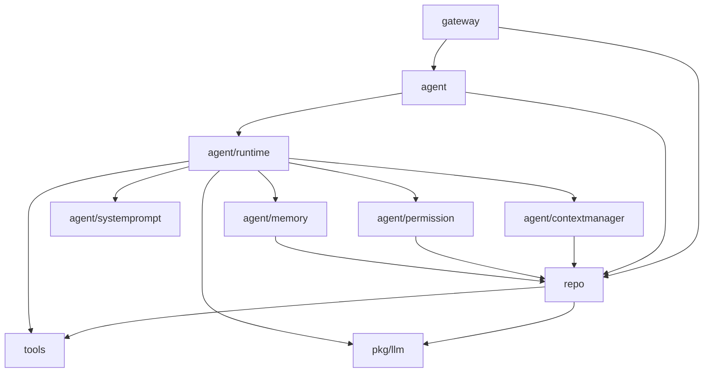
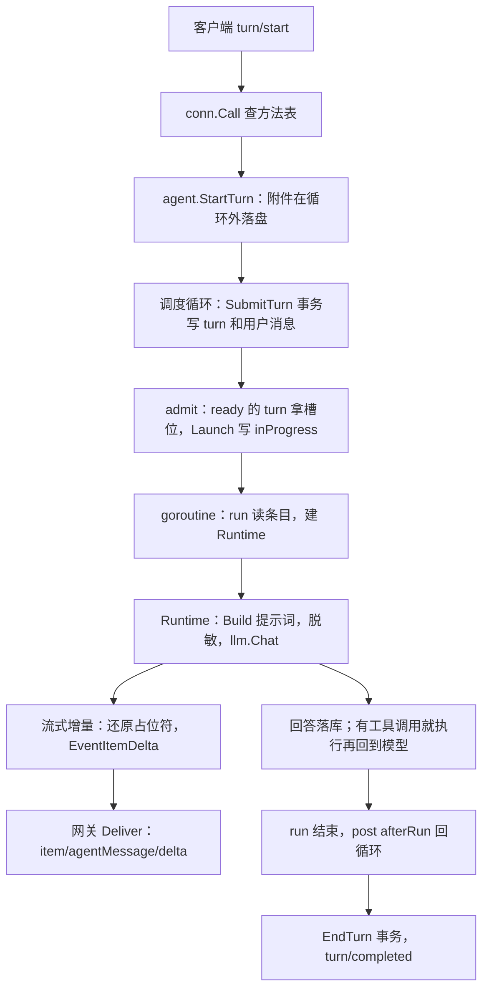

# 引擎架构

Ollupi 引擎是一个 Go 库，模块路径 `github.com/0xfakeSpike/ollupi`。一个进程运行一个分片上的所有会话（thread）：运行状态全部写在 SQLite 里，内存里只保留正在运行的部分。这一页讲引擎分几层、依赖往哪个方向走、宿主怎样把各部分装起来，以及一条消息从客户端进来、到回答回到界面经过哪些代码。

## 为什么这样设计

- **引擎是库，宿主负责装配。** 引擎没有 `main`。宿主程序（host）打开数据库，创建模型客户端和工具，构造 `agent.Agent` 和 `gateway.Server`，再启动定时器和记忆提炼。桌面端的 `sidecar/internal/host/host.go` 是一个宿主，`bench/` 是另一个。初版提交就这样定位：应用导入它，自带工具、技能和界面（`acfb8e4`）。早期 `Agent.Start` 自己启动记忆提炼的后台循环，定时任务的计时器是调度循环里的一个分支；`527fe58` 和 `ee7776c` 把两者移到宿主，agent 不再知道定时任务的存在，到点时宿主调用和用户消息相同的入口。
- **依赖只朝下，每个概念一个主人。** `repo` 拥有会话状态机，也就是轮次和条目的状态转换及其约束；`agent` 负责调度，并发出每一次变化；`gateway` 只做编解码、认证和分页的字节预算。`eedc2c8` 把工作区操作从网关移进 agent、把状态转换移进 repo；`701ac2a` 删掉了网关在调用之后补发通知、复制定时任务校验的代码。所以不经网关、直接嵌入 agent 的宿主拿到的是同一套规则。agent 也不知道网关存在：事件经 `Config.OnEvent` 回调往上走，库里只有 `gateway` 导入 `agent`。见[设计决策 19](/zh/reference/decisions#_19-逻辑放在拥有它的层)。
- **调度状态只在一个事件循环里改。** 会改变调度状态的操作都投进同一个 goroutine 依次执行，槽位表只在这个 goroutine 上读写，不需要锁。它取代了早期的全局互斥锁加条件变量（`bca8b52`）。纯读操作直接访问数据库，不进循环。见[设计决策 3](/zh/reference/decisions#_3-无内存调度状态)。
- **一个进程承载一个分片的全部会话。** 不按 agent 分进程或容器，等待中的会话只剩数据库记录。槽位和停放的细节见[执行模型](/zh/engine/execution)和[设计决策 1](/zh/reference/decisions#_1-池化-runtime)。

代价是装配的正确性落在宿主身上：启动和关闭的顺序、失去租约时停掉库上的其他组件、定时器和记忆提炼的生命周期，引擎都不替宿主检查。`OnEvent` 在调度循环或槽位的 goroutine 上同步调用，所以它必须很快返回（见[边界](#边界与已知问题)）；循环里的数据库读写也是同步的，任何慢操作都会拖住整个分片，附件读写因此在进循环之前完成（`fb3e2d1`）。

## 分层

| 层 | 目录 | 负责什么 |
|---|---|---|
| 网关 | `gateway` | WebSocket 上的 JSON-RPC 2.0；认证；把引擎事件推给客户端；路由器（`gateway/router.go`） |
| agent | `agent` | 调度循环、槽位、轮次（turn）的生命周期、子 agent、会话管理、分片租约 |
| 运行时 | `agent/runtime` | 一个轮次在槽位里的执行：决定工具调用、执行工具、调用模型 |
| 上下文 | `agent/contextmanager`、`agent/systemprompt` | 窗口预算、提示词组装、压缩、工具输出裁剪 |
| 策略 | `agent/permission`、`agent/memory`、`agent/skills` | 权限判定、记忆提炼与召回、技能目录 |
| 存储 | `repo` | SQLite 表、事务、migration、分片租约行、分片目录 |
| 工具 | `tools` 及子目录 | 工具注册表和 `Provider` 接口；`workspace`、`web`、`mcp`、`cron`、`plan`、`subagent`、`userinput` |
| 基础包 | `pkg/llm`、`pkg/sandbox`、`pkg/redact`、`pkg/blobs`、`pkg/jsonrpc` | 模型客户端、沙箱、脱敏、附件存储、JSON-RPC 连接 |

本页用到的术语：

- 会话（thread）：一段对话，是 `threads` 表的一行。
- 轮次（turn，口语"一轮"）：用户发一条消息后 agent 的一次完整处理，是 `turns` 表的一行。
- 条目（item）：轮次里的一步，比如一条消息、一段思考、一次工具调用，是 `items` 表的一行。
- 槽位（slot）：执行池里的一个运行名额，轮次只有占着槽位才在执行。
- 宿主（host）：导入引擎、负责装配和启动的程序。

## 依赖方向

依赖只朝下走，下面是用 `go list` 查到的真实导入关系（只列主干）。

几条从导入关系能直接看出的约束：

- `tools` 根包和 `pkg/*` 不导入仓库里的任何其他包，它们是最底层。
- `repo` 只导入 `tools` 和 `pkg/llm`，用的是它们的类型（`tools.Await`、`tools.ContextArtifact`、`llm.Model` 等），因为这些类型要存进条目和轮次的 JSON 列。
- 库内只有 `gateway` 这一层导入 `agent`。引擎事件通过 `Config.OnEvent` 回调往上走，`agent` 不知道网关存在。
- `gateway` 也直接导入 `repo`：不需要 agent 逻辑的视图（设置、搜索、会话分页、工作区和定时任务列表）由网关经 `Options.DB` 自己读库（`701ac2a`）。
- `tools/cron` 导入 `repo`，因为定时任务存在数据库里；`agent` 不导入 `tools/cron`，定时器由宿主启动，到点时调用 `agent.StartScheduledTurn`。
- `agent/runtime` 导入 `tools/workspace` 只为两个工具名：精简模式常驻的 `read_file` 和 `run_command`。

## 一次请求的完整路径

下面按时间顺序走一遍：用户在客户端发一条消息，模型回答，结果回到界面。

### 连接和认证

客户端用 WebSocket 连到网关（`GET /`）。`Server.ServeHTTP` 依次做：

1. `authorize`：`r.Host` 不在允许名单时回 403；令牌不对时回 401。令牌怎么读见[分片与租约](/zh/engine/sharding#令牌认证)。
2. `db.EnsureUser(user)`：用户不存在就建 `users`、`settings`、`memory_state` 三行。
3. `websocket.Accept`，`Origin` 按 `localhost:*`、`127.0.0.1:*`、`[::1]:*` 和 `AllowedOrigins` 校验；单条消息上限 32 MiB（`maxMessageBytes`）。
4. 新连接记进 `Server.clients[user]`。每个用户只有一条当前连接，新的进来时旧的以 `StatusPolicyViolation` 关闭。
5. 进入 `jsonrpc.Conn.Serve`，在一个循环里逐条读消息。同一连接上的请求按顺序处理。

客户端的第一个调用必须是 `initialize`，其他方法在它之前都返回 `notInitialized`。`initialize` 回应发出之后，网关调用 `AllPendingRequests`，把这个用户所有等待处理的审批和提问重新发一遍。所以客户端断线再连回来不会漏掉请求。

### 提交消息

`turn/start` 经 `conn.Call` 查 `protocol.methods` 表，由 `handle` 解码参数后调用 `conn.turnStart`，再到 `agent.StartTurn(user, threadID, in)`。

`StartTurn` 分两段：

1. 在调用方 goroutine 上执行 `attach`：`topThread` 确认会话属于这个用户且不是子 agent 会话，然后把附件从用户沙箱复制进附件存储，超时 1 分钟。这一步放在循环外，因为慢的沙箱或对象存储会卡住分片上所有会话。
2. 用 `a.call` 把后续工作投进调度循环，等它完成：校验消息（文本最多 4000 字符，`maxInputRunes`）、确定模型（请求里指定的连接，否则沿用上一轮，否则第一个模型）、检查图片、调用 `repo.SubmitTurn`。

`SubmitTurn` 是一个事务：写 `turns` 行（`queued`），如果会话没有未结束的轮次，就地改成 `ready` 并写入用户消息条目。随后事件依次发出 `turn/started`、`item/started`、`item/completed`、`thread/status/changed`。如果前面还有轮次，新轮次留在 `queued`，只发 `turn/queued`。JSON-RPC 的响应这时才返回给客户端。

### 进入槽位

`a.call` 执行的函数跑完后，调度循环马上调用 `admit`。它算出空闲槽位数，从数据库读出同样数量的就绪会话，对每个调用 `reconcile`。`reconcile` 先写 `Launch`（`status = 'inProgress'`），再 `launch` 起 goroutine。细节见[执行模型](/zh/engine/execution#调度循环和槽位)。

### 运行和回到界面

goroutine 里的 `a.run` 读轮次、会话和条目（`RunItems`），构造 `runtime.Runtime`，调用 `rt.Run`。`Runtime` 在循环里处理待执行的工具调用，再调用模型。

模型的流式输出这样回到界面：

1. `rt.send` 把模型客户端回调的每个增量先交给 `restored`，它用 `redactor.Stream` 把占位符还原成真实值。
2. `responseRecorder.delta` 在第一个增量到来时写入一条 `inProgress` 的条目，然后调用 `rt.Delta`。增量文本本身不落库。
3. `rt.Delta` 发出 `EventItemDelta`，`OnEvent` 把它交给 `Server.Deliver`。
4. `Deliver` 按 `e.Thread.UserID` 找到这个用户的连接，`conn.event` 把事件翻译成 `item/agentMessage/delta` 或 `item/reasoning/textDelta` 通知。
5. `jsonrpc.Conn.send` 把消息放进发件箱，由单独的写 goroutine 发送，所以写 socket 不阻塞引擎。发件箱积压超过 16 MiB 时连接直接关闭，单次写超时 10 秒。

模型调用结束后，完整文本和工具调用落库，发出 `item/completed`。一轮结束时，`run` 用 `post` 把 `afterRun` 投回调度循环，由它写 `EndTurn`，发出 `turn/completed` 和 `thread/status/changed`，再让下一个排队的轮次开始。

事件和协议消息的对应关系：

| 引擎事件 | 发给客户端 |
|---|---|
| `thread_started` | 通知 `thread/started` |
| `thread_changed`、`thread_deleted` | 通知 `thread/changed`（删除时不带 `thread`） |
| `turn_queued`、`turn_started`、`turn_completed` | 通知 `turn/queued`、`turn/started`、`turn/completed` |
| `item_started`、`item_updated`、`item_completed` | 通知 `item/started`、`item/updated`、`item/completed` |
| `item_delta` | 通知 `item/agentMessage/delta` 或 `item/reasoning/textDelta` |
| `thread_status_changed` | 通知 `thread/status/changed` |
| `approval_requested` | 服务端请求 `item/toolCall/requestApproval` |
| `user_input_requested` | 服务端请求 `item/tool/requestUserInput` |
| `workspace_changed`、`cron_job_changed` | 通知 `workspace/changed`、`cron/changed` |
| `error` | 通知 `error` |

事件只发给本人：没有用户的事件不发给任何人，只进日志。完整协议见[协议](/zh/integrate/protocol)。

## 调度循环

`Agent.loop` 是一个 goroutine，从无缓冲通道 `a.events` 取函数逐个执行。`slotByThread` 和 `slotsOfUser` 这两张内存表只在这个 goroutine 上读写，所以不用锁。

- `post(fn)`：把函数投进循环。agent 已停止时返回 `false`。
- `call(fn)`：投进循环并等待返回值。agent 停止时返回 `errStopped`；函数崩溃时返回 `errCrashed`。
- `step(fn)`：循环里每个事件的外壳。执行 `fn`，再执行 `admit`。`recover` 接住 panic，写日志后继续循环。

走循环的是会改变调度状态的操作：开始一轮、插话、中断、回答审批和提问、改名、归档、删除。纯读（列会话）和 `StartThread` 直接访问数据库。

循环里的数据库读写是同步的，所以慢操作要放到循环外，附件存储就是这样处理的。

## 进程内的主要对象

| 对象 | 数量 | 创建 | 结束 |
|---|---|---|---|
| `repo.DB` | 每分片一个，一条连接 | `repo.Open` | 宿主 `Close` |
| `agent.Agent` | 每分片进程一个 | `agent.New` + `Start` | 取消 `Start` 的 ctx，再 `Wait` |
| `slot` | 每个在跑的轮次一个 | `launch` | `release` |
| `runtime.Runtime` | 每次进槽位一个 | `runTurn` | `Run` 返回 |
| `contextmanager.Manager` | 每次进槽位一个 | `windowFor` | 随 `Runtime` |
| `tools.Registry` | 共用一个，加每用户一个 | `buildTools`、`registryFor` | 用户的工具集变了就重建 |
| `llm.Client` | 每连接一个，或每用户每连接一个 | 宿主 | 进程结束 |
| `gateway.Server` | 每进程一个 | `gateway.NewServer` | `Serve` 的 ctx 结束后关闭，HTTP 关停最多等 5 秒 |
| `conn`、`jsonrpc.Conn` | 每用户一条 | `ServeHTTP` | 断开或被新连接替换 |
| `gateway.Router` | 任意个，无状态 | `gateway.NewRouter` | 宿主 |
| `repo.Catalog` | 所有分片共用一个目录库 | `repo.OpenCatalog` | 宿主 `Close` |

常驻 goroutine：调度循环一个；有租约时续约一个；每个槽位一个，工具并行时每个工具再一个；每条连接一读一写两个；宿主另外跑定时任务和记忆提炼。等待中的轮次不占 goroutine。

### Agent 的生命周期

`Start(ctx)` 的顺序：

1. 校验名字和数据库。
2. `buildTools`：在 `Config.Providers` 后加上内置的 `plan`、`subagent`、`userinput`、`read_tool_output`、`load_tools`，以及配置了才有的记忆和技能，建共用注册表。
3. `checkModels`：至少一个模型；每个模型有连接和名字；一个连接只对应一个模型；每个连接都有客户端。
4. `checkPromptFits`：每个模型的系统提示词加工具定义不能超过输入预算的一半，否则启动失败。
5. 填默认值：`Slots` 32，`UserSlots` 等于 `Slots`，`RunLimit` 4 小时。
6. 如果配了 `Lease`，等到拿到租约才继续（`claimShard`）。
7. `recover`：处理上次进程留下的状态。
8. 起调度循环。

取消 `Start` 的 ctx 后，`a.ctx` 结束，循环退出，每个槽位的 ctx 跟着结束。`afterRun` 投不进循环，所以这些轮次留在 `inProgress`，等下次启动恢复。`Wait` 等所有 goroutine 退出，再释放租约（如果有）。

关闭顺序由宿主保证。桌面端 sidecar 用同一个 ctx 停止所有组件，然后依次等网关、定时器等附属组件、agent，最后关数据库。

## 边界与已知问题

- **`OnEvent` 是同步回调。** 它在调度循环或槽位的 goroutine 上被调用（流式增量来自槽位），所以必须能并发调用、很快返回，也不能回调会进循环的 agent 方法：在循环上调用时，循环正在等它返回，`call` 会一直等下去。`bca8b52` 的 README 写过这条约束，现在的 README 和代码注释里都没有。网关的 `Deliver` 只把消息放进发件箱就返回。
- **循环里的慢操作拖住整个分片。** 循环里的数据库读写是同步的，一次慢查询会让分片上所有会话的调度一起等。附件读写已经移出循环，其他循环内操作没有单独的超时。
- **断线期间的事件不补发。** `Deliver` 找不到这个用户的当前连接时直接丢掉事件。重连后网关只重发等待中的审批和提问，其余状态要客户端自己重读会话。
- **一个用户只有一条当前连接。** 同一用户的新连接会把旧连接以 `StatusPolicyViolation` 关掉，两个客户端不能同时连同一个用户。
- **读得慢的客户端会被断开。** 发件箱积压超过 16 MiB 时连接直接关闭。
- **装配错误引擎不检查。** 发布分片地址的时机、失去租约后停掉其他组件、关闭顺序，都只写在注释和文档里，由宿主自己保证，见[分片与租约](/zh/engine/sharding#分片租约)。

## 代码位置

| 仓库 | 路径 | 职责 |
|---|---|---|
| ollupi | `agent/agent.go` | `Config`、`Agent`、`Start`、工具组装 |
| ollupi | `agent/loop.go` | 调度循环、`post`、`call`、`launch`、`release` |
| ollupi | `agent/turns.go` | 开始一轮、插话、中断、回答审批和提问 |
| ollupi | `agent/events.go` | 事件类型和发送 |
| ollupi | `agent/runtime/` | 一轮在槽位里的执行 |
| ollupi | `gateway/server.go` | 连接、方法分发、事件翻译 |
| ollupi | `gateway/serve.go` | 选项、监听、Host 校验 |
| ollupi | `gateway/protocol.go` | 方法表、通知名、错误码 |
| ollupi | `gateway/threads.go` | `thread/*`、`turn/*` 方法 |
| ollupi | `pkg/jsonrpc/jsonrpc.go` | JSON-RPC 连接和发件箱 |
| ollupi-desktop | `sidecar/internal/host/host.go` | 桌面端的组装方式 |
