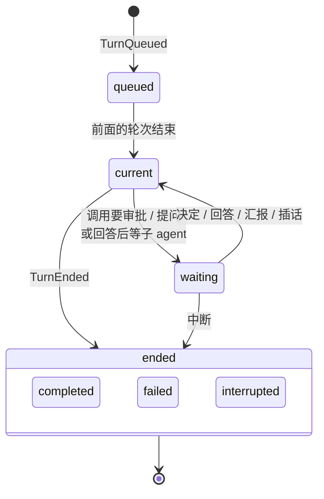

# 执行模型

执行模型决定一个轮次（turn）什么时候运行、在哪里等、怎样被唤醒。用户发来的轮次、子 agent 的轮次、定时任务的轮次共用一个执行池，池的名额叫槽位（slot），默认 32 个。调度器（`schedule`）决定哪个会话（thread）占槽位，运行（`run`）在槽位里一步步推进它的当前轮次，每一步做什么由 `agent.Next` 从会话日志里读出来。


## 为什么这样设计

个人 agent 的大部分时间在等：等用户回复、等审批、等子 agent。执行模型围绕这一点做了几个取舍。

- **槽位只给正在干活的会话。** 会话占着槽位才算在运行；等用户、等审批、等子 agent 时让出槽位，只剩数据库里的日志，不占 goroutine，也不占模型并发。所以停放的会话花的主要是数据库空间，而不是内存。放弃的做法是每个 agent 一个进程或容器：两种做法的内存对照见[性能基准](/zh/benchmarks/#内存与隔离)。见[设计决策 1](/zh/reference/decisions#_1-池化-runtime)。
- **队列就是数据库。** 排队的不是内存里的结构，而是 `threads` 表上记下的"会话变为可运行的时刻"（`runnable_since`）。调度器内存里只有"哪个会话占着哪个槽位"，它随进程消失，重启后不需要恢复。见[设计决策 3](/zh/reference/decisions#_3-无内存调度状态)。
- **调度器只听 feed。** 谁也不通知调度器：发消息、审批、回答、子 agent 汇报，都只是向日志追加记录。记录让会话变得可运行时，这次提交在 feed 上的事件就会唤醒调度器。调度器没有计时器，也不把运行放回队列，等待都写在日志里。
- **下一步从日志读出来。** `agent.Next` 只看会话的投影就决定下一步：等、执行工具、跳过工具、调模型或结束。`run` 每一步都重读日志，做完把结果追加回去。所以重启后接手一个会话，和平常运行走的是同一段逻辑。
- **两层并发分开算。** 槽位限制同时运行的会话，模型连接的名额限制同时在途的模型请求。工具执行不占模型名额，跑长工具的会话不会挡住别的会话调用模型。见[设计决策 4](/zh/reference/decisions#_4-两层并发)。
- **子 agent 和定时任务不走特殊路径。** 它们都是普通会话里的普通轮次，和用户的轮次在同一个池里排队。见[设计决策 5](/zh/reference/decisions#_5-子-agent-即普通会话) 和[设计决策 6](/zh/reference/decisions#_6-定时任务即消息)。

代价也很明确：每一步都要重读整个会话的投影；数据库只有一条连接，慢事务会拖住调度；跑长工具的会话一直占着槽位，模型调用重试期间也一直占着槽位和名额。

::: info 演进
- 早期有一个内存里的等待队列。它缓存的是数据库本来就能回答的问题，还要额外维护，后来删掉，队列只剩 `turns` 表。调度状态一度由一把全局锁加条件变量保护，后来改成一个事件循环串行修改。
- 并发以前是 4 个 worker 按整个步骤计数，模型调用和工具执行都算，4 个长时间运行的工具就能卡住所有会话。后来拆成槽位和模型名额两层。
- v0.12.1 的调度是 agent 事件循环里的 `reconcile`：每个事件之后按 `turns.status` 推一个会话，调用方要记得在合适的地方调用它。v0.16.0 的重建（`d263a2d`）里，`3c3ed62` 让调度器只从 feed 得知变化，`cf4141e` 让 `run` 每步从日志读出下一步。
:::

## 调度器和槽位

`schedule.Scheduler` 在一个 goroutine 上运行（`Run`），内存里只有两张表，用一把互斥锁保护：

```go
runs   map[string]*worker // 会话 -> 它占着的槽位
ofUser map[string]int     // 用户 -> 占用的槽位数
```

一个会话同时只运行它的当前轮次，所以一个会话最多占一个槽位。

`Run` 订阅 feed 上所有用户的事件，然后等 `wake` 通道。`wake` 的容量是 1，多个信号合成一个。三种情况会发信号：启动时一次；某个事件里的会话可以运行（`Change.Header.Runnable`）；一个运行返回、放出槽位。每收到一个信号就调用一次 `admit`：

```go
free := s.slots - len(s.runs)
// full：已到 userSlots 上限的用户
runnable, err = r.Runnable(free+running, full)
for _, rn := range runnable {
	// 跳过已在运行的会话；槽位或这个用户的份额满了也跳过
	s.start(ctx, rn)
}
```

`start` 给这次运行建一个带时限的 `ctx`，记进两张表，起一个 goroutine 调用 `Runner.Run(ctx, thread)`。运行返回后，这个 goroutine 处理错误（见[错误处理](#错误处理)），从两张表里删掉记录，再发一个信号。

| `host.Config` | `schedule.New` 的参数 | 默认值 | 含义 |
|---|---|---|---|
| `Slots` | `slots` | 32 | 分片的槽位总数 |
| `UserSlots` | `userSlots` | 等于 `Slots` | 一个用户最多占的槽位数，子 agent 的会话算在用户头上 |
| `RunLimit` | `limit` | 4 小时 | 一次占用槽位的最长时间，超过后这一轮失败 |

`RunLimit` 用 `context.WithTimeoutCause` 实现，按每次占槽位计时：会话让出槽位、之后再拿到时重新计时。调参的后果见[容量规划](/zh/integrate/capacity)。

## 就绪队列

就绪队列不是内存结构，就是 `threads` 表里 `runnable_since` 不为空的行，由部分索引 `threads_runnable` 支撑。`Reader.Runnable(limit, except)` 这样取：

```sql
SELECT id AS thread, user_id AS user FROM threads
WHERE runnable_since IS NOT NULL AND user_id NOT IN (?)
ORDER BY parent_id IS NOT NULL, runnable_since, id LIMIT ?
```

- 普通会话排在子 agent 的会话前面。
- 同类按 `runnable_since` 先后，也就是会话变为可运行的时刻。
- `except` 是已到 `UserSlots` 上限的用户，他们的会话不读出来。
- 排序只在有会话等槽位时才起作用。

`runnable_since` 由 store 在每次追加时维护：会话可运行（有当前轮次，且它不在等任何东西）时，已有的值保留，没有就写入当前时间；不可运行时清空。所以会话一直可运行时它的位置不变：正在运行的会话仍在这张表里（这也是 `admit` 多读 `running` 行的原因），一轮结束、排在后面的轮次接着成为当前轮次时，`runnable_since` 也不变。

等待中和空闲的会话不在这个索引里，所以大量停放的会话不影响 `admit` 的开销。

::: info 演进
v0.12.1 的就绪队列是 `turns` 表里 `status = 'ready'` 的行（部分索引 `turns_ready`，按 `started_at` 排）。v0.16.0 的日志重建把排队的依据移到会话上，store 在每次追加时写 `runnable_since`（`6a64e78`）。
:::

## 轮次状态机

轮次没有状态列。它要么已经结束（`TurnEnded` 记着 `completed`、`failed` 或 `interrupted` 和原因），要么没结束。没结束的轮次里，日志里第一个是会话的当前轮次（`View.Active`），其余排在它后面（`View.Queued`）。当前轮次在不在等，看它的条目（`View.Waiting`）：

| 当前轮次的条目 | 等什么 | 会话状态 | 可运行 |
|---|---|---|---|
| 有调用在等审批 | 用户的审批 | `waitingOnApproval` | 否 |
| 有调用在等回答 | 用户的回答 | `waitingOnUserInput` | 否 |
| 已经回答，它启动的子 agent 还没全部汇报 | 子 agent | `active` | 否 |
| 都不是 | 不等 | `active` | 是 |

几种等待同时存在时，优先级是审批、回答、子 agent。先看需要人处理的，因为只有人能解开它们。等子 agent 只在这一轮已经回答之后才算：回答之前，子 agent 和父轮次一起跑。



协议里轮次的 `status` 是这张图的简化：排在后面的是 `queued`，当前轮次不论在不在等都是 `inProgress`，结束的取 `TurnEnded` 的状态。会话的 `status` 还会把子 agent 对用户的等待算进来：子 agent 在等审批或回答时，父会话也显示在等（`conversation.RollUp`）。

::: info 演进
v0.12.1 的 `turns.status` 有九个值，`queued`、`ready`、`inProgress` 和三种 `waitingOn*` 都是存下来的状态，由调度器在每次转换时改写。v0.16.0 的重建（`89cbf7c`）去掉了状态列，轮次在做什么从日志折叠出来。
:::

## 一次运行

`Runner.Run(ctx, thread)` 在槽位的 goroutine 上执行：

1. `closeStranded`：当前轮次里已开始（`ToolStarted`）、还没有结果、也不在等用户回答的调用，追加一条带错误的 `ToolResult`，记为被切断。同一会话只会有一个运行，所以这种调用只可能是上一次运行留下的。
2. 循环，每一步：
   1. `load` 在一个读事务里取会话行、视图、用户设置、工作区和父会话（子 agent 才有），按当前轮次的角色（`TurnQueued.Role`）取 `agent.Role`，按模型的限额建上下文窗口，按用户的密钥建脱敏器。没有当前轮次时运行结束。
   2. 第一次进循环时取这个用户的工具集（内置工具、宿主的工具和用户的 MCP 服务器）。一次运行只取一次。
   3. `permit` 按角色自己的层、部署、用户、工作区和会话（子 agent 用父会话的）几层权限建 `policy.Checker`，再用 `Window.Offer` 决定这一步发给模型哪些工具、哪些延迟加载。
   4. 问 `agent.Next(view, role)`，按返回的动作做一件事，见下一节。
3. 动作是 `Wait` 时返回 `nil`，`Finish` 时结束这一轮后返回；出错或 `ctx` 被取消时返回错误。

运行返回之后，调度器这样处理：

| 情况 | 结果 |
|---|---|
| 返回 `nil` | 放出槽位。会话在等，或这一轮已经结束 |
| 这一轮已被别处结束（中断），或会话被删除 | 调度器在 feed 上看到后已经取消了运行，不再写什么 |
| 进程正在关闭 | 什么也不写，轮次留在原处，下次启动接着跑 |
| 超过 `RunLimit` | `run.End(failed)`，原因是 `the turn reached its time limit of …` |
| 其他错误 | `run.End(failed)`，原因是错误文本 |

失败的轮次在放出槽位之前结束，所以它不会立刻又被当成可运行的会话取出来。

## 循环的每一步

`agent.Next` 按顺序检查：

| 条件 | 动作 | `run` 做什么 |
|---|---|---|
| 没有当前轮次，或它在等审批、回答、子 agent | `Wait` | 返回，放出槽位 |
| 有 `pending` 的调用，且工具使用已经停止 | `SkipTools` | 每个调用追加 `ToolResult`，错误是 `skipped: ` 加停止原因 |
| 有 `pending` 的调用 | `RunTools` | 执行，见[执行工具调用](#执行工具调用) |
| 这一轮已经回答 | `Finish` | `run.End(completed)` |
| 工具使用已停止，且已经告诉过模型 | `CallModel{NoTools}` | 不给工具，再调一次模型 |
| 工具使用已停止 | `CallModel{NoTools, Notice}` | 追加一条 `notice`，下一步再调模型 |
| 其他 | `CallModel` | 调模型，见[模型调用](#模型调用) |

"已经回答"（`View.Answered`）是指：这一轮最近一次模型回答有正文、没有工具调用，而且它之后没有新的用户消息或子 agent 汇报。插话和汇报因此天然会让一轮继续，不用单独检查。

工具使用停止的原因（`agent.stop`），从最近一条用户消息或最近一次不带调用的回答之后算起：

- 用户拒绝了某个调用；
- 这一轮已执行或已结束的调用数到了上限；
- 最后连续失败的调用数到了上限；
- 这一轮的模型调用数（不算压缩）到了上限。

停止之后，`notice` 的内容以 `[runtime] Tool use has stopped:` 开头，写明原因，要求模型不再调用工具、直接写最终回答。这条 `notice` 在下次组装提示词时发给模型。不给工具的这次调用如果仍然要工具，或回答被输出上限截断，运行出错，这一轮失败。

### 判定工具调用

调用在写进日志的那一刻就判定完了。模型的回答回来后，`run.decide` 为其中每个调用生成记录：

1. 回答因输出上限被截断（`finish_reason` 为 `length`）：调用不执行，直接以错误结束，提示分成更小的步骤。
2. 工具不在这一步发给模型的列表里：以错误结束；延迟加载的工具提示先调用 `load_tools`。
3. 参数不是 JSON 对象：以错误结束。
4. 工具声明了需要内容时，取出用于权限规则的内容（`Set.Content`）。
5. `Prepare`：工具冻结它的执行计划（目录、命令、环境、文件 diff 等），记在 `ToolCall` 上。
6. 权限判定（`Checker.Decide`）：`Deny` 时追加带原因的 `ToolResult`；`Ask` 时追加 `ApprovalAsked`；`Allow` 时调用保持 `pending`。

这些记录和这次回答的其他记录在同一次提交里写下。审批针对的就是记下的那份计划，批准之后不再重新判定。权限的具体规则见[审批与权限](/zh/engine/permissions)。

### 执行工具调用

`RunTools` 拿到这一轮所有 `pending` 的调用，从第一个开始取一组：开头连续的可并行调用一起执行，最多 8 个（`maxParallelCalls`）；第一个不可并行时只执行它一个。可并行的条件是工具标了 `ReadOnlyHint` 且不是 `Serial`。

1. 这一组每个调用追加 `ToolStarted`，一次提交。
2. 并行调用 `Set.Invoke`。工具 panic 时 `tool/kit` 把它变成失败的结果。
3. 所有结果在一次提交里写下：普通输出或错误写 `ToolResult`；工具要问用户时写 `InputAsked`，调用留在 `inProgress`，会话开始等回答；工具要启动子 agent 时，在同一次提交里建子会话，见[子 agent](#子-agent)。

一组执行完回到循环，下一步重读日志，再取下一组。

### 运行次数上限

每个角色的上限都是同一组值（`agent.Limits`）：

| 字段 | 值 | 到达后 |
|---|---|---|
| `MaxModelCalls` | 200 | 停止工具使用，要求写最终回答 |
| `MaxToolCalls` | 400 | 同上 |
| `MaxConsecutiveFailures` | 10 | 连续 10 个调用失败或被拒，同上 |

模型调用数和工具调用数是整个轮次的总数，从日志里数出来，轮次让出槽位再回来时不清零。模型调用数数的是这一轮不同的回答，压缩的回答不算。连续失败只从最近一条用户消息或最近一次不带调用的回答之后算。

### 模型调用

`callModel` 每次只做一件事，做完回到循环：

1. 带 `Notice` 时只追加这条 `notice`。
2. 角色会召回记忆、用户开着记忆，而且上次压缩之后还没载入过记忆时，追加一条 `Recalled`（记忆快照）。
3. 组装系统提示和消息，`Window.Build` 算出请求；超出压缩阈值时先压缩：以不带工具的方式调一次模型，追加压缩的回答和 `Compacted` 摘要。见[上下文管理](/zh/engine/context)。
4. `send`：脱敏开启时把系统提示、消息和历史调用的参数换成占位符，读出附件，调用 `Chat`。流式增量还原后直接发到 feed，不落库。
5. `checkResponse`：有工具调用就通过；没有时，`finish_reason` 为 `length` 或正文为空都算失败。
6. 把 `ModelResponded`（用量、上下文统计、服务商原生格式的回答）、思考、正文和每个判定过的调用在一次提交里写下。

模型调用失败时追加一条 `ModelFailed`（界面上是一个 `error` 条目），运行返回错误，这一轮失败。已经推给界面的部分文本不落库。

::: info 演进
v0.12.1 的运行在执行前才逐个判定调用（`planCalls`），审批之后内容变了还会重新判定。`cf4141e` 改成调用在写下时就判定完，审批对记下的那份计划有效；`agent.Next` 也在这次加入了 `SkipTools`。
:::

## 让出槽位的条件

| 情况 | 占槽位吗 |
|---|---|
| 等模型并发名额 | 占 |
| 模型调用中，包括重试和退避等待 | 占 |
| 压缩、载入记忆 | 占 |
| 工具执行中 | 占 |
| 已启动子 agent，这一轮还没回答 | 占，父轮次和子 agent 一起跑 |
| 调用等审批 | 让出 |
| 等用户回答提问 | 让出 |
| 已回答，等子 agent 汇报 | 让出 |
| 轮次结束 | 让出；会话后面还有轮次时它仍可运行，重新经 `admit` 取槽位 |

让出就是 `Runner.Run` 返回：goroutine 结束，调度器删掉 `runs` 里的记录，再 `admit` 一次。之后再次运行时，从数据库重新读取全部状态。

## 模型并发限制

模型并发按连接限制，和槽位无关。每个模型客户端（`llm.NewOpenAI`、`llm.NewAnthropic`、`llm.NewGemini`）的第三个参数是这个连接的名额，给 0 或负数时取 4（`defaultCalls`）。名额是一个带缓冲的通道：

```go
func (c connection) acquire(ctx context.Context) (func(), error) {
	select {
	case c.calls <- struct{}{}:
	case <-ctx.Done():
		return nil, ctx.Err()
	}
	return func() { <-c.calls }, nil
}
```

`Chat` 进来时取名额，返回时释放。所以：

- 工具执行不占名额。这是槽位数可以大于模型并发的原因。
- 名额满时，模型调用在通道上排队，会话仍占着槽位。中断和 `RunLimit` 都能打断排队。
- 被拒绝或中途断开的请求由各家 SDK 重试，最多 8 次（`retries`）；每次尝试如果 3 分钟收不到服务商的任何数据就放弃这次尝试。重试期间名额不释放，所以在途请求数始终不超过限制。重试的细节见[模型接入](/zh/engine/models#重试)。
- 压缩走同一个 `Chat`，同样受限。记忆提取用 `Config.Memory` 指定的模型，经同一个连接的客户端调用，也占这个连接的名额。

配了 `ClientFor` 时，每个用户走自己的客户端，名额按用户的客户端算。见[分片与租约](/zh/engine/sharding)。

## 插话、排队和中断

三种操作都由 `app` 在一个事务里写日志，再通过已有的机制生效：调度器从 feed 得知会话可运行，运行每一步重读日志。

### 排队

会话有未结束的轮次时再 `turn/start`，`app.Send` 照样追加 `TurnQueued` 和 `UserMessage`，新轮次排在后面，`turn/start` 返回的状态是 `queued`。每条消息一个轮次，排在后面的最多 20 个（`maxQueued`），满了返回 `threadBusy`。

排队时消息已经写进日志，模型和角色也在这时选定。当前轮次结束时，日志里下一个没结束的轮次就是新的当前轮次，不需要谁去"启动"它。

### 插话（steer）

`turn/steer` 必须带 `expectedTurnId`，和当前轮次对不上时返回 `turnMismatch`，没有当前轮次时返回 `noActiveTurn`。子 agent 的会话不接受插话（`subagentThread`）。

`app.Steer` 在一个事务里把消息作为 `UserMessage` 追加进当前轮次。轮次在运行时，这一步不打断任何东西，新消息靠运行循环发现：

- 每一步开始时 `load` 重读日志。模型调用进行中写入的插话，在下一次调模型时带上；工具执行期间写入的，在这组工具执行完之后的那一步看到。
- 插话之后，这一轮不再算"已经回答"（见[循环的每一步](#循环的每一步)），所以即使模型刚写完最终回答，运行也会再调一次模型，而不是结束。

轮次在等审批或等回答时，这条消息代替用户的回答：同一个事务里，等审批的调用追加 `Decided{decline}`（`By` 是这个用户），等回答的调用追加 `Answered{Skipped}`，然后才是这条消息。会话随之可运行，调度器把它送回槽位。因为消息在这些拒绝之后，它们不算停止工具使用的原因：同一次回答里其余已获允许、还没执行的调用照常执行，模型下一次调用时读到被拒的结果和新消息。被拒的条目以 `item/changed` 发出，客户端据此关掉审批或提问的对话框；之后再回答那条请求会得到 `noSuchRequest`。

轮次在等子 agent 时，插话同样让它可运行：模型先回答用户，回答之后如果子 agent 还没全部汇报，再接着等。

::: info 演进
v0.12.1 之前，插话进等审批或等回答的轮次时只落库，轮次一直停着，看起来像卡住了；用户说了"算了"之后再批准，调用会在模型读到这句话之前执行。`c4899f5` 改成由消息代替回答。v0.14.0 曾把会话忙时发来的消息并进同一个排队轮次（`301c65f`），v0.16.0 的 `app`（`d110977`）改回每条消息一个轮次。
:::

### 中断

`turn/interrupt` 走 `app.Interrupt`：`turnId` 必须是当前轮次，然后在一个事务里调用 `run.End(interrupted, "interrupted by the user")`。

`run.End` 结束一轮时，先停掉它启动的、还没汇报的子 agent（对子会话递归调用 `run.End(interrupted)`，原因是 `stopped with the turn that launched it`），再关掉这一轮还没结束的调用：等回答的记为跳过，其余记为被拒绝，错误写明原因；最后追加 `TurnEnded`。会话占着槽位时，调度器在 feed 上看到这一轮结束，取消对应运行的 `ctx`，正在进行的模型调用或工具因此返回，结果不再写入。

中断只结束当前轮次，排在后面的轮次随后照常成为当前轮次。排在后面的轮次不能直接中断，要等它成为当前轮次。

## 审批和提问的恢复

用户的回答经网关到 `app.Decide` 或 `app.Answer`。用户也可以不回答，直接发一条消息代替，见[插话](#插话-steer)。

- **审批**：在当前轮次等审批的调用里按 `approvalId` 找，找不到返回 `noSuchRequest`；决定必须在这次审批给出的可选项里。追加 `Decided`。选 `acceptAlways` 时，同一个事务里把建议的规则写进会话所属的工作区，不属于工作区时写进会话；子 agent 的审批按父会话算。批准的调用仍是 `pending`，只是不再等审批；拒绝的调用直接是 `declined`。
- **提问**：按条目 ID 找等回答的调用，校验答案（每个问题都要有非空的回答，全部回答合计最多 4000 字符），追加 `Answered`。调用变成 `completed`，答案就是工具结果。跳过提问时调用变成 `declined`。

追加之后会话如果不再等任何东西，就变得可运行，调度器从 feed 得知后把它送回槽位。下一步 `agent.Next` 看到批准的调用就执行它；看到被拒的调用就停止工具使用，跳过其余调用，让模型写最终回答。

## 子 agent

子 agent 没有专门的运行机制：启动它就是建一个普通会话、排一个普通轮次，和其他会话在同一个池里排队。

子 agent 的工具按角色命名，`general-sub-agent` 和 `browser-sub-agent`，由 `subagents` provider 提供。它们标了只读，所以一次回答里的多个启动一起执行。工具本身只返回要启动什么（`tool.Launch`：角色、标题、任务），`run` 在写结果的同一次提交里：

1. 建子会话：`parent_id`、`parent_item` 指回父会话和启动它的调用，工作区和执行环境与父会话相同，标题取任务描述。
2. 给子会话追加 `TurnQueued`（父轮次的模型，子 agent 的角色）和任务消息。
3. 给父会话的调用追加 `ChildLaunched` 和结果 `run.Launched`：子会话 ID、描述，以及"它会自己工作，结束时汇报"的说明。

启动的调用当场完成，父轮次接着跑，子会话同时变得可运行。父轮次写完回答时，如果还有子 agent 没汇报，它就开始等子 agent，让出槽位。

子会话的轮次以任何方式结束时，`run.End` 在同一个事务里向父轮次汇报：追加 `ChildReported`，在父轮次里形成一个 `agentReport` 条目。完成时输出是子 agent 最后一条回答，失败或中断时带原因。汇报在父轮次最近一次回答之后，所以父轮次不再算"已经回答"，重新可运行，模型读到汇报后继续。所有子 agent 都汇报、模型也写完回答之后，父轮次才结束。

子 agent 和普通会话的差别都写在规则里：

| 方面 | 子 agent |
|---|---|
| 排队 | `Reader.Runnable` 把它排在普通会话之后；槽位算在同一个用户头上 |
| 用户消息 | `turn/start` 和 `turn/steer` 返回 `subagentThread`，只能经父会话沟通 |
| 权限 | 角色自己的层，加部署、用户、工作区，再加父会话的权限设置 |
| 再派生子 agent | `general-sub-agent` 的角色层去掉了 `subagents` 和 `cron` 两个 provider；`browser-sub-agent` 只留浏览器、`context`、`skills`、`plan` |
| 状态展示 | 子 agent 等审批或回答时，父会话的状态也显示在等 |
| 审批请求 | 随父会话的待处理请求一起列出 |
| 随父结束 | 父轮次结束时，`run.End` 先中断所有还没汇报的子 agent |
| 删除 | 子会话随父会话级联删除 |

父轮次在等待期间不占槽位，所以子 agent 多于槽位时也不会死锁。基准里的子 agent 发散实验验证过这一点：512 个子 agent 跑在 32 个槽位上，全部完成，见[性能基准](/zh/benchmarks/#子-agent-发散)。这组数字测于日志重建之前的引擎，v0.16.0 之后还没有重测。

::: info 演进
v0.12.1 的 `Agent` 工具返回一个等待，父轮次停在 `waitingOnAgent`，直到子 agent 回报才继续，期间用户发的消息要等所有子 agent 回报后才有回应。`975de2e` 让启动当场完成、子 agent 和父轮次一起跑、汇报作为 `agentReport` 条目送回。
:::

## 定时任务

定时任务到点时，`cron.Run`（每分钟查一次到点的任务）在一个事务里调用 `app.Scheduled`，走和用户消息相同的 `queue`，`TurnQueued` 多记一个 `CronJob`。排队、槽位、排序完全相同。同一任务上一次的轮次还排在后面时，这一次跳过，不计次数。详情见[定时任务](/zh/engine/cron)。

## 重启恢复

没有单独的恢复流程。调度器启动时先发一次信号，`admit` 从库里取出所有可运行的会话，包括崩溃时正在运行的那些，因为它们的 `runnable_since` 还在。`Runner.Run` 接手时先把上一次运行留下的、已开始未结束的调用记为被切断：它可能已经部分或全部生效，结果里提示模型先核实再重试，绝不会自动执行两次。`pending` 的调用照常执行；进行中的模型调用什么也没留下，重新调用；回答已经写下而轮次还没结束的，`agent.Next` 看到"已经回答"就直接结束，不会多出一条回答。

存储层的恢复见[持久化与崩溃恢复](/zh/engine/persistence#崩溃恢复)。

::: info 演进
v0.12.1 启动时有一步单独的 `recover`，先把库里停在半路的轮次和条目收拾好，再起调度循环；进程在最终回答落库之后、轮次结束之前退出时，恢复后会再调用一次模型。`3c3ed62` 把恢复缩成运行开头的这一步。
:::

## 错误处理

| 出错的地方 | 结果 |
|---|---|
| 模型调用 | 追加 `ModelFailed`，这一轮以 `failed` 结束 |
| 运行里读写库、取工具集、建权限判定器 | 这一轮以 `failed` 结束，原因是错误文本 |
| 工具执行，包括工具 panic | 只是这个调用失败，结果写进日志，模型照常读到 |
| 调度器读可运行的会话，或给失败的轮次写结束 | `Scheduler.Run` 返回错误，`Host.Run` 随之停止调度器、定时任务和记忆提取，由宿主决定退出还是重启 |

运行里其他地方的 panic 没有被接住，会让进程退出；重启后按上一节从日志接着跑。

## 边界与已知问题

- **排在后面的轮次跟着前一个的位置。** 会话从第一个轮次变为可运行起一直可运行时，`runnable_since` 不变，所以它后面排着的轮次按最早的那个时间排队，往往紧接着拿回刚放出的槽位。一个会话连发多条消息，会比后来的会话先跑完。
- **用户份额只在读之前算一次。** `admit` 按读之前的占用排除已满的用户；读出来的会话可能都属于同一个用户，这个用户中途满额后其余的被跳过，空出的槽位要等下一个信号才分给别人。
- **同类不轮转。** 同类会话按变为可运行的时刻排队，一轮派出的一批子 agent 会排在后来者派出的子 agent 前面。混合负载实验里子 agent 等待的 p99 是 4.6 s，这个数字测于日志重建之前。
- **长工具和重试都占着槽位。** 槽位按会话算，不按模型调用算；一个跑十分钟的命令就占十分钟槽位。
- **跳过提问会停止工具使用。** 跳过的提问是 `declined`，`agent.Next` 把它和用户拒绝的调用一样当作停止原因，模型随后只能写最终回答。只有插话代替回答时不会这样。
- **工具集一次运行只取一次。** 权限每一步重建，但用户在运行中途改了 MCP 服务器，要等下一次运行才生效。
- **多用户下没测过。** 上面的调度规则在单用户、单分片下测过，每用户份额和多分片下的公平性还没有测量，见[接下来要测的](/zh/benchmarks/plan)。

## 代码位置

| 仓库 | 路径 | 职责 |
|---|---|---|
| ollupi | `schedule/schedule.go` | 调度器：`Run`、`hear`、`admit`、`start` |
| ollupi | `store/sqlite/conversations.go` | `Runnable` 查询、`runnable_since` 的维护 |
| ollupi | `run/run.go` | `Runner.Run`、`closeStranded`、`load`、`permit` |
| ollupi | `run/model.go` | 模型调用、记忆载入、压缩、脱敏与还原 |
| ollupi | `run/tools.go` | 调用的判定、执行、子 agent 的启动 |
| ollupi | `run/end.go` | `End`、子 agent 的汇报 |
| ollupi | `agent/agent.go` | 角色、上限、`Next`、停止原因 |
| ollupi | `conversation/view.go` | `Active`、`Waiting`、`Answered`、`Runnable`、`RollUp` |
| ollupi | `app/turns.go` | 发消息、插话、中断、审批、回答 |
| ollupi | `tool/builtin/subagent/subagent.go` | 子 agent 工具 |
| ollupi | `cron/cron.go` | 定时任务到点时排一轮 |
| ollupi | `pkg/llm/connection.go` | 并发名额、重试次数 |
| ollupi | `host/host.go` | 槽位和时限的默认值 |
