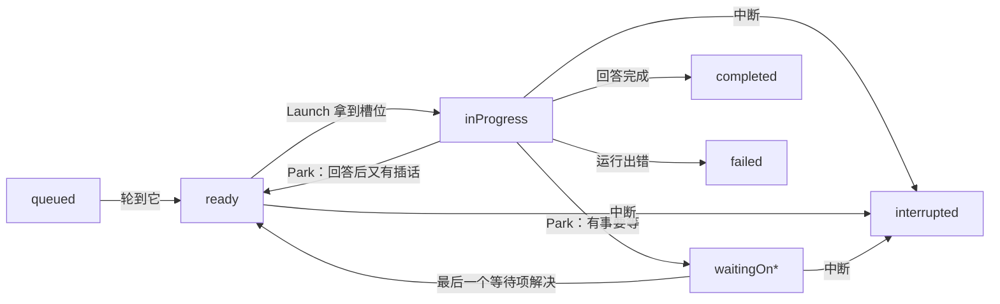
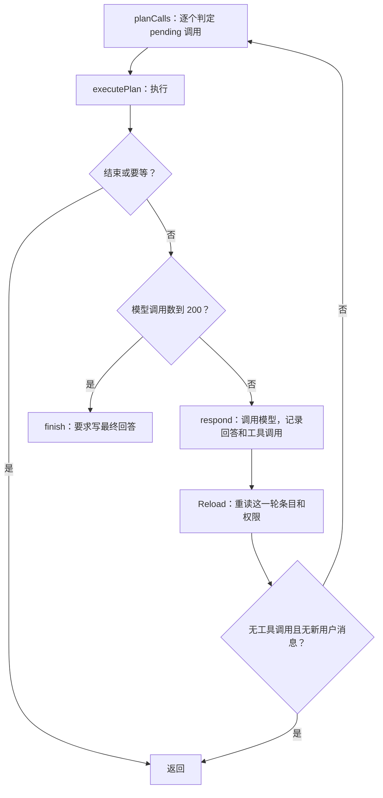

# 执行模型

执行模型决定一个轮次（turn）什么时候运行、在哪里等、怎样被唤醒。用户发来的轮次、子 agent 的轮次、定时任务的轮次共用一个执行池，池的名额叫槽位（slot），默认 32 个。


## 为什么这样设计

个人 agent 的大部分时间在等：等用户回复、等审批、等子 agent。执行模型围绕这一点做了几个取舍。

- **槽位只给正在干活的轮次。** 轮次占着槽位才算在运行；等用户、等审批、等子 agent 时让出槽位，只剩数据库里的几行记录，不占 goroutine，也不占模型并发。所以停放的会话花的主要是数据库空间，而不是内存。放弃的做法是每个 agent 一个进程或容器：两种做法的内存对照见[性能基准](/zh/benchmarks/#内存与隔离)。见[设计决策 1](/zh/reference/decisions#_1-池化-runtime)。
- **队列就是数据库。** 就绪队列不是内存结构，而是 `turns` 表里状态为 `ready` 的行。内存里只有"哪个轮次占着哪个槽位"这一张表，它随进程消失，重启后不需要恢复。见[设计决策 3](/zh/reference/decisions#_3-无内存调度状态)。
- **一个事件循环串行修改调度状态。** 所有会改变调度状态的操作都投进同一个 goroutine 依次执行，不需要锁。
- **两层并发分开算。** 槽位限制同时运行的轮次，模型连接的名额限制同时在途的模型请求，工具执行不占模型名额，跑长工具的轮次不会挡住别的会话调用模型。见[设计决策 4](/zh/reference/decisions#_4-两层并发)。
- **子 agent 和定时任务不走特殊路径。** 它们都是普通会话里的普通轮次，和用户的轮次在同一个池里排队。见[设计决策 5](/zh/reference/decisions#_5-子-agent-即普通会话) 和[设计决策 6](/zh/reference/decisions#_6-定时任务即消息)。

代价也很明确：每个事件之后都要读库；事件循环里有数据库读写，循环里任何慢操作都会拖住所有会话，所以附件读写放在循环外；跑长工具的轮次一直占着槽位，模型调用重试期间也一直占着槽位和名额。

::: info 演进
- 早期有一个内存里的等待队列。它缓存的是数据库本来就能回答的问题，还要额外维护，后来删掉，队列只剩 `turns` 表。
- 调度状态以前由一把全局锁加条件变量保护，现在改成一个事件循环串行修改。
- 并发以前是 4 个 worker 按整个步骤计数，模型调用和工具执行都算，4 个长时间运行的工具就能卡住所有会话。现在拆成槽位和模型名额两层。
:::

## 调度循环和槽位

调度由一个 goroutine 上的事件循环完成（见[引擎架构](/zh/engine/architecture)）。循环每处理完一个事件就调用 `admit` 填充空闲槽位。内存里的调度状态只有两张表：

```go
type slot struct {
	user   string
	turnID string
	ctx    context.Context
	cancel context.CancelFunc
}

// Agent 的字段
slotByThread map[string]*slot // 会话 -> 它占着的槽位
slotsOfUser  map[string]int   // 用户 -> 占用的槽位数
```

一个会话最多只有一个当前轮次，这由 `turns_one_active` 唯一索引保证，所以一个会话最多占一个槽位。

| 配置 | 默认值 | 含义 |
|---|---|---|
| `Config.Slots` | 32 | 分片的槽位总数 |
| `Config.UserSlots` | 等于 `Slots` | 一个用户最多占的槽位数，子 agent 算在用户头上 |
| `Config.RunLimit` | 4 小时 | 一次占用槽位的最长时间，超时后这一轮失败 |

`RunLimit` 用 `context.WithTimeoutCause` 实现，按每次进槽位计时。一轮离开槽位再回来时重新计时。

## 就绪队列

就绪队列不是内存结构，就是 `turns` 表里 `status = 'ready'` 的行，由部分索引 `turns_ready`（按 `started_at`）支撑。`admit` 这样取：

```go
free := a.cfg.Slots - len(a.slotByThread)
// full：已到 UserSlots 上限的用户
ids, err := a.cfg.DB.ReadyThreads(free, full)
for _, id := range ids {
	a.reconcile(id)
}
```

`ReadyThreads` 只读 `free` 行，排除 `full` 里的用户，排序是：

```sql
ORDER BY threads.parent_thread_id IS NOT NULL, turns.started_at, turns.thread_id
```

- 普通会话排在子 agent 前面。
- 同类按 `started_at` 先后，也就是这个轮次成为会话当前轮次的时间。轮次从等待回到 `ready` 时 `started_at` 不变，所以它排在更晚开始的轮次前面。
- 排序只在有轮次等槽位时才起作用。

等待中的轮次有自己的 `waitingOn*` 状态，不在这个索引里，所以大量停放的会话不影响 `admit` 的开销。

::: info 演进
以前等待中的轮次也是 `inProgress`，每个事件都要把它们重新扫一遍。`waitingOn*` 状态（migration 0002）就是为了把它们挪出就绪索引。
:::

## 轮次状态机

`turns.status` 有九个值。

| 状态 | 含义 | 占槽位 | 算当前轮次 |
|---|---|---|---|
| `queued` | 排在会话当前轮次后面 | 否 | 否 |
| `ready` | 会话的当前轮次，等槽位 | 否 | 是 |
| `inProgress` | 正在槽位里执行 | 是 | 是 |
| `waitingOnApproval` | 等用户审批工具调用 | 否 | 是 |
| `waitingOnUserInput` | 等用户回答 `request_user_input` | 否 | 是 |
| `waitingOnAgent` | 等子 agent 回报 | 否 | 是 |
| `completed` | 结束：有最终回答 | 否 | 否 |
| `interrupted` | 结束：被中断 | 否 | 否 |
| `failed` | 结束：出错 | 否 | 否 |



图里没画的还有一类：调度步骤读写库失败，或模型连接从配置里去掉时，`ready` 和等待状态的轮次也会直接变 `failed`。

离开槽位时的状态由 `repo.waitingOn` 根据这一轮未结束的工具调用算出，优先级是：等审批 > 等回答 > 等子 agent > 无等待（`ready`）。先看需要人处理的，因为只有人能给出它们。一轮如果同时开着子 agent 和提问，状态是 `waitingOnUserInput`。

等待状态的解除发生在 `repo.RecordItem`：写入一个工具调用条目时，如果当前轮次处于等待状态，就在同一事务里调用 `settleStatus` 重新计算。还有未解决的等待项时状态不变，全部解决后变成 `ready`。

## reconcile

`reconcile(threadID)` 让一个会话往前走一步，是调度的核心函数。它幂等，可以重复调用：

1. 会话已占槽位，或 agent 已停止，直接返回。
2. 读 `ThreadState`：未结束的轮次、最后一个轮次、当前轮次未结束的工具调用。
3. 没有当前轮次但有排队的：`StartQueuedTurn` 把最早的一条改成 `ready`，写入用户消息条目，发出 `turn/started`。
4. 当前轮次的模型连接已从配置里去掉：这一轮失败，提示恢复连接或换模型。
5. 对每个等待子 agent 的工具调用执行 `settle`（见[子 agent](#子-agent)）。
6. 子 agent 有回报时重新读轮次，因为状态可能变了。
7. 轮次是 `ready`，总槽位和用户限额都没满：`Launch` 写 `inProgress`，然后 `launch` 起 goroutine。

## 一次运行

`a.run` 在槽位的 goroutine 上执行：

1. 读 `turns` 行。行不存在或状态不是 `inProgress` 时，放回槽位退出。
2. 读 `ThreadRow` 和 `RunItems`，读失败时这一轮失败。
3. `runTurn` 准备运行环境：上下文窗口、用户的模型客户端、用户的工具注册表、权限判定器。条目分成 `history`（别的轮）和 `items`（这一轮）。
4. 构造 `runtime.Runtime`，调用 `Run`。
5. `AddUsage` 把这次运行的用量累加到轮次上，然后把 `afterRun` 投回调度循环。

`Run` 返回 `(final, usage, err)`。`afterRun` 据此决定：

| 情况 | 结果 |
|---|---|
| agent 正在关闭，且出错或被取消 | 什么也不写，轮次留在 `inProgress`，下次启动恢复 |
| 槽位 ctx 被取消 | `interrupted`，错误文本 `interrupted by the user` |
| `err != nil` | `failed`，错误文本来自 `err` |
| `final` 为真，回答之后没有新用户消息 | `completed` |
| `final` 为真，回答之后有新用户消息 | 不结束，`Park` 回 `ready` |
| `final` 为假，无错误 | `Park` 进等待状态，然后发出审批和提问请求 |

审批和提问的请求在 `Park` 之后才发给客户端。`respond` 在会话占着槽位时直接返回 `ErrNoSuchRequest`，所以运行中不会有人答到一半的请求。

## 循环的每一步

`Runtime.run` 是一个循环，每圈做三件事：先处理这一轮所有 `pending` 的工具调用，再调用模型，再重读数据库。



`start` 在进入循环前运行一次：确认没有未解决的等待项，读用户设置建脱敏器，用 `Offer` 决定工具列表，组装系统提示词。如果上次压缩之后没有记忆快照，就载入一份。

### 判定工具调用

`planCalls` 按 `seq` 遍历 `pending` 的工具调用，`handleCall` 逐个判定：

1. 调用已有审批记录：`changedSinceApproval` 重新算审批内容。没变就按决定走（允许则执行，拒绝则标 `declined` 并结束这一轮的工具使用）。变了就丢弃旧审批重新走下面的流程，新的审批原因会写明"批准之后内容变了"。
2. 工具不在当前列表：拒绝。延迟加载的工具提示先调用 `load_tools`。
3. 解析参数并按 schema 校验，不合格就拒绝。
4. 工具调用数到 400：跳过并结束工具使用。
5. `Prepare`：工具冻结它的执行内容（目录、命令、环境、文件 diff），写进 `prepared_execution` 落库。
6. 权限判定：`Deny` 拒绝，`Ask` 写入审批记录后停止规划，`Allow` 进入执行计划。

判定结果有五种动作：

| 动作 | 含义 |
|---|---|
| `actionRunReadOnly` | 只读工具，攒成一批并行执行 |
| `actionRun` | 其他工具，先执行完手里的只读批次，再单独执行 |
| `actionSkip` | 前面已决定停止工具使用，这个调用标失败 |
| `actionWait` | 要等审批，执行完已规划的调用后退出运行 |
| `actionHalt` | 记下停止原因，后续调用都跳过 |

工具算只读的条件是 `ReadOnlyHint` 为真且 `Serial` 为假。`Agent` 和 `request_user_input` 的结果是"等待"而不是输出，`Agent` 标了只读，所以一次回答里的多个 `Agent` 调用一批发出。

等待型工具返回 `tools.Result.Await`，`finishTool` 把它写到条目上，条目保持 `inProgress`。这样 `rt.waiting()` 为真，运行结束，`afterRun` 把轮次停放。`Await` 的结构：

```go
type Await struct {
	By       AwaitBy         `json:"by"` // "user" 或 "agent"
	Request  json.RawMessage `json:"request"`
	ThreadID string          `json:"threadId,omitempty"`
}
```

### 运行次数上限

| 常量 | 值 | 到达后 |
|---|---|---|
| `maxModelCalls` | 200 | 停止工具使用，要求写最终回答 |
| `maxToolCalls` | 400 | 同上 |
| `maxConsecutiveFailures` | 10 | 连续 10 个工具调用失败或被拒，同上 |

这些是一轮的总数，从这一轮的条目数出来，一轮离开槽位再回来时不清零。`modelCalls` 数不同的 `response_id`，不算压缩。

停止工具使用由 `finish` 完成：写一条 `error` 类型条目（内容以 `[runtime] Tool use has stopped:` 开头，告诉模型不要再调用工具），然后以 `ToolChoiceNone` 再调用一次模型。这条条目在下次组装提示词时作为用户消息发给模型。这次调用如果又要工具，或被输出上限截断，这一轮失败。

### 模型调用

`respond` 的步骤：

1. 重算 `Offer`，因为上一步可能加载了工具。
2. `Window.Build` 组装提示词，需要时先压缩，见[上下文管理](/zh/engine/context)。
3. `send`：脱敏开启时把系统提示词、消息和历史工具调用的参数换成占位符，读出附件，调用 `LLM.Chat`。
4. `checkResponse`：有工具调用就通过；没有时，`finish_reason` 为 `length` 或正文为空都算失败。
5. 记录回答，再为每个工具调用写一条 `pending` 条目。

模型调用失败时，`responseRecorder.fail` 把已收到的部分文本标 `failed` 落库，或者写一条 `error` 条目，然后这一轮失败。

## 让出槽位的条件

| 情况 | 占槽位吗 |
|---|---|
| 等模型并发名额 | 占 |
| 模型调用中，包括重试和退避等待 | 占 |
| 压缩 | 占 |
| 工具执行中 | 占 |
| 工具调用等审批 | 让出 |
| 等 `request_user_input` 的回答 | 让出 |
| 等子 agent | 让出 |
| 轮次结束或被中断 | 让出 |
| 回答写完后发现有新插话 | 让出后立刻重新就绪 |

让出就是 `run` 这个函数返回：goroutine 结束，`afterRun` 调用 `release` 取消 ctx、删除 `slotByThread` 里的记录。之后再次运行时，从数据库重新读取全部状态。

## 模型并发限制

模型并发按连接限制，和槽位无关。每个 `llm.Client` 内部有一个容量为 `calls` 的带缓冲通道，默认 4（`llm.DefaultCalls`）：

```go
func (c connection) acquire(ctx context.Context) (context.Context, func(), error) {
	select {
	case c.calls <- struct{}{}:
	case <-ctx.Done():
		return nil, nil, ctx.Err()
	}
	// ...
}
```

`Chat` 进来时 `acquire`，返回时释放。所以：

- 工具执行不占名额。这是槽位数可以大于模型并发的原因。
- 名额满时，模型调用在通道上排队，这一轮仍占着槽位。中断能打断排队。
- 被 408、429、5xx 拒绝或中途断开的请求重试 8 次（`retries`），退避从 0.5 秒翻倍到最多 8 秒。OpenAI 和 Anthropic 客户端还会遵守 `Retry-After`。重试期间名额不释放，所以在途请求数始终不超过限制。
- 压缩走同一个 `Chat`，同样受限。
- `acquire` 在 ctx 没有截止时间时加 180 秒超时（`defaultChatTimeout`）。轮次里的 ctx 带 `RunLimit` 的截止时间，所以轮次内的模型调用受 `RunLimit` 约束。

配了 `ClientFor` 时，每个用户走自己的客户端，并发按用户的客户端算。见[分片与多用户](/zh/engine/sharding)。

## 插话、排队和中断

三种操作都走调度循环，并且都只改数据库，再通过已有机制生效。

### 排队

有轮次未结束时再 `turn/start`，新轮次留在 `queued`，发 `turn/queued`。`SubmitTurn` 用 `openTurn` 条件计数，已排队的也算，所以多条排队的消息严格按 `seq` 先后。

用户消息条目不在排队时写，而是在 `queued` 变 `ready` 的同一事务里写（`startIn`）。所以排队中的消息还不进入会话记录。

当前轮次结束时，`endTurn` 调用 `reconcile`，取最早的一条开始。

### 插话（steer）

`turn/steer` 必须带 `expectedTurnId`，和当前轮次对不上时返回 `turnMismatch`，没有当前轮次时返回 `noActiveTurn`。

`repo.Steer` 在一个事务里把用户消息作为条目写进当前轮次。轮次在运行或 `ready` 时，这一步不改状态，不打断任何东西，新消息靠运行循环发现：

- `respond` 之后的 `Reload` 重读这一轮全部条目，新消息从此进入 `rt.Items`，下一次组装提示词时带上。提示词是在模型调用之前组装的，所以模型调用进行中写入的插话，在下一次模型调用时看到；工具执行期间写入的插话，要等下一次 `Reload` 之后。
- 模型这时没有要工具也不算结束。循环比较 `seq`，有比本次调用之前更新的用户消息就继续下一圈。
- 模型的最终回答写完、`afterRun` 还没执行时才写入的插话，由 `InputAfterAnswer` 接住：它查最后一条完成的 `agentMessage` 之后有没有用户消息。有的话这一轮不结束，`Park` 回 `ready`，重新运行。

轮次在等审批（`waitingOnApproval`）或等回答（`waitingOnUserInput`）时，这条消息代替用户的回答。同一个事务里，这一轮还没执行的调用全部以 `declined` 结束，`error` 写明原因：

| 调用 | `error` |
|---|---|
| 等审批的那条 | `the user sent a message instead of approving this call, so it did not run` |
| 等回答的那条 | `the user sent a message instead of answering` |
| 排在后面、还是 `pending` 的 | `skipped: the user sent a message before this call ran` |

然后 `settleStatus` 把轮次重算成 `ready`，`admit` 送它回槽位。下一次运行把这些被拒的结果和新消息一起发给模型，工具调用照常继续，不像用户显式拒绝那样结束这一轮的工具调用。被拒的条目以 `item/completed` 发出，客户端据此关掉审批或提问的对话框；之后再回答那条请求会得到 `noSuchRequest`。

等子 agent（`waitingOnAgent`）的轮次例外：插话落库，子 agent 回报、这一轮重新运行时读到。

::: info 演进
v0.12.1 之前，插话进等审批或等回答的轮次时只落库，轮次一直停着，看起来像卡住了；用户说了"算了"之后再批准，调用会在模型读到这句话之前执行。`c4899f5` 改成现在由消息代替回答。
:::

### 中断

`turn/interrupt` 走 `a.interrupt`：

- 占着槽位：调用 `sl.cancel()`。`run` 里的模型调用或工具因 ctx 取消而返回，`afterRun` 看到 `sl.ctx.Err() != nil`，把轮次标 `interrupted`。
- 不占槽位：直接 `endTurn`，错误文本按状态选：`interrupted while waiting for a slot`、`interrupted while waiting for the user`、`interrupted while waiting for subagents`。

`EndTurn` 在一个事务里写轮次终态，并把这一轮所有 `pending` 和 `inProgress` 的条目标 `failed`，错误文本写明轮次在它们完成前结束。

中断只结束当前轮次，排队的轮次随后照常开始。

## 审批和提问的恢复

用户的回答经 `resolveApproval` 或 `answerUserInput` 进入 `respond`（`agent/turns.go`）。用户也可以不回答，直接发一条消息代替，见[插话](#插话-steer)。回答的处理：

1. 会话占着槽位时返回 `ErrNoSuchRequest`。
2. 在 `PendingRequests` 里找匹配的请求，找不到也返回 `ErrNoSuchRequest`。
3. 校验决定或答案。选 `acceptAlways` 时把规则写进所属工作区，不属于工作区时写进会话；子 agent 的审批按父会话算。
4. `RecordItem` 落库，事务里 `settleStatus` 重算状态。

审批条目解决后 `status` 仍是 `pending`，只是 `approval.decision` 有值。回答条目直接变 `completed`，答案就是工具结果。轮次变成 `ready` 后，循环的 `admit` 把它送回槽位，`handleCall` 接着处理这条审批过的调用。权限的具体规则见[权限](/zh/engine/permissions)。

## 子 agent

子 agent 没有专门的运行机制。`Agent` 工具创建一个普通会话，里面跑一个普通轮次，共用同一个执行池。父轮次的工具调用条目等它的回报。

`Agent` 工具只返回 `Await{By: "agent"}`。父轮次被 `Park` 成 `waitingOnAgent`，`afterRun` 接着调用 `reconcile`，`settle` 处理每个等待调用：

1. `call.Await.ThreadID` 为空：`createThread` 建子会话（`parent_thread_id`、`parent_item_id` 指回父会话和调用条目，工作区和执行环境与父会话相同，标题取任务描述），把子会话 ID 写回调用条目。
2. 子会话还没有轮次：用父轮次的模型提交一个轮次，内容是 `prompt`，再 `reconcile` 子会话。
3. 子会话的轮次还没结束：什么也不做。
4. 结束了：`report` 把结果写进父调用条目。`completed` 取最后一条完成的 `agentMessage` 作为输出；`interrupted`、`failed` 把调用标 `failed` 并写明原因。

这个顺序可以重入：进程在任意两步之间崩溃，下次 `reconcile` 从条目上记录的进度继续。

子轮次结束时 `endTurn` 对父会话调用 `reconcile`，这一步把回报写回去。父轮次的所有等待调用都回报之后状态变 `ready`，重新拿槽位。

子 agent 和普通会话的差别都写在规则里：

| 方面 | 子 agent |
|---|---|
| 优先级 | `ReadyThreads` 排在普通会话之后 |
| 用户消息 | `turn/start` 和 `turn/steer` 返回 `subagentThread`，只能经父会话沟通 |
| 权限 | 默认层和工作区层，加父会话的设置，再加一条 deny `Agent` |
| 再派生子 agent | 被上面的 deny 拒绝，系统提示词也写明 |
| 系统提示词 | 末尾多一段 `# You are a subagent`，说明最终回答是给父 agent 的报告 |
| 状态展示 | `thread/status/changed` 冒泡到父会话；子 agent 等审批时，父会话也显示等待 |
| 审批请求 | 随父会话的 `PendingRequests` 一起列出 |
| 随父结束 | 父轮次结束时 `stopSubagent` 取消或结束所有未回报的子 agent |

父轮次在等待期间不占槽位，所以子 agent 多于槽位时也不会死锁。基准里的子 agent 发散实验验证了这一点：512 个子 agent 跑在 32 个槽位上，全部完成，见[性能基准](/zh/benchmarks/#子-agent-发散)。

## 定时任务

定时任务到点时，宿主的定时器调用 `agent.StartScheduledTurn`，它走和用户消息相同的 `startTurn`，只多带一个 `cron_job_id`。排队、槽位、优先级完全相同。详情见[定时任务](/zh/engine/cron)。

## 重启恢复

进程退出后，新进程在起调度循环之前先把库里停在半路的轮次和条目收拾好，再照常调度。`pending` 的工具调用照常执行，`inProgress` 的标成"可能已生效"而不重跑。完整的恢复流程见[持久化与崩溃恢复](/zh/engine/persistence#崩溃恢复)。

## 错误处理

读写库失败时不继续执行，并尽量让界面知道：

| 函数 | 用途 |
|---|---|
| `halt(threadID, cause)` | 调度步骤失败时把当前轮次标 `failed` |
| `failTurn(turnID, status, reason)` | 按轮次 ID 结束，已结束的不动 |
| `fault(threadID, turnID, err)` | 写不进库时写日志并发 `error` 事件，这时无法把失败记到轮次上 |

一轮的 goroutine panic 时，`launch` 的 `recover` 把 `errCrashed` 投回 `afterRun`，只有这一轮失败。循环里的 panic 由 `step` 接住，`call` 的调用方收到 `errCrashed`。

## 边界与已知问题

- **排序不是严格公平的。** `reconcile` 还会被会话自身的事件直接调用（轮次结束后开始下一条、停放后重新就绪、子 agent 回报），这时只要有空槽位就直接 `Launch`，不经过 `ReadyThreads` 的排序。所以刚放出槽位的会话如果马上又有就绪的轮次，可能排在已经等着的轮次前面。
- **用户限额可能让槽位空转一个事件。** `ReadyThreads` 读出的会话可能都属于同一个用户。如果这个用户中途到了 `UserSlots` 上限，后面几个 `reconcile` 会跳过，这些空槽位要等下一个事件才会分给其他用户。
- **同类不轮转。** 同类轮次按开始时间排队，一轮派出的一批子 agent 会排在后来者派出的子 agent 前面。混合负载实验里，子 agent 等待的 p99 是 4.6 s。
- **长工具和重试都占着槽位。** 槽位按轮次算，不按模型调用算；一个跑十分钟的命令就占十分钟槽位。
- **可能多出一条回答。** 进程如果在最终回答落库之后、轮次结束之前退出，恢复后会再调用一次模型，见[崩溃恢复](/zh/engine/persistence#崩溃恢复)。
- **多用户下没测过。** 上面的调度规则在单用户、单分片下测过，每用户限额和多分片下的公平性还没有测量，见[接下来要测的](/zh/benchmarks/plan)。

## 代码位置

| 仓库 | 路径 | 职责 |
|---|---|---|
| ollupi | `agent/loop.go` | 调度循环、`launch`、`release` |
| ollupi | `agent/schedule.go` | `reconcile`、`admit`、`recover` |
| ollupi | `agent/run.go` | `run`、`runTurn`、`afterRun`、`endTurn` |
| ollupi | `agent/turns.go` | 开始、插话、中断、回答请求 |
| ollupi | `agent/subagents.go` | `settle`、`report` |
| ollupi | `agent/requests.go` | 列出等待处理的请求 |
| ollupi | `agent/runtime/runtime.go` | `Runtime`、运行循环、`Offer`、`finish` |
| ollupi | `agent/runtime/calls.go` | 工具调用判定 |
| ollupi | `agent/runtime/execute.go` | 工具调用执行 |
| ollupi | `agent/runtime/chat.go` | 模型调用、压缩 |
| ollupi | `agent/runtime/stream.go` | 流式记录 |
| ollupi | `repo/turns.go` | 轮次状态、就绪查询、`RunItems` |
| ollupi | `repo/items.go` | 条目写入、`RecoverItems` |
| ollupi | `pkg/llm/connection.go` | 并发名额、重试次数、`Limits` |
| ollupi | `tools/subagent/subagent.go` | `Agent` 工具 |
