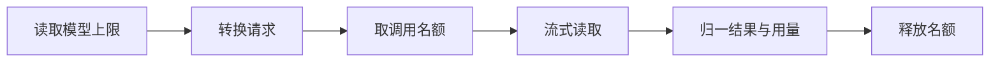

# 模型接入

`pkg/llm` 把三种模型 API 收拢成一个接口。引擎的其余部分只看到 `Chat` 和 `Limits`：发一组消息，拿回一段流式文本和一条结果。每种 API 在思考内容、缓存、回答上限上的差异都留在各自的客户端里。

```go
type Client interface {
	Chat(ctx context.Context, req ChatRequest, onDelta func(Delta)) (ChatResponse, error)
	Limits(model string) (Limits, error)
}
```

一个客户端对应一条连接（connection）：一个 Base URL、一把密钥、一组声明了上限的模型和一个并发名额池。`Agent` 的配置里 `Connections` 按连接名存客户端，`Models` 列出可选模型，每条连接只能出现一次。

## 为什么这样设计

- **原生接口，而不是只走 OpenAI 兼容层。** 初版只有 Chat Completions 客户端。Anthropic 和 Gemini 的思考内容带签名，要按服务商自己的格式原样送回，兼容层表达不了，所以加了 `NewAnthropic` 和 `NewGemini`，每次回答另存一份服务商格式的原始消息（`9ac61ec`）。见[设计决策 12](/zh/reference/decisions#_12-原生-anthropic-与-gemini-接口)。
- **上限由连接声明，引擎不猜。** 早期内置过一张常见模型的上限表，按模型名查；`cd0efe2` 删掉了它，没声明上限的模型直接报错，不再按名字猜。见[设计决策 18](/zh/reference/decisions#_18-出错即暴露)。
- **并发名额按连接算，不按步骤算。** 早期 4 个 worker 按整个步骤计数，4 个跑长工具的步骤就能卡住所有会话。现在只有模型调用占名额，工具执行不占（`64f8593`）。见[设计决策 4](/zh/reference/decisions#_4-两层并发)。
- **三个客户端统一重试 8 次。** 之前 OpenAI 和 Anthropic 的 SDK 在约 1.5 秒内只重试两次，Gemini 的 SDK 不重试，服务商短暂缺配额就让工具已经跑完的轮次失败（`a7bf0b2`）。模拟模型下 5% 请求返回 500 的负载，加重试前 326 个轮次失败，加重试后 0 个，见[性能基准](/zh/benchmarks/#故障与长尾)。
- **错误只留状态码。** 服务商的错误响应正文可能复述提示词，`safeRequestError` 只保留 HTTP 状态码，不把正文带进返回的错误。

代价：三个客户端在思考、缓存、回答上限、结束原因上的行为要各自对齐和测试；原始消息存在 `items.native` 列，体积大；用户必须自己填每个模型的上限；重试期间调用一直占着名额和槽位，最多约 40 秒。

## 三种客户端

| 项 | `OpenAI` | `Anthropic` | `Gemini` |
| --- | --- | --- | --- |
| 接口 | Chat Completions，流式 | Beta Messages，流式 | `GenerateContentStream` |
| 构造 | `NewOpenAI`，空密钥时去掉 `Authorization` 头 | `NewAnthropic` | `NewGemini`，返回 `error` |
| 系统提示词 | `system` 消息 | 请求的 `system` 块 | `SystemInstruction` |
| 回答上限 | 不发送 | `max_tokens` 取 `Limits.Answer(InputTokens)` | `MaxOutputTokens` 取同一个值 |
| 思考开关 | `Thinking` 不为空时发 `enable_thinking` | 开：`adaptive`；关：`disabled` | 开：`IncludeThoughts`；关：`ThinkingBudget: 0` |
| 思考默认 | 不发字段，由服务商决定 | 开 | 开 |
| 思考回放 | `reasoning_content` 字段 | 原样回放 Native，含签名 | 原样回放 Native，含签名 |
| 缓存 | 不主动设置，只读 `cached_tokens` | 请求级 `cache_control` | 不主动设置，只读 `CachedContentTokenCount` |
| 工具调用 ID | 服务商给 | 服务商给 | 可能没有，补 `gemini-<uuid>`，回传时去掉 |
| 并行工具结果 | 分开的 `tool` 消息 | 并进同一个 user 回合 | 并进同一个 user 回合 |

`ToolChoice` 只有 `auto` 和 `none` 两种，其他值在三个客户端都报错。OpenAI 客户端在有工具时总是打开 `parallel_tool_calls`。

### 结束原因

三个客户端把结束原因归一到 `stop`、`tool_calls`、`length`，其余情况当错误返回。

| 客户端 | `stop` | `tool_calls` | `length` | 报错 |
| --- | --- | --- | --- | --- |
| Anthropic | `end_turn`、`stop_sequence` | `tool_use` | `max_tokens`、`model_context_window_exceeded` | `refusal`（"the model declined to answer"）、空值、其他值 |
| Gemini | `STOP` 且没有函数调用 | `STOP` 且有函数调用 | `MAX_TOKENS` | 空值、其他值（"the model stopped with ..."） |
| OpenAI | 原样透传 `finish_reason` | 同左 | 同左 | 没有任何 choice、`finish_reason` 为空、调用缺 ID 或名字 |

流读完了却没有结束原因时，三个客户端都报 "the stream ended before the response finished"。运行时再做一层检查：没有工具调用又以 `length` 结束的回答算失败（"final answer truncated by the model output limit"），既没有工具调用也没有文本的回答也算失败。

## 一次调用



这是 Anthropic 和 Gemini 的顺序，请求不合法时不占名额。OpenAI 客户端不读上限，先取名额再转换请求。

流里的文本经 `onDelta` 逐段送出，`Delta` 只有 `Content` 和 `Reasoning` 两个字段，空的不发。结束后 `ChatResponse.Message` 里是完整文本、完整思考和工具调用。失败时返回的 `ChatResponse` 仍带已经上报的用量，所以半途失败的调用也计入这一轮的 token。

错误经 `safeRequestError` 过滤。服务商的响应正文可能复述提示词，所以错误只保留 HTTP 状态码：`model request failed (HTTP 429); check the selected connection and model`。`context.Canceled` 和 `context.DeadlineExceeded` 原样返回。

## 连接与并发限制

`connection` 是三个客户端共用的部分：声明的上限表和一个带缓冲的 channel。`calls` 小于等于 0 时取 `DefaultCalls`，也就是 4。

- 名额按连接算，不按模型算。一条连接上的所有调用共用这些名额。
- 只有模型调用占名额。工具执行不占，这一点和[执行模型](/zh/engine/execution)里的槽位是两回事。
- 取名额会阻塞，直到有空位或 `ctx` 结束。
- 重试期间调用一直占着名额，所以同时在途的调用数不超过上限。

`acquire` 在 `ctx` 没有截止时间时加一个 180 秒的超时（`defaultChatTimeout`）。一轮对话的 `ctx` 带着 `RunLimit`（默认 4 小时）的截止时间，记忆提炼的 `ctx` 带 2 分钟，所以这两条路径上的模型调用不受 180 秒约束，分别受它们自己的时限约束。

## 重试

`retries` 是 8：一次调用最多发 9 次。等待从 0.5 秒开始翻倍，上限 8 秒，全部等完约 40 秒。重试由三个 SDK 完成，`pkg/llm` 只传参数。

| 客户端 | 配置 | 重试条件 | 退避 |
| --- | --- | --- | --- |
| OpenAI | `option.WithMaxRetries(8)` | 连接错误、408、409、429、5xx，服务商的 `x-should-retry` 优先 | 0.5 秒翻倍到 8 秒，带抖动；服务商给 `Retry-After` 时按它等 |
| Anthropic | 同上 | 同上 | 同上 |
| Gemini | `HTTPRetryOptions{Attempts: 9, InitialDelay: 0.5, MaxDelay: 8}` | 连接错误、408、429、500、502、503、504 | 0.5 秒翻倍到 8 秒，带抖动 |

Gemini 的 SDK 默认只发一次，不配 `RetryOptions` 就没有重试。这是提交 `a7bf0b2` 补上的，当时目标是让服务商短暂缺配额时一轮变慢而不是失败。

重试只发生在拿到响应之前。流已经开始之后断开，`Chat` 返回错误，运行时不重发，这一轮失败，已经落库的条目保留。

## 思考内容和签名回放

`ChatMessage.Native` 是服务商自己格式的助手消息。Anthropic 和 Gemini 的思考块带签名，服务商校验签名，所以这两个客户端把整条回答保存下来，下次原样发回，不从 `Content`、`ReasoningContent`、`ToolCalls` 重建。

```go
type native struct {
	Provider string          `json:"provider"`
	Message  json.RawMessage `json:"message"`
	Prefix   string          `json:"prefix,omitempty"`
}
```

运行时把 Native 存在这次回答的第一个条目上（`items.native` 列），只存一份。下次组装请求时，上下文管理器把它放回助手消息。`nativeOf` 检查 `Provider`，会话中途换了服务商时，旧记录被忽略，退回用 `Content` 和 `ToolCalls` 重建，签名丢弃。

OpenAI 兼容接口没有 Native，思考内容从流里的 `reasoning_content` 读出，回放时放回同名字段。

### Gemini

Gemini 的签名挂在 `Part` 上。流式文本是碎片，客户端把连续的同类文本合并成一个 part 以减小存储，但带签名的 part 到此结束，后面的文本另起一个。回放时直接解码 `genai.Content` 放回请求。

### Anthropic

Anthropic 的思考块绑定在它之前发送的全部内容上。之前的内容一变（工具列表变长、工具结果被截短、系统提示词变了），这个块就失效。服务商允许从前面删除思考块，所以 `replayable` 做的事是：找到最后一个失效的记录，把它和它之前的思考块都删掉，后面的保留。

判断失效用哈希链：

1. 头部哈希：`system` 和 `tools` 的 JSON 做 SHA-256。
2. 之后每条消息去掉 `thinking`、`redacted_thinking` 块后接到链上。
3. 每次回答把这次请求的整条链哈希存进 `native.Prefix`。
4. 下次请求重新算链，第 i 条消息前的哈希和该位置 Native 记录的 `Prefix` 不等，就是失效。

请求同时开启了 `prefix_mismatch_behavior: drop_block`（beta `thinking-binding-controls-2026-08-01`），`replayable` 漏掉的失效块由服务商丢弃，不让请求失败。思考展示方式是 `summarized`。

测试 `TestAnthropicReplaysThinkingUntilThePrefixChanges` 和 `TestAnthropicKeepsThinkingAfterTheLastChange` 覆盖了这两种情形：工具列表变长后旧签名被删，变长之后产生的新签名保留。

## 缓存断点

Anthropic 请求带顶层 `cache_control: ephemeral`，断点由服务商决定，消息上不做标记。

OpenAI 兼容接口和 Gemini 用服务商的隐式前缀缓存，客户端不做任何设置。三种情况都依赖请求前缀稳定：系统提示词按从最稳定到最不稳定的顺序拼接，延迟加载的工具只追加到列表末尾，见[工具系统](/zh/engine/tools)和[上下文管理](/zh/engine/context)。

## Token 计数

### 估算

`pkg/llm` 的 `EstimateTokens` 不用分词器，上下文管理器再按服务商上报的真实用量校准，得到的 `CalibratedTokens` 作为 `ChatRequest.InputTokens` 传给客户端，用来算回答上限。公式和校准方法见[上下文管理](/zh/engine/context#token-估算)。

### 上报

`Usage` 把三种服务商的字段归一：

| 字段 | OpenAI | Anthropic | Gemini |
| --- | --- | --- | --- |
| `PromptTokens` | `prompt_tokens` | `input + cache_read + cache_creation` | `PromptTokenCount` |
| `CachedPromptTokens` | `prompt_tokens_details.cached_tokens` | `cache_read_input_tokens` | `CachedContentTokenCount` |
| `CacheWritePromptTokens` | 无 | `cache_creation_input_tokens` | 无 |
| `CompletionTokens` | `completion_tokens` | `output_tokens` | `CandidatesTokenCount + ThoughtsTokenCount` |

`UsageReported` 区分"没上报"和"上报了 0"。没上报的回答不计入这一轮的用量。OpenAI 请求设置了 `stream_options.include_usage`。

## 每模型配置项

| 项 | 所在类型 | 含义 | 默认 |
| --- | --- | --- | --- |
| `Name` | `Model` | 发给服务商的模型名 | 必填 |
| `Connection` | `Model` | 走哪条连接 | 必填 |
| `Thinking` | `Model` | `*bool`，思考开关 | 空，见上表 |
| `Images` | `Model` | 是否接受图片 | `false` |
| `Context` | `Limits` | 上下文窗口 | 必填，须为正 |
| `Output` | `Limits` | 回答上限 | 必填，须为正 |
| `MaxInput` | `Limits` | 模型自己的输入上限，JSON 名 `input` | 0，表示没有 |
| `calls` | 构造参数 | 并发调用数 | 4 |

模型没有声明上限时，`Limits` 报错 "the context limits of model %q are not declared"。引擎不内置任何模型表，桌面端怎么填这些值见[配置](/zh/app/config)。

### 窗口怎么分

`Limits` 有两个方法：`Input()` 是输入预算，窗口减去为回答预留的 `min(Output, Context/4)`，有 `MaxInput` 时再取较小值；`Answer(input)` 是给 Anthropic 和 Gemini 的回答上限，按估算输入收紧，但不低于预留量。公式、例子和从输入预算派生的各项份额见[上下文管理](/zh/engine/context#窗口预算)。

### 启动检查和选择模型

`Agent` 启动时做两项检查：

- `checkModels`：至少一个模型，每个都有连接名和名字，连接不重复，连接有客户端。
- `checkPromptFits`：对每个模型，系统提示词加工具定义不超过输入预算的一半，否则启动失败。

一轮用哪个模型按顺序决定：这次请求指定的连接，上一轮的连接，`Models` 的第一个。连接已不可用时拒绝新消息（`connection %q is unavailable`）。已经排队的轮次到执行时发现连接没了，直接失败。

`Config.ClientFor(user, connection)` 可以给用户配自己的客户端，让模型调用走用户自己的密钥。窗口仍按 `Connections` 里共享客户端声明的上限计算。

## 附件

用户消息可以带图片和文本文件。它们不进数据库，内容放在 `blobs.Store`，条目里只存元数据（列见[持久化](/zh/engine/persistence#items)）。

```go
type Store interface {
	Put(ctx context.Context, key string, data []byte) error
	Get(ctx context.Context, key string) ([]byte, error)
	Delete(ctx context.Context, key string) error
	DeletePrefix(ctx context.Context, prefix string) error
}
```

`blobs.Dir` 是本机文件夹的实现，接口形状按对象存储设计。key 是 `<会话 ID>/<附件 ID><扩展名>`，一个 key 只写一次（`O_EXCL`），key 不能跳出存储目录，目录权限 `0700`，文件权限 `0600`。

| 限制 | 值 |
| --- | --- |
| 每条消息的附件数 | 10 |
| 图片大小 | 20 MiB |
| 文本文件大小 | 256 KiB |
| 文件名 | 120 字符 |
| 单次读写时限 | 1 分钟 |

类型按内容判断：取前 512 字节，调用方给了 MIME 类型就用给的，否则嗅探。PNG、JPEG、GIF、WebP 算图片。其余文件前 512 字节含 NUL、整体不是 UTF-8 或含 NUL，都拒绝。

文件经用户的沙箱读取（`Box.Stat`、`sandbox.ReadFile`），路径必须是绝对路径。`describe` 量出大小后，`copyAttachment` 只复制这么多字节，读到的长度不等就拒绝（"the file changed while it was being attached"）。这一步在消息进入事件循环之前做，带超时，慢的沙箱或存储不会卡住同一分片（shard）上的其他会话（`fb3e2d1`，见[引擎架构](/zh/engine/architecture)）。

Token 估算：图片按长边缩到 1568 后每 750 像素 1 个 token，最少 85，读不出尺寸时算 1600；文本文件按 `EstimateTokens` 加文件名再加 8。

发送时运行时从存储读出内容：图片放进 `Data`，文本加上 `--- file: <名字> ---` 头放进 `Text`，脱敏打开时一起脱敏。模型 `Images` 为假时，消息带图片或会话里已有图片都拒绝，不丢弃内容（`this conversation shows the model images`）。

## 边界与已知问题

- **流开始之后断开不重试。** 重试只覆盖拿到响应之前；流中途断开时这一轮失败，见[重试](#重试)。
- **重试期间一直占着名额和槽位。** 全部等完约 40 秒，同一连接上的其他调用要排队等。
- **会话中途换服务商会丢掉签名。** 旧的原始消息被忽略，按 `Content` 和 `ToolCalls` 重建，思考内容的签名不再回放，见[思考内容和签名回放](#思考内容和签名回放)。
- **OpenAI 兼容接口不声明回答上限。** 回答能有多长由服务商的默认值决定；OpenAI 客户端也不读上限，先取名额再转换请求。
- **用户自己的客户端仍按共享连接算窗口。** `Config.ClientFor` 换的是密钥和请求的去处，输入预算和回答上限仍取 `Connections` 里共享客户端声明的上限。
- **有图片的会话不能换到不接受图片的模型。** 新消息会被拒绝，不会去掉旧图片再发。

## 代码位置

| 位置 | 职责 |
| --- | --- |
| ollupi `pkg/llm/chat.go` | `Client` 接口、消息、模型、用量、Native 封装 |
| ollupi `pkg/llm/connection.go` | 上限计算、调用名额、重试次数、错误过滤 |
| ollupi `pkg/llm/openai.go` | OpenAI 兼容客户端 |
| ollupi `pkg/llm/anthropic.go` | Anthropic 客户端、`replayable` 哈希链 |
| ollupi `pkg/llm/gemini.go` | Gemini 客户端 |
| ollupi `pkg/llm/tokens.go` | `EstimateTokens` |
| ollupi `pkg/blobs/blobs.go` | 附件存储接口和本机实现 |
| ollupi `agent/models.go` | 启动检查、选择模型、用户客户端 |
| ollupi `agent/attachments.go` | 附件校验、存储、token 估算 |
| ollupi `agent/runtime/chat.go` | 发送请求、检查回答、记录用量 |
