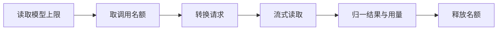

# 模型接入

`pkg/llm` 把三种模型 API 收拢成一个接口。引擎的其余部分只看到 `Chat` 和 `Limits`：发一组消息，拿回一段流式文本和一条结果。每种 API 在思考内容、缓存、回答上限上的差异都留在各自的客户端里。

```go
type Client interface {
	Chat(ctx context.Context, req ChatRequest, onDelta func(Delta)) (ChatResponse, error)
	Limits(model string) (Limits, error)
}
```

一个客户端对应一条连接（connection）：一个 Base URL、一把密钥、一组声明了上限的模型和一个并发名额池。宿主在 `host.Config.Connections` 里按连接名放客户端，在 `host.Config.Models` 里列出可选的模型，每个模型指向一条连接，一条连接只能出现一次。`host/models.go` 把这两样合成 `run` 和 `app` 用的模型集合。

## 为什么这样设计

- **原生接口，而不是只走 OpenAI 兼容层。** Anthropic 和 Gemini 的思考内容带签名，要按服务商自己的格式原样送回，兼容层表达不了，所以它们各有原生客户端 `NewAnthropic`、`NewGemini`，每次回答另存一份服务商格式的原始消息。见[设计决策 12](/zh/reference/decisions#_12-原生-anthropic-与-gemini-接口)。
- **上限由连接声明，引擎不猜。** 没声明上限的模型直接报错，引擎不按模型名猜。见[设计决策 18](/zh/reference/decisions#_18-出错即暴露)。
- **并发名额按连接算，不按步骤算。** 只有模型调用占名额，工具执行不占，跑长工具的轮次不会挡住别人调用模型。见[设计决策 4](/zh/reference/decisions#_4-两层并发)。
- **三个客户端统一重试 8 次。** 服务商短暂缺配额时，一轮变慢而不是失败。
- **一次尝试 3 分钟没有任何数据就放弃。** 服务商接了连接却不回话时，调用不会一直占着名额，这次尝试按普通错误重试。
- **连接只发自己的密钥和地址。** 三个 SDK 默认会读进程的环境变量；客户端把这些默认关掉，连接没填密钥时不会把服务自己的凭据发到别人的地址。
- **错误只留状态码。** 服务商的错误响应正文可能复述提示词，`safeRequestError` 只保留 HTTP 状态码，不把正文带进返回的错误。

代价：三个客户端在思考、缓存、回答上限、结束原因上的行为要各自对齐和测试；原始消息随每次回答存进日志，体积大；用户必须自己填每个模型的上限；重试期间调用一直占着名额和槽位。

::: info 演进
- 初版只有 Chat Completions 客户端，`287d0ed` 加了 `NewAnthropic` 和 `NewGemini`，以及每次回答的原始消息。
- 早期内置过一张常见模型的上限表，按模型名查；`be273dd` 删掉了它。
- 早期 4 个 worker 按整个步骤计数，4 个跑长工具的步骤就能卡住所有会话；`52faf5a` 改成只有模型调用占名额。
- 以前 OpenAI 和 Anthropic 的 SDK 在约 1.5 秒内只重试两次，Gemini 的 SDK 不重试，服务商短暂缺配额就让工具已经跑完的轮次失败。`5b34df7` 统一成 8 次；同一负载下加重试前 326 个轮次失败，加重试后 0 个。
- 以前模型调用只在 `ctx` 没有截止时间时才有 180 秒超时，而一轮的 `ctx` 总带着 4 小时的时限，不回话的服务商能把一个名额占 4 小时。`5058402` 换成每次尝试 3 分钟无数据即放弃。
- 以前空密钥的 Anthropic 客户端仍会发送进程的 `ANTHROPIC_AUTH_TOKEN`，OpenAI 客户端总带 `OPENAI_ORG_ID` 和 `OPENAI_PROJECT_ID`，Gemini 客户端会读 `GEMINI_API_KEY`，没填地址时三者都读进程的 `*_BASE_URL`。`7ed7bc9` 关掉了这些默认。
:::

## 三种客户端

| 项 | `OpenAI` | `Anthropic` | `Gemini` |
| --- | --- | --- | --- |
| 接口 | Chat Completions，流式 | Beta Messages，流式 | `GenerateContentStream` |
| 构造 | `NewOpenAI(baseURL, apiKey, calls, limits)`，空密钥时去掉 `Authorization` 头 | `NewAnthropic(...)` | `NewGemini(...)`，返回 `error`，必须有密钥 |
| 地址 | 没填时用生产地址 | 没填时用生产地址 | 没填时用 `https://generativelanguage.googleapis.com/` |
| 系统提示词 | `system` 消息 | 请求的 `system` 块 | `SystemInstruction` |
| 回答上限 | 不发送 | `max_tokens` 取 `Limits.Answer(InputTokens)` | `MaxOutputTokens` 取同一个值 |
| 思考开关 | `Thinking` 不为空时发 `enable_thinking` | 开：`adaptive`；关：`disabled` | 开：`IncludeThoughts`；关：`ThinkingBudget: 0` |
| 思考默认 | 不发字段，由服务商决定 | 开 | 开 |
| 思考回放 | `reasoning_content` 字段 | 原样回放 Native，含签名 | 原样回放 Native，含签名 |
| 缓存 | 不主动设置，只读 `cached_tokens` | 请求级 `cache_control` | 不主动设置，只读 `CachedContentTokenCount` |
| 工具调用 ID | 服务商给 | 服务商给 | 可能没有，补 `gemini-<uuid>`，回传时去掉 |
| 并行工具结果 | 分开的 `tool` 消息 | 并进同一个 user 回合 | 并进同一个 user 回合 |

`ToolChoice` 只有 `auto` 和 `none` 两种，引擎自己只会传这两个值。OpenAI 客户端在有工具时总是打开 `parallel_tool_calls`，并且去掉 `OpenAI-Organization` 和 `OpenAI-Project` 头。Anthropic 客户端用 `WithoutEnvironmentDefaults`，不读进程的环境变量。

### 结束原因

三个客户端把结束原因归一到 `stop`、`tool_calls`、`length`，其余情况当错误返回。

| 客户端 | `stop` | `tool_calls` | `length` | 报错 |
| --- | --- | --- | --- | --- |
| Anthropic | `end_turn`、`stop_sequence` | `tool_use` | `max_tokens`、`model_context_window_exceeded` | `refusal`（"the model declined to answer"）、空值、其他值 |
| Gemini | `STOP` 且没有函数调用 | `STOP` 且有函数调用 | `MAX_TOKENS` | 空值、其他值（"the model stopped with ..."） |
| OpenAI | 原样透传 `finish_reason` | 同左 | 同左 | 没有任何 choice、`finish_reason` 为空、调用缺 ID 或名字 |

流读完了却没有结束原因时，三个客户端都报 "the stream ended before the response finished"。`run` 再做一层检查（`checkResponse`）：

| 情况 | 结果 |
| --- | --- |
| 没有工具调用，以 `length` 结束 | 失败："the answer was cut off by the model's output limit" |
| 既没有工具调用也没有文本 | 失败："the model returned neither a tool call nor an answer" |
| 停止用工具后（`ToolChoiceNone`）仍调用工具 | 失败："the model called tools after tool use stopped" |
| 有工具调用，但以 `length` 结束 | 回答照常写下，这些调用不执行，结果说明回答被截断、要分小步做 |

模型调用失败时，`run` 追加一条 `ModelFailed` 记录（视图里是 `error` 条目，不进提示词），这一轮以失败结束，见[执行模型](/zh/engine/execution)。

## 一次调用



三个客户端都先调 `connection.begin`：查这个模型声明的上限，算出回答上限，再取一个调用名额；之后才把消息转换成服务商的格式。模型没有声明上限时在取名额之前就报错。

流里的文本经 `onDelta` 逐段送出，`Delta` 只有 `Content` 和 `Reasoning` 两个字段，空的不发（`llm.Emit`）。结束后 `ChatResponse.Message` 里是完整文本、完整思考和工具调用。失败的调用不返回用量，`run` 丢掉失败的回答，它不计入这一轮的 token。

错误经 `safeRequestError` 过滤。服务商的响应正文可能复述提示词，所以错误只保留 HTTP 状态码：`model request failed (HTTP 429); check the selected connection and model`。`context.Canceled`、`context.DeadlineExceeded` 和空闲超时的错误原样返回。

`run` 发请求前把系统提示词、消息、工具参数按用户的设置脱敏，流式文本和最终回答再还原，见[脱敏](/zh/engine/redaction)。

## 连接与并发限制

`connection` 是三个客户端共用的部分：声明的上限表和一个带缓冲的 channel。`calls` 小于等于 0 时取 `defaultCalls`，也就是 4。

- 名额按连接算，不按模型算。一条连接上的所有调用共用这些名额，包括压缩和记忆提炼的调用。
- 只有模型调用占名额。工具执行不占，这一点和[执行模型](/zh/engine/execution)里的槽位是两回事。
- 取名额会阻塞，直到有空位或 `ctx` 结束。
- 重试期间调用一直占着名额，所以同时在途的调用数不超过上限。

所有请求都经同一个 `http.Client`，它的 `idleTransport`（`pkg/llm/idle.go`）给每次 HTTP 尝试加一个 3 分钟的空闲计时：发出请求后 3 分钟没收到响应头，或者流读到一半 3 分钟没有新数据，这次尝试就结束，错误是 `llm: the provider sent nothing for 3m0s`。回答是流式的，所以一个很长但一直在输出的回答不受影响。这次尝试和其他失败一样进入重试。一轮的总时限（`host.Config.RunLimit`，默认 4 小时）仍然约束整个调用。

## 重试

`retries` 是 8：一次调用最多发 9 次。等待从 0.5 秒开始翻倍，上限 8 秒，全部等完约 40 秒，不算每次尝试本身的时间。重试由三个 SDK 完成，`pkg/llm` 只传参数。

| 客户端 | 配置 | 重试条件 | 退避 |
| --- | --- | --- | --- |
| OpenAI | `option.WithMaxRetries(8)` | 连接错误、408、409、429、5xx，服务商的 `x-should-retry` 优先 | 0.5 秒翻倍到 8 秒，带抖动；服务商给 `Retry-After` 时按它等 |
| Anthropic | 同上 | 同上 | 同上 |
| Gemini | `HTTPRetryOptions{Attempts: 9, InitialDelay: 0.5, MaxDelay: 8}` | 连接错误、408、429、500、502、503、504 | 0.5 秒翻倍到 8 秒，带抖动 |

Gemini 的 SDK 默认只发一次，不配 `RetryOptions` 就没有重试，所以 Gemini 客户端显式配了它。

重试只发生在拿到响应之前。流已经开始之后断开，`Chat` 返回错误，`run` 不重发，这一轮失败，已经写进日志的记录保留。

::: info 演进
来自 `5b34df7`：Gemini 的 `RetryOptions` 由这个提交补上，目标是服务商短暂缺配额时一轮变慢而不是失败。
:::

## 思考内容和签名回放

`ChatMessage.Native` 是服务商自己格式的助手消息。Anthropic 和 Gemini 的思考块带签名，服务商校验签名，所以这两个客户端把整条回答保存下来，下次原样发回，不从 `Content`、`ReasoningContent`、`ToolCalls` 重建。

```go
type native struct {
	Provider string          `json:"provider"`
	Message  json.RawMessage `json:"message"`
	Prefix   string          `json:"prefix,omitempty"`
}
```

`run` 把 Native 存在这次回答的 `ModelResponded` 记录里，一次回答一份。下次组装请求时，`prompt` 把它放回同一回答的助手消息。`nativeOf` 检查 `Provider`，会话中途换了服务商时，旧记录被忽略，退回用 `Content` 和 `ToolCalls` 重建，签名丢弃。

OpenAI 兼容接口没有 Native，思考内容从流里的 `reasoning_content` 读出，回放时放回同名字段。

### Gemini

Gemini 的签名挂在 `Part` 上。流式文本是碎片，客户端把连续的同类文本合并成一个 part 以减小存储，但带签名的 part 到此结束，后面的文本另起一个。回放时直接解码 `genai.Content` 放回请求。

### Anthropic

Anthropic 的思考块绑定在它之前发送的全部内容上。之前的内容一变（工具列表变长、工具结果被截短、系统提示词变了），这个块就失效。服务商允许从前面删除思考块，所以 `replayable` 做的事是：找到最后一个失效的记录，把它和它之前的思考块都删掉，后面的保留。

判断失效用哈希链：

1. 头部哈希：`system` 和 `tools` 的 JSON 做 SHA-256。
2. 之后每条消息去掉 `thinking`、`redacted_thinking` 块后接到链上。
3. 每次回答把这次请求的整条链哈希存进 `native.Prefix`。
4. 下次请求重新算链，第 i 条消息前的哈希和该位置 Native 记录的 `Prefix` 不等，就是失效。

请求同时开启了 `prefix_mismatch_behavior: drop_block`（beta `thinking-binding-controls-2026-08-01`），`replayable` 漏掉的失效块由服务商丢弃，不让请求失败。思考展示方式是 `summarized`。

测试 `TestAnthropicReplaysThinkingUntilThePrefixChanges` 和 `TestAnthropicKeepsThinkingAfterTheLastChange` 覆盖了这两种情形：工具列表变长后旧签名被删，变长之后产生的新签名保留。

## 缓存断点

Anthropic 请求带顶层 `cache_control: ephemeral`，断点由服务商决定，消息上不做标记。

OpenAI 兼容接口和 Gemini 用服务商的隐式前缀缓存，客户端不做任何设置。三种情况都依赖请求前缀稳定：系统提示词按从最稳定到最不稳定的顺序拼接，延迟加载的工具只追加到列表末尾，见[工具系统](/zh/engine/tools#延迟加载)和[上下文管理](/zh/engine/context#前缀缓存的稳定性)。

## Token 计数

### 估算

`pkg/llm` 的 `EstimateTokens` 不用分词器，`prompt` 再按服务商上报的真实用量校准，得到的 `CalibratedTokens` 作为 `ChatRequest.InputTokens` 传给客户端，用来算回答上限。公式和校准方法见[上下文管理](/zh/engine/context#token-估算)。

### 上报

`Usage` 把三种服务商的字段归一，`run` 再换成日志里的 `conversation.Usage`：

| `llm.Usage` | 日志与协议 | OpenAI | Anthropic | Gemini |
| --- | --- | --- | --- | --- |
| `PromptTokens` | `inputTokens` | `prompt_tokens` | `input + cache_read + cache_creation` | `PromptTokenCount` |
| `CachedPromptTokens` | `cachedInputTokens` | `prompt_tokens_details.cached_tokens` | `cache_read_input_tokens` | `CachedContentTokenCount` |
| `CacheWritePromptTokens` | `cacheWriteInputTokens` | 无 | `cache_creation_input_tokens` | 无 |
| `CompletionTokens` | `outputTokens` | `completion_tokens` | `output_tokens` | `CandidatesTokenCount + ThoughtsTokenCount` |

服务商没上报用量的回答，用量就是 0。OpenAI 请求设置了 `stream_options.include_usage`。用量记在每次回答的 `ModelResponded` 上，轮次的用量是它们的和；后台再从这些条目派生出一张用量表，见[用量](#用量)。

::: info 演进
来自 `efda360`：以前 `UsageReported` 区分"没上报"和"上报了 0"，失败的调用也带回已上报的用量；这两样都去掉了，没上报就是 0，失败的回答整个丢掉。
:::

## 用量

用量表（`usage`）是会话日志的派生结果，不是写入时顺手记的：后台的记录器（`usage.Recorder`）从 `ModelResponded` 条目补出 `usage` 表里缺的行，一次模型回复一行。写得晚、写失败或重启过，下一次扫描都会补齐，日志始终是唯一的事实。

### 记录器怎么工作

记录器在宿主启动时创建（`host/host.go`），在同一个 errgroup 里跑 `Run`，日志里出现 `ModelResponded` 时被唤醒：

- 订阅存储的变更事件（`Feed().SubscribeAll`），事件里带新的 `ModelResponded` 就把这个会话标脏并唤醒循环。回调运行在提交那批条目的 goroutine 上，所以它只记下会话名，不碰存储。
- 循环按会话补齐：一页 `batchSize` = 256 条，位置是 `(thread, seq)` 键而不是 rowid（删掉末行后 SQLite 会复用 rowid，会跳过条目）。
- `stale` 刚开始为真，先扫全部会话；标脏的会话排满 256 个（`maxQueued`）时也退回全量扫。某个会话写失败时把它放回标脏队列（队列满或失败的就是全量扫时才置 `stale`）。
- 写失败只记一条警告（`usage: a model response's tokens are not recorded yet; retrying`），`retryAfter` = 30 秒后重试。记录器不让宿主失败。

### 一行是什么

| 列 | 来源 |
|---|---|
| `thread_id`、`seq`、`user_id`、`workspace_id`、`turn_id`、`item_id`、`at` | 条目自身的字段 |
| `source` | `response`；压缩的回答是 `compaction`（`store.UsageResponse` / `store.UsageCompaction`） |
| `model` | 这次回答的 `Stats.Model` |
| `input_tokens`、`cached_input_tokens`、`cache_write_input_tokens`、`output_tokens` | `ModelResponded.Usage`，四种 token 的归一见[上报](#上报) |

`usage_at`、`usage_user_at` 上的索引支撑按时间查；`entries_model_responded` 是 `entries(thread_id, seq)` 上 `kind = 'modelResponded'` 的部分索引，记录器靠它找缺行的条目。

记忆提炼的调用不写 `ModelResponded`，所以不进这张表；它的花费只在服务商的账单里。

`usage/query` 按 `from`（含）、`to`（不含）查当前用户的行，按 `day`、`workspace`、`model` 三种方式分组，`offsetMinutes` 决定按天分组时的时区。行永不删除：删掉会话之后，它的用量仍然计入。参数和返回格式见[用量查询](/zh/integrate/protocol/usage)。

::: info 演进
来自 `d2e0f0c`：以前用量只存在于每次回答的 `ModelResponded` 条目里，统计要自己扫日志求和；迁移 `0011_usage.sql` 加了 `usage` 表和三个索引，由后台记录器派生。
:::

## 每模型配置项

| 项 | 所在类型 | 含义 | 默认 |
| --- | --- | --- | --- |
| `Name` | `llm.Model` | 发给服务商的模型名 | 必填 |
| `Connection` | `llm.Model` | 走哪条连接 | 必填 |
| `Thinking` | `llm.Model` | `*bool`，思考开关 | 空，见上表 |
| `Images` | `llm.Model` | 是否接受图片 | `false` |
| `Context` | `llm.Limits` | 上下文窗口 | 必填，须为正 |
| `Output` | `llm.Limits` | 回答上限 | 必填，须为正 |
| `MaxInput` | `llm.Limits` | 模型自己的输入上限，JSON 名 `input` | 0，表示没有 |
| `calls` | 构造参数 | 这条连接的并发调用数 | 4 |

上限按模型名放在构造客户端时传入的 `limits` 表里。模型没有声明上限时，`Limits` 报错 `llm: the context limits of model "..." are not declared; declare them on its connection`。引擎不内置任何模型表，桌面端怎么填这些值见[配置](/zh/app/config)，嵌入方怎么填见[配置项](/zh/integrate/config)。

### 窗口怎么分

`Limits` 有两个方法：`Input()` 是输入预算，窗口减去为回答预留的 `min(Output, Context/4)`，有 `MaxInput` 时再取较小值；`Answer(input)` 是给 Anthropic 和 Gemini 的回答上限，按估算输入收紧，但不低于预留量。公式、例子和从输入预算派生的各项份额见[上下文管理](/zh/engine/context#窗口预算)。

### 启动检查和选择模型

`host.New` 用 `newModels` 检查模型列表：至少一个模型，每个都有连接名和名字，连接不重复，连接有客户端。配了记忆提炼的模型（`host.Config.Memory`）时，它的上限在启动时就读一遍，没声明就启动失败。其余模型的上限到第一次用它时才读。

一轮用哪个模型，在它排队时（`app.pickModel`）按顺序决定：这次请求指定的连接，会话上一轮的连接，`Models` 的第一个。指定的连接不在列表里时拒绝这条消息（`connection "..." is unavailable`）。选定之后，`app` 读这个模型的上限，检查消息大小和图片，再按输入预算选主 agent 的角色，模型和角色都记在这一轮上，见[精简模式](/zh/engine/context#精简模式)。hub 工作区里的会话不走这条：`app.queue` 直接给它 `hub-main-agent`，不管输入预算，见[中枢工作区](/zh/engine/hub)。已经排队的轮次到运行时发现连接不在了，这一轮失败。

`host.Config.ClientFor(user, connection)` 可以给用户配自己的客户端，让模型调用走用户自己的密钥。窗口仍按 `Connections` 里共享客户端声明的上限计算。

## 附件

用户消息可以带图片和文本文件。它们的内容不进日志，存在附件存储里，条目上只有元数据，存储方式和大小限制见[持久化](/zh/engine/persistence)。这里只讲它们怎样到达模型。

Token 估算在加附件时算好，记在附件的 `Tokens` 上（`app/attachments.go`）：图片按长边缩到 1568 后每 750 像素 1 个 token，最少 85；读不出尺寸的图片直接拒绝。文本文件按 `EstimateTokens` 算内容和文件名，再加 8。

发送时 `run` 从存储读出内容（`run.parts`）：图片放进 `Data`，文本加上 `--- file: <名字> ---` 头放进 `Text`，脱敏打开时一起脱敏。模型 `Images` 为假时，消息带图片或会话里已有图片都拒绝，不丢弃内容（`this conversation shows the model images, and model ... does not accept them; pick a model that does`）。

## 边界与已知问题

- **用量行滞后于日志。** 记录器异步补行，还在跑的轮次要等它的条目提交、记录器扫到之后才出现在 `usage` 里；记忆提炼的调用不写 `ModelResponded`，不计入用量。
- **流开始之后断开不重试。** 重试只覆盖拿到响应之前；流中途断开时这一轮失败，见[重试](#重试)。
- **重试期间一直占着名额和槽位。** 等待全部算上约 40 秒，每次尝试最多再等 3 分钟空闲，同一连接上的其他调用要排队等。
- **会话中途换服务商会丢掉签名。** 旧的原始消息被忽略，按 `Content` 和 `ToolCalls` 重建，思考内容的签名不再回放，见[思考内容和签名回放](#思考内容和签名回放)。
- **OpenAI 兼容接口不声明回答上限。** 回答能有多长由服务商的默认值决定。
- **用户自己的客户端仍按共享连接算窗口。** `ClientFor` 换的是密钥和请求的去处，输入预算和回答上限仍取 `Connections` 里共享客户端声明的上限。
- **模型的上限到用时才检查。** 除了记忆提炼的模型，启动时不读上限；没声明上限的模型能启动，用它的第一条消息才被拒绝。
- **有图片的会话不能换到不接受图片的模型。** 新消息会被拒绝，不会去掉旧图片再发。

## 代码位置

| 仓库 | 路径 | 职责 |
| --- | --- | --- |
| ollupi | `pkg/llm/chat.go` | `Client` 接口、消息、模型、用量、Native 封装 |
| ollupi | `pkg/llm/connection.go` | 调用名额、`begin`、重试次数、错误过滤 |
| ollupi | `pkg/llm/limits.go` | `Limits`、`Input`、`Answer`、上限检查 |
| ollupi | `pkg/llm/idle.go` | 每次尝试的空闲超时 |
| ollupi | `pkg/llm/openai.go` | OpenAI 兼容客户端 |
| ollupi | `pkg/llm/anthropic.go` | Anthropic 客户端、`replayable` 哈希链 |
| ollupi | `pkg/llm/gemini.go` | Gemini 客户端 |
| ollupi | `pkg/llm/tokens.go` | `EstimateTokens` |
| ollupi | `host/models.go` | 模型列表检查、按连接取上限和客户端、`ClientFor` |
| ollupi | `app/app.go`、`app/turns.go` | 选择模型、消息大小和图片检查、选择角色 |
| ollupi | `app/attachments.go` | 附件校验、token 估算 |
| ollupi | `run/model.go` | 发送请求、脱敏、检查回答、记录用量和 Native |
| ollupi | `usage/usage.go` | `Recorder`：从 `ModelResponded` 条目派生 `usage` 表 |
| ollupi | `app/usage.go` | `usage/query` 的参数校验 |
| ollupi | `store/sqlite/usage.go` | `UsageBuckets`、`MissingUsage` 的 SQL |
| ollupi | `store/sqlite/migrations/0011_usage.sql` | `usage` 表、索引 |
