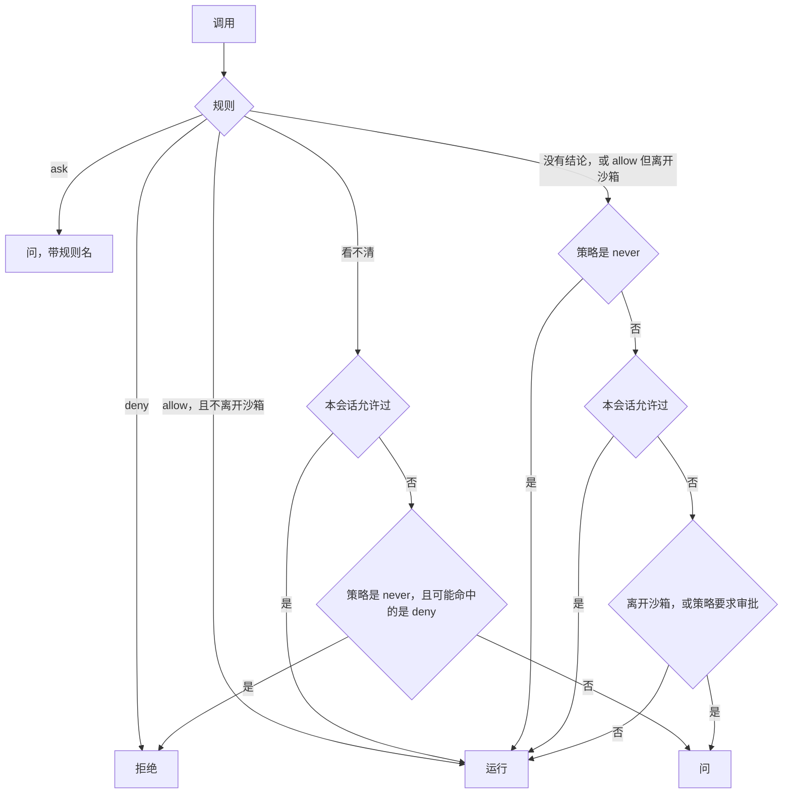

# 审批与权限

agent 的每个工具调用在写进对话日志时就已经判定好：直接运行、问用户，还是拒绝。判定在 `policy` 包里，是一个不读库、不调工具的纯函数，依据审批策略、规则和这次调用的内容。审批（approval）是判定为"问用户"时的等待：问了什么、用户怎么决定，都是对话日志里的条目，等待期间这一轮不占槽位。权限在整体安全设计里的位置见[安全总览](/zh/engine/security)。

## 为什么这样设计

- **规则先于策略，下层去不掉上层的 deny。** deny 和 ask 规则代表用户本人，三档策略下都先判定。各层设置合并时规则取并集，下层能加规则，去不掉上层的 deny。
- **按命令的结构匹配，读不懂就不算数。** 规则看的是拆开 `sh -c`、`env` 这类包装之后的每个子命令：deny 命中任一部分就生效，allow 要覆盖全部。脚本由 shell 解析器读，只认纯字面量的命令，其余标为看不清。看不清的命令不能被带说明符的 allow 放行，也不会被当作"规则没意见"。
- **`never` 是"不问"，不是"不许"。** 规则之外的一切都运行，包括离开沙箱的命令，真正不想让它做的事用 deny 规则表达。为了让 deny 规则在这一档真的可靠，规则读不懂、又可能被 deny 命中的命令直接拒绝。
- **判定是纯函数，结论写进日志。** `policy` 只看调用方交给它的工具清单（`Toolbox`）、调用（`Call`）和会话视图（`conversation.View`）。判定和模型回答在同一次提交里写下：一个调用要跑、要问还是被拒，重启或换分片之后从日志就能读出来，不用重新判定。
- **批准对问到的那次调用照原样生效。** 用户批准的是冻结在 `ToolCall.Prepared` 里的命令、目录、环境变量和 diff。批准之后不再重新判定；执行时工具自己核对冻结的内容还成立，不成立就不执行，交给模型重来。见[审批流程](#审批流程)。
- **等审批不占资源，读不到设置就失败。** 等待时这一轮让出槽位，用户隔几小时再回答也只占几行日志，见[设计决策 1](/zh/reference/decisions#_1-池化-runtime)。权限设置读不出或不合法时这一轮失败，不退回默认值，见[设计决策 18](/zh/reference/decisions#_18-出错即暴露)。

代价：写法复杂一点的命令（变量、子 shell、`xargs`）经常看不清，带说明符的规则一多，用户被问的次数就多；`never` 档下能拦住沙箱外命令的只有 deny 规则；"本会话允许"只认完全相同的调用，换个参数就要再问；MCP 工具的规则只能写到工具名；批准之后改的规则管不到已经批准的调用。

::: info 演进
- `faa3b90` 之前，工作区的规则列表会整个替换掉 agent 默认的规则，现在各层取并集。
- 按拆开包装后的子命令匹配来自 `e36dd28`；只认确定能理解的语法、其余标为看不清来自 `28b9033`。
- `7b6e720` 之前，`never` 因为没人能批准而一律拒绝提权，结果桌面端"宽松"档里 agent 完全出不了沙箱；`7b6e720` 改成不问就运行。规则读不懂又可能命中 deny 的命令直接拒绝来自 `2ac82a0`。
- v0.16.0 重建引擎时，判定从 `agent/permission`（读注册表和数据库）拆成纯函数的 `policy`（`d1b1463`），判定结果随模型回答一起写进日志（`cf4141e`）。
:::

## 每个调用怎样判定

模型回答之后，`run/tools.go` 的 `Runner.decide` 逐个处理这个回答里的工具调用，结果和回答本身在一次提交里追加到日志：

1. 回答被模型的输出上限截断（`finish_reason` 为 `length`）：这个回答里的调用都不运行，结果是错误，告诉模型分小步做。
2. 工具不在这一步发给模型的列表里：延迟加载的工具提示先调 `load_tools`；其他工具（被 deny 规则、`Allowlist` 或角色层去掉的）提示不可用。
3. 参数不是 JSON 对象：错误。
4. 工具声明了内容（`tool.Spec.Content`）时，`Set.Content` 先按工具的 schema 校验参数，再算出规则匹配用的 `policy.Content`；失败是错误。
5. `Set.Prepare` 冻结执行内容，得到 `tool.Plan`：`Data` 写进 `ToolCall.Prepared`，`Sandboxed`、`Escalated` 交给判定。命令黑名单、提权的前提、程序路径解析都在这一步检查，失败是错误。
6. `Checker.Decide(call, view)` 给出结论：
   - 拒绝：追加带错误的 `ToolResult`，条目 `failed`，算进连续失败次数；
   - 问：追加 `ApprovalAsked`，条目留在 `pending`；
   - 运行：只有 `ToolCall`，条目留在 `pending`，下一步执行。

交给 `policy` 的 `Call` 来自工具的标注：`ReadOnly` 是 `readOnlyHint`，`OpenWorld` 在 `openWorldHint` 没写或为真时成立。MCP 服务器自报的 `readOnlyHint` 和 `openWorldHint` 不被采信（`tool/mcp/session.go` 的 `toSpec` 不抄这两项），所以 MCP 工具一律按"非只读、开放"判定。

`Checker` 在每一步开始时重建（`run/run.go` 的 `step.permit`），所以权限设置的修改在下一步生效。已经写下结论的调用不再重新判定。

## 判定顺序

`Checker.decide` 按固定顺序走，先到先得：



规则先于策略：deny 和 ask 规则代表用户本人，三档策略下都先判定。"看不清"这一支要单独说：带说明符的 deny 或 ask 遇到看不清的命令，证明不了自己不适用，所以不能当作没命中。`untrusted`、`on-request` 下转为问用户；`never` 下没有人可问，可能命中的是 deny 就拒绝，只有 ask 就照样问。

"离开沙箱"指策略不是 `never` 且 `Call.Escalated` 为真（`leavesTheSandbox`）；这样的调用即使命中 allow 规则也不直接运行，继续走后面的判断。`never` 下没有人可问，规则没有给出结论的调用一律运行，离开沙箱的命令也包括在内。

拒绝时错误交给模型：被规则拒绝的，告诉它不要重试，换个办法或者告诉用户；`never` 下读不懂的命令，告诉它把命令写清楚。由规则触发的询问带上规则名；看不清的命令说明为什么要问；其余询问不带说明，界面从冻结的执行内容自己讲清楚要做什么。

::: info 演进
v0.12.1 时判定在调用运行之前做（`agent/runtime/calls.go`），一批调用遇到第一个要问的就停，后面的调用等前一个有了决定才判定。`cf4141e` 起一个回答里的调用在回答写下时一起判定，几个审批可以同时等待。
:::

## 审批策略

策略只有三档，取 `untrusted`、`on-request`、`never`，在规则没有给出结论时起作用（`Checker.requiresApproval`）。部署层不设时默认 `on-request`。

| 调用 | `never` | `on-request` | `untrusted` |
| --- | --- | --- | --- |
| 只读且封闭：`read_file`、`glob`、`grep`、`update_plan`、`request_user_input`、`load_tools`、`read_tool_output`、记忆搜索、派生子 agent | 运行 | 运行 | 运行 |
| 只读但没关 `openWorldHint`：宿主自己的工具这样标时 | 运行 | 运行 | 问 |
| 在沙箱内执行（`Sandboxed`）：沙箱生效时的 `run_command`、`edit_file`、`write_file` | 运行 | 运行 | 问 |
| 其他非只读：`web_fetch`、定时任务的增删改、MCP 工具、沙箱关闭时的命令和文件修改 | 运行 | 问 | 问 |
| 离开沙箱：带 `require_escalated` 的命令、本机沙箱下的 `claude` | 运行 | 问 | 问 |
| 看不清、且工具上有带说明符的 deny 规则 | 拒绝 | 问 | 问 |
| 看不清、且工具上只有带说明符的 ask 规则 | 问 | 问 | 问 |

`on-request` 的依据是 `Prepared.Sandboxed`：沙箱已经限制了命令能做什么，所以不用问。`claude` 工具把任务交给 Claude Code，它要网络和主目录里自己的设置，所以在能提权的本机沙箱下总是离开沙箱运行，见[工作区工具](/zh/engine/workspace)。

`never` 的含义是"不问任何人"，所以规则之外的一切都运行，包括离开沙箱的命令。选了 `never` 的人要的就是不被打断，真正不想让它做的事用 deny 规则表达。所以规则读不懂的命令不会被当作"规则没意见"放行：可能命中 deny 的直接拒绝。否则只要把 `rm` 包进 `sh -c "$X"`，`run_command(rm:*)` 这条 deny 就形同虚设，而且这条命令还能申请离开沙箱。三档对普通调用、沙箱内命令、提权命令的结论由 `TestEachPolicyDecidesWhatRunsWithoutAsking` 覆盖，规则在每档先判定由 `TestRulesSpeakAtEveryLevel` 覆盖，`never` 下看不清的命令由 `TestNeverDoesNotRunWhatARuleCannotRead` 覆盖（都在 `policy/policy_test.go`）。

::: info 演进
- `7b6e720` 之前 `never` 的做法相反：没有人能批准，于是提权一律拒绝，而 `run_command` 的描述还在承诺"会问用户"。看不清又可能命中 deny 的命令直接拒绝来自 `2ac82a0`。
- `fdefa84` 起不再采信 MCP 服务器自报的只读标注，此前标了只读的 MCP 工具在 `on-request` 下直接运行。
:::

## 规则语法

规则分 `allow`、`ask`、`deny` 三组，每条是 `工具` 或 `工具(说明符)`。

| 写法 | 匹配 |
| --- | --- |
| `edit_file` | 这个工具的所有调用 |
| `edit_file(*)` | 同上 |
| `run_command(git status)` | 内容完全等于 `git status` |
| `run_command(git:*)` | `git`，或 `git` 后接空格和任意内容 |
| `run_command(git *)` | 同上 |
| `read_file(src/*)` | 相对项目根的路径以 `src/` 开头，`*` 跨目录 |
| `web_fetch(example.com)` | 主机名 |

- `*` 编译成 `.*`，可以跨 `/` 和换行。结尾的 `:*` 或空格加 `*` 表示后面的部分可有可无。
- 命令的说明符只把第一个词转小写，匹配的内容里程序名也是小写，其余大小写敏感。路径和主机名的内容整体小写（`Content.Folded`），说明符也整体转小写再比。
- 空说明符、缺右括号、工具名为空或含空格和括号都报错。
- 工具没有内容（`Spec.Content` 为空）就不能写说明符（"takes no specifier"），MCP 工具都属于这一类。有内容的是 `run_command`、`claude`、`edit_file`、`write_file`、`read_file`、`glob`、`grep`、`web_fetch`。
- 工具名必须在用户的工具清单里，否则报错。MCP 服务器暂时连不上时，已保存的规则保留，但不能新增提到它的规则。部署层是所有用户共用的（`Layer.Shared`），可以写某些用户没有的 MCP 服务器的工具。

一条不带说明符的 `deny` 把工具从发给模型的列表里去掉。带说明符的 `deny` 只拒绝匹配的调用。

### 匹配过程

`ruleSet.decide` 的输入是 `Content`：`Match` 加上 `Parts`（拆开的子命令）。

1. 依次试 `deny`、`ask`。`Match` 或任一 `Parts` 命中即生效。
2. 内容看不清（`Opaque`），且这个工具有带说明符的 `deny` 或 `ask` 规则：无法证明它们不适用，结果是"看不清"。
3. 有不带说明符的 `allow`：通过。
4. 内容看不清或工具没有内容：没有结论。
5. 每个 `Parts`（没有拆分时是 `Match`）都必须被某条 `allow` 匹配，缺一个就没有结论。

第 5 步是 `allow` 比 `deny` 严的地方：`deny` 命中一部分就够，`allow` 要覆盖全部。`git status && rm -rf x` 不会因为允许了 `git:*` 而放行。

## 权限分层

每一层的设置格式相同：

```go
type Settings struct {
	ApprovalPolicy string `json:"approvalPolicy,omitempty"`
	Rules          Rules  `json:"permissions"`
}
```

一个调用按这些层判定，从上到下（`account.Layers`，角色层由 `run/run.go` 放在最前）：

| 层 | 来源 | 存在哪 | 怎么改 |
| --- | --- | --- | --- |
| 角色 | `agent.Role.Own` | 代码里 | 不能改 |
| 部署 | `host.Config.Permissions` | 宿主的配置 | 改配置后重启 |
| 用户 | `account.Settings.Permissions` | `settings.permissions` | `settings/updatePermissions` |
| 工作区 | `account.Workspace.Settings` | `workspaces.settings` | `workspace/updatePermissions` |
| 会话 | `account.Thread.Settings` | `threads.settings` | `thread/updatePermissions` |

会话不在工作区里时没有工作区这一层。`policy.Resolve` 按顺序合并：策略取最后一个非空的，三组规则取并集去重。因为 `deny` 永远先判定，下层可以加规则，去不掉上层的 `deny`。`host.New` 给部署层补上默认策略 `on-request`，读不懂的部署设置（未知策略、写错的规则）直接让 `host.New` 失败。

层上除了设置还能限定工具（`policy.Layer` 的 `Providers` 和 `Without`，不存库，用户改不了）：

- 通用子 agent 的角色层去掉派生子 agent 和定时任务的工具，所以子 agent 不能再派生；浏览器子 agent 的角色层只留浏览器、`read_tool_output`、技能和计划的工具。
- 用户关掉记忆时，用户层去掉记忆的工具。

一个工具发给模型，要每一层都留着它（`policy.Kept`）、在宿主的 `Allowlist` 里（配了的话），而且没有被不带说明符的 deny 去掉。某个子 agent 角色一个可用工具都没有时，派生它的工具也去掉（`agent.Launchable`）。

子 agent 不用自己的会话设置，会话这一层换成父会话的设置（`Thread.ParentLayer`），工作区随父会话。

修改走三个协议方法，由 `policy.Validate` 校验：这一层单独合法（策略是三档之一、规则能解析、工具都认得），叠在它上面各层之上也合法。用户层只叠在部署层上校验，工作区叠在部署和用户上，会话再加上工作区。校验失败返回 `policy.ErrInvalidSettings`，协议上是 `-32602`。改动经 feed 通知界面（`settings/changed`、`workspace/changed`、`thread/changed`），下一步生效。

::: info 演进
- v0.12.1 时只有 agent 默认、工作区、会话三层，子 agent 再加一层 `Deny: ["Agent"]`。用户层来自 `1ae27b2`：每个用户的权限、MCP 服务器和记忆开关存进数据库，经协议修改，不用重启。角色层来自 `a83b2c7`，取代了子 agent 的 `Deny` 层和单独的工具筛选。
- `13eafa9` 起新会话不带自己的设置开始，`thread/start` 不再接受 `approvalPolicy` 和 `permissions`。
:::

## 命令解析

`run_command` 的内容不是简单拼字符串。模型常把命令包在 `sh -c` 或 `env` 里，所以规则要看到真正运行的程序（`tool/builtin/workspace/command.go`）。

`Match` 是 `程序名 参数...`，程序名取路径的最后一段并转小写。`commandParts` 递归拆开包装，结果放进 `Parts`；`Text` 是给用户看的原文，调用带 `env` 参数时环境变量排在命令前。

| 形式 | 处理 |
| --- | --- |
| `sh -c "a && b"`（`sh`、`bash`、`zsh`、`dash`、`ash`、`ksh`、`fish`、`csh`、`tcsh`） | 用 `mvdan.cc/sh` 解析脚本，取出每个简单命令，各自再展开 |
| shell 带 `aehiklmnuvx`、`c` 以外的选项（如 `-o`、`--login`、`+x`），或 `-c` 后没有脚本 | 看不清 |
| `sh script.sh` | 不拆，按普通命令 |
| `env`、`nohup`、`nice`、`caffeinate`、`time` 接命令 | 去掉包装 |
| `timeout 5 cmd` | 去掉 `timeout` 和时长 |
| 上面这些包装带选项，或 `env A=B cmd` | 看不清 |
| `xargs`、`sudo`、`doas` | 看不清，不拆 |
| 路径不在系统目录下的程序，比如 `./sh` | 看不清 |
| 嵌套超过 4 层 | 看不清 |
| 调用参数里带 `env` | 看不清 |

系统目录是 `/bin`、`/sbin`、`/usr/bin`、`/usr/sbin`、`/usr/local/bin`、`/opt/homebrew/bin`、`/opt/homebrew/sbin`。名字不含 `/` 的程序算可信。路径检查的意义在于仓库里一个叫 `sh` 的脚本不是 shell。

### 看不清的命令

`splitScript` 用 `mvdan.cc/sh` 解析脚本，只认简单命令、管道、`;`、`&&`、`||`、`&`、纯字面量的词和重定向。行继续、结尾的注释、引号里的字面文字、分隔符加了引号的 here-document（正文不会展开）都读得懂。以下任何一种都让整条命令标为看不清：

- 解析失败，比如未闭合的引号
- 任何展开：`$X`、`"$HOME"`、`$(...)`、反引号、算术、`$'...'`、进程替换 `<(...)`
- 引号外的非 ASCII 字符，或 `{`、`}`、`~`、`!`、`#`
- 子 shell、`{ }` 块、`if`、`for`、`while`、`case` 这类复合语句：里面的命令照样拆出来逐个匹配 deny 和 ask，但整条仍是看不清
- `!` 取反、协进程、赋值（`A=1 cmd`）
- 重定向的目标不是字面量、未加引号的 here-document 正文里有展开、文件描述符不是数字
- 程序位置含通配符或 `=`，或是保留字：`if`、`for`、`while`、`case`、`eval`、`source`、`.`、`exec`、`command`、`builtin`、`alias`、`trap`、`export` 等

重定向的目标不算词，`ls 2>&1 > out.txt` 的内容是 `ls`。

看不清的效果：带说明符的 `allow` 不生效，不提供"总是允许"；工具上有带说明符的 `deny` 或 `ask` 时转为问用户；`never` 下有带说明符的 `deny` 就拒绝，只有 `ask` 时照样问。工具上没有这类规则时，结论落到审批策略，`on-request` 下沙箱内的命令仍然直接运行，沙箱是这时的限制。

::: info 演进
v0.12.1 的 `splitScript` 是手写的，按 `;`、`&`、`|`、换行切词。`7e10076` 换成 `mvdan.cc/sh`：行继续、结尾注释、加引号的 here-document 不再看不清；子 shell 和复合语句里的命令拆成命令本身（`cd x`、`rm y`），不再带着括号，deny 和 ask 能匹配到它们。
:::

### 命令黑名单

`command_blacklist` 是工作区工具的配置项（`workspace.Config.CommandBlacklist`），和规则分开。`Prepare` 阶段检查，比对 `Match` 和全部 `Parts` 里的连续词序列，命中直接报错，判定和审批都不会发生。黑名单也算进命令的设置摘要，改了之后按旧设置冻结的调用不再执行。

## 审批流程


审批由两种日志条目组成（`conversation/entry.go`）：

| 条目 | 字段 | 含义 |
| --- | --- | --- |
| `ApprovalAsked` | `Approval` | 请求 ID |
| | `Reason` | 为什么要问，可以为空 |
| | `Rule` | 触发询问的 ask 规则 |
| | `Content` | `Content.Text`，问的具体内容 |
| | `Suggested` | "总是允许"会写入的规则 |
| `Decided` | `Decision`、`By` | 决定和做决定的用户 |

两者折叠成条目上的 `Approval`，再加上 `AskedAt`、`DecidedAt`。`conversation.Check` 守住顺序：只有 `pending`、还没问过的调用能追加 `ApprovalAsked`；只有在等审批的调用能追加 `Decided`，而且决定必须在可选范围内。

条目有 `Approval` 而没有决定时这一轮在等审批（`View.Waiting`），会话状态是 `waitingOnApproval`。一个回答里可以有几个调用同时在等；全部有了决定之后，这一轮才重新可运行。界面经 `item/toolCall/requestApproval` 收到请求，带 `preparedExecution`（冻结的命令和 diff）、`content`、`reason`、`suggestedRules` 和 `availableDecisions`；连接恢复或打开会话时，网关按提问时间重发所有在等的请求（`App.Requests`）。

可选决定由 `Approval.Decisions` 算：

| 情况 | 可选 |
| --- | --- |
| 由 ask 规则触发 | `accept`、`decline` |
| 没有建议规则（看不清、离开沙箱、含 `*`） | `accept`、`acceptForSession`、`decline` |
| 其他 | `accept`、`acceptForSession`、`acceptAlways`、`decline` |

规则触发时不给"总是允许"：`ask` 规则的意思就是每次都问，加 `allow` 也改变不了。

| 决定 | 效果 |
| --- | --- |
| `accept` | 只放行这一次 |
| `acceptForSession` | 放行这一次；这个会话之后完全相同的调用不再问 |
| `acceptAlways` | 在同一个事务里写入建议规则，然后放行 |
| `decline` | 条目 `declined`，这一轮停止用工具，由模型写最终回答 |

`acceptForSession` 不存额外状态，判定时扫描会话日志里的条目（`allowedForConversation`）："相同"指工具相同、`Prepared` 逐字节相同，有内容的工具 `Content.Text` 也相同。`Prepared` 里有参数摘要和设置摘要，沙箱配置变了之后旧批准自然失效。工具既没有冻结内容也没有内容时（MCP 工具），这个会话之后对它的每次调用都算相同。同一个回答里的其他调用在判定时看不到这次批准，各自照常判定。

一个调用被拒绝后，这一轮停止用工具：同一回答里其他调用即使已经批准，也以 "skipped: the user declined …" 结束，不再运行。用户在等审批时插话（`turn/steer`），在等的审批都记为该用户拒绝，再追加新消息。

决定写下之后这一轮回到调度。执行时不再重新判定，工具按 `Prepared` 运行，并自己核对冻结的内容还成立（`tool/builtin/workspace/prepared.go`）：

- 设置摘要（沙箱规则的 `Fingerprint`、超时、黑名单、命令目录）、参数摘要、命令目录都和冻结时一致；
- 命令的程序名重新解析后仍指向同一个文件；
- 文件修改时，文件现在的内容和冻结时的哈希一致，算出的新内容也一致。

不一致就不执行，结果是错误，提示模型重新调用。决定只在调用还在等时接受，否则返回 `ErrNoSuchRequest`；不在可选范围内返回 `ErrInvalidDecision`。

::: info 演进
v0.12.1 时，批准之后、执行之前会重新计算调用的内容，变了就按新内容重新判定（`changedSinceApproval`），审批写在条目的 JSON 字段上。v0.16.0 的日志重建把审批变成 `ApprovalAsked` 和 `Decided` 两种条目，批准对问到的那次调用照原样生效，不再重新判定（`cf4141e`）；冻结内容的核对仍由工具在执行时做。
:::

## "总是允许"的写入

`suggest` 为每个 `Part` 生成一条规则：

| 内容 | 建议 |
| --- | --- |
| 工具没有内容 | 工具名本身 |
| `git status --short` | `run_command(git status:*)`，第二个词像子命令时 |
| `rm -rf build` | `run_command(rm -rf build)`，第二个词不像子命令时用原文 |
| 多个子命令 | 每个一条，去重 |
| 含 `*`、看不清、离开沙箱 | 不建议 |

建议的规则会被再解析一次，确认它确实匹配这次调用才给出。子命令的判断标准是 `^[a-z][a-z0-9_-]*$`。只有不是由 ask 规则触发的询问才带建议。

`acceptAlways` 的规则写到哪里（`app/settings.go` 的 `allowAlways`）：

| 会话 | 写入 |
| --- | --- |
| 在工作区里 | 工作区设置 |
| 不在工作区 | 会话设置 |
| 子 agent | 先换成父会话，再按上面两条 |

写入和协议修改走同一个校验（`permitWorkspace`、`permitThread`），和 `Decided` 在同一个事务里：校验不过，决定也不生效。

## 结构化提问

`request_user_input`（`ask.Tool`）让模型向用户提问，而不是把问题写在回答里。它是只读工具，三档下都不经审批直接运行；`Invoke` 校验问题后返回 `Ask`，`run` 追加 `InputAsked`，条目保持 `inProgress`，会话状态是 `waitingOnUserInput`。

| 项 | 约束 |
| --- | --- |
| 问题数 | 1 到 4 |
| `id` | `^[a-z][a-z0-9_]{0,63}$`，不重复 |
| `header` | 1 到 12 字符，不能全是空白 |
| `question` | 1 到 600 字符，不能全是空白 |
| `options` | 至多 4 个，可省略 |
| `options[].label` | 1 到 60 字符，不能全是空白 |
| `options[].description` | 至多 200 字符 |

工具描述要求这是回答里唯一的调用，同一回答里的其他调用会在用户回答之前运行。

界面收到 `item/tool/requestUserInput`，回 `{answers: {问题 ID: {answers: [...]}}}`，或 `{skipped: true}`。`Request.Check` 校验：每题都有回答，回答不为空白，没有多出的题，总长不超过 4000 字符。校验失败返回 `ErrInvalidAnswer`，请求仍在等待。通过后追加 `Answered`，回答成为工具结果，条目 `completed`。跳过时条目 `declined`，告诉模型不带回答继续；和拒绝审批一样，这一轮随后停止用工具。插话时在等的提问按跳过处理。

## 边界与已知问题

- **`never` 档下提权不问。** 规则没有给出结论的调用一律运行，离开沙箱的命令也包括在内，能拦住它们的只有 deny 规则，见[审批策略](#审批策略)。
- **看不清的命令只在有带说明符的规则时才问。** 工具上没有带说明符的 deny 或 ask 时，看不清的命令落到审批策略：`on-request` 下沙箱内的命令直接运行，这时的限制只有沙箱，见[看不清的命令](#看不清的命令)。
- **沙箱不生效时 `on-request` 每条命令都问。** 这一档免问的依据是 `Prepared.Sandboxed`。本机在 `full-access` 下 `Sandboxed` 恒为假，`run_command`、`edit_file`、`write_file` 都会问。
- **MCP 工具只能整体放行或禁止。** MCP 工具没有内容，规则不能带说明符；服务器自报的只读标注不被采信，所以 `on-request` 下每次调用都问，除非规则放行或本会话允许过。对 MCP 工具选"本会话允许"，等于放行这个会话之后对它的所有调用。见[权限与沙箱](/zh/engine/skills-mcp#权限与沙箱)。
- **"本会话允许"只认完全相同的调用。** `Prepared` 里有参数摘要，同一个命令换个参数要再问一次。
- **批准之后改的规则管不到已批准的调用。** 判定只在调用写下时做一次；用户在等审批期间加了 deny 规则，之后批准的调用照样运行。
- **一次拒绝停掉同一回答里的其他调用。** 已经批准的也不再运行，模型要重新发起。

## 代码位置

| 位置 | 职责 |
| --- | --- |
| ollupi `policy/checker.go` | `Checker`、`New`、`Decide`、判定顺序、本会话允许 |
| ollupi `policy/policy.go` | `Settings`、`Rules`、三档策略、`Layer`、`Kept`、`Resolve`、`Content`、`Call`、`Decision` |
| ollupi `policy/rules.go` | 规则解析、匹配、建议规则 |
| ollupi `policy/validate.go` | `Settings.Check`、`Validate` |
| ollupi `account/account.go` | 各层：`Settings.Layer`、`Workspace.Layer`、`Thread.Layer`、`ParentLayer`、`Deployment`、`Layers` |
| ollupi `agent/agent.go` | 角色层、`Launchable` |
| ollupi `run/run.go` | `step.permit`：每一步组装各层、建 `Checker`、定下发给模型的工具 |
| ollupi `run/tools.go` | `decide`：每个调用的判定 |
| ollupi `tool/tool.go`、`tool/mcp/session.go` | `Set`、`Plan`、标注；MCP 工具的标注 |
| ollupi `tool/builtin/workspace/command.go` | 命令解析、黑名单 |
| ollupi `tool/builtin/workspace/prepared.go`、`execution.go`、`files.go` | 冻结执行内容、执行前核对 |
| ollupi `conversation/entry.go`、`view.go`、`check.go` | `ApprovalAsked`、`Decided`、`Approval.Decisions`、`Waiting`、追加时的检查 |
| ollupi `app/turns.go` | `Decide`、`Answer`、`Steer`、`Requests` |
| ollupi `app/settings.go` | `UpdateUserPermissions`、`UpdateWorkspacePermissions`、`UpdateThreadPermissions`、`allowAlways` |
| ollupi `ask/ask.go`、`tool/builtin/ask/ask.go` | 结构化提问 |
| ollupi `gateway/server.go`、`gateway/protocol.go` | 请求的发送和回应 |
| ollupi `host/host.go` | 部署层的默认策略和校验 |
