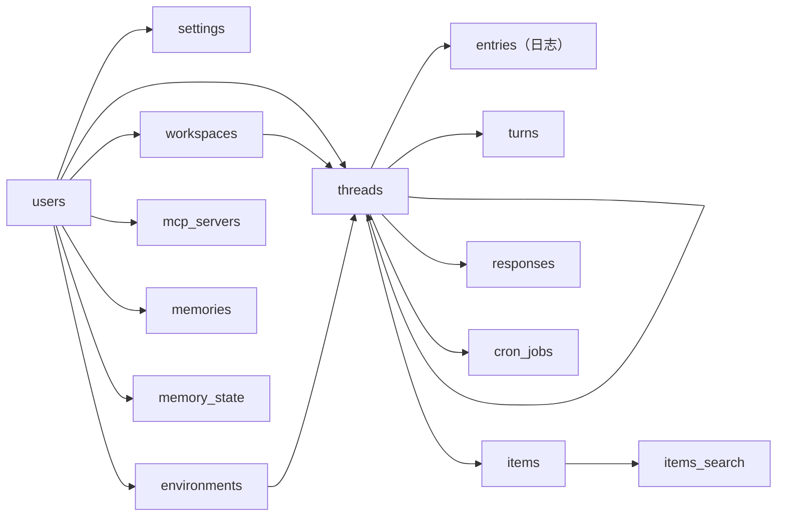
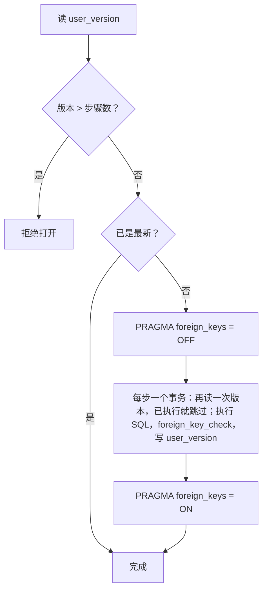

# 持久化与崩溃恢复

Ollupi 把每个会话（thread）存成一份只追加的日志：一条条记录写下后不再修改，轮次（turn）、条目（item）、会话在等什么、能不能运行，都由这份日志折叠得出。日志和它折叠出的结果放在一个 SQLite 库里，一个库就是一个分片（shard），分片上的用户共用它的表。每一步在执行之前先追加进日志，所以进程任何时刻退出，重启后读日志就知道"做到哪了"。这一页讲日志由哪些记录组成、怎样检查和折叠、写入和通知走哪条路、库里有哪些表、重启时怎样恢复、表结构怎样升级，以及附件存在哪里。调度本身见[执行模型](/zh/engine/execution)。

## 为什么这样设计

- **会话是日志，状态是折叠出来的。** 一切变化都是追加一条 `conversation.Entry`：轮次排队、用户消息、模型回答、工具调用的每一步、子 agent 的报告、轮次结束。轮次和条目的状态、当前轮次在等什么、会话能不能运行，都由同一组纯函数（`conversation.View.Apply`）从日志算出来，不另存一份可能和日志对不上的状态。见[设计决策 3](/zh/reference/decisions#_3-无内存调度状态)。
- **一条写路径，一个守门人。** 所有写入都在 `store.Update` 的一个事务里完成，对会话的写入只有 `Tx.Append` 一种。每条记录追加前由 `conversation.Check` 判断它能不能接在当前日志后面，不能就整个事务失败（`conversation.ErrRefused`）。"已结束的轮次不能再写""没批准的调用不能开始"这类规则只写在 `Check` 一处。
- **物化只为查询。** `turns`、`items`、`responses` 表和 `threads` 的 `head`、`status`、`own_status`、`runnable_since` 列是视图的物化，在追加的同一事务里写下，供列表、分页、调度和搜索直接查询，不用每次重新折叠日志。
- **通知走 feed，按提交编号。** 事务提交后，它改变的东西作为事件发到 store 的 feed 上，同一次提交的事件共用一个序号 `seq`。网关、调度器、记忆提取都只从 feed 得知变化，写的一方不通知任何人。
- **一个 SQLite 库，一条连接。** 会话、用户设置、工作区、记忆、定时任务都在同一个库里，库外没有需要恢复的调度状态。连接池固定为一条，进程内的读写全部串行。为什么选 SQLite 而不是别的存储，仓库里没有记录。见[设计决策 2](/zh/reference/decisions#_2-sqlite-与先落库再执行)。
- **恢复不是另一条路径。** 一次运行开始时先关掉上一次运行留下的、已开始却没有结果的工具调用，然后照常往下走。正常关闭、崩溃、[租约接管](/zh/engine/sharding#启动和接管)都走这一条路。
- **表结构按编号 migration 升级。** 每一步是一段 SQL，能改列、重建表、迁移数据，不用清库，因为库里存着用户的会话和记忆。见[设计决策 17](/zh/reference/decisions#_17-编号-migration)。

代价：每一步都要写库，而且一次追加除了日志还要写物化的行；所有读写排在一条连接上；工具调用开始后进程退出，这次调用不会自动重做，生效与否交给模型和用户判断；日志只增不减，会话删除之前一直留着；migration 只能往前走。[基准](/zh/benchmarks/#容量)里一轮约 126 次读、44 次写、14 KB 磁盘（三次模型调用、两次工具调用，模拟模型，v0.18.0）；1536 个活跃会话以上，一轮慢在等这条连接。

::: info 演进
- 以前每个条目是 `items` 表里的一行，执行过程中原地更新它的状态列；轮次也有自己的状态列。状态分散在多处写入，靠各处代码保持一致，恢复时要单独处理每种中断。v0.16.0 把引擎重建为以日志为中心：`89cbf7c` 加入 `conversation`（记录、`Check`、`View`），`6a64e78` 加入 `store` 和 `store/sqlite`，`8a8e43b` 把用户拥有的数据也放进 store，并让 feed 按提交编号。新库是 `data/store.sqlite`。`28ffcc8`（v0.16.1）让新库第一次打开时导入旧引擎的 `data/ollupi.sqlite`，`46545db`（v0.17.2）去掉了这个导入。
- 以前调用从模型回答记下起就是 `inProgress`，崩溃后分不清没跑过和跑到一半，恢复时只能猜。`b52bde4` 拆成 `pending` 和 `inProgress`，现在的 `ToolStarted` 记录延续了这一区分。
- 以前用 gorm 的 `AutoMigrate`，它只能加表加列，做不到的改动就得清库；`a885647` 换成编号的 SQL 步骤。
:::

## 对话日志

### 记录（Entry）

一条记录是 `conversation.Entry`：

| 字段 | 含义 |
|---|---|
| `Seq` | 在这个会话日志里的位置，从 1 起逐条加一，由 `Tx.Append` 分配 |
| `Turn` | 所属轮次 |
| `Item` | 所属条目；属于轮次本身的记录（`TurnQueued`、`TurnEnded`、`ModelResponded`）为空 |
| `At` | 时间，UTC；调用方没给时取追加时的时间 |
| `Body` | 记录的内容，下表十九种之一 |

| 种类（`EntryKind`） | Body | 含义 |
|---|---|---|
| `turnQueued` | `TurnQueued` | 一个轮次排上：模型、角色（role）、发出它的定时任务 |
| `turnEnded` | `TurnEnded` | 轮次结束：`completed`、`failed` 或 `interrupted`，以及原因 |
| `userMessage` | `UserMessage` | 用户消息和附件，包括插话、子 agent 收到的任务 |
| `agentMessage` | `AgentMessage` | 模型回答的正文 |
| `reasoning` | `Reasoning` | 模型的思考内容，带开始和结束时间 |
| `modelResponded` | `ModelResponded` | 一次模型回答本身：用量、上下文统计、提供方的原始记录（`Native`）、是否为压缩所做 |
| `modelFailed` | `ModelFailed` | 模型调用失败 |
| `toolCall` | `ToolCall` | 模型发起的一次工具调用：参数、工具注解、冻结的执行内容（`Prepared`） |
| `approvalAsked` | `ApprovalAsked` | 这次调用要用户审批：原因、命中的规则、建议的规则 |
| `decided` | `Decided` | 用户的审批决定和决定者 |
| `toolStarted` | `ToolStarted` | 调用开始执行 |
| `inputAsked` | `InputAsked` | 工具向用户提问 |
| `answered` | `Answered` | 用户回答了，或跳过了提问 |
| `toolResult` | `ToolResult` | 调用的结果、错误，或被拒绝 |
| `childLaunched` | `ChildLaunched` | 这次调用启动了一个子 agent 会话 |
| `childReported` | `ChildReported` | 子 agent 的报告送回启动它的轮次 |
| `compacted` | `Compacted` | 一次上下文压缩：摘要，以及它覆盖到日志的哪个位置（`Through`） |
| `recalled` | `Recalled` | 这一轮召回的记忆 |
| `notice` | `Notice` | 运行时告诉模型的话，比如工具调用为什么停了 |

记录写下后不再修改，也不单独删除；会话删除时整份日志一起删掉。

### 折叠成视图

`conversation.View` 是日志折叠出的当前状态：轮次列表、条目列表、模型回答列表，以及已折叠到的位置 `Head`。`View.Apply(e)` 把一条记录折进视图，是纯函数，没有 I/O。在此之上的几个判断：

| 方法 | 回答什么 |
|---|---|
| `Active` | 当前轮次：第一个还没结束的轮次 |
| `Queued` | 排在当前轮次后面、还没结束的轮次 |
| `Waiting` | 当前轮次在等什么：审批、用户回答、子 agent 的报告，或什么都不等 |
| `Runnable` | 有当前轮次且它什么都不等 |
| `Answered` | 这一轮最近一次模型回答有正文、没有工具调用，之后也没有新的用户消息或报告 |
| `Status` | 会话自己的状态：`idle`、`active`、`waitingOnApproval`、`waitingOnUserInput` |
| `RollUp` | 会话自己的状态加上子 agent 对用户的等待：子会话在等审批或回答时，父会话也显示在等，审批排在回答前面 |

一轮处在什么阶段、下一步做什么，由 `agent.Next` 读这个视图决定，见[执行模型](/zh/engine/execution)。

### 运行时读取什么

一次运行每一步都重新读会话的视图（`Reader.View`），读的是物化的 `turns`、`items`、`responses` 三张表，不重新折叠 `entries`。组装提示词时，`prompt.Transcript` 取已结束的轮次和当前轮次的全部条目，排在后面的轮次不进提示词；压缩、裁剪、按回答合并消息都在 `prompt` 里完成，见[上下文管理](/zh/engine/context)。

## 条目模型

条目是轮次里的一步，由一条或几条记录折叠而成。消息、思考、报告这类条目由一条记录写成，写下时就已结束；工具调用从 `ToolCall` 开始，依次可能有 `ApprovalAsked`、`Decided`、`ToolStarted`、`InputAsked`、`Answered`、`ChildLaunched`，到 `ToolResult` 或 `Answered` 结束，这些都折叠在同一个条目上。条目的 `seq` 是它第一条记录的位置，`updated` 是最近一次改变它的记录的位置。

### 类型

| 类型 | 由哪条记录开始 | 含义 |
|---|---|---|
| `userMessage` | `UserMessage` | 用户消息：开启轮次的消息、插话、子 agent 的任务 |
| `agentMessage` | `AgentMessage` | 模型回答的正文 |
| `reasoning` | `Reasoning` | 模型的思考内容 |
| `toolCall` | `ToolCall` | 一次工具调用，参数、执行内容、审批、提问、结果都在这一个条目里 |
| `agentReport` | `ChildReported` | 一个子 agent 的报告，送回启动它的轮次 |
| `contextCompaction` | `Compacted` | 一次上下文压缩，`text` 是摘要 |
| `memoryContext` | `Recalled` | 这一轮召回的记忆 |
| `error` | `ModelFailed` | 模型调用失败 |
| `notice` | `Notice` | 运行时发给模型的通知 |

### 状态

| 状态 | 含义 |
|---|---|
| `pending` | 调用已记下、还没开始，或在等审批 |
| `inProgress` | 调用已开始执行（`ToolStarted`），或在等用户回答 |
| `completed` | 成功 |
| `failed` | 失败，`error` 写原因：工具报错、判定拒绝、被叫停、被切断 |
| `declined` | 用户拒绝了这次调用、跳过了提问，或轮次结束时它还没结束 |

几个判断都基于字段，没有单独的状态列：

- 等审批：`toolCall`、`pending`，有审批请求而没有决定（`Item.WaitsForApproval`）。
- 等回答：`toolCall`、`inProgress`，有提问而没有回答（`Item.WaitsForInput`）。
- 等子 agent：`toolCall` 启动了子会话而它还没报告（`Item.AwaitsReport`）；这一轮已经回答之后才算轮次在等。
- 未结束的调用：`toolCall` 且状态是 `pending` 或 `inProgress`（`Item.Open`）。

### 一次模型回答

一次模型调用写成一个 `ModelResponded` 记录，带一个回答 id；它产生的 `reasoning`、`agentMessage` 和各个 `toolCall` 都记着这个 id。用量、上下文统计和提供方的原始记录只在 `ModelResponded` 上，所以每次调用只计一次：折叠后累加到轮次的用量上，也作为一行写进 `responses`。组装提示词时按回答 id 把条目合成一条 assistant 消息和若干 tool 消息，原始记录原样回放给同类提供方。

为压缩做的那次模型调用也写 `ModelResponded`，带 `Compaction` 标记，和 `Compacted` 在同一次提交里写下。

### 写入约束

`conversation.Check(v, e)` 是唯一的守门人。不满足时返回包了 `conversation.ErrRefused` 的错误，写明违反了哪条：

- 每条记录都要有 `Body`。
- `TurnQueued` 要用一个新的轮次 id；其余记录要指向一个已有的、还没结束的轮次。
- 排在后面的轮次只能追加 `UserMessage` 和 `TurnEnded`，其余记录只能写给当前轮次。
- 还有调用没结束时不能追加 `TurnEnded`。
- 新条目（消息、思考、调用、压缩、召回、通知、报告、模型失败）要用新的条目 id；`ModelResponded` 属于轮次本身，不带条目 id，要带回答 id。
- `ChildReported` 要指向一个启动了这个子会话、还没收到报告的调用。
- 调用的每一步都要接在它当前的状态之后：只有 `pending` 且没问过审批的调用能 `ApprovalAsked`；只有在等审批的调用能 `Decided`，决定要在这个审批允许的选项里；只有 `pending` 且不在等审批的调用能 `ToolStarted`；只有 `inProgress` 且没提过问的调用能 `InputAsked`；只有在等回答的调用能 `Answered`；只有未结束且不在等回答的调用能 `ToolResult`；只有 `inProgress` 的调用能 `ChildLaunched`，而且只能一次。

记录写下后不再修改，所以审批依据的参数和执行内容就是 `ToolCall` 记下的那份，不会被悄悄换掉。审批怎样绑定执行内容见[审批与权限](/zh/engine/permissions)。

## 一条写路径

`store.Store` 是存储的端口，`store/sqlite` 是它唯一的实现：

| 方法 | 做什么 |
|---|---|
| `Update(ctx, fn)` | 在一个写事务里运行 `fn(Tx)`；`fn` 返回错误时整个事务回滚 |
| `Read(ctx, fn)` | 在一个事务里运行 `fn(Reader)`，读到的东西出自同一个快照 |
| `Feed()` | 这个 store 的事件 feed |
| `Fence(epoch)` | 记下分片的 epoch，之后每次写入都核对它，见[分片与租约](/zh/engine/sharding#围栏) |

`Tx` 是 `Reader` 加上写方法：用户、设置、工作区、执行环境、MCP 服务器、定时任务、记忆和提炼进度的写入，会话的建、改、删，以及 `Append`。

`Tx.Append(thread, entries...)` 是对会话日志的唯一写法：

1. 读会话的视图。同一事务里再次追加同一会话时用事务里缓存的视图，所以一个事务可以连续追加，后一条看得到前一条。
2. 对每条记录：分配 `Seq = Head + 1`，补上时间，`Check`，`Apply`，插入 `entries` 一行。
3. 把这次写到的轮次、条目、回答按折叠后的样子写进 `turns`、`items`、`responses`。轮次刚结束时，`turns.ended_seq` 取这次提交的序号。
4. 更新 `threads` 的 `head`、`own_status`、`updated_at`；顶层会话的轮次结束时写 `replied_at`；会话变得可运行时记下 `runnable_since`（已经可运行就保留原来的时刻），不可运行时清空。
5. 沿父会话往上重算 `status`（`conversation.RollUp`），哪一层没变就停。状态变了的祖先会话也进入这次提交的事件。

一个事务可以跨多个会话：子 agent 的轮次结束时，它的 `TurnEnded` 和父会话里的 `ChildReported` 在同一个事务里写下；启动子 agent 时，建子会话、排上它的第一个轮次和任务、父会话里调用的 `ChildLaunched` 和 `ToolResult` 也在同一个事务里。

## feed 与 seq

库里有两种序号：

- **日志位置**：每个会话自己的 `Seq`，`threads.head` 是最新一条。条目的 `seq` 和 `updated`、分页的 `beforeSeq` 用的是它。
- **提交序号**：整个分片的提交计数，存在 `feed` 表的一行里。一个有事件的事务提交前把它加一，这次提交的所有事件都带这个值。没有改变任何东西的事务不占序号。

事务提交之后，`Update` 把事件逐个交给 `store.Feed`。事件（`store.Event`）有三种内容：

| 内容 | 什么时候 | 带什么 |
|---|---|---|
| `Change` | 一次提交改变了一个会话 | 这次追加的记录、折叠后的条目和轮次、会话头部、当前轮次，或会话已删除 |
| `Owned` | 一次提交改变了用户拥有的东西 | 设置、工作区、执行环境、MCP 服务器、定时任务、记忆的新值或删除 |
| `Delta` | 模型流式输出时 | 一小段正文或思考；不落库，不带序号，由运行直接发到 feed |

订阅有两种：`Subscribe(user, fn)` 只收这个用户的事件，网关的每条连接用它；`SubscribeAll(fn)` 收全部，调度器用它。feed 只在进程内存里，不持久化，错过的事件不会重发：客户端连上或重连后读一次会话，`thread/read` 和 `thread/resume` 返回读取时的提交序号，之后收到的通知按这个序号判断新旧。通知在协议里的样子见[会话协议](/zh/integrate/protocol/threads)。

## 先落库再执行的顺序

下表是一轮从提交到结束追加的记录。每一行都是先提交，再做下一步。

| 时机 | 一次提交里追加 | 代码 |
|---|---|---|
| 收到消息 | `TurnQueued` 和 `UserMessage`；会话空闲时它就是当前轮次 | `app.Send` |
| 定时任务到点 | 同上，`TurnQueued.CronJob` 记着任务 | `app.Scheduled` |
| 插话 | 给当前轮次追加 `UserMessage`；在等的审批记为拒绝，在等的提问记为跳过 | `app.Steer` |
| 运行开始 | 上一次运行留下的被切断的调用：`ToolResult` 带错误 | `run.closeStranded` |
| 需要召回记忆 | `Recalled` | `run.callModel` |
| 需要压缩 | 压缩回答返回后：`ModelResponded`（压缩）和 `Compacted` | `run.compact` |
| 工具调用被叫停 | `Notice`，之后的模型调用不带工具 | `run.callModel` |
| 模型流式输出 | 不写库，增量只发到 feed | `run.callModel` |
| 模型回答结束 | `ModelResponded`、`Reasoning`、`AgentMessage`，以及每个 `ToolCall`。每个调用写下时已经判定过：可以直接运行的只有 `ToolCall`，要审批的加 `ApprovalAsked`，被拒绝或无法准备的加带错误的 `ToolResult` | `run.callModel`、`run.decide` |
| 模型调用失败 | `ModelFailed` | `run.callModel` |
| 执行工具之前 | 这一组调用的 `ToolStarted`，提交之后才调用工具 | `run.runTools` |
| 工具结束 | `ToolResult`；或 `InputAsked`；启动子 agent 时是建子会话、它的 `TurnQueued` 和任务，加上父调用的 `ChildLaunched` 和 `ToolResult` | `run.recordResult`、`run.launch` |
| 剩下的调用被叫停 | `ToolResult`，错误是 `skipped: ` 加原因 | `run.skip` |
| 用户审批 | `Decided` | `app.Decide` |
| 用户回答 | `Answered` | `app.Answer` |
| 一轮结束 | 先结束它启动的、还没报告的子 agent，再关掉未结束的调用（等回答的记为跳过，其余记为拒绝），最后 `TurnEnded`；子会话的轮次还给父轮次追加 `ChildReported` | `run.End` |

除了增量，客户端、调度器和记忆提取看到的变化都已在库里。

## 崩溃恢复

上面的顺序保证了：进程任何时刻退出，日志里都记着做到了哪一步。重启后没有单独的恢复流程：调度器启动时从 `threads.runnable_since` 读出可运行的会话，照常交给槽位，见[执行模型](/zh/engine/execution)。在等审批、回答、子 agent 的会话本来就不依赖进程，原样留着。

每次运行开始时，`run.Runner.Run` 先调用 `closeStranded`：在当前轮次里找已开始执行、没有结果、也不在等用户回答的调用，给每个追加一条 `ToolResult`，错误文本是：

```text
the call was cut off when the run that made it stopped; it may have taken effect in part or in full, so check before trying it again
```

同一个会话任何时刻只有一次运行，而一次运行提交 `ToolStarted` 之后总会写下结果才返回，除非进程退出、上下文被取消或分片换手。所以运行开始时还开着的调用，一定是上一次运行留下的。

| 退出时停在哪里 | 恢复后 |
|---|---|
| 调用已追加、还没 `ToolStarted` | 照常判定和执行，已做出的审批决定保留 |
| 调用已 `ToolStarted`、没有结果 | 记为被切断（`failed`），错误文本交给模型，由它决定要不要先核实再重试；引擎绝不自动重跑 |
| 调用在等用户回答 | 不动，继续等 |
| 模型正在流式输出 | 没有任何记录，恢复后重新调用模型；已推给界面的增量作废 |
| 模型回答已提交、轮次还没结束 | `agent.Next` 读到这一轮已经回答，直接结束轮次，不会多出一条回答 |
| 子 agent 正在启动 | 建子会话和父调用的结果在同一次提交里，要么都在，要么都没有 |

执行之前一定先提交 `ToolStarted`，所以没有 `ToolStarted` 的调用一定没跑过，有的可能已经生效。引擎不会把一个工具调用执行两次。

正常关闭和崩溃走同一条路：上下文取消后，运行返回而不写任何东西，调度器也不结束它的轮次，下次启动时按上面的方式接着走。运行出错或超过时限时，调度器在让出槽位之前用 `run.End` 把轮次记为 `failed`，未结束的调用随之记为拒绝。租约接管也一样，新的持有者从同一个库读出同样的日志，见[分片与租约](/zh/engine/sharding#启动和接管)。

::: info 演进
以前恢复是启动时的一个单独步骤：找出上个进程在跑的轮次，按条目类型逐个关掉，再把轮次停放；进程在最终回答落库之后、轮次结束之前退出时，恢复后还会多调用一次模型。日志重建时，`3c3ed62` 让每次运行开始时关掉被切断的调用，这就是全部的崩溃恢复。流式输出期间什么都不写，所以也不再有写到一半的回答要关掉。
:::

## SQLite 配置

库文件在 `<home>/data/store.sqlite`，目录不存在时以 `0755` 创建。打开库由 `pkg/sqlitedb` 负责，store 和分片目录库（`catalog.SQL`）共用它。驱动是 `gorm.io/driver/sqlite`（底层 `mattn/go-sqlite3`）。

| 配置 | 值 | 位置 |
|---|---|---|
| `_journal_mode` | `WAL` | DSN |
| `_busy_timeout` | `5000`（毫秒） | DSN |
| `_foreign_keys` | `on` | DSN |
| `_txlock` | `immediate`，每个事务（包括只读的）一开始就拿写锁 | DSN |
| 连接池 | `SetMaxOpenConns(1)`，一个进程一条连接 | `pkg/sqlitedb` |
| 时间 | `NowFunc` 取 UTC | gorm 配置 |
| 日志 | gorm 日志静默 | gorm 配置 |

只有一条连接，所以进程内的数据库访问是串行的。`_txlock=immediate` 让先读后写的事务在开始时就排队等写锁，而不是读完之后升级失败；多个进程同时打开的目录库需要这一点。

构建时必须带 `-tags sqlite_fts5`，消息搜索需要 FTS5。`store/sqlite/fts5.go` 在没有这个标签时引用一个不存在的符号，让编译直接失败。

## 表和关系



`entries` 是日志本身；`turns`、`items`、`responses` 和 `threads` 的状态列是它的物化。

外键：

- `settings`、`workspaces`、`environments`、`mcp_servers`、`memories`、`memory_state` 指向 `users`，是 `ON DELETE CASCADE`；`threads.user_id` 是 `ON DELETE RESTRICT`。引擎没有删除用户的操作。
- `threads.workspace_id` 和 `threads.environment_id` 是 `ON DELETE RESTRICT`：工作区只归档不删除；执行环境只有在没有会话用它时才能删，引擎在删之前用 `EnvironmentInUse` 先报错。
- `entries`、`turns`、`items`、`responses`、`cron_jobs` 指向 `threads`，`threads.parent_id` 指向父会话，都是 `ON DELETE CASCADE`。所以删除一个会话会带走它的日志、物化的行、定时任务和子 agent 会话。

`feed` 和 `shard_epoch` 各是单独一行，不和其他表关联。

### users

分片上的用户。"谁是调用者"在进入 Ollupi 之前就确定了，这一行只表示用户存在于这个分片。

| 字段 | 类型 | 说明 |
|---|---|---|
| `id` | text，主键 | 用户 ID；单用户网关的用户是 `default` |
| `created_at` | datetime | |

`Tx.EnsureUser` 在用户不存在时建三样东西：`users` 一行、`settings` 一行（脱敏开、随机生成脱敏密钥、记忆开），以及这个用户在这台机器上的执行环境（`environments` 里 `kind = 'local'`、名字 `This computer` 的一行）。用户已存在时什么都不做。网关在一个用户第一次连到这个进程时调用它。

### settings

每个用户一行。

| 字段 | 类型 | 说明 |
|---|---|---|
| `user_id` | text，主键，外键 | |
| `redaction` | integer | 是否脱敏 |
| `redaction_key` | text | 脱敏占位符的密钥，随机生成一次，不暴露给客户端 |
| `memory` | integer | 是否使用记忆 |
| `learn` | integer | 是否从结束的轮次里学习，默认开 |
| `permissions` | text，JSON | 用户这一层的权限设置 |

### workspaces

工作区（workspace）是用户沙箱里的一个文件夹。

| 字段 | 类型 | 说明 |
|---|---|---|
| `id` | text，主键 | |
| `user_id` | text，外键 | |
| `name` | text | |
| `root` | text | 根目录，`(user_id, root)` 唯一 |
| `settings` | text，JSON | 工作区这一层的权限设置 |
| `created_at`、`updated_at` | datetime | |
| `archived_at` | datetime，可空 | 非空表示已归档 |

### environments

执行环境（environment）：会话的命令和文件工具在哪个沙箱里运行。

| 字段 | 类型 | 说明 |
|---|---|---|
| `id` | text，主键 | |
| `user_id` | text，外键 | |
| `name` | text | `(user_id, name)` 不分大小写唯一 |
| `kind` | text | `local`（这台机器）或 `machine`（宿主接入的云沙箱） |
| `created_at`、`updated_at` | datetime | 列表把 `local` 排在最前，其余按 `created_at, id` |

### mcp_servers

用户自己的 MCP 服务器，主键 `(user_id, name)`。`command`、`args`、`env` 描述本地启动的服务器，`url`、`headers` 描述 HTTP 服务器。行为见[技能与 MCP](/zh/engine/skills-mcp)。

### threads

| 字段 | 类型 | 说明 |
|---|---|---|
| `id` | text，主键 | |
| `user_id` | text，外键 | |
| `title` | text | |
| `settings` | text，JSON | 会话这一层的权限设置 |
| `workspace_id` | text，外键，可空 | 空表示不属于任何工作区 |
| `environment_id` | text，外键，可空 | 会话运行的执行环境，创建时定下；子 agent 会话取父会话的 |
| `parent_id` | text，外键，可空 | 非空表示子 agent 会话 |
| `parent_item` | text | 启动它的那个调用条目 |
| `created_at`、`updated_at` | datetime | 每次追加都更新 `updated_at`；列表按 `updated_at, created_at, id` 倒序 |
| `archived_at` | datetime，可空 | |
| `replied_at`、`read_at` | datetime，可空 | 顶层会话的轮次结束时写 `replied_at`，标记已读时写 `read_at` |
| `head` | integer | 日志的最新位置 |
| `own_status` | text | 会话自己的状态（`View.Status`） |
| `status` | text | 加上子 agent 对用户的等待之后的状态（`conversation.RollUp`） |
| `runnable_since` | datetime，可空 | 从什么时候起可运行；不可运行时为空 |

### entries

日志本身，主键 `(thread_id, seq)`。

| 字段 | 类型 | 说明 |
|---|---|---|
| `thread_id` | text，外键 | |
| `seq` | integer | 日志位置 |
| `turn_id` | text | |
| `item_id` | text | 属于轮次本身的记录为空 |
| `at` | datetime | |
| `kind` | text | 记录种类（`EntryKind`） |
| `body` | text，JSON | 记录内容 |

### turns

折叠后的轮次，主键 `(thread_id, id)`。

| 字段 | 类型 | 说明 |
|---|---|---|
| `thread_id` | text，外键 | |
| `id` | text | |
| `ord` | integer | 在会话里的先后 |
| `ended_seq` | integer，可空 | 结束它的那次提交的序号；没结束时为空。记忆提取按它的先后读已结束的轮次 |
| `cron_job` | text | 发出它的定时任务；不是定时任务发的为空 |
| `body` | text，JSON | 折叠后的轮次（`conversation.Turn`）：模型、角色、排队时间、结束状态、用量、各次模型回答 |

### items

折叠后的条目，主键 `(thread_id, id)`。

| 字段 | 类型 | 说明 |
|---|---|---|
| `thread_id` | text，外键 | |
| `id` | text | |
| `turn_id` | text | |
| `seq` | integer | 条目第一条记录的位置 |
| `updated` | integer | 最近一次改变它的记录的位置 |
| `kind`、`status` | text | 类型和状态 |
| `at` | datetime | 开始时间 |
| `text` | text | 只有用户消息和 agent 消息写，供搜索；写下后不再改 |
| `body` | text，JSON | 折叠后的条目（`conversation.Item`） |

### responses

每次模型回答一行，主键 `(thread_id, id)`，`body` 是 `conversation.Response`：所属轮次、位置、用量、上下文统计、提供方的原始记录、是否为压缩。给客户端的分页不读这张表。

### cron_jobs

| 字段 | 类型 | 说明 |
|---|---|---|
| `id` | text，主键 | |
| `thread_id` | text，外键 | 所属会话，`(thread_id, name)` 唯一 |
| `name`、`spec`、`prompt` | text | 名字、cron 表达式、到点发送的消息 |
| `times` | integer，可空 | 总次数；空表示一直重复 |
| `runs` | integer | 已发送次数 |
| `paused` | integer | 是否暂停 |
| `next_run_at` | datetime | 下次运行时间 |
| `created_at` | datetime | |

定时任务没有 `user_id`，经所属会话找到用户。它发过的轮次由 `turns.cron_job` 找到。行为见[定时任务](/zh/engine/cron)。

### memories

| 字段 | 类型 | 说明 |
|---|---|---|
| `id` | text，主键 | |
| `user_id` | text，外键 | |
| `scope` | text | `global`、`general`、`workspace`，CHECK 限定 |
| `workspace_id` | text | `scope = 'workspace'` 时非空，否则为空，CHECK 约束 |
| `origin_workspace_id` | text | 移到全局前所在的工作区，只有 `global` 能非空 |
| `topic` | text | `(user_id, scope, workspace_id, topic)` 唯一 |
| `kind`、`text` | text | 记忆类型和内容 |
| `status` | text | `active`、`retired`、`forgotten`，CHECK 限定 |
| `user_edited` | integer | 用户改过，不被自动覆盖 |
| `sources` | text，JSON | 来源条目 |
| `created_at`、`updated_at` | datetime | |

### memory_state

每个用户一行，记录提炼进度。行为见[记忆](/zh/engine/memory)。

| 字段 | 类型 | 说明 |
|---|---|---|
| `user_id` | text，主键，外键 | |
| `cursor_seq`、`cursor_thread`、`cursor_turn` | integer、text、text | 提炼到哪个已结束的轮次，对应 `turns` 的 `(ended_seq, thread_id, id)` |
| `state` | text，JSON | 尝试次数、下次重试时间、跳过数、最近的成功、失败和跳过 |

### feed

一行（`CHECK id = 1`），`seq` 是这个分片的提交计数，见 [feed 与 seq](#feed-与-seq)。

### shard_epoch

一行（`CHECK id = 1`），`epoch` 是最近一次占有这个分片的 epoch，见[分片与租约](/zh/engine/sharding#围栏)。没有作为分片运行过的库没有这一行。

### items_search

FTS5 外部内容虚拟表，分词器 `trigram`，内容来自 `items.text`：

```sql
CREATE VIRTUAL TABLE items_search USING fts5(text, content='items', content_rowid='rowid', tokenize='trigram');
```

只收录 `text` 非空的行，也就是用户消息和 agent 消息，由 `items_search_insert` 和 `items_search_delete` 两个触发器维护。`items.text` 写下后不再改，所以没有更新触发器。索引靠 `rowid` 回读 `items`，而 `items` 没有 INTEGER PRIMARY KEY，`VACUUM` 或重建 `items` 会重新编号 rowid，之后必须重建这个索引。搜索的行为见[搜索](/zh/engine/search)。

### 索引

| 索引 | 表 | 定义 | 用途 |
|---|---|---|---|
| `threads_user_list` | `threads` | `(user_id, updated_at DESC, created_at DESC, id DESC)`，条件：顶层会话 | 会话列表 |
| `threads_workspace` | `threads` | `(workspace_id)` | 工作区外键、按工作区查 |
| `threads_environment` | `threads` | `(environment_id)` | 执行环境外键 |
| `threads_parent` | `threads` | `(parent_id)`，条件：子 agent | 找子 agent、向上汇总状态 |
| `threads_runnable` | `threads` | `(runnable_since, id)`，条件：可运行 | 调度器取可运行的会话 |
| `turns_open` | `turns` | `(thread_id, ord)`，条件：未结束 | 分页时带上未结束的轮次 |
| `turns_ended` | `turns` | `(ended_seq, thread_id, id)`，条件：已结束 | 记忆提取的游标 |
| `turns_cron_job` | `turns` | `(cron_job, ord)`，条件：定时任务发的 | 定时任务的最近一次运行 |
| `items_thread_seq` | `items` | `(thread_id, seq)` | 读视图、分页 |
| `responses_thread_seq` | `responses` | `(thread_id, seq)` | 读视图 |
| `cron_jobs_due` | `cron_jobs` | `(next_run_at)`，条件：没暂停 | 到期任务 |
| `memories_topic` | `memories` | 唯一 `(user_id, scope, workspace_id, topic)` | 一个位置一个主题一条 |

## Migration 机制

表结构按编号的步骤升级，文件在 `store/sqlite/migrations/NNNN_<what>.sql`，用 `go:embed` 打进二进制。`sqlite.Open` 打开库时就执行，宿主拿到 store 时表结构已是最新。执行步骤的是 `sqlitedb.Migrate`，分片目录库也用它，带自己的一组步骤。

规则：

- 文件名必须是四位编号加 `_<what>.sql`，编号从 1 开始，不能有空洞，否则报错。
- 库的版本存在 `PRAGMA user_version`，含义是已执行的步数。
- 版本高于本程序知道的步数时拒绝打开：`the database is at schema version N, from a newer version of this program; this one knows up to M`。
- 步骤只往前走，没有回滚。

`sqlitedb.Migrate` 的流程：



要点：

- 步骤运行时外键关闭，这样可以重建被其他表引用的表而不触发级联删除。
- 每步提交前运行 `PRAGMA foreign_key_check`，有悬空引用就让这一步失败并回滚：`N rows of T refer to rows that do not exist`。
- `user_version` 和步骤本身在同一事务里，所以一步要么完整生效，要么没发生。
- 每步在自己的事务里重新读版本，别的进程已经执行过这一步就跳过。几个进程同时打开同一个目录库时，不会都去执行同一步而失败。
- 任何一步失败，`Open` 返回错误并关闭连接。

## Migration 列表

| 编号 | 文件 | 做什么 |
|---|---|---|
| 0001 | `0001_init.sql` | 日志引擎的初始结构：上面除了 `turns.cron_job`、`threads.own_status`、`settings.learn` 之外的全部表、索引和触发器；`feed` 插入 `seq = 0` 的一行 |
| 0002 | `0002_task_runs_and_waits.sql` | `turns` 加 `cron_job` 列并从 `body` 回填，加 `turns_cron_job` 索引；`threads` 加 `own_status`，从原来的 `status` 复制，再按子会话的等待重算 `status` |
| 0003 | `0003_learn.sql` | `settings` 加 `learn`，默认开 |

这三步只把 v0.16.0 及以后的库往前升。`sqlite.Open` 只打开 `data/store.sqlite`，不看旧引擎（v0.16.0 之前）的 `data/ollupi.sqlite`：只有旧库的 home 打开后是空的。

::: info 演进
0001 是 v0.16.0 新库的起点（`6a64e78`），0002 随 v0.16.1 加入（`b02dbfd`），0003 随 v0.17.1 加入（`1681a3d`）。v0.16.1 到 v0.17.1 的 `sqlite.Open` 在新库还没有用户、旁边有旧引擎的 `data/ollupi.sqlite` 时把它导入（`28ffcc8`）：用旧引擎自己的二十个 migration（`store/sqlite/legacy/`）把只读快照升到最后一版结构，再在一个事务里把用户、设置、执行环境、工作区、MCP 服务器、会话、定时任务、记忆和每个会话的日志写进新库，没结束的轮次以 `interrupted` 结束。`46545db`（v0.17.2）连同那二十个步骤删掉了导入。
:::

## 附件存储

用户消息的附件不进数据库。日志里的 `UserMessage.Attachments` 只记元数据（类型、名字、MIME、大小、图片尺寸、token 估算）和文件的键，文件本身存在 `<home>/attachments` 下，由 `blob.Dir` 读写。

- 键是 `<会话 id>/<附件 id>.<扩展名>`。键必须是相对路径且不能跳出目录（`filepath.IsLocal`），否则报错。
- `Put` 以 `O_EXCL` 新建文件，不覆盖已有的键；目录 `0700`，文件 `0600`。写失败时删掉写了一半的文件。
- 错误里写的是键，不是服务器上的路径。
- `app.Send` 和 `app.Steer` 先存文件，再提交消息；提交失败就删掉刚存的文件。
- 删除会话时，事务提交之后再 `DeletePrefix("<会话 id>/")`。文件删不掉时返回 `the conversation is deleted, but not its attachments`，会话已经删了。
- 运行组装提示词时按键读回文件。

宿主不能换掉这个存储：`host.New` 总是用 `blob.Dir(<home>/attachments)`。附件的大小和类型限制见[扩展点](/zh/integrate/extend)。

## 边界与已知问题

- **写放大和单连接。** 每一步都写库，一次追加要写日志、物化的行和会话头部，所有读写排在一条连接上。v0.18.0 的基准里，4096 个活跃会话时一轮比单独跑多花 31.2 s，其中 29.8 s 在等这条连接；长跑里历史到 55 轮时，一轮有 12.2 s 在等它，见[性能基准](/zh/benchmarks/#容量)。
- **`entries` 现在只写不读。** 读视图走的是物化的 `turns`、`items`、`responses`；没有代码从 `entries` 重新折叠视图，`conversation.Decode` 也没有调用方。物化的行和日志一致，靠它们在同一事务里由同一次 `Apply` 写下来保证，没有校验。
- **被切断的调用不自动重做。** 只记为"可能已部分或全部生效"，交给模型判断。
- **流式文本会丢。** 模型输出到一半时退出，已推给界面的增量没有落库，恢复后整段重新生成。
- **feed 不持久化。** 进程退出或连接断开期间的事件不会重发，客户端要重新读会话。事件在事务提交之后、不持有连接时发出，两个几乎同时提交的事务，事件交给订阅者的先后不一定和提交序号一致（从代码推断，没有测试覆盖），客户端按 `seq` 判断新旧。
- **日志只增不减。** 会话删除之前，它的全部记录和物化的行一直留着，包括每次模型回答的原始记录。
- **migration 只能往前走。** 没有回滚步骤；新版本升级过的库，旧版本拒绝打开。migration 在 `sqlite.Open` 里执行，早于拿分片租约，见[分片与租约](/zh/engine/sharding#边界与已知问题)。
- **不读旧引擎的库。** v0.16.0 之前的 `data/ollupi.sqlite` 不会被读取。由此推断，要保留其中的数据，得先用 v0.16.1 到 v0.17.1 之间的版本打开一次这个 home，让它导入 `data/store.sqlite`，再换成当前版本。
- **重建 `items` 之后要重建搜索索引。** 见 [items_search](#items-search)。
- **附件和消息不在同一个事务里。** 文件先存、消息后提交，两者之间进程退出时，留下没有消息引用的文件，直到会话被删除才清掉。

## 代码位置

| 仓库 | 路径 | 职责 |
|---|---|---|
| ollupi | `conversation/entry.go` | 记录的种类和内容 |
| ollupi | `conversation/check.go` | `Check`、`ErrRefused` |
| ollupi | `conversation/view.go` | `View.Apply` 和视图上的判断、`RollUp` |
| ollupi | `conversation/codec.go` | 按种类解码记录内容 |
| ollupi | `store/store.go` | `Store`、`Reader`、`Tx`、事件 |
| ollupi | `store/feed.go` | feed 和订阅 |
| ollupi | `store/sqlite/sqlite.go` | 打开库、`Update`、`Read`、`Fence` |
| ollupi | `store/sqlite/conversations.go` | `Append`、物化、状态汇总、提交序号、视图和分页 |
| ollupi | `store/sqlite/owned.go` | 用户、设置、工作区、执行环境、MCP 服务器、定时任务、搜索 |
| ollupi | `store/sqlite/memories.go` | 记忆、提炼进度、已结束的轮次 |
| ollupi | `store/sqlite/migrations/` | 编号的 migration，共三个 |
| ollupi | `store/sqlite/fts5.go` | FTS5 构建检查 |
| ollupi | `pkg/sqlitedb/sqlitedb.go` | 打开 SQLite、执行 migration |
| ollupi | `run/run.go` | `closeStranded`：关掉被切断的调用 |
| ollupi | `run/model.go`、`run/tools.go`、`run/end.go` | 一轮里各步追加的记录 |
| ollupi | `blob/blob.go` | 附件文件 |
| ollupi | `app/attachments.go` | 附件的存、读、删 |
