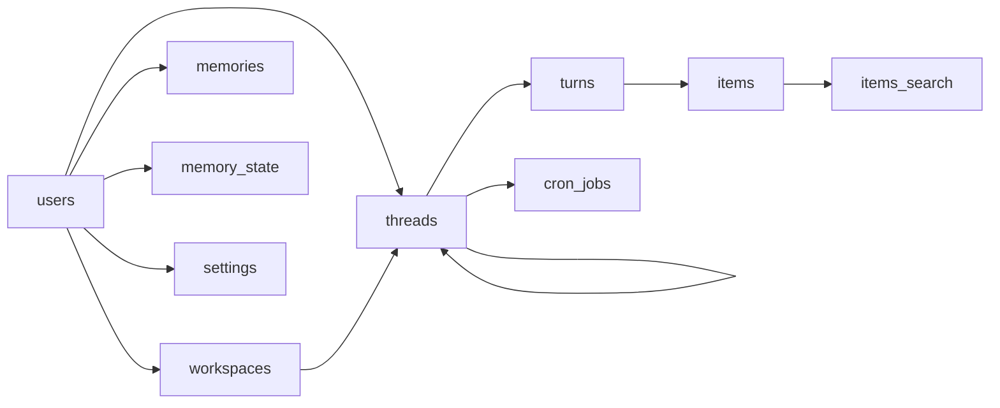
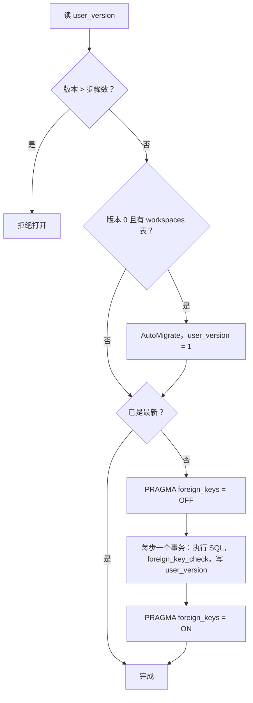

# 持久化与崩溃恢复

Ollupi 的运行状态全部存在 SQLite。一个库是一个分片（shard），分片上的用户共用它的表。每一步在执行之前先写库，所以进程任何时刻退出，重启后都能从库里读出"做到哪了"。调度不依赖内存里的状态，详见[执行模型](/zh/engine/execution)。

## SQLite 配置

库文件在 `<home>/data/ollupi.sqlite`，目录不存在时以 `0755` 创建。驱动是 `gorm.io/driver/sqlite`（底层 `mattn/go-sqlite3`）。

| 配置 | 值 | 位置 |
|---|---|---|
| `_journal_mode` | `WAL` | DSN |
| `_busy_timeout` | `5000`（毫秒） | DSN |
| `_foreign_keys` | `on` | DSN |
| 连接池 | `SetMaxOpenConns(1)`，一个进程一条连接 | `repo/db.go` |
| `SkipDefaultTransaction` | `true`，单条写不自动包事务 | gorm 配置 |
| 时间 | `NowFunc` 取 UTC，写入前都转 UTC | gorm 配置 |
| 日志 | gorm 日志静默 | gorm 配置 |

只有一条连接，所以进程内的数据库访问是串行的。`DB.Tx` 用 gorm 的事务，回调里拿到的是绑定这个事务的 `*DB`，里面的读写都要走它。事务开始时还会检查租约围栏，见[分片与多用户](/zh/engine/sharding)。

构建时必须带 `-tags sqlite_fts5`，消息搜索需要 FTS5。`repo/fts5.go` 在没有这个标签时引用一个不存在的符号，让编译直接失败。

枚举列（轮次状态、条目类型和状态、记忆范围和状态）写入时由 `driver.Valuer` 校验，值不在列表里就写不进去。

## 表和关系



外键：指向 `users` 和 `workspaces` 的是 `ON DELETE RESTRICT`；`turns`、`items`、`cron_jobs` 指向 `threads`，`items` 指向 `turns`，`threads.parent_thread_id` 指向 `threads`，都是 `ON DELETE CASCADE`。所以删除一个会话会带走它的轮次、条目、定时任务和子 agent 会话。工作区只归档，没有删除操作。

`shard_lease` 单独一张，不和其他表关联。

### users

分片上的用户。"谁是调用者"在进入 Ollupi 之前就确定了，这一行只表示用户存在于这个分片。

| 字段 | 类型 | 说明 |
|---|---|---|
| `id` | text，主键 | 用户 ID；`repo.DefaultUser` 是 `default` |
| `created_at` | datetime | 创建时间 |

`EnsureUser` 在一个事务里建 `users`、`memory_state`、`settings` 三行，用户已存在时不变。`Open` 总会确保 `default` 用户存在。

### workspaces

工作区（workspace）是 agent 工作的一个目录。

| 字段 | 类型 | 说明 |
|---|---|---|
| `id` | text，主键 | |
| `user_id` | text，外键 | 所属用户 |
| `name` | text | 名称，`CHECK length(trim(name)) > 0` |
| `root_path` | text | 根目录，`(user_id, root_path)` 唯一 |
| `settings` | text，JSON | 工作区权限：`approvalPolicy` 和 `permissions` |
| `created_at`、`updated_at` | datetime | |
| `archived_at` | datetime，可空 | 非空表示已归档 |

### threads

| 字段 | 类型 | 说明 |
|---|---|---|
| `id` | text，主键 | |
| `user_id` | text，外键 | 所属用户 |
| `workspace_id` | text，外键，可空 | 空表示不属于任何工作区（general） |
| `title` | text | 只由 `thread/start`、`thread/rename` 写；子 agent 取任务描述 |
| `settings` | text，JSON | 会话级权限 |
| `parent_thread_id` | text，外键，可空 | 非空表示子 agent 会话 |
| `parent_item_id` | text，可空 | 派生它的工具调用条目 |
| `created_at`、`updated_at` | datetime | 列表按 `updated_at, created_at, id` 倒序 |
| `archived_at` | datetime，可空 | 非空表示已归档 |

`touchThread` 只写 `updated_at`，所以轮次结束不会把旧标题写回去覆盖改名。

### turns

| 字段 | 类型 | 说明 |
|---|---|---|
| `id` | text，主键 | UUID |
| `thread_id` | text，外键 | |
| `seq` | integer | 会话内序号，`(thread_id, seq)` 唯一 |
| `status` | text | 九个状态，见[执行模型](/zh/engine/execution) |
| `model` | text，JSON | 这一轮用的模型：`name`、`connection`、`thinking`、`images` |
| `input_tokens` | integer | 累计输入 token |
| `cached_input_tokens` | integer | 其中命中缓存的 |
| `cache_write_input_tokens` | integer | 其中写入缓存的 |
| `output_tokens` | integer | 累计输出 token |
| `error` | text | 结束原因 |
| `cron_job_id` | text | 由定时任务发送时非空 |
| `created_at` | datetime | 提交时间 |
| `started_at` | datetime | 成为当前轮次的时间 |
| `completed_at` | datetime，可空 | 结束时间 |
| `attachments` | text，JSON | 这条消息的附件 |
| `input` | text | 消息正文 |

轮次上的 `input` 和 `attachments` 在 `queued` 期间保存消息。变成 `ready` 时才生成用户消息条目。

用量在每次运行结束时由 `AddUsage` 累加到轮次上。进程被杀时，这次运行的轮次级累计会丢失，模型调用的用量还留在各自的条目上。

### items

条目模型见下一节。

| 字段 | 类型 | 说明 |
|---|---|---|
| `id` | text，主键 | UUID |
| `thread_id` | text，外键 | |
| `turn_id` | text，外键 | |
| `seq` | integer | 会话内序号，`(thread_id, seq)` 唯一 |
| `type` | text | 七种类型 |
| `status` | text | 五种状态 |
| `call_id` | text | 模型给的工具调用 ID |
| `tool` | text | 工具名 |
| `server` | text | 工具的提供方 |
| `response_id` | text | 同一次模型回答的条目共用 |
| `error` | text | 失败原因 |
| `started_at`、`completed_at` | datetime | |
| `approval` | text，JSON | 审批记录 |
| `await` | text，JSON | 工具在等什么：`by`、`request`、`threadId` |
| `annotations` | text，JSON | 工具注解的快照 |
| `usage` | text，JSON | 这次模型调用的用量 |
| `context_stats` | text，JSON | 这次调用的上下文统计 |
| `memory` | text，JSON | 记忆快照引用的条目 |
| `attachments` | text，JSON | 用户消息的附件 |
| `text` | text | 消息或思考正文；压缩摘要；记忆快照文本；错误或通知文本 |
| `arguments` | text | 工具调用参数原文 |
| `prepared_execution` | text，JSON | 冻结的执行内容 |
| `result` | text，JSON | 工具结果：`output`、`artifacts` |
| `native` | blob | 模型提供方自己的回答记录，原样回放给同类提供方 |

`turns` 和 `items` 把可能很大的列放在最后，这样读前面的小列不用遍历溢出页（migration 0003 的说明）。给客户端的分页读取跳过 `native` 列。

### cron_jobs

| 字段 | 类型 | 说明 |
|---|---|---|
| `id` | text，主键 | |
| `thread_id` | text，外键 | 所属会话 |
| `name` | text | `(thread_id, name)` 唯一 |
| `spec` | text | cron 表达式 |
| `prompt` | text | 到点发送的消息 |
| `times` | integer，可空 | 总次数；空表示一直重复 |
| `runs` | integer | 已发送次数 |
| `paused` | numeric | 是否暂停 |
| `next_run_at` | datetime | 下次运行时间 |
| `created_at` | datetime | |

定时任务没有 `user_id`，经所属会话找到用户。行为见[定时任务](/zh/engine/cron)。

### memories

| 字段 | 类型 | 说明 |
|---|---|---|
| `id` | text，主键 | |
| `user_id` | text，外键 | |
| `scope` | text | `global`、`general`、`workspace` |
| `workspace_id` | text | `scope = 'workspace'` 时非空，否则为空，由 CHECK 约束 |
| `origin_workspace_id` | text | 移到全局前所在的工作区，只有 `global` 能非空 |
| `topic` | text | `(user_id, scope, workspace_id, topic)` 唯一 |
| `kind` | text | 记忆类型 |
| `text` | text | 内容 |
| `status` | text | `active`、`retired`、`forgotten` |
| `user_edited` | numeric | 用户改过，不被自动覆盖 |
| `sources` | text，JSON | 来源 |
| `created_at`、`updated_at` | datetime | |

### memory_state

每个用户一行，记录提炼进度。行为见[记忆](/zh/engine/memory)。

| 字段 | 类型 | 说明 |
|---|---|---|
| `user_id` | text，主键，外键 | |
| `cursor_at`、`cursor_id`、`cursor_seq` | datetime、text、integer | 提炼到哪个已结束轮次的哪个条目 |
| `attempts` | integer | 当前位置的尝试次数 |
| `next_attempt` | datetime，可空 | 下次重试时间 |
| `skipped` | integer | 已跳过的条目数 |
| `last_success` | datetime，可空 | |
| `last_failure`、`last_skip`、`last_report` | text，JSON，可空 | 最近的失败、跳过和报告 |

### settings

每个用户一行。

| 字段 | 类型 | 说明 |
|---|---|---|
| `user_id` | text，主键，外键 | |
| `redaction` | numeric | 是否脱敏，默认开 |
| `redaction_key` | text | 脱敏占位符的密钥，随机生成一次，不暴露给客户端 |

### shard_lease

分片租约。最多一行，`CHECK id = 1`。

| 字段 | 类型 | 说明 |
|---|---|---|
| `id` | integer，主键 | 固定为 1 |
| `owner` | text | 持有进程的 UUID |
| `expires_at` | integer | Unix 毫秒 |

协议见[分片与多用户](/zh/engine/sharding)。

### items_search

FTS5 外部内容虚拟表，分词器 `trigram`，内容来自 `items`：

```sql
CREATE VIRTUAL TABLE `items_search` USING fts5(text, content='items', content_rowid='rowid', tokenize='trigram');
```

只收录已完成的 `userMessage` 和 `agentMessage`，由 `items_search_insert`、`items_search_delete`、`items_search_update` 三个触发器维护。索引靠 `rowid` 回读 `items`，而 `items` 没有 INTEGER PRIMARY KEY，所以 `VACUUM` 或重建 `items` 的 migration 会重新编号 rowid，之后必须重建这个索引。搜索的行为见[搜索](/zh/engine/search)。

### 索引

部分索引的条件要和查询里的条件一字不差。查询用 `INDEXED BY` 指定索引，条件漂移时 SQLite 直接报错，而不是退回全表扫描。

| 索引 | 表 | 定义 | 用途 |
|---|---|---|---|
| `turns_one_active` | `turns` | 唯一 `(thread_id)`，条件：不是 queued 也未结束 | 一个会话只有一个当前轮次 |
| `turns_open` | `turns` | `(thread_id)`，条件：未结束 | `ThreadState` 读未结束的轮次 |
| `turns_ready` | `turns` | `(started_at)`，条件：`status = 'ready'` | 就绪队列 |
| `turns_ended` | `turns` | `(completed_at, id)`，条件：已结束 | 记忆提炼的游标 |
| `turns_cron_job` | `turns` | `(cron_job_id, created_at)`，条件：`cron_job_id <> ''` | 定时任务发过的轮次 |
| `items_turn` | `items` | `(turn_id, type, status, seq)` | 一轮的未结束调用和消息 |
| `items_compactions` | `items` | `(thread_id, seq)`，条件：完成的压缩 | 找最新一次压缩 |
| `items_carried` | `items` | `(thread_id, seq)`，条件见下 | 压缩之前仍需要的条目 |
| `threads_list` | `threads` | `(user_id, updated_at, created_at, id)`，条件：顶层会话 | 会话列表 |
| `threads_workspace_list` | `threads` | `(workspace_id, updated_at, created_at, id)`，条件：顶层会话 | 按工作区列会话 |
| `threads_parent` | `threads` | `(parent_thread_id)`，条件：子 agent | 找子 agent |
| `cron_jobs_due` | `cron_jobs` | `(paused, next_run_at)` | 到期任务 |

## 条目模型

一轮的全部过程都记成条目，按 `seq` 排序。`seq` 在会话内递增（`MAX(seq) + 1`），读完整会话时会校验没有空洞。

### 类型

| 类型 | 含义 |
|---|---|
| `userMessage` | 用户消息，包括插话 |
| `agentMessage` | 模型回答的正文 |
| `reasoning` | 模型的思考内容 |
| `toolCall` | 一次工具调用，结果也在这一行 |
| `contextCompaction` | 一次压缩，`text` 是摘要 |
| `memoryContext` | 载入的记忆快照 |
| `error` | 模型调用失败，或运行时发给模型的通知 |

### 状态

| 状态 | 含义 |
|---|---|
| `pending` | 已记录，未执行。工具调用等判定或等审批时都是这个状态 |
| `inProgress` | 进行中。工具调用已开始执行或在等 `await`；回答正在流式输出 |
| `completed` | 成功 |
| `failed` | 失败，`error` 写原因 |
| `declined` | 用户拒绝了这次工具调用 |

几个判断都基于字段，没有单独的状态列：

- 等审批：`toolCall`、`pending`、`approval` 非空且 `decision` 为空。
- 等回答或子 agent：`toolCall`、`inProgress`、`await` 非空，`await.by` 区分 `user` 和 `agent`。
- 未结束的调用：`type = 'toolCall' AND status IN ('pending', 'inProgress')`。

### 一次模型回答

一次模型调用可能产生 `reasoning`、`agentMessage` 和多个 `toolCall`，它们共用同一个 `response_id`。组装提示词时按 `response_id` 把它们合成一条 assistant 消息和若干 tool 消息。

这次调用的 `context_stats`、`usage`、`native` 只写在它记录的第一个条目上，优先级是 `agentMessage`、`reasoning`、第一个 `toolCall`，所以每次调用只计一次。

### 写入约束

所有写入都经过 `saveItemOf`：

- 新条目分配 `seq`。
- 已有条目不能改 `thread_id`、`type`、`turn_id`。
- 已有 `prepared_execution` 的条目不能再改它，也不能改 `arguments`、`tool`、`server`。审批依据的内容不会被悄悄换掉。
- `saveItem` 是带条件的 upsert，只更新固定的一组列。

`RecordItem` 在事务里确认条目所属的轮次是会话的当前轮次，否则拒绝。写入工具调用时，如果轮次在等待状态，同一事务内重算轮次状态。

### 运行时读取什么

一次运行不读会话的全部条目。`RunItems` 读两部分：

1. 最新一次完成的压缩及之后的所有条目。
2. 压缩之前的"跨压缩仍有效"的条目，不读 `native`。

第二部分的条件是 `carriedItem`：

```sql
type = 'userMessage' OR (type = 'toolCall' AND (approval ->> '$.decision' = 'acceptForSession'
  OR (status = 'completed' AND (tool = 'load_tools' OR result -> '$.artifacts' IS NOT NULL))))
```

用户消息要被压缩历史引用；`acceptForSession` 的调用让这个会话里后续同类调用继续放行；`load_tools` 决定哪些工具已加载；带 artifacts 的结果是激活的技能。详见[上下文管理](/zh/engine/context)。

## 先落库再执行的顺序

下表是一轮从提交到结束的写入顺序。每一行都是先写库再做下一步。

| 时机 | 写入 | 函数 |
|---|---|---|
| 收到消息 | 一个事务：插入轮次（`queued`）。没有未结束的轮次时，同一事务改成 `ready`，插入 `userMessage`，更新 `threads.updated_at` | `SubmitTurn` |
| 前一轮结束 | 一个事务：最早的 `queued` 改成 `ready`，插入 `userMessage` | `StartQueuedTurn` |
| 拿到槽位 | `status = 'inProgress'`，之后才起 goroutine | `Launch` |
| 需要记忆快照 | 插入 `memoryContext` | `loadMemory` |
| 压缩开始 | 插入 `contextCompaction`（`inProgress`），之后才调用模型 | `compact` |
| 压缩结束 | `text` 写摘要，`completed` 或 `failed` | `compact` |
| 流式首个增量 | 插入 `reasoning` 或 `agentMessage`（`inProgress`，正文为空） | `responseRecorder.add` |
| 模型回答结束 | 写完整正文，`completed` | `responseRecorder.finish` |
| 回答里的工具调用 | 每个调用插入一条 `pending`，全部写完才开始执行工具 | `respond` |
| 工具准备 | 写 `prepared_execution` | `handleCall` |
| 需要审批 | 写 `approval`，状态仍是 `pending`，然后退出运行 | `handleCall` |
| 工具开始前 | `inProgress`，之后才调用工具 | `runJobs` |
| 工具结束 | 写 `result`，`completed` 或 `failed` | `finishTool` |
| 工具要等待 | 写 `await`，状态保持 `inProgress` | `finishTool` |
| 离开槽位 | 轮次改成等待状态或 `ready` | `Park` |
| 用户回答 | 一个事务：写条目，重算轮次状态 | `RecordItem` |
| 一轮结束 | 一个事务：写轮次终态和用量，未完成条目标 `failed`，更新会话时间 | `EndTurn` |

只有增量文本不落库，它们只推给界面。回答结束时完整文本一次写入，失败时写入已收到的部分。

除增量外，事件都在写库之后才发，所以客户端看到的状态都已在库里。

## 崩溃恢复

上面的写入顺序保证了：进程任何时刻退出，库里都能读出做到了哪一步。`Agent.Start` 在起调度循环前调用 `recover`。这时内存是空的，所有 `inProgress` 的轮次都不在任何槽位上。

`StrandedThreads` 找出可能走不下去的会话：

```sql
SELECT thread_id FROM turns WHERE status IN ('inProgress', 'waitingOnAgent')
UNION SELECT thread_id FROM turns q WHERE q.status = 'queued'
  AND NOT EXISTS (SELECT 1 FROM turns a WHERE a.thread_id = q.thread_id AND <当前 turn>)
```

三类分别是：上个进程在跑的轮次；等子 agent 的轮次，子 agent 可能已结束但没回报，或者根本没开始；排队的轮次前面没有当前轮次。

对每个会话：

1. `RecoverItems` 处理当前轮次的 `inProgress` 条目，见下表。
2. 轮次还是 `inProgress`：`Park`，按未结束的调用改成等待状态或 `ready`。
3. `reconcile`。

最后 `admit` 把 `ready` 的轮次送进槽位。`ready`、`waitingOnApproval`、`waitingOnUserInput` 的轮次不用特别处理，它们本来就不依赖进程。

条目按类型处理：

| 条目 | 恢复时 |
|---|---|
| 工具调用 `pending` | 不动。还没执行，`planCalls` 会照常判定和执行 |
| 工具调用 `inProgress`，无 `await` | 标 `failed`，错误文本是 `the app stopped while this call was running; it may or may not have taken effect, so check before repeating it` |
| 工具调用 `inProgress`，有 `await` | 不动，继续等 |
| `agentMessage`、`reasoning`、`contextCompaction` 在 `inProgress` | 标 `failed`，错误文本 `the app stopped before this finished` |

`pending` 和 `inProgress` 的区分就是"先落库再执行"的用途：执行前一定先写 `inProgress`。所以恢复时 `pending` 一定没跑过，可以重做；`inProgress` 可能已经生效，绝不重跑，错误文本交给模型，由它判断要不要先检查再重试。这样工具调用不会被执行两次。

模型回答没有副作用，所以没写完的回答直接作废，恢复后重新调用模型。流式文本不落库，这部分文本会丢。

一个边界：进程如果在最终回答落库之后、`EndTurn` 之前退出，这一轮恢复后是 `ready`，运行时再调用一次模型，会多出一条回答。

正常关闭和崩溃走同一条恢复路径。取消 ctx 后，`afterRun` 进不了循环，或者走到 `a.ctx.Err() != nil` 分支什么也不写，轮次留在 `inProgress`。

## Migration 机制

表结构按编号的步骤升级，文件在 `repo/migrations/NNNN_<what>.sql`，用 `go:embed` 打进二进制。以前用 gorm 的 `AutoMigrate`，它只能加表和加列，不能加的改动就得清库，而库里存着用户的会话和记忆。

规则：

- 文件名必须是四位编号加 `_<what>.sql`，编号从 1 开始，不能有空洞，否则 `steps()` 报错。
- 库的版本存在 `PRAGMA user_version`，含义是已执行的步数。
- 版本高于本程序知道的步数时拒绝打开：`the database is at schema version N, from a newer ollupi; this one knows up to M`。
- 步骤只往前走，没有回滚。

`DB.migrate` 的流程：



要点：

- 版本 0 且已有 `workspaces` 表的库是 migration 之前由 gorm 建的。它用 `AutoMigrate` 补齐并标为版本 1，保留数据。`AutoMigrate` 用的是当前的全部行类型，所以 0005 和 0006 用 `CREATE TABLE IF NOT EXISTS` 建表，0002 用 `DROP INDEX IF EXISTS`。
- 步骤运行时外键关闭，这样可以重建被其他表引用的表而不触发级联删除。
- 每步提交前运行 `PRAGMA foreign_key_check`，有悬空引用就让这一步失败并回滚：`N rows of T refer to rows that do not exist`。
- `user_version` 和步骤本身在同一事务里，所以一步要么完整生效要么没发生。
- 任何一步失败，`Open` 返回错误并关闭连接。
- `migrate` 之后 `applySchema` 确保 `default` 用户存在。

`TestMigrationsMatchTheRows` 比较两个库：一个走完全部 migration，一个由 gorm 根据行类型建出。列、键、检查约束、索引必须一致。行类型改了却没写 migration 时测试失败。

分片目录库（`repo.Catalog`）是单独的文件，只有 `shards` 和 `placements` 两张表，用 `AutoMigrate`，不走这套步骤。见[分片与多用户](/zh/engine/sharding)。

## 六个 migration

| 编号 | 文件 | 做什么 |
|---|---|---|
| 0001 | `0001_init.sql` | migration 开始时 gorm 建出的结构：`workspaces`、`threads`、`turns`、`items`、`cron_jobs`、`memories`、`memory_state`、`settings` |
| 0002 | `0002_turn_waiting_statuses.sql` | 给轮次引入 `ready` 和等待状态，重建 `turns_one_active`、`turns_open`，新增 `turns_ready` |
| 0003 | `0003_rebuild_turns_items.sql` | 重建 `turns` 和 `items`：大列放最后，`turns` 增加 `created_at` |
| 0004 | `0004_search_messages.sql` | 新增 FTS5 表 `items_search` 和三个触发器 |
| 0005 | `0005_users.sql` | 引入多用户：`users` 表，`workspaces`、`threads`、`memories` 加 `user_id`，`settings` 和 `memory_state` 改成每用户一行 |
| 0006 | `0006_shard_lease.sql` | 新增 `shard_lease` |

### 0002 等待状态

等待中的轮次以前都是 `inProgress`。这一步只改索引，不动数据：唯一索引 `turns_one_active` 的条件从 `status = 'inProgress'` 改成"不是 queued 也未结束"，`turns_open` 的条件改成"未结束"，再加 `turns_ready`。旧版留下的 `inProgress` 轮次在启动时按普通的恢复流程处理。

### 0003 重建 turns 和 items

SQLite 不能调整列的顺序，所以新建 `turns_new`、`items_new`，复制数据，删旧表，改名，重建索引。

- `turns.created_at` 是提交时间。以前 `started_at` 兼任这个含义，这一步后轮次开始时 `started_at` 会更新。已有行的 `created_at` 取原来的 `started_at`。
- `turns_cron_job` 改成部分索引，只收录定时任务发出的轮次。
- 补上 `threads_workspace` 索引，用于工作区外键。

### 0004 消息搜索

建表之后用 `INSERT ... SELECT` 回填已完成的用户和 agent 消息。更新触发器先删旧文本再插新文本，文本不变的更新也保持索引。

### 0005 多用户

`users` 建好后插入 `default` 用户。`workspaces`、`threads`、`memories`、`memory_state`、`settings` 都用新建、复制、删旧、改名的方式重建，已有行全部归 `default`。

- `user_id` 默认是空字符串，而没有哪个用户的 id 是空字符串，所以漏写用户的行会被外键拒绝。
- `workspaces` 的唯一索引从 `root_path` 改成 `(user_id, root_path)`，不同用户可以有相同的根目录。
- `memory_state` 和 `settings` 的主键从固定的 `id = 1` 改成 `user_id`。
- `turns`、`items`、`cron_jobs` 不变，它们经 `threads` 找到用户。

这一步没有重建 `items`，所以 `items_search` 的 rowid 不受影响。

### 0006 分片租约

建 `shard_lease` 单行表。

## 代码位置

| 仓库 | 路径 | 职责 |
|---|---|---|
| ollupi | `repo/db.go` | 打开库、事务、行类型列表 |
| ollupi | `repo/migrate.go` | migration 执行 |
| ollupi | `repo/migrations/` | 六个 migration |
| ollupi | `repo/threads.go` | `threads` 表、`ThreadState` |
| ollupi | `repo/turns.go` | `turns` 表、`SubmitTurn`、`EndTurn`、`RunItems` |
| ollupi | `repo/items.go` | `items` 表、`RecordItem`、`RecoverItems` |
| ollupi | `repo/users.go` | `users` 表、`EnsureUser` |
| ollupi | `repo/workspaces.go` | `workspaces` 表 |
| ollupi | `repo/cron_jobs.go` | `cron_jobs` 表 |
| ollupi | `repo/memories.go`、`repo/memory_state.go` | 记忆和提炼进度 |
| ollupi | `repo/settings.go` | `settings` 表 |
| ollupi | `repo/shard.go` | `shard_lease` 表和围栏 |
| ollupi | `repo/search.go`、`repo/fts5.go` | 搜索和 FTS5 构建检查 |
| ollupi | `repo/migrate_test.go` | migration 和行类型一致性测试 |
