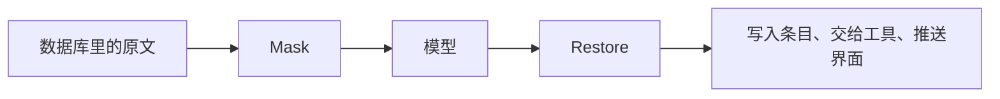

# 脱敏

脱敏（redaction）在消息离开引擎之前把敏感值换成占位符，在模型的回答回来之后换回原值。模型看不到手机号、密钥这些值，用户和工具看到的内容不受影响。`pkg/redact` 只做文本替换，调用它的是运行时和记忆提炼。

替换是双向的：发出去的是 `<PHONE:a1b2c3d4>`，模型回答里写的也是这个占位符，还原后界面和工具拿到真实号码。模型要操作这个值时，工具调用的参数同样被还原，所以任务不受影响。脱敏在整体安全设计里的位置见[安全总览](/zh/engine/security)。

## 为什么这样设计

- **只在模型边界替换，库里存原文。** 脱敏针对的是模型服务商，所以替换只发生在请求发出的那一刻。记忆曾有自己的凭据过滤，因为记忆只经模型调用到达模型，`831b554` 删掉了它，记忆里存真实值。见[设计决策 15](/zh/reference/decisions#_15-脱敏只在模型边界)。
- **占位符用 HMAC，密钥持久化。** 同一个值在同一个用户下总是同一个占位符，模型能认出两处说的是同一个值，历史逐字稳定，服务商的前缀缓存继续命中。`e36dd28` 起用的是进程启动时随机生成的密钥，`9ac61ec` 改成存进设置，占位符在重启后不变。
- **双向还原，任务不受影响。** 回答和工具参数在落库、交给工具之前还原。模型看不到值，但仍能让工具使用它。
- **按模式识别，带校验。** 正则找候选，身份证和银行卡再过校验码，减少把普通数字当成敏感值。截断工具输出时切点避开敏感范围，否则留下的半段认不出来，会原样发出去（`31f9092`）。
- **用户可以关，下一次模型调用就生效。** 开关每次调用模型前读一次，正在运行的一轮也跟着变（`2d7d064`）。

代价：数据库里是明文；每次模型调用都要过一遍检测器，`bd16658` 让每轮的 `Redactor` 缓存处理过的文本，同一段一轮只扫一次；识别不到的形式原样发给模型。

## 识别类型

`findSpans` 用一组正则扫描文本。有些类型再经校验函数确认，减少误伤。

| 类别 | 占位符前缀 | 匹配 | 校验 | 优先级 |
| --- | --- | --- | --- | --- |
| 私钥 | `SECRET` | PEM 的 `BEGIN ... PRIVATE KEY` 到 `END` 整段 | | 100 |
| AWS 访问密钥 | `SECRET` | `AKIA` 或 `ASIA` 加 16 位 | | 99 |
| GitHub 令牌 | `SECRET` | `ghp_`、`gho_`、`ghu_`、`ghs_`、`ghr_` 加 36 位 | | 99 |
| `sk-` 密钥 | `SECRET` | `sk-` 加至少 20 位 | | 99 |
| Slack 令牌 | `SECRET` | `xoxb-`、`xoxa-`、`xoxp-`、`xoxr-`、`xoxs-` 加至少 10 位 | | 99 |
| JWT | `JWT` | `eyJ` 开头的三段 | | 95 |
| 身份证 | `IDCARD` | 17 位数字加校验位 | GB 11643 校验码 | 90 |
| 银行卡 | `BANKCARD` | 13 到 19 位数字 | Luhn | 89 |
| 手机号 | `PHONE` | `1[3-9]` 开头的 11 位 | | 88 |
| 邮箱 | `EMAIL` | 常规形式 | | 80 |
| IPv4 | `IP` | 四段点分 | 每段不超过 255，无前导 0 | 70 |
| MAC | `MAC` | 六组十六进制，`:` 或 `-` 分隔 | | 70 |

重叠时按起点排序，同起点比优先级，再比长度，靠前的留下，和它重叠的丢弃。

输入常常是 JSON 文本，`\n13812345678` 里的 `n` 会让 `\b` 失效。`escapeView` 把 `\n`、`\t` 这类转义换成空格再匹配，位置不变，取值仍从原文取。

## HMAC 占位符

占位符的形式是 `<类别:十六进制>`：

```go
func (r *Redactor) placeholder(cat category, value string) string {
	mac := hmac.New(sha256.New, r.key)
	mac.Write([]byte(value))
	hexSum := hex.EncodeToString(mac.Sum(nil))
	for n := 8; ; n += 4 {
		p := fmt.Sprintf("<%s:%s>", cat, hexSum[:n])
		if existing, ok := r.reverse[p]; !ok || existing == value {
			r.reverse[p] = value
			return p
		}
	}
}
```

用 HMAC 而不是随机编号有两个原因：

- 同一个值在同一个用户下总得到同一个占位符。模型能看出两处提到的是同一个人，发给模型的历史逐字稳定，服务商的前缀缓存继续命中。
- 没有密钥推不回原值。短值（手机号）直接哈希可以穷举，HMAC 不行。

密钥是 `settings.redaction_key`，用户创建时用 `rand.Text()` 生成一次，不经协议暴露（`json:"-"`）。占位符默认 8 位十六进制，同一次运行里撞上不同的值时每次加 4 位。

`Redactor` 存两张表：`reverse` 是占位符到原值的映射，`masked` 缓存每段文本的结果。一轮里每次模型调用都重发历史，有了缓存，历史只扫描一次。

`Redactor` 不落库，每次运行时 `rt.start` 新建一个。重启或跨轮之后 `reverse` 为空，但每次发送都先把全部历史脱敏一遍，表随之重建，模型能引用的占位符都在表里。

## 替换的时机和位置



数据库里存的是原文。占位符只存在于发给模型的请求和模型的回答之间。

### 发送前

`Runtime.send` 每次调用模型时处理：

| 内容 | 处理 |
| --- | --- |
| 系统提示词 | `Mask` |
| 消息 `Content`（用户消息、工具结果、摘要、记忆快照） | `Mask` |
| `ReasoningContent` | `Mask` |
| 工具调用的 `Arguments` | `Mask` |
| 文本附件 | `Mask`，加上文件头之后 |
| 图片附件 | 不处理 |
| 工具定义 | 不处理 |
| `Native` 记录 | 不处理 |

`Native` 是服务商自己格式的回答，见[模型接入](/zh/engine/models)。它保存的是模型当时的原始输出，带着占位符，下次原样发回，这样签名仍然有效。

### 回答后

| 内容 | 处理 |
| --- | --- |
| 流式 `Content`、`Reasoning` | 经 `Stream` 还原后再送出 |
| 完整 `Content`、`ReasoningContent` | `Restore` |
| 工具调用的 `Arguments` | `RestoreJSON` |

`Stream` 解决占位符被切成两段的问题。一段文本结尾有 `<` 且后面没有 `>`，距离不足 64 字节（`maxPlaceholderLen`）时先留着，等下一段拼起来。流结束时 `Flush` 输出剩余内容。

工具参数是 JSON 字符串，原值里的引号和反斜杠必须转义，所以用 `RestoreJSON`，它写入的是 JSON 转义后的值。模型有时把占位符的 `<`、`>` 写成 JSON 的 Unicode 转义（`<` 写作反斜杠加 `u003c`，`>` 写作反斜杠加 `u003e`），这种形式也被识别。

只有 `<` 或 `\` 出现时才进替换循环，普通文本直接返回。

### 截断时

工具输出太长时要切掉中间一段。如果切点落在敏感值中间，留下的半段不再匹配正则，就会被原样发给模型。`cutPoints` 用 `redact.Spans` 拿到敏感范围，把切点移到范围外，整个值归入被切掉的部分。这一步不依赖开关，总是生效。

### 记忆提炼

提炼任务发给模型的是另一条路径。`Manager.extract` 用同样的密钥新建一个 `Redactor`，对整个 JSON 载荷 `Mask`。模型返回的操作里 `topic` 和 `text` 经 `Restore` 还原后再入库，所以记忆表里也是原文。见[记忆](/zh/engine/memory)。

## 开关

`settings.redaction`，每用户一行，默认开。协议方法 `settings/read` 和 `settings/update`（参数 `{redaction: bool}`），改动后推送 `settings/changed`。

`Runtime.send` 每次调用模型前都读设置，所以切换在下一次模型调用生效，正在运行的一轮也一样。关闭时 `mask` 是恒等函数，请求发原文。还原逻辑不变，`reverse` 为空时等于什么都不做。

已经存进 `Native` 的旧回答不随开关改变，里面的占位符保持原样。

## 边界与已知问题

- **只认上面列出的形式。** 没有匹配规则的敏感内容原样发给模型，比如姓名、地址、配置文件里的密码，以及格式不在表里的令牌。`sk-` 规则要求 `sk-` 后面是至少 20 位连续的字母或数字，中间带 `-` 或 `_` 的写法（如 `sk-proj-…`）不匹配。IP 地址只认 IPv4。
- **图片、工具定义不处理。** 图片附件原样发送；工具的描述和 schema（包括 MCP 服务器提供的）不经 `Mask`。
- **挡的是模型看到，不是 agent 使用。** 工具参数会被还原，模型可以让命令用到它看不到的值，包括把它发到别处。这类调用由[权限](/zh/engine/permissions)和[沙箱](/zh/engine/sandbox)管。
- **数据库里是明文。** 条目和记忆都存原值，见[替换的时机和位置](#替换的时机和位置)。
- **模型自己输出的值不还原。** 从没发给模型的敏感值不在 `reverse` 里，原样保留。
- **关掉之后旧回答不变。** 已经存进 `Native` 的回答里的占位符保持原样，见[开关](#开关)。
- **日志不记消息正文。** 占位符只对发给模型的内容生效，日志记的是 ID、计数和错误。

## 代码位置

| 位置 | 职责 |
| --- | --- |
| ollupi `pkg/redact/redact.go` | 识别、占位符、`Mask`、`Restore`、`Stream`、`Spans` |
| ollupi `agent/runtime/chat.go` | `send` 里的双向替换 |
| ollupi `agent/runtime/runtime.go` | 每次运行新建 `Redactor` |
| ollupi `agent/contextmanager/observation.go` | 截断时避开敏感范围 |
| ollupi `agent/memory/manager.go` | 记忆提炼的脱敏 |
| ollupi `repo/settings.go` | 开关和密钥的存储 |
| ollupi `repo/users.go` | 创建用户时生成密钥 |
| ollupi `gateway/settings.go` | `settings/read`、`settings/update` |
