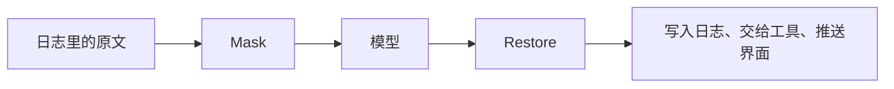

# 脱敏

脱敏（redaction）在请求发给模型之前把敏感值换成占位符，在模型的回答回来之后换回原值。模型看不到手机号、密钥这些值，用户和工具看到的内容不受影响。`pkg/redact` 只做文本替换，调用它的是一轮运行里的模型调用（`run/model.go`）和记忆提取（`extract`）。

替换是双向的：发出去的是 `<PHONE:a1b2c3d4>`，模型回答里写的也是这个占位符，还原后界面和工具拿到真实号码。模型要操作这个值时，工具调用的参数同样被还原，所以任务不受影响。脱敏在整体安全设计里的位置见[安全总览](/zh/engine/security)。

## 为什么这样设计

- **只在模型边界替换，日志里存原文。** 脱敏针对的是模型服务商，所以替换只发生在请求发出的那一刻。记忆只经模型调用到达模型，所以记忆不另做过滤，存的是真实值。见[设计决策 15](/zh/reference/decisions#_15-脱敏只在模型边界)。
- **占位符用 HMAC，密钥持久化。** 同一个值在同一个用户下总是同一个占位符，模型能认出两处说的是同一个值，历史逐字稳定，服务商的前缀缓存继续命中。密钥存在用户的设置里，占位符在重启后不变。
- **双向还原，任务不受影响。** 回答和工具参数在写进日志、交给工具之前还原。模型看不到值，但仍能让工具使用它。
- **按模式识别，带校验。** 正则找候选，身份证和银行卡再过校验码，减少把普通数字当成敏感值。截断工具输出时切点避开敏感范围，否则留下的半段认不出来，会原样发出去。
- **用户可以关，下一次模型调用就生效。** 开关在每一步开始时读一次，正在运行的一轮也跟着变。

代价：日志里是明文；每次模型调用都要过一遍检测器，整段历史每次请求都重新扫描；识别不到的形式原样发给模型。

::: info 演进
- 记忆曾有自己的凭据过滤，`831b554` 删掉了它。
- `e36dd28` 起占位符用的是进程启动时随机生成的密钥，重启后会变；`9ac61ec` 改成存进设置。
- 截断时避开敏感范围来自 `31f9092`；开关每次调用前读来自 `2d7d064`。
:::

## 识别类型

`findSpans` 用一组正则扫描文本。有些类型再经校验函数确认，减少误伤。

| 类别 | 占位符前缀 | 匹配 | 校验 | 优先级 |
| --- | --- | --- | --- | --- |
| 私钥 | `SECRET` | PEM 的 `BEGIN ... PRIVATE KEY` 到 `END` 整段 | | 100 |
| AWS 访问密钥 | `SECRET` | `AKIA` 或 `ASIA` 加 16 位大写字母或数字 | | 99 |
| GitHub 令牌 | `SECRET` | `ghp_`、`gho_`、`ghu_`、`ghs_`、`ghr_` 加 36 位 | | 99 |
| GitHub 细粒度令牌 | `SECRET` | `github_pat_` 加至少 22 位 | | 99 |
| `sk-` 密钥 | `SECRET` | `sk-` 加至少 20 位字母、数字、`-`、`_`，覆盖 `sk-proj-…`、`sk-ant-api03-…` | | 99 |
| Google API 密钥 | `SECRET` | `AIza` 加 35 位 | | 99 |
| Slack 令牌 | `SECRET` | `xoxb-`、`xoxa-`、`xoxp-`、`xoxr-`、`xoxs-` 加至少 10 位 | | 99 |
| Bearer 令牌 | `SECRET` | `Bearer`（不分大小写）、空白、至少 20 位令牌字符，整段替换 | | 98 |
| JWT | `JWT` | `eyJ` 开头的三段，每段至少 8 位 | | 95 |
| 身份证 | `IDCARD` | 17 位数字加校验位 | GB 11643 校验码 | 90 |
| 银行卡 | `BANKCARD` | 13 到 19 位数字 | 不以 0 或 1 开头，Luhn | 89 |
| 手机号 | `PHONE` | `1[3-9]` 开头的 11 位 | | 88 |
| 邮箱 | `EMAIL` | 常规形式 | | 80 |
| IPv4 | `IP` | 四段点分 | 能解析成 IPv4：每段不超过 255，无前导 0 | 70 |
| MAC | `MAC` | 两位十六进制一组，`:` 或 `-` 分隔，整串连续的组一起匹配 | 恰好六组 | 70 |

银行卡不以 0 或 1 开头，是因为补零的地址和偏移（`0000000000401000`）以 0 开头，毫秒和纳秒时间戳以 1 开头，Luhn 校验挡不住它们。MAC 要求整串恰好六组，所以 SHA-256 指纹这类更长的十六进制串不会被拆成几个 MAC。

重叠时按起点排序，同起点比优先级，再比长度，靠前的留下，和它重叠的丢弃。

输入常常是 JSON 文本，`\n13812345678` 里的 `n` 会让 `\b` 失效。`escapeView` 把 `\n`、`\t`、`\"`、`\\` 这类转义换成两个空格再匹配，位置不变，取值仍从原文取。

::: info 演进
- `a73ef69` 加了 `github_pat_`、`AIza`、`Bearer` 三种，并让 `sk-` 允许 `-` 和 `_`：此前 OpenAI 的 `sk-proj-…` 和 Anthropic 的 `sk-ant-api03-…` 原样发给模型。
- `66ded7e` 之前，任何通过 Luhn 的 13 到 19 位数字都算银行卡，任何长十六进制串里的六组都算 MAC。Terminal-Bench 的任务里，`readelf` 的补零地址和证书的 SHA-256 指纹被换成占位符，模型只能猜它看不到的地址。
:::

## HMAC 占位符

占位符的形式是 `<类别:十六进制>`：

```go
func (r *Redactor) placeholder(cat category, value string) string {
	mac := hmac.New(sha256.New, r.key)
	mac.Write([]byte(value))
	hexSum := hex.EncodeToString(mac.Sum(nil))
	for n := 8; ; n += 4 {
		p := fmt.Sprintf("<%s:%s>", cat, hexSum[:n])
		if existing, ok := r.reverse[p]; !ok || existing.value == value {
			r.reverse[p] = originalOf(value)
			return p
		}
	}
}
```

用 HMAC 而不是随机编号有两个原因：

- 同一个值在同一个用户下总得到同一个占位符。模型能看出两处提到的是同一个人，发给模型的历史逐字稳定，服务商的前缀缓存继续命中。
- 没有密钥推不回原值。短值（手机号）直接哈希可以穷举，HMAC 不行。

密钥是 `settings.redaction_key`，创建用户时（`EnsureUser`）用 `rand.Text()` 生成一次，不经协议暴露。占位符默认 8 位十六进制，同一个 `Redactor` 里撞上不同的值时每次加 4 位。

`Redactor` 存两张表：`reverse` 是占位符到原值的映射，`masked` 缓存每段文本处理后的结果。`reverse` 里的原值在生成占位符时就备好两种写法（`originalOf`）：

| 写法 | 用在哪 |
| --- | --- |
| 普通文本 | 回答的正文和思考内容 |
| JSON 字符串里的转义形式 | 工具参数，以及写成 Unicode 转义的占位符 |

原值本身含反斜杠时，它是从 JSON 文本里取出来的，已经是转义形式；这时 JSON 写法用原样，普通文本写法是解开转义后的结果。

`Redactor` 不落库。一轮运行的每一步开始时，`run` 用用户的密钥新建一个（`Runner.load`），只在这一步里用。每次发送都先把整段请求脱敏一遍，所以这次请求里出现过的占位符都在 `reverse` 里，回答引用它们时能还原。

::: info 演进
`547c914` 起原值的两种写法在生成占位符时算好，还原时用一个正则扫描找占位符；此前每段流式文本都要把表里每个值重新编码一遍再逐个替换。
:::

## 替换的时机和位置



日志里存的是原文。占位符只存在于发给模型的请求和模型的回答之间。

### 发送前

`Runner.send`（`run/model.go`）每次调用模型时处理，压缩用的那次调用也一样：

| 内容 | 处理 |
| --- | --- |
| 系统提示词 | `Mask` |
| 消息 `Content`（用户消息、工具结果、摘要、召回的记忆） | `Mask` |
| `ReasoningContent` | `Mask` |
| 工具调用的 `Arguments` | `Mask` |
| 文本附件 | 加上 `--- file: 文件名 ---` 文件头之后 `Mask` |
| 图片附件 | 不处理 |
| 工具定义 | 不处理 |
| `Native` 记录 | 不处理 |

`Native` 是服务商自己格式的回答，见[模型接入](/zh/engine/models)。它保存的是模型当时的原始输出，带着占位符，下次原样发回，这样签名仍然有效。

### 回答后

| 内容 | 处理 |
| --- | --- |
| 流式 `Content`、`Reasoning` | 各经一个 `Stream` 还原后再推给界面 |
| 完整 `Content`、`ReasoningContent` | `Restore` |
| 工具调用的 `Arguments` | `RestoreJSON` |

还原用一个正则找 `<类别:8 到 64 位十六进制>`，以及把 `<`、`>` 写成 JSON Unicode 转义（反斜杠加 `u003c`、`u003e`）的形式，查 `reverse` 换回原值；表里没有的占位符原样留下。写成转义形式的、以及 `RestoreJSON` 里的，换成 JSON 写法，因为它们在 JSON 字符串里，原值里的引号和反斜杠必须转义；其余换成普通文本写法。表为空，或文本里既没有 `<` 也没有反斜杠时直接返回。

`Stream` 解决占位符被切成两段的问题。一段文本结尾有 `<` 且后面没有 `>`，距离不足 64 字节（`maxPlaceholderLen`）时先留着，等下一段拼起来。流结束时 `Flush` 输出剩余内容。

### 截断时

工具输出和错误太长时要切掉中间一段（`prompt/observation.go` 的 `clip`）。如果切点落在敏感值中间，留下的半段不再匹配正则，就会被原样发给模型。`redact.Cuts` 用 `redact.Spans` 拿到的敏感范围，把开头的切点挪到范围起点、结尾的切点挪到范围终点，整个值归入被切掉的部分。这一步不依赖开关，总是生效。记忆提取的证据裁剪也用 `Cuts`。

### 记忆提取

记忆提取发给模型的是另一条路径（`extract/extract.go`）。它用同样的密钥新建一个 `Redactor`，开关打开时对整个载荷 `Mask`。模型返回的操作里 `topic` 和 `text` 经 `Restore` 还原后再入库，所以记忆表里也是原文。见[记忆](/zh/engine/memory)。

::: info 演进
`a73ef69` 之前，记忆证据先按预算裁剪再脱敏：一把被切掉 `END` 行的私钥不再匹配 PEM 规则，几乎整个发给了提取模型。裁剪时避开敏感范围原本只在上下文这边有，这次挪进 `pkg/redact`（`Cuts`），记忆也用上。
:::

## 开关

`settings.redaction`，每用户一行，默认开。协议方法 `settings/read` 和 `settings/update`（参数 `redaction`、`memory`、`learn` 都可选，至少给一个），改动后推送 `settings/changed`。

`run` 在每一步开始时读用户设置，所以切换在下一次模型调用生效，正在运行的一轮也一样。关闭时 `mask` 是恒等函数，请求发原文。还原逻辑不变，`reverse` 为空时等于什么都不做。

已经存进 `Native` 的旧回答不随开关改变，里面的占位符保持原样。

## 边界与已知问题

- **只认上面列出的形式。** 没有匹配规则的敏感内容原样发给模型，比如姓名、地址、配置文件里的密码，以及格式不在表里的令牌。IP 地址只认 IPv4。
- **图片、工具定义不处理。** 图片附件原样发送；工具的描述和 schema（包括 MCP 服务器提供的）不经 `Mask`。
- **挡的是模型看到，不是 agent 使用。** 工具参数会被还原，模型可以让命令用到它看不到的值，包括把它发到别处。这类调用由[权限](/zh/engine/permissions)和[沙箱](/zh/engine/sandbox)管。
- **日志里是明文。** 条目和记忆都存原值，见[替换的时机和位置](#替换的时机和位置)。
- **模型自己输出的值不还原。** 这次请求里没有出现过的敏感值不在 `reverse` 里，原样保留。
- **关掉之后旧回答不变。** 已经存进 `Native` 的回答里的占位符保持原样，见[开关](#开关)。

## 代码位置

| 位置 | 职责 |
| --- | --- |
| ollupi `pkg/redact/redact.go` | 识别、占位符、`Mask`、`Restore`、`RestoreJSON`、`Stream`、`Spans`、`Cuts` |
| ollupi `run/model.go` | `send` 里的双向替换 |
| ollupi `run/run.go` | 每一步新建 `Redactor`、读开关 |
| ollupi `prompt/observation.go` | 截断时避开敏感范围 |
| ollupi `memory/extract.go`、`extract/extract.go` | 记忆证据的裁剪、记忆提取的脱敏和还原 |
| ollupi `account/account.go` | `Settings.Redaction`、`RedactionKey` |
| ollupi `store/sqlite/owned.go` | 开关和密钥的存储，创建用户时生成密钥 |
| ollupi `app/settings.go`、`gateway/owned.go` | `settings/read`、`settings/update` |
