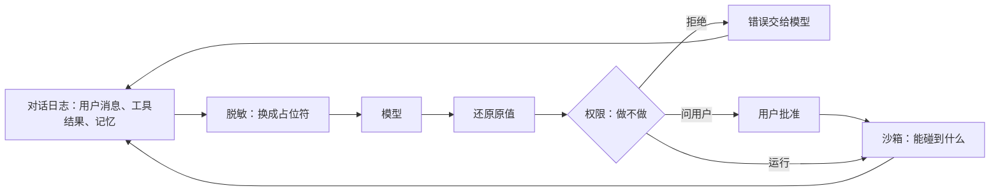

# 安全总览

agent 代替用户读写文件、运行命令、访问网络，它犯的错和被提示注入（prompt injection，藏在网页、文件里的指令）操纵的后果都落在用户身上。Ollupi 用三套互相独立的机制约束它：权限决定一次工具调用做不做，沙箱决定放行之后能碰到什么，脱敏决定模型服务商能看到什么。这一页讲信任边界、每道防线挡什么、多用户时隔离靠什么，以及已知的口子。机制细节在[审批与权限](/zh/engine/permissions)、[沙箱](/zh/engine/sandbox)、[脱敏](/zh/engine/redaction)和[分片与租约](/zh/engine/sharding)。

## 为什么这样设计

- **三道防线各管一件事。** 权限只看"这次调用要不要先问人"，沙箱只看"进程能读写哪些路径、连哪些地址"，脱敏只看"哪些值不出现在发给模型的请求里"。三者在三个包里（`policy`、`pkg/sandbox`、`pkg/redact`），可以分别放宽：`never` 档不再询问，`full-access` 不用沙箱，`settings.redaction` 关掉脱敏。
- **沙箱让审批变少。** `on-request` 档下，沙箱内的命令和文件修改直接运行，只有离开沙箱的命令和沙箱管不到的改动（`web_fetch`、定时任务、MCP 工具）才问用户（`Checker.requiresApproval`）。所以沙箱不只是限制，也是这一档少打断用户的前提：非 macOS 的本机只能用 `full-access`，同一档下每条命令都要问。
- **批准的是冻结的执行内容，不是一句描述。** 问用户之前，工具先把调用冻结成执行内容；用户批准的就是它，批准对这次调用照原样生效。执行时工具核对冻结的内容还成立，环境变了就不执行。见[审批绑定执行内容](#审批绑定执行内容)。
- **用户的规则优先于档位。** deny 和 ask 规则在三档下都先于策略判定；`never` 档"不问任何人"，但规则读不懂的命令遇到可能命中的 deny 规则时拒绝，而不是放行，把 `rm` 包进 `sh -c "$X"` 绕不过 `run_command(rm:*)`。见[判定顺序](/zh/engine/permissions#判定顺序)。
- **隔离来自代码，不来自进程。** 一个进程服务一个分片上的所有用户，放弃了每个 agent 一个虚拟机或容器的做法。用户之间的边界由入口检查、按用户投递的事件、每用户的 `Box` 和故障隔离守住。见[设计决策 1](/zh/reference/decisions#_1-池化-runtime)。
- **脱敏只在模型边界。** 日志里存原文，只有发给模型的请求里是占位符，模型回答在写进日志和交给工具之前还原。记忆没有另一套凭据过滤。见[设计决策 15](/zh/reference/decisions#_15-脱敏只在模型边界)。

代价也很明确：`never` 档下能挡住沙箱外命令的只剩 deny 规则；同一分片的用户之间没有进程边界，漏掉一处入口检查就是越权；脱敏只认得出写好模式的值；本机沙箱只有 macOS 实现。下面的"已知的口子"逐条列出。

::: info 演进
- `2ac82a0` 之前，`never` 档下把 `rm` 包进 `sh -c "$X"` 就能绕过 `run_command(rm:*)`。
- 记忆曾有自己的凭据过滤，`831b554` 删掉，脱敏统一在模型边界。
- v0.16.0 把权限判定拆成纯函数的 `policy` 包（`d1b1463`），判定结果和审批都成为对话日志的条目（`cf4141e`）。
:::

## 信任谁，不信任谁

| 对象 | 信任程度 | 怎么处理 |
|---|---|---|
| 用户本人 | 可信 | 规则和审批决定代表用户，规则在每一档都先判定 |
| 宿主（host，嵌入引擎的程序） | 可信 | 认证（`Authenticate`）、每用户的 `Box`（`host.Config.Boxes`，工作区工具的 `BoxFor`、`BoxIn`）、每用户的模型客户端（`ClientFor`）、部署层权限，都由宿主提供 |
| 模型的输出 | 不可信 | 每个工具调用都过权限判定，命令和文件操作经沙箱 |
| 工具结果、网页、仓库里的文件 | 不可信，是提示注入的来源 | 引擎不识别注入，靠权限和沙箱限制后果 |
| MCP 服务器、技能 | 由用户自己安装，按用户自己的程序对待 | 服务器自报的只读标注不被采信，MCP 工具一律按会改东西的工具审批 |
| 模型服务商 | 会看到请求内容 | 脱敏 |
| 同一分片上的其他用户 | 不可信 | 入口检查、按用户投递事件、每用户的 `Box` |

## 三道防线

| 防线 | 位置 | 挡住什么 | 挡不住什么 |
|---|---|---|---|
| 权限 | 模型回答写进日志时，逐个判定其中的调用（`run/tools.go`） | 用户没同意的改动、离开沙箱的命令、规则禁止的调用 | 用户自己批准的调用；`never` 档下规则没提到的调用 |
| 沙箱 | 命令和文件操作执行时（`sandbox.Box`） | 写命令目录以外的路径、读凭据路径、连未放行的地址、写之后会被别的程序自动运行的配置 | 禁读路径以外的读取；离开沙箱的命令；不经 `Box` 的工具 |
| 脱敏 | 模型请求发出前、回答收到后（`run/model.go` 的 `Runner.send`） | 模型服务商看到手机号、密钥这类能按模式识别的值 | agent 使用这些值：工具拿到的是还原后的原值 |

`on-request` 是三者配合的典型：沙箱已经限制了命令能做什么，所以沙箱内的命令不问；命令要离开沙箱时，限制没了，改由用户决定。见[审批策略](/zh/engine/permissions#审批策略)和[提权](/zh/engine/sandbox#提权)。

## 审批绑定执行内容

问用户之前，工具先把调用冻结成执行内容，写在 `ToolCall.Prepared` 里：命令目录、解析后的程序路径、参数、环境变量、超时、设置摘要（含沙箱规则的 `Fingerprint`），文件修改还有修改前后的哈希和 diff。用户看到的、批准的就是这份内容。

判定和审批都是日志条目：模型回答时写下 `ApprovalAsked`，用户决定时写下 `Decided`。批准对问到的那次调用照原样生效，不再重新判定。执行时工具自己核对：

- 设置摘要、参数摘要、命令目录要和冻结时一致，程序名重新解析后要指向同一个文件；
- 文件修改时文件已经变了，就拒绝写入。

不一致就不执行，错误交给模型重来。"本会话允许"（`acceptForSession`）只对工具相同、`Prepared` 逐字节相同、内容文本相同的调用生效，沙箱规则变了之后旧批准自然失效。看不清的命令、离开沙箱的调用不提供"总是允许"。完整流程见[审批流程](/zh/engine/permissions#审批流程)，取舍见[设计决策 16](/zh/reference/decisions#_16-审批绑定执行内容)。

::: info 演进
v0.12.1 时批准之后、执行之前还会重新计算调用的内容，变了就重新判定。`cf4141e` 起批准对问到的那次调用照原样生效，冻结内容的核对仍在工具执行时做。
:::

## 多用户隔离

同一分片的用户共用一个进程和一个库，隔离分四层：

| 层 | 做法 | 细节 |
|---|---|---|
| 数据 | 每张表经 `user_id` 归属用户，`app` 的每个操作按调用方查（`thread`、`view`、`topThread`），别人的东西一律当作不存在 | [多用户隔离](/zh/engine/sharding#多用户隔离) |
| 连接和事件 | 令牌经 `Authenticate` 换成用户，连接只订阅自己用户的事件（`Feed.Subscribe`） | [令牌认证](/zh/engine/sharding#令牌认证) |
| 执行环境 | `host.Config.Boxes(user)` 给每个用户自己的 Box，MCP 服务器在里面启动；工作区工具的 `BoxFor`、`BoxIn` 按用户或会话的执行环境给 Box；`ClientFor` 给每个用户自己的模型客户端 | [每用户资源](/zh/engine/sharding#每用户资源) |
| 故障 | 工具 panic 只让这次调用失败（`tool/kit`）；MCP 调用有超时；一轮最多占槽位 `RunLimit`（默认 4 小时）；`UserSlots` 限制一个用户的槽位数 | [单用户槽位限额](/zh/engine/sharding#单用户槽位限额) |

脱敏密钥也是每用户一个，同一个值在不同用户下得到不同的占位符。

::: info 演进
v0.12.1 时宿主不配 `BoxFor` 就让所有用户共用 `sandbox.Here()`；v0.16.0 起 `host.Config.Boxes` 必填，MCP 服务器和附件都经它取得用户自己的 Box。
:::

## 已知的口子

- **MCP 服务器不在工作区沙箱里。** stdio 服务器经 `host.Config.Boxes(user)` 给的 `Box` 启动，能做什么由那个 Box 决定；宿主给的是不受限的本机环境时，服务器进程能做用户能做的一切。调用本身也不受沙箱限制：引擎只是把参数交给服务器。MCP 工具没有内容，规则只能写到工具名。见[权限与沙箱](/zh/engine/skills-mcp#权限与沙箱)。
- **`.git/hooks` 可写。** 仓库的 `.git` 和普通目录一样可写，包括 `.git/config` 和 `.git/hooks`。agent 写进去的钩子会在用户之后自己运行 git 时在沙箱外执行。这是有意的取舍，换来 `git init`、`git clone` 不用提权，见[保护名](/zh/engine/sandbox#保护名)。
- **`never` 档下提权不问。** 规则没有给出结论的调用一律运行，离开沙箱的命令也包括在内。这一档下能拦住沙箱外命令的只有 deny 规则；规则读不懂的命令遇到可能命中的 deny 规则会被拒绝，没有规则提到的命令照常运行。
- **批准之后改的规则管不到已批准的调用。** 判定只在调用写下时做一次，等审批期间加的 deny 规则不会拦下随后批准的调用。
- **读几乎不设限。** Seatbelt 规则是 `(allow file-read*)` 加禁读路径，读取工具只查禁读路径（`CheckRead`），三档下都不问用户。禁读名单之外的文件，比如用户的文档目录，命令和读取工具都能读到。数据能不能出去取决于网络：`web_fetch` 在 `on-request` 下要问，沙箱网络默认关闭。
- **`web_fetch` 不受沙箱的域名名单约束。** 它从引擎进程直接发请求，用 `PublicTransport`，只拦内网地址，不看 `allowed_domains`（`tool/builtin/web/web.go`）。
- **本机沙箱只有 macOS 实现。** 本机沙箱是 Seatbelt，非 macOS 上 `read-only` 和 `workspace-write` 直接报错，只能用 `full-access`。云沙箱只有 `Machine` 接口，仓库里的实现只在测试里。见[设计决策 20](/zh/reference/decisions#_20-seatbelt-沙箱)和[云沙箱接入点](/zh/engine/sandbox#云沙箱接入点)。
- **网络过滤靠本地代理，管不到不走代理的程序。** Seatbelt 不能按域名过滤，所以配了 `allowed_domains` 时内核只放行到本地代理端口，代理按域名放行。不读代理环境变量的程序连不上网，而不是绕过去。只开网络、不配 `allowed_domains` 时，外网完全放开。见[网络](/zh/engine/sandbox#网络)。
- **工作区工具的本机沙箱可能不区分用户。** 工作区工具不配 `BoxFor`、`BoxIn` 时所有用户共用一个本机沙箱，读写规则对所有用户相同。多用户部署要给每个用户一台自己的机器。
- **脱敏只认得出写好的模式。** `pkg/redact` 识别私钥、AWS 访问密钥、GitHub 令牌、`sk-` 开头的密钥、Google API 密钥、Slack 令牌、Bearer 令牌、JWT、身份证号、银行卡号、手机号、邮箱、IPv4 和 MAC 地址。其他形式的敏感值原样发给模型，比如姓名、地址、密码，以及格式不在表里的令牌。图片不处理。见[识别类型](/zh/engine/redaction#识别类型)。
- **同分片用户的隔离靠代码。** 没有进程或库的边界，漏掉一处入口检查就能读到别人的数据。现有的保证来自入口检查和功能测试，比如 `store/sqlite/owned_test.go` 的 `TestWhatAUserOwnsIsTheirsAlone`、`tool/mcp/users_test.go` 的 `TestEachUsersServersRunInTheirMachine`；多用户下的调度公平性还没有测量，见[接下来要测的](/zh/benchmarks/plan)。
- **提示注入没有专门的识别。** 工具结果、网页内容原样进入上下文（经脱敏），引擎不区分"数据"和"指令"，后果由权限和沙箱限制。

::: info 演进
- `.git` 可写来自 `5d4354d`。
- `never` 档下提权不问来自 `7b6e720`；规则读不懂又可能命中 deny 的命令被拒绝来自 `2ac82a0`。
- `fdefa84` 起不再采信 MCP 服务器自报的只读标注，此前标了只读的 MCP 工具在 `on-request` 下直接运行。
:::

## 代码位置

| 仓库 | 路径 | 职责 |
|---|---|---|
| ollupi | `policy` | 规则、审批策略、判定顺序、各层合并 |
| ollupi | `account/account.go` | 权限分层：部署、用户、工作区、会话 |
| ollupi | `run/tools.go` | 每个调用的判定 |
| ollupi | `tool/builtin/workspace/execution.go`、`files.go`、`prepared.go` | 冻结命令和文件修改、执行前核对 |
| ollupi | `pkg/sandbox` | `Box`、Seatbelt、网络代理、`Machine`、`Remote` |
| ollupi | `pkg/redact` | 识别、占位符、还原 |
| ollupi | `run/model.go` | 模型请求的脱敏和还原 |
| ollupi | `app/app.go`、`store/feed.go`、`gateway/serve.go` | 按用户读写和入口检查、按用户投递事件、认证 |
| ollupi | `tool/builtin/web/web.go` | `web_fetch` 的出站限制 |
| ollupi | `tool/mcp` | 每个用户的 MCP 服务器，在用户的 Box 里启动 |
