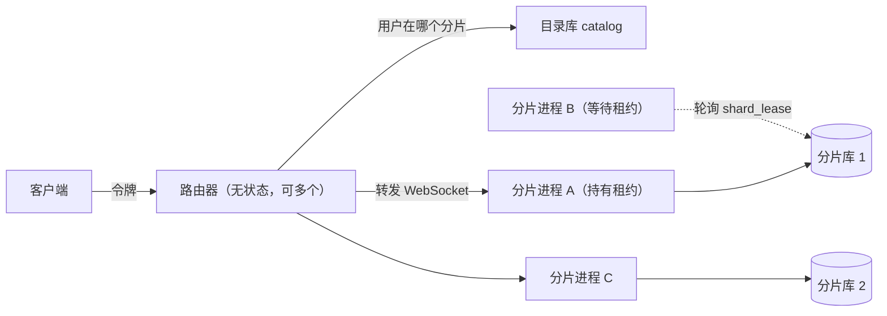

# 分片与租约

一个 SQLite 库是一个分片（shard）。分片上的用户共用它的表，按用户隔离。同一时间只有一个进程运行一个分片，靠库里的一行租约（lease）保证；进程退出后备用进程接管，从上次停下的地方继续。分片的数量决定容量。客户端只连路由器，路由器把每条连接转给用户所在的分片。这一页讲多用户怎样隔离、租约怎样占有和接管、路由器怎样找到分片，以及令牌认证和每用户资源。



## 为什么这样设计

- **用户共用分片的表。** 一个库就是一个分片：工作区、会话、记忆带 `user_id`，轮次、条目、定时任务经会话找到用户。分片上所有用户的轮次在同一个就绪队列里，共用同一组槽位。见[设计决策 10](/zh/reference/decisions#_10-单库即分片与租约)。
- **租约就存在分片自己的库里。** 占有、续约、接管是 `shard_lease` 上的同一条语句，能打开这个库的进程就能参与争抢。接管之后按重启恢复，没有专门的接管逻辑，因为调度状态本来就全在库里，见[设计决策 3](/zh/reference/decisions#_3-无内存调度状态)。
- **围栏挡住卡住的旧持有者。** 一个进程可能卡得比租约还久，醒来时还不知道分片已经换了主人。`DB.Tx` 在事务开始时核对租约持有者，不是自己就失败，所以它写不坏新持有者的数据。
- **路由器不保存状态，分片自己再查一次。** 路由器只做认证、查目录、转发，可以运行任意多个；目录库只记用户放在哪个分片、分片在哪个地址。`OnShard` 让分片拒绝放在别处的用户，所以一个用户不会在第二个分片上再建一份数据。
- **不配就不变。** 不设 `Lease` 时进程相信自己是唯一的；不设 `Authenticate` 时网关只有一个令牌，属于 `default` 用户。桌面端就是这样运行的，桌面和飞书都以 `default` 用户运行。

代价：容量靠分片数堆，单个分片仍是一个 SQLite 文件和一条连接；用户不能跨分片迁移；进程崩溃没有释放租约时，接管要等租约过期；备用进程要能打开同一个数据库文件；围栏让每个事务多一次读，而且只挡事务内的写入；现有基准测于多用户和分片之前，这些开销还没有测过。

::: info 演进
- v0.9.0 之前一个库只属于一个使用者。`28adb4d` 让一个库成为一个分片，加了 `user_id`，调度没有因此改动。有没有对比过一人一个库，没有记录。
- 租约和"接管即重启恢复"来自 `cd8faee`，不设 `Lease` 时行为不变也是这个提交定的；路由器和目录库来自 `583d20c`；令牌认证和 `default` 用户来自 `15a76c7`。
- 基准没有在这些改动之后重测，见 `d85f978`。
:::

## 多用户隔离

用户隔离在同一张表里完成，不是一人一个库。

### 数据归属

| 数据 | 怎么归到用户 |
|---|---|
| `workspaces`、`threads`、`memories` | 自带 `user_id` 列，外键指向 `users` |
| `settings`、`memory_state` | 主键就是 `user_id`，每用户一行 |
| `turns`、`items`、`cron_jobs` | 经 `thread_id` 到 `threads.user_id` |

`user_id` 列的默认值是空字符串，而没有用户的 id 是空字符串，所以漏写用户的行会被外键拒绝。

同一用户的工作区按 `(user_id, root_path)` 唯一，不同用户可以用相同的路径。记忆的主题按 `(user_id, scope, workspace_id, topic)` 唯一。

### 入口检查

调用方拥有什么，在 `agent` 和 `gateway` 的入口检查。不属于这个用户的东西一律当作不存在，返回 `repo.ErrNotFound`，到协议层是 `notFound`。

| 检查 | 用在 |
|---|---|
| `repo.ThreadOf(user, id)` | 按用户读会话，别人的返回未找到 |
| `repo.WorkspaceOf(user, id)` | 按用户读工作区 |
| `agent.owned` | 中断、回答审批和提问、读等待请求 |
| `agent.topThread` | 开始一轮、插话、改名、归档、删除、改权限；同时拒绝子 agent 会话 |
| `repo.ThreadRows(user, ...)`、`repo.Search(user, ...)` | 列表和搜索都带用户条件 |
| `repo.Memories(user, ...)`、`repo.Settings(user)` | 记忆和设置按用户读 |

`read_tool_output` 还校验条目属于调用者所在的会话，所以模型读不到别的会话的输出。定时任务的 `StartScheduledTurn` 没有调用方，它在所属会话里运行，按会话主人算。

### 事件和连接

`Server.clients` 是用户到连接的映射，一个用户一条当前连接。`Deliver` 按 `e.Thread.UserID`（工作区事件按 `e.Workspace.UserID`）投递，所以事件只发给本人。不属于任何用户的事件不发给任何人。

用户第一次连上来时，`ServeHTTP` 调用 `EnsureUser`，建 `users`、`settings`、`memory_state` 三行。`settings` 里的脱敏密钥此时随机生成。

调度不区分用户：所有用户的轮次在一个就绪队列里，按相同的优先级排序，只受单用户限额约束。

## 分片

`repo.Open(homeDir)` 打开的库就是一个分片。分片之间不共享数据，用户的轮次和文件都留在自己的分片。

所有分片共享一个目录库 `repo.Catalog`，它是独立的 SQLite 文件，用 `repo.OpenCatalog(path)` 打开。它只保存够路由器找到分片的信息：

| 表 | 字段 | 说明 |
|---|---|---|
| `shards` | `id` | 分片 ID |
| | `address` | 持有分片的进程当前接受连接的地址 |
| | `accepting` | 是否可以放新用户；留给单个客户的分片设为否 |
| `placements` | `user_id` | 用户 |
| | `shard_id` | 所在分片，带索引 |

| 方法 | 行为 |
|---|---|
| `Publish(shard, address, accepting)` | 写入或更新分片的地址，由拿到租约的进程调用 |
| `Address(shard)` | 读分片地址 |
| `ShardOf(user)` | 查用户所在分片；新用户在一个事务里放到 `accepting` 且用户最少的分片，相同时取 `id` 最小的。没有可用分片时返回 `ErrNoShard` |
| `Place(user, shard)` | 运维指定用户的分片，比如单独给一个客户的分片。用户已在别的分片时报错 |

引擎不搬迁用户：用户一旦在分片上有了数据就留在那里。`Place` 必须在用户有任何数据之前调用。

`Publish` 的调用由宿主负责。`Agent.Start` 返回说明已拿到租约，宿主这时才应该发布地址。

## 分片租约

`Config.Lease` 设了时长才启用租约。引擎没有默认值，`bench` 的崩溃实验用 `-lease 1500ms`，测试用 300 毫秒。

### 租约行

`shard_lease` 表最多一行（`CHECK id = 1`）：`owner` 是进程启动时生成的 UUID，`expires_at` 是 Unix 毫秒。占有和续约是同一条语句：

```sql
INSERT INTO shard_lease(id, owner, expires_at) VALUES (1, ?, ?)
ON CONFLICT(id) DO UPDATE SET owner = excluded.owner, expires_at = excluded.expires_at
WHERE shard_lease.owner = excluded.owner OR shard_lease.expires_at <= ?
```

语句影响一行时算成功。三种情况成功：没有行；自己是持有者（续约）；别人的租约已过期（接管）。`now` 由调用进程传入，所以比较用的是这个进程的时钟。

### 时间参数

设租约时长为 L：

| 动作 | 间隔或期限 |
|---|---|
| 等待方轮询 | L/3 |
| 持有方续约 | L/3 |
| 续约失败时的容忍期 | 从上次成功续约起 L |
| 进程被杀后的接管延迟 | 最多约 L + L/3（租约到期，加一次轮询） |
| 进程正常退出后的接管延迟 | 最多约 L/3（租约已释放，只等一次轮询） |

### 启动和接管

`Agent.Start` 在恢复之前调用 `claimShard`：

1. 生成 `a.owner`。
2. 循环调用 `ClaimShard`，没拿到就等 L/3 再试。这一步会一直阻塞，直到拿到或 ctx 结束。`ClaimShard` 返回错误时不重试，`Start` 直接失败。
3. `DB.Fence(a.owner)` 给数据库句柄加上围栏。
4. 起 `keepShard` goroutine，返回一个租约结束时会取消的 ctx，它成为 `a.ctx`。

之后的流程和普通重启完全相同：`recover` 处理上一个进程留下的 `inProgress` 轮次，接着往下跑。接管不需要专门的逻辑，恢复流程见[崩溃恢复](/zh/engine/persistence#崩溃恢复)。

### 续约和失去租约

`keepShard` 每 L/3 调用一次 `ClaimShard`：

| 结果 | 处理 |
|---|---|
| 成功 | 把截止时间 `until` 更新为 `now + L` |
| 返回错误，还没到 `until` | 写警告，下一轮再试 |
| 返回错误，已过 `until` | 失去租约 |
| 没有错误，但别的进程持有 | 立即失去租约 |

失去租约时：

1. 写错误日志 `shard lost`，调用 `Config.OnLeaseLost`。宿主必须停掉其他也在用这个库的组件。
2. `keepShard` 返回，取消 `a.ctx`。
3. 调度循环退出，所有槽位的 ctx 结束，运行中的模型调用和工具被取消。
4. `post` 和 `call` 不再接受工作，调用方收到 `errStopped`。
5. 这些轮次留在 `inProgress`，由新持有者恢复。

进程退出时 `Wait` 调用 `ReleaseShard`，它只删 `owner` 是自己的行。所以失去租约后退出不会碰到新持有者的行，正常退出时下一个进程不用等到过期。

### 围栏

进程可能卡住比租约还久：它既没续约，也还不知道自己失去了租约。这时新持有者已经开始工作。围栏防止旧进程写坏数据：`DB.Tx` 在事务开始时读 `shard_lease.owner`，不是自己就返回 `ErrShardLost`，事务不执行。

```go
func (d *DB) checkFence() error {
	if d.owner == "" {
		return nil
	}
	var holder string
	if err := d.gorm.Model(&ShardLeaseRow{}).Where("id = 1").Select("owner").Scan(&holder).Error; err != nil {
		return err
	}
	if holder != d.owner {
		return ErrShardLost
	}
	return nil
}
```

调度的关键写入都走 `DB.Tx`：`RecordItem`、`SubmitTurn`、`StartQueuedTurn`、`EndTurn`、`Park`、`AddUsage`、`RecoverItems`。

围栏只挡 `DB.Tx`。不走它的写入不受影响，比如 `Launch`、`CreateThread`、`DeleteThread`、`SetRedaction`、`EnsureUser`、`SaveMemory`、`SetCronJobNextRun`。这些写入在进程发现失去租约之前可能还会成功，所以 `OnLeaseLost` 要求宿主停掉数据库上的其他活动。

## 路由器

`gateway.Router` 是客户端唯一要连的地址，实现了 `http.Handler`。它不保存状态，可以运行任意多个。`Directory` 接口把它和目录解耦，`repo.Catalog` 是一个实现：

```go
type Directory interface {
	ShardOf(user string) (string, error)
	Address(shard string) (string, error)
}
```

`ServeHTTP` 的步骤：

| 步骤 | 失败时 |
|---|---|
| `authenticate(tokenOf(r))` 认出用户 | 401 `invalid or missing gateway token` |
| `ShardOf(user)`，新用户在此时放置 | 503 `no shard can take this user now` |
| `Address(shard)` | 503 `the user's shard cannot be found now` |
| 解析地址 | 503 `the user's shard cannot be reached now` |
| `httputil.ReverseProxy` 转发，含 WebSocket 升级 | 503 `the user's shard cannot be reached now; try again` |

路由器不解析 JSON-RPC，它只转发连接。分片换手时，连在旧进程上的 WebSocket 断开，客户端重连，再次经路由器转给新地址。新地址发布之前，客户端看到 503 并重试。

### 分片这一侧的校验

路由器的放置结果可能过时，或者连接绕过了路由器。`gateway.OnShard` 包在分片网关的 `Authenticate` 外面：用户被放在别的分片时认证失败，并写警告 `connection refused on the wrong shard`。这样一个用户不会在第二个分片上再建一份数据。

```go
gateway.NewServer(a, gateway.Options{
	DB:           db,
	Authenticate: gateway.OnShard(shardID, catalog, authenticate),
})
```

## 令牌认证

Ollupi 不做登录。登录在它之前完成，`Authenticate(token)` 只回答"这是谁的令牌"。

| 选项 | 含义 |
|---|---|
| `Options.Token` | 单用户网关的令牌，属于 `default` 用户，用 `subtle.ConstantTimeCompare` 比较 |
| `Options.Authenticate` | 多用户时取代 `Token`，返回 `(user, ok)` |

两者都没有时 `NewServer` 报错。

`tokenOf(r)` 按顺序读两个地方：

1. `Authorization: Bearer <token>`。
2. WebSocket 子协议。浏览器不能设置 `Authorization`，所以把令牌放在子协议列表里，紧跟在 `ollupi.token` 后面：

```js
new WebSocket(url, ["ollupi.token", token])
```

`tokenOf` 解析 `Sec-WebSocket-Protocol` 头，找到 `ollupi.token`，取它的下一项。服务端 `websocket.Accept` 只声明支持 `ollupi.token` 这一个子协议，所以握手时协商回去的是 `ollupi.token`，令牌不出现在响应里。

令牌不放在 URL 里，因为访问日志会记录 URL。`?token=` 不能用于认证。

网关在令牌之前还校验 `Host`：不在 `localhost`、`127.0.0.1`、`::1` 和 `AllowedHosts` 里时回 403。`Origin` 按 `localhost:*`、`127.0.0.1:*`、`[::1]:*` 和 `AllowedOrigins` 校验。

## 单用户槽位限额

`Config.UserSlots` 防止一个用户的轮次占满分片。默认等于 `Slots`，即不限。

`slotsOfUser` 记录每个用户占用的槽位数。限额在两处生效：

- `admit` 算出已到上限的用户，`ReadyThreads` 把他们排除，这样限额内的用户不会被排在前面的超额轮次挡住。
- `reconcile` 在 `Launch` 之前再查一次 `a.slotsOfUser[user] >= a.cfg.UserSlots`。

超额的轮次留在 `ready`，不失败。用户的槽位释放后，下一次 `admit` 接着取。子 agent 的轮次和父会话是同一个用户，算在同一个限额里。

## 每用户资源

`agent.Config` 有几个按用户取资源的钩子。没有配置时大家共用默认值。

| 钩子 | 取什么 | 没配时 |
|---|---|---|
| `ClientFor(user, connection)` | 这个用户调用这条连接时用的模型客户端 | 共用 `Connections` |
| `ToolsFor(user)` | 这个用户多出的工具，比如 MCP 服务器 | 只有 `Providers` |
| `BoxFor(user)` | 这个用户在这台机器上的沙箱 | `sandbox.Here()` |

工具调用另有 `workspace.Options.BoxIn`，按会话的执行环境给沙箱，见[扩展点](/zh/integrate/extend#按会话选择环境)。

### 模型客户端

`runTurn` 调用 `clientFor(t.UserID, turn.Model.Connection)` 取客户端。配了 `ClientFor` 时用户的轮次走自己的密钥和配额。

- 模型并发名额在客户端内部，所以 `ClientFor` 应该每次返回同一个客户端。否则每次调用都是新的名额，限制不生效。
- `ClientFor` 返回错误时只有这一轮失败，错误前缀是 `agent: the model client of the user`。其他用户不受影响。
- 窗口预算仍从 `Connections` 里的客户端读 `Limits`，所以共享的 `Connections` 始终要配。模型列表也是共用的。
- 记忆提炼有自己的 `memory.Options.ClientFor`，按用户取客户端。

### 工具和沙箱

`registryFor(user)` 用 `ToolsFor` 返回的 `*tools.Set` 指针作为缓存键。同一个 `Set` 表示工具没变，直接用缓存的注册表；换了新的 `Set` 就重建。第一次调用可能要等用户的 MCP 服务器连上。

命令、文件和 MCP 服务器都经 `sandbox.Box` 访问，详见[沙箱](/zh/engine/sandbox)。

## 边界与已知问题

- **租约接管没有测量数据。** `bench crash -lease` 会启动备用进程，但没有保留结果。从 kill 到备用进程开始服务要多久、接管期间有没有工具执行两次，都还没有数字，见[接下来要测的](/zh/benchmarks/plan)第 3 项。上面的接管延迟是按时间参数算出来的上限，不是测量值。
- **多分片没有测量数据。** 现有基准全部是一个库、一个进程。吞吐是否随分片数增长、路由器增加多少延迟，都没测，见[接下来要测的](/zh/benchmarks/plan)第 5 项。
- **吵闹邻居没有测量数据。** `UserSlots` 默认等于 `Slots`，即不限；不配 `ClientFor` 时所有用户共用连接上的模型并发名额。一个用户刷满分片，或者他的模型密钥持续出错时，其他用户受多大影响，没测，见[接下来要测的](/zh/benchmarks/plan)第 4 项。多用户下的调度公平性也没测，见[执行模型](/zh/engine/execution#边界与已知问题)。
- **围栏只挡 `DB.Tx`。** 不走事务的写入不受约束，见[围栏](#围栏)。旧进程槽位里正在执行的工具，要等它自己发现失去租约、取消 `a.ctx` 时才停；在那之前工具在沙箱里的副作用照常发生。新持有者恢复时把这些调用标成"可能已生效"。
- **租约比较依赖两台机器的时钟。** `expires_at` 由持有者按自己的时钟写入，接管方按自己的时钟比较。两边时钟有偏差时，接管会提前或推迟同样的量。
- **migration 早于争租约。** `repo.Open` 打开库时就执行 migration，而争租约在之后的 `Agent.Start` 里。版本更新的备用进程一启动，就会在持有者还在运行时升级表结构，代码里没有挡住这种情况。
- **目录库读不到时新连接全部失败。** 路由器对每条连接都查 `ShardOf`，失败时回 503；分片上的 `OnShard` 也查它，失败时认证不通过，客户端看到的是 401。
- **地址由宿主发布。** 引擎不调用 `Publish`。新持有者发布地址之前，路由器还指向旧地址，客户端看到 503 并重试。
- **用户不能迁移。** 用户有了数据就留在原分片，`Place` 必须在用户有任何数据之前调用。

## 代码位置

| 仓库 | 路径 | 职责 |
|---|---|---|
| ollupi | `agent/lease.go` | 占有和续约租约 |
| ollupi | `agent/schedule.go` | 单用户限额的调度部分 |
| ollupi | `agent/scope.go` | 工作区和权限层的查找 |
| ollupi | `agent/models.go` | `clientFor`、窗口、模型校验 |
| ollupi | `repo/shard.go` | `shard_lease`、`ClaimShard`、`Fence` |
| ollupi | `repo/catalog.go` | 分片目录 |
| ollupi | `repo/users.go` | `users` 表、`EnsureUser` |
| ollupi | `gateway/router.go` | 路由器、`OnShard`、`tokenOf` |
| ollupi | `gateway/serve.go` | `Options`、`authorize`、Host 校验 |
| ollupi | `gateway/server.go` | 连接表、`Deliver` |
| ollupi | `agent/users_test.go` | 隔离、限额、接管的测试 |
| ollupi | `gateway/router_test.go` | 路由和换手的测试 |
| ollupi-desktop | `sidecar/internal/host/host.go` | 单用户的组装方式 |
