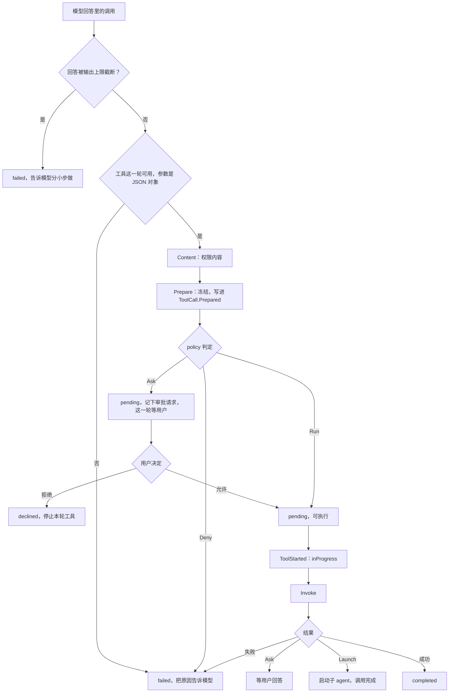

# 工具系统

工具是模型能调用的动作。`tool` 包是运行时调用工具的端口：一个用户的一组工具（`tool.Set`）怎样描述、怎样为权限判定给出内容、怎样冻结执行内容、怎样执行。`tool/kit` 是引擎自己的工具怎样写成：一个提供者（provider）列出它的工具并执行它们，注册表把提供者合成 `tool.Set`。内置工具在 `tool/builtin/*`，MCP 服务器的工具在 `tool/mcp`。

每次工具调用是一个条目（item），由会话日志里的几条记录折叠而成：先记下调用，再记审批、开始、结果，所以它的每个阶段都能在进程重启后读回来，这部分机制见[执行模型](/zh/engine/execution)和[持久化](/zh/engine/persistence)。

## 为什么这样设计

- **工具只给模型用。** 协议里有 `tool/list` 列出工具，没有直接调用工具的方法，界面要做的事走专门的方法（如 `cron/list`）。这样界面不绑在写给模型看的输出上，工具输出可以随时为模型调整，工具层也没有跳过权限的直调路径。见[设计决策 9](/zh/reference/decisions#_9-工具只给模型用)。
- **审批绑定执行内容。** 两段式工具先 `Prepare` 冻结要执行的内容再判定；用户批准的就是冻结的那一份，执行时工具自己核对它还成立，不成立就不执行。见[设计决策 16](/zh/reference/decisions#_16-审批绑定执行内容)。
- **调用先记成 `pending`，真正开始执行时才记 `inProgress`。** 崩溃后能分清"没跑过"和"跑到一半"：`pending` 的调用照常执行并保留审批结果，`inProgress` 的调用标为失败并告诉模型它可能已经部分生效，见[崩溃恢复](/zh/engine/persistence#崩溃恢复)。
- **失败交还模型，不结束这一轮。** 参数无效、被规则拒绝、执行出错，都变成工具结果交给模型；工具 panic 由注册表接住，只让这一次调用失败。轮次只在角色的上限或用户拒绝时停止用工具。
- **只读调用并行，其余按顺序。** 标了只读的调用连续几个一起执行，最多 8 个；有副作用的调用按模型给出的顺序逐个执行。判断只看工具自己的 `ReadOnlyHint`，不分析参数；MCP 服务器自己声明的只读不采信。

代价：每个界面操作都要有专门的方法；工具要自己提供 `Content` 和 `Prepare`，没有的（比如 MCP 工具）规则只能按工具名写，也不冻结；只读标注写错的内置工具会被错误地并行。

::: info 演进
- 早期协议有 `tool/call`，界面可以直接调模型的工具，这把界面绑在写给模型看的输出上，还让工具层多了一个跳过权限的直调模式。`38c5a1c` 删掉了它。
- 早期调用从模型回答落库起就是 `inProgress`，崩溃后分不清"没跑过"和"跑到一半"，恢复时只能猜；`b52bde4` 改成先记 `pending`。
- 注册表接住工具 panic 来自 `28b9033`。
- `fdefa84` 不再搬运 MCP 服务器自己的只读和封闭世界标注：它们的工具在 `on-request` 下要问，也不并行。
- v0.16.0 的日志重建把工具层拆成端口和适配器：`cf4141e` 加了 `tool` 端口，批准从此对问到的那次调用照原样生效，执行前不再重新判定；`cef6026` 加了 `tool/kit`，内置工具搬到 `tool/builtin`。
:::

## 工具接口

工具有两层描述。`tool` 是运行时看到的端口，`tool/kit` 是写工具的人用的。

```go
type Set interface {
	Specs() []Spec
	Unavailable() []string
	Content(ctx context.Context, c Call) (policy.Content, error)
	Prepare(ctx context.Context, c Call) (Plan, error)
	Invoke(ctx context.Context, c Call) Result
}
```

`tool.Spec` 是发给模型、交给权限判定的描述：`Name`、`Provider`、`Description`、`Schema`、`Annotations`，`Content` 表示这个工具能给出权限内容，`Serial` 表示即使只读也不并行。

写一个工具时实现 `kit.Provider`：

```go
type Provider interface {
	Name() (id string, description string)
	Tools(ctx context.Context) ([]Spec, error)
	Invoke(ctx context.Context, c tool.Call) (Result, error)
}

type Spec struct {
	Name        string
	Description string
	InputSchema any
	Annotations tool.Annotations
	Content     func(ctx context.Context, c tool.Call) (policy.Content, error)
	Prepare     func(ctx context.Context, c tool.Call) (tool.Plan, error)
	Serial      bool
}
```

| 字段 | 作用 |
| --- | --- |
| `InputSchema` | JSON Schema，参数校验和发给模型都用它。`kit.InputSchema[T]()` 从 Go 结构体生成（`google/jsonschema-go`），类型可实现 `Constrainer` 补上长度、范围、枚举等约束 |
| `Annotations` | MCP 同款提示：`Title`、`ReadOnlyHint`、`DestructiveHint`、`IdempotentHint`、`OpenWorldHint`。审批策略读 `ReadOnlyHint` 和 `OpenWorldHint`（`policy/checker.go`），并行执行只读 `ReadOnlyHint`（`run/tools.go`）；其余引擎不读，随调用记进日志，供界面显示。`OpenWorldHint` 未设时当作真 |
| `Content` | 把参数变成权限规则能匹配的内容。没有它的工具，规则只能按工具名写 |
| `Prepare` | 两段式工具：先冻结要执行的内容，得到 `tool.Plan`，执行时 `Invoke` 拿到它。没有它的工具 `Prepare` 返回空计划 |
| `Serial` | 即使只读也不并行。桌面端的浏览器工具用它 |

`policy.Content` 是权限检查看到的东西：

| 字段 | 含义 |
| --- | --- |
| `Text` | 给人看的内容，审批卡片显示它 |
| `Match` | 规则匹配的主字符串 |
| `Parts` | 拆开后的子命令，每个都要过规则 |
| `Opaque` | 看不清，带说明符的规则无法判定 |
| `Folded` | 规则按大小写不敏感匹配，用于路径和主机名 |

`tool.Plan` 有三个字段：`Data` 是工具自己格式的冻结内容（JSON），记进调用的 `ToolCall.Prepared`；`Sandboxed` 和 `Escalated` 交给审批策略。

工具从 `tool.Call` 拿到参数、冻结内容和调用者 `tool.Caller`：`User`、`Thread`、`Workspace`、`Environment`、`Root`（工作区根目录）、`Subagent`、`Role`、`Item`（这次调用的条目 ID），以及 `Deferred`（这一轮只列了名字的工具）。

`kit.Result` 是工具的返回：

```go
type Result struct {
	Output    any
	Artifacts []conversation.Artifact
	Ask       any
	Launch    *tool.Launch
}
```

`Output` 编码成 JSON 写进日志。`Artifacts` 把内容放进上下文，目前只有技能（`agent_skill`）一种。`Ask` 表示要问用户（`request_user_input`），调用保持 `inProgress`，这一轮等用户回答，答案就是结果。`Launch` 表示要启动子 agent，`run` 在同一个事务里建子会话并结束这次调用。

## 注册表

`kit.New(ctx, unavailable, providers...)` 把一组提供者合成 `kit.Registry`（实现 `tool.Set`），并加上自省提供者 `tool_registry`。

- 提供者 ID 不能为空也不能重复，工具名不能为空也不能重复，否则报错。
- 每个工具的 `InputSchema` 在建注册表时解析一次，不合法就报错。
- 工具按提供者 ID 排序、再按工具名排序，顺序固定，发给模型的工具列表因此稳定。
- `Content`、`Prepare`、`Invoke` 都先检查工具存在、参数符合 schema，失败分别是 `ErrUnknownTool`、`ErrInvalidArguments`。
- 工具的 panic 被接住，这一次调用失败（`the tool crashed: ...`，在 `Content` 和 `Prepare` 里是 `the tool crashed while ...`），进程不受影响。
- 输出编码后超过 1 MiB 时截成前 1 MiB 文本加 `[output truncated: N of M bytes shown]`；错误超过 16 KiB 时同样截断。切点退到字符边界。

### 每个用户的工具

运行时按用户取工具：`host` 把 `mcp.Users.Tools` 交给 `run` 和 `app`。它为每个用户建一个注册表，里面是共享的内置提供者加上这个用户自己的 MCP 服务器；连不上的服务器列在 `Unavailable` 里，它们的工具不提供，但引用它们的权限规则不算错。用户改了 MCP 服务器，`mcp.Users` 从 store 的 feed 得知，重建这个用户的注册表。一次运行在第一步取一次工具，之后每一步沿用。

`host.New` 加上的内置提供者：嵌入方的 `host.Config.Tools`，然后是 `plan`、`user_input`、`deferred_tools`、`subagents`、`context`、`memory`，配了 `SkillsDir` 时加 `skills`，最后是 `cron`。`workspace` 和 `web` 不由引擎自己加，嵌入方用 `workspace.New`、`web.New` 建好放进 `host.Config.Tools`。MCP 的部分见[技能与 MCP](/zh/engine/skills-mcp)。

## 一次调用的生命周期

模型的一次回答可以带多个工具调用。`run` 在写下这次回答的同一个事务里，逐个判定这些调用（`run.decide`），然后这一轮再按步骤执行它们。



几个细节：

- 只列了名字、还没载入的工具被调用时失败，错误提示先调 `load_tools`；根本不在这一轮工具列表里的，提示用列表里的确切名字。
- 判定规则、审批策略、"总是允许"见[审批与权限](/zh/engine/permissions)。
- 一轮的工具调用数、模型调用数、连续失败数各有上限，到了就停止用工具，剩下的调用记为跳过，再让模型写最终回答，见[执行模型](/zh/engine/execution)。
- 工具失败不会结束这一轮。错误变成工具结果交给模型，由它决定下一步。

### 并行

每一步取还在 `pending` 的调用（`run.runTools`）：第一个是只读且不是 `Serial` 时，连着往后取同样的调用，最多 8 个（`maxParallelCalls`），一起执行；否则只执行这一个。开始前一次写下这批的 `ToolStarted`，结束后一次写下它们的结果。有副作用的调用因此按模型给出的顺序逐个进行。

`request_user_input`、子 agent 工具、`update_plan`、`load_tools`、`read_tool_output` 都标了只读，所以一次回答里的多个子 agent 调用会一起启动。

## 审批前冻结

用户批准的必须和实际执行的是同一件事。两段式工具在判定之前 `Prepare`，把要执行的内容算好放进 `tool.Plan.Data`，它和调用一起记进日志（`ToolCall.Prepared`），界面在审批卡片里显示它（协议里的 `preparedExecution`）。日志只追加不修改，所以审批依据的这一份不会被换掉。

批准之后不再重新判定。执行时 `Invoke` 拿到同一份冻结内容，由工具自己核对它还成立：工作区工具重新算设置摘要、参数摘要、命令目录、可执行文件路径和文件哈希，有一项不同就不执行，把原因交给模型。冻结的内容和核对的细节见[工作区工具](/zh/engine/workspace#审批前冻结的内容)，批准的流程见[审批与权限](/zh/engine/permissions#审批流程)。

## 内置工具

所有工具的参数都先过 `InputSchema`。

| 提供者 | 工具 | 只读 | 说明 |
| --- | --- | --- | --- |
| `workspace` | `run_command`、`claude`、`edit_file`、`write_file` | 否 | 两段式，见[工作区工具](/zh/engine/workspace) |
| `workspace` | `read_file`、`glob`、`grep` | 是 | 见下文[读文件和搜索](#读文件和搜索) |
| `web` | `web_fetch` | 否 | 见下文[网页](#网页) |
| `plan` | `update_plan` | 是 | `explanation`（最长 500）、`plan[]`（1 到 12 步，`step` 最长 200，`status` 为 `pending`、`in_progress`、`completed`）；至多一步 `in_progress`，每次替换整个计划 |
| `user_input` | `request_user_input` | 是 | `questions[]`（1 到 4 个），见[结构化提问](/zh/engine/permissions#结构化提问) |
| `subagents` | `general-sub-agent`、`browser-sub-agent` | 是 | `description`（1 到 80）、`prompt`（1 到 20000）；启动子 agent 后立即返回，报告之后作为条目回到这一轮，见[执行模型](/zh/engine/execution#子-agent) |
| `context` | `read_tool_output` | 是 | `output_id`、`offset`、`length`（默认 8000，上限 20000），见[上下文管理](/zh/engine/context#read-tool-output) |
| `deferred_tools` | `load_tools` | 是 | `names[]`，见下面的[延迟加载](#延迟加载) |
| `memory` | `memory_search` | 是 | 见[记忆](/zh/engine/memory) |
| `skills` | `get_skills_root_dir`、`list_skills`、`activate_skill`、`read_skill_resource` | | 见[技能与 MCP](/zh/engine/skills-mcp) |
| `cron` | `create_`、`pause_`、`delete_`、`list_scheduled_jobs` | | 见[定时任务](/zh/engine/cron) |
| `tool_registry` | `list_tool_providers`、`list_tools_for_provider` | 是 | 列出提供者和它的工具，只在用户问能做什么时用 |

子 agent 工具只在至少有一个工具能给那种子 agent 用时才出现（`agent.Launchable`）；子 agent 自己看不到 `subagents` 和 `cron` 的工具（通用子 agent），或只看到浏览器、`context`、`skills`、`plan` 的工具（浏览器子 agent）。

### 读文件和搜索

`read_file`、`glob`、`grep` 只读，不冻结，按 `ReadOnlyHint` 并行。它们的参数、上限、`.gitignore` 处理和路径规则见[工作区工具](/zh/engine/workspace#读文件和搜索)。

### 网页

`web_fetch`（`tool/builtin/web`）的参数只有 `url`。

- 只接受 http、https，URL 不能带用户名密码。
- 经 `sandbox.PublicTransport` 连接，只连公网地址，解析到内网时报错并提示用 `run_command`。
- 同域跳转跟随，最多 10 次；跨域不跟随，返回 `redirectedTo`，让新域名作为一次新调用过权限。
- 超时 30 秒，响应体上限 10 MiB，超过时报错。文本上限 200000 字符，超过时截断并标 `truncated`。
- 只读文本类型（`text/*`、JSON、XML 及其 `+json`、`+xml` 变体，或没有类型）。按响应的 charset 解码。
- HTML 用 `html-to-markdown` 转成 Markdown，带上标题、链接和表格；`title` 单独返回。

这个工具没有标只读：URL 能把数据带给网站，所以每个新站点都要批准。权限规则按主机名匹配（小写，去掉结尾的点），例如 `web_fetch(example.com)`。

::: info 演进
来自 `6d3e87c`：网页以前由手写的转换器变成类 Markdown 文本，现在用 `html-to-markdown` 转成完整的 Markdown。
:::

## 输出截断

过长的输出分三层处理，每层解决不同的问题。

| 层 | 位置 | 上限 | 超出时 |
| --- | --- | --- | --- |
| 工具自身 | 各工具 | 见各工具；命令的 stdout、stderr 各 `max_output_bytes`，默认 1 MiB | 工具决定：命令保留头尾，中间换成 `[… N bytes omitted …]` |
| 注册表 | `kit.Registry.Invoke` | 输出 JSON 1 MiB，错误 16 KiB | 换成开头部分加 `[output truncated: ...]` 或 `[error truncated: ...]` |
| 上下文 | `prompt` | 单条输出最多 6000 token，最少 256 | 保留开头约三分之一和结尾约三分之二，中间换成提示 |

前两层决定写进日志的是什么，第三层只影响发给模型的内容，日志里仍是完整结果。截断提示写明怎么读回：

```text
[... characters 8000-52000 of this output omitted; call read_tool_output with output_id "<条目 ID>" and offset 8000 to read them ...]
```

`read_tool_output` 按字符读日志里的完整结果，只接受当前会话的工具调用和子 agent 报告。第三层的预算怎么分给同一批调用、切点怎么避开脱敏范围，见[上下文管理](/zh/engine/context#工具输出裁剪)。

三层各管一件事：工具层按各自输出的形状截（命令的 stdout、stderr 各自保留头尾）；注册表要保证任何工具，包括 MCP 工具，写进日志的结果都有上限；只有上下文层知道这次请求还剩多少预算，而且它不改日志里的内容，所以同一个结果在下一次请求里可以显示得更长。

## 延迟加载

工具定义占输入预算。工具太多时，把一部分工具只列名字，模型用到时再载入。

每一步 `run` 先用权限算出这一轮看得见的工具，再由 `Window.Offer`（`prompt/tools.go`）分成发送的和只列名字的（deferred）：

1. `load_tools` 不可见，或全部工具定义不超过输入预算的 10%：全部发送，不延迟。
2. 否则发送内置工具（名字里没有 `__` 的），延迟外部工具（MCP 工具，名字是 `<服务器>__<工具>`）。
3. 内置工具还放不下，而且角色有核心工具（`Role.Core`）时：只发送 `load_tools` 和核心工具，其余全部延迟。只有精简主 agent 有核心工具（`read_file`、`run_command`），见[精简模式](/zh/engine/context#精简模式)。
4. 结果没有任何工具被延迟时，全部发送，`load_tools` 也不单独出现。

被延迟的工具按提供者分组列在系统提示词的 `# DEFERRED TOOLS` 一节。

`load_tools`（`tool/builtin/loader`）只校验名字在这一轮的延迟列表里（`Caller.Deferred`），名字不对就报错，返回 `{"loaded": [...]}`。它不改任何状态：`Offer` 从会话里已完成的 `load_tools` 调用读出已载入的名字，追加到发送列表末尾，按载入顺序排列。这样有两个好处：工具列表只会变长，请求前缀不变，服务商缓存继续有效；状态全在日志里，重启后不用恢复，压缩之后也还在。载入后本会话一直可用。

这样设计是为了前缀缓存（见[设计决策 14](/zh/reference/decisions#_14-记忆快照与稳定前缀)）。同一机制也用于窗口小的模型，见[精简模式](/zh/engine/context#精简模式)。

::: info 演进
来自 `f195793`：延迟加载为了保住前缀缓存而加入。
:::

## 边界与已知问题

- **只读标注由内置工具自己声明。** 并行和审批策略都信 `ReadOnlyHint`，引擎不核对。MCP 服务器的只读标注不采信，所以 MCP 工具从不并行，在 `on-request` 下也要问，见[技能与 MCP](/zh/engine/skills-mcp#权限与沙箱)。
- **没有 `Content` 的工具只能按名字管。** 规则写不了说明符，也没有审批前冻结；MCP 工具都属于这一类。
- **注册表截断会切坏 JSON。** 输出超过 1 MiB 时按字节截前 1 MiB（退到字符边界），结果变成一段不完整的 JSON 文本。
- **上限按轮次算，不能配置。** 工具调用数、模型调用数、连续失败数的上限写在角色上（`agent/agent.go`），到了就停止用工具，只能让模型写最终回答。
- **一个回答里有调用要审批，整批都等。** 判定在写下回答时一起做，只要有一个调用在等审批，这一轮就等，同一回答里不需要审批的调用也要等全部有了决定才执行。
- **延迟加载的工具载入后不能卸下。** 工具列表只增不减，载入过的工具一直占着输入预算。

## 代码位置

| 位置 | 职责 |
| --- | --- |
| ollupi `tool/tool.go` | `Set`、`Spec`、`Annotations`、`Caller`、`Call`、`Plan`、`Result`、`Launch` |
| ollupi `tool/kit/kit.go` | `Provider`、`kit.Spec`、`kit.Result`、注册表、输出上限、panic 保护、`tool_registry` |
| ollupi `tool/kit/schema.go` | Schema 生成、解析和参数校验 |
| ollupi `tool/mcp/` | 每个用户的工具集合、MCP 服务器 |
| ollupi `tool/builtin/workspace/` | 命令、文件、读取工具，`claude` |
| ollupi `tool/builtin/web/` | `web_fetch` 和 HTML 转 Markdown |
| ollupi `tool/builtin/plan/`、`ask/`、`subagent/`、`loader/`、`outputs/` | 计划、提问、子 agent、`load_tools`、`read_tool_output` |
| ollupi `run/tools.go` | 判定调用、并行执行、记录结果、启动子 agent |
| ollupi `prompt/tools.go` | `Offer`、延迟加载的划分 |
| ollupi `host/host.go` | 内置提供者的装配 |
