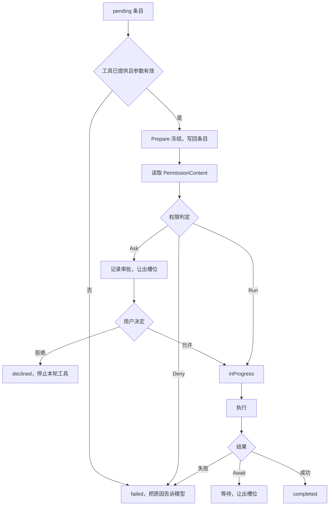

# 工具系统

工具是模型能调用的动作。`tools` 包定义一个工具长什么样、谁提供它、调用时要经过哪些步骤。每次工具调用是一个条目（item），先落库再执行，所以它的每个阶段都能在进程重启后读回来，这部分机制见[执行模型](/zh/engine/execution)和[持久化](/zh/engine/persistence)。

## 为什么这样设计

- **工具只给模型用。** 早期有 `tool/call`，界面可以直接调模型的工具，这把界面绑在写给模型看的输出上，还让工具层多了一个跳过权限的直调模式。`38c5a1c` 删掉了它，界面要做的事走专门的方法（如 `cron/list`），工具输出可以随时为模型调整。见[设计决策 9](/zh/reference/decisions#_9-工具只给模型用)。
- **审批绑定执行内容。** 两段式工具先 `Prepare` 冻结要执行的内容再审批；批准之后、执行之前再算一遍，内容变了就重新判定。初版只在批准后按冻结内容执行，不再核对，挡不住等审批期间环境的变化（`0f981f8` 替换）。见[设计决策 16](/zh/reference/decisions#_16-审批绑定执行内容)。
- **调用先记成 `pending`，真正开始执行时才记 `inProgress`。** 早期调用从模型回答落库起就是 `inProgress`，崩溃后分不清"没跑过"和"跑到一半"，恢复时只能猜（`b52bde4` 改掉）。现在恢复时 `pending` 的调用照常执行并保留审批结果，见[崩溃恢复](/zh/engine/persistence#崩溃恢复)。
- **失败交还模型，不结束这一轮。** 参数无效、被规则拒绝、执行出错，都变成工具结果交给模型；工具 panic 由注册表接住，只让这一次调用失败（`28b9033`）。轮次只在三个硬上限或用户拒绝时停止用工具。
- **只读调用并行，其余按顺序。** 标了只读的调用攒成一批并发执行，有副作用的调用按模型给出的顺序逐个执行。判断只看工具自己的 `ReadOnlyHint`，不分析参数。

代价：每个界面操作都要有专门的方法；工具要自己提供 `PermissionContent` 和 `Prepare`，没有的（比如 MCP 工具）规则只能按工具名写，也不冻结；内容变了的调用要用户再批一次；只读标注写错的工具会被错误地并行。

## 工具接口

一个工具由 `Spec` 描述，由 `Provider` 提供。

```go
type Spec struct {
	Name        string
	Description string
	InputSchema any
	Annotations *Annotations

	PermissionContent func(ctx context.Context, arguments map[string]any) (Content, error)
	Local             *Local
	Serial            bool
}

type Provider interface {
	Name() (id string, description string)
	ToolList(ctx context.Context) ([]*Spec, error)
	Invoke(ctx context.Context, tool string, arguments map[string]any) (Result, error)
}
```

| 字段 | 作用 |
| --- | --- |
| `InputSchema` | JSON Schema，参数校验和发给模型都用它。`tools.InputSchema[T]()` 从 Go 结构体生成，类型可实现 `Constrainer` 补上长度、枚举等约束 |
| `Annotations` | MCP 同款提示：`ReadOnlyHint`、`DestructiveHint`、`IdempotentHint`、`OpenWorldHint`。审批策略和并行执行都读它。`OpenWorldHint` 未设时当作真 |
| `PermissionContent` | 把参数变成权限规则能匹配的内容。没有它的工具，规则只能按工具名写 |
| `Local` | 两段式工具：`Prepare` 先冻结，`Run` 再执行。没有它的工具走 `Provider.Invoke` |
| `Serial` | 即使只读也不并行。桌面端的浏览器工具用它 |

`Content` 是权限检查看到的东西：

| 字段 | 含义 |
| --- | --- |
| `Text` | 给人看的内容，审批卡片显示它，批准后拿它比对调用有没有变 |
| `Match` | 规则匹配的主字符串 |
| `Parts` | 拆开后的子命令，每个都要过规则 |
| `Opaque` | 看不清，规则无法判定 |

工具经 `CallerOf(ctx)` 拿到调用者：`UserID`、`ThreadID`、`WorkspaceID`、`Root`（工作区根目录）、`Subagent`。

`Result` 是工具的返回：

```go
type Result struct {
	Output    any
	Err       error
	Tool      string
	Artifacts []ContextArtifact
	Await     *Await
}
```

`Artifacts` 把内容放进上下文，目前只有技能（`agent_skill`）一种。`Await` 表示结果要等别人给：`AwaitUser` 等用户回答，`AwaitAgent` 等子 agent。工具用 `tools.Awaiting(by, request)` 返回它，此时条目保持 `inProgress`，这一轮让出槽位，答案到了才补上结果。

## 注册表

`tools.New` 把一组 `Provider` 合成 `Registry`，并加上自省提供者 `tool_registry`。

- 提供者 ID 不能为空也不能重复，工具名不能为空也不能重复，否则报错。
- 工具按提供者 ID 排序、再按工具名排序生成 `ToolDescriptor`，顺序固定，发给模型的工具列表因此稳定。
- `Invoke` 和 `Prepare` 都先用 `InputSchema` 校验参数，失败返回 `ErrInvalidArguments`。
- `guard` 接住工具的 panic，这一次调用失败（"the tool crashed"），进程不受影响。

`Agent` 的内置提供者是 `plan`、`subagents`、`user_input`、`context`、`deferred_tools`，配了记忆和技能时再加 `memory`、`skills`。`workspace`、`web`、`cron` 由嵌入方放进 `Config.Providers`。

每个用户可以额外有一组工具。`Config.ToolsFor(user)` 返回 `tools.Set`（`Providers` 和 `Unavailable`），`registryFor` 用共享提供者加这个 `Set` 建一个用户专属的 `Registry`，按 `Set` 的指针缓存：同一个 `Set` 就是同一组工具。`Unavailable` 列出连不上的 MCP 服务器，它们的工具不提供，但引用它们的权限规则不算错。

## 一次调用的生命周期

模型的一次回答可以带多个工具调用。回答结束后，运行时把每个调用记成 `pending` 条目，然后逐个判断，再执行。



`planCalls` 只判断，不执行，产出一组动作；`executePlan` 按顺序执行这些动作。

一轮有三个硬上限（`agent/runtime/runtime.go`）：

| 上限 | 值 | 到达后 |
| --- | --- | --- |
| `maxToolCalls` | 400 | 这次调用失败，停止用工具 |
| `maxModelCalls` | 200 | 停止用工具 |
| `maxConsecutiveFailures` | 10 | 连续失败或被拒达到 10 次，停止用工具 |

"停止用工具"（`finish`）写一条 `[runtime] Tool use has stopped` 消息，再以 `ToolChoiceNone` 调一次模型，让它写最终回答。同一批里后面的调用记为失败，原因是 "skipped: the turn stopped before this call was executed"。

用户拒绝也走这条路：条目变成 `declined`，这一轮不再调用工具。

工具失败不会结束这一轮。错误变成工具结果交给模型，由它决定下一步。

### 并行

`readOnly(tool)` 为真（`ReadOnlyHint` 且非 `Serial`）的调用攒成一批，一起并发执行。其他调用单独执行：先把攒着的一批跑完，再跑它，保证有副作用的调用按模型给出的顺序进行。

调用遇到等待时（需要审批），先把已攒的批次跑完，然后这一次循环结束，后面的调用留在 `pending`，用户决定后下次运行时接着判断。

`Agent` 和 `request_user_input` 都标了只读，所以一次回答里的多个 `Agent` 调用会并行派生子 agent。

## 审批前冻结

用户批准的必须和实际执行的是同一件事。`Local` 工具把执行内容算好写进 `tools.Prepared`，存在条目的 `prepared_execution` 里，发给界面审批，执行时再比对。

```go
type Prepared struct {
	Cwd             string
	SettingsDigest  string
	ArgumentsDigest string
	Program         string
	Args            []string
	Env             map[string]string
	TimeoutSec      int
	Sandboxed       bool
	Escalated       bool
	Justification   string
	Files           []FileChange
}
```

`Prepare` 在权限判定之前运行，结果立即落库，所以界面在审批卡片之前就能收到冻结内容（条目更新通知）。

| 冻结的内容 | 执行时的校验 | 不一致时 |
| --- | --- | --- |
| `SettingsDigest`：沙箱指纹、超时、命令黑名单、根目录的哈希 | 重新计算 | 不运行，提示重新调用 `run_command` |
| `ArgumentsDigest`：全部参数的哈希 | 重新计算 | 不运行 |
| `Cwd` | 重新解析 | 不运行 |
| `Program`：解析链接后的可执行文件路径 | 重新解析 | "approved executable now resolves to a different path" |
| `Files[0].Before`、`After`：文件修改前后的 SHA-256 | 重新读文件、重新算新内容 | 不写入，提示重读后重做 |

文件修改冻结的是哈希和 diff，不是全文。`FileChange.Diff` 是统一格式的 diff，审批卡片显示它，`Added`、`Removed` 是增删行数。diff 用 Myers 算法，上下文 3 行。

审批和恢复之间还有一层检查。一个已决定的调用再次被处理时，`changedSinceApproval` 重新算 `PermissionContent`，`Text` 和批准时不同就清掉批准重新判定，新的审批理由以 "This call changed after you approved it, which was for: ..." 开头。

## 内置工具

所有工具的参数都先过 `InputSchema`。

### 命令

| 参数 | 类型 | 说明 |
| --- | --- | --- |
| `program` | string，必填 | argv0 |
| `args` | string[] | 后续参数。shell 单行用 `["-c", "..."]` |
| `work_dir` | string | 相对工作区根或绝对路径，必须在允许的目录内 |
| `timeout_sec` | integer | 超过 `max_command_timeout_sec` 报错 |
| `env` | object | 环境变量 |
| `sandbox_permissions` | `use_default`、`require_escalated` | 只在沙箱能提权时出现 |
| `justification` | string | 提权时必填，一句话说明原因 |

`run_command` 只能在一轮里运行，走 `Local`。超时默认 30 秒，上限默认 `max(600, 默认超时)`。命令命中 `command_blacklist` 时 `Prepare` 直接拒绝，不进审批。退出码非 0 不算工具失败，和输出一起返回。输出字段：`stdout`、`stderr`、`exit_code`、`work_dir`、`signal`、`truncated`、`sandbox_denials`、`sandbox`。

不在工作区的会话在配置的 `workspace_dirs` 里运行。没配时用 `<agent home>/scratch`，不用 agent 目录本身，那里有数据库。命令解析、提权规则见[审批与权限](/zh/engine/permissions)和[沙箱](/zh/engine/sandbox)。

### 读文件和搜索

三个工具只读，不走 `Local`，也不需要审批。路径相对工作区根或绝对路径，先规范化再过 `Box.CheckRead`，所以链接绕不过去。禁读路径在任何沙箱模式下都不读，错误提示模型改用命令，让用户决定。

| 工具 | 参数 | 行为 |
| --- | --- | --- |
| `read_file` | `path`、`offset`（从 1 起）、`limit`（默认和上限 2000） | 带行号。每行最多 2000 字符，总量 256 KiB。前 8000 字节含 NUL 或不是 UTF-8 时只返回类型和大小 |
| `glob` | `pattern`、`path` | 新的文件在前，最多 500 个 |
| `grep` | `pattern`（RE2）、`path`、`include`、`ignore_case`、`files_only`、`context`（最大 10） | 最多 300 行匹配或 500 个文件，每行最多 500 字符，跳过大于 8 MiB 的文件和非文本文件 |

模式语法：`*` 匹配一层内，`**` 匹配任意层目录，`?` 一个字符，`[...]` 字符类（`[!...]` 取反），`{a,b}` 二选一。

`glob` 和 `grep` 共用一个遍历器：按名字顺序，跳过 `.git`，遵守 `.git/info/exclude` 和逐层的 `.gitignore`（否定、目录专用、锚定都支持，深层文件和后面的行优先），不进入指向目录的链接，指向文件的链接解析到目标后再查 `CheckRead`。遍历上限 200000 项，到达时结果标 `truncated`。沙箱不让读的项计入 `skipped`，让模型知道结果有缺口。

权限规则按路径匹配：`Match` 是相对工作区根的小写路径，比如 `read_file(src/*)`。

### 改文件

| 工具 | 参数 | 行为 |
| --- | --- | --- |
| `edit_file` | `path`、`edits[]`（`old_text`、`new_text`、`replace_all`） | 依次替换，每条作用于上一条的结果。`old_text` 必须出现且默认只能出现一次 |
| `write_file` | `path`、`content` | 创建或覆盖，缺的目录自动建 |

两者都走 `Local`。写之前过 `Box.CheckWrite`：在只读模式下拒绝，必须在根目录内，沙箱生效时不能写保护路径。文件大小修改前后都不能超过 2 MiB，必须是合法 UTF-8 的普通文件。`Box.WriteFile` 先写临时文件再改名，读的人不会看到半个文件。内容没有变化时报错。

### 网页

`web_fetch` 的参数只有 `url`。

- 只接受 http、https，URL 不能带用户名密码。
- 经 `sandbox.PublicTransport` 连接，只连公网地址，解析到内网时报错并提示用 `run_command`。
- 同域跳转跟随，最多 10 次；跨域不跟随，返回 `redirectedTo`，让新域名作为一次新调用过权限。
- 超时 30 秒，响应体上限 10 MiB，超过时报错。文本上限 200000 字符，超过时截断并标 `truncated`。
- 只读文本类型（`text/*`、JSON、XML 及其 `+json`、`+xml` 变体，或没有类型）。按响应的 charset 解码。
- HTML 转成类 Markdown：标题、段落、列表、链接、代码、表格行，去掉脚本、样式、导航、页脚、表单。

这个工具没有标只读：URL 能把数据带给网站，所以每个新站点都要批准。权限规则按主机名匹配，例如 `web_fetch(example.com)`。

### 其他

| 工具 | 提供者 | 参数 | 行为 |
| --- | --- | --- | --- |
| `update_plan` | `plan` | `explanation`（500）、`plan[]`（`step` 200、`status`） | 1 到 12 步，至多一步 `in_progress`，每次替换整个计划 |
| `Agent` | `subagents` | `description`（80）、`prompt`（20000） | 派生子 agent，结果作为工具结果返回，子 agent 不能再派生 |
| `request_user_input` | `user_input` | `questions[]`（1 到 4 个） | 见[结构化提问](/zh/engine/permissions#结构化提问) |
| `read_tool_output` | `context` | `output_id`、`offset`、`length`（默认 8000，上限 20000） | 分段读回被截短的输出，只能读本会话的 |
| `memory_search` | `memory` | `query` | 见[记忆](/zh/engine/memory) |
| `load_tools` | `deferred_tools` | `names[]` | 见下面的延迟加载 |
| `list_tool_providers`、`list_tools_for_provider` | `tool_registry` | 无、`provider` | 列出提供者和它的工具 |
| `get_skills_root_dir`、`list_skills`、`activate_skill`、`read_skill_resource` | `skills` | 见[技能与 MCP](/zh/engine/skills-mcp) | |
| `create_`、`pause_`、`delete_`、`list_scheduled_jobs` | `cron` | 见[定时任务](/zh/engine/cron) | |

## 输出截断

过长的输出分三层处理，每层解决不同的问题。

| 层 | 位置 | 上限 | 超出时 |
| --- | --- | --- | --- |
| 工具自身 | 各工具 | 见上文；命令的 stdout、stderr 各 `max_output_bytes`，默认 1 MiB | 工具决定：命令保留头尾各一半，中间换成 `[… N bytes omitted …]` |
| 注册表 | `guard` | 输出 JSON 1 MiB（`maxOutputBytes`） | 换成前 1 MiB 文本加 `[output truncated: ...]` |
| 上下文 | `contextmanager` | 单条输出最多 6000 token，最少 256 | 保留开头约三分之一和结尾约三分之二，中间换成提示 |

前两层决定存进数据库的是什么，第三层只影响发给模型的内容，库里仍是完整结果。截断提示写明怎么读回：

```text
[... characters 8000-52000 of this output omitted; call read_tool_output with output_id "<条目 ID>" and offset 8000 to read them ...]
```

`read_tool_output` 按字符读库里的完整结果，只接受本会话的工具调用条目。第三层的预算怎么分给同一批调用、切点怎么避开脱敏范围、`read_tool_output` 的参数，见[上下文管理](/zh/engine/context#工具输出裁剪)。

三层各管一件事：工具层按各自输出的形状截（命令的 stdout、stderr 各自保留头尾）；注册表要保证任何工具，包括 MCP 工具，存进库的结果都有上限；只有上下文层知道这次请求还剩多少预算，而且它不改库里的内容，所以同一个结果在下一次请求里可以显示得更长。

## 延迟加载

工具定义占输入预算。工具太多时，把一部分工具只列名字，模型用到时再载入。

`runtime.Offer` 把可见工具分成发送的（`offered`）和只列名字的（`deferred`）：

| 情况 | 触发条件 | 哪些工具被延迟 |
| --- | --- | --- |
| 工具放不下 | 有外部工具（名字含 `__`），且全部工具定义超过输入预算的 10%（`toolPercent`） | 外部工具 |
| 小输入模型 | 输入预算小于 16384 token | 除 `load_tools`、`read_file`、`run_command` 以外的全部 |

`load_tools` 本身只在延迟发生时才发给模型。被延迟的工具按提供者分组列在系统提示词的 `# DEFERRED TOOLS` 一节。

`load_tools` 只校验名字是否在延迟列表里，名字不对就报错。它不改任何状态：`Offer` 从会话中已完成的 `load_tools` 条目读出已载入的名字，追加到工具列表末尾，按载入顺序排列。这样有两个好处：工具列表只会变长，请求前缀不变，服务商缓存继续有效；状态全在条目里，重启后不用恢复。载入后本会话一直可用。

模型直接调用没载入的工具时，这次调用失败，错误提示它先调 `load_tools`。

这样设计是为了前缀缓存（见[设计决策 14](/zh/reference/decisions#_14-记忆快照与稳定前缀)），提交 `f195793`。同一机制也用于窗口小的模型，见[精简模式](/zh/engine/context#精简模式)。

## 边界与已知问题

- **只读标注由工具自己声明。** 并行和审批策略都信 `ReadOnlyHint`，引擎不核对。MCP 服务器给的标注原样搬过来，标错的工具会被并行执行，在适中策略下也不问就运行，见[技能与 MCP](/zh/engine/skills-mcp#权限与沙箱)。
- **没有 `PermissionContent` 的工具只能按名字管。** 规则写不了说明符，也没有审批前冻结；MCP 工具都属于这一类。
- **注册表截断可能切坏 JSON。** 输出超过 1 MiB 时按字节截前 1 MiB，结果变成一段不完整的 JSON 文本，可能切在多字节字符中间。
- **硬上限按轮次算。** 400 次工具调用、200 次模型调用、连续 10 次失败，到了就停止用工具，只能让模型写最终回答；这些值不能配置（`agent/runtime/runtime.go` 的常量）。
- **一次回答里遇到审批就停在那里。** 审批之前攒的只读调用先跑完，后面的调用留在 `pending`，用户决定之后才继续判断，见[并行](#并行)。
- **延迟加载的工具载入后不能卸下。** 工具列表只增不减，载入过的工具一直占着输入预算。

## 代码位置

| 位置 | 职责 |
| --- | --- |
| ollupi `tools/spec.go` | `Spec`、`Annotations`、`Content`、`Local`、`ToolDescriptor` |
| ollupi `tools/prepared.go` | `Prepared`、`FileChange` |
| ollupi `tools/result.go` | `Result`、`Await`、`ContextArtifact` |
| ollupi `tools/provider.go`、`tools/caller.go` | `Provider` 接口、调用者上下文 |
| ollupi `tools/registry.go` | 注册表、分发、输出上限、panic 保护 |
| ollupi `tools/schema.go` | Schema 生成和参数校验 |
| ollupi `tools/introspection.go` | `list_tool_providers`、`list_tools_for_provider` |
| ollupi `tools/workspace/` | `run_command`、文件工具、读取工具、diff、gitignore |
| ollupi `tools/web/` | `web_fetch` 和 HTML 转文本 |
| ollupi `tools/plan/`、`tools/subagent/`、`tools/userinput/` | 计划、子 agent、提问 |
| ollupi `agent/runtime/calls.go` | 逐个判断调用 |
| ollupi `agent/runtime/execute.go` | 执行动作、并行、停止用工具 |
| ollupi `agent/runtime/loader.go` | `load_tools` |
| ollupi `agent/contextmanager/outputs.go` | `read_tool_output` |
