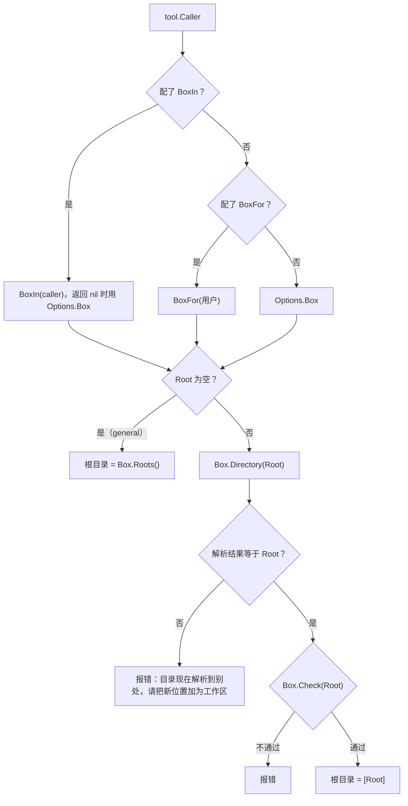

# 工作区

工作区（workspace）是用户沙箱（`sandbox.Box`）里的一个项目文件夹，会话挂在它上面。工作区工具（`tool/builtin/workspace`）在这个文件夹里跑命令、读写文件：一次调用在哪个目录运行、能写到哪里、经过哪一层权限设置，都由会话所在的工作区决定。

本页先讲工作区怎样把会话、工具和权限连起来，再讲工作区工具本身：`run_command`、`claude`、读文件和搜索、改文件和 diff，以及它们在审批前冻结什么。工作区的表结构见[持久化](/zh/engine/persistence#workspaces)，协议方法见[网关协议](/zh/integrate/protocol/workspaces#工作区的方法)，沙箱规则见[沙箱](/zh/engine/sandbox)，命令怎样拆给权限规则看见[命令解析](/zh/engine/permissions#命令解析)。

## 为什么这样设计

- **工作区是 Box 里的路径，不是本机路径。** 加工作区时用的是这个用户自己的 Box 来校验路径，工具每次调用也在用户自己的 Box 里解析目录。云沙箱用户的工作区是他那台机器里的路径，本机根本没有这个目录。这样一个进程能同时服务本机用户和云沙箱用户，见[设计决策 1](/zh/reference/decisions#_1-池化-runtime)。
- **数据挂在工作区 ID 上，路径可以换。** 会话、记忆、定时任务都记的是工作区 ID，不是路径。所以 `workspace/move` 搬文件夹时只改工作区自己的根目录，别的数据不用改写。
- **只归档，不删除。** 引擎没有删除工作区的操作，只能归档。归档只是让它不能再开新会话和新的一轮，数据都留着。
- **不在工作区的会话不在 agent 目录里跑。** 没配 `workspace_dirs` 时，命令在 `<agent home>/scratch` 里运行，而不是 agent 目录本身，因为那里有数据库。
- **权限多一层，按项目区分。** 用户为一个项目批准的"总是允许"写进这个工作区的设置，只对这个项目的会话生效，不影响别的项目，见[权限分层](/zh/engine/permissions#权限分层)。
- **改动先冻结再审批。** 命令和文件修改在判定之前算好要执行的程序、目录、diff 和哈希，用户批准的就是这一份；执行时再核对一遍，环境在等审批期间变了就不执行。
- **读写文件用专门的工具，不用 shell。** `read_file`、`glob`、`grep` 只读、按路径过权限，可以并行；`edit_file`、`write_file` 让用户在审批时看到 diff。工具描述要求模型用它们，不用 `cat`、`find`、`grep`。

代价：每次工具调用都要在用户的 Box 里重新解析一次工作区目录，云沙箱用户的每次调用因此多一次到机器的往返；文件夹在引擎之外被挪走或换成链接后，工作区就用不了了，只能重新添加或者用 `workspace/move`；工作区限制的是写入和命令目录，不限制读取，见[边界与已知问题](#边界与已知问题)。

::: info 演进
- 在用户自己的 Box 里校验和解析工作区路径来自 `aecfb63`。
- `workspace/move` 来自 `d63435b`。在此之前根目录是唯一改不了的列，用户在访达里挪了文件夹，所有会话就都指向一个不存在的路径。
- scratch 目录由引擎创建来自 `701ac2a`，此前由桌面端自己建这个目录。
- v0.16.0 的日志重建把工作区的操作移到 `app`（`app/owned.go`），工作区工具移到 `tool/builtin/workspace`（`cef6026`），冻结内容成了调用记录的一部分。
:::

## 机制

### 一个工作区是什么

`account.Workspace`：ID、名称、根目录 `Root`、权限设置 `Settings`、创建和更新时间、归档时间。根目录是用户 Box 里规范化之后的绝对路径。同一个用户不会有两个指向同一文件夹的工作区，不同用户可以有同样的根目录，因为它们在各自的 Box 里。

会话的工作区可以为空，这时会话不属于任何工作区，界面上叫 general。子 agent 的会话继承父会话的工作区和执行环境（`run.launch`），所以子 agent 和父会话在同一个目录里干活，经过同一层工作区权限。

### 添加

`workspace/add` 调到 `app.AddWorkspace(ctx, user, path, name)`，整个操作限时 1 分钟：

1. `host.Config.Boxes(user)` 拿到这个用户的 Box。
2. `Box.Directory(path)` 规范化路径，并确认它存在、是目录。本机解析链接，云沙箱只做路径清理并要求绝对路径。失败时返回 `ErrInvalidPath`，协议上是 `-32602`。
3. `name` 为空时取目录名，去掉首尾空白后必须是 1 到 120 个字符。
4. 读这个用户已有的工作区，用 `Box.Same` 判断是不是同一个文件夹。本机比较的是文件本身，所以经过不同链接到达的同一个文件夹算同一个。

| 已有同一个文件夹的工作区 | 结果 |
| --- | --- |
| 没有 | 新建一个 |
| 有，未归档 | 返回已有的那个，`name` 参数不生效 |
| 有，已归档 | 取消归档后返回 |

添加时不检查这个目录能不能作为命令目录（`Box.Check`），这一步留到工具调用时，见[边界与已知问题](#边界与已知问题)。

### 一轮里的工作区

一轮的每一步，`run` 读出会话的工作区（`run.load`），用在三个地方：

- **调用者。** `tool.Caller` 的 `Workspace`、`Root`（工作区的根目录）和 `Environment`（会话的执行环境），工具从 `tool.Call` 读到。
- **系统提示词。** 会话在工作区里、而且这一轮能用工作区的工具时，系统提示词里多一节 `# PROJECT`，告诉模型这个会话在哪个项目里、命令默认在那里运行，见[系统提示词](/zh/engine/context#系统提示词)。
- **权限层。** 工作区设置是权限分层里的一层，见下文[权限](#权限)。

### 工具怎样用工作区

每次调用先由 `dirs`（`tool/builtin/workspace/dirs.go`）算出这次调用的 Box 和根目录：



根目录列表决定这些事：

| | 在工作区里 | 不在工作区（general） |
| --- | --- | --- |
| 相对路径的基准 | 工作区根目录 | `Box.Roots()` 的第一个 |
| 命令能在哪运行（`work_dir`） | 工作区根目录之内 | `Box.Roots()` 里任一个之内 |
| 文件工具能写哪里（`CheckWrite`） | 工作区根目录之内，再受沙箱规则限制 | `Box.Roots()` 之内，再受沙箱规则限制 |
| 读取工具能读哪里（`CheckRead`） | 禁读路径以外的任何地方 | 同左 |

本机的 `Box.Roots()` 是配置的 `workspace_dirs`，没配时是 `<agent home>/scratch`；云沙箱是它自己的根目录。所以一个会话进了工作区，它的命令目录就从 `workspace_dirs` 收窄到这一个项目，`workspace_dirs` 里别的目录对它不可写。

本机 Seatbelt 模式下，`Box.Check` 拒绝 `/`、用户主目录、`~/Library` 以及包含它们的目录。这样一来命令目录不会大到把保护路径包进去，见[沙箱](/zh/engine/sandbox#三种模式)。`full-access` 下和云沙箱里 `Check` 总是通过。

工具显示路径时，根目录之内的写成相对路径，权限规则也按这个相对路径匹配（大小写不敏感），比如 `read_file(src/*)`；根目录之外的写成绝对路径。

每次调用都重新解析，而不是用添加时存下的结果：冻结的设置摘要里包含根目录，执行之前再算一遍，根目录变了就不执行，见[审批前冻结的内容](#审批前冻结的内容)。

### Provider 的配置

`workspace.New(Options)` 建这个提供者，嵌入方把它放进 `host.Config.Tools`，引擎不会自己加。`Options` 的字段：

| 字段 | 作用 | 不填时 |
| --- | --- | --- |
| `Config` | 下表的配置项 | 用默认值 |
| `Box` | 描述工具用的 Box：工具描述里写的目录和沙箱规则从它来；也服务 `BoxFor` 没给的用户。给了它时 `workspace_dirs` 取 `Box.Roots()` | 用 `Config` 在本机建一个沙箱 |
| `BoxFor` | 每次调用用这个用户自己的 Box。Box 的生命周期归宿主，`Provider.Close` 只关 `Box` | 所有用户都用 `Box` |
| `BoxIn` | 按会话的执行环境（`caller.Environment`）给 Box，配了它就不再用 `BoxFor`；返回 `nil` 而不报错时用 `Box`。配了它时 `run_command` 的描述会说明命令在会话选的环境里运行 | 用 `BoxFor` |
| `Agent.Home` | agent 目录：`workspace_dirs` 的相对路径基于它，`<home>/data` 禁读，`<home>/scratch` 是默认命令目录 | `workspace_dirs` 必须配 |
| `Agent.SkillsDir` | 技能目录，命令和文件工具对它只读 | 不加这条规则 |
| `DenyRead`、`EnvMarker` | 追加的禁读路径、命令环境里的标记变量，交给本机沙箱 | 不加 |

`Config` 里和工作区工具有关的配置项（其余是沙箱的，见[沙箱](/zh/engine/sandbox)）：

| 配置项 | 默认 | 作用 | 调大 / 调小 |
| --- | --- | --- | --- |
| `workspace_dirs` | `<home>/scratch`（自动创建） | 不在工作区的会话的命令目录；相对路径基于 agent 目录 | 加目录让 general 会话能写更多地方 |
| `command_timeout_sec` | 30 | 命令默认超时 | 调大让慢命令不被杀，调小让卡住的命令早点返回 |
| `max_command_timeout_sec` | `max(600, command_timeout_sec)` | 模型能要的最长超时，也是 `claude` 的默认超时；不能小于默认超时 | 调大允许更长的构建和测试，期间占着这一轮 |
| `command_blacklist` | 空 | 命中就在 `Prepare` 阶段拒绝，见[命令黑名单](/zh/engine/permissions#命令黑名单) | |
| `max_output_bytes` | 1 MiB | 命令 stdout、stderr 各自保留的字节数 | 调大写进日志的输出更多，调小省日志空间 |

提供者还给沙箱追加了一组保护名：`AGENTS.md`、`.agents`、`.codex`、`.claude`、`CLAUDE.md`、`.cursor`、`.mcp.json`。这些是别的 agent 工具之后会读的配置，在命令目录的任意层级都不可写，见[保护名](/zh/engine/sandbox#保护名)。

::: info 演进
执行环境是 v0.12.0 加入的（`5f64857`）：调用者多了执行环境，`Options` 多了 `BoxIn`。在此之前每次调用只看 `BoxFor`，一个用户的所有会话都在同一个 Box 里运行。
:::

### 权限

工作区设置是权限分层里的一层：部署默认、用户、工作区、会话（`account.Layers`）。合并规则见[权限分层](/zh/engine/permissions#权限分层)。

- `workspace/updatePermissions` 改这一层，先校验单层和合并后的结果。
- 审批时选"总是允许"，建议的规则写进工作区设置；会话不在工作区时写进会话设置；子 agent 的调用写进父会话所在的工作区或父会话，见["总是允许"的写入](/zh/engine/permissions#总是允许-的写入)。
- 子 agent 用工作区这一层，会话那一层用父会话的设置。

### 归档与搬家

归档的工作区里，不能再开新会话，会话也不能再开始新的一轮（`account.ErrWorkspaceArchived`，协议上是 `-32014`）。数据都还在，取消归档或重新添加同一个文件夹就恢复。

`workspace/move` 经用户的 `Box.Move` 把文件夹搬到一个已存在的空文件夹，再改根目录。工作区里还有没结束的轮次时拒绝（`ErrWorkspaceBusy`），因为那些轮次的调用里写着旧路径；搬的过程中不让新轮次开始。拒绝的条件和失败后的回滚见[网关协议](/zh/integrate/protocol/workspaces#工作区的方法)。

### 别处怎样用工作区

| 功能 | 怎样用 | 见 |
| --- | --- | --- |
| 记忆 | 范围分 `global`、`general`、`workspace`，`workspace` 范围的记忆只进这个工作区的会话 | [记忆](/zh/engine/memory) |
| 搜索 | `search` 可以带 `workspaceId` 只搜一个工作区 | [搜索](/zh/engine/search) |
| 会话列表 | `thread/list` 按 `workspaceId` 过滤 | [网关协议](/zh/integrate/protocol/threads) |
| 附件 | 源文件从用户自己的 Box（`host.Config.Boxes`）里读，宿主应当给它和工作区工具同一个函数 | [扩展点](/zh/integrate/extend#云沙箱) |

## 工作区工具

`workspace` 提供者有七个工具。四个是两段式（`run_command`、`claude`、`edit_file`、`write_file`）：有 `Content` 也有 `Prepare`，判定之前冻结执行内容。三个只读（`read_file`、`glob`、`grep`）：只有 `Content`，按路径过权限，不冻结，可以并行。工具框架见[工具系统](/zh/engine/tools)。

### 命令

`run_command` 的参数：

| 参数 | 类型 | 说明 |
| --- | --- | --- |
| `program` | string，必填 | argv0：PATH 上的程序名或绝对路径 |
| `args` | string[] | 后续参数。shell 单行用 `["-c", "..."]` |
| `work_dir` | string，非空 | 相对工作区根或绝对路径，必须在根目录之内 |
| `timeout_sec` | integer，1 到 `max_command_timeout_sec` | 不填用 `command_timeout_sec` |
| `env` | object | 环境变量，名字只能是字母、数字和 `_`，不以数字开头 |
| `sandbox_permissions` | `use_default`、`require_escalated` | 只在沙箱能提权时出现在 schema 里 |
| `justification` | string | 提权时必填，一句话告诉用户命令需要沙箱不允许的什么 |

`Content` 把命令变成权限内容：`Text` 是给人看的整行（带 `env` 时环境变量排在前面），`Match` 是 `程序名 参数...`，`Parts` 是拆开的子命令。`sh -c` 等形式的脚本用 `mvdan.cc/sh/v3/syntax` 解析，取出每个简单命令；包装命令（`env`、`nohup`、`timeout` 等）去掉后再看；有展开、复合语句、带 `env` 参数等情况时标为看不清（`Opaque`）。拆分的完整规则见[命令解析](/zh/engine/permissions#命令解析)。

`Prepare`（`prepareCommand`）依次：

1. 算出这次调用的 Box 和根目录，解析 `work_dir`，必须在根目录之内。
2. 拿 `Match` 和 `Parts` 比对 `command_blacklist`，命中直接报错，不进判定。
3. 检查提权：要 `require_escalated` 时，沙箱必须生效（否则提示去掉这个参数）、必须能提权、必须有 `justification`。
4. `Box.Executable(program, cwd)` 把程序名解析成可执行文件的真实路径。
5. 写下冻结内容：目录、设置摘要、参数摘要、程序路径、参数、环境变量、超时、是否在沙箱里（沙箱生效且没有提权）、是否提权和理由。

执行时（`execute`）重新算 Box 和根目录，核对冻结内容（见[审批前冻结的内容](#审批前冻结的内容)），再把模型给的程序名重新解析一遍，和冻结的路径不同就报 `approved executable now resolves to a different path`，不执行。通过后经 `Box.Run` 运行：提权的命令不进沙箱（`Unsandboxed`）。

结果是 `CommandOutput`：`stdout`、`stderr`、`exit_code`、`work_dir`、`signal`、`truncated`、`sandbox_denials`（沙箱拦下了什么），提权运行时 `sandbox` 写明 `escalated: ran on the host without the sandbox`。退出码非 0 不算工具失败，和输出一起返回，由模型判断。stdout 和 stderr 各自超过 `max_output_bytes` 时保留头尾，中间换成 `[… N bytes omitted …]`。

工具描述会随 Box 变化：写明默认目录和可用目录、沙箱的规则摘要；沙箱生效时说明命令在沙箱里运行、不问用户；能提权时说明 `sandbox_denials` 的意思、什么时候该带 `require_escalated` 重试、不要为了绕开故意禁止的路径而提权。审批策略怎样对待沙箱内和提权的命令见[审批策略](/zh/engine/permissions#审批策略)，提权见[沙箱](/zh/engine/sandbox#提权)。

::: info 演进
- `00a1f22` 让"程序仍然解析到批准的可执行文件"这项检查真正生效：以前执行时重新解析的是已经解析过的路径，永远相同；现在重新解析模型给的名字，程序在批准和运行之间换了位置就拒绝。同一个提交把 `timeout_sec` 的范围和 `work_dir` 非空写进了 schema。
- `7e10076` 用 `mvdan.cc/sh` 取代手写的脚本切分。
:::

### claude

`claude` 把一个自包含的任务交给 Claude Code，在会话的 Box 里、项目目录下运行，返回它的最终回答（`tool/builtin/workspace/claude.go`）。参数是 `prompt`（必填）、`work_dir`、`timeout_sec`（默认取 `max_command_timeout_sec`）。

命令行是固定的：

```text
claude -p <prompt> --output-format json --permission-mode acceptEdits
    --allowedTools "Bash(go test *)" --permission-prompts none --max-budget-usd 2
```

也就是说 Claude Code 能改文件、能跑 `go test`，别的都不能，花到 2 美元就停。它需要网络和用户主目录里自己的设置，沙箱不允许，所以 Box 能提权时这个调用总是以提权准备，理由是 `Claude Code needs the network and its own settings in your home folder`，按审批策略问用户；Box 不能提权时按沙箱允许的范围运行。审批卡片显示整行命令。`claude` 不在 PATH 上时 `Prepare` 报错。

结果是 Claude Code JSON 里的 `result`、`is_error`、`subtype`、`num_turns`、`session_id`，加上 `work_dir`，不含花费。它在给出回答之前就失败时，模型拿到的是 stdout、stderr 和退出码。执行前的核对和 `run_command` 走同一条路。

### 读文件和搜索

三个工具只读，不冻结，也不需要审批（除非规则要求）。路径相对工作区根或绝对路径，先规范化再过 `Box.CheckRead`，所以链接绕不过去。禁读路径在任何沙箱模式下都不读，错误提示模型改用命令，让用户决定。权限规则按路径匹配：`Match` 是根目录内的相对路径（小写），比如 `read_file(src/*)`。

| 工具 | 参数 | 行为 |
| --- | --- | --- |
| `read_file` | `path`、`offset`（从 1 起）、`limit`（默认和上限 2000） | 带行号。每行最多 2000 字符，返回的文本最多 256 KiB；扫描超过 64 MiB 而这一页已经取够时停下，`totalLines` 只是下限，`totalLinesAtLeast` 为真。前 8000 字节含 NUL 或不是 UTF-8 时只返回类型和大小 |
| `glob` | `pattern`、`path` | 新的文件在前，最多 500 个 |
| `grep` | `pattern`（RE2）、`path`（文件或目录）、`include`、`ignore_case`、`files_only`、`context`（最大 10） | 最多 300 行匹配或 500 个文件，每行最多 500 字符，跳过大于 8 MiB 的文件和非文本文件 |

模式（`glob` 的 `pattern`、`grep` 的 `include`）由 `doublestar` 校验和匹配：`*` 匹配一层内，`**` 匹配任意层目录，`?` 一个字符，`[...]` 字符类（`[!...]` 取反），`{a,b}` 二选一，`\` 转义。不合法的模式报 `not a valid glob`。

`glob` 和 `grep` 共用一个遍历器（`walk.go`）：按名字顺序，跳过 `.git`，不进入指向目录的链接，指向文件的链接解析到目标后再查 `CheckRead`。忽略规则（`patterns.go`）从最近的含 `.git` 的上层目录开始：读 `.git/info/exclude`，再沿路逐层读 `.gitignore`，用 go-git 的 `gitignore` 包解析和匹配，每层的规则只作用于它自己的目录，后面的规则优先，支持否定、目录专用和锚定。忽略文件超过 1 MiB 时当作没有。遍历上限 200000 项，到达时结果标 `truncated`。沙箱不让读的项和读不了的文件计入 `skipped`，让模型知道结果有缺口。

::: info 演进
来自 `4889540`：`glob` 和 `grep` 的模式以前由手写的翻译器转成正则，`.gitignore` 由手写的匹配器处理；现在分别用 `doublestar` 和 go-git。同样的模式匹配同样的路径，嵌套的花括号和字符类按 `doublestar` 的规则。
:::

### 改文件

| 工具 | 参数 | 行为 |
| --- | --- | --- |
| `edit_file` | `path`、`edits[]`（`old_text`、`new_text`、`replace_all`） | 依次替换，每条作用于上一条的结果。`old_text` 必须出现，默认只能出现一次；文件必须已存在 |
| `write_file` | `path`、`content` | 创建或覆盖，缺的目录自动建 |

两者都两段式。`Content` 和 `Prepare` 走同一段计算（`change`）：

1. 路径规范化后过 `Box.CheckWrite`：在只读模式下拒绝，必须在根目录内，沙箱生效时不能写保护路径。
2. 目标已存在时必须是普通文件、不超过 2 MiB、是合法 UTF-8，按 2 MiB 上限读出。
3. 算出新内容；`edit_file` 的替换找不到、出现多次、或改完内容没变，都报错并告诉模型怎么改。新内容也不能超过 2 MiB。
4. 用 `go-udiff` 算统一格式的 diff，上下文 3 行，数出增删行数。

权限内容的 `Text` 就是这份 diff，审批卡片显示它；`Match` 是相对路径（小写）。冻结内容里有一个 `FileChange`：路径、修改前后内容的 SHA-256、diff、增删行数。

执行时（`runFile`）先核对设置和参数摘要，再把上面的计算重做一遍，路径、修改前的哈希、修改后的哈希都要和冻结时一致，不一致就不写，提示模型重读文件再改。通过后经 `Box.WriteFile` 写入：先写同目录下的临时文件再改名，读的人不会看到半个文件，已有文件保持原来的权限位。结果是 `path`、`created`、`added`、`removed`。

::: info 演进
来自 `e20ea77`：以前的 diff 是手写的，内存随文件行数乘以改动行数增长，一次整体重写 20000 行的文件要约 25 GB，而 diff 在审批前就要算，一次 `write_file` 就能耗尽服务所有用户的进程。现在用 `go-udiff`，它的 LCS 搜索有上限，同样的改动 0.02 秒。
:::

### 审批前冻结的内容

两段式工具的冻结内容是 `workspace.Prepared`，编码成 JSON 记进调用的 `ToolCall.Prepared`，协议里是条目的 `preparedExecution`：

```go
type Prepared struct {
	Cwd             string
	SettingsDigest  string
	ArgumentsDigest string
	Program         string
	Args            []string
	Env             map[string]string
	TimeoutSec      int
	Sandboxed       bool
	Escalated       bool
	Justification   string
	Files           []FileChange
}
```

批准之后不再重新判定，执行时由工具自己核对（`prepared.go` 的 `validatePrepared`，以及各工具的检查）：

| 冻结的内容 | 执行时的校验 | 不一致时 |
| --- | --- | --- |
| `SettingsDigest`：沙箱的 `Fingerprint`、默认超时、命令黑名单、根目录的哈希 | 重新计算 | 不运行，提示重新调用 `run_command` |
| `ArgumentsDigest`：全部参数的哈希 | 重新计算 | 不运行 |
| `Cwd` | 重新解析 | 不运行 |
| `Program`：解析链接后的可执行文件路径 | 按模型给的名字重新解析 | "approved executable now resolves to a different path" |
| `Files[0].Before`、`After`：文件修改前后的 SHA-256 | 重新读文件、重新算新内容 | 不写入，提示重读后重做 |

文件修改冻结的是哈希和 diff，不是全文。`Sandboxed` 和 `Escalated` 也随 `tool.Plan` 交给审批策略：`on-request` 下在沙箱里运行、没有提权的调用不用问，见[审批策略](/zh/engine/permissions#审批策略)。

## 边界与已知问题

- **添加时不查能不能作为命令目录。** `AddWorkspace` 只确认路径存在、是目录，不调 `Box.Check`。在 Seatbelt 模式下，把用户主目录加成工作区会成功，但之后这个工作区里的每一次文件和命令调用都会因为 `Check` 不通过而失败。
- **工作区不限制读取。** 读取工具能读禁读名单以外的任何路径，不限于工作区根目录，命令也一样，见[沙箱](/zh/engine/sandbox#边界与已知问题)。工作区收窄的只是命令目录和写入范围。
- **文件夹被挪走或换成链接后工作区失效。** 每次调用都要求根目录解析到它自己，解析到别处时报错，提示把新位置加为工作区；用 `workspace/move` 才能让工作区跟着走。
- **同一个文件夹的判定依赖 Box。** 本机按文件身份判断，云沙箱的 `Same` 只比较路径字符串，同一台机器里经过链接到达的同一个文件夹会被当成两个。
- **工具描述按描述用的 Box 写。** `run_command` 和文件工具的描述里写的目录和沙箱规则来自 `Options.Box`，不是每个用户自己的 Box。用户的 Box 根目录和它不同时，模型看到的描述和实际规则对不上。
- **命令里的文件改动没有 diff。** 只有 `edit_file`、`write_file` 冻结 diff 和哈希；`run_command` 冻结的是命令本身，命令会改哪些文件审批时看不到。
- **`claude` 在能提权的沙箱里总是离开沙箱。** 它的限制来自 Claude Code 自己的参数（只许改文件和 `go test`、2 美元上限），不来自沙箱。
- **大文件改不了。** 超过 2 MiB 的文件 `edit_file`、`write_file` 都拒绝，只能用命令。
- **没有删除。** 工作区只能归档，归档后的记录一直留在库里。
- **工作区属于这台机器上的环境。** 会话可以在别的执行环境里运行，但 `workspace/add` 和 `workspace/move` 仍经 `host.Config.Boxes` 校验路径，也就是用户在这台机器上的 Box。会话在云沙箱环境里时，它的工作区路径要在那台机器上也解析到它自己，否则每次调用都按上面的流程报错。执行环境见[网关协议](/zh/integrate/protocol/workspaces#执行环境的方法)。

## 代码位置

| 位置 | 职责 |
| --- | --- |
| ollupi `account/account.go` | `Workspace`、权限层、名称检查、`ErrWorkspaceArchived` |
| ollupi `app/owned.go` | `AddWorkspace`、`RenameWorkspace`、`MoveWorkspace`、`ArchiveWorkspace` |
| ollupi `app/settings.go` | "总是允许"写进工作区或会话 |
| ollupi `run/run.go` | 读会话的工作区、组装权限层、把根目录放进 `tool.Caller` |
| ollupi `run/tools.go` | 子 agent 继承父会话的工作区和执行环境 |
| ollupi `prompt/system.go` | `# PROJECT` 一节 |
| ollupi `tool/builtin/workspace/tool.go` | `Options`、`New`、`Provider` |
| ollupi `tool/builtin/workspace/config.go` | 配置项、默认值、scratch 目录、追加的保护名 |
| ollupi `tool/builtin/workspace/dirs.go` | 每次调用的 Box 和根目录、路径解析 |
| ollupi `tool/builtin/workspace/command.go` | 命令的权限内容、脚本解析、黑名单匹配 |
| ollupi `tool/builtin/workspace/execution.go` | `run_command` 的参数、冻结、执行、描述 |
| ollupi `tool/builtin/workspace/claude.go` | `claude` |
| ollupi `tool/builtin/workspace/read.go`、`walk.go`、`patterns.go` | 读取工具、遍历、`doublestar` 和 `.gitignore` |
| ollupi `tool/builtin/workspace/files.go`、`diff.go` | `edit_file`、`write_file`、diff |
| ollupi `tool/builtin/workspace/plan.go`、`prepared.go` | `Prepared`、`FileChange`、摘要和核对 |
| ollupi `gateway/owned.go` | `workspace/*` 方法 |
