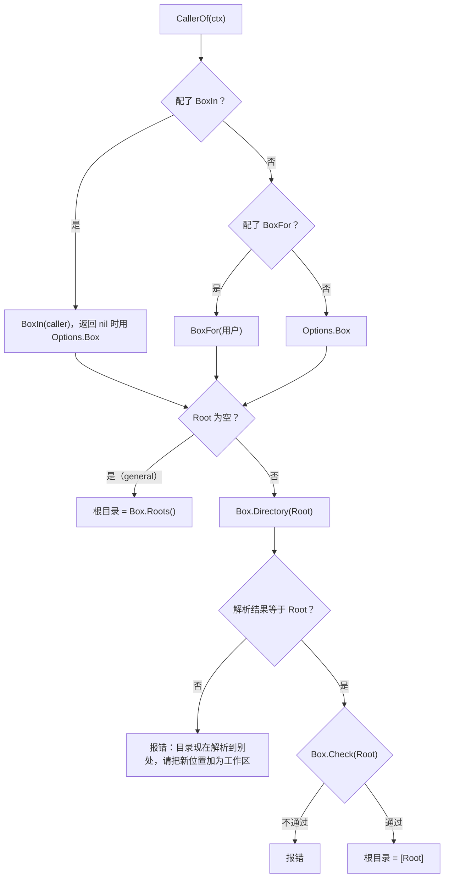

# 工作区

工作区（workspace）是用户沙箱（`sandbox.Box`）里的一个项目文件夹，会话挂在它上面。一次工具调用在哪个目录运行、能写到哪里、经过哪一层权限设置，都由会话所在的工作区决定。

工作区的表结构见[持久化](/zh/engine/persistence#workspaces)，协议方法见[网关协议](/zh/integrate/protocol/workspaces#工作区的方法)，工具各自的参数见[工具](/zh/engine/tools#内置工具)，沙箱规则见[沙箱](/zh/engine/sandbox)。本页讲这些部分怎样通过工作区连起来。

## 为什么这样设计

- **工作区是 Box 里的路径，不是本机路径。** 加工作区时用的是这个用户自己的 Box 来校验路径，工具每次调用也在用户自己的 Box 里解析目录（`aecfb63`）。云沙箱用户的工作区是他那台机器里的路径，本机根本没有这个目录。这样一个进程能同时服务本机用户和云沙箱用户，见[设计决策 1](/zh/reference/decisions#_1-池化-runtime)。
- **数据挂在工作区 ID 上，路径可以换。** 会话、记忆、定时任务都记的是工作区 ID，不是路径。所以 `workspace/move` 搬文件夹时只改工作区自己的 `root_path` 一列，别的数据不用改写（`d63435b`）。在此之前，根目录是唯一改不了的列，用户在访达里挪了文件夹，所有会话就都指向一个不存在的路径。
- **只归档，不删除。** 引擎没有删除工作区的操作，只能归档；指向 `workspaces` 的外键是 `ON DELETE RESTRICT`，库也不允许删掉还有会话的工作区。归档只是让它不能再开新会话和新的一轮，数据都留着。
- **不在工作区的会话不在 agent 目录里跑。** 没配 `workspace_dirs` 时，命令在 `<agent home>/scratch` 里运行，而不是 agent 目录本身，因为那里有数据库（`701ac2a`，此前由桌面端自己建这个目录）。
- **权限多一层，按项目区分。** 用户为一个项目批准的"总是允许"写进这个工作区的设置，只对这个项目的会话生效，不影响别的项目，见[审批与权限](/zh/engine/permissions#三层叠加)。

代价：每次工具调用都要在用户的 Box 里重新解析一次工作区目录，云沙箱用户的每次调用因此多一次到机器的往返；文件夹在引擎之外被挪走或换成链接后，工作区就用不了了，只能重新添加或者用 `workspace/move`；工作区限制的是写入和命令目录，不限制读取，见[边界与已知问题](#边界与已知问题)。

## 机制

### 一个工作区是什么

`workspaces` 表的一行：所属用户、名称、根目录 `root_path`、权限设置 `settings`、归档时间。根目录是用户 Box 里规范化之后的绝对路径。同一个用户的根目录不能重复（唯一索引 `(user_id, root_path)`），不同用户可以有同样的根目录，因为它们在各自的 Box 里。

会话的 `workspace_id` 可以为空，这时会话不属于任何工作区，界面上叫 general。子 agent 的会话继承父会话的 `workspace_id`（`agent/subagents.go`），所以子 agent 和父会话在同一个目录里干活，经过同一层工作区权限。

### 添加

`workspace/add` 调到 `Agent.AddWorkspace(user, path, name)`：

1. `BoxFor(user)` 拿到这个用户的 Box。
2. `Box.Directory(path)` 规范化路径，并确认它存在、是目录。本机解析链接，云沙箱只做路径清理并要求绝对路径。失败时返回 `ErrInvalidPath`，协议上是 `-32602`。
3. `name` 为空时取目录名，去掉首尾空白后必须是 1 到 120 个字符。
4. 在一个事务里查这个用户已有的工作区，用 `Box.Same` 判断是不是同一个文件夹。本机比较的是文件本身（`os.Stat` 后比对），所以经过不同链接到达的同一个文件夹算同一个。

| 已有同一个文件夹的工作区 | 结果 |
| --- | --- |
| 没有 | 新建一行 |
| 有，未归档 | 返回已有的那个，`name` 参数不生效 |
| 有，已归档 | 取消归档后返回 |

添加时不检查这个目录能不能作为命令目录（`Box.Check`），这一步留到工具调用时，见[边界与已知问题](#边界与已知问题)。

### 一轮里的工作区

一轮开始运行时，`runTurn` 读出会话的工作区，交给运行时三样东西：

- **调用者。** `tools.Caller` 的 `WorkspaceID`、`Root`（工作区的 `root_path`）和 `EnvironmentID`（会话的执行环境，v0.12.0 起），工具用 `tools.CallerOf(ctx)` 读到。
- **系统提示词。** 有 `Root` 时，系统提示词里多一节 `# PROJECT`，告诉模型这个会话在哪个项目里、命令默认在那里运行；通用规则里还有一条"有项目目录时留在项目目录里"。
- **权限层。** 工作区设置是三层里的中间一层，见下文[权限](#权限)。

### 工具怎样用工作区

文件和命令工具都由 `tools/workspace` 的 `Provider` 提供。每次调用先由 `dirs` 算出这次调用的 Box 和根目录：

根目录列表决定三件事：

| | 在工作区里 | 不在工作区（general） |
| --- | --- | --- |
| 相对路径的基准 | 工作区根目录 | `Box.Roots()` 的第一个 |
| 命令能在哪运行（`work_dir`） | 工作区根目录之内 | `Box.Roots()` 里任一个之内 |
| 文件工具能写哪里（`CheckWrite`） | 工作区根目录之内，再受沙箱规则限制 | `Box.Roots()` 之内，再受沙箱规则限制 |
| 读取工具能读哪里（`CheckRead`） | 禁读路径以外的任何地方 | 同左 |

本机的 `Box.Roots()` 是配置的 `workspace_dirs`，没配时是 `<agent home>/scratch`；云沙箱是传给 `sandbox.Remote` 的 `roots`。所以一个会话进了工作区，它的命令目录就从 `workspace_dirs` 收窄到这一个项目，`workspace_dirs` 里别的目录对它不可写。

本机 Seatbelt 模式下，`Box.Check` 拒绝 `/`、用户主目录、`~/Library` 以及包含它们的目录。这样一来命令目录不会大到把保护路径包进去，见[沙箱](/zh/engine/sandbox#三种模式)。`full-access` 下和云沙箱里 `Check` 总是通过。

工具显示路径时，根目录之内的写成相对路径，权限规则也按这个相对路径匹配，比如 `read_file(src/*)`；根目录之外的写成绝对路径。

每次调用都重新解析，而不是用添加时存下的结果：两段式工具冻结的 `SettingsDigest` 里包含根目录，审批之后、执行之前再算一遍，根目录变了就不执行，见[审批前冻结](/zh/engine/tools#审批前冻结)。

### Provider 的配置

`workspace.New(Options)` 建这个 Provider，宿主把它放进 `Config.Providers`，引擎不会自己加。`Options` 里和工作区有关的字段：

| 字段 | 作用 | 不填时 |
| --- | --- | --- |
| `Box` | 描述工具用的 Box：工具描述里写的目录和沙箱规则从它来；也服务 `BoxFor` 没给的用户 | 用 `Config` 在本机建一个 Seatbelt 沙箱 |
| `BoxFor` | 每次调用用这个用户自己的 Box。Box 的生命周期归宿主，这个包只关 `Box` | 所有用户都用 `Box` |
| `BoxIn` | v0.12.0 起。按会话的执行环境（`caller.EnvironmentID`）给 Box，配了它就不再用 `BoxFor`；返回 `nil` 而不报错时用 `Box`。配了它时 `run_command` 的描述会说明命令在会话选的环境里运行 | 用 `BoxFor` |
| `Agent.Home` | agent 目录：`workspace_dirs` 的相对路径基于它，`<home>/data` 禁读，`<home>/scratch` 是默认命令目录 | `workspace_dirs` 必须配 |
| `Agent.SkillsDir` | 技能目录，命令和文件工具对它只读 | 不加这条规则 |

`Config` 里和工作区有关的配置项（其余是沙箱的，见[沙箱](/zh/engine/sandbox)）：

| 配置项 | 默认 | 作用 |
| --- | --- | --- |
| `workspace_dirs` | `<home>/scratch`（自动创建） | 不在工作区的会话的命令目录；相对路径基于 agent 目录。配了 `Box` 时用 `Box.Roots()` 代替 |
| `command_timeout_sec` | 30 | 命令默认超时 |
| `max_command_timeout_sec` | `max(600, command_timeout_sec)` | 模型能要的最长超时，不能小于默认超时 |
| `command_blacklist` | 空 | 命中就在 `Prepare` 阶段拒绝，见[命令黑名单](/zh/engine/permissions#命令黑名单) |

`Provider` 还给沙箱追加了一组保护名：`AGENTS.md`、`.agents`、`.codex`、`.claude`、`CLAUDE.md`、`.cursor`、`.mcp.json`。这些是别的 agent 工具之后会读的配置，在命令目录的任意层级都不可写，见[保护名](/zh/engine/sandbox#保护名)。

### 权限

工作区设置是三层权限里的中间一层：agent 默认、工作区、会话。规则取并集，下层去不掉上层的 deny，合并规则见[三层叠加](/zh/engine/permissions#三层叠加)。

- `workspace/updatePermissions` 改这一层，`ValidateLayer` 先校验单层和合并后的结果。
- 审批时选"总是允许"，建议的规则写进工作区设置；会话不在工作区时写进会话设置，见[审批流程](/zh/engine/permissions#审批流程)。
- 子 agent 用工作区这一层，但不用自己的会话设置，见[审批与权限](/zh/engine/permissions#三层叠加)。

### 归档与搬家

归档的工作区里，不能再开新会话（`StartThread` 返回 `ErrWorkspaceArchived`），顶层会话也不能再开始新的一轮（`-32014`）。数据都还在，取消归档或重新添加同一个文件夹就恢复。

`workspace/move` 经用户的 `Box.Move` 把文件夹搬到一个已存在的空文件夹，再改 `root_path`。工作区里还有没结束的轮次时拒绝，因为那些轮次的调用里写着旧路径。拒绝的条件和失败后的回滚见[网关协议](/zh/integrate/protocol/workspaces#工作区的方法)。

### 别处怎样用工作区

| 功能 | 怎样用 | 见 |
| --- | --- | --- |
| 记忆 | 范围分 `global`、`general`、`workspace`，`workspace` 范围的记忆只进这个工作区的会话 | [记忆](/zh/engine/memory#类型与范围) |
| 搜索 | `search` 可以带 `workspaceId` 只搜一个工作区 | [搜索](/zh/engine/search) |
| 会话列表 | `thread/list` 按 `workspaceId` 过滤，空字符串只列 general | [网关协议](/zh/integrate/protocol/threads) |
| 附件 | 源文件从用户自己的 Box（`Config.BoxFor`）里读，宿主应当给它和工作区工具同一个函数 | [扩展点](/zh/integrate/extend#云沙箱) |

## 边界与已知问题

- **添加时不查能不能作为命令目录。** `AddWorkspace` 只确认路径存在、是目录，不调 `Box.Check`。在 Seatbelt 模式下，把用户主目录加成工作区会成功，但之后这个工作区里的每一次文件和命令调用都会因为 `Check` 不通过而失败。
- **工作区不限制读取。** 读取工具能读禁读名单以外的任何路径，不限于工作区根目录，命令也一样，见[沙箱](/zh/engine/sandbox#边界与已知问题)。工作区收窄的只是命令目录和写入范围。
- **文件夹被挪走或换成链接后工作区失效。** 每次调用都要求根目录解析到它自己，解析到别处时报错，提示把新位置加为工作区；用 `workspace/move` 才能让工作区跟着走。
- **同一个文件夹的判定依赖 Box。** 本机按文件身份判断，云沙箱的 `Same` 只比较路径字符串，同一台机器里经过链接到达的同一个文件夹会被当成两个。
- **工具描述按描述用的 Box 写。** `run_command` 和文件工具的描述里写的目录和沙箱规则来自 `Options.Box`，不是每个用户自己的 Box。用户的 Box 根目录和它不同时，模型看到的描述和实际规则对不上。
- **没有删除。** 工作区只能归档，归档后的行一直留在库里。
- **工作区属于这台机器上的环境。** v0.12.0 起会话可以在别的执行环境里运行，但 `workspace/add` 和 `workspace/move` 仍经 `Config.BoxFor` 校验路径，也就是用户在这台机器上的 Box。会话在云沙箱环境里时，它的工作区路径要在那台机器上也解析到它自己，否则每次调用都按上面的流程报错。执行环境见[网关协议](/zh/integrate/protocol/workspaces#执行环境的方法)。

## 代码位置

| 位置 | 职责 |
| --- | --- |
| ollupi `agent/workspaces.go` | `AddWorkspace`、`RenameWorkspace`、`MoveWorkspace`、`ArchiveWorkspace`、`UpdateWorkspaceSettings` |
| ollupi `agent/scope.go` | 读会话的工作区、按工作区组装权限层 |
| ollupi `agent/run.go` | 把工作区根目录放进 `tools.Caller` |
| ollupi `agent/subagents.go` | 子 agent 继承父会话的工作区和执行环境 |
| ollupi `agent/systemprompt/systemprompt.go` | `# PROJECT` 一节 |
| ollupi `tools/workspace/tool.go` | `Options`、`New`、`Provider`、`run_command` 的描述 |
| ollupi `tools/workspace/dirs.go` | 每次调用的 Box 和根目录、路径解析、`SettingsDigest` |
| ollupi `tools/workspace/config.go` | 配置项、默认值、scratch 目录、追加的保护名 |
| ollupi `tools/workspace/files.go`、`read.go`、`command.go`、`execution.go` | 文件、读取、命令工具 |
| ollupi `repo/workspaces.go` | `workspaces` 表、`AddWorkspace` 的事务、`WorkspaceBusy` |
| ollupi `gateway/workspaces.go` | `workspace/*` 方法 |
