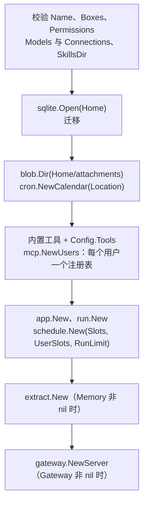

# 把引擎嵌进服务

Ollupi 引擎是一个 Go 库，模块路径 `github.com/0xfakeSpike/ollupi`。它没有 `main`：建模型客户端、选工具、给每个用户一个沙箱、监听端口、决定进程何时退出，都是宿主（host）的事。把引擎各部分拼起来的是 `host` 包：宿主填一个 `host.Config`，调 `host.New`，再跑 `Run` 和 `Gateway.Serve`。引擎仓库里的 `bench/main.go` 和 `eval/main.go` 都是这样的宿主。

本页给要把引擎嵌进自己服务的后端工程师：一个能跑起来的最小宿主，和上线前要处理的几件事。分层与装配见[引擎架构](/zh/engine/architecture)，槽位（slot）调度与一轮（turn）怎样运行见[执行模型](/zh/engine/execution)。

```sh
go get github.com/0xfakeSpike/ollupi@v0.26.2
```

引擎要用 SQLite 的 FTS5，构建和测试都要带 `-tags sqlite_fts5`（或设 `GOFLAGS=-tags=sqlite_fts5`）；不带时 `store/sqlite/fts5.go` 让编译直接失败。

## 宿主负责什么

`host.New` 按下面的顺序装配，任何一步失败都返回错误：



返回的 `*host.Host` 有三个方法要宿主调：

| 调用 | 做什么 | 什么时候返回 |
|---|---|---|
| `h.Run(ctx)` | 在一个 errgroup 里跑调度器（`schedule.Scheduler.Run`）、定时任务（`cron.Run`，每分钟查一次到期的任务）和记忆提炼（`extract.Extractor.Run`，配了 `Memory` 才有） | ctx 结束时返回 nil；任何一个出错（多半是读写库失败）时返回那个错误，其余随之停下 |
| `h.Gateway.Serve(ctx, ln)` | 在 `ln` 上服务 WebSocket 客户端；`Config.Gateway` 为 nil 时 `h.Gateway` 也是 nil | ctx 结束后最多等 5 秒关掉连接，返回 nil；监听出错时返回错误 |
| `h.Close()` | 关掉每个用户的 MCP 服务器和库 | 立即 |

除了 `Gateway`，`Host` 还导出三个字段：`Store`（`store.Store`，它的 `Feed()` 是所有变化的通知源）、`App`（`*app.App`，客户端能做的每件事都是它的一个方法）、`Users`（`*mcp.Users`，每个用户的工具注册表）。不开网关的宿主直接调 `App` 的方法、订阅 `Store.Feed()`，`bench` 就是这样驱动引擎的。

宿主自己要做的：

| 事情 | 怎么做 |
|---|---|
| 模型客户端 | `llm.NewOpenAI`、`llm.NewAnthropic`、`llm.NewGemini`，每个模型一条连接，放进 `Connections`；或自己实现 `llm.Client` |
| 工具 | 内置的计划、提问、`load_tools`、子 agent、`context`、记忆、定时任务（有 `SkillsDir` 时还有技能）由 `host.New` 加上。命令和文件工具（`tool/builtin/workspace`）、网页工具（`tool/builtin/web`）以及自己的工具要放进 `Tools` |
| 每个用户的沙箱 | `Boxes`，必填。用户可以完全使用这台机器时返回 `sandbox.Here()`（不受限的本机，根目录是主目录，见[沙箱](/zh/engine/sandbox#box-接口)）；云沙箱见[扩展点](/zh/integrate/extend#云沙箱) |
| 进程 | 信号、监听地址、`Run` 与 `Serve` 一起跑、退出时 `Close` |
| 分片 | 多进程部署时由 `shard.Member` 包住 `Run` 和 `Serve`，见[多用户与分片部署](/zh/integrate/deploy) |

`host.Config` 的全部字段见 [Config 参考](/zh/integrate/config)。

::: info 演进
v0.16.0 之前，宿主自己 `repo.Open` 打开库，填 `agent.Config`（v0.14.0 起是 `service.Config`），调 `agent.New`、`Start`、`Wait`，再用 `OnEvent` 把事件转给 `gateway.Server.Deliver`。`9fa9186` 加入 `host` 包，把这些装配收进 `host.New`；`499f96f` 让网关只从库的 feed 得知变化，`OnEvent` 和 `Deliver` 随之消失。分片租约也不再是引擎的配置（`Lease`、`OnLeaseLost`），移到了 `shard` 包（`68a4035`）。
:::

## 最小宿主程序

下面是一个完整的 `main` 包：单用户、令牌认证，不加宿主自己的工具，只用引擎自带的那些（网页读取、计划、提问、子 agent 等）。它对着引擎 v0.26.2 编译并通过 `go vet`。模型名和 limits 是示例，换成你的连接实际支持的；真实部署时把 `Home`、监听地址、令牌换成配置项。

```go
package main

import (
	"context"
	"log"
	"net"
	"os"
	"os/signal"
	"syscall"
	"time"

	"github.com/0xfakeSpike/ollupi/gateway"
	"github.com/0xfakeSpike/ollupi/host"
	"github.com/0xfakeSpike/ollupi/pkg/llm"
	"github.com/0xfakeSpike/ollupi/pkg/sandbox"
	"github.com/0xfakeSpike/ollupi/policy"
	"golang.org/x/sync/errgroup"
)

func main() {
	if err := run(); err != nil {
		log.Fatal(err)
	}
}

func run() error {
	ctx, stop := signal.NotifyContext(context.Background(), os.Interrupt, syscall.SIGTERM)
	defer stop()

	boxes := func(string) (sandbox.Box, error) { return sandbox.Here() }
	h, err := host.New(ctx, host.Config{
		Home:   "/srv/ollupi",
		Name:   "support",
		Prompt: "用中文回答工单。",
		Models: []llm.Model{{Name: "gpt-5.2", Connection: "openai"}},
		Connections: map[string]llm.Client{
			"openai": llm.NewOpenAI("", os.Getenv("OPENAI_API_KEY"), 4, map[string]llm.Limits{
				"gpt-5.2": {Context: 400_000, Output: 128_000},
			}),
		},
		Permissions: policy.Settings{ApprovalPolicy: string(policy.OnRequest)},
		Boxes:       boxes,
		Slots:       32,
		UserSlots:   4,
		RunLimit:    30 * time.Minute,
		Gateway: &gateway.Options{
			Token:          os.Getenv("OLLUPI_GATEWAY_TOKEN"),
			AllowedHosts:   []string{"agent.example.com"},
			AllowedOrigins: []string{"app.example.com"},
		},
	})
	if err != nil {
		return err
	}
	defer h.Close()

	ln, err := net.Listen("tcp", "127.0.0.1:8787")
	if err != nil {
		return err
	}
	g, ctx := errgroup.WithContext(ctx)
	g.Go(func() error { return h.Run(ctx) })
	g.Go(func() error { return h.Gateway.Serve(ctx, ln) })
	return g.Wait()
}
```

几个要注意的点：

- **`Home` 是目录，用绝对路径。** 库固定在 `<Home>/data/store.sqlite`，附件在 `<Home>/attachments`。路径拼成 SQLite 的 `file:` URI，相对路径会失败（`storage: open ...: invalid uri authority: ...`）。DSN 固定 `_busy_timeout=5000`、`_journal_mode=WAL`、`_foreign_keys=on`、`_txlock=immediate`，连接池只有一条连接（`pkg/sqlitedb`）。
- **`Run` 和 `Serve` 用同一个 ctx 一起跑。** 收到 SIGTERM 时两者一起停：网关关掉连接，调度器取消正在跑的轮次并等它们的 goroutine 退出，被取消的轮次原样留在库里，下次启动接着跑。`Close` 放在它们都返回之后，见[运维](/zh/integrate/operations#关闭、备份与升级)。
- **网关只认允许的 Host 和 Origin。** 默认只接受 `Host` 为 `localhost`、`127.0.0.1`、`::1` 的请求；经反向代理或用域名访问时，把对外域名写进 `AllowedHosts`，否则一律 403 `host not allowed`。浏览器客户端的来源写进 `AllowedOrigins`，写法是 `coder/websocket` 的 Origin 模式（`app.example.com`、`*.example.com`，或带协议的 `app://support`）。
- **`Token` 属于用户 `default`**（`gateway.DefaultUser`）。多用户换成 `Authenticate`，见[扩展点](/zh/integrate/extend#认证)。
- **`Serve` 自己建 `http.Server`**（`ReadHeaderTimeout` 5 秒、`IdleTimeout` 2 分钟），挂在 `GET /`。`gateway.Server` 也实现了 `http.Handler`，可以装进自己的服务器，但路径不能加前缀。`GET /healthz` 不要令牌，回 200。
- **网页工具不用自己加。** `host.New` 自己注册 `web.New(cfg.Boxes)`，网页请求经用户的 Box 发出；再往 `Tools` 里放一份，第一轮就失败：`tool registry: provider "web" twice`。
- **这个示例没有命令和文件工具。** `sandbox.Here()` 是这台机器、不设限制：工作区校验、附件和 stdio MCP 服务器都从这台机器读、在这台机器起，stdio 服务器的工作目录是主目录。要让 agent 跑命令、改文件，把 `workspace.New` 建的工作区工具放进 `Tools`；它在本机默认以 `workspace-write` 模式跑命令，要用 macOS 的 Seatbelt，其他系统上要把 `workspace.Options` 里 `Config.SandboxMode` 设成 `full-access` 或者接云沙箱，见[扩展点](/zh/integrate/extend#云沙箱)和[沙箱](/zh/engine/sandbox)。引擎 README 提醒：在服务器自己机器上的沙箱里跑用户命令的服务不该提供宽松（`never`）策略，那时需要完全访问的命令不经询问就以完全访问运行；`sandbox.Here` 不设任何限制，它跑的命令在任何策略下都能做用户在这台机器上能做的一切，只适合可以完全使用这台机器的用户。
- **`llm.NewGemini` 返回 `(*Gemini, error)`**，没有 API key 时报错；`NewOpenAI` 和 `NewAnthropic` 不返回错误。

## 上线之前

跑通最小宿主之后，上线前还要看这几页：

- [多用户与分片部署](/zh/integrate/deploy)：分片进程、目录库、路由器和接管。
- [容量规划与限流](/zh/integrate/capacity)：槽位和模型并发怎么设。
- [运维](/zh/integrate/operations)：关闭顺序、备份、升级、怎样观察。
- [扩展点](/zh/integrate/extend)：每用户的模型密钥、自己的工具、云沙箱、附件存储、认证。
- [Config 参考](/zh/integrate/config)：`host.Config`、`gateway.Options`、`shard.Member` 的全部字段。

## 启动校验与常见错误

引擎没有命令行，也没有 `--check-config` 之类的开关：校验都在 `host.New` 里，失败就返回错误，什么也没启动。

| 报错开头 | 什么时候出现 |
|---|---|
| `host: a name is required` | `Name` 为空 |
| `host: Boxes is required` | `Boxes` 为 nil |
| `host: the permissions: ...` | `Permissions` 的审批策略不是 `untrusted`、`on-request`、`never` 之一，或某条规则写不对，如 `permissions.ask: permission rule "": expected Tool or Tool(specifier)` |
| `host: at least one model is required` | `Models` 为空 |
| `host: every model needs a connection and a name` | 某个模型缺字段 |
| `host: connection %q is listed twice` | 两个模型用同一条连接 |
| `host: connection %q has no client` | `Connections` 里没有这条连接 |
| `host: skills: ...` | `SkillsDir` 读不了，或里面有不属于任何角色的目录 |
| `storage: open ...` | `Home` 建不了目录、打不开，或是相对路径 |
| `store: <路径>: the database is at schema version N, from a newer version of this program; this one knows up to M` | 用旧二进制打开了新版本升级过的库，见[运维](/zh/integrate/operations#关闭、备份与升级) |
| `host: the memory model: ...` | `Memory` 指的模型没有连接，或连接没声明它的 limits |
| `extract: the extraction budget is N tokens; it must be at least 8192 ...` | 记忆模型的输入预算不到 8192 token |
| `gateway: a token is required; ...` | 开了网关，`Token` 为空且没有 `Authenticate` |
| `gateway: wshub: ...` | `Gateway.Connections` 只填了一部分，有字段为 0 或不合法 |

有三件事 `host.New` 不查，要到第一轮才暴露：

- **模型的 limits。** 只有 `Memory` 指的模型在启动时查。其他模型的连接没声明它时，选它发消息会被拒：`llm: the context limits of model "<名字>" are not declared; declare them on its connection`。
- **默认权限里的规则提到的工具。** `Permissions` 只查语法。规则提到一个注册表里没有、名字里也不带 `__` 的工具时，每一轮都失败，原因是 `run: the permission settings: the default permission settings: permission rule "x": tool "x" is not in the tool registry`。
- **`Allowlist`。** 名单里不存在的工具名被直接忽略，不报错。

所以发版前最好拿临时目录跑一遍同样的配置，发一条消息看它是否正常结束。下面这段在 `os.MkdirTemp` 给出的空目录上装配、建用户、建工具注册表、发一条消息，等这一轮结束（`cfg` 是生产配置的副本）。它对着 v0.26.2 编译并通过 `go vet`，并在 v0.26.2 上用一个假模型跑通过：

```go
func preflight(ctx context.Context, cfg host.Config, dir string) error {
	cfg.Home, cfg.Gateway = dir, nil
	h, err := host.New(ctx, cfg)
	if err != nil {
		return err
	}
	defer h.Close()

	ended := make(chan conversation.TurnEnded, 1)
	sub := h.Store.Feed().SubscribeAll(func(e store.Event) {
		if e.Change == nil {
			return
		}
		for _, entry := range e.Change.Entries {
			if b, ok := entry.Body.(conversation.TurnEnded); ok {
				ended <- b
			}
		}
	})
	defer sub.Close()

	ctx, cancel := context.WithCancel(ctx)
	done := make(chan error, 1)
	go func() { done <- h.Run(ctx) }()
	defer func() { cancel(); <-done }()

	if err := h.App.EnsureUser(ctx, "check"); err != nil {
		return err
	}
	if _, err := h.App.Tools(ctx, "check"); err != nil {
		return err
	}
	th, err := h.App.StartThread(ctx, "check", "", "", "preflight") // 用户、工作区、执行环境、标题
	if err != nil {
		return err
	}
	if _, _, err := h.App.Send(ctx, "check", th.ID, app.Input{Text: "hello"}); err != nil {
		return err
	}
	if b := <-ended; b.Status != conversation.Completed {
		return fmt.Errorf("the preflight turn ended %s: %s", b.Status, b.Reason)
	}
	return nil
}
```

这会真的调一次模型。第一种问题让 `Send` 返回错误，后两种以 `b.Reason` 出现。

## 代码位置

| 路径 | 职责 |
|---|---|
| `host/host.go` | `Config`、`New`、`Run`、`Close`、默认值（32 个槽位、4 小时） |
| `host/models.go` | 模型与连接的校验，`ClientFor` 和 `Connections` 怎样选客户端 |
| `store/sqlite/sqlite.go`、`pkg/sqlitedb/` | 库的位置、DSN、迁移、版本检查 |
| `store/sqlite/fts5.go` | 不带 `sqlite_fts5` 时让编译失败 |
| `gateway/serve.go` | `Options`、`NewServer`、`Serve`、默认连接参数 |
| `gateway/auth.go`、`gateway/server.go` | Host 与令牌的校验、`/healthz`、第一次连接时 `EnsureUser` |
| `pkg/llm/openai.go`、`anthropic.go`、`gemini.go` | 三个模型客户端的构造 |
| `bench/main.go`、`eval/main.go` | 引擎仓库里的两个宿主 |
