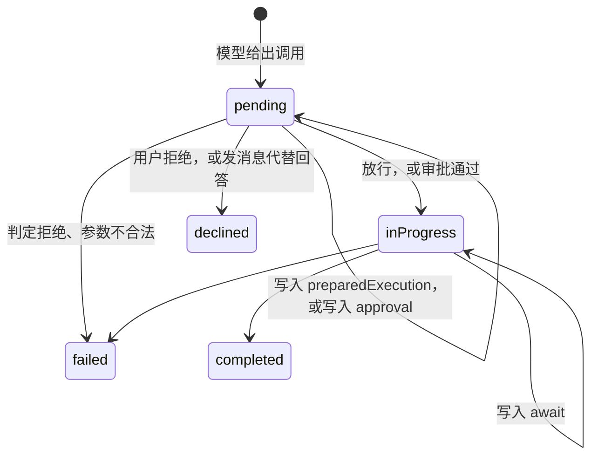

# 协议数据类型

这一页是网关契约 `protocol.schema.json` 里命名类型（`$defs`）的参考：每个字段是什么、什么时候出现、取什么值。方法、通知、服务端请求、错误码和枚举的取值列表见[网关协议](/zh/integrate/protocol)，这里不重复。

本页按引擎 v0.12.0 的契约写，共 129 个命名类型。只做参数包装的类型（如 `ThreadRenameParams`、`WorkspaceResult`）字段已经列在[客户端方法](/zh/integrate/protocol#客户端方法)里，这里只讲客户端要解读的数据。

几条通用约定：

- `?` 表示字段可能不出现。Go 端用 `omitempty`：空字符串、`0`、`false`、空数组都不发，客户端要把"缺"当成零值。
- 时间都是 RFC 3339 的 UTC 字符串，带纳秒，如 `2026-11-08T11:44:56.877645Z`。
- ID 是字符串，通常是 UUID。例外是 migration 0007 给已有用户补的本机环境，它的 ID 是 32 位十六进制（`lower(hex(randomblob(16)))`）。客户端不要假设 ID 的格式。
- 多数字段是 camelCase。直接给模型看的类型（工具描述、内置工具的参数和输出）用 snake_case，如 `input_schema`、`exit_code`、`work_dir`，这是模型那一侧的命名，不是笔误。
- 下文的 JSON 示例都来自桌面端仓库录制的真实会话 `packages/protocol/fixtures/session.json`。它用假模型跑了一遍 sidecar，录制时的协议摘要等于 v0.12.0 的 `protocolSha256`。路径和 ID 是录制时的临时值。

## 会话、轮次、条目

客户端的本地状态就是这三类行。`thread/read` 和 `thread/resume` 返回 `{thread, turns, items, hasMore}`。通知里的 `thread`、`turn`、`item` 都是发出时的完整行，收到后整行替换即可，不用做字段合并。

### ThreadRow

| 字段 | 类型 | 说明 |
|---|---|---|
| `id` | string | 会话 ID |
| `workspaceId?` | string | 所属工作区。不出现时，会话不属于任何工作区（界面上叫 general） |
| `environmentId?` | string | v0.12.0 新增：会话在哪个执行环境里运行，建会话时选定，之后不变。`thread/start` 不传时用这个用户本机的环境。migration 0007 给旧会话都补上了本机环境，所以实际上总会出现 |
| `title` | string | 标题，可以是空字符串。子 agent 会话取任务描述 |
| `settings` | `PermissionSettings` | 会话这一层的权限设置，见[权限设置](#权限设置) |
| `parentThreadId?` | string | 子 agent 会话的父会话。顶层会话没有这个字段 |
| `parentItemId?` | string | 派生这个子 agent 的那条 `Agent` 工具调用条目 |
| `createdAt` | string | 创建时间 |
| `updatedAt` | string | 最近一次变化的时间，`thread/list` 按它倒序 |
| `archivedAt?` | string \| null | 归档时间；不出现表示未归档 |

`ThreadSummary` 是 `ThreadRow` 加一个 `status`（`ThreadStatus`），只出现在 `thread/list` 的结果里。会话状态的计算方式见[执行模型](/zh/engine/execution)。`ThreadRow` 本身不带状态，状态变化走 `thread/status/changed`。

### TurnRow

| 字段 | 类型 | 说明 |
|---|---|---|
| `id` | string | 轮次 ID |
| `threadId` | string | 所属会话 |
| `seq` | integer | 会话内的序号，从 1 开始 |
| `status` | `TurnStatus` | 九个状态，状态机见[执行模型](/zh/engine/execution) |
| `model` | `Model` | 这一轮用的模型，提交时选定 |
| `usage` | `Usage` | 这一轮累计的 token，每次运行结束时加上去。进程被杀时，最后一次运行的累计会丢失，各次模型调用的用量还留在各自的条目上 |
| `error?` | string | 结束原因：失败的错误、中断的原因 |
| `cronJobId?` | string | 由定时任务发出时，是那个任务的 ID |
| `createdAt` | string | 提交时间 |
| `startedAt` | string | 成为会话当前一轮的时间。排队期间（`queued`）等于 `createdAt` |
| `completedAt?` | string \| null | 结束时间 |
| `attachments?` | `Attachment[]` | 这条消息的附件 |
| `input?` | string | 这条消息的文本，结束后也保留 |

`turn/started` 时 `status` 是 `ready`，这一轮还没有占到槽位。进槽位不单独发通知，`inProgress` 只在 `thread/read` 读到的行里看得到。

### Usage

| 字段 | 类型 | 说明 |
|---|---|---|
| `inputTokens` | integer | 输入 token，服务商报告的值 |
| `cachedInputTokens` | integer | 其中命中前缀缓存的 |
| `cacheWriteInputTokens` | integer | 其中写入缓存的，同样计在 `inputTokens` 里 |
| `outputTokens` | integer | 输出 token |

`Usage` 出现在两处：`TurnRow.usage` 是整轮的累计，`ItemRow.usage` 是一次模型调用的用量。服务商没报告用量时，条目上没有 `usage`。

### ItemRow

一轮的全部过程都记成条目。条目在会话内按 `seq` 递增，`seq` 不跳号，客户端按它排序。条目落库之后才发通知，所以通知里的 `seq` 就是库里的值。

| 字段 | 类型 | 说明 |
|---|---|---|
| `id` | string | 条目 ID |
| `turnId` | string | 所属轮次。条目里没有 `threadId`，在通知外层 |
| `seq` | integer | 会话内序号 |
| `type` | `ItemType` | 七种类型，见下表 |
| `status` | `ItemStatus` | 五种状态，见下文各类型 |
| `callId?` | string | 模型给这次工具调用的 ID，只在 `toolCall` 上 |
| `tool?` | string | 工具名，只在 `toolCall` 上 |
| `server?` | string | 工具的提供方，见[提供方](#提供方) |
| `responseId?` | string | 同一次模型回答产生的条目共用这个 ID |
| `error?` | string | 失败或被拒绝的原因 |
| `startedAt` | string | |
| `completedAt?` | string \| null | |
| `approval?` | `Approval` \| null | 审批记录，只在要审批的 `toolCall` 上 |
| `await?` | `Await` \| null | 工具在等什么，只在 `request_user_input` 和 `Agent` 上 |
| `annotations?` | `Annotations` \| null | 记录这次调用时工具注解的快照 |
| `usage?` | `Usage` \| null | 这次模型调用的用量 |
| `contextStats?` | `ContextStats` \| null | 这次模型调用的上下文统计 |
| `memory?` | `MemoryReference[]` | 记忆快照引用的记忆，只在 `memoryContext` 上 |
| `attachments?` | `Attachment[]` | 用户消息的附件 |
| `text?` | string | 正文，含义随类型不同 |
| `arguments?` | string | 工具调用参数的 **JSON 文本**，要客户端自己解析；服务端请求里的 `arguments` 才是 JSON 对象 |
| `preparedExecution?` | `Prepared` \| null | 冻结的执行内容，见 [Prepared](#prepared) |
| `result?` | `ToolResult` \| null | 工具结果 |

库里还有一列 `native`，存的是模型服务商自己的回答记录，用来原样回放给同类服务商。它从不发给客户端。`thread_id` 列也不发。

一次模型调用的 `usage`、`contextStats` 只写在它记录的第一个条目上，优先级是 `agentMessage`、`reasoning`、第一个 `toolCall`。把所有条目上的 `usage` 加起来，每次调用正好算一次。

各类型用到的字段：

| `type` | 状态的变化 | 设置的字段 |
|---|---|---|
| `userMessage` | 生成时即 `completed` | `text`、`attachments?`。轮次从 `queued` 变成 `ready` 时才生成；插话（steer）也是一条 `userMessage` |
| `agentMessage` | 流式时 `inProgress` → `completed`；调用中途失败时 `failed`，`text` 留下已收到的部分 | `text`、`responseId`、通常带 `usage` 和 `contextStats`。增量走 `item/agentMessage/delta`，完整文本在 `item/completed` 里 |
| `reasoning` | 同 `agentMessage` | `text` 是模型的思考内容，增量走 `item/reasoning/textDelta` |
| `toolCall` | 见下文 | `callId`、`tool`、`server`、`arguments`、`annotations`，按需有 `preparedExecution`、`approval`、`await`、`result`、`error` |
| `contextCompaction` | `inProgress` → `completed` 或 `failed` | 完成时 `text` 是压缩摘要；带压缩请求的 `contextStats` 和 `usage` |
| `memoryContext` | 生成时即 `completed` | `memory` 和 `text` 是这一轮载入的记忆快照，可能都为空。只在配置了长期记忆时出现，压缩之后会再载入一次 |
| `error` | `failed` 或 `completed` | 两种来源。一是模型调用失败、还没有任何输出：`failed`，`text` 和 `error` 都是错误原文，带这次调用的 `contextStats`。二是运行时给模型的通知，比如工具调用次数到了上限、要求它直接给出答案：`completed`，`text` 以 `[runtime]` 开头 |

#### toolCall 的生命周期



- **记录。** 模型给出调用时写一条 `pending`，带 `callId`、`tool`、`server`、`arguments`、`annotations`。
- **冻结。** 有两段式实现的工具（命令和改文件）先算出执行内容，写进 `preparedExecution`，再发一次 `item/updated`，状态仍是 `pending`。写入之后 `preparedExecution`、`arguments`、`tool`、`server` 都不能再改，见[审批前冻结](/zh/engine/tools#审批前冻结)。
- **审批。** 要询问时写入 `approval`（没有 `decision`），发 `item/updated`，再发服务端请求 `item/toolCall/requestApproval`。"在等审批"的判断条件是：`toolCall`、`pending`、`approval` 存在且没有 `decision`。
- **执行。** 放行或批准后变成 `inProgress`。`approval` 留在条目上，带上 `decision`、`decidedBy`、`decidedAt`。
- **等待。** `request_user_input` 和 `Agent` 执行后不马上出结果，而是写入 `await`，状态仍是 `inProgress`。`await.by` 是 `user` 时网关发 `item/tool/requestUserInput`；是 `agent` 时等子 agent 会话结束，`await.threadId` 就是子 agent 会话的 ID。
- **结束。** `completed` 时 `result.output` 是工具输出。`failed` 时 `error` 写原因，`result.output` 可能也有内容，因为工具可以同时返回输出和错误。用户拒绝时状态是 `declined`，`error` 是 `the user declined this call`。v0.12.1 起，用户在等审批或提问时直接发消息（`turn/steer`），这一轮还没执行的调用也以 `declined` 结束，`error` 是三种说明之一，见[插话](/zh/engine/execution#插话-steer)。

进程重启时，`inProgress` 的调用不会重跑，而是标成失败、提示核实是否已经生效，见[崩溃恢复](/zh/engine/persistence#崩溃恢复)。

等审批时的条目（`item/updated`）：

```json
{
  "id": "0953fed7-bfca-437d-b654-ffcb6648aa7a",
  "turnId": "1a6cd3c7-a291-41e4-9883-a298b15edf17",
  "seq": 11,
  "type": "toolCall",
  "status": "pending",
  "callId": "call_3_0",
  "tool": "run_command",
  "server": "workspace",
  "responseId": "8f6bd63f-4927-4c24-b393-bc6b66b58273",
  "startedAt": "2026-11-08T11:44:56.877645Z",
  "approval": {
    "id": "b9ca49b1-18ce-42b8-babd-a25112559867",
    "requestedAt": "2026-11-08T11:44:56.881499Z",
    "reason": "Runs outside the sandbox: Demonstrate a command that needs approval",
    "content": "echo hello from the command"
  },
  "annotations": { "destructiveHint": true, "openWorldHint": true },
  "arguments": "{\"program\":\"echo\",\"args\":[\"hello from the command\"],\"sandbox_permissions\":\"require_escalated\",\"justification\":\"Demonstrate a command that needs approval\"}",
  "preparedExecution": {
    "cwd": "/private/var/folders/.../workspace",
    "settingsDigest": "sha256:9af6da35...",
    "argumentsDigest": "sha256:3036d737...",
    "program": "/bin/echo",
    "args": ["hello from the command"],
    "timeoutSec": 30,
    "escalated": true,
    "justification": "Demonstrate a command that needs approval"
  }
}
```

批准后同一条目结束（`item/completed`），只列出变化的字段：

```json
{
  "status": "completed",
  "completedAt": "2026-11-08T11:44:56.902415Z",
  "approval": {
    "id": "b9ca49b1-18ce-42b8-babd-a25112559867",
    "requestedAt": "2026-11-08T11:44:56.881499Z",
    "reason": "Runs outside the sandbox: Demonstrate a command that needs approval",
    "content": "echo hello from the command",
    "decision": "accept",
    "decidedBy": "gateway",
    "decidedAt": "2026-11-08T11:44:56.885694Z"
  },
  "result": {
    "output": {
      "stdout": "hello from the command\n",
      "stderr": "",
      "exit_code": 0,
      "work_dir": "/private/var/folders/.../workspace",
      "sandbox": "escalated: ran on the host without the sandbox"
    }
  }
}
```

一条完成的回答（`item/completed`）：

```json
{
  "id": "e1b87120-5bcb-42f8-8ea8-ab0a3282799b",
  "turnId": "59bc7f8b-a427-4a0b-a044-a5d1d4c4038e",
  "seq": 4,
  "type": "agentMessage",
  "status": "completed",
  "responseId": "04a6cef1-f51f-44ca-b62e-a6f56f160b05",
  "startedAt": "2026-11-08T11:44:54.751121Z",
  "completedAt": "2026-11-08T11:44:55.429665Z",
  "usage": { "inputTokens": 1234, "cachedInputTokens": 0, "cacheWriteInputTokens": 0, "outputTokens": 56 },
  "contextStats": {
    "model": "mock-model",
    "budgetTokens": 120000,
    "compactAtTokens": 96000,
    "systemTokens": 1345,
    "messagesTokens": 28,
    "globalMemory": { "tokens": 0, "ids": [] },
    "localMemory": { "tokens": 0, "ids": [] },
    "toolsTokens": 5256,
    "estimatedTokens": 6629,
    "calibratedTokens": 6629
  },
  "text": "## Hello from the mock model\n\n..."
}
```

### Await

| 字段 | 类型 | 说明 |
|---|---|---|
| `by` | `AwaitBy` | `user`：等用户回答；`agent`：等子 agent |
| `request` | 任意 JSON | `user` 时是 `UserInputRequest`，`agent` 时是 `SubagentCall` |
| `threadId?` | string | `agent` 时是子 agent 会话的 ID；会话建出来之前没有这个字段 |

条目结束后 `await` 仍然保留。`Agent` 调用完成时，`result.output` 是子 agent 最后一轮的最终回答文本；子 agent 失败或被停止时，调用以 `failed` 结束，`error` 以 `the subagent failed:` 或 `the subagent was stopped:` 开头。

### Attachment

| 字段 | 类型 | 说明 |
|---|---|---|
| `id` | string | 附件 ID，`attachment/read` 用它取回内容 |
| `kind` | `AttachmentKind` | `image` 或 `file`（文本文件） |
| `name` | string | 文件名 |
| `mimeType` | string | |
| `size` | integer | 字节数 |
| `file` | string | 在附件存储里的键，形如 `<会话 ID>/<附件 ID>.txt`。客户端不需要用它 |
| `width?`、`height?` | integer | 图片的像素尺寸 |
| `tokens` | integer | 发给模型时估算的 token |

附件的上限和接收条件见[一轮](/zh/integrate/protocol#一轮)，存储接口见[扩展点](/zh/integrate/extend#附件存储)。

### ContextStats

每次模型调用的上下文预算和各部分的估算，写在这次调用的第一个条目上，界面的上下文面板读它。字段的含义见[上下文统计](/zh/engine/context#上下文统计)。`globalMemory`、`localMemory` 是 `MemoryStats`：`tokens` 加上进入快照的记忆 ID 列表 `ids`。

### ToolResult 和 ContextArtifact

| 字段 | 类型 | 说明 |
|---|---|---|
| `output?` | 任意 JSON | 工具输出。内置工具的结构见下文，其余工具的结构不进契约 |
| `artifacts?` | `ContextArtifact[]` | 要留在上下文里的内容。目前唯一的 `kind` 是 `agent_skill`：激活的技能，`name` 是技能名，`content` 是技能正文 |

带 `artifacts` 的结果在上下文压缩之后仍然发给模型，见[运行时读取什么](/zh/engine/persistence#运行时读取什么)。

### 提供方

`ItemRow.server` 和 `ToolDescriptor.provider` 是工具的提供方。引擎自带的提供方有：`workspace`（命令和文件）、`plan`、`subagents`、`user_input`、`web`、`cron`、`skills`、`memory`、`context`（`read_tool_output`）、`deferred_tools`（`load_tools`）、`tool_registry`（工具自省）。MCP 工具的提供方是服务器名，工具名形如 `<服务器>__<工具>`。宿主可以加自己的提供方，桌面端就有 `browser`。

契约的 `providers` 段只列 `cron`、`skills`、`memory`。它不是 `server` 全部可能的取值；上面的名字是从提供方的 `Name()` 和录制的会话里读出来的。

## 审批与提问

两种服务端请求的流程、`availableDecisions` 的规则和回答失败时的处理见[服务端请求](/zh/integrate/protocol#服务端请求)。这里只讲载荷。

### ApprovalRequestParams

| 字段 | 类型 | 说明 |
|---|---|---|
| `threadId`、`turnId`、`itemId` | string | 这条调用所在的位置。子 agent 的审批，`threadId` 是子 agent 会话 |
| `approvalId` | string | 等于条目上 `approval.id` |
| `server`、`tool` | string | 提供方和工具名 |
| `arguments` | JSON 对象 | 调用参数，已经解析成对象；条目上的参数为空时是 `{}` |
| `preparedExecution?` | `Prepared` \| null | 冻结的执行内容，审批的就是它 |
| `reason?` | string | 为什么要问，给用户看 |
| `content?` | string | 权限规则匹配的内容，比如命令行。规则怎么写见[规则语法](/zh/engine/permissions#规则语法) |
| `suggestedRules?` | string[] | 选 `acceptAlways` 时会写入的规则 |
| `availableDecisions` | `Decision[]` | 这次能给哪几种决定 |

回复是 `ApprovalResponse`：`{"decision": "accept"}`。

```json
{
  "jsonrpc": "2.0",
  "id": 1,
  "method": "item/toolCall/requestApproval",
  "params": {
    "preparedExecution": { "cwd": "/private/var/folders/.../workspace", "program": "/bin/echo", "args": ["hello from the command"], "timeoutSec": 30, "escalated": true, "justification": "Demonstrate a command that needs approval", "settingsDigest": "sha256:9af6...", "argumentsDigest": "sha256:3036..." },
    "threadId": "9f311e1e-e8d6-47b8-a5f5-2e49f0d1be23",
    "turnId": "1a6cd3c7-a291-41e4-9883-a298b15edf17",
    "itemId": "0953fed7-bfca-437d-b654-ffcb6648aa7a",
    "approvalId": "b9ca49b1-18ce-42b8-babd-a25112559867",
    "server": "workspace",
    "tool": "run_command",
    "arguments": { "program": "echo", "args": ["hello from the command"], "sandbox_permissions": "require_escalated", "justification": "Demonstrate a command that needs approval" },
    "reason": "Runs outside the sandbox: Demonstrate a command that needs approval",
    "content": "echo hello from the command",
    "availableDecisions": ["accept", "acceptForSession", "decline"]
  }
}
```

```json
{ "jsonrpc": "2.0", "id": 1, "result": { "decision": "accept" } }
```

### Approval

条目上的审批记录。

| 字段 | 类型 | 说明 |
|---|---|---|
| `id` | string | 审批 ID |
| `requestedAt` | string | 发起时间 |
| `reason?` | string | 同请求里的 `reason`。调用在批准之后又变了时，前面会加上 `This call changed after you approved it, ...` |
| `rule?` | string | 命中的 ask 规则。有它时只能 `accept` 或 `decline` |
| `content?` | string | 同请求里的 `content` |
| `suggestedRules?` | string[] | 同请求里的 `suggestedRules` |
| `decision?` | `Decision` | 用户的决定；没有时表示还在等 |
| `decidedBy?` | string | 由谁做的决定，宿主调用时自己给。经网关回答的是 `gateway` |
| `decidedAt?` | string \| null | |

### Prepared

审批前冻结的执行内容。执行前引擎会重新算一遍，和冻结的不一致就不执行，见[审批前冻结](/zh/engine/tools#审批前冻结)。

| 字段 | 类型 | 说明 |
|---|---|---|
| `cwd` | string | 命令的工作目录；改文件时是根目录 |
| `settingsDigest` | string | 沙箱设置和根目录的摘要，`sha256:` 开头 |
| `argumentsDigest` | string | 参数的摘要 |
| `program?`、`args?` | string、string[] | 命令：解析后的程序绝对路径和参数 |
| `env?` | object | 命令额外的环境变量 |
| `timeoutSec?` | integer | 命令超时 |
| `sandboxed?` | boolean | 在强制沙箱里运行 |
| `escalated?` | boolean | 申请在沙箱外运行（提权，escalation） |
| `justification?` | string | 模型给的提权理由 |
| `files?` | `FileChange[]` | 改文件：要写的变化 |

`FileChange` 描述一个文件的变化：

| 字段 | 类型 | 说明 |
|---|---|---|
| `path` | string | 相对根目录的路径 |
| `before?` | string | 原内容的 **sha256**，不是内容本身；新建文件时没有 |
| `after` | string | 新内容的 sha256 |
| `diff` | string | unified diff，界面显示它 |
| `added`、`removed` | integer | 增删的行数 |

### 提问

`item/tool/requestUserInput` 的参数是 `UserInputRequestParams`：`threadId`、`turnId`、`itemId` 加上 `questions`。

| `UserInputQuestion` 字段 | 类型 | 说明 |
|---|---|---|
| `id` | string | 回答时用它对应问题，匹配 `^[a-z][a-z0-9_]{0,63}$` |
| `header` | string | 1 到 12 个字符的短标签 |
| `question` | string | 问题正文，1 到 600 个字符 |
| `options?` | `UserInputOption[]` | 最多 4 个互斥选项：`label`（1 到 60 字符）、`description?`（最多 200 字符）。模型被要求把推荐项放第一个并标 `(Recommended)`，不要自己加"其他" |

一次最多 4 个问题。回复是 `UserInputResponse`：`answers` 以问题 `id` 为键，值是 `{answers: string[]}`。答案可以是选项的 `label`，也可以是用户自己写的文字。这一份答案原样成为 `request_user_input` 条目的 `result.output`。

```json
{
  "jsonrpc": "2.0",
  "id": 2,
  "method": "item/tool/requestUserInput",
  "params": {
    "threadId": "9f311e1e-e8d6-47b8-a5f5-2e49f0d1be23",
    "turnId": "38e43c53-ca1b-4dfd-98f9-0e7920c4a9a3",
    "itemId": "65339636-3845-400b-93d3-67cc79b85d78",
    "questions": [
      {
        "id": "lang",
        "header": "Language",
        "question": "Which language should the script use?",
        "options": [
          { "label": "Go", "description": "Matches the backend" },
          { "label": "TypeScript", "description": "Matches the UI" }
        ]
      }
    ]
  }
}
```

```json
{ "jsonrpc": "2.0", "id": 2, "result": { "answers": { "lang": { "answers": ["Go"] } } } }
```

## 内置工具的参数和输出

契约的 `builtinTools` 段给 9 个内置工具的参数（`arguments`，对应条目的 `arguments` 文本解析之后）和输出（`output`，对应 `result.output`）。为什么只有这些工具进契约，见[网关协议](/zh/integrate/protocol#一张表分发和生成-schema)。没列参数的工具，参数不进契约；没列输出的，输出不进契约。

| 工具 | 参数 | 输出 |
|---|---|---|
| `update_plan` | `Plan` | 不进契约（实际是字符串 `Plan updated`） |
| `Agent` | `SubagentCall` | 不进契约（实际是子 agent 的最终回答文本） |
| `request_user_input` | `UserInputRequest` | `UserInputAnswers` |
| `run_command` | 不进契约 | `CommandOutput` |
| `edit_file`、`write_file` | 不进契约 | `FileOutput` |
| `read_file` | `ReadFile` | `ReadFileOutput` |
| `glob` | `Glob` | `GlobOutput` |
| `grep` | `Grep` | `GrepOutput` |

**`Plan`**：`explanation?`（最多 500 字符）和 `plan`：1 到 12 个 `PlanStep`，每步 `step`（1 到 200 字符）和 `status`（`pending`、`in_progress`、`completed`，注意是下划线）。最多一步是 `in_progress`。每次调用给出完整的计划，替换上一次的，不是增量。

**`SubagentCall`**：`description`（1 到 80 字符，显示给用户，也是子 agent 会话的标题）和 `prompt`（1 到 20000 字符，交给子 agent 的完整任务）。

**`CommandOutput`**：

| 字段 | 类型 | 说明 |
|---|---|---|
| `stdout`、`stderr` | string | 各自最多 `max_output_bytes`（默认 1 MiB），超出时保留头尾，中间换成省略提示 |
| `exit_code` | integer | 退出码 |
| `work_dir` | string | 实际的工作目录 |
| `signal?` | string | 被信号终止时的信号名 |
| `truncated?` | boolean | 输出被截过 |
| `sandbox_denials?` | string[] | 沙箱拦下的操作，桌面端在命令失败时显示，见[拒绝原因报告](/zh/engine/sandbox#拒绝原因报告) |
| `sandbox?` | string | 关于沙箱的说明，在沙箱外运行时是 `escalated: ran on the host without the sandbox` |

**`FileOutput`**：`path`、`created?`（新建的文件）、`added`、`removed`（增删的行数）。

**`ReadFile`** / **`ReadFileOutput`**：参数是 `path`、`offset?`（从 1 开始的行号）、`limit?`（最多 2000 行）。输出是 `path`、`text?`（带行号的文本，每行形如 `1\t# demo`）、`startLine?`、`endLine?`、`totalLines`、`size`（字节数）；不是文本的文件不给 `text`，只给 `binary: true` 和 `mimeType`。

**`Glob`** / **`GlobOutput`**：参数是 `pattern`、`path?`。输出是 `path`（显示用的搜索目录）、`files`（按修改时间新的在前），以及 `truncated?`、`skipped?`。`skipped` 是因为读不了或沙箱禁读而跳过的条目数。

**`Grep`** / **`GrepOutput`**：参数是 `pattern`（RE2 正则）、`path?`、`include?`、`ignore_case?`、`files_only?`、`context?`（0 到 10 行）。输出是 `path`、`files`、`matches`（总匹配数）、`truncated?`、`skipped?`。每个 `GrepFile` 有 `path`、`matches`、`lines?`；`GrepLine` 有 `line`、`text`，`match: true` 表示匹配行，否则是上下文行。

## 目录类

### Model

| 字段 | 类型 | 说明 |
|---|---|---|
| `name` | string | 发给服务商的模型名 |
| `connection` | string | 连接 ID，`turn/start` 的 `connection` 参数传它 |
| `thinking?` | boolean \| null | 不出现或 `true`：能关思考的服务商保持思考开着；`false`：关掉 |
| `images?` | boolean | 这个模型收图片。不收时带图片的 `turn/start` 返回 `-32602` |

`model/list` 的 `default` 是第一个模型的 `connection`。

### ToolDescriptor 和 Annotations

`tool/list` 返回当前用户能用的全部工具，包括 MCP 的。

| 字段 | 类型 | 说明 |
|---|---|---|
| `provider` | string | 提供方，见[提供方](#提供方) |
| `name` | string | 工具名，权限规则用它 |
| `description` | string | 给模型看的描述 |
| `annotations` | `Annotations` | 见下表 |
| `input_schema` | object | 参数的 JSON Schema |

| `Annotations` 字段 | 类型 | 说明 |
|---|---|---|
| `title?` | string | 显示名 |
| `readOnlyHint?` | boolean | 只读。审批策略和并行执行都读它 |
| `destructiveHint?` | boolean \| null | 可能删除或覆盖东西。引擎不读，只给客户端显示 |
| `idempotentHint?` | boolean | 重复调用结果相同。引擎不读 |
| `openWorldHint?` | boolean \| null | 接触外部世界。**不出现时当作 `true`**，审批策略读它 |

MCP 工具的注解是服务器自报的，引擎无法验证。

### ServerStatus

| 字段 | 类型 | 说明 |
|---|---|---|
| `name` | string | 服务器名 |
| `connected` | boolean | 是否连上 |
| `tools` | integer | 交给 agent 的工具数 |
| `skippedTools?` | string[] | 加上 `<服务器>__` 前缀后不匹配 `^[A-Za-z0-9_-]{1,64}$`、因此没有交给 agent 的工具 |
| `error?` | string | 没连上的原因 |

### WorkspaceRow

| 字段 | 类型 | 说明 |
|---|---|---|
| `id` | string | |
| `name` | string | 名称，不能为空白 |
| `rootPath` | string | 用户沙箱里规范化之后的绝对路径，同一用户内唯一 |
| `settings` | `PermissionSettings` | 工作区这一层的权限设置 |
| `createdAt`、`updatedAt` | string | |
| `archivedAt?` | string \| null | |

机制见[工作区](/zh/engine/workspace)。

### EnvironmentRow

v0.12.0 新增。环境是会话可以在里面运行的地方，由宿主建出对应的沙箱。

| 字段 | 类型 | 说明 |
|---|---|---|
| `id` | string | 新建的是 UUID；migration 0007 补出来的本机环境是 32 位十六进制 |
| `name` | string | 1 到 120 字符，同一用户内不区分大小写地唯一。本机环境默认叫 `This computer` |
| `kind` | `EnvironmentKind` | `local`：这台机器，工作区就是它里面的文件夹，每个用户正好一个；`machine`：用户的一台云沙箱，由宿主通过 `sandbox.Machine` 接入 |
| `createdAt`、`updatedAt` | string | |

- `environment/list` 把本机环境排在第一个。
- `environment/add` 的 `kind` 只能是 `machine`，省略时也是 `machine`；传 `local` 返回 `-32602`。
- `environment/delete` 返回被删的那一行。本机环境不能删，还有会话在用的环境也不能删，都返回 `-32602`。
- `environment/changed` 的载荷是 `environmentId` 加 `environment`；环境被删之后 `environment` 为 `null`。

宿主怎样为 `machine` 环境建出沙箱，见[扩展点](/zh/integrate/extend#云沙箱)。

### CronJobView

`cron/list`、`cron/changed`、`search` 的 `tasks` 用 `CronJobView`；`cron/create`、`cron/pause` 返回 `CronJobRow`，它只有前十个字段。

| 字段 | 类型 | 说明 |
|---|---|---|
| `id`、`threadId`、`name` | string | 任务按 `(threadId, name)` 唯一 |
| `spec` | string | 调度表达式，语法见[定时任务](/zh/engine/cron#调度表达式) |
| `prompt` | string | 到点发给会话的消息 |
| `times?` | integer \| null | 总共发几次；不出现表示不限 |
| `runs` | integer | 已经发了几次 |
| `paused` | boolean | |
| `nextRunAt` | string | 下次到点时间 |
| `createdAt` | string | |
| `threadTitle` | string | 所属会话的标题 |
| `workspaceId?`、`parentThreadId?` | string | 所属会话的工作区、父会话。有 `parentThreadId` 的是子 agent 会话上的任务，到点时会被拒绝但仍计数，见[定时任务](/zh/engine/cron#边界与已知问题) |
| `threadArchived?` | boolean | 所属会话已归档 |
| `lastRunAt?`、`lastTurnId?` | string | 最近一次发出的时间和轮次 |

### 记忆

`MemoryRow` 是一条长期记忆：

| 字段 | 类型 | 说明 |
|---|---|---|
| `id` | string | |
| `scope` | `MemoryScope` | `global`、`general`、`workspace` |
| `workspaceId?` | string | `scope` 是 `workspace` 时的工作区 |
| `originWorkspaceId?` | string | 全局记忆是从哪个工作区的证据提炼出来的 |
| `topic` | string | 主题，同一范围内唯一 |
| `kind` | string | `preference`、`decision`、`fact`、`procedure`；契约里是普通字符串 |
| `text` | string | 正文；遗忘后为空 |
| `status` | `MemoryRowStatus` | `active`、`retired`、`forgotten` |
| `userEdited?` | boolean | 用户改过，提炼不再覆盖 |
| `sources` | `MemorySource[]` | 证据：`{table, id, occurredAt?}`，`table` 目前总是 `items` |
| `createdAt`、`updatedAt` | string | |

`MemoryReference` 是 `memoryContext` 条目里引用的精简形式：`id`、`topic?`、`text`、`scope`、`workspaceId?`。

`memory/status` 返回 `MemoryStatus`：

| 字段 | 类型 | 说明 |
|---|---|---|
| `generationEnabled` | boolean | 后台提炼开着 |
| `useEnabled` | boolean | 记忆会载入会话 |
| `pending` | integer | 已结束、还没提炼的轮次数 |
| `active` | integer | `active` 状态的记忆条数 |
| `attempts?`、`nextAttempt?` | integer、string | 连续失败的次数和下次重试的时间 |
| `skipped` | integer | 累计跳过的条目数：一批证据连续失败 10 次后被跳过，见[失败重试和跳过](/zh/engine/memory#失败重试和跳过) |
| `lastSuccess?` | string | 上次成功的时间 |
| `lastFailure?` | `MemoryFailure` | `code`（`model_request`、`invalid_response`、`evidence`、`storage`）和 `error` |
| `lastSkip?` | `MemorySkip` | 上次跳过的批次：`at`、`entries`、`threadId`、`turnId`，加上 `code`、`error` |
| `lastReport?` | `MemoryReport` | 上次提炼请求：`model`、`estimatedInputTokens`、`inputTokens`、`outputTokens`、`usageReported` |

范围、提炼和失败重试的机制见[记忆](/zh/engine/memory)。

### SearchResult

`search` 返回四组，每组都是数组，没有命中时为空数组：`threads`（`ThreadRow[]`）、`messages`（`MessageHit[]`）、`tasks`（`CronJobView[]`）、`memories`（`MemoryRow[]`，没配置记忆时为空）。

| `MessageHit` 字段 | 类型 | 说明 |
|---|---|---|
| `threadId`、`threadTitle` | string | 命中所在的会话 |
| `itemId`、`turnId`、`seq` | string、string、integer | 命中的条目，客户端用 `seq` 定位 |
| `type` | `ItemType` | 只会是 `userMessage` 或 `agentMessage` |
| `snippet` | string | 命中处前后的片段 |
| `at` | string | 条目的时间 |

匹配规则和限制见[搜索](/zh/engine/search)。

### 权限设置

`PermissionSettings` 是会话、工作区的 `settings`，也是 `thread/start`、`*/updatePermissions` 的参数：

| 字段 | 类型 | 说明 |
|---|---|---|
| `approvalPolicy?` | `ApprovalPolicy` | 这一层的审批策略；不出现表示沿用上一层 |
| `permissions` | `PermissionRules` | 规则，总会出现，可以是 `{}` |

`PermissionRules` 有 `allow?`、`ask?`、`deny?` 三个字符串数组，每项是一条规则，如 `run_command(git:*)`。三层怎样叠加、规则怎样写，见[审批与权限](/zh/engine/permissions)。

### SettingsRow

`settings/read`、`settings/update` 的结果和 `settings/changed` 的载荷都是 `{redaction: boolean}`：是否在发给模型之前脱敏，按用户保存，默认开启，见[脱敏](/zh/engine/redaction)。

## 代码位置

| 仓库 | 路径 | 职责 |
|---|---|---|
| ollupi | `gateway/protocol.go` | 参数、结果和通知的包装类型，`ApprovalRequestParams`、`UserInputRequestParams` |
| ollupi | `gateway/server.go` | 从条目生成两种服务端请求，`decidedBy` 写成 `gateway` |
| ollupi | `gateway/environments.go` | `environment/*` 方法和 `environment/changed` |
| ollupi | `repo/threads.go`、`turns.go`、`items.go` | `ThreadRow`、`ThreadSummary`、`TurnRow`、`Usage`、`ItemRow`、`Approval`、`Attachment`、`ContextStats`、`ToolResult` |
| ollupi | `repo/workspaces.go`、`environments.go`、`cron_jobs.go`、`memories.go`、`memory_state.go`、`search.go`、`settings.go`、`permissions.go` | 目录类的行 |
| ollupi | `agent/runtime/stream.go`、`chat.go`、`calls.go`、`execute.go` | 各类条目怎样写入、状态怎样变 |
| ollupi | `agent/subagents.go` | `Agent` 调用的 `await.threadId` 和结果 |
| ollupi | `agent/environments.go` | 环境的增删改和校验 |
| ollupi | `tools/spec.go`、`prepared.go`、`result.go` | `ToolDescriptor`、`Annotations`、`Prepared`、`FileChange`、`Await`、`ContextArtifact` |
| ollupi | `tools/workspace/execution.go`、`files.go`、`read.go` | 命令和文件工具的参数、输出，`Prepared` 的填法 |
| ollupi | `tools/plan`、`tools/subagent`、`tools/userinput` | `Plan`、`SubagentCall`、提问的类型和约束 |
| ollupi | `tools/mcp/servers.go`、`session.go` | `ServerStatus`、跳过工具的名字规则 |
| ollupi | `pkg/llm/chat.go` | `Model` |
| ollupi | `gateway/schema_test.go` | `builtinTools`、`providers` 两段的来源 |
| ollupi-desktop | `packages/protocol/fixtures/session.json` | 本页示例所用的录制会话 |
