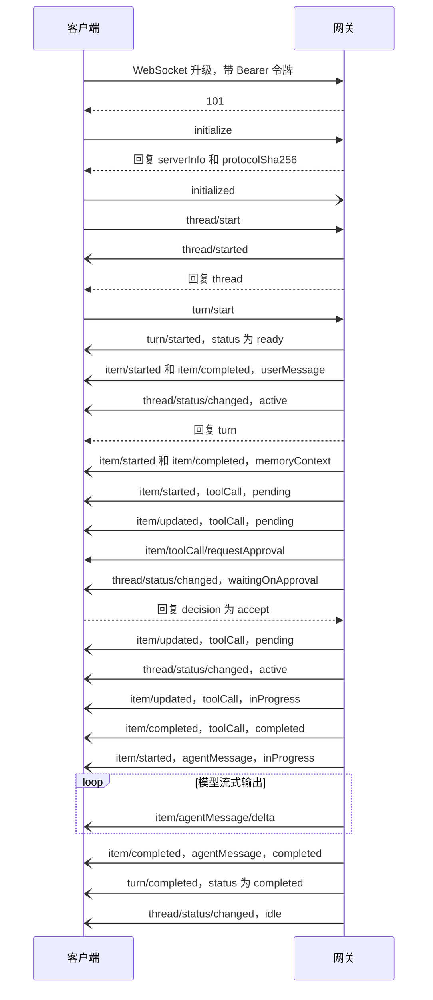

# 网关协议

网关（gateway）是引擎对外的唯一接口：WebSocket 上的 JSON-RPC 2.0。客户端用它管理会话（thread）、发起一轮（turn）、接收条目（item）的增量，并回答审批和提问。方法名对齐 Codex app-server。

协议由 `gateway/protocol.go` 里的一张表定义。这张表同时做请求分发，也是 `gateway/protocol.schema.json` 的生成来源，所以文档、类型和实际行为不会各走各的。下文的数字和名称对应引擎 v0.11.3：34 个方法、15 种通知、2 种服务端请求、1 种客户端通知、15 个错误码。

## 传输

每个 WebSocket 文本帧是一条 JSON-RPC 消息。网关接受任意路径的 `GET` 升级请求。

| 项 | 值 | 超出或失败时 |
|---|---|---|
| 帧类型 | 只收文本帧 | 回 `-32600`，`id` 为 `null`，连接保持 |
| 版本字段 | `jsonrpc` 必须是 `"2.0"` | 回 `-32600`，连接保持 |
| 解析失败 | | 回 `-32700`，`id` 为 `null`，连接保持 |
| 单条入站消息 | 32 MiB（`maxMessageBytes`） | 读取失败，连接关闭 |
| 单次写超时 | 10 秒（`writeTimeout`） | 关闭码 1011，reason `write failed` |
| 出站队列 | 16 MiB（`maxOutboxBytes`） | 关闭码 1008，reason `client is not reading fast enough` |
| HTTP 头读取超时 | 5 秒 | 升级失败 |
| 关停等待 | 5 秒 | 网关退出前用关闭码 1001 通知客户端 |

出站队列的上限也作用于单条消息。一条超过 16 MiB 的回复会被当成客户端读得太慢，连接直接关闭。这个边界影响 `attachment/read`：图片附件上限是 20 MiB，而 base64 之后约 1.33 倍，所以大约 12 MiB 以上的图片读不回来。实测读一张 14 MiB 的图片时，连接以 1008 关闭。

Go 客户端如果用 `coder/websocket`，默认读上限是 32768 字节，`tool/list` 的回复就可能超过它，需要先调用 `SetReadLimit`。

## 认证

一次升级请求依次经过四道检查。

| 顺序 | 检查 | 依据 | 失败 |
|---|---|---|---|
| 1 | Host | `localhost`、`127.0.0.1`、`::1`，加上 `Options.AllowedHosts` | 403 `host not allowed` |
| 2 | 令牌 | `Options.Authenticate`，单用户时用 `Options.Token` 做常量时间比较 | 401 `invalid or missing gateway token` |
| 3 | 用户 | `db.EnsureUser` 确保用户行存在 | 500 |
| 4 | Origin | 没有 Origin 头或与 Host 相同时放行；否则匹配 `localhost:*`、`127.0.0.1:*`、`[::1]:*`，加上 `Options.AllowedOrigins` | 403 |

令牌有两种传法，都不进 URL，因为访问日志会保留 URL：

- `Authorization: Bearer <token>`。
- 浏览器不能设置这个头，改用子协议：`new WebSocket(url, ["ollupi.token", token])`。网关读 `ollupi.token` 后面紧跟的那一项，握手只回 `ollupi.token`，不回显令牌。

`NewServer` 要求 `Token` 或 `Authenticate` 二选一，否则启动失败。令牌的签发不归引擎管：`Authenticate` 只回答"这个令牌是谁的"。

## 连接模型

- **每个用户一条连接。** 同一用户的新连接替换旧连接，旧连接以 1008 关闭，reason `replaced by a newer connection`。
- **请求串行处理。** 网关在读循环里同步执行方法，同一连接上的下一条请求要等上一条回复写入队列。
- **事件不缓存。** `Deliver` 只投给该用户当前已初始化的连接。断线期间的事件不补发，客户端重连后用 `thread/read` 或 `thread/resume` 读库里的状态。
- **读视图与事件有序。** `thread/read`、`thread/resume`、`cron/list` 在读库到回复入队之间持有 `deliver` 锁，事件不会抢在视图之前到达，客户端看到的变化总是发生在它读到的视图之后。
- **通知可能先于回复。** agent 在处理请求时同步发事件，所以 `thread/started` 排在 `thread/start` 的回复之前，`turn/started` 排在 `turn/start` 的回复之前。客户端不能假设先收到回复。
- **用户隔离。** 其他用户的会话对当前用户表现为不存在，返回 `-32004`。

## 握手

1. 客户端发 `initialize`，带 `clientInfo: {name, version}`。
2. 网关回 `serverInfo: {name: "ollupi", version}` 和 `protocolSha256`。
3. 回复入队之后，连接标记为已初始化，并把该用户所有待回答的审批和提问按请求时间重发一遍。
4. 客户端发 `initialized` 通知。

| 情况 | 结果 |
|---|---|
| 初始化之前调用任何其他方法，包括不存在的方法 | `-32002` `call initialize first` |
| 重复 `initialize` | `-32600` `already initialized` |
| 未知方法（已初始化） | `-32601` |
| 未知的客户端通知 | 记一条警告，不回复 |

网关不等 `initialized`：第 3 步在 `initialize` 回复之后就发生，收到这条通知也不做任何事。契约里保留它，客户端照发即可。这意味着客户端必须在 `initialize` 返回时已经能处理服务端请求。

`serverInfo.version` 取自 `debug.ReadBuildInfo().Main.Version`，也就是最终二进制主模块的版本，引擎被嵌入时不是引擎自己的版本，本地构建时是 `(devel)`。判断协议是否兼容要看 `protocolSha256`。

## 版本校验

`protocolSha256` 是嵌入二进制的 `protocol.schema.json` 的 SHA-256。客户端把它和自己生成类型时用的契约文件比较。

网关不做校验，也不拒绝不一致的客户端。怎么处理由客户端决定。桌面端的做法：`packages/protocol` 生成时把摘要写进常量 `PROTOCOL_SHA256`，连接后比较；不一致时显示一条提示横幅，连接继续工作。

## 一次完整对话

下图来自实际流量：新建会话，发一条消息，模型调用一个需要审批的工具，然后回答。



有几处细节：

- `turn/started` 表示这一轮成为会话的当前一轮，此时状态是 `ready`，还没有占到槽位（slot）。进入槽位不单独发通知，`inProgress` 只存在于 `thread/read` 读到的 `turn.status` 里。状态机见 [执行模型](/zh/engine/execution)。
- `memoryContext` 条目只在配置了长期记忆时出现。
- 带推理输出的模型会多出 `reasoning` 条目和 `item/reasoning/textDelta`。
- 审批请求先于 `thread/status/changed` 到达。
- 会话已有进行中的一轮时，`turn/start` 发出的是 `turn/queued`，等前一轮结束后才发 `turn/started`。
- 增量只走事件。`item/agentMessage/delta` 和 `item/reasoning/textDelta` 不补发，完整文本在 `item/completed` 的 `item.text` 里。

## 客户端方法

参数全部用严格解码：多余字段返回 `-32602`。`params` 省略时按 `{}` 处理。`?` 表示可选。

### 握手和目录

| 方法 | 参数要点 | 结果要点 | 说明 |
|---|---|---|---|
| `initialize` | `clientInfo` | `serverInfo`、`protocolSha256` | 只能调一次 |
| `model/list` | 无 | `data: Model[]`、`default` | `default` 是第一个模型的 `connection` |
| `tool/list` | 无 | `data: ToolDescriptor[]` | 当前用户的工具，第一次调用可能等待 MCP 连接 |
| `mcpServer/list` | 无 | `data: ServerStatus[]` | 未配置 `Options.MCP` 时返回空数组 |

### 会话

| 方法 | 参数要点 | 结果要点 | 说明 |
|---|---|---|---|
| `thread/start` | `workspaceId?`、`title?`、`approvalPolicy?`、`permissions` | `thread` | 标题最多 120 字符，可空。发 `thread/started` |
| `thread/read` | `threadId`、`beforeSeq?`、`limit?` | `thread`、`turns`、`items`、`hasMore` | 只读一页 |
| `thread/resume` | 同 `thread/read` | 同 `thread/read` | 回复后重发该会话及其等待中子 agent 的待回答请求 |
| `thread/list` | `workspaceId?`、`archived?`、`after?`、`limit?` | `data: ThreadSummary[]`、`hasMore` | 只列顶层会话，见下 |
| `thread/updatePermissions` | `threadId`、`approvalPolicy?`、`permissions` | `thread` | 整体替换会话设置。发 `thread/changed` |
| `thread/rename` | `threadId`、`title` | `thread` | 标题 1 到 120 字符 |
| `thread/archive` | `threadId`、`archived` | `thread` | `archived` 必填。归档要求会话空闲，否则 `-32016`。同时为会话的定时任务发 `cron/changed` |
| `thread/delete` | `threadId` | `{}` | 要求会话空闲，否则 `-32016`。发 `thread/changed`（`thread` 为 `null`），并删除附件 |

分页规则：

- `thread/read` 的 `limit` 默认 100，最大 500。`items` 从新到旧取，按 `seq` 升序返回；`beforeSeq` 只取更早的条目。`turns` 不分页，总是全部返回。
- 页内条目累计超过 4 MiB（`pageBytes`）时从旧的一端截断，至少保留最新一条，并把 `hasMore` 置为 `true`。
- `thread/list` 的 `limit` 默认 20，最大 100。排序是 `updatedAt`、`createdAt`、`id` 倒序，`after` 传上一页最后一项的这三个字段。
- `workspaceId` 省略时不过滤，传空字符串只列不属于任何工作区的会话。`archived` 为 `true` 时只列已归档。

`thread/updatePermissions`、`thread/rename`、`thread/archive`、`thread/delete` 对子 agent 会话返回 `-32013`。

### 一轮

| 方法 | 参数要点 | 结果要点 | 说明 |
|---|---|---|---|
| `turn/start` | `threadId`、`input`、`connection?` | `turn` | 有进行中的一轮时排队，发 `turn/queued` |
| `turn/steer` | `threadId`、`input`、`expectedTurnId` | `turnId` | 把消息写入进行中的这一轮 |
| `turn/interrupt` | `threadId`、`turnId` | `{}` | 返回不代表已结束，结束时发 `turn/completed`，状态 `interrupted` |
| `attachment/read` | `threadId`、`attachmentId` | `attachment`、`data` | `data` 是 base64 |

`input` 是 `UserInput` 数组：

| `type` | 字段 | 行为 |
|---|---|---|
| `text` | `text` | 多段文本用换行连接，合计最多 4000 字符 |
| `file` | `path`、`name?`、`mimeType?` | `path` 必须是绝对路径，从用户的沙箱读取并在发送时复制一份 |

其他 `type` 返回 `-32602`。文本和文件都为空时也返回 `-32602`。附件最多 10 个，图片（PNG、JPEG、GIF、WebP）最大 20 MiB，文本文件最大 256 KiB。未配置 `Attachments` 或 `AttachmentsDir` 的引擎不收附件。

`connection` 选模型。省略时沿用该会话上一轮的模型，新会话用第一个模型。连接不存在、或模型不收图片而消息带图片时返回 `-32602`。

`turn/start` 还可能返回 `-32013`（子 agent 会话不接受输入）、`-32014`（工作区已归档）、`-32015`（会话已归档）。`turn/steer` 在没有进行中的一轮时返回 `-32010`，`expectedTurnId` 不匹配时返回 `-32011`。`turn/interrupt` 同样如此；排队中的一轮不算进行中。

### 工作区

| 方法 | 参数要点 | 结果要点 | 说明 |
|---|---|---|---|
| `workspace/list` | 无 | `data: WorkspaceRow[]` | |
| `workspace/add` | `path`、`name?` | `workspace` | `path` 由用户沙箱校验，无效时 `-32602`。`name` 默认取目录名。同一路径已归档时恢复 |
| `workspace/rename` | `workspaceId`、`name` | `workspace` | |
| `workspace/move` | `workspaceId`、`path` | `workspace` | 把工作区的文件夹搬到 `path`，见下 |
| `workspace/archive` | `workspaceId`、`archived` | `workspace` | `archived` 必填 |
| `workspace/updatePermissions` | `workspaceId`、`approvalPolicy?`、`permissions` | `workspace` | `workspaceId` 必填 |

以上写操作都发 `workspace/changed`。权限字段的语义见 [权限](/zh/engine/permissions)。

`workspace/move`（`d63435b`，v0.11.0 起）经用户自己的 `Box.Move` 搬文件夹，本机是 `os.Rename`，云沙箱是机器里的 `mv`，然后把工作区指向新路径。会话、记忆和定时任务都挂在工作区 ID 上，所以别的数据不用改写。`path` 必须是已经存在的空文件夹；搬到原处时直接返回，不做任何事。下列情况拒绝：

| 情况 | 错误 |
|---|---|
| `path` 不存在、不是文件夹或不为空 | `-32602` |
| `path` 在工作区自己里面 | `-32602` |
| `path` 已是另一个工作区的文件夹 | `-32602` |
| 工作区里有会话的一轮还没结束（进行中、排队或在等待） | `-32016`，这些轮次的调用里写着旧路径 |

文件夹搬过去了、数据库却没改成功时，引擎把文件夹搬回原处；搬回也失败时，错误里同时写明文件夹现在在哪、工作区还指着哪。这类错误和 `Box.Move` 自己的失败都不在错误码表里，客户端只收到 `-32000` `the request could not be completed`，详情只在服务端日志里。

### 定时任务

未配置 `Options.Jobs` 时，写方法返回 `-32000` `scheduled tasks are unavailable`。

| 方法 | 参数要点 | 结果要点 | 说明 |
|---|---|---|---|
| `cron/list` | `threadId?` | `data: CronJobView[]` | |
| `cron/create` | `threadId`、`name`、`spec`、`prompt`、`times?` | `CronJobRow` | 非法任务 `-32602`，规则见 [定时任务](/zh/engine/cron) |
| `cron/pause` | `threadId`、`name`、`paused` | `CronJobRow` | `paused` 必填 |
| `cron/delete` | `threadId`、`name` | `{}` | |

### 记忆、搜索和设置

未配置 `Options.Memory` 时，`memory/*` 返回 `-32000` `long-term memory is unavailable`。

| 方法 | 参数要点 | 结果要点 | 说明 |
|---|---|---|---|
| `memory/list` | `scope`、`workspaceId?` | `data: MemoryRow[]` | `scope` 是 `global`、`general`、`workspace`；`workspaceId` 只在 `workspace` 时给 |
| `memory/status` | 无 | `MemoryStatus` | 提取状态和最近一次结果 |
| `memory/update` | `id`、`text` | `memory` | 文本 1 到 4000 字符 |
| `memory/move` | `id` | `memory` | 在全局和来源范围之间切换 |
| `memory/forget` | `id` | `{}` | 清空文本，标记为 `forgotten` |
| `search` | `query`、`workspaceId?`、`limit?` | `threads`、`messages`、`tasks`、`memories` | `query` 按空白切词，全空时 `-32602`。`limit` 默认 20，最大 100。未配置记忆时 `memories` 为空数组 |
| `settings/read` | 无 | `redaction` | 按用户保存，默认开启 |
| `settings/update` | `redaction` | `redaction` | `redaction` 必填。回复后发 `settings/changed` |

机制见 [记忆](/zh/engine/memory)、[搜索](/zh/engine/search)、[脱敏](/zh/engine/redaction)。

## 服务端通知

| 通知 | 载荷 | 何时发 |
|---|---|---|
| `thread/started` | `thread` | 会话创建，包括子 agent 会话 |
| `thread/changed` | `threadId`、`thread` | 改名、权限、归档；`thread` 为 `null` 表示已删除 |
| `thread/status/changed` | `threadId`、`status` | 顶层会话状态变化；子 agent 的变化算到父会话上 |
| `turn/queued` | `threadId`、`thread`、`turn` | 一轮进入排队 |
| `turn/started` | 同上 | 一轮成为会话的当前一轮 |
| `turn/completed` | 同上 | 一轮结束，`turn.status` 是 `completed`、`failed` 或 `interrupted` |
| `item/started` | `threadId`、`turnId`、`item` | 新条目 |
| `item/updated` | 同上 | 条目还在 `pending` 或 `inProgress` 时记录有变化 |
| `item/completed` | 同上 | 条目结束 |
| `item/agentMessage/delta` | `threadId`、`turnId`、`itemId`、`delta` | 回答的增量 |
| `item/reasoning/textDelta` | 同上 | 推理的增量 |
| `workspace/changed` | `workspace` | 工作区变化 |
| `cron/changed` | `id`、`threadId`、`job` | 定时任务变化；`job` 为 `null` 表示已删除 |
| `settings/changed` | `redaction` | 设置变化 |
| `error` | `threadId?`、`turnId?`、`itemId?`、`message` | agent 内部故障，或客户端的回答没有生效 |

`turn` 和 `item` 通知带的是发出时的完整行，客户端可以直接替换本地状态。子 agent 的条目和轮次也走这些通知，靠 `thread.parentThreadId` 区分。

## 服务端请求

服务端请求的 `id` 从 1 开始，每条连接单独计数，客户端回复时原样带回。同一条目在一条连接上同时只问一次（`asked`）。

| 请求 | 参数要点 | 回复 |
|---|---|---|
| `item/toolCall/requestApproval` | `threadId`、`turnId`、`itemId`、`approvalId`、`server`、`tool`、`arguments`、`preparedExecution?`、`reason?`、`content?`、`suggestedRules?`、`availableDecisions` | `{decision}` |
| `item/tool/requestUserInput` | `threadId`、`turnId`、`itemId`、`questions` | `{answers: {<问题 id>: {answers: [...]}}}` |

`availableDecisions` 决定客户端能给哪些按钮：

| 情况 | 可选决定 |
|---|---|
| 规则要求询问（`Approval.Rule` 非空） | `accept`、`decline` |
| 没有建议规则 | `accept`、`acceptForSession`、`decline` |
| 有建议规则 | `accept`、`acceptForSession`、`acceptAlways`、`decline` |

`acceptAlways` 把 `suggestedRules` 写进工作区设置，没有工作区时写进会话设置，随后发 `workspace/changed` 或 `thread/changed`。

客户端的回答可能有几种结果：

| 客户端回复 | 网关行为 |
|---|---|
| 合法结果 | 写入条目，发 `item/updated` 或 `item/completed` 和 `thread/status/changed` |
| 结果无法解析，或决定、答案不合法 | 发 `error`（带 `itemId`），用新 `id` 重发同一请求 |
| 请求已失效（`ErrNoSuchRequest`） | 发 `error`，不再重发 |
| JSON-RPC 错误回复 | 只记日志。这一轮继续等待，下次 `thread/resume` 或重连时重发 |
| 连接断开 | 请求留在数据库。新连接 `initialize` 后重发 |

等待中的一轮不占槽位，也不依赖连接存活。客户端断开一周后回来，请求还在。

## 枚举

| 类型 | 取值 |
|---|---|
| `TurnStatus` | `queued`、`ready`、`inProgress`、`waitingOnApproval`、`waitingOnUserInput`、`waitingOnAgent`、`completed`、`interrupted`、`failed` |
| `ThreadStatus` | `idle`、`active`、`waitingOnApproval`、`waitingOnUserInput` |
| `ItemType` | `userMessage`、`agentMessage`、`reasoning`、`toolCall`、`contextCompaction`、`memoryContext`、`error` |
| `ItemStatus` | `pending`、`inProgress`、`completed`、`failed`、`declined` |
| `Decision` | `accept`、`acceptForSession`、`acceptAlways`、`decline` |
| `ApprovalPolicy` | `untrusted`、`on-request`、`never` |

## 错误码

| 码 | 名称 | 来源 |
|---|---|---|
| `-32700` | `parseError` | 消息不是合法 JSON |
| `-32600` | `invalidRequest` | 非文本帧、版本不对、不是请求也不是响应、重复初始化 |
| `-32601` | `methodNotFound` | 方法不存在 |
| `-32602` | `invalidParams` | 参数解码失败、`ErrInvalidMessage`、`ErrInvalidAnswer`、`ErrInvalidDecision`、`ErrInvalidName`、`ErrInvalidPath`、`permission.ErrInvalidSettings`、`memory.ErrInvalidChange`、`tools.ErrUnknownTool`、`tools.ErrInvalidArguments`、`cron.ErrInvalidJob` |
| `-32603` | `internalError` | 结果无法编码 |
| `-32000` | `serverError` | 其余所有错误 |
| `-32002` | `notInitialized` | 未初始化 |
| `-32004` | `notFound` | `repo.ErrNotFound`，包括别的用户的数据 |
| `-32010` | `noActiveTurn` | 会话没有进行中的一轮 |
| `-32011` | `turnMismatch` | 期望的一轮不是进行中的那一轮 |
| `-32012` | `noSuchRequest` | 会话没有在等这个请求 |
| `-32013` | `subagentThread` | 子 agent 会话不接受这个操作 |
| `-32014` | `workspaceArchived` | 工作区已归档 |
| `-32015` | `threadArchived` | 会话已归档 |
| `-32016` | `threadBusy` | 会话有进行中或排队的一轮；`workspace/move` 时指工作区里有会话的一轮还没结束（`ErrWorkspaceBusy`） |

`serverError` 把内部错误挡在服务端。`errorCodes` 表里的错误把原文发给客户端；不在表里的错误只写日志，客户端只收到 `the request could not be completed`，这样数据库路径之类的内容不会外泄。`TestAnUnknownErrorStaysOnTheServer` 守着这条。例外是 `cron/*` 和 `memory/*` 未配置时的提示，它们本身就是给客户端看的 `-32000`。

## 一张表分发和生成 schema

`protocol.go` 里的变量 `protocol` 声明所有消息：

```go
var protocol = struct {
	methods             map[string]method
	notifications       map[string]reflect.Type
	serverRequests      map[string]serverRequest
	clientNotifications map[string]reflect.Type
	errors              map[int]string
}{ /* ... */ }
```

每个方法用泛型 `handle` 注册：

```go
"thread/start": handle((*conn).threadStart),
```

`handle[P, R]` 同时做两件事：记下参数和结果的 `reflect.Type`，生成解码、调用、错误映射的闭包。`conn.Call` 在运行时查这张表分发。`gateway/schema_test.go` 里的生成器读同一张表写出 schema。一个方法只要能被调用，就一定在 schema 里。

| 契约段 | 来源 | 内容 |
|---|---|---|
| `methods` | `protocol.methods` | 34 个方法的 `params`、`result` |
| `notifications` | `protocol.notifications` | 15 种通知的载荷 |
| `serverRequests` | `protocol.serverRequests` | 2 种服务端请求 |
| `clientNotifications` | `protocol.clientNotifications` | `initialized` |
| `errors` | `protocol.errors` | 错误码到名称 |
| `builtinTools` | `schema_test.go` | 9 个内置工具的参数和输出 |
| `providers` | `schema_test.go` | `cron`、`skills`、`memory`，`ItemRow.server` 可取的提供方 id |
| `$defs` | 从以上类型遍历得到 | 120 个命名类型 |

生成器对协议类型有约束，违反时生成失败：

- 匿名结构体不能进协议，必须有名字并且导出。
- 命名字符串类型必须在 `enums` 里给出取值列表，或者列入 `plainStrings`。
- map 的键必须是字符串，命名切片要在 `special` 里给 schema。
- 两个类型重名时要在 `defNames` 里改名。

枚举的取值列表写在常量旁边，代码也在用：写库前按它校验。`TestEnumValuesMatchConstants` 解析 Go 源码，确认列表和常量一致。

`protocol.schema.json` 通过 `//go:embed` 编进二进制，`protocolSHA256` 在包初始化时算出。修改协议后重新生成：

```bash
GOFLAGS=-tags=sqlite_fts5 go generate ./gateway
```

这份文件是提交进仓库的跨语言契约。桌面端不解析 Go，`packages/protocol/scripts/generate.mjs` 用 `go list -m` 找到 sidecar 依赖的那个引擎版本，读它的契约，生成 `src/generated/` 下的 `types.ts`、`messages.ts`、`tools.ts`、`tools.validate.js`、`tools.validate.d.ts` 和契约副本。`pnpm protocol:check` 检查生成物是否过期。

## 契约测试

契约由三层测试守住，都用真实消息而不是手写样例。

| 层 | 位置 | 做什么 |
|---|---|---|
| 生成物一致 | `TestProtocolSchema` | 重新生成并和提交的文件逐字节比较 |
| 真实流量 | `TestTrafficMatchesContract` | 用假模型跑完整会话，校验每条消息 |
| 录制回放 | 桌面端 `packages/protocol/src/contract.test.ts` | 用当前 sidecar 录下的会话校验生成的类型 |

`TestTrafficMatchesContract` 起一个真实的网关和 agent，只把模型换成 `httptest` 假服务。测试客户端读到每条消息时：

- 按契约校验方法参数、结果、通知载荷、服务端请求和客户端回复；契约没声明的消息算失败。
- 校验 `initialize` 报告的摘要等于契约文件的 SHA-256。
- 校验内置工具调用的参数和输出。
- 记下见过的消息种类，结束时检查覆盖：每个方法都调过，每种通知和服务端请求都收到过，每个内置工具的参数和输出都校验过（`run_command` 的参数除外）。

新增一个方法而不写进测试流程，这个测试就失败。

桌面端的 `packages/protocol/scripts/record-session.mjs` 构建 sidecar，接脚本化的假模型，驱动一个覆盖 UI 所有消息种类的会话，把每条 JSON-RPC 消息连同方向存进 `fixtures/session.json`。`contract.test.ts` 用 Ajv 逐条校验，并要求录制时的摘要等于当前 `PROTOCOL_SHA256`。开发构建还在运行时把每条消息过一遍契约，不符时弹出提示。

## 路由

多分片部署时，客户端只连 `gateway.Router`。它用同样的方式读令牌，查 `Directory` 找到用户的分片（shard），再反向代理过去，自身不保存状态。

| 失败 | 状态码 |
|---|---|
| 令牌无效 | 401 |
| 用户无法放到分片上、分片地址查不到或不可用 | 503 |
| 分片连不上 | 503，客户端重试，此时新持有者已发布地址 |

`gateway.OnShard` 把 `Authenticate` 收窄到本分片的用户，连错分片的请求拿到 401，不会给用户开出第二个家。部署方式见 [分片](/zh/engine/sharding)。

## 代码位置

| 仓库 | 路径 | 职责 |
|---|---|---|
| ollupi | `gateway/protocol.go` | 协议表、错误码、全部参数和结果类型 |
| ollupi | `gateway/protocol.schema.json` | 生成的契约 |
| ollupi | `gateway/server.go` | 连接、事件到通知的映射、服务端请求、错误映射 |
| ollupi | `gateway/serve.go` | `Options`、`NewServer`、`Serve`、Host 和令牌检查 |
| ollupi | `gateway/router.go` | `Router`、`OnShard`、令牌读取 |
| ollupi | `gateway/threads.go`、`workspaces.go`、`cron.go`、`memory.go`、`search.go`、`settings.go` | 各组方法的处理函数 |
| ollupi | `gateway/schema_test.go` | schema 生成器和枚举检查 |
| ollupi | `gateway/traffic_test.go` | 真实流量契约测试 |
| ollupi | `pkg/jsonrpc/jsonrpc.go` | JSON-RPC 编解码、读循环、出站队列 |
| ollupi-desktop | `packages/protocol/scripts/generate.mjs` | 从契约生成 TypeScript 和校验器 |
| ollupi-desktop | `packages/protocol/scripts/record-session.mjs` | 录制真实会话 |
| ollupi-desktop | `packages/protocol/src/contract.test.ts` | 校验录制的会话 |
| ollupi-desktop | `packages/client/src/client.ts` | TypeScript 客户端 |
| ollupi-desktop | `apps/desktop/src/renderer/src/gateway/session.ts` | 连接、重连、协议摘要比较 |
