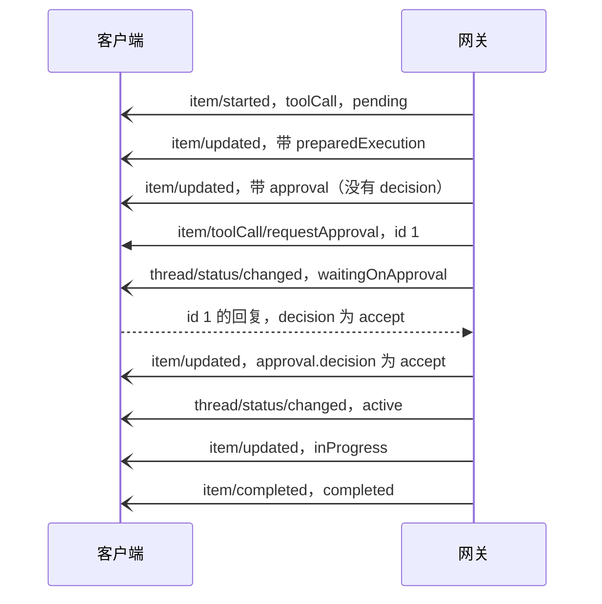
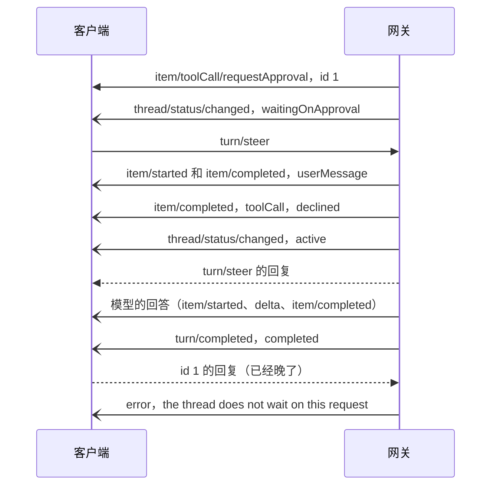

# 审批与提问

agent 要做一件需要用户点头的事，或者要用户回答一个问题时，网关向客户端发一个 JSON-RPC 请求，客户端回复结果。这一页讲这两种服务端请求：什么时候发、怎样回复、各种回复的结果、断线和重连后怎样重发，以及条目在这期间怎样变化。

审批策略和规则决定哪些调用要问，见[权限](/zh/integrate/protocol/permissions)；条目（`ItemRow`）本身的字段见[一轮与条目](/zh/integrate/protocol/turns)；客户端怎样保存和去重待回答的请求，见[写一个客户端](/zh/integrate/client#审批和提问)。

本页按引擎 v0.12.1 写。示例有两个来源：桌面端仓库录制的会话 `packages/protocol/fixtures/session.json`（录制时的协议摘要等于 v0.12.0 和 v0.12.1 的 `protocolSha256`），以及对 v0.12.1 网关的脚本试验（假模型、`untrusted` 策略、`full-access` 沙箱），标为"实测"。ID、路径和时间是当时的临时值，部分字段省略。

## 概念与状态

两种等待都落在一条 `toolCall` 条目上，这一轮随之进入等待状态，离开槽位（slot），只剩库里的记录。等待不依赖连接：客户端断开很久再回来，请求还在。

| | 审批 | 提问 |
|---|---|---|
| 起因 | 规则或审批策略要求先问用户 | 模型调用了 `request_user_input` 工具 |
| 条目 | `toolCall`，`status` 为 `pending`，`approval` 非空且没有 `decision` | `request_user_input` 的 `toolCall`，`status` 为 `inProgress`，`await.by` 为 `user` |
| 轮次（turn）状态 | `waitingOnApproval` | `waitingOnUserInput` |
| 服务端请求 | `item/toolCall/requestApproval` | `item/tool/requestUserInput` |
| 回复 | `{"decision": ...}` | `{"answers": {...}}` |
| 回复之后 | 决定写进 `approval`，条目仍是 `pending`，这一轮回到 `ready`，重新拿到槽位后执行或拒绝 | 答案成为工具结果，条目直接 `completed` |

一次模型回答里有几个要问的调用时，遇到第一个就停，后面的调用留在 `pending`，所以审批一个接一个出现，前一个有了决定，后一个才会来。

子 agent 的审批和提问照样发给客户端，请求里的 `threadId` 是子 agent 自己的会话。父会话这时在等子 agent（`waitingOnAgent`），而会话状态通知把子 agent 的变化算到父会话上，见[会话](/zh/integrate/protocol/threads)。

## 典型流程

### 审批一条命令

录制的会话里，模型要在沙箱外运行一条命令：



请求先于 `thread/status/changed` 到达。请求：

```json
{
  "jsonrpc": "2.0",
  "id": 1,
  "method": "item/toolCall/requestApproval",
  "params": {
    "preparedExecution": { "cwd": "/private/var/folders/.../workspace", "program": "/bin/echo", "args": ["hello from the command"], "timeoutSec": 30, "escalated": true, "justification": "Demonstrate a command that needs approval", "settingsDigest": "sha256:9af6...", "argumentsDigest": "sha256:3036..." },
    "threadId": "9f311e1e-e8d6-47b8-a5f5-2e49f0d1be23",
    "turnId": "1a6cd3c7-a291-41e4-9883-a298b15edf17",
    "itemId": "0953fed7-bfca-437d-b654-ffcb6648aa7a",
    "approvalId": "b9ca49b1-18ce-42b8-babd-a25112559867",
    "server": "workspace",
    "tool": "run_command",
    "arguments": { "program": "echo", "args": ["hello from the command"], "sandbox_permissions": "require_escalated", "justification": "Demonstrate a command that needs approval" },
    "reason": "Runs outside the sandbox: Demonstrate a command that needs approval",
    "content": "echo hello from the command",
    "availableDecisions": ["accept", "acceptForSession", "decline"]
  }
}
```

这是一条提权（escalation）命令，没有建议规则，所以 `availableDecisions` 里没有 `acceptAlways`。回复：

```json
{ "jsonrpc": "2.0", "id": 1, "result": { "decision": "accept" } }
```

之后条目上的 `approval` 带上了决定：

```json
"approval": {
  "id": "b9ca49b1-18ce-42b8-babd-a25112559867",
  "requestedAt": "2026-11-08T11:44:56.881499Z",
  "reason": "Runs outside the sandbox: Demonstrate a command that needs approval",
  "content": "echo hello from the command",
  "decision": "accept",
  "decidedBy": "gateway",
  "decidedAt": "2026-11-08T11:44:56.885694Z"
}
```

### 回答一个提问

录制的会话里，模型问用哪种语言。条目先是 `pending`，随后 `inProgress` 并带上 `await`：

```json
"await": {
  "by": "user",
  "request": { "questions": [ { "id": "lang", "header": "Language", "question": "Which language should the script use?", "options": [ { "label": "Go", "description": "Matches the backend" }, { "label": "TypeScript", "description": "Matches the UI" } ] } ] }
}
```

请求和回复：

```json
{
  "jsonrpc": "2.0",
  "id": 2,
  "method": "item/tool/requestUserInput",
  "params": {
    "threadId": "9f311e1e-e8d6-47b8-a5f5-2e49f0d1be23",
    "turnId": "38e43c53-ca1b-4dfd-98f9-0e7920c4a9a3",
    "itemId": "65339636-3845-400b-93d3-67cc79b85d78",
    "questions": [
      { "id": "lang", "header": "Language", "question": "Which language should the script use?", "options": [ { "label": "Go", "description": "Matches the backend" }, { "label": "TypeScript", "description": "Matches the UI" } ] }
    ]
  }
}
```

```json
{ "jsonrpc": "2.0", "id": 2, "result": { "answers": { "lang": { "answers": ["Go"] } } } }
```

回复之后条目直接 `item/completed`（`completed`），答案原样成为它的 `result.output`，`thread/status/changed` 回到 `active`。

### 拒绝

实测：回复 `decline` 之后，网关依次发出：

| 通知 | 内容 |
|---|---|
| `item/updated` | 条目仍是 `pending`，`approval.decision` 为 `decline` |
| `thread/status/changed` | `active` |
| `item/completed` | 条目 `declined`，`error` 是 `the user declined this call` |
| `item/started`、`item/completed` | 一条 `error` 条目，`text` 告诉模型工具调用已经停止、直接写最终回答 |
| `item/started` … `item/completed` | 模型的最终回答 |
| `turn/completed` | `completed`，不是 `failed` |

`error` 条目的 `text` 实测是：

```text
[runtime] Tool use has stopped: the user declined run_command.
Do not call tools. Write the final answer to the user now, in their language: report what was accomplished, citing the observations above; state clearly what could not be done and why; and give the most useful next step.
```

拒绝结束的是这一轮的工具调用，不是这一轮：模型还会写一段回答，这一轮正常完成。

### 用一条消息代替回答

这一轮在等审批或提问时，用户直接发消息（`turn/steer`），这条消息就代替了回答。实测，等审批时插话：



被代答的条目以 `declined` 结束，`approval` 里没有 `decision`：

```json
{
  "id": "32541507-cc0b-43d1-b646-6ef93301d543",
  "type": "toolCall",
  "status": "declined",
  "tool": "run_command",
  "server": "workspace",
  "error": "the user sent a message instead of approving this call, so it did not run",
  "approval": { "id": "3d825943-0ade-4e11-ab1c-46f34a1eca77", "requestedAt": "2026-11-09T05:30:29.430884Z", "content": "echo hi", "suggestedRules": ["run_command(echo hi:*)"] },
  "arguments": "{\"program\":\"echo\",\"args\":[\"hi\"]}"
}
```

这一轮还没执行的调用全部以 `declined` 结束，`error` 按情况不同：

| 调用 | `error` |
|---|---|
| 等审批的那条 | `the user sent a message instead of approving this call, so it did not run` |
| 等回答的那条 | `the user sent a message instead of answering` |
| 排在后面、还是 `pending` 的 | `skipped: the user sent a message before this call ran` |

和显式拒绝不同，这里不会出现"工具调用已停止"的 `error` 条目：模型读到被拒的结果和新消息，可以接着用工具。客户端收到这些 `item/completed` 时就该关掉对应的审批或提问界面；之后再回复那条请求，只会收到 `error` 通知，不会重发。机制见[插话](/zh/engine/execution#插话-steer)。

::: info 演进
v0.12.1 之前，插话只落库，这一轮一直停在等待里，直到用户回答；用户说了"算了"之后再批准，调用会在模型读到这句话之前执行。`c4899f5` 改成由消息代替回答。
:::

## 请求

### item/toolCall/requestApproval

| | |
|---|---|
| 方向 | 服务端 → 客户端 |
| 参数 | [`ApprovalRequestParams`](#approvalrequestparams) |
| 回复 | [`ApprovalResponse`](#approvalresponse)：`{"decision": "<Decision>"}` |
| 回复之后的通知 | `item/updated`（`approval.decision` 有值）、`thread/status/changed`；之后条目执行或被拒，见上面的流程。选 `acceptAlways` 时先有 `thread/changed` 或 `workspace/changed` |

`availableDecisions` 决定客户端能给哪些按钮：

| 情况 | 可选决定 |
|---|---|
| 由 ask 规则触发（`approval.rule` 非空） | `accept`、`decline` |
| 没有建议规则（命令看不清、提权、含 `*`） | `accept`、`acceptForSession`、`decline` |
| 有建议规则 | `accept`、`acceptForSession`、`acceptAlways`、`decline` |

ask 规则的意思是每次都问，所以规则触发时不给"总是允许"。

| 决定 | 效果 |
|---|---|
| `accept` | 只放行这一次 |
| `acceptForSession` | 本会话内完全相同的调用不再问：工具相同，冻结的执行内容（`preparedExecution`）深度相等，`content` 相等 |
| `acceptAlways` | 把 `suggestedRules` 写成 allow 规则，然后放行。写到哪里、发什么通知见[权限](/zh/integrate/protocol/permissions#总是允许) |
| `decline` | 条目 `declined`，这一轮停止用工具，模型写最终回答 |

`decision` 不在 `availableDecisions` 里时，引擎返回 `invalid decision`，网关发 `error` 通知并重发请求，见[回复的结果](#回复的结果)。

### item/tool/requestUserInput

| | |
|---|---|
| 方向 | 服务端 → 客户端 |
| 参数 | [`UserInputRequestParams`](#userinputrequestparams)：`threadId`、`turnId`、`itemId`、`questions` |
| 回复 | [`UserInputResponse`](#userinputresponse)：`{"answers": {"<问题 id>": {"answers": ["..."]}}}` |
| 回复之后的通知 | `item/completed`（`completed`）、`thread/status/changed` |

问题的约束：

| 项 | 约束 |
|---|---|
| 问题数 | 1 到 4 |
| `id` | `^[a-z][a-z0-9_]{0,63}$`，不重复 |
| `header` | 1 到 12 字符 |
| `question` | 1 到 600 字符 |
| `options` | 至多 4 个，可省略；`label` 1 到 60 字符，`description` 至多 200 字符 |

工具的参数说明要求模型把推荐项放第一个，在 `label` 后面加 ` (Recommended)`，并且不要加"其他"选项，理由是用户总能用自己的话回答。所以客户端应当总是允许用户写自己的答案。

引擎校验回复：每个问题都要有至少一个回答，回答不能是空白，回答的问题数要和问的一样多，所有答案合计不超过 4000 字符。不通过时 `message` 写明哪一条，如 `question "lang" has no answer`。答案可以是选项的 `label`，也可以是用户自己写的文字，引擎不检查它是不是选项之一。

## 回复的结果

| 客户端 | 网关 | 之后 |
|---|---|---|
| 合法的 `result` | 写进条目，发 `item/updated` 或 `item/completed` 和 `thread/status/changed` | 这一轮回到 `ready` |
| `result` 解析不了，或决定、答案不合法（如 `"maybe"`、少答一题） | 发 `error` 通知（带 `itemId`，`message` 写明原因） | 立刻用新的 `id` 重发同一个请求 |
| 请求已经失效：这一轮被中断、被插话代答，或者别处已经回答了 | 发 `error` 通知，`message` 是 `the thread does not wait on this request` | 不再重发 |
| JSON-RPC 错误回复（`error` 而不是 `result`） | 只记一条警告日志 | 这一轮继续等；下一次 `thread/resume` 或重连时重发 |
| `id` 写成字符串（`"3"` 而不是 `3`） | 对不上这条请求，只记 `response to unknown request` | 这条连接上不再重发，`thread/resume` 也不会；只有重连才会重新问 |
| 不回复就断开 | 请求留在库里 | 新连接 `initialize` 之后重发 |

回复的 `result` 不做严格解码，多余的字段被忽略。这和客户端方法的参数不同，见[总览](/zh/integrate/protocol#模块)。

`error` 通知的载荷是 `ErrorNotification`：`threadId`、`turnId`、`itemId`、`message`。它和 agent 内部故障共用同一种通知，靠 `itemId` 区分。

## 重发

服务端请求的 `id` 是 JSON 数字，每条连接从 1 开始单独计数。网关按 `id` 的原始 JSON 文本找对应的请求，所以回复时要原样带回，类型也不能变。

同一个条目在一条连接上同一时刻只问一次：网关记着这条连接已经问过、还没收到回复的条目，回复到了才清掉。由此有三个重发时机：

| 时机 | 发什么 |
|---|---|
| `initialize` 的回复入队之后 | 这个用户所有在等的请求，按请求时间排序。读不出来时网关以 1011 `pending requests could not be read` 关闭连接 |
| `thread/resume` 的回复之后 | 这个会话和它正在等的子 agent 的请求，这条连接上已经问过、还没回答的不再重发 |
| 回复不合法之后 | 同一个请求立刻重发，`id` 是新的 |

所以同一个条目的请求会带着不同的 `id` 来好几次。客户端应以 `itemId`（审批另有 `approvalId`）为键保存待回答的请求，新来的替换旧的，回复时用最新的 `id`，见[写一个客户端](/zh/integrate/client#审批和提问)。

网关不撤回请求，也没有"请求作废"的通知。请求失效时客户端能看到的是条目的变化：

| 发生了什么 | 客户端看到 |
|---|---|
| 别处（如飞书机器人、另一个宿主调用）批准了 | `item/updated`，`approval.decision` 有了值，执行完才有 `item/completed` |
| 别处回答了提问 | `item/completed`（`completed`） |
| 这一轮被中断 | 条目 `item/completed`（`failed`），`turn/completed`（`interrupted`，`error` 是 `interrupted while waiting for the user`） |
| 用户插话代答 | 条目 `item/completed`（`declined`），见[用一条消息代替回答](#用一条消息代替回答) |

每个用户只有一条连接，请求只发给这个用户当前已初始化的连接，见[连接模型](/zh/integrate/protocol#连接模型)。

## 通知

这两种请求本身不是通知，但总伴随着这些通知：

| 通知 | 什么时候 |
|---|---|
| `item/updated` | 条目带上 `preparedExecution`、`approval` 或 `await`；审批有了决定 |
| `item/completed` | 提问被回答；调用执行完、被拒绝、被代答或随中断失败 |
| `thread/status/changed` | 进入 `waitingOnApproval` 或 `waitingOnUserInput`（在请求之后到达），回答后回到 `active` |
| `error` | 回复没有生效 |
| `thread/changed`、`workspace/changed` | 选了 `acceptAlways`，规则写进会话或工作区设置 |

这些通知的载荷见[一轮与条目](/zh/integrate/protocol/turns)和[会话](/zh/integrate/protocol/threads)。

## 类型

`?` 表示字段可能不出现。

### ApprovalRequestParams

| 字段 | 类型 | 说明 |
|---|---|---|
| `threadId`、`turnId`、`itemId` | string | 这条调用所在的位置。子 agent 的审批，`threadId` 是子 agent 会话 |
| `approvalId` | string | 等于条目上 `approval.id` |
| `server`、`tool` | string | 提供方和工具名 |
| `arguments` | JSON 对象 | 调用参数，已经解析成对象（条目上的 `arguments` 是 JSON 文本）；条目上的参数为空时是 `{}` |
| `preparedExecution?` | [`Prepared`](#prepared) \| null | 冻结的执行内容，审批的就是它 |
| `reason?` | string | 为什么要问，给用户看 |
| `content?` | string | 权限规则匹配的内容，比如命令行。规则怎么写见[规则语法](/zh/integrate/protocol/permissions#规则语法) |
| `suggestedRules?` | string[] | 选 `acceptAlways` 时会写入的规则 |
| `availableDecisions` | [`Decision`](#decision)[] | 这次能给哪几种决定 |

### ApprovalResponse

| 字段 | 类型 | 说明 |
|---|---|---|
| `decision` | [`Decision`](#decision) | 必须是请求里 `availableDecisions` 之一 |

### Decision

`accept`、`acceptForSession`、`acceptAlways`、`decline`，含义见[上文](#item-toolcall-requestapproval)。

### Approval

条目上的审批记录，审批和决定都存在这里。

| 字段 | 类型 | 说明 |
|---|---|---|
| `id` | string | 审批 ID，等于请求里的 `approvalId` |
| `requestedAt` | string | 发起时间 |
| `reason?` | string | 同请求里的 `reason`。调用在批准之后又变了、要重新问时，前面会加上 `This call changed after you approved it, ...` |
| `rule?` | string | 触发询问的 ask 规则。有它时只能 `accept` 或 `decline` |
| `content?` | string | 同请求里的 `content` |
| `suggestedRules?` | string[] | 同请求里的 `suggestedRules` |
| `decision?` | `Decision` | 用户的决定；不出现表示还在等。被插话代答的条目没有这个字段 |
| `decidedBy?` | string | 由谁做的决定，宿主直接调用引擎时自己给；经网关回答的是 `gateway` |
| `decidedAt?` | string \| null | 决定的时间 |

### Prepared

审批前冻结的执行内容，出现在请求的 `preparedExecution` 和条目的 `preparedExecution` 上。执行前引擎重新算一遍，和冻结的不一致就不执行，见[审批前冻结](/zh/engine/tools#审批前冻结)。

| 字段 | 类型 | 说明 |
|---|---|---|
| `cwd` | string | 命令的工作目录；改文件时是根目录 |
| `settingsDigest` | string | 沙箱设置和根目录的摘要，`sha256:` 开头 |
| `argumentsDigest` | string | 参数的摘要 |
| `program?`、`args?` | string、string[] | 命令：解析后的程序绝对路径和参数 |
| `env?` | object | 命令额外的环境变量 |
| `timeoutSec?` | integer | 命令超时 |
| `sandboxed?` | boolean | 在强制沙箱里运行 |
| `escalated?` | boolean | 申请在沙箱外运行（提权） |
| `justification?` | string | 模型给的提权理由 |
| `files?` | [`FileChange`](#filechange)[] | 改文件：要写的变化 |

### FileChange

一个文件的变化，界面用它显示 diff。

| 字段 | 类型 | 说明 |
|---|---|---|
| `path` | string | 相对根目录的路径 |
| `before?` | string | 原内容的 **sha256**，不是内容本身；新建文件时没有 |
| `after` | string | 新内容的 sha256 |
| `diff` | string | unified diff |
| `added`、`removed` | integer | 增删的行数 |

### UserInputRequestParams

| 字段 | 类型 | 说明 |
|---|---|---|
| `threadId`、`turnId`、`itemId` | string | 这个 `request_user_input` 调用所在的位置 |
| `questions` | [`UserInputQuestion`](#userinputquestion)[] | 和条目上 `await.request.questions` 相同 |

条目上 `await.request` 的类型是 `UserInputRequest`，只有一个字段 `questions`。

### UserInputQuestion

| 字段 | 类型 | 说明 |
|---|---|---|
| `id` | string | 回答时用它对应问题 |
| `header` | string | 短标签 |
| `question` | string | 问题正文 |
| `options?` | [`UserInputOption`](#userinputoption)[] | 互斥选项 |

### UserInputOption

| 字段 | 类型 | 说明 |
|---|---|---|
| `label` | string | 选项文字，也是选它时回答的内容 |
| `description?` | string | 说明 |

### UserInputResponse

| 字段 | 类型 | 说明 |
|---|---|---|
| `answers` | `UserInputAnswers` | 以问题 `id` 为键的对象，值是 `UserInputAnswer` |

`UserInputAnswer` 只有一个字段 `answers`：string[]，这个问题的回答。整个 `answers` 对象原样成为条目的 `result.output`。

## 错误与边界

- **请求不撤回。** 请求失效只能从条目的变化看出来，见[重发](#重发)。
- **插话代答只对等用户的这一轮生效。** 父会话在等子 agent（`waitingOnAgent`）时插话，消息落库，等子 agent 回报后才读到，不会代答子 agent 正在等的审批。
- **"本会话允许"只认完全相同的调用。** 同一个命令换个参数要再问一次；沙箱配置变了，`settingsDigest` 跟着变，旧的批准自然失效。
- **一批调用逐个审批。** 前一个有了决定，后一个才会来。
- **网关不区分是哪个客户端回答的。** 经网关的回答一律记 `decidedBy: "gateway"`。一个用户同时只有一条连接，新连接替换旧连接；宿主自己直接调用引擎回答时（桌面端的飞书机器人就是这样），`decidedBy` 由宿主给。
- **回答不必立刻给。** 等待中的一轮不占槽位，也不依赖连接。

## 代码位置

| 仓库 | 路径 | 职责 |
|---|---|---|
| ollupi | `gateway/server.go` | `request`、`requests`、`resolve`：发请求、记已问过的条目、处理回复和重发 |
| ollupi | `gateway/protocol.go` | `ApprovalRequestParams`、`ApprovalResponse`、`UserInputRequestParams`、`UserInputResponse` |
| ollupi | `pkg/jsonrpc/jsonrpc.go` | 服务端请求的 `id` 计数和回复匹配 |
| ollupi | `agent/turns.go` | `ResolveApproval`、`AnswerUserInput`、`respond`、`allowAlways`、插话 `steer` |
| ollupi | `agent/requests.go` | `PendingRequests`、`AllPendingRequests` |
| ollupi | `repo/items.go` | `Approval`、`AvailableDecisions`、`WaitsForApproval`、`Steer` |
| ollupi | `tools/userinput` | 提问的类型、约束和 `Check` |
| ollupi | `tools/prepared.go` | `Prepared`、`FileChange` |
