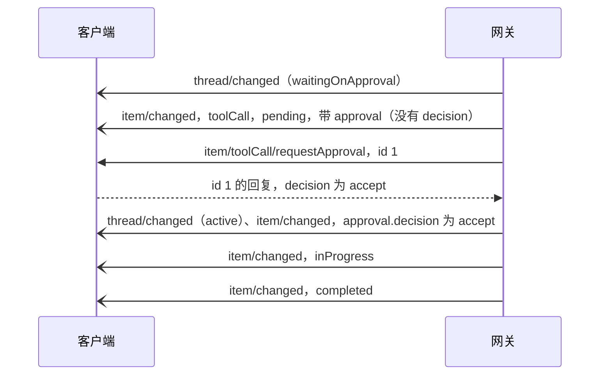
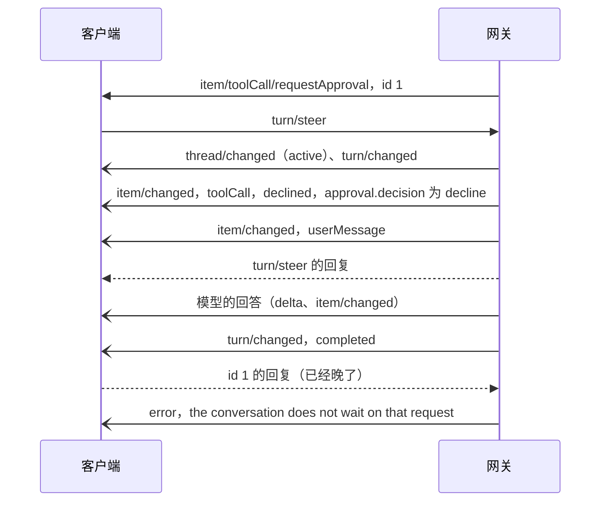

# 审批与提问

agent 要做一件需要用户点头的事，或者要用户回答一个问题时，网关向客户端发一个 JSON-RPC 请求，客户端回复结果。这一页讲这两种服务端请求：什么时候发、怎样回复、各种回复的结果、什么时候重发，以及条目在这期间怎样变化。

审批策略和规则决定哪些调用要问，见[权限](/zh/integrate/protocol/permissions)；条目（`ItemRow`）本身的字段见[一轮与条目](/zh/integrate/protocol/turns#itemrow)；客户端怎样保存和去重待回答的请求，见[写一个客户端](/zh/integrate/client#审批和提问)。

本页按引擎 v0.17.1 写。示例来自对着 v0.17.1 跑的一个最小宿主：`host.New` 配一个脚本化的假模型和一个非只读工具 `deploy`，审批策略为适中（`on-request`），标为"实测"。ID 和时间是当时的临时值，部分字段省略。

## 概念与状态

两种等待都落在一条 `toolCall` 条目上，这一轮随之停下、让出槽位（slot），只剩日志里的记录。等待不依赖连接：客户端断开很久再回来，请求还在。

| | 审批 | 提问 |
|---|---|---|
| 起因 | 权限规则或审批策略要求先问用户 | 模型调用了 `request_user_input` 工具 |
| 条目 | `toolCall`，`status` 为 `pending`，`approval` 存在且没有 `decision` | `request_user_input` 的 `toolCall`，`status` 为 `inProgress`，`input` 存在且 `answered` 为 `false` |
| 会话状态 | `waitingOnApproval` | `waitingOnUserInput` |
| 服务端请求 | `item/toolCall/requestApproval` | `item/tool/requestUserInput` |
| 回复 | `{"decision": ...}` | `{"answers": {...}}`，或 `{"answers": {}, "skipped": true}` |
| 回复之后 | 批准：决定写进 `approval`，条目仍是 `pending`，等这一轮跑到它再执行。拒绝：条目直接 `declined` | 回答：答案成为 `result.output`，条目直接 `completed`。跳过：条目 `declined` |

模型的一次回答里有几个要问的调用时，它们在同一次提交里一起写下，审批请求一起发出；全部有了决定，这一轮才继续。

子 agent 的审批和提问照样发给客户端，请求里的 `threadId` 是子 agent 自己的会话。父会话的状态这时也是 `waitingOnApproval` 或 `waitingOnUserInput`，见[会话状态](/zh/integrate/protocol/threads#会话状态)。

## 典型流程

### 审批一次调用

实测，模型要调用非只读的 `deploy`，策略是适中：



请求紧跟在同一次提交的 `item/changed` 后面：

```json
{
  "jsonrpc": "2.0",
  "id": 1,
  "method": "item/toolCall/requestApproval",
  "params": {
    "threadId": "cc3c2ce9-b688-4c61-b123-7b16135b5e55",
    "turnId": "85994ccc-05de-455b-9177-9d6abef8fb67",
    "itemId": "d05e2ec2-799c-4b3c-9abf-1f6ad805cf37",
    "approvalId": "09ff99f7-f9ac-4021-b0d3-ce8bafe17dc1",
    "server": "ops",
    "tool": "deploy",
    "arguments": {"target": "prod"},
    "suggestedRules": ["deploy"],
    "availableDecisions": ["accept", "acceptForSession", "acceptAlways", "decline"]
  }
}
```

`deploy` 没有可供规则匹配的内容，建议规则就是工具名本身，所以有 `acceptAlways`；这是适中策略下的普通询问，没有 `reason`。命令（`run_command`）的请求还会带 `content`（命令行）和 `preparedExecution`（解析后的程序、参数、目录）。`reason` 只在两种情况下有：由 ask 规则触发（`Your permission rule ... asks before this call.`），或命令看不清、没法逐条对照规则。回复：

```json
{"jsonrpc": "2.0", "id": 1, "result": {"decision": "accept"}}
```

之后条目上的 `approval` 带上了决定，`decidedBy` 是回答者的用户 ID（单令牌部署是 `default`）：

```json
"approval": {
  "approvalId": "09ff99f7-f9ac-4021-b0d3-ce8bafe17dc1",
  "suggestedRules": ["deploy"],
  "availableDecisions": ["accept", "acceptForSession", "acceptAlways", "decline"],
  "askedAt": "2026-11-18T12:14:11.31091Z",
  "decision": "accept",
  "decidedBy": "default",
  "decidedAt": "2026-11-18T12:14:11.31249Z"
}
```

### 回答一个提问

实测，模型问用哪种语言。条目先是 `pending`，开始执行变成 `inProgress`，再带上 `input`：

```json
"input": {
  "request": {"questions": [{"id": "lang", "header": "Language", "question": "Which language?",
    "options": [{"label": "Go (Recommended)", "description": "Matches the backend"}, {"label": "TypeScript"}]}]},
  "askedAt": "2026-11-18T12:28:59.228045Z",
  "answered": false
}
```

请求和回复：

```json
{"jsonrpc": "2.0", "id": 1, "method": "item/tool/requestUserInput", "params": {
  "threadId": "8a67fd15-46d7-4db1-a63d-81843e61dc70",
  "turnId": "78ce6a8f-373d-4ad3-902a-71b0917837fe",
  "itemId": "6814c56a-98e8-4d04-b033-58e824861004",
  "questions": [{"id": "lang", "header": "Language", "question": "Which language?",
    "options": [{"label": "Go (Recommended)", "description": "Matches the backend"}, {"label": "TypeScript"}]}]}}
{"jsonrpc": "2.0", "id": 1, "result": {"answers": {"lang": {"answers": ["Go"]}}}}
```

回复之后条目直接 `completed`，`input.answered` 为 `true`，答案原样成为 `result.output`，会话状态回到 `active`。

### 跳过提问

用户不想回答时，回复 `{"answers": {}, "skipped": true}`（带 `skipped` 时 `answers` 被忽略）。实测：条目以 `declined` 结束，`error` 是 `the user skipped these questions; go on without their answers`；接着和拒绝一样，运行时写一条 `notice` 告诉模型工具调用已经停止，模型直接写回答，这一轮 `completed`。

### 拒绝

实测：回复 `decline` 之后，网关依次发出：

| 通知 | 内容 |
|---|---|
| `item/changed` | 条目 `declined`，`error` 是 `the user declined this call`，`approval.decision` 为 `decline` |
| `item/changed` | 一条 `notice` 条目，`text` 告诉模型工具调用已经停止、直接写最终回答 |
| `item/agentMessage/delta` … `item/changed` | 模型的最终回答 |
| `turn/changed` | `completed`，不是 `failed` |

`notice` 条目的 `text` 实测以这一句开头：

```text
[runtime] Tool use has stopped: the user declined deploy.
```

拒绝结束的是这一轮的工具调用，不是这一轮：模型还会写一段回答，这一轮正常完成。模型在这之后仍然要调工具时，这次调用失败，这一轮以 `failed` 结束。

### 用一条消息代替回答

这一轮在等审批或提问时，用户直接发消息（`turn/steer`），这条消息就代替了回答。实测，等审批时插话：



在等的审批按用户拒绝记下，在等的提问按用户跳过记下，`decidedBy` 是发消息的用户：

| 调用 | 结果 |
|---|---|
| 等审批的 | `declined`，`error` 是 `the user declined this call`，`approval.decision` 为 `decline` |
| 等回答的 | `declined`，`error` 是 `the user skipped these questions; go on without their answers` |

和显式拒绝不同，这里不会出现"工具调用已停止"的 `notice`：用户的消息在拒绝之后，模型读到被拒的结果和新消息，可以接着用工具。客户端收到这些 `item/changed` 时就该关掉对应的审批或提问界面；之后再回复那条请求，只会收到 `error` 通知，不会重发。机制见[执行模型](/zh/engine/execution)。

::: info 演进
v0.12.1 的插话代替回答时，等着的调用以 `declined` 结束，`error` 写明是被消息取代的，`approval` 里没有 `decision`；排在后面的调用以 `skipped: the user sent a message before this call ran` 结束。v0.16.0 改成按拒绝和跳过记下（`9b5b50b`），排在后面的调用不再单独处理。跳过提问来自 `d6a80e8`。
:::

## 请求

### item/toolCall/requestApproval

| | |
|---|---|
| 方向 | 服务端 → 客户端 |
| 参数 | [`ApprovalRequestParams`](#approvalrequestparams) |
| 回复 | [`ApprovalResponse`](#approvalresponse)：`{"decision": "<Decision>"}` |
| 回复之后的通知 | `thread/changed`、`item/changed`（批准时 `approval.decision` 有值，拒绝时条目 `declined`）；之后条目执行或这一轮停用工具，见上面的流程。选 `acceptAlways` 时同一次提交里还有 `thread/changed` 或 `workspace/changed` |

`availableDecisions` 决定客户端能给哪些按钮（`conversation.Approval.Decisions`）：

| 情况 | 可选决定 |
|---|---|
| 由 ask 规则触发（`approval.rule` 非空） | `accept`、`decline` |
| 没有建议规则（命令看不清、申请在沙箱外运行、含 `*`） | `accept`、`acceptForSession`、`decline` |
| 有建议规则 | `accept`、`acceptForSession`、`acceptAlways`、`decline` |

ask 规则的意思是每次都问，所以规则触发时不给"总是允许"。

| 决定 | 效果 |
|---|---|
| `accept` | 只放行这一次 |
| `acceptForSession` | 本会话内完全相同的调用不再问：工具相同，执行内容（`preparedExecution`）逐字节相同，`content` 相同 |
| `acceptAlways` | 把 `suggestedRules` 写成 allow 规则，然后放行。会话属于工作区时写进工作区那一层，否则写进会话那一层；子 agent 的调用写进父会话所在的那一层。见[权限](/zh/integrate/protocol/permissions) |
| `decline` | 条目 `declined`，这一轮停止用工具，模型写最终回答 |

`decision` 不在 `availableDecisions` 里时，引擎返回 `invalid decision`，网关发 `error` 通知并重发请求，见[回复的结果](#回复的结果)。

### item/tool/requestUserInput

| | |
|---|---|
| 方向 | 服务端 → 客户端 |
| 参数 | [`UserInputRequestParams`](#userinputrequestparams)：`threadId`、`turnId`、`itemId`、`questions` |
| 回复 | [`UserInputResponse`](#userinputresponse)：`{"answers": {"<问题 id>": {"answers": ["..."]}}}`，或 `{"answers": {}, "skipped": true}` |
| 回复之后的通知 | `thread/changed`、`item/changed`（回答时 `completed`，跳过时 `declined`） |

问题的约束：

| 项 | 约束 |
|---|---|
| 问题数 | 1 到 4 |
| `id` | `^[a-z][a-z0-9_]{0,63}$`，不重复 |
| `header` | 1 到 12 字符 |
| `question` | 1 到 600 字符 |
| `options` | 至多 4 个，可省略；`label` 1 到 60 字符，`description` 至多 200 字符 |

工具的参数说明要求模型把推荐项放第一个，在 `label` 后面加 ` (Recommended)`，并且不要加"其他"选项，理由是用户总能用自己的话回答。所以客户端应当总是允许用户写自己的答案。

引擎校验回复（`ask.Request.Check`）：每个问题都要有至少一个回答，回答不能是空白，不能回答没问过的问题，所有答案合计不超过 4000 个字符。不通过时 `message` 写明哪一条，如 `invalid answer: question "lang" has no answer`。答案可以是选项的 `label`，也可以是用户自己写的文字，引擎不检查它是不是选项之一。

## 回复的结果

| 客户端 | 网关 | 之后 |
|---|---|---|
| 合法的 `result` | 写进日志，发 `thread/changed`、`item/changed` | 这一轮可以继续 |
| `result` 解析不了，有契约之外的字段，或决定、答案不合法（如 `"maybe"`、少答一题） | 发 `error` 通知（带 `threadId`、`turnId`、`itemId`，`message` 写明原因） | 立刻用新的 `id` 重发同一个请求 |
| 请求已经失效：这一轮被中断、被插话代答，或者别处已经回答了 | 发 `error` 通知，`message` 是 `the conversation does not wait on that request` | 不再重发 |
| JSON-RPC 错误回复（`error` 而不是 `result`） | 什么也不做，这条连接忘掉它问过 | 这一轮继续等；下一次 `thread/resume`、重连，或这个条目再有变化时重发 |
| `id` 写成字符串（`"3"` 而不是 `3`） | 对不上这条请求，忽略 | 这条连接上不再重发，`thread/resume` 也不会；只有重连才会重新问 |
| 不回复就断开 | 请求留在日志里 | 新连接 `initialize` 之后重发 |

回复的 `result` 和方法参数一样严格解码，多余的字段算不合法。实测，回复里多一个字段时网关发 `error`（`json: unknown field "extra"`）并立刻重发；客户端如果每次都回同样的内容，会和网关来回打转。

`error` 通知的载荷是 `ErrorNotification`：`threadId`、`turnId`、`itemId`、`message`，见[一轮与条目](/zh/integrate/protocol/turns#error)。

## 重发

服务端请求的 `id` 是 JSON 数字，每条连接从 1 开始单独计数。网关按 `id` 的原始 JSON 文本找对应的请求，所以回复时要原样带回，类型也不能变。

同一个条目在一条连接上同一时刻只问一次：网关记着这条连接问过、还没收到回复的条目，回复到了才清掉（`conn.asked`）。由此有这些发请求的时机：

| 时机 | 发什么 |
|---|---|
| 一次提交让某个调用开始等用户 | 这条连接还没问过的、在等的调用 |
| `initialize` 的回复入队之后 | 这个用户所有在等的请求，包括子 agent 会话的，按发起时间排序。读不出来时网关以 1011 `pending requests could not be read` 关闭连接 |
| `thread/resume` 的回复之后 | 这个会话和它的子 agent 会话里在等的请求，这条连接上已经问过、还没回答的不再发 |
| 回复不合法之后 | 同一个请求立刻重发，`id` 是新的 |

所以同一个条目的请求会带着不同的 `id` 来好几次。客户端应以 `itemId`（审批另有 `approvalId`）为键保存待回答的请求，新来的替换旧的，回复时用最新的 `id`，见[写一个客户端](/zh/integrate/client#审批和提问)。

**多条连接。** 一个用户最多四条连接，每条连接各自收到每个请求，各自计数 `id`。哪条连接先给出合法的回复，就以它为准；别的连接随后收到条目变化的 `item/changed`，这时再回复只会得到 `error` 通知。实测：连接 A 发起一轮后不回答就断开，新连接 C 在 `initialize` 之后立刻收到这条请求，之后的 `thread/resume` 不再重复发；连接 B 先回答，C 晚一步回答，C 收到 `error`。

网关不撤回请求，也没有"请求作废"的通知。请求失效时客户端能看到的是条目的变化：

| 发生了什么 | 客户端看到 |
|---|---|
| 另一条连接或宿主批准了 | `item/changed`，`approval.decision` 有了值，执行完才 `completed` |
| 另一条连接或宿主拒绝了 | `item/changed`，`declined` |
| 别处回答或跳过了提问 | `item/changed`，`completed` 或 `declined` |
| 这一轮被中断 | 条目 `declined`（审批是 `interrupted by the user`，提问按跳过记下），`turn/changed` 为 `interrupted` |
| 用户插话代答 | 条目 `declined`，见[用一条消息代替回答](#用一条消息代替回答) |

判断一个请求还要不要显示，看对应条目是否仍满足"在等"的条件：审批是 `pending` 且 `approval.decision` 为空，提问是 `inProgress` 且 `input.answered` 为 `false`。

## 通知

这两种请求本身不是通知，但总伴随着这些通知：

| 通知 | 什么时候 |
|---|---|
| `item/changed` | 条目带上 `approval` 或 `input`；审批有了决定；提问被回答或跳过；调用执行完、被拒绝、被代答或随中断结束 |
| `thread/changed` | 每次提交都有；进入等待时 `status` 变成 `waitingOnApproval` 或 `waitingOnUserInput`，回答后回到 `active` |
| `error` | 回复没有生效 |
| `thread/changed`、`workspace/changed` | 选了 `acceptAlways`，规则写进会话或工作区设置 |

这些通知的载荷见[一轮与条目](/zh/integrate/protocol/turns)和[会话](/zh/integrate/protocol/threads)。

## 类型

`?` 表示字段可能不出现。

### ApprovalRequestParams

| 字段 | 类型 | 说明 |
|---|---|---|
| `threadId`、`turnId`、`itemId` | string | 这次调用所在的位置。子 agent 的审批，`threadId` 是子 agent 会话 |
| `approvalId` | string | 等于条目上 `approval.approvalId` |
| `server`、`tool` | string | 提供方和工具名 |
| `arguments` | JSON 对象 | 调用参数，已经解析成对象（条目上的 `arguments` 是 JSON 文本）；条目上的参数为空时是 `{}` |
| `preparedExecution?` | [`PreparedExecution`](#preparedexecution) | 判定时算出的执行内容，审批的就是它 |
| `reason?` | string | 为什么要问，给用户看 |
| `content?` | string | 权限规则匹配的内容，比如命令行。规则怎么写见[权限](/zh/integrate/protocol/permissions) |
| `suggestedRules?` | string[] | 选 `acceptAlways` 时会写入的规则 |
| `availableDecisions` | [`Decision`](#decision)[] | 这次能给哪几种决定 |

### ApprovalResponse

| 字段 | 类型 | 说明 |
|---|---|---|
| `decision` | [`Decision`](#decision) | 必须是请求里 `availableDecisions` 之一 |

### Decision

`accept`、`acceptForSession`、`acceptAlways`、`decline`，含义见[上文](#item-toolcall-requestapproval)。

### Approval

条目上的审批记录，审批和决定都存在这里。

| 字段 | 类型 | 说明 |
|---|---|---|
| `approvalId` | string | 审批 ID，等于请求里的 `approvalId` |
| `reason?` | string | 同请求里的 `reason` |
| `rule?` | string | 触发询问的 ask 规则。有它时只能 `accept` 或 `decline` |
| `content?` | string | 同请求里的 `content` |
| `suggestedRules?` | string[] | 同请求里的 `suggestedRules` |
| `availableDecisions` | `Decision[]` | 同请求里的 `availableDecisions` |
| `askedAt` | string | 发起时间 |
| `decision?` | `Decision` | 用户的决定；不出现表示还在等 |
| `decidedBy?` | string | 做决定的用户 ID。经网关回答、插话代答都是连接所认出的那个用户；宿主直接调 `app.Decide` 时是它传入的 `user` |
| `decidedAt?` | string \| null | 决定的时间 |

### Input

条目上的提问记录。

| 字段 | 类型 | 说明 |
|---|---|---|
| `request` | `UserInputRequest` | 问了什么：`{questions: UserInputQuestion[]}`，和请求里的 `questions` 相同 |
| `askedAt` | string | 发起时间 |
| `answered` | boolean | 已经回答或跳过。答案在条目的 `result.output` 里，跳过时没有 |

### PreparedExecution

判定时算出的执行内容，出现在请求的 `preparedExecution` 和条目的 `preparedExecution` 上，只有工作区的命令和改文件工具有。它和调用一起写进日志，之后不再改变；执行前工具重新核对，沙箱设置、根目录或参数变了就不执行，见[工具系统](/zh/engine/tools)。

| 字段 | 类型 | 说明 |
|---|---|---|
| `cwd` | string | 命令的工作目录；改文件时是根目录 |
| `settingsDigest` | string | 沙箱设置、超时、命令黑名单和根目录的摘要，`sha256:` 开头 |
| `argumentsDigest` | string | 参数的摘要 |
| `program?`、`args?` | string、string[] | 命令：解析后的程序和参数 |
| `env?` | object | 命令额外的环境变量 |
| `timeoutSec?` | integer | 命令超时 |
| `sandboxed?` | boolean | 在强制沙箱里运行 |
| `escalated?` | boolean | 申请在沙箱外运行（提权） |
| `justification?` | string | 模型给的提权理由 |
| `files?` | [`FileChange`](#filechange)[] | 改文件：要写的变化 |

### FileChange

一个文件的变化，界面用它显示 diff。

| 字段 | 类型 | 说明 |
|---|---|---|
| `path` | string | 相对根目录的路径 |
| `before?` | string | 原内容的 **sha256**，不是内容本身；新建文件时没有 |
| `after` | string | 新内容的 sha256 |
| `diff` | string | unified diff |
| `added`、`removed` | integer | 增删的行数 |

### UserInputRequestParams

| 字段 | 类型 | 说明 |
|---|---|---|
| `threadId`、`turnId`、`itemId` | string | 这个 `request_user_input` 调用所在的位置 |
| `questions` | [`UserInputQuestion`](#userinputquestion)[] | 和条目上 `input.request.questions` 相同 |

`UserInputRequest` 只有一个字段 `questions`，它也是 `request_user_input` 工具的参数。

### UserInputQuestion

| 字段 | 类型 | 说明 |
|---|---|---|
| `id` | string | 回答时用它对应问题 |
| `header` | string | 短标签 |
| `question` | string | 问题正文 |
| `options?` | [`UserInputOption`](#userinputoption)[] | 互斥选项 |

### UserInputOption

| 字段 | 类型 | 说明 |
|---|---|---|
| `label` | string | 选项文字，也是选它时回答的内容 |
| `description?` | string | 说明 |

### UserInputResponse

| 字段 | 类型 | 说明 |
|---|---|---|
| `answers` | `UserInputAnswers` | 以问题 `id` 为键的对象，值是 `UserInputAnswer` |
| `skipped?` | boolean | `true` 表示用户跳过这些问题，这时 `answers` 被忽略，传 `{}` 即可 |

`UserInputAnswer` 只有一个字段 `answers`：string[]，这个问题的回答。整个 `answers` 对象原样成为条目的 `result.output`。

## 错误与边界

- **请求不撤回。** 请求失效只能从条目的变化看出来，见[重发](#重发)。
- **不合法的回复会立刻重发。** 客户端反复回同样不合法的内容时，会和网关来回打转；遇到 `error` 通知应当停下，让用户重新回答。
- **插话代答只对当前一轮在等的调用生效。** 这一轮回答完在等子 agent 时插话，子 agent 正在等的审批不受影响，要单独回答。
- **"本会话允许"只认完全相同的调用。** 同一个命令换个参数要再问一次；沙箱配置变了，执行内容跟着变，旧的批准自然不再适用。
- **看不出是哪个客户端回答的。** `decidedBy` 只是用户 ID：同一用户的几条连接、插话代答、宿主直接调 `app.Decide`，记下的都是同一个值。
- **回答不必立刻给。** 等待中的一轮不占槽位，也不依赖连接。

## 代码位置

| 仓库 | 路径 | 职责 |
|---|---|---|
| ollupi | `gateway/server.go` | `change`、`request`、`requests`、`resolve`：发请求、记已问过的条目、处理回复和重发 |
| ollupi | `gateway/protocol.go` | `ApprovalRequestParams`、`ApprovalResponse`、`UserInputRequestParams`、`UserInputResponse` |
| ollupi | `gateway/wire.go` | 条目上的 `Approval`、`Input` |
| ollupi | `pkg/jsonrpc/jsonrpc.go` | 服务端请求的 `id` 计数和回复匹配 |
| ollupi | `app/turns.go` | `Requests`、`Decide`、`Answer`、插话 `Steer` |
| ollupi | `app/settings.go` | `allowAlways`：把建议规则写进会话或工作区 |
| ollupi | `conversation/view.go` | `Approval.Decisions`、`WaitsForApproval`、`WaitsForInput`、`Requests` |
| ollupi | `policy/checker.go`、`policy/rules.go` | 判定要不要问、建议规则 |
| ollupi | `ask/ask.go` | 提问的类型、约束和 `Check` |
| ollupi | `tool/builtin/workspace/plan.go` | `Prepared`、`FileChange` |
