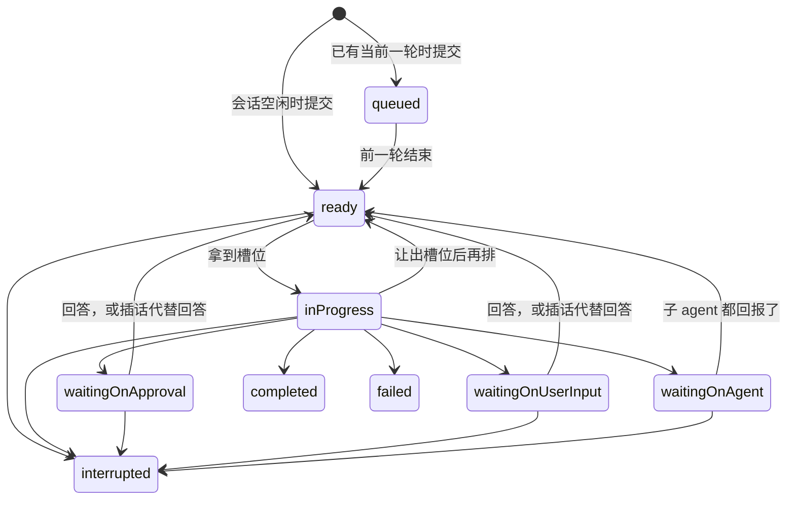
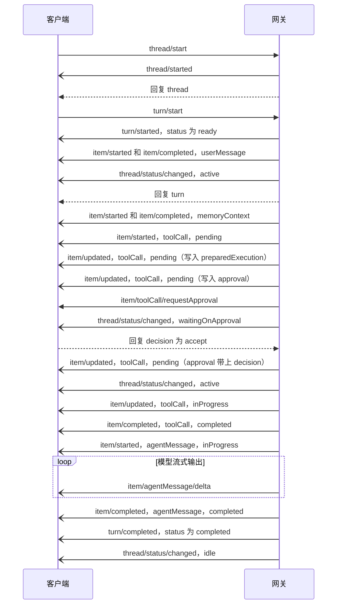
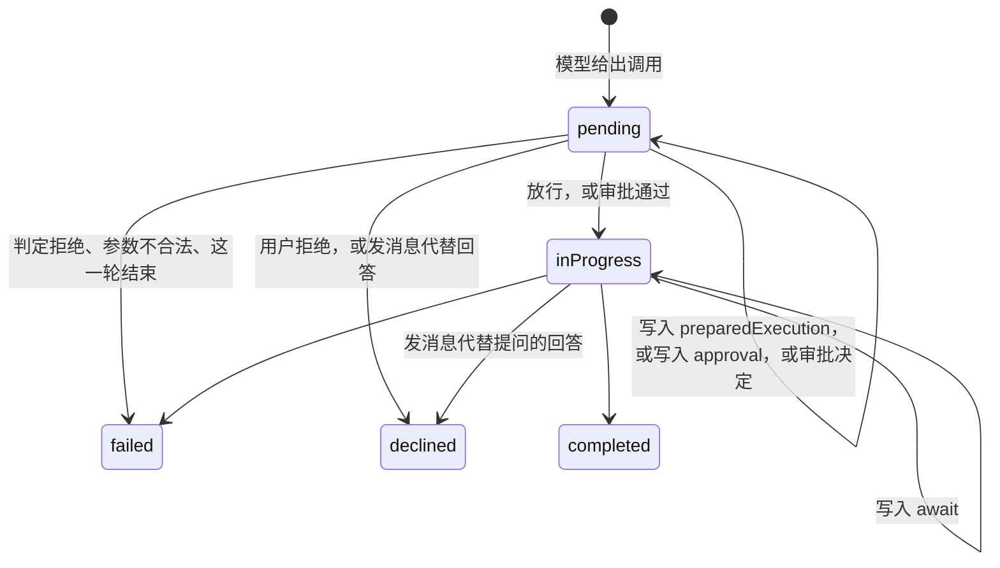

# 一轮与条目

一轮（turn）是会话里由一条用户消息开始、到 agent 给出结果为止的一段工作；它产生的每一样东西，用户消息、回答、思考、工具调用、压缩、记忆载入、错误，都记成一条条目（item）。客户端用 `turn/start`、`turn/steer`、`turn/interrupt` 驱动它，用 `turn/*` 和 `item/*` 通知跟上它。

本页按引擎 v0.12.1 写。会话本身见[会话](/zh/integrate/protocol/threads)，审批和提问这两种要用户回答的服务端请求见[审批与提问](/zh/integrate/protocol/approvals)。

## 概念与状态

### 一轮的状态

一个会话同一时刻最多有一个当前一轮。当前一轮还没结束时再提交的消息排在它后面，状态是 `queued`，前一轮结束后才按提交顺序成为当前一轮。

| `TurnStatus` | 含义 | 占槽位 |
|---|---|---|
| `queued` | 排在当前一轮后面 | 否 |
| `ready` | 是当前一轮，等一个槽位（slot） | 否 |
| `inProgress` | 在槽位里运行：调模型、跑工具 | 是 |
| `waitingOnApproval` | 有调用在等用户审批 | 否 |
| `waitingOnUserInput` | 有调用在等用户回答提问 | 否 |
| `waitingOnAgent` | 有调用在等子 agent 回报 | 否 |
| `completed` | 正常结束 | — |
| `interrupted` | 被中断，`error` 写明在什么阶段 | — |
| `failed` | 失败，`error` 是原因 | — |



客户端能看到的只有一部分：`turn/queued` 带 `queued`，`turn/started` 带 `ready`，`turn/completed` 带三个结束状态之一。进槽位、出槽位、进入等待都不单独发轮次通知，中间状态只在 `thread/read` 读到的 `turns` 里看得到；要知道"在等人"，看会话的 `thread/status/changed`（见[会话状态](/zh/integrate/protocol/threads#会话状态)）和服务端请求。调度机制见[执行模型](/zh/engine/execution)。

### 条目

条目按会话内的 `seq` 递增，不跳号，客户端按它排序。条目先落库再发通知，所以通知里的 `seq` 就是库里的值。七种类型：

| `ItemType` | 是什么 |
|---|---|
| `userMessage` | 用户的消息：一轮开头的那条，或插话 |
| `agentMessage` | 模型的回答 |
| `reasoning` | 模型的思考内容 |
| `toolCall` | 一次工具调用 |
| `contextCompaction` | 一次上下文压缩 |
| `memoryContext` | 这一轮载入的长期记忆快照，见[记忆](/zh/integrate/protocol/memory) |
| `error` | 模型调用失败的记录，或运行时给模型的通知 |

五种状态：`pending`（只有工具调用用到：已记录，还没执行）、`inProgress`、`completed`、`failed`、`declined`（只有工具调用：被拒绝）。每种类型怎样变化见下文 [ItemRow](#itemrow)。

## 典型流程

本节的消息有两个来源，各处注明：桌面端仓库录制的会话 `ollupi-desktop/packages/protocol/fixtures/session.json`（假模型跑 sidecar，协议摘要和 v0.12.1 相同）；以及对着 v0.12.1 跑的一个最小宿主（网关加一个流式输出的假 OpenAI 服务，审批策略为严格），用来录插话代替审批。ID 和时间是录制时的值。

### 一次完整对话

下图来自录制的会话：新建会话，发一条消息，模型调用一个需要审批的工具，然后回答。



几处细节：

- `turn/started` 表示这一轮成为会话的当前一轮，此时是 `ready`，还没有占到槽位。
- 通知可能先于回复：`turn/start` 的回复排在 `turn/started`、用户消息和 `thread/status/changed` 之后。客户端不能等回复到了再处理通知，见[写一个客户端](/zh/integrate/client#通知可能先于回复)。
- `memoryContext` 条目只在配置了长期记忆时出现。
- 带思考输出的模型会多出 `reasoning` 条目和 `item/reasoning/textDelta`。录制的会话里，`reasoning` 条目的 `item/completed` 排在同一次回答的 `agentMessage` 之后。
- 审批请求先于 `thread/status/changed`（`waitingOnApproval`）到达。审批和提问的细节见[审批与提问](/zh/integrate/protocol/approvals)。
- 上一轮的 `thread/status/changed`（`idle`）可能排在下一轮 `turn/start` 发出之后才到：客户端发得快时，录制里多次出现这个顺序。

用户消息的条目（`item/started`，录制）：

```json
{"jsonrpc": "2.0", "method": "item/started", "params": {
  "threadId": "9f311e1e-e8d6-47b8-a5f5-2e49f0d1be23",
  "turnId": "59bc7f8b-a427-4a0b-a044-a5d1d4c4038e",
  "item": {"id": "aa2386f3-3305-4a08-b8fd-d89337e5f00f",
           "turnId": "59bc7f8b-a427-4a0b-a044-a5d1d4c4038e",
           "seq": 1, "type": "userMessage", "status": "completed",
           "startedAt": "2026-11-08T11:44:54.506566Z",
           "completedAt": "2026-11-08T11:44:54.506566Z",
           "text": "Hello there\nsecond line"}}}
```

### 排队

会话已有当前一轮时，`turn/start` 发出 `turn/queued`，回复里的 `turn.status` 也是 `queued`（录制）：

```json
{"jsonrpc": "2.0", "id": 22, "method": "turn/start", "params": {
  "threadId": "9f311e1e-e8d6-47b8-a5f5-2e49f0d1be23",
  "input": [{"type": "text", "text": "second of two"}]}}
{"jsonrpc": "2.0", "method": "turn/queued", "params": {
  "threadId": "9f311e1e-e8d6-47b8-a5f5-2e49f0d1be23",
  "thread": { "...": "会话行" },
  "turn": {"id": "10de2540-d75b-4de9-b247-78d2bd2f569b",
           "threadId": "9f311e1e-e8d6-47b8-a5f5-2e49f0d1be23",
           "seq": 13, "status": "queued",
           "model": {"name": "mock-model", "connection": "mock/mock-model"},
           "usage": {"inputTokens": 0, "cachedInputTokens": 0, "cacheWriteInputTokens": 0, "outputTokens": 0},
           "createdAt": "2026-11-08T11:45:05.722183Z",
           "startedAt": "2026-11-08T11:45:05.722183Z",
           "input": "second of two"}}}
{"jsonrpc": "2.0", "id": 22, "result": {"turn": { "...": "同上" }}}
```

排队的一轮还没有条目：它的 `userMessage` 条目在它成为当前一轮时才生成，那时发 `turn/started`（`ready`）、`item/started` 和 `item/completed`（`userMessage`）、`thread/status/changed`（`active`）。排队期间 `startedAt` 等于 `createdAt`，成为当前一轮时改成那一刻。协议里没有取消排队中一轮的方法。

### 插话

一轮还没结束时，用户想让它马上看到一条消息，用 `turn/steer`，必须带 `expectedTurnId`。消息写进当前一轮，成为一条新的 `userMessage` 条目，接下来怎样取决于这一轮在做什么：

| 这一轮的状态 | 插话之后 |
|---|---|
| `ready`、`inProgress` | 不改状态，不打断任何东西。运行循环在下一次组装请求时带上它；模型的最终回答写完之后才到的插话，会让这一轮再跑一圈而不是结束。时机见[插话（steer）](/zh/engine/execution#插话-steer) |
| `waitingOnApproval`、`waitingOnUserInput` | 消息代替用户的回答：这一轮还没执行的调用全部以 `declined` 结束，这一轮回到 `ready` 接着跑，模型读到被拒的结果和这条消息 |
| `waitingOnAgent` | 消息落库，子 agent 都回报、这一轮重新运行时读到 |

插话代替审批时的通知（对着 v0.12.1 的最小宿主录制，模型要跑 `echo hi`，审批策略是严格）：

```json
{"jsonrpc": "2.0", "id": 4, "method": "turn/steer", "params": {
  "threadId": "bd9403df-0a3e-4d6d-bce4-b9a5a04117e6",
  "expectedTurnId": "fbf0fada-f700-4edc-8a6c-997ea89123d1",
  "input": [{"type": "text", "text": "never mind"}]}}
```

依次收到：插话的 `userMessage` 条目（`item/started`、`item/completed`，`seq` 3）；等审批的那条调用的 `item/completed`；`thread/status/changed`（`active`）；然后才是回复 `{"turnId": "fbf0fada-..."}`；之后模型照常回答，这一轮 `completed`。被拒的调用（节选）：

```json
{"jsonrpc": "2.0", "method": "item/completed", "params": {
  "threadId": "bd9403df-0a3e-4d6d-bce4-b9a5a04117e6",
  "turnId": "fbf0fada-f700-4edc-8a6c-997ea89123d1",
  "item": {"id": "36deb8ff-6c1f-41d6-9014-387a24e30368",
           "seq": 2, "type": "toolCall", "status": "declined",
           "tool": "run_command", "server": "workspace",
           "error": "the user sent a message instead of approving this call, so it did not run",
           "completedAt": "2026-11-09T05:30:46.726287Z",
           "approval": {"id": "ab43ef38-d891-411b-a847-749472f13443",
                        "requestedAt": "2026-11-09T05:30:46.709662Z",
                        "content": "echo hi",
                        "suggestedRules": ["run_command(echo hi:*)"]},
           "arguments": "{\"program\":\"echo\",\"args\":[\"hi\"]}"}}}
```

`approval` 留在条目上，但没有 `decision`：这条调用不是被用户拒绝的，而是被消息取代的。这之后再回复那条审批请求，网关不认，发一条 `error` 通知（实测）：

```json
{"jsonrpc": "2.0", "method": "error", "params": {
  "threadId": "bd9403df-0a3e-4d6d-bce4-b9a5a04117e6",
  "turnId": "fbf0fada-f700-4edc-8a6c-997ea89123d1",
  "itemId": "36deb8ff-6c1f-41d6-9014-387a24e30368",
  "message": "the thread does not wait on this request"}}
```

客户端收到被拒调用的 `item/completed` 时就该关掉对应的审批或提问界面。三种被拒的说明见下文 [toolCall 的生命周期](#toolcall-的生命周期)。

插话会和这一轮的结束赛跑：用户按下发送时这一轮可能刚好结束，这时返回 `-32010` 或 `-32011`。桌面端遇到这两个错误时改用 `turn/start` 把消息作为新的一轮发出去。

::: info 演进
v0.12.1 之前，插话进等审批或等回答的一轮时只落库，这一轮一直停在等待里，直到用户回答；用户说了"算了"之后再批准，调用会在模型读到这句话之前执行。`c4899f5` 改成由消息代替回答。
:::

### 中断

`turn/interrupt` 停下当前一轮。回复 `{}` 不代表已经停了，以 `turn/completed`（`interrupted`）为准：

| 中断时这一轮在 | 怎样结束 | `turn.error` |
|---|---|---|
| 槽位里（`inProgress`） | 取消这次运行的 ctx：在途的模型请求和工具执行收到取消，运行退出后这一轮结束。`turn/completed` 通常在回复之后到 | `interrupted by the user` |
| `ready` | 立即结束，`turn/completed` 先于回复到达 | `interrupted while waiting for a slot` |
| `waitingOnApproval`、`waitingOnUserInput` | 同上 | `interrupted while waiting for the user` |
| `waitingOnAgent` | 同上 | `interrupted while waiting for subagents` |

一轮结束时，还是 `pending` 或 `inProgress` 的条目都改成 `failed`，`error` 是 `the turn ended (interrupted) before this item finished`，各发一条 `item/completed`。所以在等审批时中断，那条调用以 `failed` 结束，而不是 `declined`。这一轮还没回报的子 agent 也一并停下，见[子 agent 会话](/zh/integrate/protocol/threads#子-agent-会话)。之后排队的下一轮成为当前一轮。

## 方法

### turn/start

提交一条消息。会话空闲时它成为当前一轮，否则排队。

| 参数 | 类型 | 说明 |
|---|---|---|
| `threadId` | string | 顶层会话 |
| `input` | `UserInput[]` | 消息的各部分，见下 |
| `connection?` | string | 用哪个模型，取 `model/list` 里的 `connection`。省略时沿用这个会话上一轮的模型；会话还没有轮次时用第一个模型 |

`input` 里每一项是 `UserInput`：

| `type` | 字段 | 行为 |
|---|---|---|
| `text` | `text` | 多段文本用换行连接，去掉首尾空白，合计最多 4000 个字符 |
| `file` | `path`、`name?`、`mimeType?` | `path` 必须是绝对路径。引擎从用户的沙箱里读这个文件，在提交时复制一份进附件存储；`name` 默认取文件名 |

附件最多 10 个；图片（PNG、JPEG、GIF、WebP）最大 20 MiB，文本文件最大 256 KiB。没有配置附件存储（`Attachments` 或 `AttachmentsDir`）的引擎不收附件。协议里没有上传文件内容的方法，客户端和用户的沙箱不在一台机器上时，文件要先用别的途径放进沙箱。附件存储接口见[扩展点](/zh/integrate/extend#附件存储)。

结果：`{turn: TurnRow}`，`status` 是 `ready` 或 `queued`。回复之前已经发出：

- 成为当前一轮：`turn/started`、`userMessage` 的 `item/started` 和 `item/completed`、`thread/status/changed`（`active`）。
- 排队：`turn/queued`。

| 错误 | 什么时候 |
|---|---|
| `-32602` | `input` 里有别的 `type`；文本和文件都为空；文本超过 4000 字符；附件超过 10 个、太大、是空文件、既不是支持的图片也不是文本、路径不是绝对路径或读不到、附加期间文件被改了；引擎不收附件；`connection` 不存在；模型不收图片而消息带图片 |
| `-32004` | 会话不存在 |
| `-32013` | 子 agent 会话，不接受输入 |
| `-32015` | 会话已归档 |
| `-32014` | 会话所在的工作区已归档 |
| `-32000` | 附件写进附件存储失败（详情只在服务端日志里） |

定时任务到点时引擎自己提交一轮，和 `turn/start` 走同一条路，`TurnRow.cronJobId` 写着任务 ID，见[定时任务](/zh/integrate/protocol/cron)。

### turn/steer

把一条消息写进当前一轮，见上文[插话](#插话)。

| 参数 | 类型 | 说明 |
|---|---|---|
| `threadId` | string | 顶层会话 |
| `input` | `UserInput[]` | 同 `turn/start` |
| `expectedTurnId` | string | 必填，客户端以为在进行中的那一轮 |

结果：`{turnId}`，就是当前一轮的 ID。回复之前已经发出这条消息的 `item/started` 和 `item/completed`；这一轮在等审批或提问时，还有被拒调用的 `item/completed` 和 `thread/status/changed`。

| 错误 | 什么时候 |
|---|---|
| `-32602` | 没给 `expectedTurnId`；`input` 不合法（同 `turn/start`）；当前一轮的模型不收图片而消息带图片 |
| `-32004` | 会话不存在 |
| `-32013` | 子 agent 会话 |
| `-32010` | 会话没有当前一轮。排队中的一轮不算 |
| `-32011` | `expectedTurnId` 不是当前那一轮 |

### turn/interrupt

停下当前一轮，见上文[中断](#中断)。

| 参数 | 类型 | 说明 |
|---|---|---|
| `threadId` | string | 会话，子 agent 会话也可以 |
| `turnId` | string | 必填，要停的那一轮 |

结果：`{}`。

| 错误 | 什么时候 |
|---|---|
| `-32602` | 没给 `turnId` |
| `-32004` | 会话不存在 |
| `-32010` | 会话没有当前一轮，包括这一轮已经结束、或只有排队中的轮次 |
| `-32011` | `turnId` 不是当前那一轮 |

### attachment/read

取回一个附件的内容。

| 参数 | 类型 | 说明 |
|---|---|---|
| `threadId` | string | 附件所在的会话，子 agent 会话也可以 |
| `attachmentId` | string | `Attachment.id` |

结果：`{attachment: Attachment, data}`，`data` 是文件内容的 base64。

出站队列的上限（16 MiB）也作用于单条回复，而 base64 之后约是原来的 1.33 倍，所以大约 12 MiB 以上的图片读不回来：连接以 1008 关闭，见[传输](/zh/integrate/protocol#传输)。

| 错误 | 什么时候 |
|---|---|
| `-32004` | 会话或附件不存在，或附件不属于这个会话 |
| `-32000` | 附件存储读取失败（详情只在服务端日志里） |

## 通知

`turn/*` 和 `item/*` 通知带的是发出那一刻库里的完整行，客户端按 `id` 整行替换，不用自己推导字段变化。子 agent 会话的轮次和条目也走这些通知，`threadId` 是子会话的 ID。

### turn/queued、turn/started、turn/completed

载荷都是 `TurnNotification`：

| 字段 | 类型 | 说明 |
|---|---|---|
| `threadId` | string | |
| `thread` | `ThreadRow` | 会话行。一轮开始和结束时会话的 `updatedAt` 会变，客户端一并替换 |
| `turn` | `TurnRow` | 这一轮的整行 |

| 通知 | 什么时候 | `turn.status` |
|---|---|---|
| `turn/queued` | 一轮进入排队 | `queued` |
| `turn/started` | 一轮成为会话的当前一轮 | `ready` |
| `turn/completed` | 一轮结束 | `completed`、`failed`、`interrupted` |

一轮结束之前，这一轮所有没结束的条目先各发一条 `item/completed`（`failed`），然后才是 `turn/completed`。

### item/started、item/updated、item/completed

载荷都是 `ItemNotification`：`{threadId, turnId, item: ItemRow}`。

| 通知 | 什么时候 |
|---|---|
| `item/started` | 新条目落库。生成时就已结束的条目（`userMessage`、`memoryContext`）紧接着还会有一条 `item/completed` |
| `item/updated` | 条目还在 `pending` 或 `inProgress` 时内容有变化：工具调用写入 `preparedExecution`、`approval`、审批决定、`await`，或从 `pending` 变成 `inProgress` |
| `item/completed` | 条目结束：`completed`、`failed` 或 `declined` |

### item/agentMessage/delta 和 item/reasoning/textDelta

载荷都是 `DeltaNotification`：`{threadId, turnId, itemId, delta}`。`agentMessage` 的增量走前者，`reasoning` 的走后者：

```json
{"jsonrpc": "2.0", "method": "item/agentMessage/delta", "params": {
  "threadId": "9f311e1e-e8d6-47b8-a5f5-2e49f0d1be23",
  "turnId": "59bc7f8b-a427-4a0b-a044-a5d1d4c4038e",
  "itemId": "e1b87120-5bcb-42f8-8ea8-ab0a3282799b",
  "delta": "## Hel"}}
```

增量只走通知，不进库，不补发；断线期间的增量丢了就丢了。完整文本在这个条目的 `item/completed` 里（`item.text`），客户端收到它时用它覆盖拼出来的文本。条目在流式输出时是 `inProgress`，`item.text` 可能不是最新的。

### error

载荷是 `ErrorNotification`：

| 字段 | 类型 | 说明 |
|---|---|---|
| `threadId?` | string | |
| `turnId?` | string | |
| `itemId?` | string | 只在客户端对服务端请求的回答没有生效时有 |
| `message` | string | 错误原文 |

两个来源：

- **agent 内部故障**：一轮无法记录结束、子 agent 停不下来之类，带 `threadId` 和 `turnId`（可能为空），服务端日志里同时有 `agent fault`。这一轮的状态以之后的通知或 `thread/read` 为准。
- **客户端的回答没有生效**：回复无法解析、决定或答案不合法、请求已经失效，带 `itemId`。各种情况网关怎样处理见[审批与提问](/zh/integrate/protocol/approvals)。

模型调用失败不走这条通知，而是记成条目（`error` 类型或失败的 `agentMessage`）并让这一轮 `failed`。

## 类型

`?` 表示字段可能不出现：Go 端用 `omitempty`，空字符串、`0`、`false`、空数组都不发，客户端把"缺"当成零值。时间都是 RFC 3339 的 UTC 字符串，带纳秒。

### TurnRow

| 字段 | 类型 | 说明 |
|---|---|---|
| `id` | string | 轮次 ID |
| `threadId` | string | 所属会话 |
| `seq` | integer | 会话内的序号，从 1 开始 |
| `status` | `TurnStatus` | 见[一轮的状态](#一轮的状态) |
| `model` | `Model` | 这一轮用的模型，提交时选定，见[模型、工具与 MCP](/zh/integrate/protocol/models-tools) |
| `usage` | `Usage` | 这一轮累计的 token，每次运行结束时加上去。进程被杀时，最后一次运行的累计会丢失，各次模型调用的用量还留在各自的条目上 |
| `error?` | string | 结束原因：失败的错误、中断时所处的阶段 |
| `cronJobId?` | string | 由定时任务发出时，是那个任务的 ID |
| `createdAt` | string | 提交时间 |
| `startedAt` | string | 成为会话当前一轮的时间。排队期间等于 `createdAt` |
| `completedAt?` | string \| null | 结束时间 |
| `attachments?` | `Attachment[]` | 这条消息的附件 |
| `input?` | string | 这条消息的文本。排队期间用它保存消息，结束后也保留 |

`TurnResult` 是 `{turn}`，`TurnSteerResult` 是 `{turnId}`。

### Usage

| 字段 | 类型 | 说明 |
|---|---|---|
| `inputTokens` | integer | 输入 token，服务商报告的值 |
| `cachedInputTokens` | integer | 其中命中前缀缓存的 |
| `cacheWriteInputTokens` | integer | 其中写入缓存的，同样计在 `inputTokens` 里 |
| `outputTokens` | integer | 输出 token |

`Usage` 出现在两处：`TurnRow.usage` 是整轮的累计，`ItemRow.usage` 是一次模型调用的用量。服务商没报告用量时，条目上没有 `usage`。

### ItemRow

| 字段 | 类型 | 说明 |
|---|---|---|
| `id` | string | 条目 ID |
| `turnId` | string | 所属轮次。条目里没有 `threadId`，它在通知外层 |
| `seq` | integer | 会话内序号 |
| `type` | `ItemType` | 见[条目](#条目) |
| `status` | `ItemStatus` | 见下表 |
| `callId?` | string | 模型给这次工具调用的 ID，只在 `toolCall` 上 |
| `tool?` | string | 工具名，只在 `toolCall` 上 |
| `server?` | string | 工具的提供方，见[模型、工具与 MCP](/zh/integrate/protocol/models-tools) |
| `responseId?` | string | 同一次模型回答产生的条目共用这个 ID |
| `error?` | string | 失败或被拒绝的原因 |
| `startedAt` | string | |
| `completedAt?` | string \| null | |
| `approval?` | `Approval` \| null | 审批记录，只在要审批的 `toolCall` 上，见[审批与提问](/zh/integrate/protocol/approvals) |
| `await?` | `Await` \| null | 工具在等什么，只在 `request_user_input` 和 `Agent` 上 |
| `annotations?` | `Annotations` \| null | 记录这次调用时工具注解的快照 |
| `usage?` | `Usage` \| null | 这次模型调用的用量 |
| `contextStats?` | `ContextStats` \| null | 这次模型调用的上下文统计 |
| `memory?` | `MemoryReference[]` | 记忆快照引用的记忆，只在 `memoryContext` 上，见[记忆](/zh/integrate/protocol/memory) |
| `attachments?` | `Attachment[]` | 用户消息的附件 |
| `text?` | string | 正文，含义随类型不同 |
| `arguments?` | string | 工具调用参数的 **JSON 文本**，要客户端自己解析；审批请求里的 `arguments` 才是 JSON 对象 |
| `preparedExecution?` | `Prepared` \| null | 冻结的执行内容，见[审批与提问](/zh/integrate/protocol/approvals) |
| `result?` | `ToolResult` \| null | 工具结果 |

库里还有一列 `native`，存的是模型服务商自己的回答记录，用来原样回放给同类服务商；它和 `thread_id` 列都不发给客户端。

一次模型调用的 `usage`、`contextStats` 只写在它记录的第一个条目上，优先级是 `agentMessage`、`reasoning`、第一个 `toolCall`。把所有条目上的 `usage` 加起来，每次调用正好算一次。

各类型用到的字段：

| `type` | 状态的变化 | 设置的字段 |
|---|---|---|
| `userMessage` | 生成时即 `completed` | `text`、`attachments?`。一轮从 `queued` 变成 `ready` 时才生成；插话也是一条 `userMessage` |
| `agentMessage` | 流式时 `inProgress` → `completed`；调用中途失败时 `failed`，`text` 留下已收到的部分 | `text`、`responseId`、通常带 `usage` 和 `contextStats`。增量走 `item/agentMessage/delta` |
| `reasoning` | 同 `agentMessage` | `text` 是模型的思考内容，增量走 `item/reasoning/textDelta` |
| `toolCall` | 见下文 | `callId`、`tool`、`server`、`arguments`、`annotations`，按需有 `preparedExecution`、`approval`、`await`、`result`、`error` |
| `contextCompaction` | `inProgress` → `completed` 或 `failed` | 完成时 `text` 是压缩摘要；带压缩请求的 `contextStats` 和 `usage`。压缩机制见[上下文管理](/zh/engine/context#自动压缩) |
| `memoryContext` | 生成时即 `completed` | `memory` 和 `text` 是这一轮载入的记忆快照，可能都为空。只在配置了长期记忆时出现，压缩之后会再载入一次 |
| `error` | `failed` 或 `completed` | 两种来源。一是模型调用失败、还没有任何输出：`failed`，`text` 和 `error` 都是错误原文，带这次调用的 `contextStats`。二是运行时给模型的通知，比如工具调用次数到了上限、要求它直接给出答案：`completed`，`text` 以 `[runtime]` 开头 |

一条完成的回答（`item/completed`，录制）：

```json
{
  "id": "e1b87120-5bcb-42f8-8ea8-ab0a3282799b",
  "turnId": "59bc7f8b-a427-4a0b-a044-a5d1d4c4038e",
  "seq": 4,
  "type": "agentMessage",
  "status": "completed",
  "responseId": "04a6cef1-f51f-44ca-b62e-a6f56f160b05",
  "startedAt": "2026-11-08T11:44:54.751121Z",
  "completedAt": "2026-11-08T11:44:55.429665Z",
  "usage": {"inputTokens": 1234, "cachedInputTokens": 0, "cacheWriteInputTokens": 0, "outputTokens": 56},
  "contextStats": {
    "model": "mock-model", "budgetTokens": 120000, "compactAtTokens": 96000,
    "systemTokens": 1345, "messagesTokens": 28,
    "globalMemory": {"tokens": 0, "ids": []}, "localMemory": {"tokens": 0, "ids": []},
    "toolsTokens": 5256, "estimatedTokens": 6629, "calibratedTokens": 6629
  },
  "text": "## Hello from the mock model\n\n..."
}
```

#### toolCall 的生命周期



- **记录。** 模型给出调用时写一条 `pending`，带 `callId`、`tool`、`server`、`arguments`、`annotations`。
- **冻结。** 有两段式实现的工具（命令和改文件）先算出执行内容，写进 `preparedExecution`，发一次 `item/updated`，状态仍是 `pending`。写入之后 `preparedExecution`、`arguments`、`tool`、`server` 都不能再改，见[审批前冻结](/zh/engine/tools#审批前冻结)。
- **审批。** 要询问时写入 `approval`（没有 `decision`），发 `item/updated`，再发服务端请求 `item/toolCall/requestApproval`。"在等审批"的条件是：`toolCall`、`pending`、`approval` 存在且没有 `decision`。用户回答后 `approval` 带上 `decision`、`decidedBy`、`decidedAt`，状态仍是 `pending`，等这一轮回到槽位后再执行。见[审批与提问](/zh/integrate/protocol/approvals)。
- **执行。** 放行或批准后变成 `inProgress`。
- **等待。** `request_user_input` 和 `Agent` 执行后不马上出结果，而是写入 `await`，状态仍是 `inProgress`。`await.by` 是 `user` 时网关发 `item/tool/requestUserInput`；是 `agent` 时等子 agent 会话结束，`await.threadId` 是子 agent 会话的 ID。
- **结束。** `completed` 时 `result.output` 是工具输出。`failed` 时 `error` 写原因，`result.output` 可能也有内容，因为工具可以同时返回输出和错误。

`declined` 有两种来源，靠 `error` 区分：

| 来源 | `error` |
|---|---|
| 用户在审批时选 `decline` | `the user declined this call` |
| 等审批时用户发了消息 | `the user sent a message instead of approving this call, so it did not run` |
| 等回答时用户发了消息 | `the user sent a message instead of answering` |
| 排在被代替的调用后面、还没执行的调用 | `skipped: the user sent a message before this call ran` |

显式拒绝会结束这一轮剩下的工具调用；发消息代替不会，模型读到消息后照常继续。

一轮结束时还没结束的调用改成 `failed`，`error` 是 `the turn ended (<状态>) before this item finished`。进程重启时，`inProgress` 的调用不会重跑，而是标成失败、提示核实是否已经生效，见[崩溃恢复](/zh/engine/persistence#崩溃恢复)。

工具调用等审批、审批通过之后的完整条目示例见[审批与提问](/zh/integrate/protocol/approvals)；内置工具的 `arguments` 和 `result.output` 的结构见[模型、工具与 MCP](/zh/integrate/protocol/models-tools)。

::: info 演进
后三种 `declined` 是 v0.12.1 加入的（`c4899f5`）。在此之前 `declined` 只有用户显式拒绝这一种来源。
:::

### UserInput

| 字段 | 类型 | 说明 |
|---|---|---|
| `type` | string | `text` 或 `file` |
| `text?` | string | `text` 时的文本 |
| `path?` | string | `file` 时用户沙箱里的绝对路径 |
| `name?` | string | `file` 时的文件名，默认取路径里的名字 |
| `mimeType?` | string | `file` 时的类型；不给时引擎自己判断 |

`TurnStartParams` 是 `{threadId, input, connection?}`，`TurnSteerParams` 是 `{threadId, input, expectedTurnId}`，`TurnInterruptParams` 是 `{threadId, turnId}`。

### Attachment

| 字段 | 类型 | 说明 |
|---|---|---|
| `id` | string | 附件 ID，`attachment/read` 用它取回内容 |
| `kind` | `AttachmentKind` | `image` 或 `file`（文本文件） |
| `name` | string | 文件名 |
| `mimeType` | string | |
| `size` | integer | 字节数 |
| `file` | string | 在附件存储里的键，形如 `<会话 ID>/<附件 ID>.txt`。客户端不需要用它 |
| `width?`、`height?` | integer | 图片的像素尺寸 |
| `tokens` | integer | 发给模型时估算的 token |

附件同时出现在 `TurnRow.attachments` 和这一轮 `userMessage` 条目的 `attachments` 上。`AttachmentReadParams` 是 `{threadId, attachmentId}`，`AttachmentReadResult` 是 `{attachment, data}`。

### Await

| 字段 | 类型 | 说明 |
|---|---|---|
| `by` | `AwaitBy` | `user`：等用户回答；`agent`：等子 agent |
| `request` | 任意 JSON | `user` 时是 `UserInputRequest`（见[审批与提问](/zh/integrate/protocol/approvals)），`agent` 时是 `SubagentCall` |
| `threadId?` | string | `agent` 时是子 agent 会话的 ID；会话建出来之前没有这个字段 |

条目结束后 `await` 仍然保留。`Agent` 调用完成时，`result.output` 是子 agent 最后一轮的最终回答文本；子 agent 失败或被停止时，调用以 `failed` 结束，`error` 以 `the subagent failed:` 或 `the subagent was stopped:` 开头。

`Agent` 调用等子 agent 时的条目（`item/updated`，录制）：

```json
{"id": "acbe7691-a9a3-4ee9-a196-80778225016c", "seq": 29,
 "type": "toolCall", "status": "inProgress",
 "callId": "call_11_0", "tool": "Agent", "server": "subagents",
 "await": {"by": "agent",
           "request": {"description": "Check the weather", "prompt": "Report the weather in one sentence."},
           "threadId": "4debd310-b1d6-4181-bc26-d5d0bb15295e"},
 "annotations": {"title": "Subagent", "readOnlyHint": true, "openWorldHint": false},
 "arguments": "{\"description\":\"Check the weather\",\"prompt\":\"Report the weather in one sentence.\"}"}
```

### ContextStats

每次模型调用的上下文预算和各部分的估算，写在这次调用的第一个条目上，界面的上下文面板读它。

| 字段 | 类型 |
|---|---|
| `model?` | string |
| `budgetTokens` | integer |
| `compactAtTokens` | integer |
| `systemTokens` | integer |
| `messagesTokens` | integer |
| `memoryTokens?` | integer |
| `globalMemory?`、`localMemory?` | `MemoryStats`：`tokens` 加上进入快照的记忆 ID 列表 `ids` |
| `toolsTokens` | integer |
| `estimatedTokens` | integer |
| `calibratedTokens?` | integer |

各字段的含义和算法见[上下文统计](/zh/engine/context#上下文统计)。

### ToolResult 和 ContextArtifact

| 字段 | 类型 | 说明 |
|---|---|---|
| `output?` | 任意 JSON | 工具输出。内置工具的结构见[模型、工具与 MCP](/zh/integrate/protocol/models-tools)，其余工具的结构不进契约 |
| `artifacts?` | `ContextArtifact[]` | 要留在上下文里的内容。目前唯一的 `kind` 是 `agent_skill`：激活的技能，`name` 是技能名，`content` 是技能正文 |

带 `artifacts` 的结果在上下文压缩之后仍然发给模型，见[运行时读取什么](/zh/engine/persistence#运行时读取什么)。

### 通知的包装

| 类型 | 字段 |
|---|---|
| `TurnNotification` | `threadId`、`thread`、`turn` |
| `ItemNotification` | `threadId`、`turnId`、`item` |
| `DeltaNotification` | `threadId`、`turnId`、`itemId`、`delta` |
| `ErrorNotification` | `threadId?`、`turnId?`、`itemId?`、`message` |

## 错误与边界

- **轮次的中间状态不推送。** `inProgress` 和三种等待状态只在 `thread/read` 里看得到；推送的只有 `queued`、`ready` 和结束状态。界面要显示"在等审批"，看会话状态和服务端请求。
- **增量会丢。** 断线期间的增量不补发，重连后 `thread/resume` 读到的条目里有已经收到的完整部分；还在流式输出的条目，`text` 可能是落库时的旧值，等它的 `item/completed`。
- **排队的轮次取消不了。** 只能等它成为当前一轮再中断。
- **中断不等于立刻停。** 在槽位里的一轮要等在途的模型请求或工具响应取消才结束；工具不理会取消时，最长到 `RunLimit`。
- **插话代替回答只看提交那一刻。** 插话落库的同一个事务里判断这一轮是不是在等人；回复之前审批刚好被回答了，插话就只是一条普通消息。
- **附件读回受出站队列限制。** 大约 12 MiB 以上的图片用 `attachment/read` 读不回来。

## 代码位置

| 仓库 | 路径 | 职责 |
|---|---|---|
| ollupi | `gateway/threads.go` | `turn/*`、`attachment/read` 的处理函数 |
| ollupi | `gateway/server.go` | `agentInput`：`UserInput` 转成消息；事件到 `turn/*`、`item/*`、`error` 通知的映射 |
| ollupi | `gateway/protocol.go` | `TurnStartParams` 等参数、结果和通知类型 |
| ollupi | `agent/turns.go` | `StartTurn`、`submit`、`steer`、`interrupt`、`checkMessage`、`respond` |
| ollupi | `agent/run.go` | 一次运行、`afterRun` 判定结束和中断、`endTurn` |
| ollupi | `agent/attachments.go` | 附件的读取、上限、`ReadAttachment`、`checkImages` |
| ollupi | `agent/models.go` | `conversationModel`：`connection` 的默认值 |
| ollupi | `repo/turns.go` | `TurnRow`、`TurnStatus`、`SubmitTurn`、`EndTurn` 关闭未结束的条目 |
| ollupi | `repo/items.go` | `ItemRow`、`ItemType`、`ItemStatus`、`ContextStats`、`ToolResult`、`Steer` |
| ollupi-desktop | `packages/core/src/timeline.ts` | 把轮次和条目通知合进本地状态的参照实现 |
