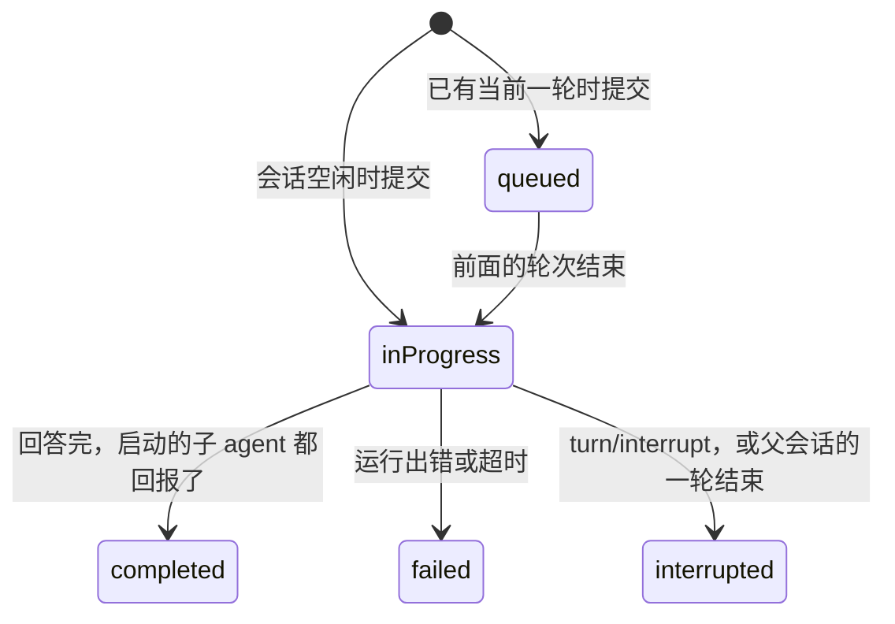
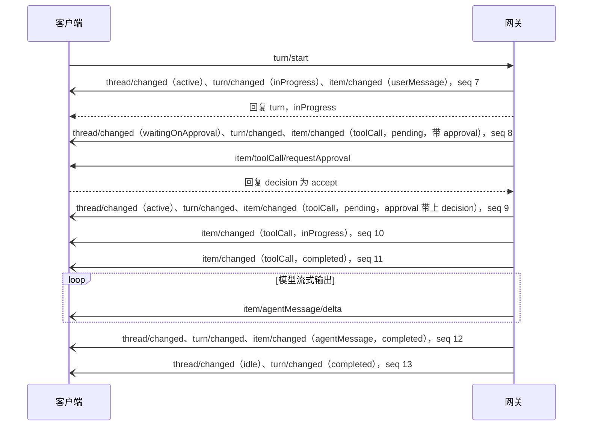
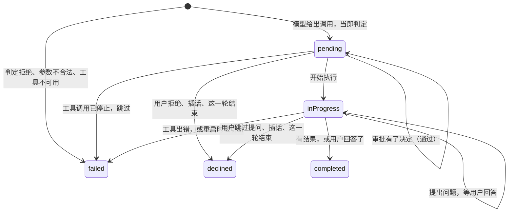

# 一轮与条目

一轮（turn）是交给 agent 的一件事：由一条用户消息开始，到 agent 给出回答为止。这一轮里的每一步，用户消息、回答、思考、工具调用、子 agent 的报告、压缩、记忆载入、运行时的提示、错误，都是一条条目（item）。客户端用 `turn/start`、`turn/steer`、`turn/interrupt` 驱动它，用 `turn/changed`、`item/changed` 和增量通知跟上它。

本页按引擎 v0.17.1 写。会话本身见[会话](/zh/integrate/protocol/threads)，审批和提问这两种要用户回答的服务端请求见[审批与提问](/zh/integrate/protocol/approvals)，怎样把通知合进本地状态见[写一个客户端](/zh/integrate/client#本地状态)。

## 概念与状态

轮次和条目都不单独保存：会话是一份只追加的日志，轮次和条目是从日志折叠出来的投影（`conversation.View`）。一次提交往日志里追加一条或几条记录，改变了哪些轮次和条目，就为它们各发一条 `turn/changed`、`item/changed`，带折叠之后的整行。机制见[持久化](/zh/engine/persistence)。

### 一轮的状态

一个会话里，第一个还没结束的轮次是当前一轮，其余没结束的排在它后面。同一时刻只有当前一轮在运行。

| `TurnStatus` | 含义 |
|---|---|
| `queued` | 没结束，排在当前一轮后面 |
| `inProgress` | 是当前一轮：在等槽位（slot）、在运行，或在等审批、回答、子 agent |
| `completed` | 正常结束 |
| `failed` | 失败，`error` 是原因 |
| `interrupted` | 被中断，`error` 是原因 |



`inProgress` 不区分"在跑"和"在等"。要知道这一轮是不是在等用户，看会话的 `status`（`waitingOnApproval`、`waitingOnUserInput`，见[会话状态](/zh/integrate/protocol/threads#会话状态)），或者看条目里有没有在等审批、等回答的调用。占不占槽位、什么时候让出，见[执行模型](/zh/engine/execution)。

::: info 演进
v0.12.1 的轮次有九个状态：`queued`、`ready`、`inProgress`、三种等待、三种结束，但只推送其中几种。v0.14.0 去掉了 `queued`、排队的轮次直接写成 `ready`（`07d497b`）；v0.16.0 从日志算状态，剩下现在这五个（`9b5b50b`），等待只看会话状态和条目。
:::

### 条目

条目按 `seq` 排序：`seq` 是条目在会话日志里第一次出现的位置，会话内唯一递增，但会跳号，因为日志里还有不成为条目的记录（轮次的开始和结束、模型回答的用量、审批的决定）。`updated` 是最近一次改动这个条目的那条记录的位置，条目没改过时等于 `seq`。这两个数都是会话日志里的位置，和通知的 `seq`（提交序号）不是一回事。

九种类型：

| `ItemKind` | 是什么 |
|---|---|
| `userMessage` | 用户的消息：开启一轮的那条、插话，或交给子 agent 的任务 |
| `agentMessage` | 模型的回答正文 |
| `reasoning` | 模型的思考内容 |
| `toolCall` | 一次工具调用；参数、执行内容、审批、提问、结果都在这一个条目里 |
| `agentReport` | 一个子 agent 的报告，写回启动它的那一轮 |
| `contextCompaction` | 一次上下文压缩，`text` 是摘要 |
| `memoryContext` | 这一轮载入的长期记忆快照，见[记忆](/zh/integrate/protocol/memory) |
| `notice` | 运行时对模型说的话，比如工具调用为什么停了，`text` 以 `[runtime]` 开头 |
| `error` | 一次模型调用失败的记录 |

五种状态：`pending`（只有工具调用：已记录，还没执行，或在等审批）、`inProgress`（只有工具调用：在执行，或在等用户回答）、`completed`、`failed`、`declined`（只有工具调用：被用户拒绝、跳过，或这一轮结束时还没执行）。除了工具调用，条目写下时就已经结束。每种类型的细节见下文 [ItemRow](#itemrow)。

::: info 演进
`agentReport` 来自 v0.14.0（`975de2e`），`notice` 来自 v0.16.0（`9b5b50b`）。v0.12.1 的 `agentMessage` 和 `reasoning` 在流式输出时就落库为 `inProgress`；现在回答结束才写下，流式期间只有增量。
:::

## 典型流程

本节的消息来自对着 v0.17.1 跑的一个最小宿主：`host.New` 配一个脚本化的假模型和一个非只读工具 `deploy`，审批策略为适中（`on-request`）。ID、时间和 `seq` 是当时的值，部分字段省略。

### 一次完整对话

发一条消息，模型调用要审批的 `deploy`，用户批准，模型回答：



几处细节：

- 每次提交都按 `thread/changed`、`turn/changed`、`item/changed` 的顺序发，带同一个 `seq`。图里后几次提交省略了前两条。
- 通知先于回复：`turn/start` 的回复排在这次提交的三条通知之后。客户端不能等回复到了再处理通知，见[写一个客户端](/zh/integrate/client#通知可能先于回复)。
- 工具调用写下时就已经判定过：要审批的调用第一次出现就带着 `approval`，审批请求紧跟在它的 `item/changed` 后面。
- 增量里的 `itemId` 指向一个还不存在的条目，模型回答完，这个条目才以 `completed` 出现，`text` 是完整的回答。带思考输出的模型会先来 `item/reasoning/textDelta`，最后和回答在同一次提交里多一条 `reasoning` 条目。
- `memoryContext` 条目只在用户开着记忆、角色会召回记忆、并且有记忆可载入时出现。

用户消息的条目：

```json
{"jsonrpc": "2.0", "method": "item/changed", "params": {
  "threadId": "cc3c2ce9-b688-4c61-b123-7b16135b5e55",
  "item": {"id": "ccf8ce97-...", "turnId": "85994ccc-05de-455b-9177-9d6abef8fb67",
           "seq": 2, "updated": 2, "type": "userMessage", "status": "completed",
           "text": "please deploy",
           "startedAt": "2026-11-18T12:14:11.30812Z", "completedAt": "2026-11-18T12:14:11.30812Z"},
  "seq": 7}}
```

### 排队

会话已有当前一轮时，`turn/start` 写下一个排在后面的轮次，回复里的 `turn.status` 是 `queued`。它的消息立刻作为一条 `userMessage` 条目写下：

```json
{"jsonrpc": "2.0", "id": 4, "method": "turn/start", "params": {
  "threadId": "69da4e3d-3ec6-4d1a-830b-86d98152b001",
  "input": [{"type": "text", "text": "hi again"}]}}
{"jsonrpc": "2.0", "method": "turn/changed", "params": {"threadId": "69da4e3d-...", "turn": {
  "id": "b113bbde-a33c-492d-80a1-9f5cc8d3288b", "threadId": "69da4e3d-...",
  "status": "queued", "model": {"name": "fake", "connection": "main"}, "agent": "full-main-agent",
  "usage": {"inputTokens": 0, "cachedInputTokens": 0, "cacheWriteInputTokens": 0, "outputTokens": 0},
  "responses": [], "queuedAt": "2026-11-18T12:14:51.189276Z"}, "seq": 42}}
{"jsonrpc": "2.0", "method": "item/changed", "params": {"threadId": "69da4e3d-...", "item": {
  "id": "9981b38c-...", "turnId": "b113bbde-...", "seq": 4, "updated": 4,
  "type": "userMessage", "status": "completed", "text": "hi again", "...": "..."}, "seq": 42}}
{"jsonrpc": "2.0", "id": 4, "result": {"turn": { "...": "同上，status 为 queued" }}}
```

每条消息各排一轮，一个会话最多 20 个排队的轮次，再发返回 `-32016`。前面的轮次结束时，排在最前的那一轮在同一次提交里变成 `inProgress`，客户端收到它的 `turn/changed`。协议里没有取消排队中一轮的方法。

### 插话

一轮还没结束时，用户想让它马上看到一条消息，用 `turn/steer`，必须带 `expectedTurnId`。消息作为一条新的 `userMessage` 条目写进当前一轮，接下来怎样取决于这一轮在做什么：

| 这一轮在 | 插话之后 |
|---|---|
| 运行或等槽位 | 不打断任何东西。下一次调模型时带上它；模型已经回答完时，这一轮会再调一次模型回应它，而不是结束 |
| 等审批 | 在等的审批都按拒绝记下（`decision` 为 `decline`，`decidedBy` 是用户），调用以 `declined` 结束，`error` 是 `the user declined this call`；这一轮接着跑，模型读到被拒的结果和这条消息，可以接着用工具 |
| 等回答 | 在等的提问都按跳过记下，调用以 `declined` 结束，`error` 是 `the user skipped these questions; go on without their answers`；这一轮接着跑 |
| 回答完在等子 agent | 这一轮马上再调一次模型回应这条消息，子 agent 照样在跑 |

插话代替审批时的通知，全部在 `turn/steer` 的回复之前到达，属于同一次提交：

```json
{"jsonrpc": "2.0", "id": 4, "method": "turn/steer", "params": {
  "threadId": "67eccc44-69c5-4844-9171-1e37778ce4fa",
  "expectedTurnId": "0037dfbb-2c77-4725-84fe-7f347174ecf9",
  "input": [{"type": "text", "text": "never mind, say hi"}]}}
{"jsonrpc": "2.0", "method": "thread/changed", "params": {"...": "status 为 active", "seq": 37}}
{"jsonrpc": "2.0", "method": "turn/changed", "params": {"...": "inProgress", "seq": 37}}
{"jsonrpc": "2.0", "method": "item/changed", "params": {"threadId": "67eccc44-...", "item": {
  "id": "53ecad31-be06-4fa9-95ad-aa62a374be1b", "seq": 4, "updated": 6,
  "type": "toolCall", "status": "declined", "tool": "deploy", "server": "ops",
  "error": "the user declined this call",
  "approval": {"approvalId": "d6eca61c-...", "suggestedRules": ["deploy"],
               "availableDecisions": ["accept", "acceptForSession", "acceptAlways", "decline"],
               "askedAt": "2026-11-18T12:14:45.391998Z",
               "decision": "decline", "decidedBy": "default", "decidedAt": "2026-11-18T12:14:45.393697Z"},
  "...": "..."}, "seq": 37}}
{"jsonrpc": "2.0", "method": "item/changed", "params": {"...": "userMessage，never mind, say hi", "seq": 37}}
{"jsonrpc": "2.0", "id": 4, "result": {"turnId": "0037dfbb-2c77-4725-84fe-7f347174ecf9"}}
```

之后再回复那条审批请求，网关发一条 `error` 通知，见[审批与提问](/zh/integrate/protocol/approvals#用一条消息代替回答)。客户端收到被拒调用的 `item/changed` 时就该关掉对应的审批界面。

插话会和这一轮的结束赛跑：用户按下发送时这一轮可能刚好结束，这时返回 `-32010` 或 `-32011`。桌面端遇到这两个错误时改用 `turn/start` 把消息作为新的一轮发出去。

::: info 演进
v0.12.1 的插话代替回答时，等着的调用以 `declined` 结束，`error` 写明是被消息取代的（`the user sent a message instead of approving this call, so it did not run`），`approval` 里没有 `decision`。v0.16.0 改成按拒绝和跳过记下，复用审批决定和提问跳过这两种记录（`9b5b50b`）。
:::

### 中断

`turn/interrupt` 在一个事务里结束当前一轮，所以回复到达之前，这一轮的 `turn/changed`（`interrupted`，`error` 为 `interrupted by the user`）已经发出：

| 这一轮在 | 结束时 |
|---|---|
| 运行（调模型、跑工具） | 调度器从变化里看到这一轮结束，取消这次运行：在途的模型请求和工具执行收到取消。正在流式输出的回答不会写下，客户端已经收到的增量要丢掉 |
| 等审批 | 在等的调用以 `declined` 结束，`error` 为 `interrupted by the user` |
| 等回答 | 在等的提问按跳过记下，调用以 `declined` 结束 |
| 等子 agent | 还没回报的子 agent 一并停下，各自的一轮以 `interrupted` 结束，`error` 为 `stopped with the turn that launched it`，并各给这一轮写一条 `failed` 的 `agentReport` |

还没结束的其他调用也以 `declined` 结束，`error` 为 `interrupted by the user`。排在后面的下一轮在同一次提交里成为当前一轮。实测，中断一个正在流式输出的轮次：

```json
{"jsonrpc": "2.0", "id": 5, "method": "turn/interrupt", "params": {"threadId": "69da4e3d-...", "turnId": "bbddf2bc-1bb4-474c-bf47-70696dfb2740"}}
{"jsonrpc": "2.0", "method": "thread/changed", "params": {"...": "status 仍是 active，后面还有一轮", "seq": 43}}
{"jsonrpc": "2.0", "method": "turn/changed", "params": {"...": "bbddf2bc-...，interrupted，error 为 interrupted by the user", "seq": 43}}
{"jsonrpc": "2.0", "method": "turn/changed", "params": {"...": "b113bbde-...，排队的那一轮变成 inProgress", "seq": 43}}
{"jsonrpc": "2.0", "id": 5, "result": {}}
```

## 方法

### turn/start

提交一条消息。会话空闲时它成为当前一轮，否则排队。

| 参数 | 类型 | 说明 |
|---|---|---|
| `threadId` | string | 顶层会话 |
| `input` | `UserInput[]` | 消息的各部分，见下 |
| `connection?` | string | 用哪个模型，取 `model/list` 里的 `connection`。省略时沿用这个会话上一轮的模型；会话还没有轮次时用第一个模型 |

`input` 里每一项是 `UserInput`：

| `type` | 字段 | 行为 |
|---|---|---|
| `text` | `text` | 多段文本用换行连接，去掉首尾空白。估算的 token 数不能超过这个模型输入上限的 25%（至少 256）；长文本应作为文件附件发 |
| `file` | `path`、`name?`、`mimeType?` | `path` 必须是用户沙箱里的绝对路径。引擎从沙箱读这个文件，复制一份进附件存储；`name` 默认取文件名 |

附件最多 10 个；图片（PNG、JPEG、GIF、WebP，按内容判断）最大 20 MiB，UTF-8 文本文件最大 256 KiB，其他文件不收。文本和附件不能都为空。协议里没有上传文件内容的方法，客户端和用户的沙箱不在一台机器上时，文件要先用别的途径放进沙箱。附件存储接口见[扩展点](/zh/integrate/extend#附件存储)。

结果：`{turn: TurnRow}`，`status` 是 `inProgress`（成为当前一轮）或 `queued`（排在后面）。回复之前已经发出这一轮的 `turn/changed`、这条消息的 `item/changed` 和会话的 `thread/changed`。

| 错误 | 什么时候 |
|---|---|
| `-32602` | `input` 里有别的 `type`；文本和文件都为空；文本太长；附件超过 10 个、太大、是空文件、既不是支持的图片也不是文本、路径不是绝对路径或读不到；`connection` 不存在；模型不收图片而消息或这个会话里已经有图片 |
| `-32004` | 会话不存在 |
| `-32013` | 子 agent 会话，不接受输入 |
| `-32015` | 会话已归档 |
| `-32014` | 会话所在的工作区已归档 |
| `-32016` | 已经有 20 条消息在排队；或会话所在的工作区正在移动 |
| `-32000` | 附件写进附件存储失败（详情只在服务端） |

定时任务到点时引擎自己提交一轮，和 `turn/start` 走同一条路，`TurnRow.cronJobId` 写着任务 ID，见[定时任务](/zh/integrate/protocol/cron)。

::: info 演进
v0.12.1 的文本上限是固定的 4000 个字符；现在按模型的输入上限估算（`fits`）。v0.15.0 的回复带过一个 `submission`（`started`、`queued`、`joined`），v0.16.0 去掉了它，由 `turn.status` 表示（`9b5b50b`）。
:::

### turn/steer

把一条消息写进当前一轮，见上文[插话](#插话)。

| 参数 | 类型 | 说明 |
|---|---|---|
| `threadId` | string | 顶层会话 |
| `input` | `UserInput[]` | 同 `turn/start` |
| `expectedTurnId` | string | 必填，客户端以为在进行中的那一轮 |

结果：`{turnId}`，就是当前一轮的 ID。回复之前已经发出这条消息的 `item/changed`；这一轮在等审批或提问时，还有被拒或被跳过的调用的 `item/changed`。

| 错误 | 什么时候 |
|---|---|
| `-32602` | 没给 `expectedTurnId`；`input` 不合法（同 `turn/start`）；当前一轮的模型不收图片而消息带图片 |
| `-32004` | 会话不存在 |
| `-32013` | 子 agent 会话 |
| `-32010` | 会话没有当前一轮 |
| `-32011` | `expectedTurnId` 不是当前那一轮 |

### turn/interrupt

结束当前一轮，见上文[中断](#中断)。

| 参数 | 类型 | 说明 |
|---|---|---|
| `threadId` | string | 会话，子 agent 会话也可以 |
| `turnId` | string | 必填，要停的那一轮 |

结果：`{}`，这一轮已经结束。

| 错误 | 什么时候 |
|---|---|
| `-32602` | 没给 `turnId` |
| `-32004` | 会话不存在 |
| `-32010` | 会话没有当前一轮，包括这一轮已经结束 |
| `-32011` | `turnId` 不是当前那一轮，包括它还在排队 |

### attachment/read

取回一个附件的内容。

| 参数 | 类型 | 说明 |
|---|---|---|
| `threadId` | string | 附件所在的会话，子 agent 会话也可以 |
| `attachmentId` | string | `Attachment.id` |

结果：`{attachment: Attachment, data}`，`data` 是文件内容的 base64。

接近 20 MiB 的图片 base64 之后约 27 MiB，超过 16 MiB 的出站队列上限；这条回复只有在队列空着时才能单独发出，否则连接以 1008 关闭，见[传输](/zh/integrate/protocol#传输)。

| 错误 | 什么时候 |
|---|---|
| `-32004` | 会话或附件不存在，或附件不在这个会话的条目里 |
| `-32000` | 附件存储读取失败（详情只在服务端） |

## 通知

`turn/changed` 和 `item/changed` 带的是提交之后的完整行，客户端按 `id` 整行替换，不用自己推导字段变化。子 agent 会话的轮次和条目也走这些通知，`threadId` 是子会话的 ID。

### turn/changed

载荷是 `TurnChangedNotification`：`{threadId, turn: TurnRow, seq}`。

一次提交给某一轮追加了记录、或让它成为当前一轮时发：提交、开始、每一步、结束，排在后面的一轮成为当前一轮时也发。`turn.usage` 和 `turn.responses` 随每次模型回答增长。结束的那一次 `status` 是 `completed`、`failed` 或 `interrupted`，`completedAt` 有值。

### item/changed

载荷是 `ItemChangedNotification`：`{threadId, item: ItemRow, seq}`。

一次提交新建或改动了某个条目时发。同一个条目会收到多次：工具调用每走一步一次。也会收到内容没变的重复通知，比如子 agent 回报时，启动它的那个调用条目会随报告一起再发一次，`updated` 不变。客户端以 `updated` 判断新旧：本地的 `updated` 更大时保留本地的。

### item/agentMessage/delta 和 item/reasoning/textDelta

载荷都是 `DeltaNotification`：`{threadId, turnId, itemId, delta}`。模型流式输出回答正文时走前者，输出思考内容时走后者：

```json
{"jsonrpc": "2.0", "method": "item/agentMessage/delta", "params": {
  "threadId": "f47f9c37-315b-493b-8446-d2a84fc471fc",
  "turnId": "f036a322-e63a-4e7e-bb52-322e21e7c804",
  "itemId": "d54b35f9-8ea0-4bf2-8ae1-ad241f2d2370",
  "delta": "Hello"}}
```

增量不进日志，没有 `seq`，不补发。`itemId` 是模型回答完之后这段文字将要成为的那个条目的 ID：回答完时，同一个 ID 的条目以 `completed` 出现在 `item/changed` 里，`text` 是完整的文字，客户端用它覆盖拼出来的文本。在那之前本地没有这个条目，客户端要自己建一个临时的来接增量。

这段文字也可能永远不成为条目：模型调用失败时写下的是一条 `error` 条目（另一个 ID），这一轮被中断时什么也不写。所以这一轮结束、或出现 `error` 条目时，客户端要丢掉这一轮还没落成条目的临时文本。增量经过脱敏的缓冲，切分和模型给的不一定相同，以最后的条目为准。

### error

载荷是 `ErrorNotification`：

| 字段 | 类型 | 说明 |
|---|---|---|
| `threadId?` | string | |
| `turnId?` | string | |
| `itemId?` | string | |
| `message` | string | 错误原文，不在错误表里的错误只有一句固定的话 |

它只在一种情况下发：客户端对服务端请求的回答没有生效，比如回复解析不了、决定或答案不合法、请求已经失效。三个 ID 都有，指向那次调用。各种情况网关怎样处理见[审批与提问](/zh/integrate/protocol/approvals#回复的结果)。

模型调用失败不走这条通知，而是记成 `error` 条目，并让这一轮 `failed`。

::: info 演进
v0.12.1 的轮次走 `turn/queued`、`turn/started`、`turn/completed` 三种通知，带 `thread` 整行；条目走 `item/started`、`item/updated`、`item/completed`；`error` 还用来报 agent 内部故障。v0.16.0 换成从提交来的 `turn/changed`、`item/changed`，带 `seq`，内部故障不再通知客户端（`9b5b50b`）。
:::

## 类型

`?` 表示字段可能不出现：Go 端用 `omitempty`，空字符串、`0`、`false`、空数组都不发，客户端把"缺"当成零值。时间都是 RFC 3339 的 UTC 字符串，带纳秒。

### TurnRow

| 字段 | 类型 | 说明 |
|---|---|---|
| `id` | string | 轮次 ID |
| `threadId` | string | 所属会话 |
| `status` | `TurnStatus` | 见[一轮的状态](#一轮的状态) |
| `model` | `Model` | 这一轮用的模型，提交时选定，见[模型、工具与 MCP](/zh/integrate/protocol/models-tools) |
| `agent` | `AgentRole` | 跑这一轮的角色：`full-main-agent`、`compact-main-agent`（按模型的输入上限选）、`general-sub-agent`、`browser-sub-agent` |
| `usage` | `Usage` | 这一轮所有模型回答的用量之和，包括压缩 |
| `responses` | `ResponseRow[]` | 这一轮的每次模型回答，按顺序 |
| `error?` | string | 失败或中断的原因 |
| `cronJobId?` | string | 由定时任务发出时，是那个任务的 ID |
| `queuedAt` | string | 提交时间 |
| `completedAt?` | string \| null | 结束时间 |

这一轮的消息不在行里：它是这一轮的第一条 `userMessage` 条目，附件也在那条条目上。`TurnResult` 是 `{turn}`，`TurnSteerResult` 是 `{turnId}`。

### ResponseRow

一次模型回答。条目的 `responseId` 指向它。

| 字段 | 类型 | 说明 |
|---|---|---|
| `id` | string | 回答 ID |
| `usage` | `Usage` | 这次回答的用量，服务商没报告时全是 0 |
| `contextStats` | `ContextStats` | 发出这次请求时的上下文统计 |

### Usage

| 字段 | 类型 | 说明 |
|---|---|---|
| `inputTokens` | integer | 输入 token，服务商报告的值 |
| `cachedInputTokens` | integer | 其中命中前缀缓存的 |
| `cacheWriteInputTokens` | integer | 其中写入缓存的，同样计在 `inputTokens` 里 |
| `outputTokens` | integer | 输出 token |

### ItemRow

| 字段 | 类型 | 说明 |
|---|---|---|
| `id` | string | 条目 ID |
| `turnId` | string | 所属轮次。条目里没有 `threadId`，它在通知外层 |
| `seq` | integer | 条目在会话日志里第一次出现的位置，用来排序和翻页 |
| `updated` | integer | 最近一次改动它的记录的位置，用来判断新旧 |
| `type` | `ItemKind` | 见[条目](#条目) |
| `status` | `ItemStatus` | 见下表 |
| `text?` | string | 正文，含义随类型不同 |
| `error?` | string | 失败或被拒的原因 |
| `responseId?` | string | 产生它的那次模型回答，对应 `TurnRow.responses` 里的一项 |
| `callId?` | string | 模型给这次工具调用的 ID，只在 `toolCall` 上 |
| `tool?` | string | 工具名，只在 `toolCall` 上 |
| `server?` | string | 工具的提供方，见[模型、工具与 MCP](/zh/integrate/protocol/models-tools) |
| `arguments?` | string | 工具调用参数的 **JSON 文本**，要客户端自己解析；审批请求里的 `arguments` 才是 JSON 对象 |
| `annotations?` | JSON | 记录这次调用时工具注解的快照 |
| `preparedExecution?` | `PreparedExecution` \| null | 判定时算出的执行内容，见[审批与提问](/zh/integrate/protocol/approvals#preparedexecution) |
| `approval?` | `Approval` \| null | 审批记录，只在要审批的 `toolCall` 上 |
| `input?` | `Input` \| null | 提问记录，只在 `request_user_input` 上，见[审批与提问](/zh/integrate/protocol/approvals#input) |
| `result?` | `Result` \| null | 工具或子 agent 的结果 |
| `childThreadId?` | string | 启动子 agent 的调用和 `agentReport` 上：子会话的 ID |
| `launchItemId?` | string | `agentReport` 上：启动它的那次调用 |
| `attachments?` | `Attachment[]` | 用户消息的附件 |
| `contextStats?` | `ContextStats` \| null | 只在 `contextCompaction` 上：压缩请求的上下文统计 |
| `memory?` | `MemoryReference[]` | 只在 `memoryContext` 上：快照里的记忆，见[记忆](/zh/integrate/protocol/memory) |
| `startedAt` | string | |
| `completedAt?` | string \| null | |

各类型用到的字段：

| `type` | 状态 | 设置的字段 |
|---|---|---|
| `userMessage` | 写下即 `completed` | `text`、`attachments?` |
| `agentMessage` | 写下即 `completed` | `text`、`responseId`。流式期间只有增量 |
| `reasoning` | 写下即 `completed` | `text`、`responseId`；`startedAt` 是开始思考的时刻，`completedAt` 是开始回答的时刻 |
| `toolCall` | 见下文 | `callId`、`tool`、`server`、`arguments`、`annotations`、`responseId`，按需有 `preparedExecution`、`approval`、`input`、`result`、`childThreadId`、`error` |
| `agentReport` | `completed` 或 `failed` | `text` 是交给子 agent 的任务，`childThreadId`、`launchItemId`；完成时 `result.output` 是子 agent 最后的回答（JSON 字符串），失败时 `error` 是原因 |
| `contextCompaction` | 写下即 `completed` | `text` 是压缩摘要，`responseId`、`contextStats`。机制见[上下文管理](/zh/engine/context) |
| `memoryContext` | 写下即 `completed` | `text` 和 `memory` 是这一轮载入的记忆快照。压缩之后会再载入一次 |
| `notice` | 写下即 `completed` | `text` 以 `[runtime]` 开头，比如用户拒绝了一次调用、调用次数到了上限之后，要模型不再用工具、直接回答 |
| `error` | 写下即 `failed` | `error` 是模型调用失败的原因。之后这一轮以 `failed` 结束 |

一条完成的回答：

```json
{
  "id": "d54b35f9-8ea0-4bf2-8ae1-ad241f2d2370",
  "turnId": "f036a322-e63a-4e7e-bb52-322e21e7c804",
  "seq": 5,
  "updated": 5,
  "type": "agentMessage",
  "status": "completed",
  "text": "Hello, world.",
  "responseId": "4f136860-3073-45b6-a26d-3ac7d3493818",
  "startedAt": "2026-11-18T12:14:04.407508Z",
  "completedAt": "2026-11-18T12:14:04.407508Z"
}
```

#### toolCall 的生命周期



- **记录和判定。** 模型给出调用时，引擎当即算出执行内容（有两段式实现的工具，比如命令和改文件），按权限规则判定，和调用一起在一次提交里写下。直接放行的调用是 `pending`；要问用户的同时带上 `approval`（没有 `decision`），发 `item/toolCall/requestApproval`；被拒绝、参数解析不了、工具不可用的直接以 `failed` 写下，`error` 写原因。执行内容写下后不再改变，审批的就是它，见[审批前冻结](/zh/engine/tools)。
- **审批。** "在等审批"的条件是：`toolCall`、`pending`、`approval` 存在且没有 `decision`。批准后 `approval` 带上 `decision`、`decidedBy`、`decidedAt`，状态仍是 `pending`，等这一轮跑到它。拒绝时直接 `declined`。见[审批与提问](/zh/integrate/protocol/approvals)。
- **执行。** 开始执行时变成 `inProgress`。连续的只读调用一起执行，最多 8 个。
- **提问。** `request_user_input` 执行后不马上出结果，而是写入 `input`，状态仍是 `inProgress`，发 `item/tool/requestUserInput`。"在等回答"的条件是：`toolCall`、`inProgress`、`input` 存在且 `answered` 为 `false`。回答后直接 `completed`，答案成为 `result.output`。
- **子 agent。** 子 agent 工具执行时建子会话，调用当即 `completed`，`childThreadId` 和 `result.output`（`SubagentLaunched`）指向子会话，见[子 agent 会话](/zh/integrate/protocol/threads#子-agent-会话)。
- **结束。** `completed` 时 `result.output` 是工具输出。`failed` 时 `error` 写原因。

`declined` 和跳过的几种来源，靠 `error` 区分：

| 来源 | `error` |
|---|---|
| 用户在审批时选 `decline`，或等审批时插话 | `the user declined this call` |
| 用户跳过提问，或等回答时插话、中断 | `the user skipped these questions; go on without their answers` |
| 这一轮被中断时还没结束的其他调用 | `interrupted by the user` |
| 这一轮因别的原因结束时还没结束的调用 | 结束的原因；没有原因时是 `the turn ended before the call did` |
| 工具调用已停止后剩下的调用（`failed`） | `skipped: ` 加上停止的原因 |

用户显式拒绝或跳过之后，这一轮剩下的工具调用都不再执行：运行时写一条 `notice` 告诉模型工具调用已停止，让它直接回答。插话的拒绝和跳过不会这样，因为用户的新消息在后面，模型可以接着用工具。

进程重启时，已经开始执行、还没有结果的调用不会重跑，而是以 `failed` 结束，`error` 提示它可能已经部分或全部生效、先核实再重试，见[持久化](/zh/engine/persistence)。

内置工具的 `arguments` 和 `result.output` 的结构见[模型、工具与 MCP](/zh/integrate/protocol/models-tools)。

### UserInput

| 字段 | 类型 | 说明 |
|---|---|---|
| `type` | string | `text` 或 `file` |
| `text?` | string | `text` 时的文本 |
| `path?` | string | `file` 时用户沙箱里的绝对路径 |
| `name?` | string | `file` 时的文件名，默认取路径里的名字 |
| `mimeType?` | string | `file` 时文本文件的类型；不给或不是 `text/*`、`application/json` 时记为 `text/plain`。图片的类型按内容判断 |

`TurnStartParams` 是 `{threadId, input, connection?}`，`TurnSteerParams` 是 `{threadId, input, expectedTurnId}`，`TurnInterruptParams` 是 `{threadId, turnId}`。

### Attachment

| 字段 | 类型 | 说明 |
|---|---|---|
| `id` | string | 附件 ID，`attachment/read` 用它取回内容 |
| `kind` | string | `image` 或 `file`（文本文件） |
| `name` | string | 文件名，最多 120 个字符 |
| `mimeType` | string | |
| `size` | integer | 字节数 |
| `file` | string | 在附件存储里的键，形如 `<会话 ID>/<附件 ID>.txt`。客户端不需要用它 |
| `width?`、`height?` | integer | 图片的像素尺寸 |
| `tokens` | integer | 发给模型时估算的 token |

附件在 `userMessage` 条目的 `attachments` 上。`AttachmentReadParams` 是 `{threadId, attachmentId}`，`AttachmentReadResult` 是 `{attachment, data}`。

### ContextStats

一次模型请求的上下文预算和各部分的估算。出现在 `ResponseRow.contextStats` 和 `contextCompaction` 条目上，界面的上下文面板读它。

| 字段 | 类型 |
|---|---|
| `model?` | string |
| `budgetTokens` | integer |
| `compactAtTokens` | integer |
| `systemTokens` | integer |
| `messagesTokens` | integer |
| `memoryTokens?` | integer |
| `globalMemory?`、`localMemory?` | `MemoryStats`：`tokens` 加上进入快照的记忆 ID 列表 `ids` |
| `toolsTokens` | integer |
| `estimatedTokens` | integer |
| `calibratedTokens?` | integer |

各字段的含义和算法见[上下文管理](/zh/engine/context)。

### Result 和 Artifact

`Result` 是工具调用或子 agent 报告的结果：

| 字段 | 类型 | 说明 |
|---|---|---|
| `output` | 任意 JSON | 工具输出、提问的答案（`UserInputAnswers`）、`SubagentLaunched`，或子 agent 的回答。内置工具的结构见[模型、工具与 MCP](/zh/integrate/protocol/models-tools)，其余工具的结构不进契约 |
| `artifacts?` | `Artifact[]` | 要留在上下文里的内容，比如激活的技能：`kind`、`name`、`content` |

带 `artifacts` 的结果在上下文压缩之后仍然发给模型。

### 通知的包装

| 类型 | 字段 |
|---|---|
| `TurnChangedNotification` | `threadId`、`turn`、`seq` |
| `ItemChangedNotification` | `threadId`、`item`、`seq` |
| `DeltaNotification` | `threadId`、`turnId`、`itemId`、`delta` |
| `ErrorNotification` | `threadId?`、`turnId?`、`itemId?`、`message` |

## 错误与边界

- **轮次的等待不单独推送。** `inProgress` 涵盖运行和等待；要显示"在等审批"，看会话的 `status` 和条目。
- **增量会丢。** 断线期间的增量不补发；重连后读到的页里没有正在流式输出的回答，等它的 `item/changed`。
- **排队的轮次取消不了。** 只能等它成为当前一轮再中断。
- **中断立刻生效，执行不一定立刻停。** 轮次在中断的事务里就结束了，但在途的工具要响应取消才会停；工具不理会取消时，它的副作用可能仍会发生，结果不会写下。
- **插话代替回答只看提交那一刻。** 插话写入的同一个事务里判断哪些调用在等用户；回复之前审批刚好被回答了，插话就只是一条普通消息。
- **大附件读回受出站队列影响。** 见 [attachment/read](#attachment-read)。

## 代码位置

| 仓库 | 路径 | 职责 |
|---|---|---|
| ollupi | `gateway/threads.go` | `turn/*`、`attachment/read` 的处理函数，`input`：`UserInput` 转成消息 |
| ollupi | `gateway/server.go` | 变化到 `turn/changed`、`item/changed`、增量通知的映射 |
| ollupi | `gateway/wire.go` | `TurnRow`、`ItemRow`、`turnRow`（状态的映射）、`itemRow` |
| ollupi | `app/turns.go` | `Send`、`Steer`、`Interrupt`、`fits`、排队上限 |
| ollupi | `app/attachments.go` | 附件的读取、判断类型、上限、`ReadAttachment` |
| ollupi | `conversation/entry.go`、`conversation/view.go` | 日志记录的种类，折叠成轮次和条目，`ItemKind`、`ItemStatus` |
| ollupi | `agent/agent.go` | `Next`：下一步做什么，工具调用什么时候停 |
| ollupi | `run/model.go` | 调模型、发增量、写下回答和调用 |
| ollupi | `run/tools.go` | 判定、执行、子 agent 的启动 |
| ollupi | `run/end.go` | `End`：结束一轮，关掉没结束的调用，停下子 agent |
| ollupi-desktop | `packages/core/src/timeline.ts` | 把轮次、条目和增量合进本地状态的参照实现 |
