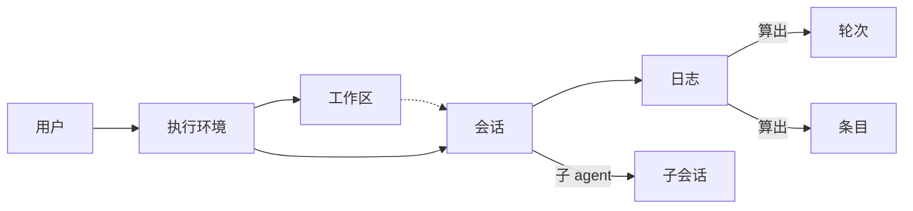

# 核心概念

Ollupi 的数据按四层组织：用户拥有工作区，工作区下有会话，会话由一轮一轮组成，每一轮产生一串条目。会话的轮次和条目并不单独保存：每个会话是一份只追加的日志，轮次和条目都是从日志算出来的。

## 工作区（workspace）

某个执行环境里的一个项目文件夹：桌面端是本机的文件夹，云端是用户那台沙箱机器里的路径。工作区属于添加它的环境，里面的会话也在那个环境里运行。工具在这里读写文件、执行命令，权限规则可以按工作区设置。会话可以属于一个工作区，也可以不属于任何工作区（general）。工作区只能归档、不能删除；归档后不能在里面开新会话，里面的会话也不能再发消息。

工作区有两种：项目工作区，和一种叫 hub 的工作区，用来汇总用户的所有项目，见下面的[中枢](#中枢-hub)。工作区还可以带一份自己的说明（项目的规矩、要避开什么）和一组开关，说明会随每个会话的指令一起交给模型。

## 执行环境（environment）

会话的命令和文件工具在哪里运行。部署提供几种沙箱，比如这台机器，或一家云沙箱服务；每个执行环境是其中一种的一个沙箱，第一次用到时才建出来，之后这个环境里的会话共用它。每个用户建出来时就有第一个环境，删不掉，还可以自己再开。会话开始时定下环境，之后不再改变：在工作区里的会话用工作区的环境，不在工作区的用选的那个，不选时用第一个；子 agent 跟随父会话。见[提供者与执行环境](/zh/engine/sandbox#提供者与执行环境)和[网关协议](/zh/integrate/protocol/workspaces#执行环境的方法)。

## 会话（thread）

一段连续的对话。子 agent 和定时任务用的也是普通会话，引擎没有为它们设特殊运行机制。

会话的状态：

| 状态 | 含义 |
|---|---|
| 空闲 | 没有没结束的轮次 |
| 进行中 | 有轮次没结束，而且不在等用户 |
| 等审批 | 当前轮次有调用在等用户批准 |
| 等回答 | 当前轮次有问题在等用户回答 |

子 agent 在等用户批准或回答时，父会话也显示为在等，两种都有时先显示等审批；所以用户从会话列表就能看到哪里在等自己。

## 日志

每个会话是一份只追加的日志：用户发了一条消息、模型回答了一段话、一次工具调用被提出、被批准、开始执行、给出结果，每件事都是日志里新的一条记录，写下之后不再修改。轮次处在什么状态、在等什么、下一步该做什么，都从日志算出来，内存里不留调度状态。

日志带来三条规矩：

- **先写再做。** 每一步先把要做的事追加进日志，再去执行。进程在任何时刻被杀，重启后读日志就知道每个会话做到了哪里，同一套逻辑接着往下走。
- **写之前检查。** 每条记录在写进日志前都要检查它能不能接在当前的日志后面：已结束的轮次不能再加东西，只有在等批准的调用才能被批准，等等。不能接上就整笔拒绝。
- **写完再通知。** 一次写入提交之后，它带来的变化才发给界面、调度和记忆提炼；同一次提交的变化共用一个序号，客户端据此丢掉过时的通知。写的一方不直接通知任何人。

## 轮次（turn）

交给 agent 的一件事，是一轮。它有三个来源：用户发了一条消息、定时任务到点、父会话启动了一个子 agent。一轮可能调用多次模型和工具。

同一个会话同一时间只运行一轮。会话忙时新的消息各自成为一轮，排在后面，最多排 20 轮；想把话说给正在跑的那一轮，用插话，消息会加进当前轮次，agent 在下一步读到。

| 状态 | 含义 | 占槽位 |
|---|---|---|
| 排队中 | 排在同一会话没结束的轮次后面 | 否 |
| 进行中 | 会话的当前轮次 | 只在真正运行时占；等审批、等回答、等子 agent 时让出 |
| 已完成 / 失败 / 被中断 | 结束 | 否 |

进行中的轮次在做什么，看它的条目：有调用在等审批或等回答，它就在等用户；它已经回答了、但启动的子 agent 还没都交回报告，它就在等子 agent；都不是，它就可以运行，等一个空闲槽位。运行出错或超过时限（默认四小时）的轮次以失败结束。

状态怎么转换、谁让轮次前进，见[执行模型](/zh/engine/execution)。

## 条目（item）

一轮里的每一步都是一条条目，界面的时间线就是条目列表。一条条目由日志里的一条或几条记录算出来：比如一次工具调用，从提出、等批准、开始执行到给出结果，在日志里是好几条记录，在时间线上是一条条目。

| 类型 | 内容 |
|---|---|
| 用户消息 | 开启一轮的消息、插话，或交给子 agent 的任务 |
| 回答 | 模型给用户的回复 |
| 思考 | 模型的思考过程 |
| 工具调用 | 一次工具调用，参数、审批、提问和结果都在这一条上 |
| 子 agent 报告 | 一个子 agent 交回给启动它的那一轮的报告 |
| 上下文压缩 | 一次压缩留下的摘要 |
| 记忆 | 这一轮载入的记忆 |
| 提示 | 运行时告诉模型的话，比如工具为什么停了 |
| 错误 | 模型调用失败 |

条目有自己的状态：待执行、执行中、完成、失败、被拒绝。待执行和执行中的区别决定了重启后工具会不会重做：还没开始的调用照常执行；已经开始、还没有结果的调用可能已经生效，重启后记为被切断，agent 被提示先核实再决定要不要重试，绝不会自动执行两次。

## 槽位（slot）

会话池的并发单位。一个会话要运行它的当前轮次，先要拿到一个槽位，默认一共 32 个；宿主还可以限制一个用户最多同时占几个。等待中的轮次让出槽位，所以槽位数限制的是同时在跑的轮次，不是会话总数。槽位不够时，用户自己的会话排在子 agent 前面，同类按变得可以运行的先后排。

模型调用另有一层限制：按模型连接算，默认每连接 4 个。工具执行不占这个名额。

## 分片（shard）

一个数据库是一个分片，一个分片里有多个用户，共用同一组表，数据按用户隔离。同一时间只有一个进程持有分片的租约，进程死后备用进程接管。分片数决定容量。桌面端只有一个分片和一个默认用户。详见[多用户与分片](/zh/engine/sharding)。

## 审批和提问

工具调用可能需要用户批准，agent 也可以向用户提结构化的问题。这两种情况下轮次都会让出槽位，用户批准、拒绝或回答之后又可以运行。提问可以跳过，agent 不带答案接着做。详见[权限与审批](/zh/engine/permissions)。

## 子 agent

父会话里的一次工具调用启动的子任务。子 agent 是一个普通会话，它的轮次和其他轮次一起排队，只是优先级低于用户自己的会话；用户也可以直接给它发消息，它不能再启动子 agent。

引擎按任务种类分角色：主 agent 有完整和精简两个，hub 有一个，子 agent 有八个——通用、浏览器、设计、代码库、前端、后端、写作、调研。角色决定这段会话拿到哪些工具、用哪套规则、能调多少次：代码库、后端、调研三种放宽到 400 次模型调用、1200 次工具调用，其余是 200 次和 400 次；任何角色连续失败 10 次就结束。角色只改规则和工具，运行方式都一样。

启动立即返回，子 agent 和父会话同时运行。它结束时把报告作为一条条目写回启动它的那一轮；父轮次回答完之后，等它启动的子 agent 都交回报告再接着回答，等的时候不占槽位；期间用户插话，它先回话再接着等。

## 待办（todo）

用户自己的一份清单，不属于任何会话，会话关了它还在。一条待办有标题、备注、状态和一行结果，状态是未完成、已交给会话、已完成、已放弃；标题最多 200 字、备注 2000 字、结果 500 字。待办可以链到一个会话，链上之后状态变成已交给会话。待办由 hub 的 agent 维护，见[中枢](#中枢-hub)与[待办](/zh/integrate/protocol/todos)。

## 中枢（hub）

一种工作区，用来在一处规划所有项目上的工作。部署时打开 hub，一个用户最多有一个 hub 工作区，想换一个得先把现有的改回项目工作区。在 hub 工作区里的会话由 hub 主 agent 回答：它不做某个项目的活，带的工具里没有子 agent 和浏览器，多出五个——列出工作区、在某个项目工作区里开新会话、给已有会话发消息、列会话状态、读会话最近几轮，另外三个维护用户的待办。它替用户把一件事交给某个项目，之后靠读那些会话判断做到哪里。见[中枢](/zh/engine/hub)。

## 记忆和技能

记忆是后台从已结束的轮次里提炼出的长期信息，分偏好、决定、流程、事实四类。每个用户有两个开关：记忆关着时会话既不载入也不搜索记忆；学习关着时照常使用已有记忆，只是不再从新的轮次里提炼。见[记忆](/zh/engine/memory)。

技能是一个含 `SKILL.md` 的文件夹，按 agent 的种类分别安装，agent 按需激活，见[技能与 MCP](/zh/engine/skills-mcp)。

## 相关页面

更多术语见[术语表](/zh/reference/glossary)。
