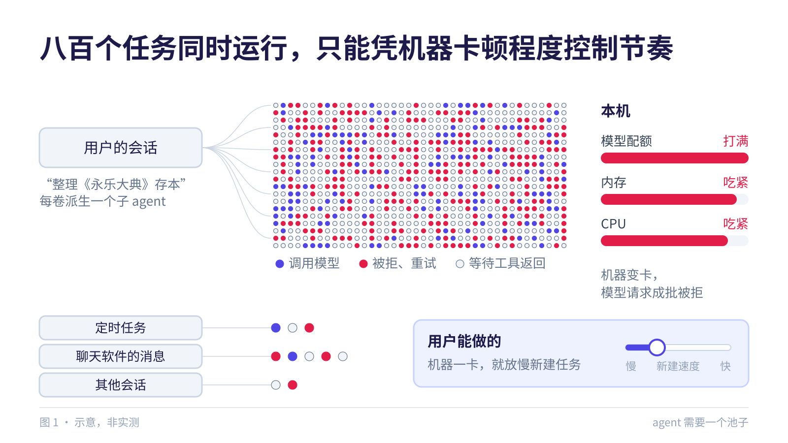
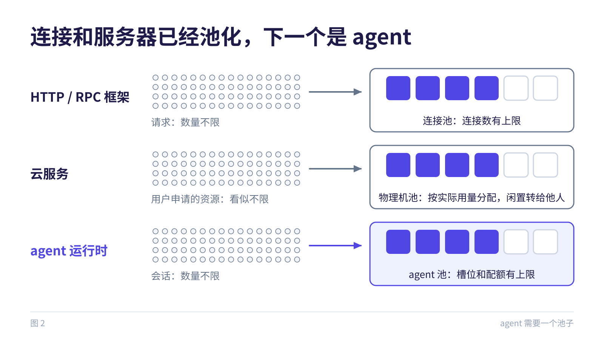
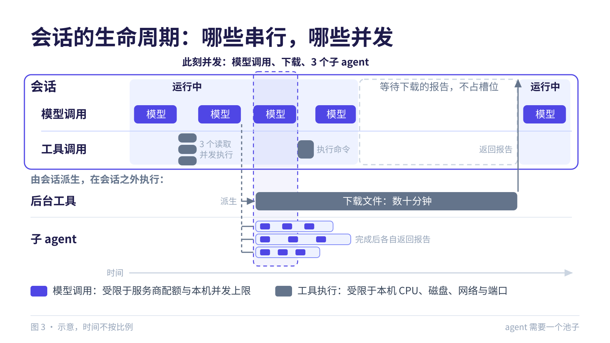
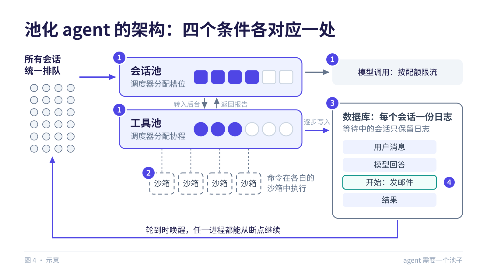
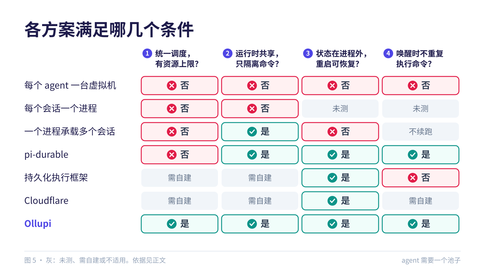
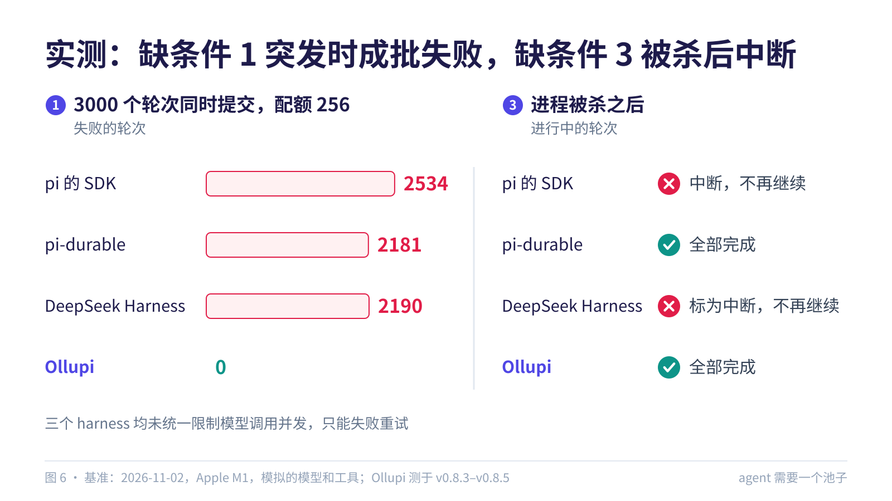
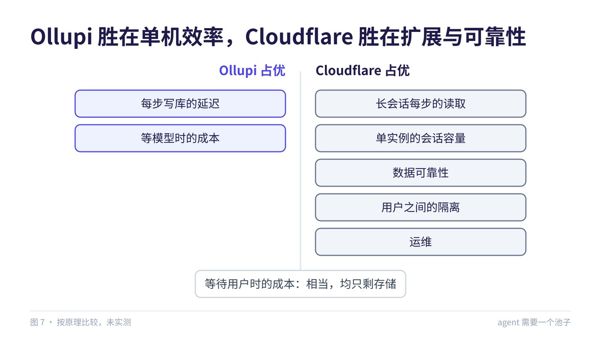

# agent 需要一个池子

agent 将以成百上千的规模同时运行，既在个人电脑上，也在云平台上。机器和模型配额有限，人的想法和需求却没有上限；某一时刻该运行哪些 agent，用户无法逐个决定，主 agent 也无法准确判断。网络连接和服务器遇到过同样的问题，解法都是池化。agent 同样需要池化，但会话比连接复杂，池化要满足四个条件，现有方案都至少缺一条。Ollupi 是只为这四个条件设计的运行时。

## 问题：agent 的数量超出人工调度的能力

设想交给 agent 一个任务：整理《永乐大典》的存世部分。存世的八百余卷散藏于八个国家的三十多家机构。agent 为每一卷派生一个子 agent，负责查找、下载、识别和校对扫描件，共八百多个会话（thread）。同一台电脑上还有定时任务、聊天软件的消息和其他会话。

这些会话同时启动，争抢同一份模型配额、内存和 CPU：模型请求成批被拒、反复重试，机器越来越卡。某一时刻运行哪些会话，由谁决定？

- **用户决定**：用户看不到配额和内存的余量，只能根据机器的卡顿程度，手动放慢新建任务的速度。既不精确，也增加负担。
- **主 agent 决定**：它看不到剩余的配额和内存，也看不到其他会话的状态，只能估计；每次估计还要额外消耗一次模型调用。

## 答案：池化

软件行业解决过两次类似的问题。HTTP 和 RPC 框架使用连接池：连接数设上限，请求排队，连接用完归还。云服务商把物理机池化：用户按需申请，可用的资源看似不限，平台却只按实际用量分配，闲置的 CPU 和内存转给其他用户。AWS Lambda 在生产环境中把 CPU 和内存超售到 10 倍，闲置的 EC2 容量则以 Spot 实例低价出售。两者的共同点：资源总量有上限，按实际使用分配，空闲即归还。调用方只负责提交请求，不负责分配资源。

agent 是第三次。池化之后，用户只需设定上限，然后交出全部任务：即使派生八百个子 agent，同时运行的数量也不超过上限，其余排队。池中的一个运行名额称为槽位（slot）。

但会话与连接不同。连接借出几毫秒即归还，每次用法相同；会话可能持续几分钟到几天，其间调用模型、执行命令、派生子 agent。池化会话之前，需要先看清它的生命周期。

## 会话的生命周期

运行时自身的计算很少，每个轮次（turn）只需几毫秒到几十毫秒 CPU。其余时间都在等待，等待的对象不同，能否并发也不同：

- **模型调用**耗时最长，每次几秒到一分钟。同一会话的模型调用串行进行，下一步依赖上一步的结果。瓶颈在外部：模型服务商的配额，以及本机的并发请求上限。
- **工具调用**每轮多次，时长差异大。只读调用（如读文件）可以并发，几毫秒完成；命令逐个执行。耗时长的调用（如下载文件）可以转入后台，会话继续调用模型。瓶颈在本机的 CPU、磁盘和网络，部分工具还占用端口。命令会修改文件、发出请求，部分操作不可撤销。
- **子 agent** 是独立的会话，可以同时派生多个，各自经历完整的生命周期。
- **等待报告、审批或用户回复**时，会话不做任何工作，等待可能长达数天。

因此在同一时刻，一个会话可能同时有一次模型调用、一个下载和若干子 agent 在运行，各自受限于不同的资源。

## 四个条件

池化要求会话在空闲时归还槽位，轮到时再恢复运行。上述生命周期有四个特点，各对应一个条件：

1. **瓶颈不同 → 分开调度，各设上限。** 会话按槽位放行；模型调用按服务商配额和本机并发上限限流；模型可以把耗时长的工具调用转入后台，在独立的工具池中执行，完成后像子 agent 一样返回报告。三者若共用一个队列会相互阻塞：工具执行如果占用模型调用的名额，几个长时间运行的工具就会耗尽名额，使所有会话无法调用模型。上限还必须由所有会话共享：各会话独立调用、被拒、重试，只会加剧拥塞。
2. **需要执行命令 → 运行时与沙箱分离。** agent 循环几乎不消耗计算，需要隔离的是它执行的命令。循环运行在共享的运行时中，命令在各自的沙箱中执行；否则每个会话都要附带一整套进程或机器，池的容量会大幅下降。
3. **等待长达数天 → 运行时无会话状态。** 等待期间，进程会重启、升级，机器会故障。因此每一步都写入持久存储：等待中的会话只剩数据库中的日志，不占槽位，也不占内存；任一进程都能唤醒它，从断点继续。
4. **命令有副作用 → 唤醒时不盲目重做。** 已发出的邮件无法撤回。工具执行前先写入记录；进程中途退出时，该调用标记为"可能已生效"，交由模型和用户核对，不自动重做。

缺少任何一条，池化都无法成立。四条之外的机制，都应说明去掉它会破坏哪一条，否则就是多余的。

## 现有方案：各自解决了什么，还缺什么

前四种方案依次递进，每一种都解决了前一种的问题，又留下新的缺口；Cloudflare 走的是另一条路线。

1. **每个 agent 一台虚拟机。** agent 和它执行的命令装进同一台机器，隔离彻底。缺口是什么都不共享：每个 agent 独占一台机器，空闲时也不释放；各自调用模型，没有共同的上限；挂起依赖内存快照，恢复时回到快照时刻，之后执行过的命令可能被重复执行。
2. **每个会话一个进程**，如 Claude Code 及其 SDK。不再为每个 agent 准备一台机器，一台机器能承载许多会话。缺口在于需要隔离的只是命令，却为每个会话配置了完整的运行环境：把 Ollupi 和 DeepSeek Harness 按每会话一个进程运行，每个进程 17.7–129 MB。模型调用仍各自进行，没有共同的上限。
3. **一个进程承载多个会话**，如 pi 的 SDK、DeepSeek Harness。会话共用一个进程，省去了多余的运行环境。缺口有两个：没有共同的上限，突发流量下成批失败；状态只在内存中，进程被杀后轮次中断，等待中的会话仍占内存。pi 的实验版本 pi-durable 把状态存进 SQLite，被杀后能从断点继续，但仍缺共同的上限。
4. **持久化执行框架**，如 Temporal、Restate、DBOS。状态持久化，进程重启后能从断点恢复。缺口在于它们不理解 agent 的步骤，只能把代码当作黑盒：恢复时重放代码，步骤失败即重试，因此要求每一步都可安全重复，而模型临时决定的命令做不到这一点。调度上限和沙箱也要自行构建。
5. **Cloudflare 的 Durable Objects 和 Workflows**，池化的另一条路线：把池化做在平台层。每个会话是一个独立的对象，带自己的存储，等待时只剩存储；扩展、复制和隔离由平台负责。它提供的是更底层的基础能力，agent 循环、模型调用的上限和副作用记录，仍要开发者在上面自行构建。

## Ollupi：只实现这四个条件

Ollupi 把池化做在运行时层。四个条件都要求运行时知道循环当前所处的步骤：哪一步是模型调用，哪一步在执行命令，每一步的结果是什么。通用框架无法理解 agent 的步骤，进程内的 harness 看不到其他会话。因此 Ollupi 自行实现 agent 循环，并为每个条件提供一个对应机制：

| 条件 | Ollupi 的实现 |
|---|---|
| 分开调度，各设上限 | 三个上限，各对应一种瓶颈。会话池：固定数量的槽位，总量和每个用户的上限可配置，子 agent 和定时任务都是池中的普通会话。模型调用：按服务商配额限流，工具执行不占用模型调用的名额。工具池：转入后台的工具调用在此排队，总量和每个用户的上限可配置；模型收到"已开始"后继续其他工作 |
| 运行时与沙箱分离 | 命令和文件操作都经由同一个沙箱接口；本机使用 macOS 的系统沙箱，也可接入云端沙箱 |
| 运行时无会话状态 | 每个会话一份只追加的日志，状态由日志计算得出；进程内存只记录槽位占用；进程退出后由备用进程接管，容量通过增加分片（shard）扩展 |
| 唤醒时不盲目重做 | 工具执行前，日志先记录"开始"；中途中断的调用标记为"可能已生效" |

放弃的是可定制性：宿主（host）可以替换模型、工具、沙箱和认证方式，但不能替换循环本身。需要自行设计循环的团队，更适合使用持久化执行框架。

## 代价与边界

Ollupi 和 Cloudflare 是池化的两条路线：Cloudflare 做在平台层，Ollupi 做在运行时层。两者的取舍：

Ollupi 把会话放在一个进程、一个数据库中，优势在单机效率：每一步写入本机的 SQLite，等待模型时只占一个槽位。代价是扩展、复制和隔离交给部署方：一个分片是一台机器上的一个文件，扩容需要增加分片，备份需要自行完成，同一分片的用户会相互影响。因此它既能直接运行在个人电脑上，也能由服务商嵌入自己的服务、部署在自己的云上；用户越多、并发越高，池化调度的收益越大。

尚未解决的一点：上限约束的是并发的会话、模型请求和后台工具调用，不约束命令本身占用的内存和 CPU。这一项已列入[路线图](/zh/roadmap#_6-命令的内存和-cpu-限额)。

## 证据

| 结论 | 数据 |
|---|---|
| agent 循环几乎不消耗 CPU | 512 个会话同时运行、每轮约 17 秒，整个进程只用 0.64 个核 |
| 等待中的会话几乎不占内存 | 5 万个等待中的会话共占 34 MB 常驻内存；同条件对照下，Ollupi 每个等待中的会话 14 KB，另外三个 harness 64–147 KB |
| 共享运行时比每会话一个进程更省内存 | 每个活跃会话约 112 KB；每会话一个进程时，Ollupi 为 17.7 MB，DeepSeek Harness 为 129 MB |
| 共享上限下，突发流量不导致失败 | 3000 个轮次同时提交、配额 256：Ollupi 全部完成，没有 429；另外三个只完成 483–1764 个 |
| 进程被杀后从断点继续，不重做 | 500 个会话运行中杀进程 30 次：600 个轮次全部完成，110 个被打断的调用重做 0 次 |
| 满载时的延迟 | 1536 个会话并发，每轮只比单独运行（17 秒）慢约 5%；4096 个时中位数 48.2 秒，多出的时间几乎都在等唯一的 SQLite 连接 |
| 虚拟机中挂起的 agent 的资源占用 | 待补 |
| 备用进程的接管时间 | 租约 1.5 秒时，中位数 1.3 秒；杀进程 8 次，480 个轮次全部完成 |
| 同一分片中重度用户对其他用户的影响 | 一个用户占满全部槽位时，其他用户等 206 秒；每用户槽位上限设为 64 后只等 8 毫秒，每轮 17.1 秒，和单独运行相同 |
| 多用户之间的公平性 | 待补 |
| 增加分片能否线性扩容 | 同一台机器上，4096 个会话分到 1 / 2 / 4 个分片，每秒 84.9 / 116.3 / 144.4 个轮次，4 个分片时机器先到上限；分片各占一台机器时待补 |

已有数据来自[性能基准](/zh/benchmarks/)和[与其他 harness 对照](/zh/benchmarks/#对比)：模拟的模型和工具，一台 8 GB 内存的 Apple M1；Ollupi 测于 v0.18.0（2026-11-19），每项一次。仍空白的几项见[接下来要测的](/zh/benchmarks/plan)。

## 两个项目

- **[ollupi](https://github.com/0xfakeSpike/ollupi)**，引擎：面向服务大量用户的宿主的 Go 库。入门见[把引擎嵌进服务](/zh/integrate/embed)。
- **[ollupi-desktop](https://github.com/0xfakeSpike/ollupi-desktop)**，基于引擎的 macOS 应用，是引擎最简单的实际部署：单用户、多会话，作者每天使用。入门见[桌面端上手](/zh/app/install)。

后续计划见[路线图](/zh/roadmap)。

## 参考

- AWS Lambda 的超售（soft allocation，生产环境最高 10 倍）：[Firecracker: Lightweight Virtualization for Serverless Applications](https://www.usenix.org/conference/nsdi20/presentation/agache)
- Spot 实例使用闲置的 EC2 容量：[Spot Instances](https://docs.aws.amazon.com/AWSEC2/latest/UserGuide/using-spot-instances.html)
- Claude Agent SDK 每个会话一个子进程：[Hosting the Agent SDK](https://code.claude.com/docs/en/agent-sdk/hosting)
- Temporal 的步骤默认重试、要求可重复执行：[What is idempotency? And why it matters for durable systems](https://temporal.io/blog/idempotency-and-durable-execution)
- Durable Objects 的 SQLite 与写入确认：[Zero-latency SQLite storage in every Durable Object](https://blog.cloudflare.com/sqlite-in-durable-objects)
- Durable Objects 的计费：[Durable Objects pricing](https://developers.cloudflare.com/durable-objects/platform/pricing)
